## Capítulo II: Requirements Elicitation & Analysis

### 2.1. Competidores

En esta sección, examinamos el ecosistema de soluciones existentes en el mercado peruano que ofrecen servicios de producción, gestión de lotes/inventario y comercialización específicamente para pisco.

#### 2.1.1. Análisis competitivo

**¿Por qué llevar a cabo este análisis?** Determinar si existe una solución digital que ya resuelva de forma integrada el monitoreo de producción, la gestión de inventario/lotes y la comercialización del pisco, y con ello confirmar el espacio de diferenciación de Destilatech frente a otras soluciones.
<table border="1" cellpadding="5" cellspacing="0">
  <tr>
    <th colspan="6"><b>Competitive Analysis Landscape</b></th>
  </tr>
  <tr>
    <td>¿Por qué llevar a cabo este análisis?</td>
    <td colspan="5">Queremos saber cómo está posicionado cada posible competidor con nuestro producto, así podemos detectar ventajas competitivas y diferenciar nuestra propuesta de valor.</td>
  </tr>
  <tr>
    <td colspan="2">Nombre y logo de competidor</td>
    <td><b>Destilatech</b></td>
    <td><b>Solmicro–eXpertis</b></td>
    <td><b>Ubidots</b></td>
    <td><b>Defontana Perú</b></td>
  </tr>
  <tr>
    <td rowspan="2"><b>Perfil</b></td>
    <td><b>Overview</b></td>
    <td>Plataforma web B2B SaaS que centraliza monitoreo IoT de producción, gestión de lotes/inventario y comercialización básica (clientes/pedidos) para productores y comercializadores de pisco en el Perú.</td>
    <td>ERP especializado para bodegas vitivinícolas y de pisco (viñedo–elaboración–embotellado–venta), del grupo español Solmicro, con distribución activa en Perú (Agraria.pe, 2011).</td>
    <td>Plataforma de IoT industrial "AI-native" para monitoreo, alertas y mantenimiento predictivo de variables de proceso, con enfoque regional en Latinoamérica.</td>
    <td>ERP peruano en la nube con IA agéntica, orientado a facturación, inventario, ventas/CRM y punto de venta para pymes y medianas empresas.</td>
  </tr>
  <tr>
    <td><b>Ventaja competitiva ¿Qué valor ofrece a los clientes?</b></td>
    <td>- Única solución (identificada) que integra IoT de producción + inventario/lotes + comercialización en un mismo producto, especializada en el dominio del pisco. - Visión centralizada de producción e inventario, alertas oportunas y estimaciones de reposición, reduciendo la dependencia de registros dispersos.</td>
    <td>- Cobertura completa del ciclo productivo vitivinícola (incluida trazabilidad y costos), con experiencia previa en el sector vino/pisco. - Control administrativo y de costos de la producción vitivinícola, con trazabilidad end-to-end para cumplimiento y calidad.</td>
    <td>- Motor de IoT maduro, flexible y multi-industria, con capacidades de IA/mantenimiento predictivo ya probadas a escala. - Visibilidad en tiempo real de variables físicas de cualquier proceso, con automatización de alertas y acciones.</td>
    <td>- Marca establecida y confianza en el mercado peruano ("N.º 1 en Perú"), con integración nativa a SUNAT y soporte local. - Cumplimiento tributario automatizado, control de inventario y ventas omnicanal para el día a día del negocio.</td>
  </tr>
  <tr>
    <td rowspan="2"><b>Perfil de Marketing</b></td>
    <td><b>Mercado objetivo</b></td>
    <td>Pequeños y medianos productores de pisco (Lima, Ica, Arequipa, Moquegua, Tacna) y pequeños comercializadores de pisco (licorerías, bodegas, minimarkets, distribuidores).</td>
    <td>Bodegas productoras de vino y pisco de mediana escala en el Perú (ej. Arequipa/Ica).</td>
    <td>Empresas industriales, agroindustria, energía y ciudades inteligentes en LatAm/EE. UU. — sin foco específico en bebidas alcohólicas.</td>
    <td>Pymes y medianas empresas peruanas de cualquier rubro comercial.</td>
  </tr>
  <tr>
    <td><b>Estrategias de marketing</b></td>
    <td>Modelo B2B SaaS con prueba gratuita de hasta 14 días, marketing directo a gremios y asociaciones de productores de pisco.</td>
    <td>Venta consultiva vía distribuidor local, referencias de clientes existentes (casos de éxito) en el sector.</td>
    <td>Marketing de producto (documentación técnica, comunidad de desarrolladores), prueba gratuita de 30 días.</td>
    <td>Marketing digital masivo (SEO/SEM), cotización y demo gratuita en línea, equipo comercial local.</td>
  </tr>
  <tr>
    <td rowspan="3"><b>Perfil de Producto</b></td>
    <td><b>Productos y Servicios</b></td>
    <td>Monitoreo IoT simulado, gestión de lotes, inventario, alertas, clientes/pedidos, estimaciones predictivas; futuro: instalación y mantenimiento de sensores físicos.</td>
    <td>Gestión de viñedo/vendimia, elaboración, guarda/embotellado, trazabilidad, costos, logística, CRM comercial.</td>
    <td>Dashboards, reglas de automatización, gestión de dispositivos, agentes de IA, analítica predictiva.</td>
    <td>Facturación electrónica, inventario, ventas/CRM, contabilidad, RR. HH., punto de venta.</td>
  </tr>
  <tr>
    <td><b>Precios y Costos</b></td>
    <td>SaaS por suscripción (planes Básico S/ 60, Profesional S/ 110 y Empresarial S/ 200 al mes), prueba gratuita de 14 días; ingresos complementarios por instalación y mantenimiento de IoT físico.</td>
    <td>No publica precios; modelo de cotización personalizada por distribuidor.</td>
    <td>Plan Profesional desde USD 99/mes; planes Industrial y Enterprise con precio personalizado; prueba gratuita de 30 días sin tarjeta (Ubidots, 2026).</td>
    <td>No publica precios; modelo de cotización y demo personalizada.</td>
  </tr>
  <tr>
    <td><b>Canales de distribución (Web y/o móvil)</b></td>
    <td>Plataforma web responsive; app móvil no contemplada en el MVP.</td>
    <td>Software de escritorio/web distribuido a través de partner local; sin app móvil evidenciada.</td>
    <td>Plataforma web + app móvil, con SDKs para integración de dispositivos.</td>
    <td>Plataforma web + POS móvil para ventas en punto de venta y e-commerce.</td>
  </tr>
  <tr>
    <td rowspan="5"><b>Análisis SWOT</b></td>
    <td colspan="5">Realice esto para su startup y sus competidores. Sus fortalezas deberían apoyar sus oportunidades y contribuir a lo que ustedes definen como su posible ventaja competitiva.</td>
  </tr>
  <tr>
    <td><b>Fortalezas</b></td>
    <td>Propuesta única de integración (IoT + inventario + comercialización) enfocada en el nicho del pisco; modelo SaaS de bajo costo de entrada (trial de 14 días).</td>
    <td>Producto maduro con trazabilidad y control de costos ya probados en bodegas reales.</td>
    <td>Plataforma de IoT robusta, probada y multi-industria, con capacidades de IA.</td>
    <td>Marca reconocida en Perú, integración nativa con SUNAT y soporte local.</td>
  </tr>
  <tr>
    <td><b>Debilidades</b></td>
    <td>Producto nuevo, sin base de clientes ni casos de éxito; dispositivos IoT físicos aún no desarrollados (datos simulados).</td>
    <td>Sin módulo de monitoreo IoT ni de comercialización minorista; orientado a bodegas medianas/grandes, con curva de adopción más compleja para MYPE.</td>
    <td>No ofrece gestión de inventario, lotes, clientes ni pedidos; requiere conocimiento técnico para configurar el monitoreo de un proceso específico como la destilación de pisco.</td>
    <td>Sin ninguna funcionalidad de producción o monitoreo IoT; es un ERP genérico no especializado en pisco.</td>
  </tr>
  <tr>
    <td><b>Oportunidades</b></td>
    <td>Mercado con más de 527 empresas formales (mayoritariamente MYPE); posible adopción de un ERP genérico sin experiencia previa en el sector.</td>
    <td>Bajo conocimiento de ERPs en el mercado vitivinícola peruano (mencionado por su propio distribuidor; Agraria.pe, 2011), lo que deja espacio para alternativas más simples.</td>
    <td>Demanda creciente de monitoreo remoto en agroindustria latinoamericana.</td>
    <td>Amplia base instalada de pymes peruanas que ya usan o conocen Defontana.</td>
  </tr>
  <tr>
    <td><b>Amenazas</b></td>
    <td>Entrada de ERPs vitivinícolas ya consolidados (como Solmicro) hacia el mercado peruano; posibilidad de que los productores armen soluciones "caseras" combinando Ubidots + un ERP genérico a menor costo percibido.</td>
    <td>Que soluciones locales y más económicas (como Destilatech) capturen primero a las MYPE antes de que Solmicro escale su distribución en el país.</td>
    <td>Que plataformas verticales especializadas (como Destilatech) empaqueten IoT + gestión para el usuario final sin que este necesite configurar nada.</td>
    <td>Que comercializadores que ya usan Defontana no vean necesidad de migrar o integrarse con una solución adicional especializada.</td>
  </tr>
</table>

#### 2.1.2. Estrategias y tácticas frente a competidores

Frente a Solmicro–eXpertis, Destilatech no competirá en profundidad de control de costos ni en trazabilidad contable, sino en simplicidad y en el módulo que Solmicro no ofrece: el monitoreo IoT de variables productivas. La táctica preliminar es priorizar en el MVP una experiencia de configuración simple (datos simulados primero, sensores físicos después) y un precio de entrada accesible para MYPE, buscando posicionar a Destilatech como la opción "más simple y más barata de empezar" frente a un ERP vitivinícola que exige mayor inversión y curva de adopción.

Frente a Ubidots, la estrategia es no competir como plataforma de IoT genérica, sino ofrecer una solución "lista para usar" en el dominio del pisco: variables y alertas preconfiguradas para el proceso de destilación/almacenamiento, sin que el productor tenga que programar reglas ni dashboards desde cero. Esto aprovecha la debilidad de Ubidots (requiere configuración técnica) y evita competir directamente en la robustez de su motor de IoT, donde Destilatech no tiene ventaja.

Frente a Defontana Perú (y ERPs genéricos similares), la táctica es capturar al segmento comercializador ofreciendo, dentro del mismo producto que ya usan sus proveedores productores, un módulo de inventario/pedidos/alertas de stock enfocado específicamente en bebidas alcohólicas (presentaciones, lotes, vencimientos si aplica), de forma que un comercializador que trabaja con varios productores encuentre valor en compartir una misma plataforma con ellos, en lugar de mantener un ERP genérico desconectado de sus proveedores.

Como táctica transversal, dado que ninguno de los tres competidores identificados atiende el dominio combinado (producción + inventario + comercialización del pisco) desde una sola plataforma, la estrategia central de Destilatech durante el MVP es validar rápidamente con productores y comercializadores reales (mediante las entrevistas descritas en la sección 2.2) si esta integración es realmente valorada, antes de invertir en profundizar cualquiera de los tres módulos por separado.

---

---

### 2.2. Entrevistas

#### 2.2.1. Diseño de entrevistas

**Estructura común a ambas guías**

1. Apertura: presentación del equipo, propósito de la investigación (sin mencionar aún la solución para no sesgar respuestas), consentimiento para grabar en video, duración estimada (20–30 min).
2. Datos demográficos y de contexto (para el User Persona).
3. Bloque de comportamiento actual (core de la indagación del problema).
4. Bloque de herramientas y tecnología.
5. Bloque de necesidades, frustraciones y priorización.
6. Cierre: agradecimiento y pregunta abierta final ("¿hay algo importante que no te haya preguntado?").

##### A. Guía de entrevista — Segmento Productor de pisco

**1. Datos demográficos y de contexto (complementaria — para el arquetipo)**
- Nombre, edad, distrito/región donde opera la bodega, estado civil y composición familiar (¿la empresa es un negocio familiar?).
- Rol/cargo dentro de la empresa (propietario, administrador, jefe de producción) y años de experiencia en el rubro.
- Tamaño aproximado de la producción (litros/año) y número de colaboradores.

**2. Producción y almacenamiento (principal)**
- Cuéntame cómo es, paso a paso, tu proceso desde que empieza la producción de un lote hasta que el pisco queda embotellado. *(complementaria: ¿qué variables monitoreas durante ese proceso — temperatura, grados alcohólicos, tiempos —, y cómo las mides hoy?)*
- ¿Cómo registras y consultas la información de cada lote de producción? *(complementaria: ¿en qué medio — cuaderno, Excel, memoria —, y quién más accede a esa información?)*
- Cuéntame de alguna vez en que algo salió mal durante la producción o el almacenamiento (una condición fuera de lo normal). ¿Cómo te enteraste y qué hiciste? *(complementaria: ¿cuánto tiempo pasó entre que ocurrió el problema y que lo detectaste?)*

**3. Inventario y comercialización (principal)**
- ¿Cómo sabes hoy cuánto stock de producto terminado tienes disponible para vender? *(complementaria: ¿con qué frecuencia actualizas o revisas esa información?)*
- ¿Cómo gestionas la información de tus clientes y de los pedidos que te hacen? *(complementaria: ¿qué información de un cliente consideras importante guardar?)*

**4. Herramientas y tecnología (complementaria)**
- ¿Qué aplicaciones o herramientas digitales usas actualmente para tu negocio (mensajería, hojas de cálculo, redes sociales, algún software)? *(complementaria: ¿en qué dispositivo las usas más — celular, computadora —, y qué tan cómodo te sientes usándolas?)*
- ¿Has usado o escuchado de algún sensor o dispositivo que mida variables de tu proceso automáticamente? ¿Qué opinas de esa idea?

**5. Necesidades y frustraciones (principal)**
- ¿Qué es lo que más tiempo o esfuerzo te quita hoy en la gestión de tu producción o inventario?
- Si pudieras resolver un solo problema de los que me has contado hoy mismo, ¿cuál sería y por qué?
- ¿Pagarías por un servicio que te ayude a resolver esto? *(complementaria: ¿cuánto estarías dispuesto a invertir al mes, aproximadamente, y por qué esa cifra?)*

##### B. Guía de entrevista — Segmento Comercializador (licorerías, bodegas, distribuidores)

**1. Datos demográficos y de contexto (complementaria — para el arquetipo)**
- Nombre, edad, distrito donde está ubicado el negocio, estado civil/familia.
- Rol dentro del negocio (propietario, administrador, encargado de inventario) y tipo de establecimiento (licorería, bodega, minimarket, distribuidor).
- Cuántos productos/marcas de pisco y otras bebidas comercializa aproximadamente.

**2. Control de inventario (principal)**
- Cuéntame cómo haces hoy para saber qué productos y cuánta cantidad tienes en tu local en un momento dado. *(complementaria: ¿en qué medio llevas ese registro?)*
- Cuéntame de alguna vez en que te quedaste sin stock de un producto que un cliente pedía. ¿Cómo te diste cuenta y qué pasó después? *(complementaria: ¿con qué frecuencia te pasa esto?)*

**3. Reposición y proveedores (principal)**
- ¿Cómo decides hoy cuándo y cuánto pedir de reposición a tus proveedores? *(complementaria: ¿qué información usas para tomar esa decisión?)*
- ¿Cómo te comunicas y coordinas los pedidos con tus proveedores (productores/distribuidores)?

**4. Herramientas y tecnología (complementaria)**
- ¿Qué herramientas digitales usas hoy para llevar tu negocio (punto de venta, hojas de cálculo, mensajería)? *(complementaria: ¿en qué dispositivo las usas más?)*
- ¿Has usado antes algún sistema de inventario o punto de venta? ¿Qué te gustó o no te gustó de esa experiencia?

**5. Necesidades y frustraciones (principal)**
- ¿Qué es lo que más te complica hoy del control de tu inventario o de tus pedidos?
- Si pudieras resolver un solo problema de los que me has contado hoy, ¿cuál sería y por qué?
- ¿Pagarías por un servicio que te ayude con esto? *(complementaria: ¿cuánto estarías dispuesto a invertir al mes, aproximadamente?)*

#### 2.2.2. Registro de entrevistas

Se realizaron siete entrevistas en video, previo consentimiento de los participantes: tres al segmento de productores de pisco y cuatro al segmento de comercializadores. Cada registro presenta los datos del entrevistado, la evidencia, la duración, el minuto del video donde inicia la entrevista y un resumen organizado según los bloques de las guías de la sección 2.2.1. Los resúmenes solo recogen lo que cada entrevistado expresó; cuando un tema no fue tratado en una entrevista, no se completa con suposiciones.

URL del video: [Entrevistas (OneDrive UPC)](https://upcedupe-my.sharepoint.com/personal/u202418755_upc_edu_pe/_layouts/15/stream.aspx?id=%2Fpersonal%2Fu202418755%5Fupc%5Fedu%5Fpe%2FDocuments%2Fentrevistas%2Emp4&referrer=StreamWebApp%2EWeb&referrerScenario=AddressBarCopied%2Eview%2E8a859f76%2D82ca%2D49cb%2D84d8%2D934b1dd892e3)

 

**Segmento #1: Productor de pisco**

<table>
  <thead>
    <tr>
      <th colspan="2">Entrevista #1</th>
    </tr>
  </thead>
  <tbody>
    <tr>
      <td width="30%"><b>Nombre</b></td>
      <td>Luciana</td>
    </tr>
    <tr>
      <td><b>Apellidos</b></td>
      <td>Cueva</td>
    </tr>
    <tr>
      <td><b>Edad</b></td>
      <td>20 años</td>
    </tr>
    <tr>
      <td><b>Distrito</b></td>
      <td>Lima</td>
    </tr>
    <tr>
      <td><b>Rol</b></td>
      <td>Área administrativa de un negocio familiar de pisco</td>
    </tr>
    <tr>
      <td><b>Evidencia</b></td>
      <td>
 <b>Figura 19</b> <i>Captura de la entrevista #1 (Luciana Cueva, productora)</i> <i>Nota.</i> Captura de la grabación de la entrevista (2026). <i>Descripción.</i> Fotograma de la grabación de la entrevista a Luciana Cueva, que evidencia su participación y el consentimiento para registrar la sesión en video.
      </td>
    </tr>
    <tr>
      <td><b>Duración / Timing</b></td>
      <td>11:27 min / 00:00 (duración de la entrevista / minuto de inicio en el video)</td>
    </tr>
    <tr>
      <td><b>Resumen</b></td>
      <td><b>Perfil y contexto</b> Luciana Cueva tiene 20 años y vive en Lima. Trabaja en el área administrativa de un negocio familiar dedicado a la producción de pisco. La empresa lleva 10 años en el mercado y, según lo que indicó, su producción anual se ubica entre 8,000 y 100,000 litros.  <b>Proceso de producción</b> Describió el proceso como una secuencia que inicia con la recepción de la uva y la molienda, continúa con la fermentación y la destilación, y termina con el reposo, los controles de calidad y el embotellado.  <b>Registro de lotes e inventario</b> Cada lote se anota primero en cuadernos y luego se traslada a una hoja de Excel. El stock de producto terminado se verifica mediante un conteo físico semanal. Señaló que este procedimiento genera errores y demoras, sobre todo cuando se reciben varios pedidos al mismo tiempo.  <b>Clientes, pedidos y promoción</b> Los pedidos se coordinan por WhatsApp y la promoción del negocio se realiza en Instagram y Facebook.  <b>Incidentes durante la producción</b> Relató un problema de temperatura durante la fermentación que malogró un lote. Ese problema solo se detectó de forma manual, es decir, después de que la condición anómala ya había afectado el producto.  <b>Necesidades y expectativas</b> Su principal necesidad es contar con un sistema centralizado, accesible desde el celular, que emita alertas automáticas cuando el proceso se desvíe de las condiciones esperadas.  <b>Disposición de pago</b> Indicó que pagaría entre S/50 y S/100 mensuales por una solución sencilla.  </td>
    </tr>
  </tbody>
</table>

 

<table>
  <thead>
    <tr>
      <th colspan="2">Entrevista #2</th>
    </tr>
  </thead>
  <tbody>
    <tr>
      <td width="30%"><b>Nombre</b></td>
      <td>Mario</td>
    </tr>
    <tr>
      <td><b>Apellidos</b></td>
      <td>Fernández</td>
    </tr>
    <tr>
      <td><b>Edad</b></td>
      <td>59 años</td>
    </tr>
    <tr>
      <td><b>Distrito</b></td>
      <td>Santiago de Surco (Chacarilla)</td>
    </tr>
    <tr>
      <td><b>Ubicación de la bodega</b></td>
      <td>Mala, Cañete</td>
    </tr>
    <tr>
      <td><b>Estado civil y familia</b></td>
      <td>Divorciado. Participa en una empresa familiar dedicada a la producción y comercialización de pisco.</td>
    </tr>
    <tr>
      <td><b>Rol</b></td>
      <td>Propietario y productor de Pisco Don Ítalo</td>
    </tr>
    <tr>
      <td><b>Evidencia</b></td>
      <td>
 <b>Figura 20</b> <i>Captura de la entrevista #2 (Mario Fernández, productor)</i> <i>Nota.</i> Captura de la grabación de la entrevista (2026). <i>Descripción.</i> Fotograma de la grabación de la entrevista a Mario Fernández, que evidencia su participación y el consentimiento para registrar la sesión en video.
      </td>
    </tr>
    <tr>
      <td><b>Duración / Timing</b></td>
      <td>14:23 min / 11:28 (duración de la entrevista / minuto de inicio en el video)</td>
    </tr>
    <tr>
      <td><b>Resumen</b></td>
      <td><b>Perfil y contexto</b> Mario Fernández tiene 59 años y reside en Chacarilla, distrito de Santiago de Surco. Es propietario de Pisco Don Ítalo, una empresa familiar cuya bodega de producción se encuentra en Mala, Cañete. Cuenta con varios años de experiencia en la elaboración de pisco y aproximadamente tres años de presencia formal en el mercado.  <b>Productos y escala</b> La empresa produce pisco puro quebranta, pisco puro Italia, mosto verde quebranta y mosto verde Italia, y tiene previsto incorporar variedades acholadas elaboradas con una mezcla de las cepas quebranta e Italia. La producción aproximada es de 22,000 litros anuales. En la bodega trabajan tres colaboradores: un responsable general y dos operarios encargados de actividades como el pesaje de la uva, el despalillado, el prensado y el manejo del alambique.  <b>Proceso de producción y control de variables</b> El proceso comprende la poda y cosecha de la uva, la recepción y pesaje, el despalillado, el prensado, la fermentación, la destilación, la separación de cabeza y cola, el reposo en tanques, el filtrado, el embotellado, el etiquetado y la distribución. Durante el proceso se controlan manualmente variables como el peso, el tiempo, la temperatura, el grado de azúcar y el grado alcohólico, utilizando principalmente termómetros y la supervisión directa del personal.  <b>Registro de lotes e inventario</b> La información de producción, lotes, inventario, clientes y pedidos se registra principalmente en hojas de cálculo de Excel, porque la empresa no cuenta con una aplicación especializada. Al momento de la entrevista disponían de aproximadamente 5,500 litros de la producción de 2024 pendientes de envasar, 10,000 litros de 2025 en proceso y cerca de 1,000 litros de producto terminado almacenados en Lima.  <b>Clientes, pedidos y comercialización</b> La información de clientes y pedidos también se administra en Excel. Un vendedor visita a los clientes aproximadamente cada quince días para revisar sus necesidades, ofrecer degustaciones y coordinar actividades comerciales. La empresa mantiene presencia en Instagram y Facebook, aunque su estrategia comercial depende principalmente de las degustaciones y del contacto presencial, debido al carácter sensorial del producto.  <b>Herramientas y tecnología</b> Usa principalmente el celular para la comunicación y la gestión directa con los clientes, y una computadora con el navegador Google Chrome para administrar el inventario y otros registros. Actualmente no utiliza sensores, dispositivos IoT ni sistemas automatizados durante la producción.  <b>Retos y necesidades</b> Considera que uno de los principales retos es controlar adecuadamente variables críticas como el grado de azúcar de la uva, la temperatura y el grado alcohólico del producto final. También señaló que los traslados hacia la bodega ubicada en Mala requieren tiempo y coordinación.  <b>Actitud frente a la tecnología</b> Su comportamiento refleja experiencia práctica, conocimiento técnico del proceso artesanal y una actitud cautelosa, pero abierta a incorporar nuevas tecnologías cuando estas demuestren beneficios concretos.  <b>Disposición de pago</b> Estaría dispuesto a evaluar una suscripción de entre S/80 y S/100 mensuales, siempre que la solución permita optimizar los procesos, reducir errores y generar un beneficio proporcional a su costo.  </td>
    </tr>
  </tbody>
</table>

 

<table>
  <thead>
    <tr>
      <th colspan="2">Entrevista #3</th>
    </tr>
  </thead>
  <tbody>
    <tr>
      <td width="30%"><b>Nombre</b></td>
      <td>Stacy</td>
    </tr>
    <tr>
      <td><b>Apellidos</b></td>
      <td>Guerra</td>
    </tr>
    <tr>
      <td><b>Edad</b></td>
      <td>19 años</td>
    </tr>
    <tr>
      <td><b>Distrito</b></td>
      <td>La Victoria</td>
    </tr>
    <tr>
      <td><b>Rol</b></td>
      <td>Administradora de la bodega familiar</td>
    </tr>
    <tr>
      <td><b>Evidencia</b></td>
      <td>
 <b>Figura 21</b> <i>Captura de la entrevista #3 (Stacy Guerra, productora)</i> <i>Nota.</i> Captura de la grabación de la entrevista (2026). <i>Descripción.</i> Fotograma de la grabación de la entrevista a Stacy Guerra, que evidencia su participación y el consentimiento para registrar la sesión en video.
      </td>
    </tr>
    <tr>
      <td><b>Duración / Timing</b></td>
      <td>25:51 min / 00:00 (duración de la entrevista / minuto de inicio en el video)</td>
    </tr>
    <tr>
      <td><b>Resumen</b></td>
      <td><b>Perfil y contexto</b> Stacy Guerra tiene 19 años y es la administradora de una bodega familiar de pisco. La sede comercial opera en el distrito de La Victoria, Lima, mientras que el centro de producción se encuentra en Ica. Aunque su rol principal es administrativo, también participa en las labores productivas cuando se requiere. La producción anual aproximada es de entre 6,000 y 8,000 litros, cifra que varía según el rendimiento de cada cosecha.  <b>Proceso de producción</b> El proceso inicia con la cosecha de la uva en Ica, seguida del pesaje y el prensado para extraer el mosto, que se deja fermentar en tanques de acero durante un periodo de 10 a 15 días, según las condiciones del clima. Luego se realiza la destilación en un alambique de cobre, etapa que su padre supervisa de forma muy estricta para asegurar la calidad, y finalmente se deja reposar el pisco antes del embotellado.  <b>Registro de lotes e inventario</b> La información de producción, el registro de lotes y el inventario de botellas producidas y vendidas se gestiona combinando apuntes en cuadros manuales y hojas de cálculo de Excel. Esta información se revisa y actualiza de forma quincenal o mensual, y ocasionalmente aparecen pequeñas discrepancias porque algunas ventas no se registran de inmediato.  <b>Clientes y pedidos</b> La administración de clientes y la coordinación de pedidos se realizan casi en su totalidad por WhatsApp, donde coordinan los datos del comprador y el volumen solicitado.  <b>Herramientas y tecnología</b> Usa principalmente su teléfono celular: WhatsApp para la atención, Excel para el control administrativo e Instagram para promocionar la bodega y exhibir el producto. La empresa no utiliza sensores, dispositivos IoT ni sistemas automatizados en sus instalaciones.  <b>Problemas y necesidades</b> Reconoce que el mayor esfuerzo y tiempo de la gestión productiva se destina al monitoreo continuo de los tanques de fermentación, que exige visitas presenciales varias veces al día para controlar la temperatura y evitar la pérdida de lotes completos. Su principal necesidad es poder monitorear la fermentación de forma remota, sin estar físicamente en la bodega todo el tiempo.  <b>Disposición de pago</b> Muestra una disposición favorable a adoptar tecnología. Estaría dispuesta a pagar entre S/60 y S/80 mensuales por un servicio que resuelva este problema, porque lo considera una inversión menor frente a las pérdidas económicas que representa un lote mal logrado.  </td>
    </tr>
  </tbody>
</table>

 

**Segmento #2: Comercializador**

<table>
  <thead>
    <tr>
      <th colspan="2">Entrevista #4</th>
    </tr>
  </thead>
  <tbody>
    <tr>
      <td width="30%"><b>Nombre</b></td>
      <td>Marco</td>
    </tr>
    <tr>
      <td><b>Apellidos</b></td>
      <td>Vargas</td>
    </tr>
    <tr>
      <td><b>Edad</b></td>
      <td>22 años</td>
    </tr>
    <tr>
      <td><b>Distrito</b></td>
      <td>San Miguel</td>
    </tr>
    <tr>
      <td><b>Rol</b></td>
      <td>Propietario de una bodega y licorería</td>
    </tr>
    <tr>
      <td><b>Evidencia</b></td>
      <td>
 <b>Figura 22</b> <i>Captura de la entrevista #4 (Marco Vargas, comercializador)</i> <i>Nota.</i> Captura de la grabación de la entrevista (2026). <i>Descripción.</i> Fotograma de la grabación de la entrevista a Marco Vargas, que evidencia su participación y el consentimiento para registrar la sesión en video.
      </td>
    </tr>
    <tr>
      <td><b>Duración / Timing</b></td>
      <td>8:55 min / 31:26 (duración de la entrevista / minuto de inicio en el video)</td>
    </tr>
    <tr>
      <td><b>Resumen</b></td>
      <td><b>Perfil y negocio</b> Marco Vargas tiene 22 años y es propietario de una bodega y licorería ubicada en San Miguel, Lima.  <b>Control de inventario</b> Controla su inventario principalmente de memoria, con un cuaderno y Excel. Los registros no siempre están actualizados debido a la cantidad de ventas.  <b>Quiebres de stock</b> Suele quedarse sin stock de algunos productos una o dos veces al mes, especialmente en fechas de alta demanda, lo que le ocasiona la pérdida de algunas ventas.  <b>Reposición y proveedores</b> Para hacer pedidos revisa las existencias y se basa en su experiencia y en las promociones de sus proveedores, con quienes se comunica principalmente por WhatsApp.  <b>Problemas y necesidades</b> Su principal dificultad es conocer rápidamente cuánto stock tiene y qué productos necesitan reposición, porque debe revisar el almacén manualmente y en ocasiones algunos productos se agotan sin que lo note. Le gustaría contar con un sistema que pueda consultar desde su celular y que le envíe alertas cuando un producto esté por terminarse.  <b>Disposición de pago</b> Estaría dispuesto a pagar entre S/40 y S/80 mensuales por una solución sencilla que le permita ahorrar tiempo y evitar pérdidas.  </td>
    </tr>
  </tbody>
</table>

 

<table>
  <thead>
    <tr>
      <th colspan="2">Entrevista #5</th>
    </tr>
  </thead>
  <tbody>
    <tr>
      <td width="30%"><b>Nombre</b></td>
      <td>Carlos</td>
    </tr>
    <tr>
      <td><b>Apellidos</b></td>
      <td>Moreno</td>
    </tr>
    <tr>
      <td><b>Edad</b></td>
      <td>29 años</td>
    </tr>
    <tr>
      <td><b>Distrito</b></td>
      <td>Magdalena</td>
    </tr>
    <tr>
      <td><b>Rol</b></td>
      <td>Administrador de una licorería, junto con su hermano</td>
    </tr>
    <tr>
      <td><b>Evidencia</b></td>
      <td>
 <b>Figura 23</b> <i>Captura de la entrevista #5 (Carlos Moreno, comercializador)</i> <i>Nota.</i> Captura de la grabación de la entrevista (2026). <i>Descripción.</i> Fotograma de la grabación de la entrevista a Carlos Moreno, que evidencia su participación y el consentimiento para registrar la sesión en video.
      </td>
    </tr>
    <tr>
      <td><b>Duración / Timing</b></td>
      <td>12:24 min / 40:22 (duración de la entrevista / minuto de inicio en el video)</td>
    </tr>
    <tr>
      <td><b>Resumen</b></td>
      <td><b>Perfil y negocio</b> Carlos Moreno tiene 29 años y es administrador de una licorería ubicada en Magdalena, que gestiona junto con su hermano. Comercializa entre 120 y 150 productos, entre ellos aproximadamente 8 a 10 marcas de pisco.  <b>Control de inventario</b> Controla el inventario de forma principalmente manual, con un cuaderno y un Excel básico. En las horas de mayor demanda no siempre registra las ventas.  <b>Quiebres de stock</b> Por esa razón, en algunas ocasiones se queda sin productos importantes y se da cuenta recién cuando un cliente los solicita. Indicó que esto ocurre una o dos veces al mes, especialmente durante fines de semana largos y fechas de alta demanda.  <b>Reposición y proveedores</b> Decide cuánto comprar basándose principalmente en su experiencia, revisando las existencias y considerando las promociones de los proveedores. La comunicación con ellos se realiza principalmente por WhatsApp.  <b>Herramientas y experiencia previa</b> Usa su celular para gestionar proveedores, pagos y otras actividades del negocio, y Excel en una laptop para algunos registros. Anteriormente probó un sistema de inventario, pero dejó de usarlo porque era complicado registrar y actualizar los productos y el inventario terminó descuadrándose.  <b>Problemas y necesidades</b> Necesita conocer en tiempo real qué productos tiene disponibles y recibir una alerta antes de que alguno se agote. Considera que una herramienta sencilla que funcione desde el celular le ayudaría a evitar pérdidas de ventas y a ahorrar tiempo.  <b>Disposición de pago</b> Estaría dispuesto a pagar entre S/50 y S/80 mensuales, siempre que el sistema sea fácil de utilizar y realmente le ayude a mejorar el control de su inventario.  </td>
    </tr>
  </tbody>
</table>

 

<table>
  <thead>
    <tr>
      <th colspan="2">Entrevista #6</th>
    </tr>
  </thead>
  <tbody>
    <tr>
      <td width="30%"><b>Nombre</b></td>
      <td>Rubens</td>
    </tr>
    <tr>
      <td><b>Apellidos</b></td>
      <td>Moreno</td>
    </tr>
    <tr>
      <td><b>Edad</b></td>
      <td>24 años</td>
    </tr>
    <tr>
      <td><b>Distrito</b></td>
      <td>Comas</td>
    </tr>
    <tr>
      <td><b>Rol</b></td>
      <td>Administrador de una licorería (compras, pedidos e inventario)</td>
    </tr>
    <tr>
      <td><b>Evidencia</b></td>
      <td>
 <b>Figura 24</b> <i>Captura de la entrevista #6 (Rubens Moreno, comercializador)</i> <i>Nota.</i> Captura de la grabación de la entrevista (2026). <i>Descripción.</i> Fotograma de la grabación de la entrevista a Rubens Moreno, que evidencia su participación y el consentimiento para registrar la sesión en video.
      </td>
    </tr>
    <tr>
      <td><b>Duración / Timing</b></td>
      <td>3:36 min / 52:46 (duración de la entrevista / minuto de inicio en el video)</td>
    </tr>
    <tr>
      <td><b>Resumen</b></td>
      <td><b>Perfil y negocio</b> Rubens Moreno tiene 24 años, vive con su familia y administra una licorería ubicada en Comas. Se encarga de las compras, los pedidos y el inventario. En el negocio se comercializan aproximadamente 10 marcas de pisco y alrededor de 80 productos entre bebidas y otros artículos.  <b>Control de inventario</b> Controla el inventario revisando directamente el almacén y utilizando un cuaderno y Excel.  <b>Quiebres de stock</b> Comentó que en algunas ocasiones se queda sin productos solicitados por los clientes, especialmente los fines de semana, lo que puede ocasionar la pérdida de ventas.  <b>Reposición y proveedores</b> Para los pedidos de reposición se basa principalmente en su experiencia, revisando las existencias y sus registros. Se comunica con sus proveedores principalmente por WhatsApp.  <b>Herramientas y experiencia previa</b> Su principal herramienta digital es el celular. Anteriormente probó un sistema de inventario, pero lo consideró complicado por la cantidad de información que debía registrar y actualizar.  <b>Problemas y necesidades</b> Su principal necesidad es saber con anticipación cuándo un producto está por agotarse para poder reponerlo a tiempo.  <b>Disposición de pago</b> Estaría dispuesto a pagar entre S/30 y S/80 mensuales por un servicio sencillo que realmente le ayude a controlar su inventario y a evitar pérdidas de ventas.  </td>
    </tr>
  </tbody>
</table>

 

<table>
  <thead>
    <tr>
      <th colspan="2">Entrevista #7</th>
    </tr>
  </thead>
  <tbody>
    <tr>
      <td width="30%"><b>Nombre</b></td>
      <td>Andrea</td>
    </tr>
    <tr>
      <td><b>Apellidos</b></td>
      <td>Mendoza</td>
    </tr>
    <tr>
      <td><b>Edad</b></td>
      <td>41 años</td>
    </tr>
    <tr>
      <td><b>Distrito</b></td>
      <td>Surquillo</td>
    </tr>
    <tr>
      <td><b>Estado civil y familia</b></td>
      <td>Casada, con dos hijos</td>
    </tr>
    <tr>
      <td><b>Rol</b></td>
      <td>Administradora, junto con su familia, de una licorería de barrio</td>
    </tr>
    <tr>
      <td><b>Evidencia</b></td>
      <td>
 <b>Figura 25</b> <i>Captura de la entrevista #7 (Andrea Mendoza, comercializadora)</i> <i>Nota.</i> Captura de la grabación de la entrevista (2026). <i>Descripción.</i> Fotograma de la grabación de la entrevista a Andrea Mendoza, que evidencia su participación y el consentimiento para registrar la sesión en video.
      </td>
    </tr>
    <tr>
      <td><b>Duración / Timing</b></td>
      <td>6:11 min / 56:23 (duración de la entrevista / minuto de inicio en el video)</td>
    </tr>
    <tr>
      <td><b>Resumen</b></td>
      <td><b>Perfil y negocio</b> Andrea Mendoza tiene 41 años, está casada y tiene dos hijos. Administra junto con su familia una licorería de barrio en Surquillo, donde ofrece unas 15 marcas de pisco y alrededor de 80 variedades de otras bebidas.  <b>Control de inventario</b> Para llevar el inventario se apoya en la revisión visual directa y en anotaciones en un cuaderno. La carga diaria le impide registrar cada venta en tiempo real.  <b>Quiebres de stock</b> Se ha quedado sin stock frente a los clientes en fechas clave, como Fiestas Patrias, y perdió ingresos importantes. Se da cuenta de la falta de producto al menos dos o tres veces al mes.  <b>Reposición y proveedores</b> Calcula la reposición a ojo, según el espacio libre en los estantes. Coordina los pedidos directamente por WhatsApp con distribuidores y productores artesanales, y con frecuencia enfrenta demoras en sus respuestas o faltantes imprevistos de mercadería.  <b>Herramientas y experiencia previa</b> Intentó usar una hoja de cálculo en laptop, pero la descartó porque le quitaba agilidad en el mostrador. Actualmente resuelve todo desde el celular con WhatsApp, Yape, Plin y banca móvil.  <b>Problemas y necesidades</b> Su principal frustración es la incertidumbre de no saber con exactitud cuánto stock le queda sin revisar físicamente el almacén, junto con el riesgo constante de perder ventas. Una alerta sencilla en el teléfono que le avise cuándo pedir reposición resolvería su mayor dificultad.  <b>Disposición de pago</b> Estaría dispuesta a pagar entre S/40 y S/50 mensuales por una herramienta práctica, manejable enteramente desde el móvil y sin pasos complejos.  </td>
    </tr>
  </tbody>
</table>

 

#### 2.2.3. Análisis de entrevistas

El análisis se realizó sobre las siete entrevistas registradas en la sección 2.2.2 (tres del segmento Productor y cuatro del segmento Comercializador). Las estadísticas se calcularon en Microsoft Excel con fórmulas (`COUNTIFS`, `AVERAGEIFS`, `MINIFS`, `MAXIFS`, `MEDIAN`) y están disponibles en el libro de trabajo [analisis_entrevistas_destilatech.xlsx](assets/analisis_entrevistas_destilatech.xlsx), que contiene las hojas *Datos*, *Segmento 1 Productor*, *Segmento 2 Comercializador*, *Comparativo* y *Disposición de pago*.

**Proceso de codificación.** Cada resumen se tradujo a variables con tres valores posibles: **Sí** (el entrevistado lo afirmó), **No** (lo negó de forma explícita) y **No registrado** (el tema no aparece en el resumen de esa entrevista). Un «No registrado» no se interpreta como «No»: por eso se informa el porcentaje sobre el total de entrevistados del segmento (menciones) y, en el libro de Excel, también sobre los entrevistados con dato.

**Alcance y limitaciones.** La muestra es pequeña (n = 7) y por conveniencia, de modo que los porcentajes describen a los entrevistados y no permiten inferencia estadística sobre toda la industria del pisco. Con n = 3 en el segmento Productor, cada entrevistado equivale a 33 puntos porcentuales; con n = 4 en el segmento Comercializador, a 25 puntos porcentuales. Las cifras se usan para identificar patrones y orientar decisiones de diseño, no para estimar proporciones poblacionales.

##### Perfil demográfico de los entrevistados

| Medida | Segmento 1: Productor (n = 3) | Segmento 2: Comercializador (n = 4) |
| :---------- | :----------: | :----------: |
| Rango de edad | 19–59 años | 22–41 años |
| Edad promedio | 32.7 años | 29.0 años |
| Distritos de residencia o sede comercial | Lima, Santiago de Surco, La Victoria | San Miguel, Magdalena, Comas, Surquillo |
| Roles declarados | Administradora de negocio familiar (2), propietario y productor (1) | Propietario (1), administradores (3) |
| Duración promedio de la entrevista | 17.2 min | 7.8 min |

**Figura 26**

*Edad de los entrevistados por segmento*

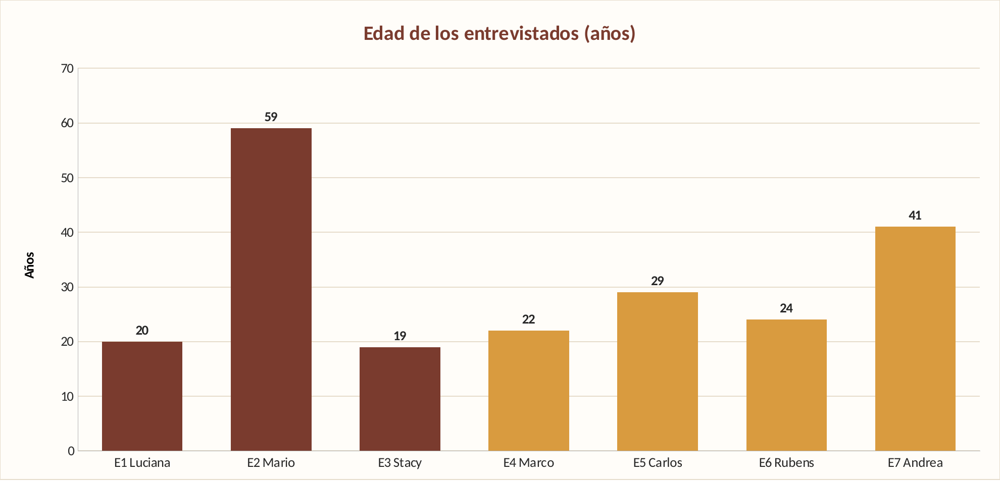

*Nota.* Elaboración propia a partir de los datos de las entrevistas (2026), en Microsoft Excel (hoja «Gráficos» del archivo `assets/analisis_entrevistas_destilatech.xlsx`).

*Descripción.* El gráfico de barras muestra la edad de cada entrevistado (E1 a E7), con color marrón para productores (E1 a E3) y dorado para comercializadores (E4 a E7). Los productores incluyen a los entrevistados más joven (19 años) y de mayor edad (59 años), por lo que su promedio (32,7 años) esconde una dispersión alta, mientras que los comercializadores se concentran entre 22 y 41 años, con promedio de 29 años.

##### Segmento 1: Productor de pisco

**Características objetivas.** Los tres productores trabajan en negocios familiares de pisco: dos de ellos en funciones administrativas (Luciana y Stacy, de 20 y 19 años) y uno como propietario y productor (Mario, de 59 años). La producción anual declarada va de aproximadamente 6,000 a 22,000 litros en dos casos (Stacy y Mario) y de 8,000 a 100,000 litros en el tercero (Luciana). Las bodegas de producción de Mario y Stacy se encuentran fuera de Lima (Mala, en Cañete, e Ica, respectivamente), mientras que su residencia o sede comercial está en Lima.

**Características subjetivas** (herramientas, canales y actitud hacia la tecnología):

| Aspecto analizado | Sí | No | No registrado | % de menciones (sobre n = 3) |
| :----------- | :----------: | :----------: | :----------: | :----------: |
| Usa cuaderno/papel | 2 | 0 | 1 | 67% |
| Usa Excel/hoja de cálculo | 3 | 0 | 0 | 100% |
| Usa WhatsApp para pedidos/proveedores | 2 | 0 | 1 | 67% |
| Usa smartphone como dispositivo principal | 3 | 0 | 0 | 100% |
| Usa laptop/PC | 1 | 2 | 0 | 33% |
| Usa redes sociales (Instagram/Facebook) | 3 | 0 | 0 | 100% |
| Usa sensores/IoT | 0 | 3 | 0 | 0% |
| Dificultad en monitoreo de variables del proceso | 3 | 0 | 0 | 100% |
| Errores/desfases en registros de stock o lotes | 2 | 0 | 1 | 67% |
| Supervisión presencial frecuente en bodega | 2 | 0 | 1 | 67% |
| Desea alertas automáticas en el celular | 2 | 0 | 1 | 67% |
| Dispuesto a pagar suscripción | 3 | 0 | 0 | 100% |

**Interpretación.** Los tres productores usan Excel y redes sociales, y los tres tienen el celular como dispositivo principal; solo uno (33 %) menciona la laptop. Ninguno usa sensores ni IoT (3 de 3) y los tres describen dificultad para monitorear variables del proceso (temperatura, grado de azúcar, grado alcohólico), un problema que dos de ellos (67 %) resuelven con supervisión presencial frecuente y que, según dos entrevistados, produce errores o desfases en los registros. Los tres estarían dispuestos a pagar una suscripción: el pago mínimo propuesto promedia S/ 63.3, el máximo S/ 93.3 y el punto medio del rango S/ 78.3 al mes.

**Figura 27**

*Hallazgos del segmento Productor (porcentaje sobre n = 3)*

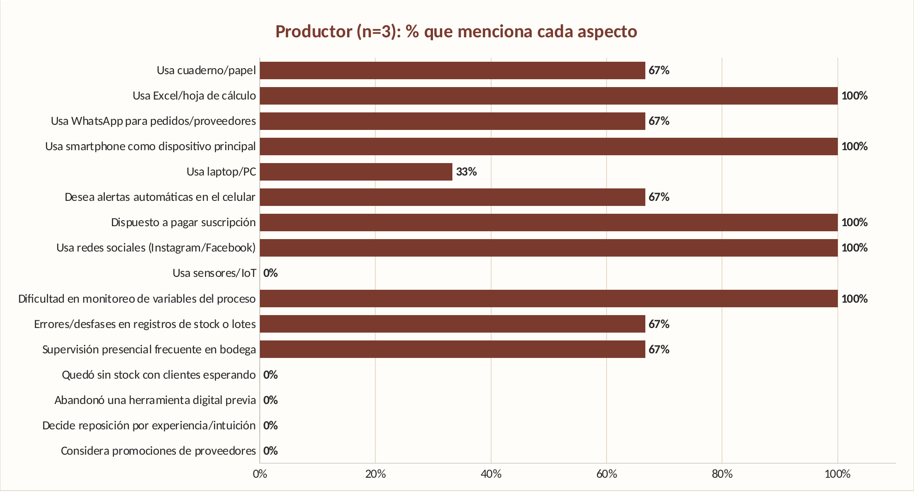

*Nota.* Elaboración propia a partir de los datos de las entrevistas (2026), en Microsoft Excel (hoja «Gráficos» del archivo `assets/analisis_entrevistas_destilatech.xlsx`).

*Descripción.* Las barras horizontales indican qué porcentaje de los tres productores mencionó cada aspecto. El uso de Excel, el uso del smartphone, la disposición a pagar una suscripción, el uso de redes sociales y la dificultad para monitorear las variables del proceso alcanzan el 100 % (3 de 3); el uso de cuaderno, WhatsApp, el deseo de alertas en el celular, los errores en los registros y la supervisión presencial frecuente llegan al 67 % (2 de 3), y el uso de laptop al 33 %. Ningún productor usa sensores o IoT (0 %).

##### Segmento 2: Comercializador

**Características objetivas.** Los cuatro comercializadores administran licorerías o bodegas en distritos de Lima (San Miguel, Magdalena, Comas y Surquillo). Tres son propietarios o administradores de 22 a 29 años y una es administradora de 41 años. Tres de ellos precisaron el tamaño de su oferta: entre 80 y 150 productos aproximadamente y entre 8 y 15 marcas de pisco (Carlos, Rubens y Andrea).

**Características subjetivas** (herramientas, canales y actitud hacia la tecnología):

| Aspecto analizado | Sí | No | No registrado | % de menciones (sobre n = 4) |
| :---------- | :----------: | :----------: | :----------: | :----------: |
| Usa cuaderno/papel | 4 | 0 | 0 | 100% |
| Usa Excel/hoja de cálculo | 3 | 1 | 0 | 75% |
| Usa WhatsApp para pedidos/proveedores | 4 | 0 | 0 | 100% |
| Usa smartphone como dispositivo principal | 4 | 0 | 0 | 100% |
| Usa laptop/PC | 1 | 3 | 0 | 25% |
| Quedó sin stock con clientes esperando | 4 | 0 | 0 | 100% |
| Decide reposición por experiencia/intuición | 4 | 0 | 0 | 100% |
| Considera promociones de proveedores | 2 | 1 | 1 | 50% |
| Abandonó una herramienta digital previa | 3 | 0 | 1 | 75% |
| Desea alertas automáticas en el celular | 4 | 0 | 0 | 100% |
| Dispuesto a pagar suscripción | 4 | 0 | 0 | 100% |

**Interpretación.** Los cuatro comercializadores usan cuaderno, WhatsApp y celular, se han quedado sin stock con clientes esperando y deciden la reposición según su experiencia o intuición; los cuatro desean alertas de stock en el celular y estarían dispuestos a pagar. Tres de cuatro (75 %) abandonaron una herramienta digital previa (un sistema de inventario en dos casos y una hoja de cálculo en el tercero) por considerarla complicada o poco ágil, lo que indica que la facilidad de uso es un requisito crítico. El quiebre de stock se da, en promedio, 1.83 veces al mes entre los tres entrevistados que dieron una frecuencia. El pago mínimo propuesto promedia S/ 40.0, el máximo S/ 72.5 y el punto medio del rango S/ 56.2 al mes.

**Figura 28**

*Hallazgos del segmento Comercializador (porcentaje sobre n = 4)*

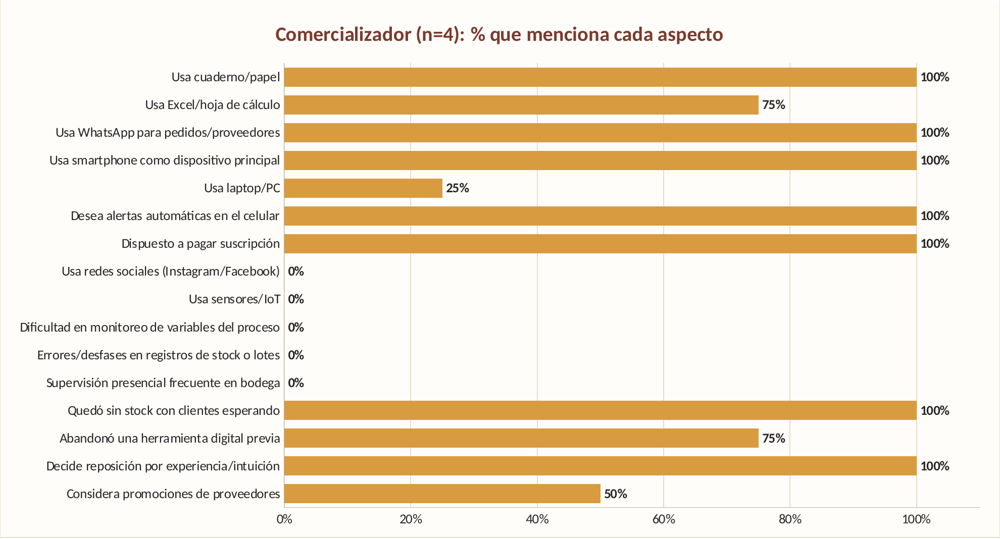

*Nota.* Elaboración propia a partir de los datos de las entrevistas (2026), en Microsoft Excel (hoja «Gráficos» del archivo `assets/analisis_entrevistas_destilatech.xlsx`).

*Descripción.* Las barras horizontales muestran el porcentaje de los cuatro comercializadores que mencionó cada aspecto. El uso de cuaderno, WhatsApp y smartphone, el deseo de alertas en el celular, la disposición a pagar, haberse quedado sin stock con clientes esperando y decidir la reposición por experiencia alcanzan el 100 %; usar Excel y haber abandonado una herramienta digital previa llegan al 75 %, considerar las promociones de proveedores al 50 % y usar laptop al 25 %.

##### Comparativa entre segmentos

La siguiente tabla compara los aspectos que se indagaron en ambos segmentos. Los aspectos que solo se preguntaron a un segmento se muestran como «s/d» (sin dato) y no se comparan.

| Aspecto | Productor (n = 3) | Comercializador (n = 4) | Diferencia (puntos porcentuales) |
| :----------- | :----------: | :----------: | :----------: |
| Usa cuaderno/papel | 67% | 100% | -33 |
| Usa Excel/hoja de cálculo | 100% | 75% | +25 |
| Usa WhatsApp para pedidos/proveedores | 67% | 100% | -33 |
| Usa smartphone como dispositivo principal | 100% | 100% | +0 |
| Usa laptop/PC | 33% | 25% | +8 |
| Desea alertas automáticas en el celular | 67% | 100% | -33 |
| Dispuesto a pagar suscripción | 100% | 100% | +0 |
| Usa redes sociales (Instagram/Facebook) | 100% | s/d | s/d |
| Usa sensores/IoT | 0% | s/d | s/d |
| Dificultad en monitoreo de variables del proceso | 100% | s/d | s/d |
| Errores/desfases en registros de stock o lotes | 67% | s/d | s/d |
| Supervisión presencial frecuente en bodega | 67% | s/d | s/d |
| Quedó sin stock con clientes esperando | s/d | 100% | s/d |
| Decide reposición por experiencia/intuición | s/d | 100% | s/d |
| Considera promociones de proveedores | s/d | 50% | s/d |
| Abandonó una herramienta digital previa | s/d | 75% | s/d |

**Figura 29**

*Herramientas y dispositivos usados por segmento*

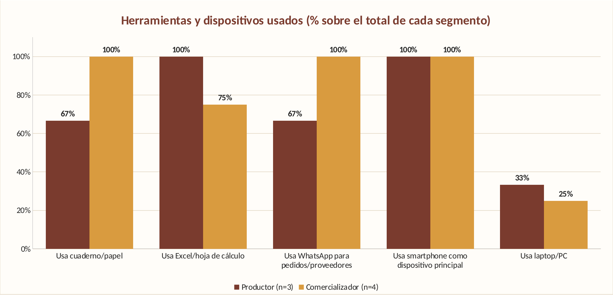

*Nota.* Elaboración propia a partir de los datos de las entrevistas (2026), en Microsoft Excel (hoja «Gráficos» del archivo `assets/analisis_entrevistas_destilatech.xlsx`).

*Descripción.* Barras agrupadas que comparan, para productores (marrón) y comercializadores (dorado), el porcentaje que usa cuaderno, Excel, WhatsApp, smartphone y laptop. El smartphone es el dispositivo principal del 100 % de ambos segmentos; el cuaderno y WhatsApp son más frecuentes entre comercializadores (100 %) que entre productores (67 %), y la laptop es minoritaria en los dos (33 % y 25 %).

**Figura 30**

*Rango de pago mensual propuesto por entrevistado*

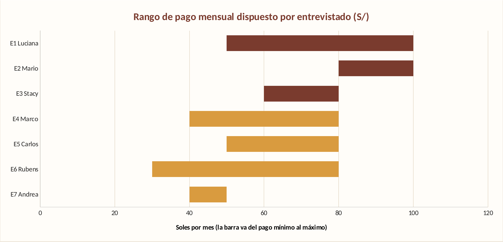

*Nota.* Elaboración propia a partir de los datos de las entrevistas (2026), en Microsoft Excel (hoja «Gráficos» del archivo `assets/analisis_entrevistas_destilatech.xlsx`).

*Descripción.* Cada barra va del pago mínimo al pago máximo mensual, en soles, que cada entrevistado estaría dispuesto a pagar (marrón: productores; dorado: comercializadores). Los productores proponen rangos más altos (entre S/ 50 y S/ 100) que los comercializadores (entre S/ 30 y S/ 80).

**Disposición de pago.** El punto medio promedio de los rangos propuestos es S/ 78.3 mensuales en productores y S/ 56.2 en comercializadores; considerando los siete entrevistados, el promedio es S/ 65.7 y la mediana S/ 65.0. Los siete expresaron disposición a pagar, siempre que la herramienta sea sencilla, ahorre tiempo y evite pérdidas.

##### Conclusiones del análisis

- **Dolor principal por segmento.** En productores, la dificultad de monitorear variables del proceso sin sensores (100 %) y la necesidad de supervisión presencial; en comercializadores, los quiebres de stock (100 %) por no saber cuánto inventario hay en tiempo real.
- **Dispositivo y canal.** El celular es el dispositivo principal en ambos segmentos (100 %) y WhatsApp es el canal habitual de pedidos, por lo que la solución debe funcionar bien en pantallas móviles y complementar, no reemplazar, a WhatsApp.
- **Barrera de adopción.** El 75 % de los comercializadores abandonó una herramienta previa por complejidad, de modo que el registro de movimientos debe requerir pocos pasos.
- **Modelo de suscripción.** Los rangos propuestos (S/ 30 a S/ 100 mensuales) sirven de referencia inicial para definir planes por segmento; el segmento Productor muestra mayor disposición de pago que el Comercializador.
- **Alertas.** Todos los comercializadores y dos de los tres productores (que respondieron sobre el tema) desean alertas automáticas en el celular.

Estos hallazgos sustentan la construcción de los User Personas de la sección 2.3.1.

### 2.3. Needfinding

El proceso de Needfinding transformó los hallazgos de las entrevistas en herramientas de diseño centradas en el usuario. A partir del análisis de las características demográficas, comportamentales y subjetivas de cada segmento (sección 2.2.3), se construyeron los siguientes artefactos sobre Destilatech.

#### 2.3.1. User Personas

Las fichas de User Persona se elaboraron en UXPressia, una para cada segmento objetivo. Cada ficha integra los hallazgos de las entrevistas: datos demográficos, objetivos, motivaciones, frustraciones, habilidades, dispositivos, navegadores, canales y marcas o influencias.

**Segmento 1: Productor de pisco**

**Figura 31**

*User Persona del segmento Productor: Ricardo Donayre*

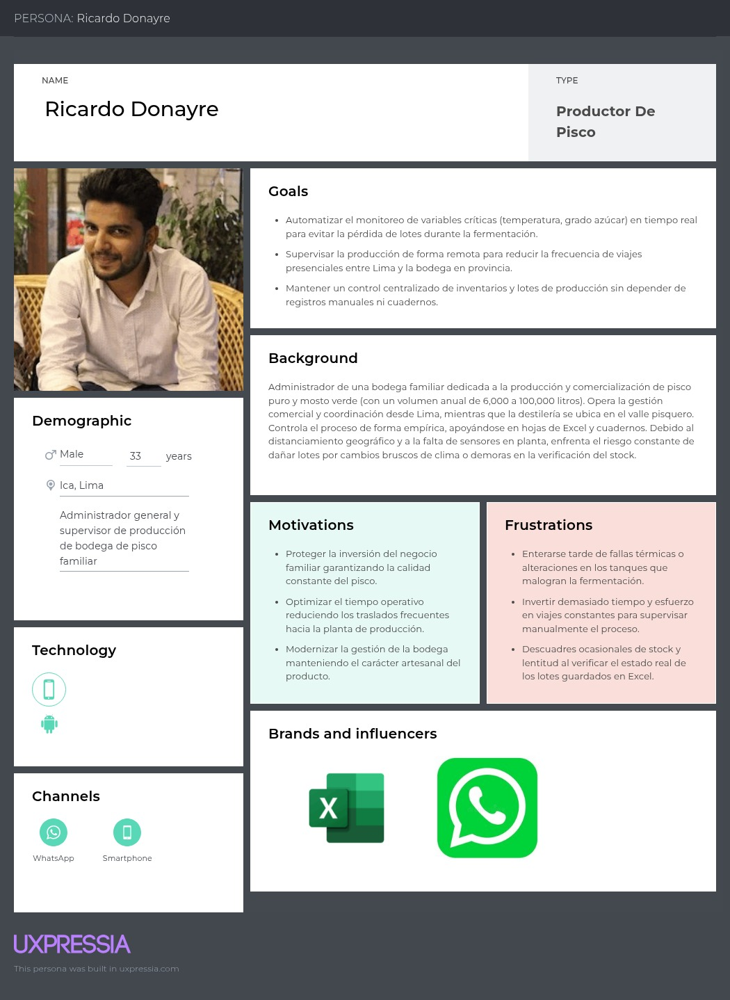

*Nota.* Elaboración propia en UXPressia (2026).

*Descripción.* La ficha presenta a Ricardo Donayre como arquetipo del segmento Productor: administrador de una bodega familiar de pisco, de 33 años (promedio de edad de los tres productores entrevistados), que gestiona el negocio desde su sede comercial en Lima mientras la producción se realiza en un valle pisquero. Sus objetivos son monitorear a distancia las variables críticas del proceso y centralizar el control de lotes e inventario; sus frustraciones son enterarse tarde de una temperatura anómala, los viajes a la bodega y los descuadres entre el stock real y Excel. Usa el smartphone como dispositivo principal, Excel, WhatsApp, Instagram y Facebook. Cada atributo se respalda en las entrevistas según la tabla de trazabilidad siguiente.

**Segmento 2: Comercializador**

**Figura 32**

*User Persona del segmento Comercializador: Carlos Mendoza*

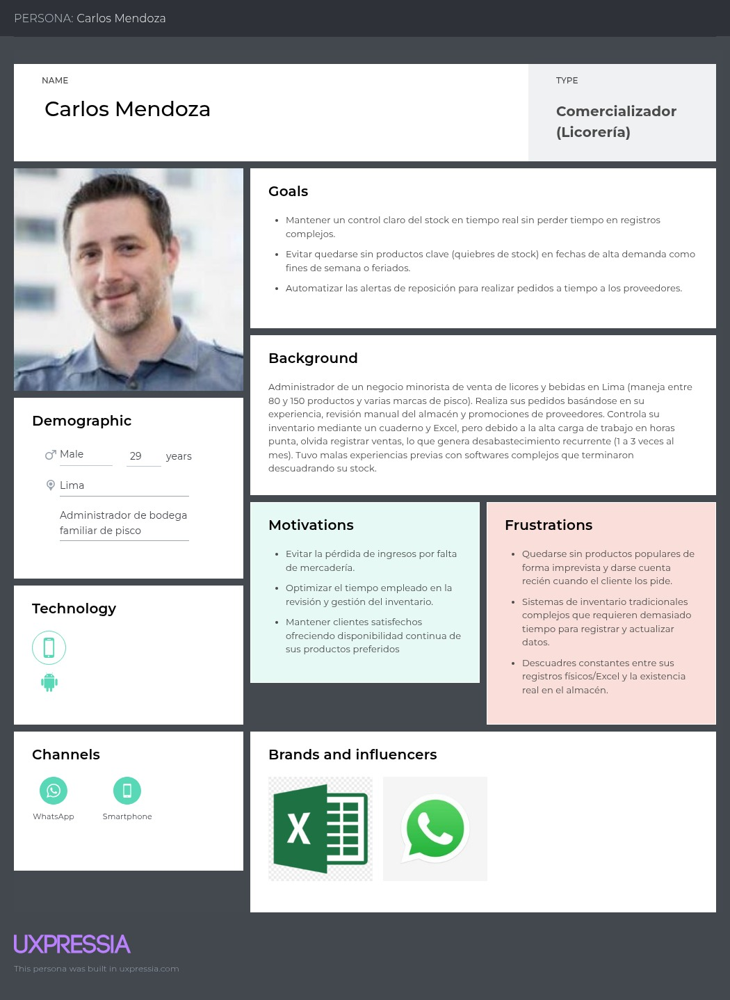

*Nota.* Elaboración propia en UXPressia (2026).

*Descripción.* La ficha presenta a Carlos Mendoza como arquetipo del segmento Comercializador: administrador de una licorería o bodega de Lima, de 29 años (promedio de edad de los cuatro comercializadores entrevistados), que maneja entre 80 y 150 productos y controla su inventario con cuaderno y Excel. Sus objetivos son saber cuánto stock tiene sin revisar el almacén, evitar quiebres de stock y recibir una alerta para reponer a tiempo; sus frustraciones son quedarse sin productos cuando el cliente los pide, los sistemas complejos que abandonó y la reposición decidida por intuición. Usa el smartphone como dispositivo principal, WhatsApp y Excel. Cada atributo se respalda en las entrevistas según la tabla de trazabilidad siguiente.

**Trazabilidad de las User Personas con las entrevistas.** La User Persona es un arquetipo: solo incluye los atributos que comparte la mayoría de los entrevistados de su segmento, tal como se registró en la sección 2.2.2 y se cuantificó en la sección 2.2.3. Los atributos que solo mencionó una persona, o que no se preguntaron, no se incluyen en la ficha; en particular, no se asignan estado civil, marca de dispositivo, sistema operativo, navegador ni tamaño de mercado, porque las entrevistas no los registran para la mayoría de los entrevistados.

| Atributo de la ficha de Ricardo Donayre (Productor) | Respaldo en las entrevistas (n = 3) | Fuente |
| :------------- | :-------------- | :---------- |
| Edad de 33 años | Promedio de 32.7 años (edades 19, 20 y 59) | E1, E2, E3 |
| Administrador de una bodega familiar | 2 de 3 son administradoras de negocio familiar; 1 es propietario y productor | E1, E3 (E2) |
| Sede comercial en Lima y producción en un valle pisquero | 2 de 3 tienen la bodega fuera de Lima (Mala e Ica) y la sede en Lima | E2, E3 |
| Smartphone como dispositivo principal | 3 de 3 | E1, E2, E3 |
| Usa Excel | 3 de 3 | E1, E2, E3 |
| Usa Instagram y Facebook | 3 de 3 | E1, E2, E3 |
| Usa WhatsApp para pedidos y clientes | 2 de 3 (1 no registrado) | E1, E3 |
| Objetivo: monitorear a distancia las variables críticas | 3 de 3 reportan dificultad para monitorear variables; 2 de 3 piden alertas en el celular o monitoreo remoto | E1, E2, E3 |
| Objetivo: centralizar lotes e inventario | 2 de 3 reportan errores o desfases en registros de lotes o stock | E1, E3 |
| Frustración: enterarse tarde de una temperatura anómala | 3 de 3 monitorean de forma manual; 1 perdió un lote | E1, E2, E3 |
| Frustración: viajes y visitas a la bodega | 2 de 3 supervisan de forma presencial con frecuencia | E2, E3 |
| Frustración: descuadres entre el stock real y Excel | 2 de 3 | E1, E3 |
| Disposición de pago: S/ 50 a S/ 100 mensuales | 3 de 3; punto medio promedio S/ 78.3 | E1, E2, E3 |

| Atributo de la ficha de Carlos Mendoza (Comercializador) | Respaldo en las entrevistas (n = 4) | Fuente |
| :------------- | :---------- | :---------- |
| Edad de 29 años | Promedio de 29.0 años (edades 22, 24, 29 y 41) | E4, E5, E6, E7 |
| Administrador de una licorería o bodega en Lima | 3 de 4 son administradores; 1 es propietario | E5, E6, E7 (E4) |
| Maneja entre 80 y 150 productos | 3 de 4 precisaron su oferta: entre 80 y 150 productos | E5, E6, E7 |
| Smartphone como dispositivo principal | 4 de 4 | E4, E5, E6, E7 |
| Usa cuaderno para el inventario | 4 de 4 | E4, E5, E6, E7 |
| Usa Excel | 3 de 4 | E4, E5, E6 |
| Usa WhatsApp con proveedores | 4 de 4 | E4, E5, E6, E7 |
| Objetivo: saber cuánto stock tiene sin revisar el almacén | 4 de 4 | E4, E5, E6, E7 |
| Objetivo: recibir una alerta para reponer a tiempo | 4 de 4 desean alertas automáticas en el celular | E4, E5, E6, E7 |
| Frustración: quedarse sin stock con clientes esperando | 4 de 4; promedio de 1.83 veces al mes (3 con dato) | E4, E5, E6, E7 |
| Frustración: sistemas complejos que abandonó | 3 de 4 abandonaron una herramienta previa | E5, E6, E7 |
| Frustración: reposición decidida por intuición | 4 de 4 | E4, E5, E6, E7 |
| Disposición de pago: S/ 30 a S/ 80 mensuales | 4 de 4; punto medio promedio S/ 56.2 | E4, E5, E6, E7 |

La laptop (1 de 3 productores y 1 de 4 comercializadores) no alcanza mayoría y por eso no figura como dispositivo del arquetipo. Tampoco hay un navegador mayoritario: solo un productor (E2) mencionó Google Chrome.

#### 2.3.2. User Task Matrix

La User Task Matrix compara las tareas que cada segmento realiza para cumplir sus objetivos, junto con su frecuencia e importancia. Las tareas se identificaron a partir de las entrevistas de la sección 2.2.2.

| Tarea | **Productor de pisco** (Frecuencia / Importancia) | **Comercializador** (Frecuencia / Importancia) |
| :---------------- | :----------: | :----------: |
| **Monitorear variables IoT (temperatura, pH, nivel)** | Horaria / Alta | N/A / N/A |
| **Atender alertas críticas de producción / stock** | Horaria / Alta | Diaria / Alta |
| **Consultar dashboard general del estado del negocio** | Diaria / Alta | Diaria / Alta |
| **Registrar y actualizar lotes de producción** | Mensual / Alta | N/A / N/A |
| **Consultar stock disponible en almacén/tienda** | Diaria / Alta | Diaria / Alta |
| **Registrar entradas y salidas de inventario (kardex)** | Diaria / Alta | Diaria / Alta |
| **Registrar clientes y pedidos de venta** | Diaria / Media | N/A / N/A |
| **Generar y emitir pedidos de reposición de stock** | N/A / N/A | Semanal / Alta |
| **Revisar estimaciones de agotamiento de stock** | Semanal / Media | Semanal / Media |
| **Analizar indicadores históricos de producción y venta** | Mensual / Media | Mensual / Media |
| **Configurar parámetros de alertas y umbrales IoT** | Ocasional / Media | N/A / N/A |
| **Gestionar suscripción y usuarios del sistema** | Ocasional / Baja | Ocasional / Baja |

**Tareas de alta frecuencia y alta importancia.**

- Para el productor, el monitoreo de las variables de fermentación y destilación (con datos IoT) y el control de inventario y lotes son operaciones críticas y frecuentes. La plataforma debe permitir llegar a estos módulos de forma inmediata desde el dashboard principal.
- Para el comercializador, la consulta diaria de existencias, el registro de movimientos y la recepción de alertas de bajo stock constituyen el núcleo de su interacción diaria.

**Diferenciación de la experiencia por rol.**

- Las tareas de seguimiento de variables físicas de producción y de gestión por lotes son exclusivas del productor, lo que justifica vistas y paneles de navegación segmentados.
- El comercializador centra su interacción en el flujo de reabastecimiento (pedidos de reposición y control rápido de stock), que demanda un flujo con pocos pasos para operaciones frecuentes.

#### 2.3.3. User Journey Mapping

Los User Journey Maps representan el recorrido de cada User Persona en su situación actual (*as-is*), sin la plataforma Destilatech. Permiten identificar los puntos de dolor y las oportunidades que la solución debe abordar. Ambos mapas se organizan en cinco etapas (Aware, Use, Join, Develop y Leave) e incluyen objetivos, canales, proceso, problemas, experiencia emocional e ideas u oportunidades.

**Segmento 1: Productor de pisco**

**Figura 33**

*User Journey Map del segmento Productor: Ricardo Donayre*

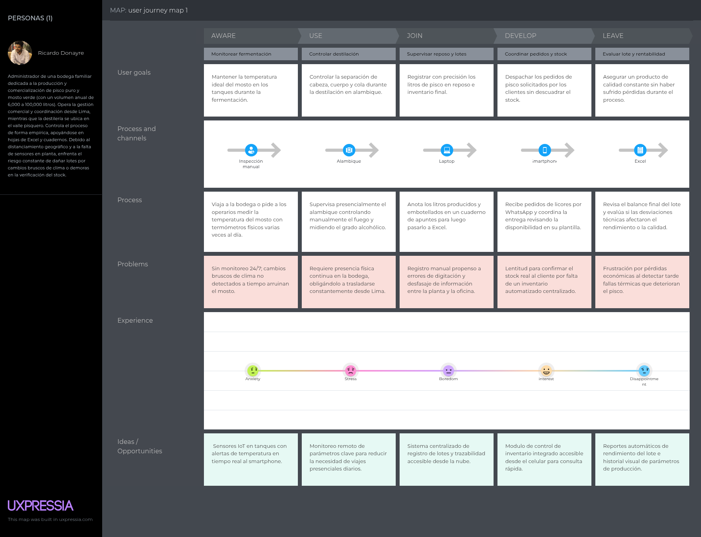

*Nota.* Elaboración propia en UXPressia (2026).

*Descripción.* El mapa recorre cinco etapas del productor: monitorear fermentación, controlar destilación, supervisar reposo y lotes, coordinar pedidos y stock, y evaluar lote y rentabilidad. En cada etapa Ricardo usa canales como inspección manual, alambique, laptop, smartphone y Excel, y enfrenta problemas como la falta de monitoreo 24/7, la necesidad de presencia física continua, el registro manual propenso a errores y la lentitud para confirmar el stock real. Su experiencia pasa de ansiedad y estrés a aburrimiento, interés y decepción. Las oportunidades incluyen sensores IoT con alertas de temperatura, monitoreo remoto, un sistema centralizado de lotes, un módulo de inventario accesible desde el celular y reportes automáticos de rendimiento.

**Segmento 2: Comercializador**

**Figura 34**

*User Journey Map del segmento Comercializador: Carlos Mendoza*

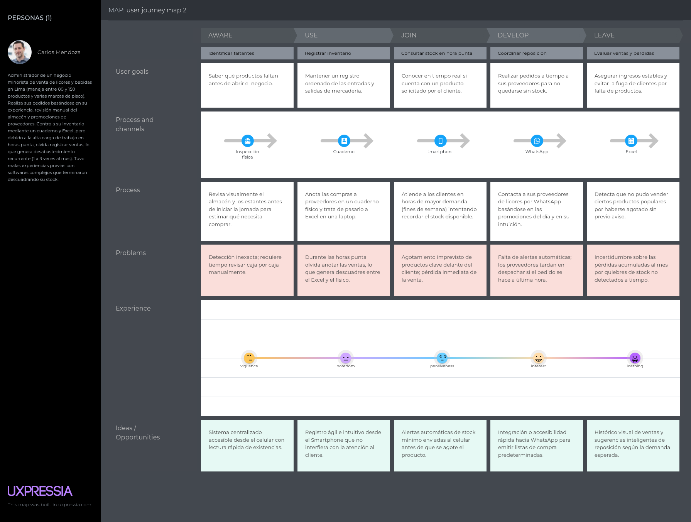

*Nota.* Elaboración propia en UXPressia (2026).

*Descripción.* El mapa recorre cinco etapas del comercializador: identificar faltantes, registrar inventario, consultar stock en hora punta, coordinar reposición y evaluar ventas y pérdidas. Carlos usa inspección física, cuaderno, tablet, WhatsApp y Excel, y enfrenta problemas como la detección inexacta de faltantes, los olvidos al anotar ventas en horas punta, el agotamiento imprevisto de productos y la falta de alertas automáticas. Su experiencia va de la vigilancia y el aburrimiento a la inquietud, el interés y el rechazo. Las oportunidades son un sistema centralizado accesible desde el celular, un registro ágil, alertas automáticas de stock mínimo, integración rápida con WhatsApp para listas de compra y un histórico de ventas con sugerencias de reposición.

#### 2.3.4. Empathy Mapping

Los Empathy Maps profundizan en lo que cada User Persona piensa, siente, ve, oye, dice y hace en su contexto diario, a partir de las observaciones de las entrevistas. Permiten identificar los *pains* y *gains* de cada segmento.

**Segmento 1: Productor de pisco**

**Figura 35**

*Empathy Map del segmento Productor: Ricardo Donayre*

*Nota.* Elaboración propia en UXPressia (2026).

*Descripción.* El mapa describe a Ricardo Donayre, administrador y productor que gestiona una bodega entre Lima (oficina comercial) y los valles de Ica y Cañete (planta). Necesita monitorear de forma continua temperatura, grados Brix y destilación; ve termómetros manuales, cuadernos y hojas de Excel desactualizadas; escucha relatos de lotes arruinados por temperatura; y siente ansiedad por no saber qué ocurre en la planta. Sus pains son el riesgo de perder lotes, el desgaste por viajes y los errores al pasar datos de cuadernos a Excel; sus gains son la tranquilidad de controlar la producción desde el smartphone, la reducción de costos de traslado, la garantía de calidad y una gestión de inventario rápida.

**Segmento 2: Comercializador**

**Figura 36**

*Empathy Map del segmento Comercializador: Carlos Mendoza*

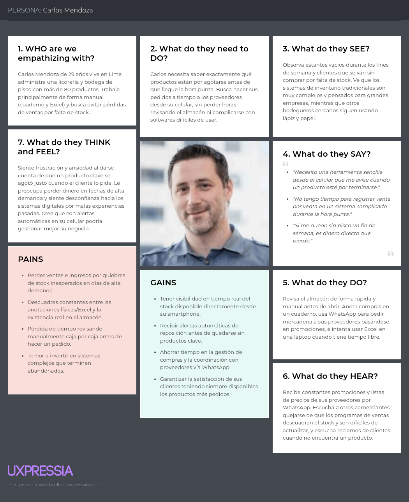

*Nota.* Elaboración propia en UXPressia (2026).

*Descripción.* El mapa describe a Carlos Mendoza, joven emprendedor que administra una licorería y bodega en Lima con más de 80 productos. Necesita saber qué productos están por agotarse antes de la hora punta; ve estantes vacíos y clientes que se van sin comprar; escucha promociones de proveedores por WhatsApp y quejas de otros comerciantes sobre programas de ventas difíciles de actualizar; y siente frustración y desconfianza hacia los sistemas digitales por malas experiencias pasadas. Sus pains son perder ventas por quiebres de stock, los descuadres entre anotaciones y existencias, y el temor a invertir en sistemas complejos; sus gains son tener visibilidad del stock en tiempo real, recibir alertas de reposición y ahorrar tiempo en compras.

### 2.4. Big Picture EventStorming

EventStorming es una técnica de modelado colaborativo creada por Alberto Brandolini en la que personas de negocio y de tecnología construyen, sobre una superficie compartida y con notas adhesivas, una línea de tiempo de los eventos relevantes de un dominio (Brandolini, 2021). Su variante *Big Picture* se utiliza al inicio de un proyecto para explorar toda la línea de negocio **tal como funciona hoy**, descubrir el vocabulario común y detectar los puntos de dolor antes de pensar en software.

Por esta razón, los tableros de Destilatech modelan el negocio **as-is**: los eventos corresponden a lo que los productores y comercializadores entrevistados hacen actualmente con su cuaderno, su hoja de Excel y WhatsApp. Los eventos que existirían solo gracias a la plataforma (por ejemplo, «usuario registrado», «alerta generada» o «suscripción contratada») no pertenecen al Big Picture; aparecen recién en el Design-Level EventStorming (sección 4.6.1), donde se analiza cómo la solución modifica este flujo. Cada evento de los tableros se sustenta en las entrevistas de la sección 2.2.2, identificadas como E1 a E7: E1 Luciana Cueva, E2 Mario Fernández y E3 Stacy Guerra (productores); E4 Marco Vargas, E5 Carlos Moreno, E6 Rubens Moreno y E7 Andrea Mendoza (comercializadores).

#### 2.4.1. Pasos del Big Picture EventStorming

El ejercicio sigue los pasos del Big Picture EventStorming descritos por Brandolini (2021) y por la guía de Baas-Schwegler y Richardson (s. f.). La siguiente tabla indica cada paso, el elemento que se produce y cómo se refleja en los tableros de Destilatech.

| Paso | Qué se hace | Resultado en los tableros de Destilatech |
| :----------: | :-------------------------- | :-------------------------------------- |
| 1. Definir el objetivo | Acordar el alcance del dominio que se va a explorar. | Alcance: cómo se producen, registran, venden y reponen hoy el pisco de los entrevistados, sin considerar la plataforma. Se modelan dos flujos: productor y comercializador. |
| 2. Exploración caótica | Escribir sin orden la mayor cantidad posible de eventos de dominio en notas naranjas, redactados en pasado. | Eventos extraídos de los resúmenes de las siete entrevistas (por ejemplo, «Mosto puesto a fermentar», «Venta perdida por producto agotado»). |
| 3. Línea de tiempo | Ordenar los eventos cronológicamente, eliminar duplicados y ajustar la redacción. | Línea de tiempo de izquierda a derecha: 16 eventos en el flujo del productor y 10 en el del comercializador. |
| 4. Eventos pivote | Reconocer los eventos que cierran una fase del proceso y abren otra. | Se identifican sobre las líneas de tiempo de cada flujo (sección 2.4.6). |
| 5. Actores y sistemas | Identificar quién actúa en cada evento y qué herramientas externas usa (notas rosa). | Cuaderno, Excel, WhatsApp, Yape/Plin, termómetros y redes sociales como herramientas actuales; notas amarillas con los objetos (Lote, Mosto, Existencias, Pedido, entre otros). |
| 6. Recorrido explícito | Leer la línea de tiempo en orden y verificar que cada evento tenga sentido y no falten pasos. | Cada flujo se recorre desde la recepción de la uva (productor) o de la mercadería (comercializador) hasta el punto donde el negocio vuelve a empezar su ciclo. |
| 7. Problemas y oportunidades | Marcar con notas rojas (hotspots) los problemas reales que describieron los entrevistados y reconocer oportunidades. | 5 hotspots en el flujo del productor y 5 en el del comercializador (secciones 2.4.3 y 2.4.4). |
| 8. Agrupación | Reunir los eventos y objetos relacionados para reconocer áreas candidatas del dominio. | Cuatro áreas candidatas del negocio actual (sección 2.4.5). |

**Leyenda de notas.** Se usó la convención de colores de EventStorming (Baas-Schwegler & Richardson, s. f.), adaptada al alcance del Big Picture:

| Nota | Elemento | Descripción | Ejemplo en Destilatech |
| :---------- | :---------- | :----------------- | :----------- |
| Naranja | Evento de dominio | Hecho relevante ocurrido hoy en el negocio, redactado en pasado. | «Mosto puesto a fermentar» |
| Amarillo pequeño | Actor | Persona o rol que provoca o recibe un evento. | Productor, Operario, Comercializador, Proveedor |
| Amarillo claro (grande) | Objeto del dominio | Concepto sobre el que ocurre el evento. | «Lote», «Existencias» |
| Rosa (ancha) | Sistema o herramienta externa | Herramienta ajena a Destilatech que se usa hoy en el proceso. | Cuaderno, Excel, WhatsApp |
| Rojo / rosa intenso | Hotspot | Problema, duda o riesgo que los entrevistados vivieron o describieron. | «Lote malogrado por temperatura detectada tarde» |
| Verde | Oportunidad | Mejora posible identificada a partir de un hotspot (no es un evento). | Conocer el stock sin revisar el almacén |

#### 2.4.2. Actores identificados

| Actor | Rol en el dominio actual | Eventos que provoca o recibe | Fuente |
| :---------- | :------------------------- | :------------------------- | :---------- |
| Productor de pisco (propietario o administrador) | Dirige la bodega, supervisa el proceso y administra lotes, inventario y pedidos. | Recibe la uva, supervisa la fermentación y la destilación, anota lotes y ventas, cuenta el producto terminado y atiende pedidos. | E1, E2, E3 |
| Operario de bodega | Ejecuta tareas de producción: pesaje, despalillado, prensado y manejo del alambique. | Participa en los eventos de preparación de la uva y de destilación. | E2 |
| Vendedor del productor | Visita periódicamente a los clientes para ofrecer degustaciones y recoger necesidades. | Provoca la recepción de pedidos de clientes. | E2 |
| Comercializador (propietario o administrador) | Administra una licorería o bodega: ventas, revisión de existencias, compras e inventario. | Registra (o no) las ventas, revisa el almacén, decide la reposición y pide mercadería. | E4, E5, E6, E7 |
| Cliente | Persona o negocio que compra pisco al productor o al comercializador. | Hace pedidos por WhatsApp o en mostrador; se va sin comprar si el producto está agotado. | E1 a E7 |
| Proveedor o distribuidor | Abastece de pisco y otras bebidas al comercializador (distribuidores y productores artesanales). | Recibe el pedido por WhatsApp, responde (a veces con demora) y entrega la mercadería. | E4 a E7 |

#### 2.4.3. Flujo del Productor

**Figura 37**

*Big Picture EventStorming: flujo del productor (as-is)*

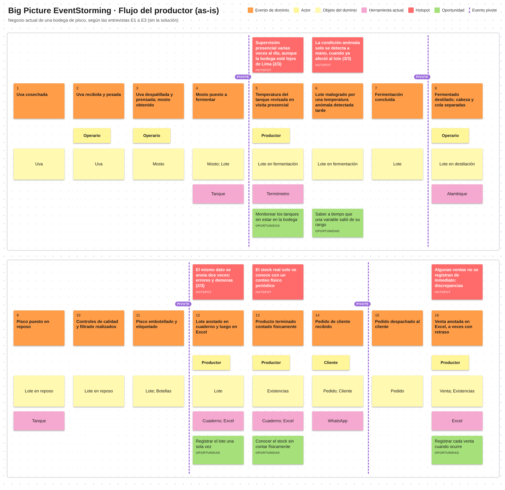

*Nota.* Elaboración propia en Miro (2026).

*Descripción.* El tablero muestra, de izquierda a derecha, dieciséis notas naranja con los eventos que hoy ocurren en una bodega de pisco, desde «Uva cosechada» hasta «Venta anotada en Excel». Debajo de los eventos aparecen los actores (notas amarillas pequeñas), los objetos del dominio (amarillo claro) y, en rosa, las herramientas que se usan hoy (termómetro, alambique, cuaderno, Excel y WhatsApp); debajo de cada hotspot hay una oportunidad en verde y los eventos pivote se marcan con una línea vertical morada. Encima de cinco eventos se ubican notas rojas con los problemas descritos por los entrevistados: la detección tardía de la temperatura anómala, la supervisión presencial en bodegas lejanas, el registro doble en cuaderno y Excel, el conteo físico periódico y las ventas anotadas con retraso.

| N.° | Evento de dominio (as-is) | Objetos del dominio | Herramienta o sistema actual | Fuente |
| :----------: | :----------- | :---------- | :---------- | :---------- |
| 1 | Uva cosechada | Uva | — | E2, E3 |
| 2 | Uva recibida y pesada | Uva | — | E1, E2, E3 |
| 3 | Uva despalillada y prensada; mosto obtenido | Mosto | — | E1, E2, E3 |
| 4 | Mosto puesto a fermentar | Mosto; Lote | Tanque | E1, E2, E3 |
| 5 | Temperatura del tanque revisada en visita presencial | Lote en fermentación | Termómetro | E2, E3 |
| 6 | Lote malogrado por una temperatura anómala detectada tarde | Lote en fermentación | — | E1 |
| 7 | Fermentación concluida | Lote | — | E1, E2, E3 |
| 8 | Fermentado destilado; cabeza y cola separadas | Lote en destilación | Alambique | E1, E2, E3 |
| 9 | Pisco puesto en reposo | Lote en reposo | Tanque | E1, E2, E3 |
| 10 | Controles de calidad y filtrado realizados | Lote en reposo | — | E1, E2 |
| 11 | Pisco embotellado y etiquetado | Lote; Botellas | — | E1, E2, E3 |
| 12 | Lote anotado en cuaderno y luego en Excel | Lote | Cuaderno; Excel | E1, E2, E3 |
| 13 | Producto terminado contado físicamente | Existencias | Cuaderno; Excel | E1, E3 |
| 14 | Pedido de cliente recibido | Pedido; Cliente | WhatsApp | E1, E3 |
| 15 | Pedido despachado al cliente | Pedido | — | E2 |
| 16 | Venta anotada en Excel, a veces con retraso | Venta; Existencias | Excel | E1, E3 |

**Hotspots del flujo del productor**

| Evento asociado | Hotspot (nota roja) | Evidencia en las entrevistas | Oportunidad identificada |
| :-------------- | :---------------------- | :------------------------------ | :---------------- |
| 5 y 6. Temperatura revisada en visita presencial; lote malogrado | La condición anómala solo se detecta de forma manual, cuando ya afectó al lote. | Los 3 productores (3/3) describen dificultad para monitorear variables; E1 perdió un lote por la temperatura de la fermentación. | Enterarse de que una variable salió de su rango mientras todavía se puede corregir. |
| 5. Temperatura del tanque revisada | La supervisión exige visitar la bodega varias veces al día, aunque la bodega esté lejos de la sede comercial. | E3 visita los tanques varias veces al día; las bodegas de E2 y E3 están en Mala (Cañete) e Ica, fuera de Lima (2/3). | Monitorear los tanques sin estar físicamente en la bodega. |
| 12. Lote anotado en cuaderno y luego en Excel | El mismo dato se anota dos veces, lo que genera errores y demoras. | E1 describe errores y demoras sobre todo cuando entran varios pedidos a la vez (2/3 reportan errores o desfases). | Registrar el lote una sola vez. |
| 13. Producto terminado contado físicamente | El stock real solo se conoce con un conteo físico periódico. | E1 lo hace cada semana; E3 revisa y actualiza el inventario de forma quincenal o mensual. | Conocer el stock sin contar físicamente. |
| 16. Venta anotada en Excel, a veces con retraso | Algunas ventas no se registran de inmediato y aparecen discrepancias. | E3 reconoce pequeñas discrepancias por ventas no registradas a tiempo. | Registrar cada venta al momento en que ocurre. |

#### 2.4.4. Flujo del Comercializador

**Figura 38**

*Big Picture EventStorming: flujo del comercializador (as-is)*

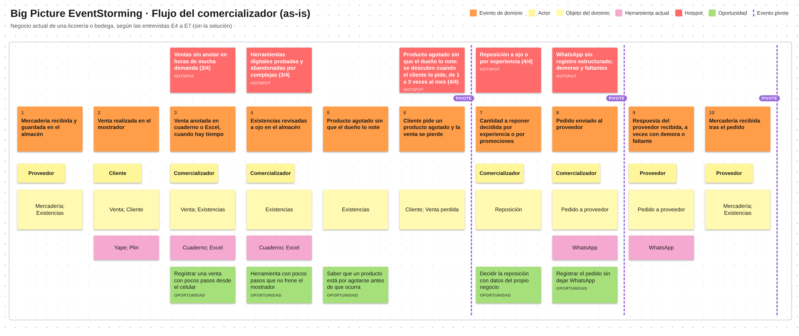

*Nota.* Elaboración propia en Miro (2026).

*Descripción.* El tablero presenta diez eventos naranja del flujo de una licorería o bodega, desde «Mercadería recibida y guardada» hasta «Mercadería recibida tras el pedido», con los actores y objetos de dominio en amarillo y las herramientas actuales (cuaderno, Excel, WhatsApp, Yape y Plin) en rosa. Cinco notas rojas señalan los problemas descritos por los cuatro comercializadores: las ventas sin registrar en horas de mucha demanda, el producto agotado que se descubre cuando el cliente lo pide, la reposición decidida por intuición, la coordinación por WhatsApp con demoras y las herramientas digitales abandonadas; cada hotspot tiene su oportunidad en verde.

| N.° | Evento de dominio (as-is) | Objetos del dominio | Herramienta o sistema actual | Fuente |
| :----------: | :-------------- | :---------- | :---------- | :---------- |
| 1 | Mercadería recibida y guardada en el almacén | Mercadería; Existencias | — | E7 (y reposición en E4 a E6) |
| 2 | Venta realizada en el mostrador | Venta; Cliente | Yape; Plin | E7 |
| 3 | Venta anotada en cuaderno o Excel, cuando hay tiempo | Venta; Existencias | Cuaderno; Excel | E4, E5, E7 |
| 4 | Existencias revisadas a ojo en el almacén | Existencias | Cuaderno; Excel | E4, E5, E6, E7 |
| 5 | Producto agotado sin que el dueño lo note | Existencias | — | E4, E5, E6, E7 |
| 6 | Cliente pide un producto agotado y la venta se pierde | Cliente; Venta perdida | — | E4, E5, E6, E7 |
| 7 | Cantidad a reponer decidida por experiencia o por promociones | Reposición | — | E4, E5, E6, E7 |
| 8 | Pedido enviado al proveedor | Pedido a proveedor | WhatsApp | E4, E5, E6, E7 |
| 9 | Respuesta del proveedor recibida, a veces con demora o faltante | Pedido a proveedor | WhatsApp | E7 |
| 10 | Mercadería recibida tras el pedido | Mercadería; Existencias | — | E7 (y reposición en E4 a E6) |

**Hotspots del flujo del comercializador**

| Evento asociado | Hotspot (nota roja) | Evidencia en las entrevistas | Oportunidad identificada |
| :------------ | :------------------------ | :-------------------------- | :------------------ |
| 3. Venta anotada en cuaderno o Excel | Las ventas no siempre se registran, sobre todo en horas de mayor demanda. | E4, E5 y E7 no registran todas las ventas por la carga de trabajo (3/4). | Registrar una venta con pocos pasos, desde el celular. |
| 5 y 6. Producto agotado; venta perdida | El producto se agota sin que el dueño lo note y se descubre cuando el cliente lo pide. | Los 4 comercializadores (4/4) se quedaron sin stock con clientes esperando, entre 1 y 3 veces al mes; se agrava en fechas de alta demanda. | Saber que un producto está por agotarse antes de que ocurra. |
| 7. Cantidad a reponer decidida por experiencia | La reposición se decide por experiencia, a ojo o según el espacio libre en los estantes. | 4/4 deciden por experiencia; E7 calcula a ojo según el espacio de los estantes. | Decidir la reposición con datos del propio negocio. |
| 8 y 9. Pedido enviado y respuesta del proveedor | La coordinación por WhatsApp no deja un registro estructurado y hay demoras o faltantes. | 4/4 usan WhatsApp con sus proveedores; E7 enfrenta demoras y faltantes imprevistos. | Llevar el registro del pedido sin dejar de usar WhatsApp. |
| General (herramientas actuales) | Las herramientas digitales probadas se abandonaron por complicadas o poco ágiles. | E5 y E6 dejaron un sistema de inventario y E7 una hoja de cálculo (3/4). | Una herramienta con pocos pasos que no frene la atención en el mostrador. |

#### 2.4.5. Áreas candidatas identificadas

Al agrupar los eventos y objetos de ambos tableros por afinidad, se reconocen cuatro áreas candidatas del negocio actual:

| Área candidata | Eventos y objetos que agrupa |
| :---------- | :------------------------------------------- |
| Producción del pisco | Productor, eventos 1 a 11: cosecha, recepción, prensado, fermentación, destilación, reposo, controles y embotellado; objetos Uva, Mosto, Lote, Botellas; herramientas termómetro y alambique. |
| Registro de lotes y existencias | Productor, eventos 12, 13 y 16; comercializador, eventos 1, 3, 4 y 5: anotación de lotes y ventas, conteo físico y revisión del almacén; objetos Lote, Existencias; cuaderno y Excel. |
| Ventas y atención al cliente | Productor, eventos 14 y 15; comercializador, eventos 2 y 6: pedidos de clientes, ventas en mostrador, venta perdida; objetos Pedido, Venta, Cliente; WhatsApp, Yape y Plin. |
| Reposición y abastecimiento | Comercializador, eventos 7 a 10: decisión de cuánto reponer, pedido al proveedor, respuesta y recepción de la mercadería; objetos Reposición, Pedido a proveedor, Mercadería; WhatsApp. |

Estas áreas describen cómo se organiza hoy el negocio, no cómo se organizará el software. La relación entre ellas y los *bounded contexts* de la solución se explica en la sección 4.6.1.

#### 2.4.6. Eventos pivote y lenguaje ubicuo descubierto

**Secuencia de los eventos.** En el flujo del productor los eventos siguen el orden del proceso productivo (de la uva al pisco embotellado) y luego el de la comercialización (del pedido a la venta anotada). En el flujo del comercializador el orden es el de un ciclo: se vende, se revisa lo que queda, se descubre lo que falta, se decide qué reponer, se pide, se recibe y se vuelve a vender. Los eventos pivote son los que cierran una fase de ese recorrido y abren otra; marcan dónde cambian el actor, el objeto del dominio o el significado de los términos y, por eso, son candidatos a frontera entre áreas.

| Flujo | Evento pivote | Fase que cierra → fase que abre | Áreas candidatas que separa |
| :---------- | :---------- | :------------- | :--------------- |
| Productor | 4. Mosto puesto a fermentar | Preparación de la uva → proceso en tanque | Producción del pisco (dos fases) |
| Productor | 7. Fermentación concluida | Fermentación → destilación | Producción del pisco (dos fases) |
| Productor | 11. Pisco embotellado y etiquetado | Producción → producto terminado en existencias | Producción del pisco / Registro de lotes y existencias |
| Productor | 14. Pedido de cliente recibido | Producto terminado disponible → venta | Registro de lotes y existencias / Ventas y atención al cliente |
| Comercializador | 6. Cliente pide un producto agotado | Venta y revisión del almacén → necesidad de reposición | Ventas y atención al cliente / Reposición y abastecimiento |
| Comercializador | 8. Pedido enviado al proveedor | Decisión de reposición → abastecimiento | Reposición y abastecimiento (dos fases) |
| Comercializador | 10. Mercadería recibida tras el pedido | Abastecimiento → existencias en el almacén | Reposición y abastecimiento / Registro de lotes y existencias |

Los pivotes más relevantes para el diseño son los cuatro que cruzan de un área a otra: «Pisco embotellado y etiquetado», «Pedido de cliente recibido», «Cliente pide un producto agotado» y «Mercadería recibida tras el pedido». Sirven de punto de partida para definir los *bounded contexts* en el Design-Level EventStorming (sección 4.6.1).

**Lenguaje ubicuo descubierto.** Los términos de la tabla son los que usan los entrevistados para nombrar su negocio; el equipo los recogió tal como los dicen. La tabla los relaciona con las entradas del glosario de la sección 2.5, donde se definen sin ambigüedad.

| Término usado por los entrevistados | Quién lo usa | Término del glosario (sección 2.5) |
| :---------- | :---------- | :---------- |
| Lote | E1, E2, E3 | Batch (Lote) |
| Mosto, mosto verde | E2 (productos), E3 | Must (Mosto) |
| Fermentación (tanques, temperatura) | E1, E2, E3 | Fermentation (Fermentación) |
| Destilación; separación de cabeza y cola | E1, E2, E3 | Distillation (Destilación) y Heads and Tails (Cabeza y cola) |
| Reposo | E1, E2, E3 | Resting Period (Reposo) |
| Embotellado, etiquetado | E1, E2, E3 | Bottling (Embotellado) |
| Existencias, stock | E1 a E7 | Inventory Item (Existencia) |
| Conteo físico, revisar el almacén | E1, E3, E4 a E7 | Physical Count (Conteo físico) |
| Quedarse sin stock, quiebre de stock | E4 a E7 | Stockout (Quiebre de stock) |
| Reposición, reponer | E4 a E7 | Replenishment (Reposición) |
| Pedido (de cliente o al proveedor) | E1 a E7 | Order (Pedido) |
| Proveedor, distribuidor | E4 a E7 | Supplier (Proveedor) |
| Cliente | E1 a E7 | Customer (Cliente) |
| Productor, comercializador | E1 a E7 | Producer (Productor) y Retailer (Comercializador) |

#### 2.4.7. Conclusiones del Big Picture

En el negocio actual los dos flujos están conectados por el producto: lo que el productor embotella y vende al cliente es lo que el comercializador pide a su proveedor. Los diez hotspots señalan los mismos tres problemas de fondo: el **monitoreo manual del proceso** (la temperatura solo se detecta tarde y obliga a visitar la bodega), el **registro manual y tardío** de lotes, ventas y existencias en cuaderno y Excel, y la **reposición decidida a ojo**, que termina en productos agotados y ventas perdidas. Las cuatro áreas candidatas muestran que el negocio actual puede separarse en producción, registro de lotes y existencias, ventas y reposición, con la información de las existencias como punto de contacto entre todas. Estos hallazgos coinciden con las necesidades de los User Personas (sección 2.3.1) y son el punto de partida del Design-Level EventStorming, donde se define qué cambia la solución en este flujo.

### 2.5. Ubiquitous Language

El siguiente glosario recoge los términos del dominio de negocio de Destilatech (producción, almacenamiento y comercialización de pisco).

| Term | Definición |
| :---------- | :------------------------------------- |
| **Batch** (Lote) | Cantidad específica de pisco producida en conjunto bajo condiciones uniformes, que se rastrea como una unidad trazable desde la recepción de la materia prima hasta el embotellado. |
| **Must** (Mosto) | Jugo de uva obtenido antes de la fermentación, materia prima base del proceso productivo. |
| **Fermentation** (Fermentación) | Proceso bioquímico mediante el cual el mosto se transforma en un líquido alcohólico base, previo a la destilación. |
| **Distillation** (Destilación) | Proceso de separación y concentración del alcohol a partir del fermentado, mediante el cual se obtiene el pisco. |
| **Resting Period** (Reposo) | Periodo posterior a la destilación durante el cual el pisco reposa en recipientes de material neutro antes de su envasado, según el Reglamento de la Denominación de Origen Pisco. |
| **Bottling** (Embotellado) | Proceso de envasado del pisco terminado en botellas listas para su comercialización. |
| **Denomination of Origin** (Denominación de Origen) | Designación oficial que restringe el uso del término "Pisco" al producto elaborado en las zonas peruanas autorizadas, bajo un reglamento específico. |
| **Producer** (Productor) | Segmento principal de usuario: pequeño o mediano negocio que elabora pisco, desde la recepción de uva hasta el embotellado. |
| **Retailer** (Comercializador) | Segmento complementario de usuario: negocio (licorería, bodega, minimarket, distribuidor) que compra pisco y otras bebidas para revenderlas al consumidor final. |
| **Inventory Item** (Ítem de inventario / Existencia) | Producto o presentación específica que se controla dentro del inventario de un productor o comercializador. |
| **Stock Movement** (Movimiento de inventario) | Registro de una entrada o salida de cantidad de un ítem de inventario. |
| **Stockout** (Quiebre de stock) | Situación en la que un producto se agota y no puede venderse cuando un cliente lo solicita. |
| **Physical Count** (Conteo físico) | Revisión directa de las existencias en el almacén para verificar la cantidad real de cada producto. |
| **Heads and Tails** (Cabeza y cola) | Fracciones inicial y final de la destilación que se separan del cuerpo del destilado que continúa hacia el reposo. |
| **Replenishment** (Reposición) | Acción de reabastecer un ítem de inventario cuando su cantidad disponible cae por debajo de lo necesario. |
| **Low-Stock Alert** (Alerta de stock bajo) | Notificación automática generada cuando el stock de un producto alcanza o cae por debajo del umbral configurado. |
| **Anomaly Alert** (Alerta de anomalía) | Notificación automática generada cuando una variable monitoreada del proceso productivo se sale del rango configurado como normal. |
| **Sensor Reading** (Lectura de sensor) | Valor capturado de una variable de proceso monitoreada, proveniente de un dispositivo IoT (simulado en el MVP). |
| **Trial Period** (Periodo de prueba) | Periodo gratuito de hasta 14 días durante el cual un nuevo cliente puede usar Destilatech antes de requerir una suscripción paga. |
| **Subscription** (Suscripción) | Plan de pago recurrente que un cliente debe contratar para continuar usando Destilatech al finalizar el periodo de prueba. |
| **Order** (Pedido) | Solicitud de productos realizada por un cliente a un productor o a un comercializador, que el negocio registra en Destilatech. |
| **Customer** (Cliente) | Parte que adquiere pisco u otro producto de un productor o comercializador. |
| **Supplier** (Proveedor) | Parte a la que un comercializador (o un productor, para insumos) solicita el abastecimiento de un producto. |
