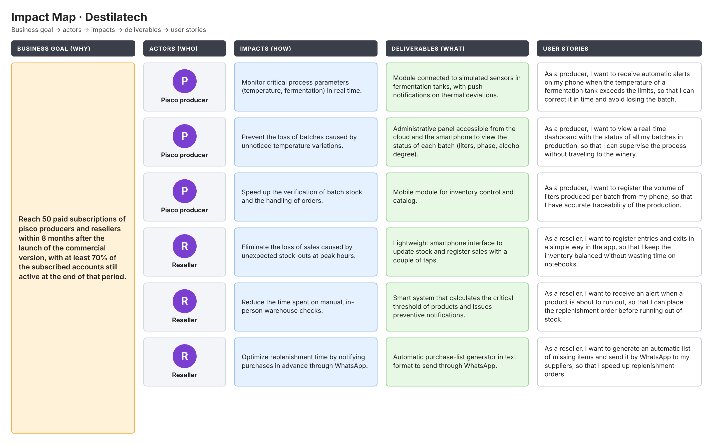
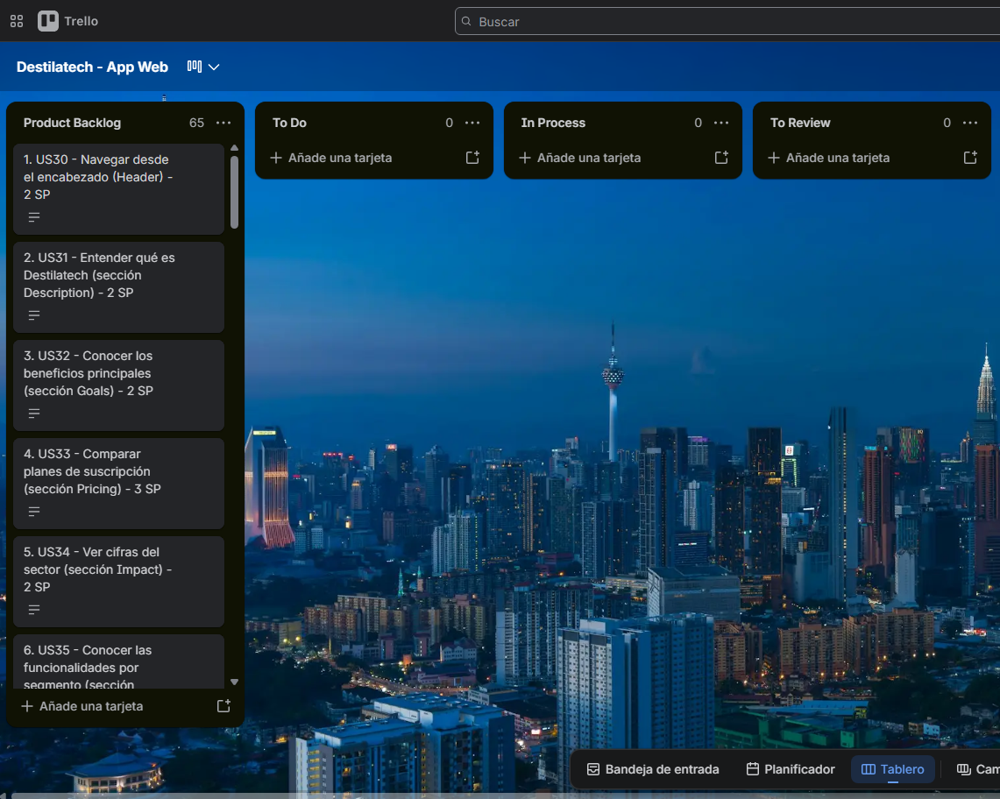

## Capítulo III: Requirements Specification

### 3.1. User Stories

Las historias de usuario describen una funcionalidad desde el punto de vista de quien la usa y del valor que obtiene; se redactan con la estructura «As a [role], I want [need], so that [benefit]» (Cohn, 2004). Sus historias y criterios de aceptación se redactan íntegramente en inglés, idioma predeterminado del producto, y los criterios usan lenguaje Gherkin: *Given* describe el contexto o estado previo, *When* la acción o el evento y *Then* el resultado observable, en tercera persona y en presente, con al menos tres escenarios por historia. Los escenarios no se limitan al éxito y al fallo: cubren el flujo principal, las validaciones y excepciones, y otras condiciones de aceptación como estados vacíos, permisos por tipo de usuario, persistencia de los datos o comportamiento en distintos dispositivos.

Las Épicas agrupan historias relacionadas. Además de las historias orientadas a visitantes, productores y comercializadores, se incluyen las **Technical Stories** (rol *Developer*), que especifican los endpoints del API REST necesarios para soportar las funcionalidades anteriores mediante solicitud y respuesta HTTP. Todas se presentan en una única tabla: 10 Épicas, 51 historias de usuario y 14 Technical Stories.

| Epic/Story ID | Title | Description | Acceptance Criteria | Related to (Epic ID) |
| :---------- | :----------- | :---------------------------------------- | :------------------------------------------- | :---------- |
| **EP01** | **Authentication and accounts** | Registration, sign-in, free trial and subscription. | **Scenario 1** Given a visitor completes the registration with valid data, When the visitor confirms the form, Then the system creates the account and starts the 14-day trial.  **Scenario 2** Given a user without an active session tries to access a restricted function, When the user performs the action, Then the system redirects the user to the sign-in screen. | — |
| US01 | Register as a producer or reseller | As a visitor, I want to register an account indicating my business type, so that I can start my free trial. | **Scenario 1: Successful registration** Given the visitor is not registered, When the visitor completes the form with valid data and selects a business type, Then the system creates the account and starts a 14-day trial.  **Scenario 2: Duplicate email** Given the entered email is already in use, When the visitor submits the form, Then the system shows an error and does not create a duplicate account.  **Scenario 3: Business type required** Given the visitor completes the form without choosing a business type, When the visitor tries to submit it, Then the system indicates that the business type is required and does not create the account. | EP01 |
| US02 | Sign in | As a registered user, I want to sign in, so that I can access the features of my user type. | **Scenario 1: Successful sign-in** Given the user has an active account, When the user enters correct credentials, Then the system redirects the user to the dashboard of the user type.  **Scenario 2: Incorrect password** Given the user enters an incorrect password, When the user tries to sign in, Then the system shows an error without revealing which data is incorrect.  **Scenario 3: Profile by user type** Given a producer and a reseller have an active account, When each one signs in, Then the system shows each one the menu and dashboard of their user type. | EP01 |
| US03 | Receive a trial-ending notice | As a user on trial, I want to receive a notice before my free period ends, so that I can decide whether to subscribe. | **Scenario 1: Early notice** Given the trial of the user ends in 3 days, When the user signs in, Then the system shows a notice with the remaining days and the option to subscribe.  **Scenario 2: Expired trial** Given the trial ended without a subscription, When the user tries to access a restricted function, Then the system redirects the user to the subscription plans.  **Scenario 3: No notice during a valid trial** Given the trial of the user has more than 3 days left, When the user signs in, Then the system does not show the trial-ending notice. | EP01 |
| US38 | Sign out | As an authenticated user, I want to sign out, so that I protect the information of my business on shared devices. | **Scenario 1: Successful sign-out** Given the user has an active session, When the user selects the sign-out option, Then the system invalidates the session and shows the sign-in screen.  **Scenario 2: Later access blocked** Given the user signed out, When the user tries to return to an internal page with the back button, Then the system redirects the user to the sign-in screen.  **Scenario 3: Session closed in every view** Given the user signed out, When the user tries to open an internal URL directly, Then the system redirects the user to the sign-in screen. | EP01 |
| US39 | Recover password | As a registered user, I want to reset my password through my email, so that I can recover access to my account if I forget it. | **Scenario 1: Reset request** Given the registered user provides an email, When the user requests a password reset, Then the system sends a reset link with limited validity.  **Scenario 2: Unregistered email** Given the entered email does not belong to any account, When the user requests the reset, Then the system shows a neutral message that does not reveal whether the account exists.  **Scenario 3: Expired link** Given the reset link has expired, When the user opens it, Then the system indicates that it expired and offers to request a new one. | EP01 |
| US40 | Subscribe to a plan | As a user on trial or with an expired trial, I want to subscribe to a plan, so that I can keep using Destilatech after the trial ends. | **Scenario 1: Successful subscription** Given the user selects a plan and completes the payment, When the payment gateway confirms the transaction, Then the system activates the subscription and enables all the features of the plan.  **Scenario 2: Rejected payment** Given the payment gateway rejects the transaction, When the user tries to subscribe to the plan, Then the system shows the reason for the rejection and keeps the previous state of the account.  **Scenario 3: Active plan reflected** Given the user subscribed to a plan, When the user returns to the subscription section, Then the system shows the active plan, the renewal date and the payment in the history.  **Scenario 4: Cancelled payment** Given the user cancels the payment in the gateway, When the user returns to Destilatech, Then the system shows a cancellation message and takes the user back to the plans. | EP01 |
| US41 | Update my business data | As a producer or reseller, I want to update the name, location and type of my business, so that the information of my account stays correct. | **Scenario 1: Valid update** Given the authenticated user edits the business data with valid values, When the user saves the changes, Then the system updates the data and shows a confirmation.  **Scenario 2: Empty required field** Given the user leaves the business name empty, When the user tries to save, Then the system shows an error and does not modify the data.  **Scenario 3: Business type change** Given the user changes the business type, When the user saves the changes, Then the system updates the menu and the dashboard according to the new type. | EP01 |
| US54 | View my plan and subscription status | As a producer or reseller, I want to view my current plan, my subscription status and my renewal or trial-end date, so that I can plan my subscription. | **Scenario 1: Account on trial** Given the account of the user is in the trial period, When the user opens the subscription section, Then the system shows the remaining trial days and the available plans.  **Scenario 2: Subscribed account** Given the account of the user has an active subscription, When the user opens the subscription section, Then the system shows the subscribed plan and the renewal date.  **Scenario 3: Expired trial** Given the trial ended without a subscription, When the user opens the subscription section, Then the system shows the expired status and the plans available to subscribe. | EP01 |
| **EP02** | **Dashboard** | Main views adapted to each user type. | **Scenario 1** Given an authenticated user enters the platform, When the user accesses the account, Then the system shows the dashboard that corresponds to the user type.  **Scenario 2** Given a user has no data registered yet, When the user opens the dashboard, Then the system shows an empty state that guides the user to register the first record. | — |
| US04 | View the production dashboard | As a producer, I want to view a dashboard with the overall status of my production and inventory, so that I can make decisions without reviewing each module separately. | **Scenario 1: Dashboard with data** Given the authenticated producer has batches and inventory registered, When the producer accesses the dashboard, Then the system shows the active batches, the pending alerts and the inventory levels.  **Scenario 2: Empty dashboard** Given the producer has no batches or inventory, When the producer accesses the dashboard, Then the system shows an empty state with a guide to register the first batch.  **Scenario 3: Pending alerts visible** Given the producer has unattended alerts, When the producer accesses the dashboard, Then the system shows the pending alerts with access to the alert center.  **Scenario 4: Indicators in the chosen language** Given the producer chose English as the language, When the producer accesses the dashboard, Then the system shows the indicators and texts in English. | EP02 |
| US05 | View the commercial dashboard | As a reseller, I want to view a dashboard with the status of my inventory and orders, so that I can quickly identify which products I need to replenish. | **Scenario 1: Dashboard with data** Given the authenticated reseller has products and orders registered, When the reseller accesses the dashboard, Then the system shows the low-stock products, the pending alerts and the recent orders.  **Scenario 2: Empty dashboard** Given the reseller has not registered products yet, When the reseller accesses the dashboard, Then the system shows an empty state with a guide to register the first product.  **Scenario 3: Priority replenishment** Given the reseller has low-stock products, When the reseller accesses the dashboard, Then the system lists the products to replenish with the suggested quantity.  **Scenario 4: Access restricted to the profile** Given a user with a producer profile tries to open the commercial dashboard, When the user accesses the dashboard, Then the system shows only the dashboard of the user type. | EP02 |
| **EP03** | **Production batch management** | Registration and tracking of production batches. | **Scenario 1** Given a producer registers and updates a batch, When the producer saves the changes, Then the system keeps a traceable history of the batch.  **Scenario 2** Given a producer opens an existing batch, When the producer selects it, Then the system shows its complete change history. | — |
| US06 | Register a production batch | As a producer, I want to register a new batch, so that I keep an organized history of my processes. | **Scenario 1: Valid registration** Given the authenticated producer enters the start date, the product and the estimated quantity, When the producer saves the batch, Then the system registers the batch and lists it among the active batches.  **Scenario 2: Missing start date** Given the producer does not provide the start date, When the producer submits the form, Then the system shows an error and does not save the batch.  **Scenario 3: Invalid estimated quantity** Given the producer enters an estimated quantity lower than or equal to zero, When the producer submits the form, Then the system shows a validation error and does not save the batch. | EP03 |
| US07 | Update the status of a batch | As a producer, I want to update the status of a batch, so that it reflects the real progress of the process. | **Scenario 1: Stage advance** Given the producer has a registered batch, When the producer changes its status to the next stage, Then the system records the date of the change and updates the batch history.  **Scenario 2: Stage not allowed** Given the batch is in the fermentation stage, When the producer tries to move it directly to bottling, Then the system rejects the change and shows the allowed stages.  **Scenario 3: Bottled batch closed** Given the batch is already in the last stage, When the producer opens the batch, Then the system does not offer to advance the stage. | EP03 |
| US08 | View the history of a batch | As a producer, I want to view the complete history of a batch, so that I can review its traceability. | **Scenario 1: History available** Given the producer has batches with registered changes, When the producer selects a batch, Then the system shows all its status changes and the monitored variables.  **Scenario 2: Batch without changes** Given the batch was just registered, When the producer queries its history, Then the system shows only the initial record of the batch.  **Scenario 3: Chronological order** Given the batch has several status changes, When the producer queries its history, Then the system shows them in chronological order with the date of each stage. | EP03 |
| US42 | Edit the data of a batch | As a producer, I want to correct the data of a registered batch, so that my production information stays accurate. | **Scenario 1: Valid edit** Given the producer has a batch in process, When the producer modifies the estimated quantity and saves, Then the system updates the batch and records the change in its history.  **Scenario 2: Invalid quantity** Given the producer enters a quantity lower than or equal to zero, When the producer tries to save, Then the system shows a validation error and keeps the previous value.  **Scenario 3: Closed batch not editable** Given the batch was already bottled, When the producer tries to edit it, Then the system does not allow modifying the estimated quantity. | EP03 |
| US43 | Register the bottling of a batch | As a producer, I want to register the bottled quantity of a batch, so that the produced bottles are added to my inventory. | **Scenario 1: Bottling registered** Given the batch is in the resting stage, When the producer registers the bottled quantity and the product, Then the system closes the batch and adds the quantity to the stock of the product.  **Scenario 2: Product not indicated** Given the producer does not select the finished product, When the producer tries to confirm the bottling, Then the system shows an error and does not modify the inventory.  **Scenario 3: Quantity above the produced one** Given the bottled quantity exceeds the estimated quantity of the batch, When the producer tries to confirm, Then the system shows a warning and asks to confirm the quantity. | EP03 |
| **EP04** | **IoT monitoring** | Visualization and configuration of (simulated) process variables. | **Scenario 1** Given a producer has an active batch with configured variables, When the system receives a simulated reading outside the normal range, Then the system raises an abnormal-condition alert.  **Scenario 2** Given a producer opens the monitoring of a batch, When the producer enters the module, Then the system shows the most recent simulated readings. | — |
| US09 | View process variables | As a producer, I want to view the (simulated) variables of a batch, so that I can supervise the process remotely. | **Scenario 1: Recent readings** Given the producer has a batch in fermentation or distillation, When the producer accesses the monitoring, Then the system shows the most recent simulated readings of that batch.  **Scenario 2: Batch without readings** Given the batch has not received readings yet, When the producer accesses the monitoring, Then the system indicates that there are no readings available yet.  **Scenario 3: Anomaly highlighted** Given a simulated reading is outside the normal range, When the producer views the variable, Then the system highlights the variable as out of range.  **Scenario 4: Batch switch** Given the producer has more than one active batch, When the producer selects another batch in the monitoring, Then the system updates the variables and the chart with the readings of the selected batch. | EP04 |
| US10 | Configure the normal range of a variable | As a producer, I want to define the normal range of a variable, so that the system detects anomalies automatically. | **Scenario 1: Valid range** Given the producer has an active batch, When the producer configures a minimum and a maximum value, Then the system saves the configuration and applies it to the next readings.  **Scenario 2: Invalid range** Given the minimum value is greater than the maximum value, When the producer tries to save, Then the system shows an error and does not save the configuration.  **Scenario 3: Range applied to new readings** Given the producer saved a new range for a variable, When the system receives a new reading, Then the system evaluates it with the updated range and not with the previous one. | EP04 |
| US11 | Receive an abnormal-condition notification | As a producer, I want to be notified when a variable leaves its normal range, so that I can act in time and avoid losing the batch. | **Scenario 1: Reading out of range** Given the producer configured a normal range, When a simulated reading exceeds that range, Then the system raises an alert visible in the dashboard and in the alert module.  **Scenario 2: Reading within range** Given a simulated reading is within the range, When the system processes it, Then the system stores it without raising an alert.  **Scenario 3: No duplicated alerts** Given a variable stays out of range for several consecutive readings, When the system processes each reading, Then the system keeps a single pending alert for that episode. | EP04 |
| US44 | View the trend of a variable | As a producer, I want to view in a chart the evolution of a variable of a batch over a date range, so that I can identify deviations before they affect the batch. | **Scenario 1: Chart available** Given the batch has readings in the selected date range, When the producer selects the variable and the range, Then the system shows an evolution chart with the configured minimum and maximum values.  **Scenario 2: Range without readings** Given there are no readings in the selected range, When the producer applies the filter, Then the system informs that there is no data for that period.  **Scenario 3: Minimum and maximum visible** Given the variable has a configured range, When the producer opens the chart, Then the system draws the minimum and maximum lines next to the readings. | EP04 |
| US55 | Choose the variables monitored in a batch | As a producer, I want to choose which variables to monitor (temperature, sugar degree or alcohol degree) in each batch, so that I see only the information relevant to my process. | **Scenario 1: Variable selection** Given the producer registers or edits a batch, When the producer marks the variables to monitor, Then the system shows only those variables in the monitoring of the batch.  **Scenario 2: No variables selected** Given the producer does not mark any variable, When the producer saves the configuration, Then the system allows saving the batch and indicates that no readings will be shown.  **Scenario 3: Default variables** Given the producer registers a batch without changing the selection, When the producer opens the monitoring, Then the system shows the variables configured by default. | EP04 |
| **EP05** | **Inventory management** | Product catalog, stock movements and stock queries. | **Scenario 1** Given a user registers products and stock movements, When the user queries the inventory, Then the system reflects the updated stock.  **Scenario 2** Given a movement would leave the stock below zero, When the user tries to register it, Then the system rejects it and shows a warning. | — |
| US12 | Register a product | As a producer or reseller, I want to register my products, so that I have an organized catalog. | **Scenario 1: Valid product** Given the authenticated user enters the name, presentation and unit, When the user saves the product, Then the system adds it to the catalog.  **Scenario 2: Duplicate product** Given a product with the same name and presentation already exists, When the user tries to register it again, Then the system shows a notice and does not create the duplicate.  **Scenario 3: Required data** Given the user leaves the product name empty, When the user tries to save it, Then the system marks the field as required and does not register the product. | EP05 |
| US13 | Register an inventory movement | As a producer or reseller, I want to register the entries and exits of a product, so that my stock stays up to date. | **Scenario 1: Valid movement** Given the user has a registered product, When the user registers an entry or exit with a valid quantity, Then the system updates the available stock.  **Scenario 2: Exit above the stock** Given the exit exceeds the available stock, When the user submits the movement, Then the system shows a warning and does not apply the movement.  **Scenario 3: Invalid quantity** Given the user enters a quantity equal to zero or negative, When the user submits the movement, Then the system shows a validation error and does not modify the stock. | EP05 |
| US14 | View available stock | As a producer or reseller, I want to view the available stock, so that I do not have to check the warehouse physically. | **Scenario 1: Stock displayed** Given the user has products with registered movements, When the user accesses the inventory, Then the system shows the current stock sorted by stock level.  **Scenario 2: Empty inventory** Given the user has no products yet, When the user accesses the inventory, Then the system shows an empty state with access to the product registration.  **Scenario 3: Stock status** Given a product has a stock equal to or lower than its threshold, When the user queries the inventory, Then the system marks the product as low or critical as appropriate. | EP05 |
| US45 | Edit or deactivate a product | As a producer or reseller, I want to edit the data of a product or deactivate it, so that my catalog stays up to date. | **Scenario 1: Product edit** Given the user has a registered product, When the user modifies its presentation and saves, Then the system updates the product without altering its stock.  **Scenario 2: Deactivation** Given the user deactivates a product, When the user queries the catalog, Then the system hides the product from the active lists and keeps its history.  **Scenario 3: Deactivated product in orders** Given the user deactivated a product, When the user registers a new order, Then the system does not offer that product among the options. | EP05 |
| US46 | View the movement history of a product | As a producer or reseller, I want to view the kardex of a product, so that I can review where a stock difference comes from. | **Scenario 1: Kardex available** Given the product has registered movements, When the user opens its history, Then the system shows the date, type, quantity and balance of each movement.  **Scenario 2: Date filter** Given the user indicates a date range, When the user applies the filter, Then the system shows only the movements of that range.  **Scenario 3: Consistent balance** Given the product has entries and exits, When the user opens its history, Then the system shows a balance that matches the current stock. | EP05 |
| US47 | Adjust the stock after a physical count | As a producer or reseller, I want to register a stock adjustment with the result of my physical count, so that I correct differences between the system and the warehouse. | **Scenario 1: Adjustment registered** Given the physical count differs from the registered stock, When the user enters the counted quantity and a reason, Then the system registers an adjustment movement and updates the stock.  **Scenario 2: Missing reason** Given the user does not indicate the reason for the adjustment, When the user tries to confirm, Then the system asks for the reason before applying the adjustment.  **Scenario 3: Adjustment visible in the history** Given the user registered a stock adjustment, When the user opens the history of the product, Then the system shows the adjustment as an adjustment-type movement with its reason. | EP05 |
| **EP06** | **Alert system** | Stock thresholds and alert management. | **Scenario 1** Given the stock of a product reaches its minimum threshold, When the system updates the inventory, Then the system raises an automatic low-stock alert.  **Scenario 2** Given a user reviews a pending alert, When the user marks it as attended, Then the system updates its status. | — |
| US15 | Configure the low-stock threshold | As a producer or reseller, I want to define a minimum threshold per product, so that I receive alerts before running out of stock. | **Scenario 1: Threshold alert** Given the user configured a minimum threshold for a product, When the stock reaches or falls below that threshold, Then the system raises an automatic low-stock alert.  **Scenario 2: Invalid threshold** Given the user enters a negative threshold, When the user tries to save, Then the system shows an error and does not save the threshold.  **Scenario 3: Modified threshold** Given the user changes the threshold of a product, When the user saves the new value, Then the system evaluates the stock with the new threshold and updates the product status. | EP06 |
| US16 | View and attend alerts | As a producer or reseller, I want to view my pending alerts and mark them as attended, so that I keep control of what I already solved. | **Scenario 1: Alert list** Given the user has generated alerts, When the user accesses the alert module, Then the system shows the list sorted by date, with pending and attended alerts.  **Scenario 2: Alert marked as attended** Given the user reviews a pending alert, When the user marks it as attended, Then the system updates its status and moves it to the attended alerts.  **Scenario 3: Attended alert removed from pending** Given the user marked an alert as attended, When the user queries the alerts, Then the system removes it from the pending alerts and keeps it among the attended ones. | EP06 |
| US48 | Filter alerts by type and status | As a producer or reseller, I want to filter my alerts by type (low stock or abnormal condition) and by status, so that I quickly find those that require attention. | **Scenario 1: Filter by type** Given the user has alerts of different types, When the user selects the low-stock type, Then the system shows only the low-stock alerts.  **Scenario 2: No results** Given no alert matches the filter, When the user applies the filter, Then the system shows a message indicating that there are no alerts with those criteria.  **Scenario 3: Combined filters** Given the user has alerts of both types and statuses, When the user applies a type filter and a status filter, Then the system shows only the alerts that meet both. | EP06 |
| **EP07** | **Customers, orders and replenishment** | Basic management of customers and sales orders, and replenishment support through purchase lists. | **Scenario 1** Given a user registers an order for a customer, When the user confirms it, Then the system deducts the corresponding stock and adds the order to the history.  **Scenario 2** Given a reseller has products to replenish, When the reseller generates the purchase list, Then the system produces a text ready to be shared with the supplier. | — |
| US17 | Register a customer | As a producer or reseller, I want to register basic information about my customers, so that their data is available when I register orders. | **Scenario 1: Valid customer** Given the authenticated user enters a name and a contact, When the user saves the customer, Then the system adds the customer to the customer list.  **Scenario 2: Missing name** Given the user does not enter the customer name, When the user tries to save, Then the system shows an error and does not register the customer.  **Scenario 3: Invalid contact format** Given the user enters a contact with an incorrect format, When the user tries to save, Then the system shows an error and does not register the customer. | EP07 |
| US18 | Register an order | As a producer or reseller, I want to register an order from a customer, so that I keep control of my sales. | **Scenario 1: Confirmed order** Given the user has customers and products registered, When the user registers an order with customer, products and quantities and confirms it, Then the system confirms the order and deducts the corresponding stock.  **Scenario 2: Order above the stock** Given the order exceeds the available stock, When the user tries to confirm it, Then the system shows a warning before continuing.  **Scenario 3: Order without products** Given the user adds no product line, When the user tries to register the order, Then the system shows an error and does not register the order.  **Scenario 4: Stock deducted** Given the order is registered with available products, When the system saves it, Then the system deducts from the inventory the units of each line. | EP07 |
| US19 | View the order history | As a producer or reseller, I want to view my previous orders, so that I can review what I sold and to whom. | **Scenario 1: Order list** Given the user has registered orders, When the user accesses the order module, Then the system shows the date, customer, products and status of each order.  **Scenario 2: Filter by status** Given the user selects the draft or confirmed status, When the user applies the filter, Then the system shows only the orders with that status.  **Scenario 3: Search by customer** Given the user has orders from several customers, When the user searches by customer code or name, Then the system shows only the matching orders. | EP07 |
| US49 | Edit the data of a customer | As a producer or reseller, I want to edit the data of a registered customer, so that my contact information stays up to date. | **Scenario 1: Valid edit** Given the user has a registered customer, When the user modifies the contact and saves, Then the system updates the customer data.  **Scenario 2: Invalid contact** Given the user enters a contact with an incorrect format, When the user tries to save, Then the system shows an error and keeps the previous data.  **Scenario 3: Changes reflected in orders** Given the user edited the name of a customer, When the user queries the order history, Then the system shows the updated name in the orders of that customer. | EP07 |
| US50 | Generate a purchase list for replenishment | As a reseller, I want to generate a purchase list with the products to replenish and share it as text, so that I speed up my replenishment orders through WhatsApp. | **Scenario 1: List generated** Given there are products with a low-stock alert or with a replenishment estimate, When the reseller selects the products and quantities, Then the system generates a text purchase list ready to copy or share through WhatsApp.  **Scenario 2: No products to replenish** Given no product has a low-stock alert or a replenishment estimate, When the reseller tries to generate the list, Then the system shows a message indicating that there are no products to replenish.  **Scenario 3: Selected products only** Given the reseller selects only some of the products to replenish, When the reseller generates the list, Then the system includes in the text only the selected products with their quantities. | EP07 |
| **EP08** | **Estimations and replenishment** | Basic analytics on inventory and replenishment. | **Scenario 1** Given a product has enough movement history, When a user opens the product detail, Then the system shows a replenishment estimate.  **Scenario 2** Given a user queries historical indicators, When the user enters the module, Then the system shows the evolution of the inventory or production. | — |
| US20 | View the replenishment estimate | As a producer or reseller, I want to view an estimate of when to replenish a product according to my history, so that I can anticipate my purchases or my production. | **Scenario 1: Estimate available** Given the product has enough history, When the user accesses its detail, Then the system shows an estimated replenishment date or quantity.  **Scenario 2: Insufficient history** Given the product does not have enough history, When the user accesses its detail, Then the system indicates that there is not enough data yet.  **Scenario 3: Little history** Given the product has few registered exits, When the user queries the estimate, Then the system shows the estimate with a low confidence level or indicates that data is missing.  **Scenario 4: Suggested date and quantity** Given the product has enough history, When the user opens its detail, Then the system shows the estimated replenishment date and the suggested quantity. | EP08 |
| US21 | View historical indicators | As a producer or reseller, I want to view historical inventory and production indicators, so that I can evaluate the evolution of my business. | **Scenario 1: Indicators available** Given the user has a registered history, When the user accesses the indicators, Then the system shows evolution charts for the selected period.  **Scenario 2: No history** Given the user has no registered history, When the user accesses the indicators, Then the system shows an empty state that explains what to register.  **Scenario 3: Period change** Given the user chooses another analysis period, When the user selects 7 days, 30 days, 90 days or 12 months, Then the system recalculates the indicators and charts for that period.  **Scenario 4: Period without records** Given there are no records in the chosen period, When the user opens the indicators, Then the system shows the values at zero and a message that there is no data. | EP08 |
| US51 | View products at risk of running out | As a producer or reseller, I want to view a list of the products at risk of running out soon, so that I prioritize what to replenish first. | **Scenario 1: Risk list** Given there are products whose estimate indicates an upcoming stock-out, When the user opens the list, Then the system shows the products sorted by the shortest estimated time to stock-out.  **Scenario 2: No risks** Given no product is at risk of running out, When the user opens the list, Then the system shows a message indicating that there are no products at risk.  **Scenario 3: Order by urgency** Given several products are at risk of running out, When the user queries the list, Then the system sorts them starting with the one that runs out first. | EP08 |
| **EP09** | **Landing page (visitor)** | Public website of Destilatech. | **Scenario 1** Given a visitor enters the website, When the visitor browses its sections, Then the website shows the value proposition, the plans, the features and a call to action towards the registration.  **Scenario 2** Given a visitor accesses the website from a mobile device, When the visitor browses the website, Then the interface adapts to the screen. | — |
| US22 | Learn the value proposition | As a visitor, I want to learn what Destilatech offers, so that I can decide whether I am interested in registering. | **Scenario 1: Proposition visible** Given the visitor enters the home page, When the visitor views the main section, Then the website shows the value proposition and the main capabilities.  **Scenario 2: Access from mobile** Given the visitor enters from a smartphone, When the page finishes loading, Then the website shows the value proposition without overflowing elements.  **Scenario 3: Quick reading** Given the visitor arrives at the home page, When the visitor reviews the first section, Then the website shows what Destilatech is and who it is for without much scrolling. | EP09 |
| US23 | Learn the plans and the trial period | As a visitor, I want to learn the plans and the free trial period, so that I can evaluate the cost before registering. | **Scenario 1: Plans visible** Given the visitor accesses the plans section, When the visitor views it, Then the website shows the plans, the prices and the duration of the trial period.  **Scenario 2: Selected plan** Given the visitor selects the call to action of a plan, When the page responds, Then the website takes the visitor to the registration form.  **Scenario 3: Trial duration visible** Given the visitor reviews the plans section, When the visitor looks for information about the free trial, Then the website indicates that the trial lasts 14 days and requires no credit card. | EP09 |
| US24 | Register from the landing page | As a visitor, I want to access the registration from the home page, so that I can create my account without searching for the form. | **Scenario 1: Main call to action** Given the visitor is on the home page, When the visitor selects the main call to action, Then the website redirects the visitor to the registration form.  **Scenario 2: Footer call to action** Given the visitor reached the end of the page, When the visitor selects the call to action of the footer, Then the website redirects the visitor to the registration form.  **Scenario 3: Access from mobile** Given the visitor uses a phone, When the visitor taps the free-trial button, Then the website takes the visitor to the registration with the button visible and without horizontal scrolling. | EP09 |
| US25 | Learn the use cases by segment | As a visitor of a segment, I want to view specific content about how Destilatech solves my needs, so that I confirm that the platform fits my type of business. | **Scenario 1: Content for producers** Given the visitor navigates to the producers section, When the visitor views it, Then the website shows content about IoT monitoring, batches and inventory.  **Scenario 2: Content for resellers** Given the visitor navigates to the resellers section, When the visitor views it, Then the website shows content about inventory, orders and replenishment alerts.  **Scenario 3: Content by segment** Given the visitor chooses the producer or the reseller segment, When the visitor opens its use cases, Then the website shows only the content of that segment. | EP09 |
| US30 | Navigate from the header | As a visitor, I want to see the logo and the navigation links in the header, so that I identify the brand and quickly reach each section. | **Scenario 1: Header visible** Given the visitor loads the landing page, When the page finishes rendering, Then the header shows the Destilatech logo and the links to the main sections.  **Scenario 2: Link navigation** Given the visitor selects a link of the header, When the page responds, Then the website scrolls to the corresponding section without reloading the page.  **Scenario 3: Mobile navigation** Given the visitor uses a phone, When the visitor opens the header, Then the website shows a compact menu with the same links. | EP09 |
| US31 | Understand what Destilatech is (Description section) | As a visitor, I want to read a brief description of the product and its users, so that I understand who it is aimed at. | **Scenario 1: Product description** Given the visitor arrives at the Description section, When the visitor views it, Then the website shows the product name, its value proposition and the target segments.  **Scenario 2: Reading on mobile** Given the visitor accesses from a smartphone, When the visitor views the section, Then the text is readable and without horizontal scrolling.  **Scenario 3: Description by user type** Given the visitor reads the description section, When the visitor reviews who the product is aimed at, Then the website mentions pisco producers and pisco resellers. | EP09 |
| US32 | Learn the main benefits (Goals section) | As a visitor, I want to see the main benefits of the platform, so that I can assess which problems it solves. | **Scenario 1: Benefits visible** Given the visitor arrives at the Goals section, When the visitor views it, Then the website clearly shows the monitoring, inventory, alert and estimation benefits.  **Scenario 2: Reading on mobile** Given the visitor accesses from a smartphone, When the visitor views the section, Then the benefits are stacked in a single column without cut elements.  **Scenario 3: Clear benefits** Given the visitor arrives at the benefits section, When the visitor reads it, Then the website presents each benefit with a title and a brief description. | EP09 |
| US33 | Compare subscription plans (Pricing section) | As a visitor, I want to compare the plans and learn the duration of the trial period, so that I choose the plan that fits my business. | **Scenario 1: Plans visible** Given the visitor arrives at the Pricing section, When the visitor views it, Then the website shows the plans, their prices and the duration of the free trial period.  **Scenario 2: Preselected plan** Given the visitor selects the call to action of a plan, When the page responds, Then the website takes the visitor to the registration form with the plan preselected.  **Scenario 3: Plan call to action** Given the visitor compares the plans, When the visitor selects a plan, Then the website takes the visitor to the free-trial registration. | EP09 |
| US34 | View sector figures (Impact section) | As a visitor, I want to see figures of the Peruvian pisco sector, so that I confirm the relevance of the solution. | **Scenario 1: Figures visible** Given the visitor arrives at the Impact section, When the visitor views it, Then the website shows sector figures (formal companies and annual production) with their source.  **Scenario 2: Reading on mobile** Given the visitor accesses from a smartphone, When the visitor views the section, Then the figures are displayed in a readable layout without overflow.  **Scenario 3: Source of the figures** Given the visitor reviews the sector figures, When the visitor looks for their origin, Then the website indicates the source of each figure. | EP09 |
| US35 | Learn the features by segment (Platform Features section) | As a visitor, I want to see the features grouped for the producer and for the reseller, so that I know which modules my business would use. | **Scenario 1: Features by segment** Given the visitor arrives at the Platform Features section, When the visitor views it, Then the website shows the features grouped for the producer and for the reseller.  **Scenario 2: Reseller segment** Given the visitor selects the reseller segment, When the page responds, Then the website shows only the features of that segment.  **Scenario 3: Segment switch without reload** Given the visitor is viewing the producer features, When the visitor selects the reseller tab, Then the website shows the features of that segment without reloading the page. | EP09 |
| US36 | Find contact and links in the footer | As a visitor, I want to see the contact information and additional links at the end of the page, so that I can contact the team or consult legal information. | **Scenario 1: Complete footer** Given the visitor arrives at the end of the landing page, When the visitor views the footer, Then the website shows the contact information, the legal links, the social networks and the registration call to action.  **Scenario 2: Legal link** Given the visitor selects the terms and conditions, When the page responds, Then the website shows the corresponding document.  **Scenario 3: Footer links** Given the visitor arrives at the end of the page, When the visitor reviews the footer, Then the website shows the contact, the social networks and the link to the terms and conditions. | EP09 |
| US37 | Use the landing page on any device (mobile adaptability) | As a visitor, I want to browse the landing page from my phone, tablet or computer, so that I have a consistent experience on any screen. | **Scenario 1: Smartphone** Given the visitor accesses from a smartphone, When the page loads, Then all sections adapt without cut or overflowing elements.  **Scenario 2: Tablet or desktop** Given the visitor accesses from a tablet or computer, When the page loads, Then the layout takes advantage of the available space and keeps the same content hierarchy.  **Scenario 3: No horizontal scrolling** Given the visitor opens the page on a phone, When the visitor goes through all the sections, Then the website adapts the content to the screen width without horizontal scrolling. | EP09 |
| US52 | Change the language of the landing page | As a visitor, I want to switch between English and Spanish, so that I read the content in the language I prefer. | **Scenario 1: Switch to Spanish** Given the landing page is displayed in English, When the visitor selects Spanish, Then the website shows all the texts in Spanish (es_419).  **Scenario 2: Default language** Given the visitor enters for the first time, When the page loads, Then the website is displayed in English (en_US), the default language.  **Scenario 3: Language remembered** Given the visitor changed the language, When the visitor reloads the page, Then the website keeps the chosen language. | EP09 |
| US53 | View the terms and conditions | As a visitor, I want to view the terms and conditions from the footer, so that I know the conditions of use before registering. | **Scenario 1: Link available** Given the visitor is in any section of the website, When the visitor reviews the footer, Then the website shows the link to the terms and conditions.  **Scenario 2: Document visible** Given the visitor selects the link, When the page responds, Then the website shows the content of the terms and conditions.  **Scenario 3: Access from the footer** Given the visitor is in any section, When the visitor selects the terms and conditions link, Then the website shows the complete document. | EP09 |
| **EP10** | **Technical stories (RESTful API)** | Endpoints required to support the previous features. | **Scenario 1** Given the Web Application consumes the API endpoints, When it sends a valid request, Then the API responds with the expected HTTP status code and data.  **Scenario 2** Given the API receives a simulated reading outside the normal range, When the API processes it, Then the API stores the reading and raises the corresponding alert. | — |
| US26 | Authentication endpoint | As a Developer, I want an authentication endpoint that returns a token, so that the Web Application authenticates users. | **Scenario 1: Valid credentials** Given a registered user exists with an email and a password, When the client sends POST /api/v1/tokens with the valid credentials, Then the API responds 200 with a token and the basic data of the user.  **Scenario 2: Invalid credentials** Given a registered user exists with an email and a password, When the client sends POST /api/v1/tokens with an incorrect password, Then the API responds 401 without indicating which data is incorrect.  **Scenario 3: Request without credentials** Given the API is available, When the client sends POST /api/v1/tokens without the email or the password, Then the API responds 400 and does not issue any token. | EP10 |
| US27 | Inventory movements endpoint | As a Developer, I want an endpoint that registers inventory movements consistently, so that the stock reflects all entries and exits. | **Scenario 1: Valid movement** Given a product exists with available stock, When the client sends a valid POST /api/v1/stock-movements, Then the API responds 201 with the movement and the new stock.  **Scenario 2: Negative stock** Given a product exists with a stock lower than the requested exit, When the client sends POST /api/v1/stock-movements with that exit, Then the API responds 409 and does not apply the movement.  **Scenario 3: Request without authentication** Given the API requires an authenticated user, When the client sends POST /api/v1/stock-movements without a valid token, Then the API responds 401 and does not register the movement.  **Scenario 4: Idempotent retry** Given a movement was already registered with a given idempotency key, When the client sends the same movement again with that key, Then the API returns the registered movement without duplicating it. | EP10 |
| US28 | Simulated IoT readings endpoint | As a Developer, I want an endpoint that receives simulated readings and evaluates them against the configured ranges, so that abnormal conditions are detected during production. | **Scenario 1: Reading within range** Given a batch exists with a configured normal range, When the client sends POST /api/v1/batches/{id}/readings with a value within the range, Then the API responds 201 and stores the reading without raising an alert.  **Scenario 2: Reading out of range** Given a batch exists with a configured normal range, When the client sends POST /api/v1/batches/{id}/readings with a value outside the range, Then the API responds 201, stores the reading and raises an alert linked to the batch.  **Scenario 3: Unrecognized source** Given the batch has no variable associated with the given source_id, When the client sends a reading with that source_id, Then the API responds with an error and does not store the reading.  **Scenario 4: Duplicated reading** Given a reading with a given origin key was already registered, When the client sends a reading with the same origin key, Then the API responds 200 and does not create a duplicate. | EP10 |
| US29 | Replenishment estimates endpoint | As a Developer, I want an endpoint that returns the replenishment estimate of a product, so that the Web Application shows when to replenish. | **Scenario 1: Enough history** Given a product exists with enough movement history, When the client sends GET /api/v1/products/{productId}/replenishment-estimate, Then the API responds 200 with the estimate.  **Scenario 2: Insufficient history** Given a product exists with insufficient movement history, When the client sends GET /api/v1/products/{productId}/replenishment-estimate, Then the API responds 200 indicating that there is not enough data.  **Scenario 3: Nonexistent product** Given no product exists with the given identifier, When the client sends GET /api/v1/products/{productId}/replenishment-estimate, Then the API responds 404 without estimate data. | EP10 |
| US56 | Account registration endpoint | As a Developer, I want an endpoint that registers producer or reseller accounts, so that the Web Application creates accounts and starts the trial period. | **Scenario 1: Valid registration** Given no account exists with the given email, When the client sends POST /api/v1/users with a valid email, password and business type, Then the API responds 201 with the created account and the end date of the trial period.  **Scenario 2: Email in use** Given an account already exists with the given email, When the client sends POST /api/v1/users with that email, Then the API responds 409 and does not create the account.  **Scenario 3: Incomplete data** Given the API is available, When the client sends POST /api/v1/users without the business type, Then the API responds 400 indicating the missing field. | EP10 |
| US57 | Subscription endpoints | As a Developer, I want endpoints to query and contract the subscription, so that the Web Application manages the plan of each account. | **Scenario 1: Status query** Given a user has a subscription, When the client sends GET /api/v1/subscriptions for that user, Then the API responds 200 with the plan, the status and the relevant dates.  **Scenario 2: Successful subscription** Given a user selected a plan and a checkout session exists, When the client sends POST /api/v1/checkout-sessions/{sessionId}/confirmation and the payment is confirmed, Then the API responds 200 and activates the subscription.  **Scenario 3: Rejected payment** Given a user selected a plan and a checkout session exists, When the client sends the confirmation and the payment is rejected, Then the API responds 402 and does not change the subscription status.  **Scenario 4: Nonexistent plan** Given no plan exists with the given code, When the client sends POST /api/v1/checkout-sessions with that plan, Then the API responds 404 and does not create the checkout session. | EP10 |
| US58 | Products endpoints | As a Developer, I want endpoints to create and list products, so that the Web Application manages the catalog. | **Scenario 1: Valid creation** Given the user has an account, When the client sends POST /api/v1/products with a valid name, presentation and unit, Then the API responds 201 with the created product.  **Scenario 2: Product list** Given the user has products registered, When the client sends GET /api/v1/products, Then the API responds 200 with the products of that account.  **Scenario 3: Invalid data** Given the user has an account, When the client sends POST /api/v1/products without the name, Then the API responds 400 and does not create the product. | EP10 |
| US59 | Batch registration endpoint | As a Developer, I want an endpoint that registers production batches, so that the Web Application stores the production history. | **Scenario 1: Valid batch** Given the user has an account, When the client sends POST /api/v1/batches with start date, product and estimated quantity, Then the API responds 201 with the batch in its initial stage.  **Scenario 2: Incomplete data** Given the user has an account, When the client sends POST /api/v1/batches without the start date, Then the API responds 400 with the detail of the missing fields.  **Scenario 3: Duplicated batch code** Given a batch already exists with the given code, When the client sends POST /api/v1/batches with that code, Then the API responds 409 and does not create the batch. | EP10 |
| US60 | Batch status change endpoint | As a Developer, I want an endpoint that changes the status of a batch validating the sequence of stages, so that the history of each batch is consistent. | **Scenario 1: Valid transition** Given a batch exists in a given stage, When the client sends PATCH /api/v1/batches/{id}/status with the next allowed stage, Then the API responds 200 with the new status and records the change in the history.  **Scenario 2: Invalid transition** Given a batch exists in a given stage, When the client sends PATCH /api/v1/batches/{id}/status with a stage that is not allowed, Then the API responds 422 and does not modify the batch.  **Scenario 3: Nonexistent batch** Given no batch exists with the given identifier, When the client sends PATCH /api/v1/batches/{id}/status, Then the API responds 404 without modifying data. | EP10 |
| US61 | Readings query endpoint | As a Developer, I want an endpoint that returns the readings of a batch filtered by variable and date range, so that the Web Application charts the evolution of the process. | **Scenario 1: Query with filters** Given a batch has readings of several variables, When the client sends GET /api/v1/batches/{id}/readings with a variable and a date range, Then the API responds 200 with the readings of the period sorted by date.  **Scenario 2: Nonexistent batch** Given no batch exists with the given identifier, When the client sends GET /api/v1/batches/{id}/readings, Then the API responds 404.  **Scenario 3: Invalid date range** Given a batch exists, When the client sends GET /api/v1/batches/{id}/readings with a start date later than the end date, Then the API responds 400 and returns no readings. | EP10 |
| US62 | Alerts endpoints | As a Developer, I want endpoints to list alerts and change their status, so that the Web Application shows and manages the alerts. | **Scenario 1: List with filters** Given the account has alerts of different types and statuses, When the client sends GET /api/v1/alerts filtered by type and status, Then the API responds 200 with the alerts that meet the filter.  **Scenario 2: Mark as attended** Given a pending alert exists, When the client sends PATCH /api/v1/alerts/{id}/attended, Then the API responds 200 with the alert in the attended status.  **Scenario 3: Nonexistent alert** Given no alert exists with the given identifier, When the client sends PATCH /api/v1/alerts/{id}/attended, Then the API responds 404 without modifying data. | EP10 |
| US63 | Orders endpoint | As a Developer, I want an endpoint that registers orders and deducts the stock, so that sales are reflected in the inventory. | **Scenario 1: Valid order** Given a customer and products with enough stock exist, When the client sends POST /api/v1/orders with the customer, products and quantities, Then the API responds 201 with the order and deducts the stock.  **Scenario 2: Insufficient stock** Given a product has less stock than the requested quantity, When the client sends POST /api/v1/orders with that quantity, Then the API responds 409 with the detail of the products without enough stock and does not deduct stock.  **Scenario 3: Order without lines** Given a customer exists, When the client sends POST /api/v1/orders without product lines, Then the API responds 400 and does not register the order. | EP10 |
| US64 | IoT readings simulator service | As a Developer, I want a simulator service that sends synthetic readings identified by a source_id to POST /api/v1/batches/{id}/readings, so that I can test the monitoring without physical sensors. | **Scenario 1: Periodic sending** Given a scenario is configured with a batch, a metric and a frequency, When the configured interval elapses, Then the simulator sends a POST /api/v1/batches/{id}/readings with a source_id and receives 201.  **Scenario 2: Retry after an error** Given the API does not respond or returns a temporary error, When the simulator retries, Then the simulator resends the same payload with the same source_id and the API does not register a duplicated reading.  **Scenario 3: Source identification** Given the simulator sends a reading with a source_id, When the endpoint receives it, Then the API associates it with the variable of the batch through its source_id. | EP10 |
| US65 | Dashboard summary endpoint | As a Developer, I want an endpoint that returns the dashboard summary according to the user type, so that the Web Application loads the dashboard with a single request. | **Scenario 1: Producer summary** Given a producer user has batches, alerts and inventory, When the client sends GET /api/v1/dashboard/summary for that user, Then the API responds 200 with the active batches, the pending alerts and the inventory levels.  **Scenario 2: Reseller summary** Given a reseller user has products, alerts and orders, When the client sends GET /api/v1/dashboard/summary for that user, Then the API responds 200 with the low-stock products, the pending alerts and the recent orders.  **Scenario 3: Nonexistent user** Given no user exists with the given identifier, When the client sends GET /api/v1/dashboard/summary, Then the API responds 404 without summary data. | EP10 |

**Summary of stories per Epic**

| Epic | User Stories | Technical Stories | Total |
| :---------- | :----------: | :----------: | :----------: |
| EP01 Authentication and accounts | 8 | 0 | 8 |
| EP02 Dashboard | 2 | 0 | 2 |
| EP03 Production batch management | 5 | 0 | 5 |
| EP04 IoT monitoring | 5 | 0 | 5 |
| EP05 Inventory management | 6 | 0 | 6 |
| EP06 Alert system | 3 | 0 | 3 |
| EP07 Customers, orders and replenishment | 5 | 0 | 5 |
| EP08 Estimations and replenishment | 3 | 0 | 3 |
| EP09 Landing page (visitor) | 14 | 0 | 14 |
| EP10 Technical stories (RESTful API) | 0 | 14 | 14 |
| **Total** | **51** | **14** | **65** |

### 3.2. Impact Mapping

**Figura 45**

*Impact Mapping de Destilatech*

*Nota.* Elaboración propia (2026).

*Descripción.* El mapa parte de un objetivo de negocio medible (alcanzar 50 suscripciones de pago en un plazo de 8 meses) y lo descompone en dos actores: el productor de pisco y el comercializador. Para cada actor se señalan los impactos que se desea provocar en su comportamiento, los entregables que los habilitan (módulo de monitoreo con notificaciones, panel accesible desde el celular, módulo móvil de inventario, interfaz ligera para smartphone, sistema de umbrales y generador de listas de compra) y las historias de usuario que los concretan.

El Impact Mapping conecta el objetivo de negocio con las funcionalidades que se construirán, a través de cuatro preguntas: *Why* (objetivo), *Who* (actores), *How* (impactos, es decir, cómo cambia su comportamiento) y *What* (entregables e historias).

**Business goal (Why).**

> Reach 50 paid subscriptions of pisco producers and resellers within 8 months after the launch of the commercial version of Destilatech, with at least 70% of the subscribed accounts still active at the end of that period.

Esta meta cumple los criterios SMART, tal como se detalla a continuación. Las cifras son metas de negocio propuestas por el equipo, que se calibrarán con el Product Owner.

| SMART criterion | Formulation for Destilatech |
| :---------- | :------------------------------------------- |
| Specific | Convert pisco producers and resellers from the free trial into paid subscriptions of the Destilatech plans. |
| Measurable | Number of accounts with an active paid subscription (target: 50) and share of those accounts still active at the end of the period (target: 70%), obtained from the subscription records of the platform. |
| Achievable | The target equals about 10% of the 527 formal pisco companies reported by the Ministerio de la Producción for 2024 (2025), and relies on the features of the MVP and on the 14-day free trial. |
| Relevant | Subscriptions are the main source of income of the SaaS business model, and they depend on the monitoring, inventory and alert features that address the pains found in the interviews: stock-outs (4 of 4 resellers) and difficulty monitoring process variables (3 of 3 producers). |
| Time-bound | 8 months, counted from the launch of the commercial version of the platform. |

**Relación entre el mapa y el backlog.** Cada rama del mapa se concreta en las siguientes historias del backlog:

| Actor (Who) | Expected impact (How) | Deliverable (What) | Related stories |
| :---------- | :-------------------- | :------------------------ | :---------- |
| Pisco producer | Monitor critical process parameters in real time. | Module connected to simulated sensors in fermentation tanks, with notifications on deviations. | US09, US10, US11, US28, US61 |
| Pisco producer | Prevent the loss of batches caused by unnoticed temperature variations. | Administrative panel accessible from the cloud and the smartphone with the status of each batch. | US04, US44, US65 |
| Pisco producer | Speed up the verification of batch stock and the handling of orders. | Mobile module for inventory control and catalog. | US06, US43, US14, US18 |
| Reseller | Eliminate the loss of sales caused by unexpected stock-outs at peak hours. | Lightweight smartphone interface to update stock and register sales with few taps. | US05, US13, US14 |
| Reseller | Reduce the time spent on manual warehouse checks. | System that calculates the critical threshold of products and issues preventive notifications. | US15, US16, US20, US51 |
| Reseller | Optimize replenishment time by notifying purchases in advance through WhatsApp. | Purchase-list generator in text format to send through WhatsApp. | US50 |

### 3.3. Product Backlog

El Product Backlog lista las 65 historias (51 historias de usuario y 14 historias técnicas) ordenadas por **prioridad de negocio**. La prioridad la determina el Product Owner según el valor que cada historia aporta a los segmentos y al negocio, y no depende de los Story Points. El orden es: primero la landing page, que es el primer punto de contacto con los clientes potenciales; luego el núcleo de valor para ambos segmentos (dashboards, inventario, alertas, producción, monitoreo, pedidos y estimaciones de reposición); después la gestión de la suscripción, que sostiene el modelo de negocio; el registro y la autenticación (IAM), que se incorporan cuando el curso aborde la autenticación; y, al final, las mejoras de gestión de datos. Cada historia técnica del *backend* aparece justo antes de la historia de interfaz que la consume.

Los Story Points los asigna el equipo de desarrollo, no el Product Owner, y expresan el esfuerzo relativo de cada historia a partir de tres factores: la complejidad, la frecuencia de uso y el riesgo. Se usa la escala 1, 2, 3, 5 y 8, donde 1 corresponde a un cambio muy pequeño y 8 a una historia con dependencias externas (como la pasarela de pago).

Las ocho primeras historias (US30 a US37) corresponden al Sprint 1 (landing page) y suman 18 Story Points.

**Product Backlog público:** [https://trello.com/b/4HZaQ3o7/destilatech-app-web](https://trello.com/b/4HZaQ3o7/destilatech-app-web) (lista «Product Backlog» del tablero «Destilatech - App Web», con las 65 historias ordenadas por prioridad de negocio)

**Figura 46**

*Product Backlog en Trello*

*Nota.* Captura propia de Trello (2026). Tablero público disponible en [https://trello.com/b/4HZaQ3o7/destilatech-app-web](https://trello.com/b/4HZaQ3o7/destilatech-app-web).

*Descripción.* La lista «Product Backlog» contiene las 65 historias de la tabla siguiente, numeradas según su orden de prioridad; la captura muestra las primeras seis (US30 a US35). Cada tarjeta indica el título de la historia con sus Story Points y la descripción en formato de historia de usuario. A su derecha se ven las listas To Do, In Process y To Review, vacías (0 tarjetas).

| # Order | User Story ID | Title | Description | Story Points |
| :----------: | :---------- | :----------- | :------------------------------------------- | :----------: |
| 1 | US30 | Navigate from the header | As a visitor, I want to see the logo and the navigation links in the header, so that I identify the brand and quickly reach each section. | 2 |
| 2 | US31 | Understand what Destilatech is (Description section) | As a visitor, I want to read a brief description of the product and its users, so that I understand who it is aimed at. | 2 |
| 3 | US32 | Learn the main benefits (Goals section) | As a visitor, I want to see the main benefits of the platform, so that I can assess which problems it solves. | 2 |
| 4 | US33 | Compare subscription plans (Pricing section) | As a visitor, I want to compare the plans and learn the duration of the trial period, so that I choose the plan that fits my business. | 3 |
| 5 | US34 | View sector figures (Impact section) | As a visitor, I want to see figures of the Peruvian pisco sector, so that I confirm the relevance of the solution. | 2 |
| 6 | US35 | Learn the features by segment (Platform Features section) | As a visitor, I want to see the features grouped for the producer and for the reseller, so that I know which modules my business would use. | 3 |
| 7 | US36 | Find contact and links in the footer | As a visitor, I want to see the contact information and additional links at the end of the page, so that I can contact the team or consult legal information. | 1 |
| 8 | US37 | Use the landing page on any device (mobile adaptability) | As a visitor, I want to browse the landing page from my phone, tablet or computer, so that I have a consistent experience on any screen. | 3 |
| 9 | US22 | Learn the value proposition | As a visitor, I want to learn what Destilatech offers, so that I can decide whether I am interested in registering. | 2 |
| 10 | US23 | Learn the plans and the trial period | As a visitor, I want to learn the plans and the free trial period, so that I can evaluate the cost before registering. | 2 |
| 11 | US25 | Learn the use cases by segment | As a visitor of a segment, I want to view specific content about how Destilatech solves my needs, so that I confirm that the platform fits my type of business. | 3 |
| 12 | US24 | Register from the landing page | As a visitor, I want to access the registration from the home page, so that I can create my account without searching for the form. | 1 |
| 13 | US52 | Change the language of the landing page | As a visitor, I want to switch between English and Spanish, so that I read the content in the language I prefer. | 2 |
| 14 | US53 | View the terms and conditions | As a visitor, I want to view the terms and conditions from the footer, so that I know the conditions of use before registering. | 1 |
| 15 | US65 | Dashboard summary endpoint | As a Developer, I want an endpoint that returns the dashboard summary according to the user type, so that the Web Application loads the dashboard with a single request. | 3 |
| 16 | US04 | View the production dashboard | As a producer, I want to view a dashboard with the overall status of my production and inventory, so that I can make decisions without reviewing each module separately. | 5 |
| 17 | US05 | View the commercial dashboard | As a reseller, I want to view a dashboard with the status of my inventory and orders, so that I can quickly identify which products I need to replenish. | 5 |
| 18 | US58 | Products endpoints | As a Developer, I want endpoints to create and list products, so that the Web Application manages the catalog. | 2 |
| 19 | US12 | Register a product | As a producer or reseller, I want to register my products, so that I have an organized catalog. | 2 |
| 20 | US27 | Inventory movements endpoint | As a Developer, I want an endpoint that registers inventory movements consistently, so that the stock reflects all entries and exits. | 3 |
| 21 | US13 | Register an inventory movement | As a producer or reseller, I want to register the entries and exits of a product, so that my stock stays up to date. | 3 |
| 22 | US14 | View available stock | As a producer or reseller, I want to view the available stock, so that I do not have to check the warehouse physically. | 2 |
| 23 | US15 | Configure the low-stock threshold | As a producer or reseller, I want to define a minimum threshold per product, so that I receive alerts before running out of stock. | 2 |
| 24 | US62 | Alerts endpoints | As a Developer, I want endpoints to list alerts and change their status, so that the Web Application shows and manages the alerts. | 3 |
| 25 | US16 | View and attend alerts | As a producer or reseller, I want to view my pending alerts and mark them as attended, so that I keep control of what I already solved. | 3 |
| 26 | US59 | Batch registration endpoint | As a Developer, I want an endpoint that registers production batches, so that the Web Application stores the production history. | 2 |
| 27 | US06 | Register a production batch | As a producer, I want to register a new batch, so that I keep an organized history of my processes. | 3 |
| 28 | US60 | Batch status change endpoint | As a Developer, I want an endpoint that changes the status of a batch validating the sequence of stages, so that the history of each batch is consistent. | 2 |
| 29 | US07 | Update the status of a batch | As a producer, I want to update the status of a batch, so that it reflects the real progress of the process. | 2 |
| 30 | US08 | View the history of a batch | As a producer, I want to view the complete history of a batch, so that I can review its traceability. | 2 |
| 31 | US43 | Register the bottling of a batch | As a producer, I want to register the bottled quantity of a batch, so that the produced bottles are added to my inventory. | 3 |
| 32 | US63 | Orders endpoint | As a Developer, I want an endpoint that registers orders and deducts the stock, so that sales are reflected in the inventory. | 3 |
| 33 | US17 | Register a customer | As a producer or reseller, I want to register basic information about my customers, so that their data is available when I register orders. | 2 |
| 34 | US18 | Register an order | As a producer or reseller, I want to register an order from a customer, so that I keep control of my sales. | 5 |
| 35 | US19 | View the order history | As a producer or reseller, I want to view my previous orders, so that I can review what I sold and to whom. | 2 |
| 36 | US28 | Simulated IoT readings endpoint | As a Developer, I want an endpoint that receives simulated readings and evaluates them against the configured ranges, so that abnormal conditions are detected during production. | 3 |
| 37 | US09 | View process variables | As a producer, I want to view the (simulated) variables of a batch, so that I can supervise the process remotely. | 5 |
| 38 | US10 | Configure the normal range of a variable | As a producer, I want to define the normal range of a variable, so that the system detects anomalies automatically. | 3 |
| 39 | US11 | Receive an abnormal-condition notification | As a producer, I want to be notified when a variable leaves its normal range, so that I can act in time and avoid losing the batch. | 3 |
| 40 | US55 | Choose the variables monitored in a batch | As a producer, I want to choose which variables to monitor (temperature, sugar degree or alcohol degree) in each batch, so that I see only the information relevant to my process. | 3 |
| 41 | US61 | Readings query endpoint | As a Developer, I want an endpoint that returns the readings of a batch filtered by variable and date range, so that the Web Application charts the evolution of the process. | 2 |
| 42 | US44 | View the trend of a variable | As a producer, I want to view in a chart the evolution of a variable of a batch over a date range, so that I can identify deviations before they affect the batch. | 3 |
| 43 | US50 | Generate a purchase list for replenishment | As a reseller, I want to generate a purchase list with the products to replenish and share it as text, so that I speed up my replenishment orders through WhatsApp. | 3 |
| 44 | US64 | IoT readings simulator service | As a Developer, I want a simulator service that sends synthetic readings identified by a source_id to POST /api/v1/batches/{id}/readings, so that I can test the monitoring without physical sensors. | 3 |
| 45 | US29 | Replenishment estimates endpoint | As a Developer, I want an endpoint that returns the replenishment estimate of a product, so that the Web Application shows when to replenish. | 3 |
| 46 | US20 | View the replenishment estimate | As a producer or reseller, I want to view an estimate of when to replenish a product according to my history, so that I can anticipate my purchases or my production. | 5 |
| 47 | US51 | View products at risk of running out | As a producer or reseller, I want to view a list of the products at risk of running out soon, so that I prioritize what to replenish first. | 3 |
| 48 | US21 | View historical indicators | As a producer or reseller, I want to view historical inventory and production indicators, so that I can evaluate the evolution of my business. | 5 |
| 49 | US57 | Subscription endpoints | As a Developer, I want endpoints to query and contract the subscription, so that the Web Application manages the plan of each account. | 5 |
| 50 | US03 | Receive a trial-ending notice | As a user on trial, I want to receive a notice before my free period ends, so that I can decide whether to subscribe. | 2 |
| 51 | US54 | View my plan and subscription status | As a producer or reseller, I want to view my current plan, my subscription status and my renewal or trial-end date, so that I can plan my subscription. | 2 |
| 52 | US40 | Subscribe to a plan | As a user on trial or with an expired trial, I want to subscribe to a plan, so that I can keep using Destilatech after the trial ends. | 8 |
| 53 | US56 | Account registration endpoint | As a Developer, I want an endpoint that registers producer or reseller accounts, so that the Web Application creates accounts and starts the trial period. | 3 |
| 54 | US01 | Register as a producer or reseller | As a visitor, I want to register an account indicating my business type, so that I can start my free trial. | 3 |
| 55 | US26 | Authentication endpoint | As a Developer, I want an authentication endpoint that returns a token, so that the Web Application authenticates users. | 3 |
| 56 | US02 | Sign in | As a registered user, I want to sign in, so that I can access the features of my user type. | 2 |
| 57 | US38 | Sign out | As an authenticated user, I want to sign out, so that I protect the information of my business on shared devices. | 1 |
| 58 | US39 | Recover password | As a registered user, I want to reset my password through my email, so that I can recover access to my account if I forget it. | 3 |
| 59 | US41 | Update my business data | As a producer or reseller, I want to update the name, location and type of my business, so that the information of my account stays correct. | 2 |
| 60 | US46 | View the movement history of a product | As a producer or reseller, I want to view the kardex of a product, so that I can review where a stock difference comes from. | 3 |
| 61 | US47 | Adjust the stock after a physical count | As a producer or reseller, I want to register a stock adjustment with the result of my physical count, so that I correct differences between the system and the warehouse. | 3 |
| 62 | US48 | Filter alerts by type and status | As a producer or reseller, I want to filter my alerts by type (low stock or abnormal condition) and by status, so that I quickly find those that require attention. | 2 |
| 63 | US49 | Edit the data of a customer | As a producer or reseller, I want to edit the data of a registered customer, so that my contact information stays up to date. | 1 |
| 64 | US42 | Edit the data of a batch | As a producer, I want to correct the data of a registered batch, so that my production information stays accurate. | 2 |
| 65 | US45 | Edit or deactivate a product | As a producer or reseller, I want to edit the data of a product or deactivate it, so that my catalog stays up to date. | 2 |

**Total del backlog: 179 Story Points.**
