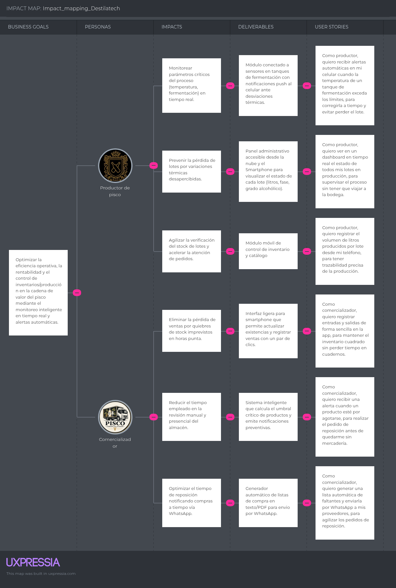
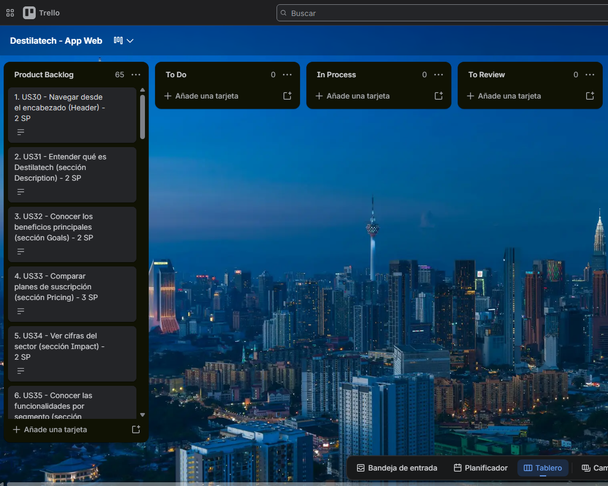

## Capítulo III: Requirements Specification

### 3.1. User Stories

Las historias de usuario describen una funcionalidad desde el punto de vista de quien la usa y del valor que obtiene; se redactan con la estructura «Como [rol] quiero [necesidad] para [beneficio]» (Cohn, 2004). Sus criterios de aceptación se escriben en lenguaje Gherkin (*Given*, *When*, *Then*), en tercera persona y en presente, con al menos tres escenarios por historia. Los escenarios no se limitan al éxito y al fallo: cubren el flujo principal, las validaciones y excepciones, y otras condiciones de aceptación como estados vacíos, permisos por tipo de usuario, persistencia de los datos o comportamiento en distintos dispositivos.

Las Épicas agrupan historias relacionadas. Además de las historias orientadas a visitantes, productores y comercializadores, se incluyen las **Technical Stories** (rol *Developer*), que especifican los endpoints del API REST necesarios para soportar las funcionalidades anteriores mediante solicitud y respuesta HTTP. Todas se presentan en una única tabla: 10 Épicas, 51 historias de usuario y 14 Technical Stories.

| Epic/Story ID | Título | Descripción | Criterios de Aceptación | Relacionado con (Epic ID) |
| :---------- | :----------- | :---------------------------------------- | :------------------------------------------- | :---------- |
| **EP01** | **Autenticación y cuentas** | Registro, inicio de sesión, periodo de prueba gratuito y suscripción. | **Escenario 1** Given que un visitante completa el registro con datos válidos, When confirma el formulario, Then el sistema crea la cuenta y activa el periodo de prueba de 14 días.  **Escenario 2** Given que un usuario sin sesión iniciada intenta acceder a una función restringida, When realiza la acción, Then el sistema lo redirige a la pantalla de inicio de sesión. | — |
| US01 | Registrarme como productor o comercializador | Como visitante quiero registrar una cuenta indicando mi tipo de negocio para comenzar mi periodo de prueba gratuito. | **Escenario 1: Registro exitoso** Given que el visitante no está registrado, When completa el formulario con datos válidos y selecciona su tipo de negocio, Then el sistema crea la cuenta y activa un periodo de prueba de 14 días.  **Escenario 2: Correo duplicado** Given que el correo ingresado ya está en uso, When el visitante envía el formulario, Then el sistema muestra un error y no crea una cuenta duplicada.  **Escenario 3: Tipo de negocio obligatorio** Given que el visitante completa el formulario sin elegir su tipo de negocio, When intenta enviarlo, Then el sistema indica que el tipo de negocio es obligatorio y no crea la cuenta. | EP01 |
| US02 | Iniciar sesión | Como usuario registrado quiero iniciar sesión para acceder a las funcionalidades de mi tipo de usuario. | **Escenario 1: Inicio de sesión correcto** Given que el usuario tiene una cuenta activa, When ingresa credenciales correctas, Then el sistema lo redirige al dashboard de su tipo de usuario.  **Escenario 2: Contraseña incorrecta** Given que el usuario ingresa una contraseña incorrecta, When intenta iniciar sesión, Then el sistema muestra un error sin indicar cuál dato es incorrecto.  **Escenario 3: Perfil según tipo de usuario** Given que un productor y un comercializador tienen cuenta activa, When cada uno inicia sesión, Then el sistema muestra a cada uno el menú y el dashboard de su tipo de usuario. | EP01 |
| US03 | Recibir aviso de fin de periodo de prueba | Como usuario en prueba quiero recibir un aviso antes de que finalice mi periodo gratuito para decidir si me suscribo. | **Escenario 1: Aviso previo** Given que la prueba del usuario finaliza en 3 días, When el usuario inicia sesión, Then el sistema muestra un aviso con los días restantes y la opción de suscribirse.  **Escenario 2: Prueba vencida** Given que la prueba finalizó sin suscripción, When el usuario intenta acceder a una función restringida, Then el sistema lo redirige a los planes de suscripción.  **Escenario 3: Sin aviso con prueba vigente** Given que a la prueba del usuario le quedan más de 3 días, When el usuario inicia sesión, Then el sistema no muestra el aviso de fin de prueba. | EP01 |
| US38 | Cerrar sesión | Como usuario autenticado quiero cerrar mi sesión para proteger la información de mi negocio en dispositivos compartidos. | **Escenario 1: Cierre de sesión** Given que el usuario tiene una sesión iniciada, When selecciona la opción de cerrar sesión, Then el sistema invalida la sesión y muestra la pantalla de inicio de sesión.  **Escenario 2: Acceso posterior bloqueado** Given que el usuario cerró su sesión, When intenta volver a una página interna con el botón de retroceso, Then el sistema lo redirige al inicio de sesión.  **Escenario 3: Sesión cerrada en todas las vistas** Given que el usuario cerró su sesión, When intenta abrir una URL interna directamente, Then el sistema lo redirige al inicio de sesión. | EP01 |
| US39 | Recuperar contraseña | Como usuario registrado quiero restablecer mi contraseña mediante mi correo para recuperar el acceso a mi cuenta si la olvido. | **Escenario 1: Solicitud de restablecimiento** Given que el usuario registrado indica su correo, When solicita restablecer la contraseña, Then el sistema envía un enlace de restablecimiento con vigencia limitada.  **Escenario 2: Correo no registrado** Given que el correo ingresado no pertenece a ninguna cuenta, When el usuario solicita el restablecimiento, Then el sistema muestra un mensaje neutro que no revela si la cuenta existe.  **Escenario 3: Enlace vencido** Given que el enlace de restablecimiento ya venció, When el usuario lo abre, Then el sistema indica que expiró y ofrece solicitar uno nuevo. | EP01 |
| US40 | Contratar un plan de suscripción | Como usuario en prueba o con prueba vencida quiero contratar un plan de suscripción para continuar usando Destilatech al terminar el periodo de prueba. | **Escenario 1: Contratación exitosa** Given que el usuario selecciona un plan y completa el pago, When la pasarela de pago confirma la transacción, Then el sistema activa la suscripción y habilita todas las funciones del plan.  **Escenario 2: Pago rechazado** Given que la pasarela de pago rechaza la transacción, When el usuario intenta contratar el plan, Then el sistema muestra el motivo del rechazo y mantiene el estado anterior de la cuenta.  **Escenario 3: Plan activo reflejado** Given que el usuario contrató un plan, When vuelve a la sección de suscripción, Then el sistema muestra el plan activo, la fecha de renovación y el pago en el historial.  **Escenario 4: Pago cancelado** Given que el usuario cancela el pago en la pasarela, When regresa a Destilatech, Then el sistema muestra un mensaje de cancelación y lo devuelve a los planes. | EP01 |
| US41 | Actualizar los datos de mi negocio | Como productor o comercializador quiero actualizar el nombre, la ubicación y el tipo de mi negocio para mantener correcta la información de mi cuenta. | **Escenario 1: Actualización válida** Given que el usuario autenticado edita los datos de su negocio con valores válidos, When guarda los cambios, Then el sistema actualiza los datos y muestra una confirmación.  **Escenario 2: Campo obligatorio vacío** Given que el usuario deja vacío el nombre del negocio, When intenta guardar, Then el sistema muestra un error y no modifica los datos.  **Escenario 3: Cambio de tipo de negocio** Given que el usuario cambia el tipo de su negocio, When guarda los cambios, Then el sistema actualiza el menú y el dashboard según el nuevo tipo. | EP01 |
| US54 | Consultar mi plan y estado de suscripción | Como productor o comercializador quiero consultar mi plan actual, el estado de mi suscripción y mi fecha de renovación o fin de prueba para planificar mi contratación. | **Escenario 1: Cuenta en prueba** Given que la cuenta del usuario está en periodo de prueba, When el usuario abre la sección de suscripción, Then el sistema muestra los días restantes de prueba y los planes disponibles.  **Escenario 2: Cuenta suscrita** Given que la cuenta del usuario tiene una suscripción activa, When el usuario abre la sección de suscripción, Then el sistema muestra el plan contratado y la fecha de renovación.  **Escenario 3: Prueba vencida** Given que la prueba terminó sin suscripción, When el usuario abre la sección de suscripción, Then el sistema muestra el estado vencido y los planes para contratar. | EP01 |
| **EP02** | **Dashboard** | Vistas principales adaptadas por tipo de usuario. | **Escenario 1** Given que un usuario autenticado ingresa a la plataforma, When accede a su cuenta, Then el sistema muestra el dashboard correspondiente a su tipo de usuario.  **Escenario 2** Given que un usuario aún no tiene datos registrados, When accede a su dashboard, Then el sistema muestra un estado vacío que lo guía a registrar su primera información. | — |
| US04 | Ver dashboard de producción | Como productor quiero ver un dashboard con el estado general de mi producción e inventario para tomar decisiones sin revisar cada módulo por separado. | **Escenario 1: Dashboard con datos** Given que el productor autenticado tiene lotes e inventario registrados, When accede al dashboard, Then el sistema muestra los lotes activos, las alertas pendientes y los niveles de inventario.  **Escenario 2: Dashboard vacío** Given que el productor no tiene lotes ni inventario, When accede al dashboard, Then el sistema muestra un estado vacío con una guía para registrar el primer lote.  **Escenario 3: Alertas pendientes visibles** Given que el productor tiene alertas sin atender, When accede al dashboard, Then el sistema muestra las alertas pendientes con acceso al centro de alertas.  **Escenario 4: Indicadores en el idioma elegido** Given que el productor eligió el idioma inglés, When accede al dashboard, Then el sistema muestra los indicadores y los textos en inglés. | EP02 |
| US05 | Ver dashboard comercial | Como comercializador quiero ver un dashboard con el estado de mi inventario y pedidos para identificar rápidamente qué productos necesito reponer. | **Escenario 1: Dashboard con datos** Given que el comercializador autenticado tiene productos y pedidos registrados, When accede al dashboard, Then el sistema muestra los productos con stock bajo, las alertas pendientes y los pedidos recientes.  **Escenario 2: Dashboard vacío** Given que el comercializador aún no registró productos, When accede al dashboard, Then el sistema muestra un estado vacío con una guía para registrar el primer producto.  **Escenario 3: Reposición prioritaria** Given que el comercializador tiene productos con stock bajo, When accede al dashboard, Then el sistema lista los productos a reponer con la cantidad sugerida.  **Escenario 4: Acceso restringido al perfil** Given que un usuario con perfil de productor intenta abrir el dashboard comercial, When accede a su dashboard, Then el sistema muestra solo el dashboard de su tipo de usuario. | EP02 |
| **EP03** | **Gestión de lotes de producción** | Registro y seguimiento de lotes de producción. | **Escenario 1** Given que un productor registra y actualiza un lote, When guarda los cambios, Then el sistema mantiene un historial trazable del lote.  **Escenario 2** Given que un productor consulta un lote existente, When lo selecciona, Then el sistema muestra su historial completo de cambios. | — |
| US06 | Registrar lote de producción | Como productor quiero registrar un nuevo lote para llevar un historial organizado de mis procesos. | **Escenario 1: Registro válido** Given que el productor autenticado ingresa fecha de inicio, producto y cantidad estimada, When guarda el lote, Then el sistema registra el lote y lo muestra entre los lotes activos.  **Escenario 2: Fecha de inicio ausente** Given que el productor no indica la fecha de inicio, When envía el formulario, Then el sistema muestra un error y no guarda el lote.  **Escenario 3: Cantidad estimada inválida** Given que el productor ingresa una cantidad estimada menor o igual a cero, When envía el formulario, Then el sistema muestra un error de validación y no guarda el lote. | EP03 |
| US07 | Actualizar estado de un lote | Como productor quiero actualizar el estado de un lote para reflejar el avance real del proceso. | **Escenario 1: Avance de etapa** Given que el productor tiene un lote registrado, When cambia su estado a la siguiente etapa, Then el sistema registra la fecha del cambio y actualiza el historial del lote.  **Escenario 2: Etapa no permitida** Given que el lote está en la etapa de fermentación, When el productor intenta pasarlo directamente a embotellado, Then el sistema rechaza el cambio y muestra las etapas permitidas.  **Escenario 3: Lote embotellado cerrado** Given que el lote ya está en la última etapa, When el productor abre el lote, Then el sistema no ofrece avanzar de etapa. | EP03 |
| US08 | Consultar historial de un lote | Como productor quiero consultar el historial completo de un lote para revisar su trazabilidad. | **Escenario 1: Historial disponible** Given que el productor tiene lotes con cambios registrados, When selecciona un lote, Then el sistema muestra todos sus cambios de estado y las variables monitoreadas.  **Escenario 2: Lote sin cambios** Given que el lote fue recién registrado, When el productor consulta su historial, Then el sistema muestra solo el registro inicial del lote.  **Escenario 3: Orden cronológico** Given que el lote tiene varios cambios de estado, When el productor consulta su historial, Then el sistema los muestra en orden cronológico con la fecha de cada etapa. | EP03 |
| US42 | Editar los datos de un lote | Como productor quiero corregir los datos de un lote registrado para mantener información exacta de mi producción. | **Escenario 1: Edición válida** Given que el productor tiene un lote en proceso, When modifica la cantidad estimada y guarda, Then el sistema actualiza el lote y registra el cambio en su historial.  **Escenario 2: Cantidad inválida** Given que el productor ingresa una cantidad menor o igual a cero, When intenta guardar, Then el sistema muestra un error de validación y conserva el valor anterior.  **Escenario 3: Lote cerrado no editable** Given que el lote ya fue embotellado, When el productor intenta editarlo, Then el sistema no permite modificar la cantidad estimada. | EP03 |
| US43 | Registrar el embotellado de un lote | Como productor quiero registrar la cantidad embotellada de un lote para incorporar las botellas producidas a mi inventario. | **Escenario 1: Embotellado registrado** Given que el lote está en la etapa de reposo, When el productor registra la cantidad embotellada y el producto, Then el sistema cierra el lote y suma la cantidad al stock del producto.  **Escenario 2: Producto no indicado** Given que el productor no selecciona el producto terminado, When intenta confirmar el embotellado, Then el sistema muestra un error y no modifica el inventario.  **Escenario 3: Cantidad mayor a la producida** Given que la cantidad embotellada supera la cantidad estimada del lote, When el productor intenta confirmar, Then el sistema muestra una advertencia y solicita confirmar la cantidad. | EP03 |
| **EP04** | **Monitoreo IoT** | Visualización y configuración de variables de proceso (simuladas). | **Escenario 1** Given que un productor tiene un lote activo con variables configuradas, When el sistema recibe una lectura simulada fuera de rango, Then el sistema genera una alerta de condición anómala.  **Escenario 2** Given que un productor consulta el monitoreo de un lote, When accede al módulo, Then el sistema muestra las lecturas simuladas más recientes. | — |
| US09 | Visualizar variables de proceso | Como productor quiero visualizar las variables de un lote (simuladas) para supervisar el proceso a distancia. | **Escenario 1: Lecturas recientes** Given que el productor tiene un lote en fermentación o destilación, When accede al monitoreo, Then el sistema muestra las lecturas simuladas más recientes de ese lote.  **Escenario 2: Lote sin lecturas** Given que el lote aún no recibió lecturas, When el productor accede al monitoreo, Then el sistema indica que todavía no hay lecturas disponibles.  **Escenario 3: Anomalía señalada** Given que una lectura simulada está fuera del rango normal, When el productor visualiza la variable, Then el sistema destaca la variable como fuera de rango.  **Escenario 4: Cambio de lote** Given que el productor tiene más de un lote activo, When selecciona otro lote en el monitoreo, Then el sistema actualiza las variables y el gráfico con las lecturas del lote elegido. | EP04 |
| US10 | Configurar rango normal de una variable | Como productor quiero definir el rango normal de una variable para que el sistema detecte anomalías automáticamente. | **Escenario 1: Rango válido** Given que el productor tiene un lote activo, When configura un valor mínimo y uno máximo, Then el sistema guarda la configuración y la aplica a las siguientes lecturas.  **Escenario 2: Rango inválido** Given que el valor mínimo es mayor que el máximo, When el productor intenta guardar, Then el sistema muestra un error y no guarda la configuración.  **Escenario 3: Rango aplicado a nuevas lecturas** Given que el productor guardó un nuevo rango para una variable, When el sistema recibe una nueva lectura, Then el sistema la evalúa con el rango actualizado y no con el anterior. | EP04 |
| US11 | Recibir notificación de condición anómala | Como productor quiero ser notificado cuando una variable salga del rango normal para actuar a tiempo y evitar la pérdida del lote. | **Escenario 1: Lectura fuera de rango** Given que el productor configuró un rango normal, When una lectura simulada excede ese rango, Then el sistema genera una alerta visible en el dashboard y en el módulo de alertas.  **Escenario 2: Lectura dentro de rango** Given que una lectura simulada se encuentra dentro del rango, When el sistema la procesa, Then el sistema la almacena sin generar alerta.  **Escenario 3: Alerta sin duplicados** Given que una variable permanece fuera de rango durante varias lecturas seguidas, When el sistema procesa cada lectura, Then el sistema mantiene una sola alerta pendiente para ese episodio. | EP04 |
| US44 | Ver la tendencia de una variable | Como productor quiero ver en un gráfico la evolución de una variable de un lote en un rango de fechas para identificar desviaciones antes de que afecten al lote. | **Escenario 1: Gráfico disponible** Given que el lote tiene lecturas en el rango de fechas elegido, When el productor selecciona la variable y el rango, Then el sistema muestra un gráfico de evolución con los valores mínimo y máximo configurados.  **Escenario 2: Rango sin lecturas** Given que no existen lecturas en el rango seleccionado, When el productor aplica el filtro, Then el sistema informa que no hay datos para ese periodo.  **Escenario 3: Valores mínimo y máximo visibles** Given que la variable tiene un rango configurado, When el productor abre el gráfico, Then el sistema dibuja las líneas del mínimo y del máximo junto con las lecturas. | EP04 |
| US55 | Elegir las variables que se monitorean en un lote | Como productor quiero elegir qué variables monitorear (temperatura, grado de azúcar o grado alcohólico) en cada lote para ver solo la información relevante para mi proceso. | **Escenario 1: Selección de variables** Given que el productor registra o edita un lote, When marca las variables a monitorear, Then el sistema muestra solo esas variables en el monitoreo del lote.  **Escenario 2: Sin variables seleccionadas** Given que el productor no marca ninguna variable, When guarda la configuración, Then el sistema permite guardar el lote e indica que no se mostrarán lecturas.  **Escenario 3: Variables por defecto** Given que el productor registra un lote sin cambiar la selección, When abre el monitoreo, Then el sistema muestra las variables configuradas por defecto. | EP04 |
| **EP05** | **Gestión de inventario** | Catálogo de productos, movimientos y consulta de stock. | **Escenario 1** Given que un usuario registra productos y movimientos, When consulta su inventario, Then el sistema refleja el stock actualizado.  **Escenario 2** Given que un movimiento dejaría el stock en negativo, When el usuario intenta registrarlo, Then el sistema lo rechaza con una advertencia. | — |
| US12 | Registrar producto | Como productor o comercializador quiero registrar mis productos para tener un catálogo organizado. | **Escenario 1: Producto válido** Given que el usuario autenticado ingresa nombre, presentación y unidad, When guarda el producto, Then el sistema lo agrega a su catálogo.  **Escenario 2: Producto duplicado** Given que ya existe un producto con el mismo nombre y presentación, When el usuario intenta registrarlo de nuevo, Then el sistema muestra un aviso y no crea el duplicado.  **Escenario 3: Datos obligatorios** Given que el usuario deja vacío el nombre del producto, When intenta guardarlo, Then el sistema marca el campo como obligatorio y no registra el producto. | EP05 |
| US13 | Registrar movimiento de inventario | Como productor o comercializador quiero registrar entradas y salidas de un producto para mantener mi stock actualizado. | **Escenario 1: Movimiento válido** Given que el usuario tiene un producto registrado, When registra una entrada o salida con una cantidad válida, Then el sistema actualiza el stock disponible.  **Escenario 2: Salida mayor al stock** Given que la salida supera el stock disponible, When el usuario envía el movimiento, Then el sistema muestra una advertencia y no aplica el movimiento.  **Escenario 3: Cantidad inválida** Given que el usuario ingresa una cantidad igual a cero o negativa, When envía el movimiento, Then el sistema muestra un error de validación y no modifica el stock. | EP05 |
| US14 | Consultar stock disponible | Como productor o comercializador quiero consultar el stock disponible para no tener que revisar físicamente el almacén. | **Escenario 1: Stock consultado** Given que el usuario tiene productos con movimientos registrados, When accede al inventario, Then el sistema muestra el stock actual ordenado por nivel de existencias.  **Escenario 2: Inventario vacío** Given que el usuario aún no tiene productos, When accede al inventario, Then el sistema muestra un estado vacío con acceso al registro de productos.  **Escenario 3: Estado del stock** Given que un producto tiene stock igual o menor a su umbral, When el usuario consulta el inventario, Then el sistema marca el producto con el estado bajo o crítico según corresponda. | EP05 |
| US45 | Editar o desactivar un producto | Como productor o comercializador quiero editar los datos de un producto o desactivarlo para mantener actualizado mi catálogo. | **Escenario 1: Edición de producto** Given que el usuario tiene un producto registrado, When modifica su presentación y guarda, Then el sistema actualiza el producto sin alterar su stock.  **Escenario 2: Desactivación** Given que el usuario desactiva un producto, When consulta su catálogo, Then el sistema oculta el producto de los listados activos y conserva su historial.  **Escenario 3: Producto desactivado en pedidos** Given que el usuario desactivó un producto, When registra un pedido nuevo, Then el sistema no ofrece ese producto entre las opciones. | EP05 |
| US46 | Consultar el historial de movimientos de un producto | Como productor o comercializador quiero consultar el kardex de un producto para revisar de dónde proviene la diferencia de stock. | **Escenario 1: Kardex disponible** Given que el producto tiene movimientos registrados, When el usuario abre su historial, Then el sistema muestra fecha, tipo, cantidad y saldo de cada movimiento.  **Escenario 2: Filtro por fechas** Given que el usuario indica un rango de fechas, When aplica el filtro, Then el sistema muestra solo los movimientos de ese rango.  **Escenario 3: Saldo coherente** Given que el producto tiene entradas y salidas, When el usuario abre su historial, Then el sistema muestra un saldo que coincide con el stock actual. | EP05 |
| US47 | Ajustar el stock tras un conteo físico | Como productor o comercializador quiero registrar un ajuste de stock con el resultado de mi conteo físico para corregir diferencias entre el sistema y el almacén. | **Escenario 1: Ajuste registrado** Given que el conteo físico difiere del stock registrado, When el usuario ingresa la cantidad contada y un motivo, Then el sistema registra un movimiento de ajuste y actualiza el stock.  **Escenario 2: Motivo ausente** Given que el usuario no indica el motivo del ajuste, When intenta confirmar, Then el sistema solicita el motivo antes de aplicar el ajuste.  **Escenario 3: Ajuste visible en el historial** Given que el usuario registró un ajuste de stock, When abre el historial del producto, Then el sistema muestra el ajuste como un movimiento de tipo ajuste con su motivo. | EP05 |
| **EP06** | **Sistema de alertas** | Umbrales de stock y gestión de alertas. | **Escenario 1** Given que el stock de un producto llega a su umbral mínimo, When el sistema actualiza el inventario, Then el sistema genera una alerta automática de stock bajo.  **Escenario 2** Given que un usuario atiende una alerta, When la marca como atendida, Then el sistema actualiza su estado. | — |
| US15 | Configurar umbral de stock bajo | Como productor o comercializador quiero definir un umbral mínimo por producto para recibir alertas antes de quedarme sin stock. | **Escenario 1: Alerta por umbral** Given que el usuario configuró un umbral mínimo para un producto, When el stock llega o cae por debajo de ese umbral, Then el sistema genera una alerta automática de stock bajo.  **Escenario 2: Umbral inválido** Given que el usuario ingresa un umbral negativo, When intenta guardar, Then el sistema muestra un error y no guarda el umbral.  **Escenario 3: Umbral modificado** Given que el usuario cambia el umbral de un producto, When guarda el nuevo valor, Then el sistema evalúa el stock con el nuevo umbral y actualiza el estado del producto. | EP06 |
| US16 | Visualizar y atender alertas | Como productor o comercializador quiero visualizar mis alertas pendientes y marcarlas como atendidas para llevar control de lo que ya resolví. | **Escenario 1: Lista de alertas** Given que el usuario tiene alertas generadas, When accede al módulo de alertas, Then el sistema muestra la lista ordenada por fecha, con pendientes y atendidas.  **Escenario 2: Alerta atendida** Given que el usuario revisa una alerta pendiente, When la marca como atendida, Then el sistema actualiza su estado y la mueve a las atendidas.  **Escenario 3: Alerta atendida** Given que el usuario marca una alerta como atendida, When consulta sus alertas, Then el sistema la retira de las pendientes y la conserva en las atendidas. | EP06 |
| US48 | Filtrar alertas por tipo y estado | Como productor o comercializador quiero filtrar mis alertas por tipo (stock bajo o condición anómala) y por estado para encontrar rápidamente las que requieren atención. | **Escenario 1: Filtro por tipo** Given que el usuario tiene alertas de distintos tipos, When selecciona el tipo stock bajo, Then el sistema muestra solo las alertas de stock bajo.  **Escenario 2: Sin resultados** Given que ninguna alerta cumple con el filtro, When el usuario aplica el filtro, Then el sistema muestra un mensaje indicando que no hay alertas con esos criterios.  **Escenario 3: Combinación de filtros** Given que el usuario tiene alertas de ambos tipos y estados, When aplica un filtro de tipo y otro de estado, Then el sistema muestra solo las alertas que cumplen ambos. | EP06 |
| **EP07** | **Clientes, pedidos y reposición** | Gestión comercial básica de clientes y pedidos de venta, y apoyo a la reposición con listas de compra. | **Escenario 1** Given que un usuario registra un pedido de un cliente, When lo confirma, Then el sistema descuenta el stock correspondiente y agrega el pedido al historial.  **Escenario 2** Given que un comercializador tiene productos por reponer, When genera la lista de compra, Then el sistema produce un texto listo para compartir con su proveedor. | — |
| US17 | Registrar cliente | Como productor o comercializador quiero registrar información básica de mis clientes para tener sus datos disponibles al registrar pedidos. | **Escenario 1: Cliente válido** Given que el usuario autenticado ingresa nombre y contacto, When guarda el cliente, Then el sistema lo agrega a su lista de clientes.  **Escenario 2: Nombre ausente** Given que el usuario no ingresa el nombre del cliente, When intenta guardar, Then el sistema muestra un error y no registra al cliente.  **Escenario 3: Nombre obligatorio** Given que el usuario deja vacío el nombre del cliente, When intenta guardarlo, Then el sistema marca el campo como obligatorio y no registra al cliente. | EP07 |
| US18 | Registrar pedido | Como productor o comercializador quiero registrar un pedido de un cliente para llevar control de mis ventas. | **Escenario 1: Pedido confirmado** Given que el usuario tiene clientes y productos registrados, When registra un pedido con cliente, productos y cantidades y lo confirma, Then el sistema confirma el pedido y descuenta el stock correspondiente.  **Escenario 2: Pedido sobre el stock** Given que el pedido excede el stock disponible, When el usuario intenta confirmarlo, Then el sistema muestra una advertencia antes de continuar.  **Escenario 3: Pedido sin productos** Given que el usuario no agrega ninguna línea de producto, When intenta registrar el pedido, Then el sistema muestra un error y no registra el pedido.  **Escenario 4: Stock descontado** Given que el pedido se registra con productos disponibles, When el sistema lo guarda, Then el sistema descuenta del inventario las unidades de cada línea. | EP07 |
| US19 | Consultar historial de pedidos | Como productor o comercializador quiero consultar mis pedidos anteriores para revisar qué vendí y a quién. | **Escenario 1: Listado de pedidos** Given que el usuario tiene pedidos registrados, When accede al módulo de pedidos, Then el sistema muestra fecha, cliente, productos y estado de cada pedido.  **Escenario 2: Filtro por estado** Given que el usuario selecciona el estado borrador o confirmado, When aplica el filtro, Then el sistema muestra solo los pedidos con ese estado.  **Escenario 3: Búsqueda por cliente** Given que el usuario tiene pedidos de varios clientes, When busca por código o nombre del cliente, Then el sistema muestra solo los pedidos que coinciden. | EP07 |
| US49 | Editar los datos de un cliente | Como productor o comercializador quiero editar los datos de un cliente registrado para mantener actualizada mi información de contacto. | **Escenario 1: Edición válida** Given que el usuario tiene un cliente registrado, When modifica su contacto y guarda, Then el sistema actualiza los datos del cliente.  **Escenario 2: Contacto inválido** Given que el usuario ingresa un contacto con formato incorrecto, When intenta guardar, Then el sistema muestra un error y conserva los datos anteriores.  **Escenario 3: Cambios reflejados en pedidos** Given que el usuario editó el nombre de un cliente, When consulta el historial de pedidos, Then el sistema muestra el nombre actualizado en los pedidos de ese cliente. | EP07 |
| US50 | Generar lista de compra para reposición | Como comercializador quiero generar una lista de compra con los productos por reponer y compartirla como texto para agilizar mis pedidos de reposición por WhatsApp. | **Escenario 1: Lista generada** Given que existen productos con alerta de stock bajo o con estimación de reposición, When el comercializador selecciona los productos y las cantidades, Then el sistema genera una lista de compra en texto lista para copiar o compartir por WhatsApp.  **Escenario 2: Sin productos por reponer** Given que ningún producto tiene alerta de stock bajo ni estimación de reposición, When el comercializador intenta generar la lista, Then el sistema muestra un mensaje indicando que no hay productos por reponer.  **Escenario 3: Sin productos por reponer** Given que ningún producto está bajo su umbral, When el usuario abre la reposición, Then el sistema indica que no hay productos por reponer.  **Escenario 4: Lista compartible** Given que el usuario genera la lista de compra, When la copia para compartirla, Then el sistema entrega la lista como texto con producto y cantidad. | EP07 |
| **EP08** | **Estimaciones y reposición** | Analítica básica sobre inventario y reposición. | **Escenario 1** Given que un producto cuenta con historial suficiente de movimientos, When un usuario consulta su ficha, Then el sistema muestra una estimación de reposición.  **Escenario 2** Given que un usuario consulta indicadores históricos, When accede al módulo, Then el sistema muestra la evolución de su inventario o producción. | — |
| US20 | Ver estimación de reposición | Como productor o comercializador quiero ver una estimación de cuándo reponer un producto según mi historial para anticipar mis compras o mi producción. | **Escenario 1: Estimación disponible** Given que el producto tiene historial suficiente, When el usuario accede a su ficha, Then el sistema muestra una estimación de fecha o cantidad de reposición.  **Escenario 2: Historial insuficiente** Given que el producto no tiene historial suficiente, When el usuario accede a su ficha, Then el sistema indica que aún no hay datos suficientes.  **Escenario 3: Poco historial** Given que el producto tiene pocas salidas registradas, When el usuario consulta la estimación, Then el sistema muestra la estimación con un nivel de confianza bajo o indica que faltan datos.  **Escenario 4: Fecha y cantidad sugerida** Given que el producto tiene historial suficiente, When el usuario abre su ficha, Then el sistema muestra la fecha estimada de reposición y la cantidad sugerida. | EP08 |
| US21 | Ver indicadores históricos | Como productor o comercializador quiero visualizar indicadores históricos de inventario y producción para evaluar la evolución de mi negocio. | **Escenario 1: Indicadores disponibles** Given que el usuario tiene historial registrado, When accede a los indicadores, Then el sistema muestra gráficos de evolución en el periodo seleccionado.  **Escenario 2: Sin historial** Given que el usuario no tiene historial registrado, When accede a los indicadores, Then el sistema muestra un estado vacío que explica qué registrar.  **Escenario 3: Cambio de periodo** Given que el usuario elige otro periodo de análisis, When selecciona 7 días, 30 días, 90 días o 12 meses, Then el sistema recalcula los indicadores y los gráficos para ese periodo.  **Escenario 4: Periodo sin registros** Given que no existen registros en el periodo elegido, When el usuario abre los indicadores, Then el sistema muestra los valores en cero y un mensaje de que no hay datos. | EP08 |
| US51 | Ver productos con riesgo de agotamiento | Como productor o comercializador quiero ver una lista de los productos con riesgo de agotarse pronto para priorizar qué reponer primero. | **Escenario 1: Lista de riesgo** Given que existen productos cuya estimación indica agotamiento próximo, When el usuario abre la lista, Then el sistema muestra los productos ordenados por menor tiempo estimado de agotamiento.  **Escenario 2: Sin riesgos** Given que ningún producto presenta riesgo de agotamiento, When el usuario abre la lista, Then el sistema muestra un mensaje indicando que no hay productos en riesgo.  **Escenario 3: Orden por urgencia** Given que varios productos tienen riesgo de agotarse, When el usuario consulta la lista, Then el sistema los ordena desde el que se agota primero. | EP08 |
| **EP09** | **Landing Page (visitante)** | Sitio web público de Destilatech. | **Escenario 1** Given que un visitante ingresa al sitio web, When navega por sus secciones, Then el sitio muestra la propuesta de valor, los planes, las funcionalidades y un call-to-action hacia el registro.  **Escenario 2** Given que un visitante accede desde un dispositivo móvil, When navega el sitio, Then la interfaz se adapta a su pantalla. | — |
| US22 | Conocer la propuesta de valor | Como visitante quiero conocer qué ofrece Destilatech para decidir si me interesa registrarme. | **Escenario 1: Propuesta visible** Given que el visitante ingresa a la página de inicio, When visualiza la sección principal, Then el sitio muestra la propuesta de valor y las capacidades principales.  **Escenario 2: Acceso desde móvil** Given que el visitante ingresa desde un smartphone, When la página termina de cargar, Then el sitio muestra la propuesta de valor sin elementos desbordados.  **Escenario 3: Lectura rápida** Given que el visitante llega a la página de inicio, When revisa la primera sección, Then el sistema le muestra qué es Destilatech y a quién se dirige sin necesidad de desplazarse mucho. | EP09 |
| US23 | Conocer planes y periodo de prueba | Como visitante quiero conocer los planes y el periodo de prueba gratuito para evaluar el costo antes de registrarme. | **Escenario 1: Planes visibles** Given que el visitante accede a la sección de planes, When la visualiza, Then el sitio muestra los planes, los precios y la duración del periodo de prueba.  **Escenario 2: Plan seleccionado** Given que el visitante hace clic en el call-to-action de un plan, When la página responde, Then el sitio lo lleva al formulario de registro.  **Escenario 3: Duración de la prueba visible** Given que el visitante revisa la sección de planes, When busca información sobre la prueba gratuita, Then el sistema indica que la prueba dura 14 días y que no requiere tarjeta de crédito. | EP09 |
| US24 | Registrarme desde la landing page | Como visitante quiero acceder al registro desde la página de inicio para crear mi cuenta sin buscar el formulario. | **Escenario 1: Call-to-action principal** Given que el visitante está en la página de inicio, When hace clic en el call-to-action principal, Then el sitio lo redirige al formulario de registro.  **Escenario 2: Call-to-action del pie de página** Given que el visitante llegó al final de la página, When hace clic en el call-to-action del footer, Then el sitio lo redirige al formulario de registro.  **Escenario 3: Acceso desde móvil** Given que el visitante usa un teléfono, When pulsa el botón de prueba gratuita, Then el sistema lo lleva al registro con el botón visible sin desplazamientos horizontales. | EP09 |
| US25 | Conocer casos de uso por segmento | Como visitante de un segmento quiero ver contenido específico sobre cómo Destilatech resuelve mis necesidades para confirmar que la plataforma sirve para mi tipo de negocio. | **Escenario 1: Contenido para productores** Given que el visitante navega a la sección de productores, When la visualiza, Then el sitio muestra contenido sobre monitoreo IoT, lotes e inventario.  **Escenario 2: Contenido para comercializadores** Given que el visitante navega a la sección de comercializadores, When la visualiza, Then el sitio muestra contenido sobre inventario, pedidos y alertas de reposición.  **Escenario 3: Contenido por segmento** Given que el visitante elige el segmento productor o comercializador, When abre sus casos de uso, Then el sistema muestra solo el contenido de ese segmento. | EP09 |
| US30 | Navegar desde el encabezado (Header) | Como visitante quiero ver el logo y los enlaces de navegación en el encabezado para identificar la marca y llegar rápido a cada sección. | **Escenario 1: Encabezado visible** Given que el visitante carga la landing page, When la página termina de renderizar, Then el encabezado muestra el logo de Destilatech y los enlaces a las secciones principales.  **Escenario 2: Navegación por enlace** Given que el visitante hace clic en un enlace del encabezado, When la página responde, Then el sitio se desplaza a la sección correspondiente sin recargar la página.  **Escenario 3: Navegación en móvil** Given que el visitante usa un teléfono, When abre el encabezado, Then el sistema muestra un menú compacto con los mismos enlaces. | EP09 |
| US31 | Entender qué es Destilatech (sección Description) | Como visitante quiero leer una descripción breve del producto y de sus usuarios para comprender a quién está dirigido. | **Escenario 1: Descripción del producto** Given que el visitante llega a la sección Description, When la visualiza, Then el sitio muestra el nombre del producto, su propuesta de valor y los segmentos objetivo.  **Escenario 2: Lectura en móvil** Given que el visitante accede desde un smartphone, When visualiza la sección, Then el texto se muestra legible y sin desplazamiento horizontal.  **Escenario 3: Descripción por tipo de usuario** Given que el visitante lee la sección de descripción, When revisa a quién se dirige el producto, Then el sistema menciona a los productores y a los comercializadores de pisco. | EP09 |
| US32 | Conocer los beneficios principales (sección Goals) | Como visitante quiero ver los principales beneficios de la plataforma para valorar qué problemas resuelve. | **Escenario 1: Beneficios visibles** Given que el visitante llega a la sección Goals, When la visualiza, Then el sitio muestra los beneficios de monitoreo, inventario, alertas y estimaciones de forma clara.  **Escenario 2: Lectura en móvil** Given que el visitante accede desde un smartphone, When visualiza la sección, Then los beneficios se apilan en una sola columna sin elementos cortados.  **Escenario 3: Beneficios claros** Given que el visitante llega a la sección de beneficios, When la lee, Then el sistema presenta cada beneficio con un título y una descripción breve. | EP09 |
| US33 | Comparar planes de suscripción (sección Pricing) | Como visitante quiero comparar los planes y conocer la duración del periodo de prueba para elegir el plan que se ajusta a mi negocio. | **Escenario 1: Planes visibles** Given que el visitante llega a la sección Pricing, When la visualiza, Then el sitio muestra los planes, sus precios y la duración del periodo de prueba gratuito.  **Escenario 2: Plan preseleccionado** Given que el visitante hace clic en el call-to-action de un plan, When la página responde, Then el sitio lo lleva al formulario de registro con el plan preseleccionado.  **Escenario 3: Llamado a la acción del plan** Given que el visitante compara los planes, When selecciona un plan, Then el sistema lo lleva al registro de la prueba gratuita. | EP09 |
| US34 | Ver cifras del sector (sección Impact) | Como visitante quiero ver cifras del sector pisquero peruano para confirmar la relevancia de la solución. | **Escenario 1: Cifras visibles** Given que el visitante llega a la sección Impact, When la visualiza, Then el sitio muestra cifras del sector (empresas formales y producción anual) con su fuente.  **Escenario 2: Lectura en móvil** Given que el visitante accede desde un smartphone, When visualiza la sección, Then las cifras se muestran en una disposición legible sin desbordes.  **Escenario 3: Fuente de las cifras** Given que el visitante revisa las cifras del sector, When busca su origen, Then el sistema indica la fuente de cada cifra. | EP09 |
| US35 | Conocer las funcionalidades por segmento (sección Platform Features) | Como visitante quiero ver las funcionalidades agrupadas para productor y para comercializador para saber qué módulos usaría mi negocio. | **Escenario 1: Funcionalidades por segmento** Given que el visitante llega a la sección Platform Features, When la visualiza, Then el sitio muestra las funcionalidades agrupadas para productor y para comercializador.  **Escenario 2: Cambio de segmento** Given que el visitante selecciona el segmento comercializador, When la página responde, Then el sitio muestra solo las funcionalidades de ese segmento.  **Escenario 3: Cambio de segmento** Given que el visitante está viendo las funcionalidades del productor, When selecciona la pestaña del comercializador, Then el sistema muestra las funcionalidades de ese segmento sin recargar la página. | EP09 |
| US36 | Encontrar contacto y enlaces en el pie de página (Footer) | Como visitante quiero ver la información de contacto y los enlaces adicionales al final de la página para comunicarme con el equipo o consultar información legal. | **Escenario 1: Footer completo** Given que el visitante llega al final de la landing page, When visualiza el footer, Then el sitio muestra la información de contacto, los enlaces legales, las redes sociales y el call-to-action de registro.  **Escenario 2: Enlace legal** Given que el visitante hace clic en los términos y condiciones, When la página responde, Then el sitio muestra el documento correspondiente.  **Escenario 3: Enlaces del pie de página** Given que el visitante llega al final de la página, When revisa el pie de página, Then el sistema muestra el contacto, las redes y el enlace a los términos y condiciones. | EP09 |
| US37 | Usar la landing page en cualquier dispositivo (adaptabilidad móvil) | Como visitante quiero navegar la landing page desde mi teléfono, tablet o computadora para tener una experiencia consistente en cualquier pantalla. | **Escenario 1: Smartphone** Given que el visitante accede desde un smartphone, When la página carga, Then todas las secciones se adaptan sin elementos cortados ni desbordados.  **Escenario 2: Tablet o escritorio** Given que el visitante accede desde una tablet o computadora, When la página carga, Then el diseño aprovecha el espacio disponible y mantiene la misma jerarquía de contenido.  **Escenario 3: Sin desplazamiento horizontal** Given que el visitante abre la página en un teléfono, When recorre todas las secciones, Then el sistema adapta el contenido al ancho de la pantalla sin desplazamiento horizontal. | EP09 |
| US52 | Cambiar el idioma de la landing page | Como visitante quiero cambiar entre inglés y español para leer el contenido en el idioma que prefiero. | **Escenario 1: Cambio a español** Given que la landing page se muestra en inglés, When el visitante selecciona español, Then el sitio muestra todos los textos en español (es_419).  **Escenario 2: Idioma por defecto** Given que el visitante ingresa por primera vez, When la página carga, Then el sitio se muestra en inglés (en_US), idioma predeterminado.  **Escenario 3: Idioma recordado** Given que el visitante cambió el idioma, When recarga la página, Then el sistema conserva el idioma elegido. | EP09 |
| US53 | Consultar los términos y condiciones | Como visitante quiero consultar los términos y condiciones desde el pie de página para conocer las condiciones de uso antes de registrarme. | **Escenario 1: Enlace disponible** Given que el visitante está en cualquier sección del sitio, When revisa el footer, Then el sitio muestra el enlace a los términos y condiciones.  **Escenario 2: Documento visible** Given que el visitante hace clic en el enlace, When la página responde, Then el sitio muestra el contenido de los términos y condiciones.  **Escenario 3: Acceso desde el pie de página** Given que el visitante está en cualquier sección, When pulsa el enlace de términos y condiciones, Then el sistema muestra el documento completo. | EP09 |
| **EP10** | **Technical Stories (RESTful API)** | Endpoints necesarios para soportar las funcionalidades anteriores. | **Escenario 1** Given que la Web Application consume los endpoints del API, When envía una solicitud válida, Then el API responde con el código HTTP y los datos esperados.  **Escenario 2** Given que el API recibe una lectura simulada fuera de rango, When la procesa, Then el API almacena la lectura y genera la alerta correspondiente. | — |
| US26 | Endpoint de autenticación | Como Developer quiero un endpoint de autenticación que devuelva un token para que la Web Application autentique usuarios. | **Escenario 1: Credenciales válidas** Given un POST /auth/login con credenciales válidas, When el servicio las valida, Then responde 200 con un token y los datos básicos del usuario.  **Escenario 2: Credenciales inválidas** Given un POST /auth/login con credenciales inválidas, When el servicio las valida, Then responde 401 sin indicar cuál dato es incorrecto.  **Escenario 3: Solicitud sin credenciales** Given que la solicitud no incluye correo o contraseña, When el cliente llama al endpoint, Then el sistema responde con un error 400 y no emite ningún token. | EP10 |
| US27 | Endpoint de movimientos de inventario | Como Developer quiero un endpoint que registre movimientos de inventario de forma consistente para que el stock refleje todas las entradas y salidas. | **Escenario 1: Movimiento válido** Given un POST /inventory/movements válido, When el servicio lo procesa, Then responde 201 con el movimiento y el nuevo stock.  **Escenario 2: Stock negativo** Given un POST /inventory/movements que dejaría el stock negativo, When el servicio lo valida, Then responde 409 y no aplica el movimiento.  **Escenario 3: Solicitud sin autenticación** Given que la solicitud no incluye un token válido, When el cliente llama al endpoint de movimientos, Then el sistema responde 401 y no registra el movimiento.  **Escenario 4: Reintento idempotente** Given que el cliente reenvía un movimiento con la misma clave de idempotencia, When el sistema lo recibe de nuevo, Then el sistema devuelve el movimiento ya registrado sin duplicarlo. | EP10 |
| US28 | Endpoint de lecturas IoT simuladas | Como Developer quiero un endpoint que reciba lecturas simuladas y las evalúe contra los rangos configurados para detectar condiciones anómalas durante la producción. | **Escenario 1: Lectura dentro de rango** Given un POST /batches/{id}/readings dentro de rango, When el servicio lo procesa, Then responde 201 y almacena la lectura sin generar alerta.  **Escenario 2: Lectura fuera de rango** Given un POST /batches/{id}/readings fuera de rango, When el servicio lo procesa, Then responde 201, almacena la lectura y genera una alerta asociada al lote.  **Escenario 3: Fuente no reconocida** Given que la lectura llega con un source_id que no existe, When el sistema la recibe, Then el sistema responde con un error y no almacena la lectura.  **Escenario 4: Lectura duplicada** Given que la lectura llega con una clave de origen ya registrada, When el sistema la recibe de nuevo, Then el sistema la ignora para evitar duplicados. | EP10 |
| US29 | Endpoint de estimaciones de reposición | Como Developer quiero un endpoint que devuelva la estimación de reposición de un producto para que la Web Application muestre cuándo reponer. | **Escenario 1: Historial suficiente** Given un GET /products/{id}/replenishment-estimate con historial suficiente, When el servicio lo calcula, Then responde 200 con la estimación.  **Escenario 2: Historial insuficiente** Given un GET /products/{id}/replenishment-estimate con historial insuficiente, When el servicio lo evalúa, Then responde 200 indicando que no hay datos suficientes.  **Escenario 3: Producto inexistente** Given que el identificador del producto no existe, When el cliente consulta la estimación, Then el sistema responde 404 sin datos de estimación. | EP10 |
| US56 | Endpoint de registro de cuenta | Como Developer quiero un endpoint que registre cuentas de productor o comercializador para que la Web Application cree cuentas e inicie el periodo de prueba. | **Escenario 1: Registro válido** Given un POST /auth/register con correo, contraseña y tipo de negocio válidos, When el servicio lo procesa, Then responde 201 con la cuenta creada y la fecha de fin del periodo de prueba.  **Escenario 2: Correo en uso** Given un POST /auth/register con un correo ya registrado, When el servicio lo valida, Then responde 409 y no crea la cuenta.  **Escenario 3: Datos incompletos** Given que la solicitud no incluye el tipo de negocio, When el cliente llama al endpoint, Then el sistema responde con un error 400 que indica el campo faltante. | EP10 |
| US57 | Endpoints de suscripción | Como Developer quiero endpoints para consultar y contratar la suscripción para que la Web Application gestione el plan de cada cuenta. | **Escenario 1: Consulta de estado** Given un GET /subscriptions/current de un usuario autenticado, When el servicio lo procesa, Then responde 200 con el plan, el estado y las fechas relevantes.  **Escenario 2: Contratación** Given un POST /subscriptions con un plan válido y un pago confirmado, When el servicio lo procesa, Then responde 201 y activa la suscripción; si el pago fue rechazado, responde 402 y no cambia el estado.  **Escenario 3: Plan inexistente** Given que el identificador del plan no existe, When el cliente intenta contratarlo, Then el sistema responde 404 y no crea la suscripción.  **Escenario 4: Pago idempotente** Given que el cliente reintenta el pago con la misma clave de idempotencia, When el sistema recibe la solicitud, Then el sistema devuelve el resultado anterior sin generar un cobro nuevo. | EP10 |
| US58 | Endpoints de productos | Como Developer quiero endpoints para crear y listar productos para que la Web Application administre el catálogo. | **Escenario 1: Creación válida** Given un POST /products con nombre, presentación y unidad válidos, When el servicio lo procesa, Then responde 201 con el producto creado.  **Escenario 2: Listado paginado** Given un GET /products de un usuario autenticado, When el servicio lo procesa, Then responde 200 con los productos de esa cuenta, paginados.  **Escenario 3: Solicitud sin autenticación** Given que la solicitud no incluye un token válido, When el cliente crea o lista productos, Then el sistema responde 401 sin devolver datos. | EP10 |
| US59 | Endpoint de registro de lotes | Como Developer quiero un endpoint que registre lotes de producción para que la Web Application guarde el historial de producción. | **Escenario 1: Lote válido** Given un POST /batches con fecha de inicio, producto y cantidad estimada, When el servicio lo procesa, Then responde 201 con el lote en estado inicial.  **Escenario 2: Datos incompletos** Given un POST /batches sin fecha de inicio, When el servicio lo valida, Then responde 400 con el detalle de los campos faltantes.  **Escenario 3: Solicitud sin autenticación** Given que la solicitud no incluye un token válido, When el cliente registra un lote, Then el sistema responde 401 y no crea el lote. | EP10 |
| US60 | Endpoint de cambio de estado de un lote | Como Developer quiero un endpoint que cambie el estado de un lote validando la secuencia de etapas para que el historial de cada lote sea consistente. | **Escenario 1: Transición válida** Given un PATCH /batches/{id}/status con la siguiente etapa permitida, When el servicio lo procesa, Then responde 200 con el nuevo estado y registra el cambio en el historial.  **Escenario 2: Transición inválida** Given un PATCH /batches/{id}/status con una etapa no permitida, When el servicio lo valida, Then responde 422 y no modifica el lote.  **Escenario 3: Lote inexistente** Given que el identificador del lote no existe, When el cliente solicita el cambio de estado, Then el sistema responde 404 sin modificar datos. | EP10 |
| US61 | Endpoint de consulta de lecturas | Como Developer quiero un endpoint que devuelva las lecturas de un lote filtradas por variable y rango de fechas para que la Web Application grafique la evolución del proceso. | **Escenario 1: Consulta con filtros** Given un GET /batches/{id}/readings?variable=temperatura&from=...&to=..., When el servicio lo procesa, Then responde 200 con las lecturas del periodo ordenadas por fecha.  **Escenario 2: Lote inexistente** Given un GET /batches/{id}/readings con un identificador inexistente, When el servicio lo procesa, Then responde 404.  **Escenario 3: Filtro por variable y fechas** Given que el cliente indica una variable y un rango de fechas, When consulta las lecturas, Then el sistema devuelve solo las lecturas de esa variable dentro del rango. | EP10 |
| US62 | Endpoints de alertas | Como Developer quiero endpoints para listar alertas y cambiar su estado para que la Web Application muestre y gestione las alertas. | **Escenario 1: Listado con filtros** Given un GET /alerts?type=stock_bajo&status=pendiente, When el servicio lo procesa, Then responde 200 con las alertas que cumplen el filtro.  **Escenario 2: Marcar como atendida** Given un PATCH /alerts/{id} con el estado atendida, When el servicio lo procesa, Then responde 200 con la alerta actualizada.  **Escenario 3: Alerta inexistente** Given que el identificador de la alerta no existe, When el cliente intenta cambiar su estado, Then el sistema responde 404 sin modificar datos. | EP10 |
| US63 | Endpoint de pedidos | Como Developer quiero un endpoint que registre pedidos y descuente el stock para que las ventas queden reflejadas en el inventario. | **Escenario 1: Pedido válido** Given un POST /orders con cliente, productos y cantidades dentro del stock, When el servicio lo procesa, Then responde 201 con el pedido y descuenta el stock.  **Escenario 2: Stock insuficiente** Given un POST /orders con cantidades mayores al stock, When el servicio lo valida, Then responde 409 con el detalle de los productos sin stock suficiente.  **Escenario 3: Stock insuficiente** Given que una línea del pedido supera el stock disponible, When el cliente registra el pedido, Then el sistema rechaza el pedido y no descuenta stock.  **Escenario 4: Pedido idempotente** Given que el cliente reenvía el pedido con la misma clave de idempotencia, When el sistema lo recibe de nuevo, Then el sistema devuelve el pedido ya registrado sin duplicarlo. | EP10 |
| US64 | Servicio simulador de lecturas IoT | Como Developer quiero un servicio simulador que envíe lecturas sintéticas identificadas por un source_id a POST /batches/{id}/readings para probar el monitoreo sin sensores físicos. | **Escenario 1: Envío periódico** Given un escenario configurado con lote, métrica y frecuencia, When transcurre el intervalo configurado, Then el simulador envía un POST /batches/{id}/readings con un source_id y recibe 201.  **Escenario 2: Reintento tras error** Given que la API no responde o devuelve un error temporal, When el simulador reintenta, Then el simulador reenvía el mismo payload con el mismo source_id y la API no registra la lectura duplicada.  **Escenario 3: Identificación de la fuente** Given que el simulador envía una lectura, When el endpoint la recibe, Then el sistema la asocia a la variable del lote mediante su source_id. | EP10 |
| US65 | Endpoint de resumen del dashboard | Como Developer quiero un endpoint que devuelva el resumen del dashboard según el tipo de usuario para que la Web Application cargue el dashboard con una sola solicitud. | **Escenario 1: Resumen de productor** Given un GET /dashboard/summary de un usuario productor, When el servicio lo procesa, Then responde 200 con lotes activos, alertas pendientes y niveles de inventario.  **Escenario 2: Resumen de comercializador** Given un GET /dashboard/summary de un usuario comercializador, When el servicio lo procesa, Then responde 200 con productos con stock bajo, alertas pendientes y pedidos recientes.  **Escenario 3: Resumen por tipo de usuario** Given que el cliente consulta el resumen como productor o como comercializador, When recibe la respuesta, Then el sistema devuelve solo los indicadores propios de ese tipo de usuario. | EP10 |

**Resumen de historias por Épica**

| Épica | Historias de usuario | Technical Stories | Total |
| :---------- | :----------: | :----------: | :----------: |
| EP01 Autenticación y cuentas | 8 | 0 | 8 |
| EP02 Dashboard | 2 | 0 | 2 |
| EP03 Gestión de lotes de producción | 5 | 0 | 5 |
| EP04 Monitoreo IoT | 5 | 0 | 5 |
| EP05 Gestión de inventario | 6 | 0 | 6 |
| EP06 Sistema de alertas | 3 | 0 | 3 |
| EP07 Clientes, pedidos y reposición | 5 | 0 | 5 |
| EP08 Estimaciones y reposición | 3 | 0 | 3 |
| EP09 Landing Page (visitante) | 14 | 0 | 14 |
| EP10 Technical Stories (RESTful API) | 0 | 14 | 14 |
| **Total** | **51** | **14** | **65** |

### 3.2. Impact Mapping

**Figura 39**

*Impact Mapping de Destilatech*

*Nota.* Elaboración propia en UXPressia (2026).

*Descripción.* El mapa parte de un objetivo de negocio (optimizar la eficiencia operativa, la rentabilidad y el control de inventarios y producción en la cadena de valor del pisco) y lo descompone en dos personas: el productor de pisco y el comercializador. Para cada persona se señalan tres impactos que se desea provocar, los entregables que los habilitan (módulo de monitoreo con notificaciones, panel accesible desde el celular, módulo móvil de inventario, interfaz ligera para smartphone, sistema de umbrales y generador de listas de compra) y las historias de usuario que los concretan.

El Impact Mapping conecta el objetivo de negocio con las funcionalidades que se construirán, a través de cuatro preguntas: *¿por qué?* (objetivo), *¿quién?* (personas), *¿cómo cambia su comportamiento?* (impactos) y *¿qué se entrega?* (entregables e historias).

**Objetivo de negocio (Why).** Optimizar la eficiencia operativa, la rentabilidad y el control de inventarios y producción en la cadena de valor del pisco, mediante monitoreo inteligente y alertas automáticas. Para que el objetivo sea SMART, se propone la siguiente formulación, que el equipo validará con los usuarios:

| Criterio SMART | Formulación para Destilatech |
| :---------- | :------------------------------------------- |
| Específico | Reducir los quiebres de stock de los comercializadores y la pérdida de lotes por condiciones anómalas de los productores mediante alertas automáticas. |
| Medible | Frecuencia mensual de quiebres de stock declarada por los comercializadores (línea base: 1.83 veces al mes, según las entrevistas de la sección 2.2.3) y número de alertas de condición anómala atendidas por lote. |
| Alcanzable | Se apoya en funcionalidades del MVP: umbrales de stock, rangos de variables simuladas y alertas en la plataforma. |
| Relevante | Responde a los dolores más repetidos en las entrevistas: quiebres de stock (4 de 4 comercializadores) y dificultad para monitorear variables del proceso (3 de 3 productores). |
| Temporal | Medir la mejora durante los tres primeros meses de uso de cada cuenta piloto, dentro del periodo de prueba y el primer ciclo de suscripción. |

**Relación entre el mapa y el backlog.** Cada rama del mapa se concreta en las siguientes historias del backlog:

| Persona | Impacto esperado | Entregable | Historias relacionadas |
| :---------- | :-------------------- | :------------------------ | :---------- |
| Productor de pisco | Monitorear parámetros críticos del proceso en tiempo real. | Módulo conectado a sensores simulados en tanques de fermentación, con notificaciones ante desviaciones. | US09, US10, US11, US28, US61 |
| Productor de pisco | Prevenir la pérdida de lotes por variaciones térmicas desapercibidas. | Panel administrativo accesible desde la nube y el smartphone con el estado de cada lote. | US04, US44, US65 |
| Productor de pisco | Agilizar la verificación del stock de lotes y la atención de pedidos. | Módulo móvil de control de inventario y catálogo. | US06, US43, US14, US18 |
| Comercializador | Eliminar la pérdida de ventas por quiebres de stock imprevistos en horas punta. | Interfaz ligera para smartphone que permite actualizar existencias y registrar ventas con pocos clics. | US05, US13, US14 |
| Comercializador | Reducir el tiempo empleado en la revisión manual del almacén. | Sistema que calcula el umbral crítico de productos y emite notificaciones preventivas. | US15, US16, US20, US51 |
| Comercializador | Optimizar el tiempo de reposición notificando compras a tiempo vía WhatsApp. | Generador de listas de compra en texto para enviar por WhatsApp. | US50 |

### 3.3. Product Backlog

El Product Backlog lista las 65 historias (51 historias de usuario y 14 historias técnicas) ordenadas por **prioridad de negocio**. La prioridad la determina el Product Owner según el valor que cada historia aporta a los segmentos y al negocio, y no depende de los Story Points. El orden es: primero la landing page, que es el primer punto de contacto con los clientes potenciales; luego el núcleo de valor para ambos segmentos (dashboards, inventario, alertas, producción, monitoreo, pedidos y estimaciones de reposición); después la gestión de la suscripción, que sostiene el modelo de negocio; el registro y la autenticación (IAM), que se incorporan cuando el curso aborde la autenticación; y, al final, las mejoras de gestión de datos. Cada historia técnica del *backend* aparece justo antes de la historia de interfaz que la consume.

Los Story Points los asigna el equipo de desarrollo, no el Product Owner, y expresan el esfuerzo relativo de cada historia a partir de tres factores: la complejidad, la frecuencia de uso y el riesgo. Se usa la escala 1, 2, 3, 5 y 8, donde 1 corresponde a un cambio muy pequeño y 8 a una historia con dependencias externas (como la pasarela de pago).

Las ocho primeras historias (US30 a US37) corresponden al Sprint 1 (landing page) y suman 18 Story Points.

**Product Backlog público:** [https://trello.com/b/4HZaQ3o7/destilatech-app-web](https://trello.com/b/4HZaQ3o7/destilatech-app-web) (lista «Product Backlog» del tablero «Destilatech - App Web», con las 65 historias ordenadas por prioridad de negocio)

**Figura 40**

*Product Backlog en Trello*

*Nota.* Captura propia de Trello (2026). Tablero público disponible en [https://trello.com/b/4HZaQ3o7/destilatech-app-web](https://trello.com/b/4HZaQ3o7/destilatech-app-web).

*Descripción.* La lista «Product Backlog» contiene las 65 historias de la tabla siguiente, numeradas según su orden de prioridad; la captura muestra las primeras seis (US30 a US35). Cada tarjeta indica el título de la historia con sus Story Points y la descripción en formato de historia de usuario. A su derecha se ven las listas To Do, In Process y To Review, vacías (0 tarjetas).

| # Orden | User Story ID | Título | Descripción | Story Points |
| :----------: | :---------- | :----------- | :------------------------------------------- | :----------: |
| 1 | US30 | Navegar desde el encabezado (Header) | Como visitante deseo ver el logo y los enlaces de navegación en el encabezado para identificar la marca y llegar rápido a cada sección. | 2 |
| 2 | US31 | Entender qué es Destilatech (sección Description) | Como visitante deseo leer una descripción breve del producto y de sus usuarios para comprender a quién está dirigido. | 2 |
| 3 | US32 | Conocer los beneficios principales (sección Goals) | Como visitante deseo ver los principales beneficios de la plataforma para valorar qué problemas resuelve. | 2 |
| 4 | US33 | Comparar planes de suscripción (sección Pricing) | Como visitante deseo comparar los planes y conocer la duración del periodo de prueba para elegir el plan que se ajusta a mi negocio. | 3 |
| 5 | US34 | Ver cifras del sector (sección Impact) | Como visitante deseo ver cifras del sector pisquero peruano para confirmar la relevancia de la solución. | 2 |
| 6 | US35 | Conocer las funcionalidades por segmento (sección Platform Features) | Como visitante deseo ver las funcionalidades agrupadas para productor y para comercializador para saber qué módulos usaría mi negocio. | 3 |
| 7 | US36 | Encontrar contacto y enlaces en el pie de página (Footer) | Como visitante deseo ver la información de contacto y los enlaces adicionales al final de la página para comunicarme con el equipo o consultar información legal. | 1 |
| 8 | US37 | Usar la landing page en cualquier dispositivo (adaptabilidad móvil) | Como visitante deseo navegar la landing page desde mi teléfono, tablet o computadora para tener una experiencia consistente en cualquier pantalla. | 3 |
| 9 | US22 | Conocer la propuesta de valor | Como visitante deseo conocer qué ofrece Destilatech para decidir si me interesa registrarme. | 2 |
| 10 | US23 | Conocer planes y periodo de prueba | Como visitante deseo conocer los planes y el periodo de prueba gratuito para evaluar el costo antes de registrarme. | 2 |
| 11 | US25 | Conocer casos de uso por segmento | Como visitante de un segmento deseo ver contenido específico sobre cómo Destilatech resuelve mis necesidades para confirmar que la plataforma sirve para mi tipo de negocio. | 3 |
| 12 | US24 | Registrarme desde la landing page | Como visitante deseo acceder al registro desde la página de inicio para crear mi cuenta sin buscar el formulario. | 1 |
| 13 | US52 | Cambiar el idioma de la landing page | Como visitante deseo cambiar entre inglés y español para leer el contenido en el idioma que prefiero. | 2 |
| 14 | US53 | Consultar los términos y condiciones | Como visitante deseo consultar los términos y condiciones desde el pie de página para conocer las condiciones de uso antes de registrarme. | 1 |
| 15 | US65 | Endpoint de resumen del dashboard | Como Developer deseo un endpoint que devuelva el resumen del dashboard según el tipo de usuario para que la Web Application cargue el dashboard con una sola solicitud. | 3 |
| 16 | US04 | Ver dashboard de producción | Como productor deseo ver un dashboard con el estado general de mi producción e inventario para tomar decisiones sin revisar cada módulo por separado. | 5 |
| 17 | US05 | Ver dashboard comercial | Como comercializador deseo ver un dashboard con el estado de mi inventario y pedidos para identificar rápidamente qué productos necesito reponer. | 5 |
| 18 | US58 | Endpoints de productos | Como Developer deseo endpoints para crear y listar productos para que la Web Application administre el catálogo. | 2 |
| 19 | US12 | Registrar producto | Como productor o comercializador deseo registrar mis productos para tener un catálogo organizado. | 2 |
| 20 | US27 | Endpoint de movimientos de inventario | Como Developer deseo un endpoint que registre movimientos de inventario de forma consistente para que el stock refleje todas las entradas y salidas. | 3 |
| 21 | US13 | Registrar movimiento de inventario | Como productor o comercializador deseo registrar entradas y salidas de un producto para mantener mi stock actualizado. | 3 |
| 22 | US14 | Consultar stock disponible | Como productor o comercializador deseo consultar el stock disponible para no tener que revisar físicamente el almacén. | 2 |
| 23 | US15 | Configurar umbral de stock bajo | Como productor o comercializador deseo definir un umbral mínimo por producto para recibir alertas antes de quedarme sin stock. | 2 |
| 24 | US62 | Endpoints de alertas | Como Developer deseo endpoints para listar alertas y cambiar su estado para que la Web Application muestre y gestione las alertas. | 3 |
| 25 | US16 | Visualizar y atender alertas | Como productor o comercializador deseo visualizar mis alertas pendientes y marcarlas como atendidas para llevar control de lo que ya resolví. | 3 |
| 26 | US59 | Endpoint de registro de lotes | Como Developer deseo un endpoint que registre lotes de producción para que la Web Application guarde el historial de producción. | 2 |
| 27 | US06 | Registrar lote de producción | Como productor deseo registrar un nuevo lote para llevar un historial organizado de mis procesos. | 3 |
| 28 | US60 | Endpoint de cambio de estado de un lote | Como Developer deseo un endpoint que cambie el estado de un lote validando la secuencia de etapas para que el historial de cada lote sea consistente. | 2 |
| 29 | US07 | Actualizar estado de un lote | Como productor deseo actualizar el estado de un lote para reflejar el avance real del proceso. | 2 |
| 30 | US08 | Consultar historial de un lote | Como productor deseo consultar el historial completo de un lote para revisar su trazabilidad. | 2 |
| 31 | US43 | Registrar el embotellado de un lote | Como productor deseo registrar la cantidad embotellada de un lote para incorporar las botellas producidas a mi inventario. | 3 |
| 32 | US63 | Endpoint de pedidos | Como Developer deseo un endpoint que registre pedidos y descuente el stock para que las ventas queden reflejadas en el inventario. | 3 |
| 33 | US17 | Registrar cliente | Como productor o comercializador deseo registrar información básica de mis clientes para tener sus datos disponibles al registrar pedidos. | 2 |
| 34 | US18 | Registrar pedido | Como productor o comercializador deseo registrar un pedido de un cliente para llevar control de mis ventas. | 5 |
| 35 | US19 | Consultar historial de pedidos | Como productor o comercializador deseo consultar mis pedidos anteriores para revisar qué vendí y a quién. | 2 |
| 36 | US28 | Endpoint de lecturas IoT simuladas | Como Developer deseo un endpoint que reciba lecturas simuladas y las evalúe contra los rangos configurados para detectar condiciones anómalas durante la producción. | 3 |
| 37 | US09 | Visualizar variables de proceso | Como productor deseo visualizar las variables de un lote (simuladas) para supervisar el proceso a distancia. | 5 |
| 38 | US10 | Configurar rango normal de una variable | Como productor deseo definir el rango normal de una variable para que el sistema detecte anomalías automáticamente. | 3 |
| 39 | US11 | Recibir notificación de condición anómala | Como productor deseo ser notificado cuando una variable salga del rango normal para actuar a tiempo y evitar la pérdida del lote. | 3 |
| 40 | US55 | Elegir las variables que se monitorean en un lote | Como productor deseo elegir qué variables monitorear (temperatura, grado de azúcar o grado alcohólico) en cada lote para ver solo la información relevante para mi proceso. | 3 |
| 41 | US61 | Endpoint de consulta de lecturas | Como Developer deseo un endpoint que devuelva las lecturas de un lote filtradas por variable y rango de fechas para que la Web Application grafique la evolución del proceso. | 2 |
| 42 | US44 | Ver la tendencia de una variable | Como productor deseo ver en un gráfico la evolución de una variable de un lote en un rango de fechas para identificar desviaciones antes de que afecten al lote. | 3 |
| 43 | US50 | Generar lista de compra para reposición | Como comercializador deseo generar una lista de compra con los productos por reponer y compartirla como texto para agilizar mis pedidos de reposición por WhatsApp. | 3 |
| 44 | US64 | Servicio simulador de lecturas IoT | Como Developer deseo un servicio simulador que envíe lecturas sintéticas identificadas por un source_id a POST /batches/{id}/readings para probar el monitoreo sin sensores físicos. | 3 |
| 45 | US29 | Endpoint de estimaciones de reposición | Como Developer deseo un endpoint que devuelva la estimación de reposición de un producto para que la Web Application muestre cuándo reponer. | 3 |
| 46 | US20 | Ver estimación de reposición | Como productor o comercializador deseo ver una estimación de cuándo reponer un producto según mi historial para anticipar mis compras o mi producción. | 5 |
| 47 | US51 | Ver productos con riesgo de agotamiento | Como productor o comercializador deseo ver una lista de los productos con riesgo de agotarse pronto para priorizar qué reponer primero. | 3 |
| 48 | US21 | Ver indicadores históricos | Como productor o comercializador deseo visualizar indicadores históricos de inventario y producción para evaluar la evolución de mi negocio. | 5 |
| 49 | US57 | Endpoints de suscripción | Como Developer deseo endpoints para consultar y contratar la suscripción para que la Web Application gestione el plan de cada cuenta. | 5 |
| 50 | US03 | Recibir aviso de fin de periodo de prueba | Como usuario en prueba deseo recibir un aviso antes de que finalice mi periodo gratuito para decidir si me suscribo. | 2 |
| 51 | US54 | Consultar mi plan y estado de suscripción | Como productor o comercializador deseo consultar mi plan actual, el estado de mi suscripción y mi fecha de renovación o fin de prueba para planificar mi contratación. | 2 |
| 52 | US40 | Contratar un plan de suscripción | Como usuario en prueba o con prueba vencida deseo contratar un plan de suscripción para continuar usando Destilatech al terminar el periodo de prueba. | 8 |
| 53 | US56 | Endpoint de registro de cuenta | Como Developer deseo un endpoint que registre cuentas de productor o comercializador para que la Web Application cree cuentas e inicie el periodo de prueba. | 3 |
| 54 | US01 | Registrarme como productor o comercializador | Como visitante deseo registrar una cuenta indicando mi tipo de negocio para comenzar mi periodo de prueba gratuito. | 3 |
| 55 | US26 | Endpoint de autenticación | Como Developer deseo un endpoint de autenticación que devuelva un token para que la Web Application autentique usuarios. | 3 |
| 56 | US02 | Iniciar sesión | Como usuario registrado deseo iniciar sesión para acceder a las funcionalidades de mi tipo de usuario. | 2 |
| 57 | US38 | Cerrar sesión | Como usuario autenticado deseo cerrar mi sesión para proteger la información de mi negocio en dispositivos compartidos. | 1 |
| 58 | US39 | Recuperar contraseña | Como usuario registrado deseo restablecer mi contraseña mediante mi correo para recuperar el acceso a mi cuenta si la olvido. | 3 |
| 59 | US41 | Actualizar los datos de mi negocio | Como productor o comercializador deseo actualizar el nombre, la ubicación y el tipo de mi negocio para mantener correcta la información de mi cuenta. | 2 |
| 60 | US46 | Consultar el historial de movimientos de un producto | Como productor o comercializador deseo consultar el kardex de un producto para revisar de dónde proviene la diferencia de stock. | 3 |
| 61 | US47 | Ajustar el stock tras un conteo físico | Como productor o comercializador deseo registrar un ajuste de stock con el resultado de mi conteo físico para corregir diferencias entre el sistema y el almacén. | 3 |
| 62 | US48 | Filtrar alertas por tipo y estado | Como productor o comercializador deseo filtrar mis alertas por tipo (stock bajo o condición anómala) y por estado para encontrar rápidamente las que requieren atención. | 2 |
| 63 | US49 | Editar los datos de un cliente | Como productor o comercializador deseo editar los datos de un cliente registrado para mantener actualizada mi información de contacto. | 1 |
| 64 | US42 | Editar los datos de un lote | Como productor deseo corregir los datos de un lote registrado para mantener información exacta de mi producción. | 2 |
| 65 | US45 | Editar o desactivar un producto | Como productor o comercializador deseo editar los datos de un producto o desactivarlo para mantener actualizado mi catálogo. | 2 |

**Total del backlog: 179 Story Points.**
