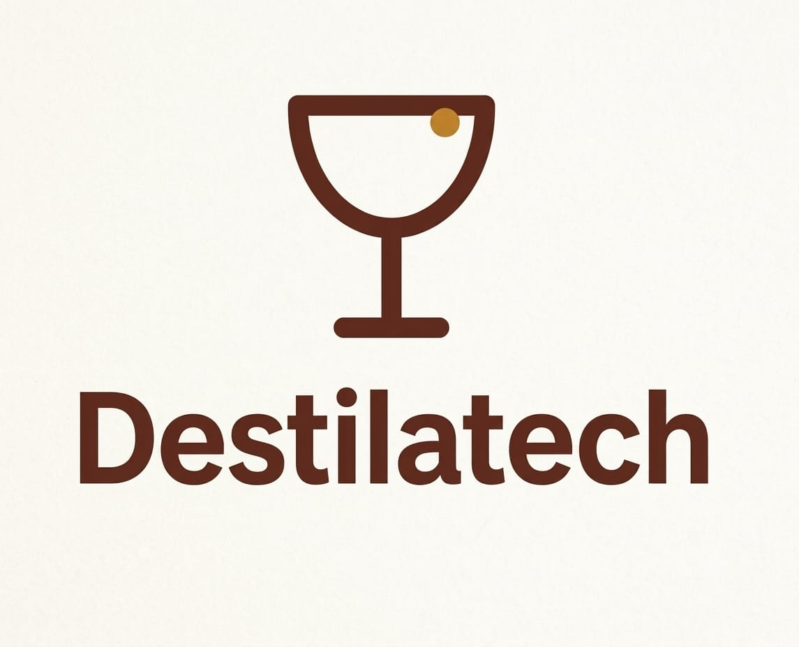
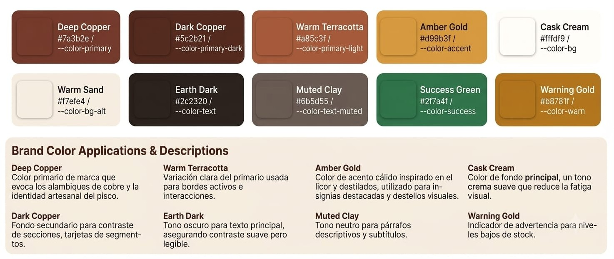

### 4.1. Style Guidelines

Una guía de estilo (*style guideline*) reúne las normas de diseño que se aplican de forma coherente en todos los puntos de contacto del producto. Las especificaciones de esta sección se aplican a la landing page, a la aplicación web y a los prototipos de Destilatech.

#### 4.1.1. General Style Guidelines

**Branding**

La identidad visual de Destilatech busca combinar la tradición artesanal del pisco con la precisión del monitoreo digital. El logotipo está formado por el nombre de la marca en tipografía sans-serif de trazo grueso y un ícono lineal de copa de destilado, con un punto ámbar en el borde que representa el dato o la medición. Los colores del logotipo —cobre oscuro sobre fondo crema— transmiten calidez y confianza, y el trazo simple facilita su uso en tamaños pequeños, como el favicon o el encabezado de la aplicación.

**Figura 41**

*Logotipo de Destilatech*

*Nota.* Elaboración propia (2026).

*Descripción.* El logotipo muestra, sobre un fondo crema, una copa de destilado dibujada con trazo lineal cobre oscuro, con un pequeño círculo ámbar en el borde superior derecho. Debajo se lee el nombre «Destilatech» en tipografía sans-serif de peso alto, en el mismo cobre oscuro. La composición es vertical y centrada.

**Typography**

Se utilizan dos familias de la biblioteca Google Fonts. **Poppins** se emplea en títulos y encabezados por sus formas geométricas y su fuerte presencia visual; **Inter** se emplea en párrafos, tablas e indicadores numéricos porque fue diseñada para pantallas y mantiene la legibilidad en tamaños pequeños, un aspecto relevante para los productores y comercializadores que consultan la aplicación desde un teléfono.

La siguiente tabla resume las especificaciones tipográficas para escritorio. Las especificaciones para móvil se detallan en la sección 4.1.3.

**Tabla 2**

*Especificaciones tipográficas de Destilatech para escritorio*

| Elemento | Color del texto | Fondo | Fuente | Peso | Tamaño | Interlineado | Alineación |
| :---------- | :---------- | :---------- | :---------- | :---------- | :---------- | :---------- | :---------- |
| **H1** | #5c2b21 | Ninguno | Poppins | Bold (700) | 48 px | 1.2 | Izquierda |
| **H2** | #5c2b21 | Ninguno | Poppins | SemiBold (600) | 36 px | 1.3 | Izquierda |
| **H3** | #5c2b21 | Ninguno | Poppins | SemiBold (600) | 24 px | 1.4 | Izquierda |
| **H4** | #7a3b2e | Ninguno | Poppins | Medium (500) | 20 px | 1.4 | Izquierda |
| **Párrafo** | #2c2320 | Ninguno | Inter | Regular (400) | 16 px | 1.5 | Izquierda |
| **Texto pequeño** | #6b5d55 | Ninguno | Inter | Light (300) | 12 px | 1.5 | Izquierda |
| **Datos e indicadores** | #5c2b21 | Ninguno | Inter | SemiBold (600) | 28 px | 1.2 | Izquierda |

**Colors**

La paleta se definió a partir de los materiales y procesos del pisco: el cobre del alambique, el ámbar del destilado y el crema del fondo de barrica. Los verdes y dorados de estado se reservan para comunicar el estado operativo (normal, advertencia). La siguiente tabla lista cada color con su variable CSS.

**Tabla 3**

*Paleta de colores de Destilatech*

| Nombre | Hexadecimal | Variable CSS | Uso principal |
| :---------- | :---------- | :---------- | :----------- |
| Deep Copper | #7a3b2e | `--color-primary` | Color primario de marca, botones y énfasis. |
| Dark Copper | #5c2b21 | `--color-primary-dark` | Encabezados, barra lateral y secciones de contraste. |
| Warm Terracotta | #a85c3f | `--color-primary-light` | Bordes activos e interacciones (hover). |
| Amber Gold | #d99b3f | `--color-accent` | Insignias, destacados y gráficos. |
| Cask Cream | #fffdf9 | `--color-bg` | Fondo principal. |
| Warm Sand | #f7efe4 | `--color-bg-alt` | Fondo alterno de secciones y tarjetas. |
| Earth Dark | #2c2320 | `--color-text` | Texto principal. |
| Muted Clay | #6b5d55 | `--color-text-muted` | Párrafos descriptivos y subtítulos. |
| Success Green | #2f7a4f | `--color-success` | Estados normales o correctos. |
| Warning Gold | #b8781f | `--color-warn` | Advertencias, como niveles bajos de stock. |

**Figura 42**

*Paleta de colores de Destilatech*

*Nota.* Elaboración propia (2026).

*Descripción.* La imagen presenta diez muestras de color con su nombre, su código hexadecimal y su variable CSS: Deep Copper, Dark Copper, Warm Terracotta, Amber Gold, Cask Cream, Warm Sand, Earth Dark, Muted Clay, Success Green y Warning Gold. Debajo se incluye un recuadro con la descripción de uso de cada color de marca, por ejemplo Deep Copper como color primario que evoca los alambiques de cobre y Warning Gold como indicador de advertencia para niveles bajos de stock.

**Spacing**

El espaciado sigue una escala de cinco valores que mantiene el orden visual y asegura áreas táctiles adecuadas en dispositivos móviles.

**Tabla 4**

*Escala de espaciado*

| Token | Valor | Uso principal |
| :---------- | :---------- | :--------------- |
| Spacing 01 | 8 px | Botones compactos, insignias e íconos pequeños. |
| Spacing 02 | 16 px | Tarjetas pequeñas, menús y separación entre ícono y texto. |
| Spacing 03 | 24 px | Tarjetas de planes, contenedores y elementos de cuadrícula. |
| Spacing 04 | 36 px | Bloques de contenido, columnas y títulos de sección. |
| Spacing 05 | 64 px a 88 px | Relleno vertical de secciones completas. |

#### 4.1.2. Web Style Guidelines

Destilatech se diseña como un sitio adaptable (*responsive*), de modo que la misma interfaz sirva a quien administra desde una oficina y a quien consulta desde la bodega o el punto de venta.

**Landing page en escritorio.** El encabezado fijo contiene, de izquierda a derecha, el logotipo, el menú de secciones (Descripción, Objetivos, Precios, Impacto, Funcionalidades), el selector de idioma ES / EN y el botón principal «Prueba gratis 14 días». La sección inicial (*hero*) sigue un recorrido en Z: el título y el resumen a la izquierda, la imagen con tarjetas de datos a la derecha y, debajo, los botones de acción. Las secciones siguientes usan cuadrículas de dos, tres y cuatro columnas según el tipo de contenido (segmentos, planes y beneficios). Los desplazamientos hacia cada sección usan *smooth scroll*.

**Aplicación web en escritorio.** Se utiliza una barra lateral de color Dark Copper con el logotipo y los módulos disponibles según el perfil, un encabezado de página con el título y la etiqueta del rol (Productor o Comercializador), y un área de contenido con tarjetas de indicadores en la parte superior y tablas o gráficos debajo.

**Idioma.** El idioma por defecto del producto es el inglés (`en_US`), con español (`es_419`) disponible desde el selector de idioma del encabezado. Todos los textos de la interfaz se gestionan mediante archivos de traducción.

**Accesibilidad.** Se usan etiquetas semánticas HTML y atributos ARIA (`aria-label` en botones de ícono, `aria-current` en el elemento activo del menú), contraste de color suficiente entre texto y fondo, navegación completa por teclado y texto alternativo en las imágenes.

**Términos y condiciones.** Los enlaces a «Términos y condiciones» y «Política de privacidad» se ubican en el pie de página de la landing page y de la aplicación web.

#### 4.1.3. Mobile Style Guidelines

Esta sección establece las reglas para pantallas menores a 768 px. Los valores son decisiones de diseño del equipo orientadas a uso con una mano y a lectura en exteriores.

**Tabla 5**

*Especificaciones tipográficas para móvil*

| Elemento | Fuente | Peso | Tamaño | Interlineado |
| :---------- | :---------- | :---------- | :---------- | :---------- |
| H1 | Poppins | Bold (700) | 32 px | 1.2 |
| H2 | Poppins | SemiBold (600) | 24 px | 1.3 |
| H3 | Poppins | SemiBold (600) | 20 px | 1.4 |
| Párrafo | Inter | Regular (400) | 16 px | 1.5 |
| Texto pequeño | Inter | Light (300) | 12 px | 1.5 |

**Tabla 6**

*Reglas de diseño para móvil*

| Aspecto | Regla |
| :---------- | :----------------------------- |
| Navegación | El menú del encabezado se reduce a un botón de menú tipo hamburguesa; el botón «Prueba gratis 14 días» permanece visible. En la aplicación, la barra lateral se convierte en un menú desplegable. |
| Áreas táctiles | Tamaño mínimo de 44 × 44 px con separación de 8 px entre elementos interactivos. |
| Diseño de contenido | Una sola columna; las tarjetas de planes y de indicadores se apilan verticalmente. |
| Tablas | Se muestran como lista de tarjetas o con desplazamiento horizontal contenido. |
| Espaciado | Márgenes laterales de 16 px y relleno vertical de sección de 40 px. |
| Formularios | Campos de ancho completo con etiqueta visible y teclado adecuado al tipo de dato (correo, número). |
