### 4.3. Landing Page UI Design

El diseño de la landing page busca causar una primera impresión clara y confiable, y llevar al visitante —productor o comercializador de pisco— a iniciar su prueba gratuita de 14 días. Se diseñó primero en baja fidelidad (wireframes) y luego en alta fidelidad (mock-ups).

#### 4.3.1. Landing Page Wireframe

**Wireframes para escritorio**

**Figura 43**

*Wireframe de la landing page: encabezado y sección inicial*

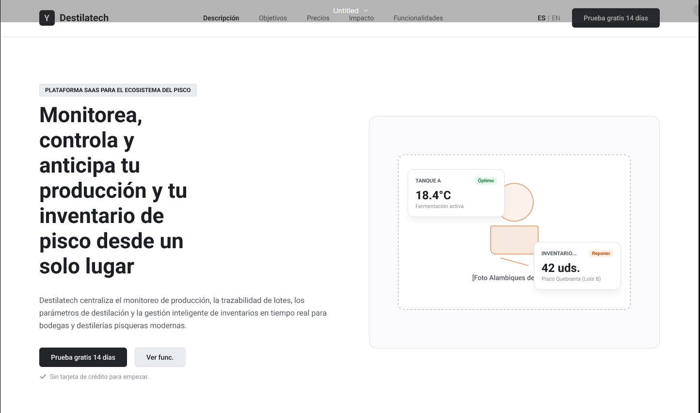

*Nota.* Elaboración propia en Figma (2026).

*Descripción.* En el encabezado se ubican el logotipo, el menú de secciones, el selector ES / EN y el botón «Prueba gratis 14 días». La sección inicial usa dos columnas: a la izquierda, el título, el resumen, los botones de acción y la nota «Sin tarjeta de crédito para empezar»; a la derecha, un marcador de imagen con dos tarjetas flotantes, una de temperatura de tanque (18.4 °C, Óptimo) y otra de inventario (42 uds., Reponer).

**Figura 44**

*Wireframe de la landing page: sección de segmentos*

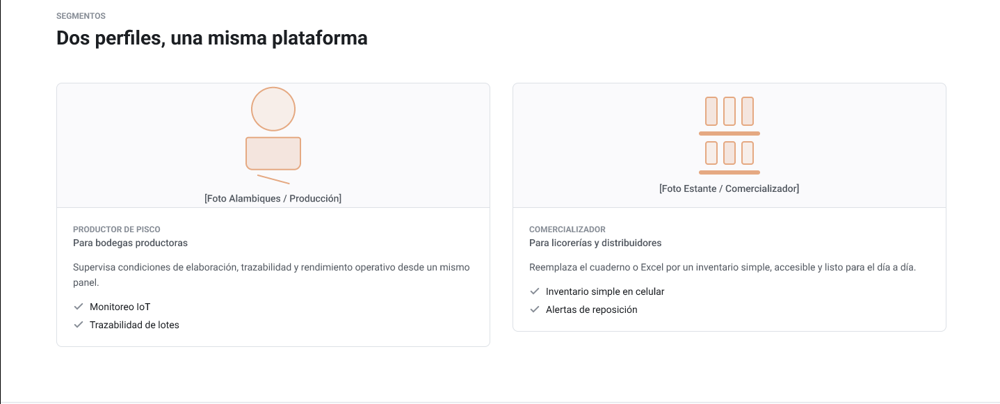

*Nota.* Elaboración propia en Figma (2026).

*Descripción.* La sección «Dos perfiles, una misma plataforma» presenta dos tarjetas lado a lado, una para el Productor de pisco y otra para el Comercializador. Cada tarjeta tiene un marcador de fotografía, un texto breve y una lista de verificación con las funciones principales de su segmento.

**Figura 45**

*Wireframe de la landing page: sección de beneficios*

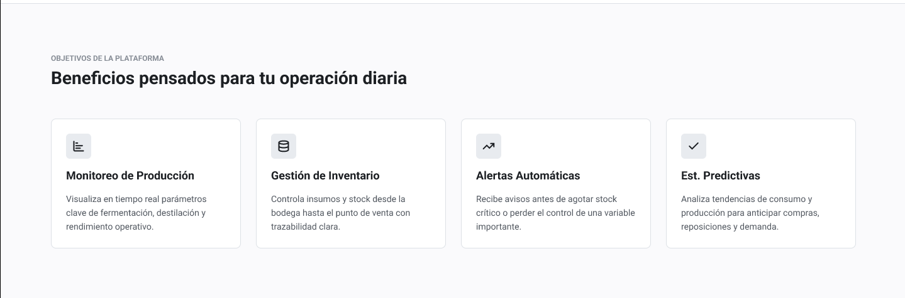

*Nota.* Elaboración propia en Figma (2026).

*Descripción.* La sección «Beneficios pensados para tu operación diaria» organiza cuatro tarjetas en una fila: Monitoreo de Producción, Gestión de Inventario, Alertas Automáticas y Estimaciones Predictivas. Cada tarjeta incluye un ícono, un título y una descripción corta.

**Figura 46**

*Wireframe de la landing page: planes de suscripción e impacto*

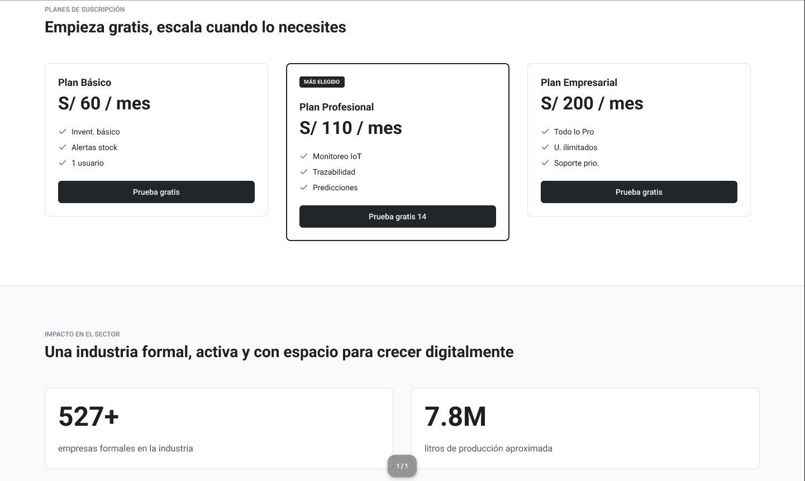

*Nota.* Elaboración propia en Figma (2026).

*Descripción.* La sección de planes muestra tres tarjetas —Plan Básico (S/ 60 al mes), Plan Profesional (S/ 110 al mes, destacado con la insignia «Más elegido») y Plan Empresarial (S/ 200 al mes)— con sus características y un botón de prueba gratuita. Debajo, un bloque de dos columnas presenta las cifras del sector: más de 527 empresas formales y 7.8 millones de litros de producción aproximada.

**Figura 47**

*Wireframe de la landing page: funcionalidades por segmento y llamada a la acción*

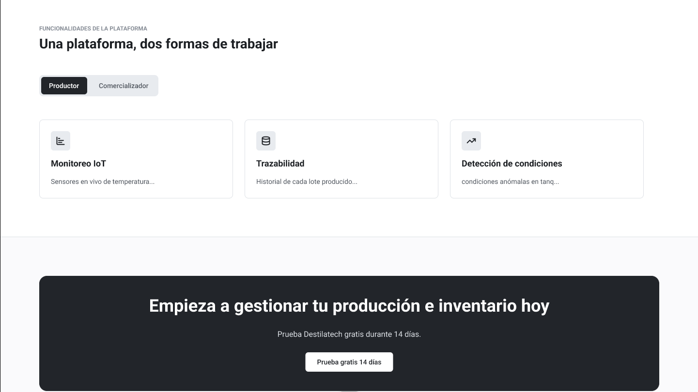

*Nota.* Elaboración propia en Figma (2026).

*Descripción.* La sección «Una plataforma, dos formas de trabajar» incluye pestañas para alternar entre Productor y Comercializador y tres tarjetas de funcionalidades por pestaña (Monitoreo IoT, Trazabilidad y Detección de condiciones anómalas). Debajo aparece un bloque oscuro con la llamada a la acción «Empieza a gestionar tu producción e inventario hoy» y el botón de prueba gratuita.

**Figura 48**

*Wireframe de la landing page: llamada a la acción final y pie de página*

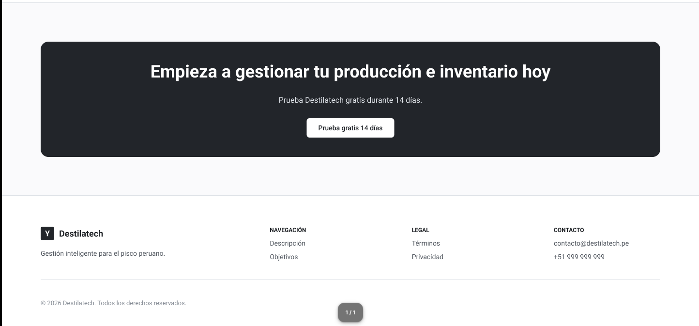

*Nota.* Elaboración propia en Figma (2026).

*Descripción.* El bloque final repite la llamada a la acción y, debajo, el pie de página se organiza en cuatro columnas: marca con eslogan, Navegación (Descripción, Objetivos), Legal (Términos, Privacidad) y Contacto (correo y teléfono), seguidas de la línea de derechos reservados.

**Wireframes para móvil**

En la versión móvil el contenido se apila en una sola columna y el menú se reduce a un botón tipo hamburguesa. Los wireframes siguientes muestran la secuencia de pantallas que ve el visitante al desplazarse.

**Figura 49**

*Wireframes de la landing page para móvil*

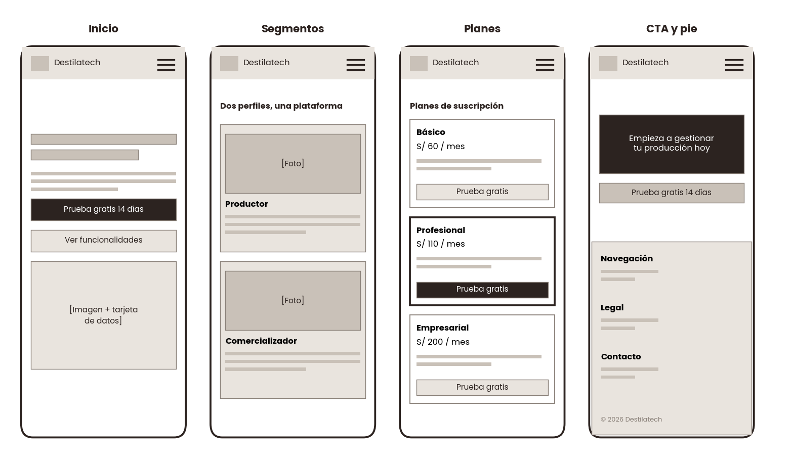

*Nota.* Elaboración propia (2026).

*Descripción.* Cuatro pantallas de teléfono dibujadas en baja fidelidad. La primera muestra el encabezado con el logotipo y el botón de menú, el título principal, el texto de apoyo, el botón «Prueba gratis 14 días» y la imagen con una tarjeta de datos. La segunda presenta las dos tarjetas de segmento apiladas una sobre otra. La tercera muestra los tres planes de suscripción en columna con el plan central destacado. La cuarta incluye la llamada a la acción final y el pie de página con sus enlaces apilados.

#### 4.3.2. Landing Page Mock-up

Los mock-ups aplican la guía de estilo de la sección 4.1 sobre los wireframes anteriores: paleta de cobre, ámbar y crema, tipografías Poppins e Inter, fotografías de bodegas y estantes de licorería, y tarjetas con ícono y lista de verificación.

**Figura 50**

*Mock-up de la landing page: encabezado y sección inicial*

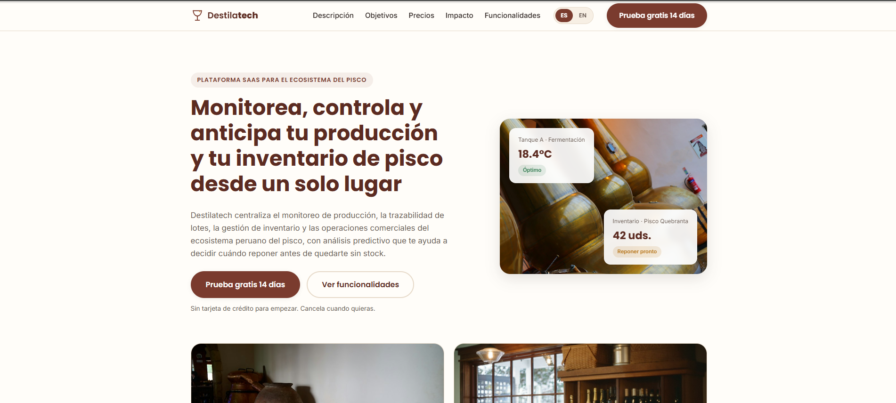

*Nota.* Elaboración propia a partir de la landing page publicada (2026).

*Descripción.* El encabezado fijo contiene el logotipo, el menú de secciones, el selector ES / EN y el botón «Prueba gratis 14 días» en color cobre. La sección inicial muestra el título «Monitorea, controla y anticipa tu producción y tu inventario de pisco desde un solo lugar», dos botones de acción y, a la derecha, una fotografía de botellas de pisco con dos tarjetas flotantes: temperatura de tanque (18.4 °C, Óptimo) e inventario (42 uds., Reponer pronto).

**Figura 51**

*Mock-up de la landing page: segmentos*

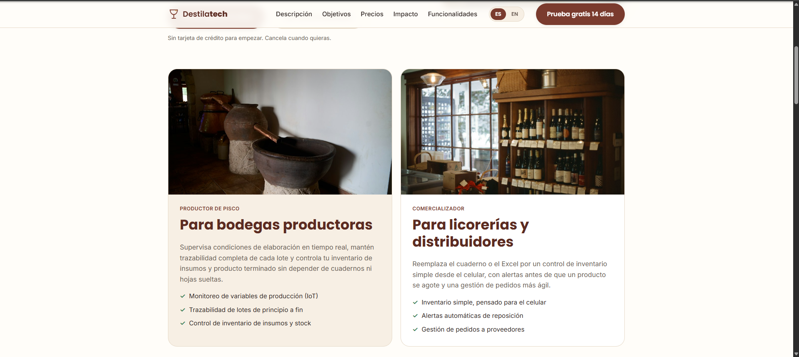

*Nota.* Elaboración propia a partir de la landing page publicada (2026).

*Descripción.* Dos tarjetas con fotografía presentan los segmentos. «Para bodegas productoras» (fondo arena) lista el monitoreo de variables, la trazabilidad de lotes y el control de inventario de insumos. «Para licorerías y distribuidores» lista el inventario simple desde el celular, las alertas de reposición y la gestión de pedidos a proveedores.

**Figura 52**

*Mock-up de la landing page: beneficios*

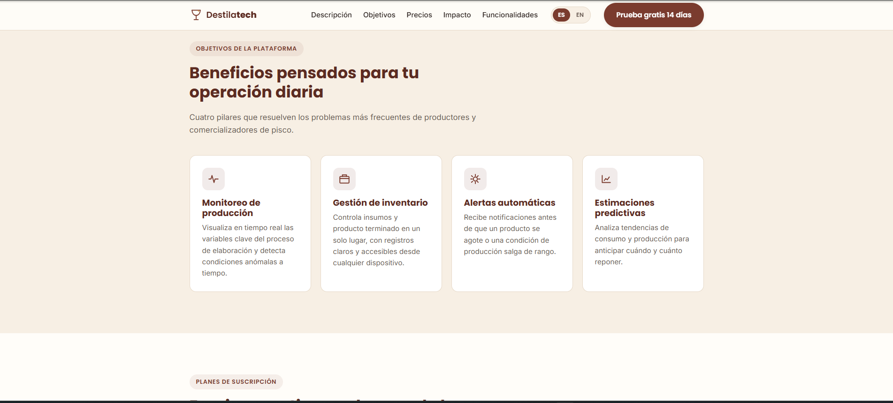

*Nota.* Elaboración propia a partir de la landing page publicada (2026).

*Descripción.* Cuatro tarjetas blancas sobre fondo arena, cada una con un ícono, un título y una descripción: Monitoreo de producción, Gestión de inventario, Alertas automáticas y Estimaciones predictivas.

**Figura 53**

*Mock-up de la landing page: planes de suscripción*

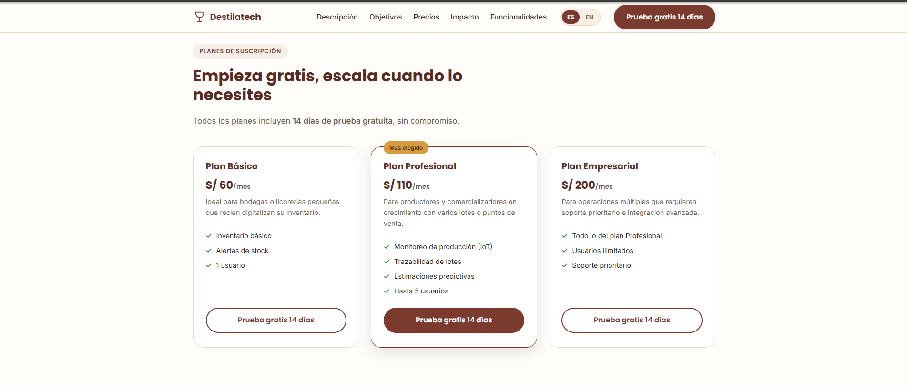

*Nota.* Elaboración propia a partir de la landing page publicada (2026).

*Descripción.* Tres tarjetas de planes: Básico (S/ 60 al mes), Profesional (S/ 110 al mes, con la insignia «Más elegido» y borde resaltado) y Empresarial (S/ 200 al mes). Cada plan lista sus características y un botón «Prueba gratis 14 días». Sobre las tarjetas se indica que todos los planes incluyen 14 días de prueba sin compromiso.

**Figura 54**

*Mock-up de la landing page: impacto en el sector*

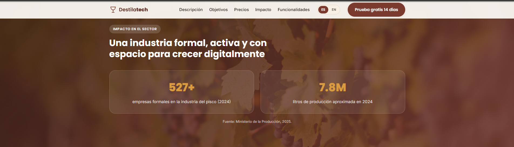

*Nota.* Elaboración propia a partir de la landing page publicada (2026).

*Descripción.* Sobre un fondo fotográfico oscuro de tonos cobre se muestran dos cifras destacadas en dorado: más de 527 empresas formales en la industria del pisco (2024) y 7.8 millones de litros de producción aproximada en 2024, con la fuente indicada al pie.

**Figura 55**

*Mock-up de la landing page: funcionalidades por segmento*

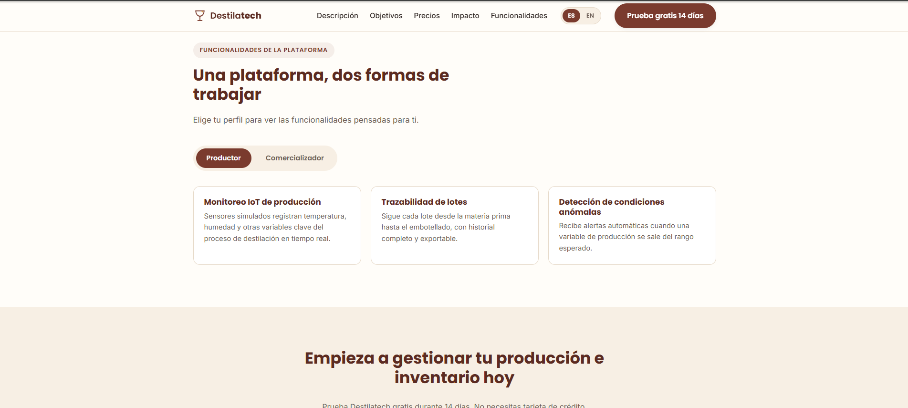

*Nota.* Elaboración propia a partir de la landing page publicada (2026).

*Descripción.* Las pestañas «Productor» y «Comercializador» permiten alternar el contenido. Con la pestaña Productor activa se ven tres tarjetas: Monitoreo IoT de producción, Trazabilidad de lotes y Detección de condiciones anómalas. Debajo comienza el bloque de la llamada a la acción sobre fondo arena.

**Figura 56**

*Mock-up de la landing page: llamada a la acción y pie de página*

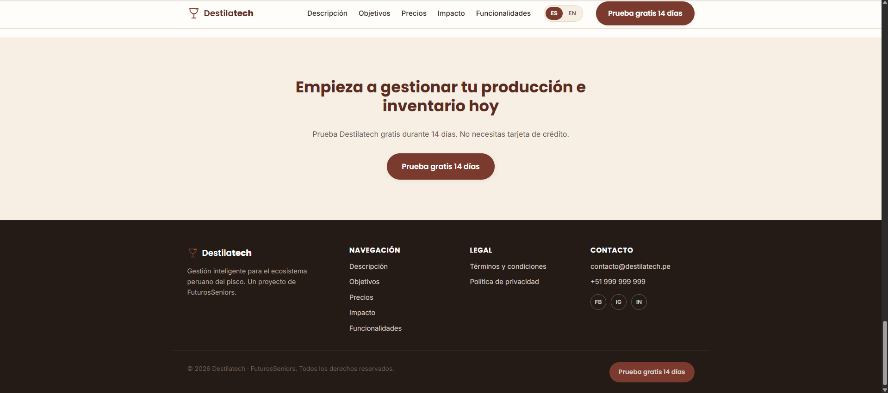

*Nota.* Elaboración propia a partir de la landing page publicada (2026).

*Descripción.* La llamada a la acción final invita a probar Destilatech durante 14 días sin tarjeta de crédito. El pie de página, en tono oscuro, se organiza en columnas de marca, Navegación, Legal (términos y condiciones y política de privacidad) y Contacto, con íconos de redes sociales y un botón de prueba gratuita.

**Mock-up para móvil**

**Figura 57**

*Mock-up de la landing page para móvil: inicio, menú desplegado y objetivos*

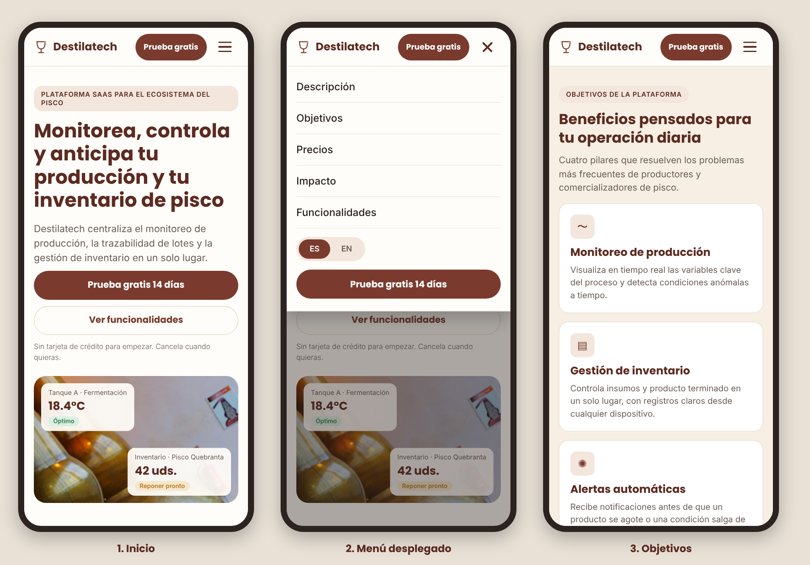

*Nota.* Elaboración propia (2026), a partir de la guía de estilo (secciones 4.1.1 y 4.1.3) y de los mock-ups de escritorio.

*Descripción.* Tres pantallas de teléfono de 390 px de ancho. La pantalla 1 muestra el encabezado con el logotipo, el botón «Prueba gratis» siempre visible y el botón de menú; debajo, la etiqueta de la plataforma, el título principal, el texto de apoyo, los botones «Prueba gratis 14 días» y «Ver funcionalidades» a ancho completo, la nota «Sin tarjeta de crédito» y la fotografía de alambiques con las tarjetas de temperatura (18.4 °C, Óptimo) e inventario (42 uds., Reponer pronto). La pantalla 2 muestra el menú desplegado (Descripción, Objetivos, Precios, Impacto y Funcionalidades), el selector de idioma ES / EN y el botón de prueba gratuita, con el contenido restante atenuado. La pantalla 3 apila en una sola columna las cuatro tarjetas de beneficios: Monitoreo de producción, Gestión de inventario, Alertas automáticas y Estimaciones predictivas.

**Figura 58**

*Mock-up de la landing page para móvil: planes, funcionalidades, impacto y pie de página*

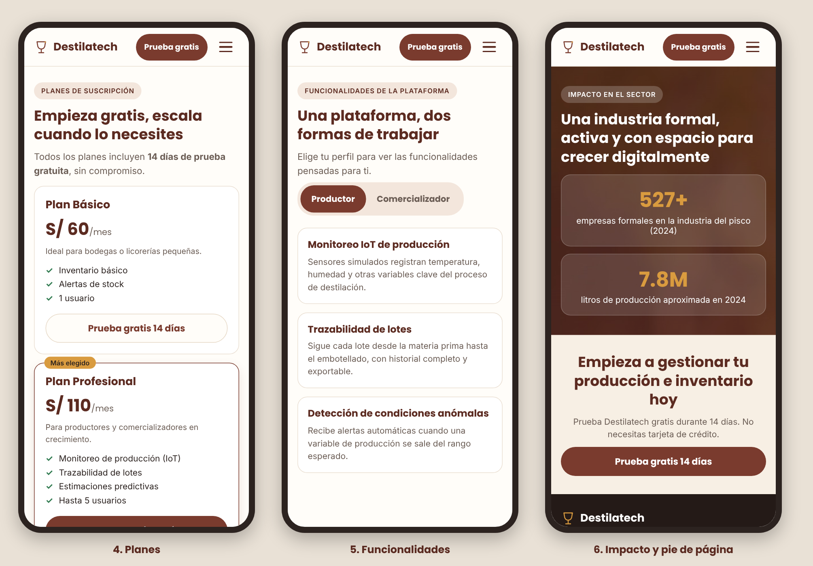

*Nota.* Elaboración propia (2026), a partir de la guía de estilo (secciones 4.1.1 y 4.1.3) y de los mock-ups de escritorio.

*Descripción.* La pantalla 4 apila las tarjetas de planes (Plan Básico a S/ 60 al mes y Plan Profesional a S/ 110 al mes, con la insignia «Más elegido»), cada una con su botón de prueba gratuita. La pantalla 5 muestra el selector de perfil (Productor y Comercializador) y las tarjetas de funcionalidades en una columna. La pantalla 6 muestra la sección de impacto sobre fondo de viñedo con las cifras 527+ y 7.8M, la llamada a la acción final y el inicio del pie de página en tono oscuro.

**Enlaces de la landing page**

- Sitio publicado: https://upc-pre-202620-1asi0730-2620-8084-desti.github.io/destilatech-website/
- Repositorio: https://github.com/upc-pre-202620-1ASI0730-2620-8084-desti/destilatech-website
