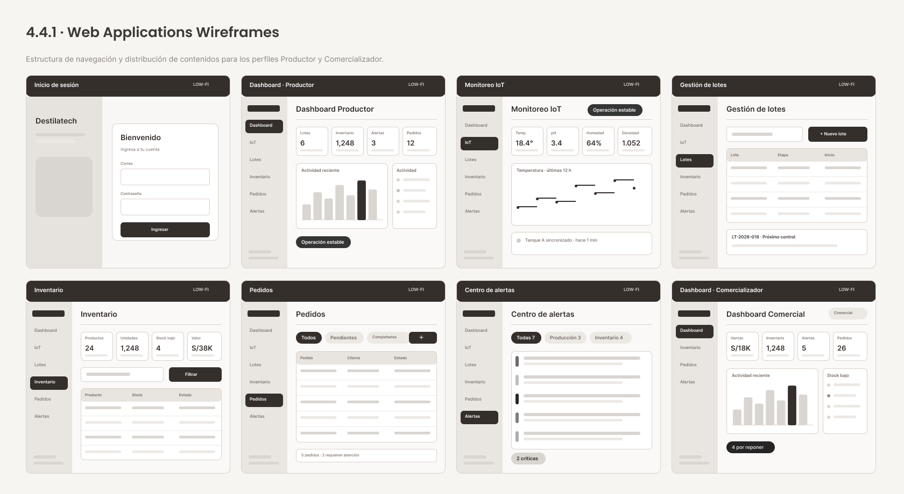
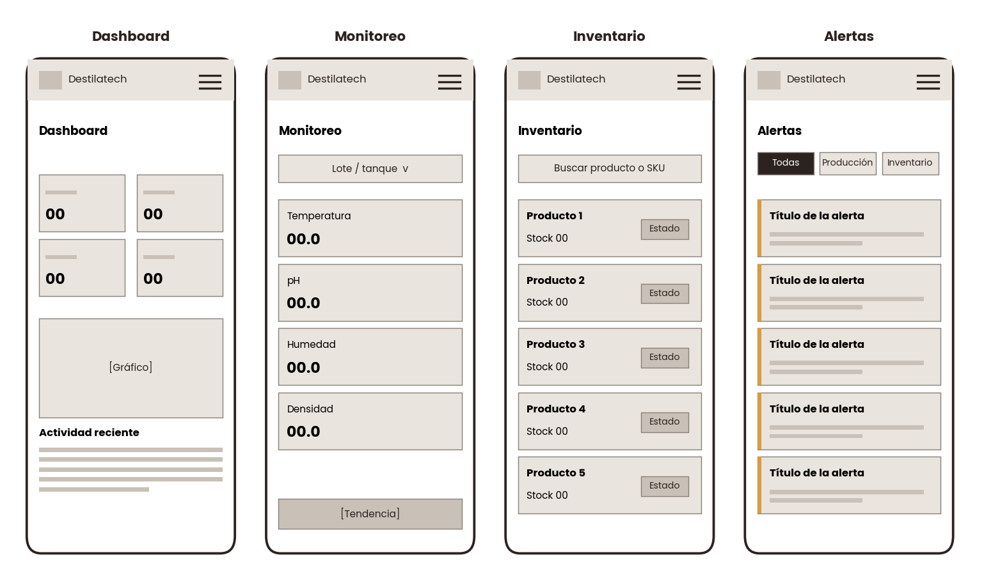
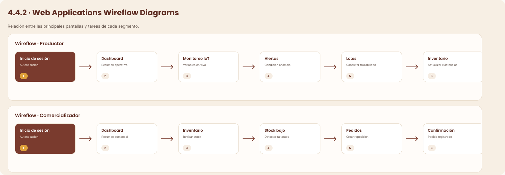
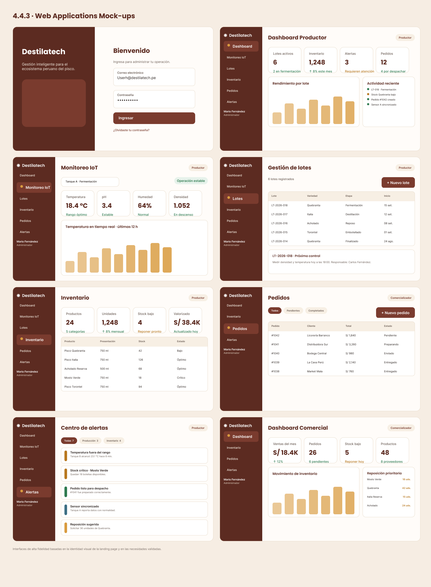
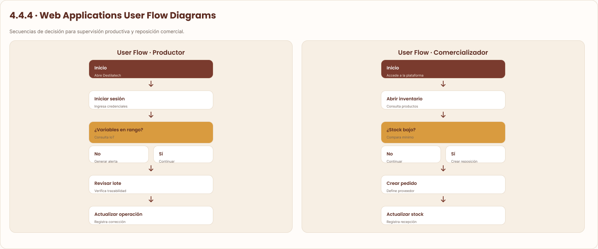

### 4.4. Web Applications UX/UI Design

El diseño de la aplicación web atiende a los dos segmentos del producto con una estructura visual común y una navegación adaptada a cada perfil. El Productor accede a monitoreo, lotes, inventario, pedidos y alertas; el Comercializador usa una navegación reducida centrada en inventario, pedidos y alertas.

El archivo de diseño se encuentra en Figma: [Archivo completo de Destilatech](https://www.figma.com/design/l1g2fiZCTh5QYzOwzvGh9n/Untitled--Copy-?node-id=2007-2).

#### 4.4.1. Web Applications Wireframes

Los wireframes definen la estructura de las pantallas antes de aplicar la identidad visual. Permiten validar la jerarquía de la información y las diferencias entre perfiles.

**Figura 59**

*Wireframes de la aplicación web*

*Nota.* Elaboración propia en Figma (2026).

*Descripción.* Ocho vistas en baja fidelidad organizadas en una cuadrícula: inicio de sesión, dashboard del productor, monitoreo IoT, gestión de lotes, inventario, pedidos, centro de alertas y dashboard del comercializador. Todas las vistas internas comparten una barra lateral de navegación a la izquierda y un área de contenido con tarjetas de indicadores, tablas o gráficos.

**Wireframes para móvil**

**Figura 60**

*Wireframes de la aplicación web para móvil*

*Nota.* Elaboración propia (2026).

*Descripción.* Cuatro pantallas de teléfono en baja fidelidad: el dashboard con cuatro tarjetas de indicadores en dos columnas y la lista de actividad reciente; el monitoreo con el selector de lote y las tarjetas de variables apiladas; el inventario como lista de tarjetas con estado de stock; y el centro de alertas con filtros por tipo. En cada una, la navegación se reduce a un botón de menú en el encabezado.

#### 4.4.2. Web Applications Wireflow Diagrams

Los wireflows combinan wireframes con flechas que muestran cómo el usuario pasa de una pantalla a otra para completar una tarea. El Productor inicia sesión, consulta su dashboard, supervisa las variables, revisa las alertas, consulta los lotes y actualiza el inventario. El Comercializador consulta su dashboard e inventario, identifica los productos con stock bajo y registra pedidos.

**Figura 61**

*Wireflows de la aplicación web*

*Nota.* Elaboración propia en Figma (2026).

*Descripción.* Dos recorridos con las pantallas conectadas por flechas. En el recorrido del Productor se encadenan inicio de sesión, dashboard, monitoreo IoT, alertas, lotes e inventario. En el recorrido del Comercializador se encadenan dashboard comercial, inventario, pedidos y alertas. Las flechas indican el sentido normal de navegación entre pantallas.

#### 4.4.3. Web Applications Mock-ups

Los mock-ups presentan la propuesta visual de alta fidelidad. Mantienen la paleta y la tipografía de la landing page y usan datos de ejemplo coherentes con el dominio (lotes, temperatura, pH, humedad, densidad, niveles de stock, pedidos y alertas). La etiqueta de rol en el encabezado y el contenido del menú lateral diferencian las funciones de cada perfil.

**Figura 62**

*Mock-ups de la aplicación web*

*Nota.* Elaboración propia en Figma (2026).

*Descripción.* Ocho pantallas de alta fidelidad con barra lateral de color cobre oscuro. Inicio de sesión con campos de correo y contraseña. Dashboard del productor con cuatro indicadores (6 lotes activos, 1,248 unidades de inventario, 3 alertas y 12 pedidos), un gráfico de rendimiento por lote y la actividad reciente. Monitoreo IoT del tanque A con temperatura (18.4 °C), pH, humedad y densidad, y un gráfico de las últimas 12 horas. Gestión de lotes con tabla de lotes por variedad, etapa y fecha de inicio. Inventario con indicadores y tabla de productos por presentación, stock y estado. Pedidos con filtros por estado y tabla de pedidos. Centro de alertas con tarjetas por severidad. Dashboard comercial con ventas del mes, pedidos, stock bajo y reposición prioritaria.

**Consideraciones sobre los mock-ups.** Algunos elementos de los mock-ups, como el estado «Preparando» o «Enviado» de un pedido, los gráficos de ventas del mes y el dato «8 proveedores», representan funciones que el alcance vigente (sección 3.3) no incluye (el pedido de venta tiene los estados Borrador y Confirmado y el proveedor no se gestiona como entidad). Estos elementos se ajustarán en la versión implementada.

#### 4.4.4. Web Applications User Flow Diagrams

Los diagramas de flujo de usuario describen las decisiones que toma el usuario en dos tareas prioritarias. En el flujo del Productor, el usuario inicia sesión y el sistema evalúa si las variables están dentro del rango esperado; si no lo están, genera una alerta; luego el usuario revisa el lote y registra una acción correctiva. En el flujo del Comercializador, el usuario abre el inventario y el sistema compara cada producto con su umbral; si el stock está bajo, el usuario genera una lista de compra y, al recibir los productos, registra la entrada para actualizar el stock.

**Rutas alternativas (unhappy paths).**

| Flujo | Situación | Respuesta del sistema |
| :---------- | :------------ | :----------------------- |
| Inicio de sesión | Credenciales incorrectas o prueba gratuita vencida. | Muestra un mensaje de error genérico y no revela cuál campo falló; si la prueba venció, ofrece contratar un plan. |
| Monitoreo | No hay lecturas recientes del lote. | Indica que no hay datos y no muestra el estado «Operación estable». |
| Alerta | La condición anómala persiste. | Mantiene una sola alerta abierta por episodio y evita duplicados. |
| Reposición | El producto no tiene umbral configurado. | No genera alerta de stock bajo y sugiere configurar el umbral. |
| Pedido | El stock disponible es menor que la cantidad pedida. | Rechaza la confirmación e indica qué producto no alcanza; no modifica el stock. |

**Figura 63**

*Diagramas de flujo de usuario de la aplicación web*

*Nota.* Elaboración propia en Figma (2026).

*Descripción.* Dos diagramas verticales. El flujo del Productor va de «Inicio» a «Iniciar sesión», una decisión «¿Variables en rango?» con las ramas «No: generar alerta» y «Sí: continuar», «Revisar lote» y «Actualizar operación». El flujo del Comercializador va de «Inicio» a «Abrir inventario», una decisión «¿Stock bajo?» con las ramas «No: continuar» y «Sí: crear reposición», «Crear pedido» y «Actualizar stock». Los rectángulos oscuros marcan el inicio, los dorados las decisiones y los blancos las acciones.

*Nota sobre el flujo del Comercializador:* en el diagrama, el paso «Crear pedido» indica «Define proveedor». En el alcance vigente (sección 3.3), la reposición se resuelve generando una lista de compra que el usuario envía por WhatsApp; el pedido a proveedor como registro dentro de la plataforma queda fuera de alcance.
