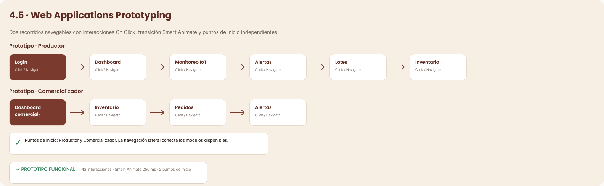

### 4.5. Web Applications Prototyping

El prototipo interactivo se construyó en Figma a partir de los mock-ups. Contiene doce pantallas y cuarenta y dos interacciones configuradas con eventos *On Click* y transiciones *Smart Animate* de 250 ms. Se definieron dos puntos de inicio, uno por perfil: el recorrido del Productor recorre inicio de sesión, dashboard, monitoreo IoT, alertas, lotes e inventario; el recorrido del Comercializador recorre dashboard comercial, inventario, pedidos y alertas.

**Figura 64**

*Recorridos del prototipo interactivo*

*Nota.* Elaboración propia en Figma (2026).

*Descripción.* Dos filas de pantallas conectadas por flechas. La fila «Prototipo · Productor» inicia en Login y continúa con Dashboard, Monitoreo IoT, Alertas, Lotes e Inventario. La fila «Prototipo · Comercializador» inicia en Dashboard comercial y continúa con Inventario, Pedidos y Alertas. Cada transición indica «Click / Navigate». Un recuadro inferior resume que el prototipo es funcional, con 42 interacciones, transición Smart Animate de 250 ms y dos puntos de inicio.

**Enlaces del prototipo interactivo**

- [Flujo del Productor](https://www.figma.com/design/l1g2fiZCTh5QYzOwzvGh9n/Untitled--Copy-?node-id=2031-525)
- [Flujo del Comercializador](https://www.figma.com/design/l1g2fiZCTh5QYzOwzvGh9n/Untitled--Copy-?node-id=2031-874)
