### 4.6. Domain-Driven Software Architecture

A partir del Big Picture EventStorming (sección 2.4) y del Ubiquitous Language (sección 2.5), el equipo profundizó el análisis del dominio con Domain-Driven Design (Evans, 2003) y derivó la arquitectura de software con el modelo C4 (Brown, 2018). Durante el Design-Level EventStorming se identificó que el área Identity / Subscriptions del Big Picture reunía dos responsabilidades con ciclos de cambio distintos: la identidad y el acceso de la cuenta, y la gestión comercial de planes, suscripciones y pagos. Por ello se dividió en dos *bounded contexts* independientes, **IAM (Identity & Access Management)** y **Billing**, que coinciden con los subdominios «Identity and Access Management» y «Subscriptions and Payment Management» que el enunciado del curso señala para las plataformas SaaS. El dominio queda compuesto por siete *bounded contexts*: IAM, Billing, Production & Monitoring, Inventory & Stock Management, Orders & Replenishment, Alerts & Notifications y Analytics & Estimations. Para cada uno se identificaron los *commands*, *aggregates*, eventos de dominio, políticas y consultas (*read models*).

Los diagramas se elaboraron como código y se guardan en `assets/diagrams/`: los diagramas C4 están escritos en Structurizr DSL (`structurizr/workspace.dsl`), los diagramas de clases y de base de datos en PlantUML (`plantuml/`) y el Design-Level EventStorming en Mermaid (`mermaid/`). Cada carpeta conserva el código fuente y las imágenes generadas a partir de él.

**Decisiones de diseño que organizan toda la sección**

| Decisión | Motivo |
| :--------------------------- | :------------------------ |
| Siete *bounded contexts* implementados como módulos de una sola API (monolito modular). | El equipo es pequeño y el alcance es acotado; se evita la complejidad operativa de los microservicios sin renunciar a los límites entre contextos. |
| Comunicación entre contextos mediante eventos de dominio y commands, no compartiendo agregados. | Mantiene los contextos desacoplados y permite evolucionar cada uno por separado. |
| Base de datos relacional MySQL, con prefijo de módulo en cada tabla. | Los datos son estructurados y relacionales; el prefijo deja visible a qué contexto pertenece cada tabla. |
| Referencias entre contextos como identificadores lógicos, sin llaves foráneas físicas. | Preserva el desacoplamiento de los módulos y facilita separarlos en el futuro. |
| Claves de idempotencia en pagos y pedidos, y `source_id` y `source_key` en lecturas y movimientos. | Evitan registros duplicados cuando una solicitud se reintenta. |
| Fuente de datos IoT simulada que envía lecturas a la API con la misma interfaz que usaría un sensor real. | El alcance académico no incluye hardware físico. |
| Pasarela de pago externa en modo de pruebas (*sandbox*), detrás de la interfaz `IPaymentGateway`. | Permite cambiar de proveedor sin modificar el dominio. |

#### 4.6.1. Design-Level EventStorming

El equipo organizó una sesión de Design-Level EventStorming de 1 hora con 45 minutos, siguiendo la guía de referencia del curso (https://bit.ly/dles-guide). Partió de las cuatro áreas candidatas del negocio actual identificadas en el Big Picture EventStorming (sección 2.4.5) y de lo que la solución añade, y llegó a siete *bounded contexts*. En cada uno se identificaron los *commands* (acciones que un actor o un sistema externo dispara), el *aggregate* que procesa el command y garantiza sus invariantes, los eventos de dominio resultantes, las políticas (reacciones automáticas del sistema ante un evento, que pueden disparar commands en el mismo contexto o en otro) y los *read models* (vistas de consulta que el sistema expone a partir de los eventos).

**Qué incluye la solución y cómo modifica el flujo de eventos.** El Big Picture mostró cómo funciona hoy el negocio, con cuaderno, Excel y WhatsApp, y sus hotspots. La solución de Destilatech incorpora commands, eventos y vistas de consulta que cambian esos puntos del flujo de la siguiente manera:

| Punto del flujo actual (Big Picture) | Cómo lo modifica Destilatech | Eventos de dominio que aparecen | Bounded context |
| :--------------------------- | :----------------------------- | :--------------- | :------------ |
| La temperatura anómala se detecta tarde y obliga a visitar la bodega (eventos 5 y 6 del productor) | Las lecturas de los sensores (simulados) se comparan con el rango configurado de cada variable y se avisa al productor | `SensorReadingRecorded`, `AnomalyDetected`, `AlertRaised` | Production & Monitoring → Alerts & Notifications |
| El lote se anota dos veces y el producto terminado se cuenta físicamente (eventos 12 y 13 del productor) | El lote se registra una vez y cada entrada, salida o ajuste se guarda como movimiento que actualiza el stock | `BatchRegistered`, `StockMovementRegistered`, `StockLevelUpdated` | Production & Monitoring, Inventory & Stock Management |
| Las ventas se anotan con retraso o no se anotan (evento 16 del productor; evento 3 del comercializador) | Registrar el pedido descuenta el stock automáticamente | `OrderRegistered`, `StockLevelUpdated` | Orders & Replenishment → Inventory & Stock Management |
| El producto se agota sin que el dueño lo note (eventos 5 y 6 del comercializador) | Un umbral por producto genera una alerta antes del quiebre | `LowStockDetected`, `AlertRaised` | Inventory & Stock Management → Alerts & Notifications |
| La reposición se decide a ojo (evento 7 del comercializador) | La estimación se calcula con el historial de movimientos y se indica su nivel de confianza | `ReplenishmentEstimateCalculated` | Analytics & Estimations |
| El pedido al proveedor se coordina por WhatsApp sin registro (eventos 8 y 9 del comercializador) | La lista de compra se genera dentro de la plataforma y el pedido queda registrado; WhatsApp sigue siendo el canal | `ReplenishmentListGenerated`, `OrderRegistered` | Orders & Replenishment |
| No existe en el negocio actual: el acceso a la herramienta y su cobro | La plataforma identifica al usuario y, al terminar la prueba, cobra la suscripción mediante una pasarela externa en modo de pruebas | `CheckoutStarted`, `PaymentConfirmed`, `SubscriptionActivated` | IAM, Billing |

**Criterios para separar los *bounded contexts*.** Las fronteras no se trazaron por módulos de pantalla, sino con cuatro criterios aplicados a las áreas candidatas del Big Picture y a las capacidades nuevas de la solución:

| Criterio | Cómo se aplicó | Ejemplo |
| :---------- | :------------------------ | :-------------------------------------- |
| Eventos pivote | Una frontera se ubica donde un evento cierra una fase y abre otra (sección 2.4.6). | «Pisco embotellado y etiquetado» separa Production & Monitoring de Inventory & Stock Management. |
| Lenguaje ubicuo | Un término tiene un solo significado dentro de un contexto; si cambia de significado, hay otro contexto. | «Lote» es una unidad en proceso en Production & Monitoring y «Existencia» es una cantidad disponible en Inventory; «Alerta» agrupa anomalías y stock bajo en Alerts & Notifications. |
| Ciclo de cambio y responsabilidad | Las responsabilidades que cambian por razones distintas se separan. | El acceso del usuario (IAM) y el cobro de la suscripción (Billing) cambian por razones distintas y no existen en el negocio actual; por eso se separan de los contextos operativos. |
| Datos propios | Cada contexto es dueño de sus agregados; los demás solo los consultan mediante eventos o commands. | Orders & Replenishment descuenta stock con el command `DiscountStock`, sin modificar los agregados de Inventory. |

**Relación entre las áreas del Big Picture y los *bounded contexts*.** «Producción del pisco» origina Production & Monitoring; «Registro de lotes y existencias» origina Inventory & Stock Management; «Ventas y atención al cliente» y «Reposición y abastecimiento» se reúnen en Orders & Replenishment porque comparten el concepto de pedido. Alerts & Notifications y Analytics & Estimations no existen en el negocio actual: nacen de la solución para atender los hotspots de detección tardía y de reposición a ojo. IAM y Billing completan la plataforma como producto SaaS.

**Leyenda utilizada en los diagramas**

| Elemento | Forma y color | Descripción |
| :---------- | :---------- | :------------------- |
| Command | Rectángulo azul | Acción o intención disparada por un actor o un sistema externo. |
| Aggregate | Hexágono amarillo | Objeto del dominio que procesa el command y mantiene su consistencia. |
| Domain Event | Óvalo naranja | Hecho relevante ya ocurrido en el dominio, resultado de procesar un command. |
| Policy | Rombo morado | Reacción automática del sistema ante un evento, que puede disparar otro command. |
| Read Model | Paralelogramo verde | Vista de consulta construida a partir de los eventos. |
| Sistema externo | Óvalo rosa | Sistema ajeno a Destilatech que dispara o recibe eventos. |

**a. IAM (Identity & Access Management)**

Gestiona la identidad de la cuenta del usuario (productor o comercializador), su autenticación, la recuperación de contraseña y el periodo de prueba de 14 días. Responde al Epic EP01.

**Figura 65**

*Design-Level EventStorming del Bounded Context IAM*

<p align="center">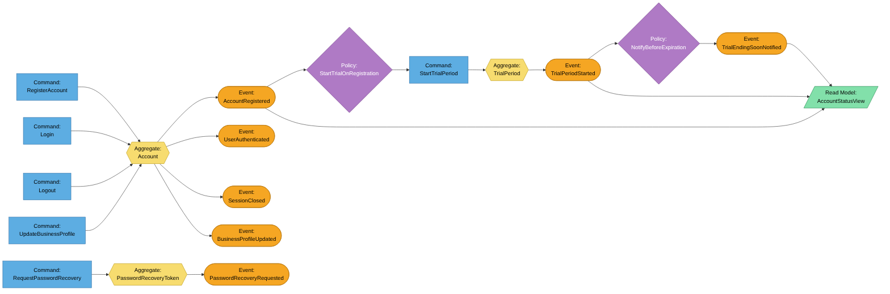</p>

*Nota.* Elaboración propia en Mermaid (2026).

*Descripción.* Diagrama de flujo de izquierda a derecha que ordena los commands, aggregates, eventos, políticas y read models del contexto IAM (Identity & Access Management); las flechas punteadas indican interacciones con otros contextos o con sistemas externos.


El evento `AccountRegistered` dispara la política `StartTrialOnRegistration`, que activa automáticamente el periodo de prueba de 14 días (US01, US56). El comando `Login` autentica al usuario y emite el token de sesión (US02, US26), mientras que `Logout` lo cierra (US38) y `RequestPasswordRecovery` genera un token temporal de recuperación (US39). `UpdateBusinessProfile` permite al usuario corregir los datos de su negocio (US41). La política `NotifyBeforeExpiration` observa el paso del tiempo sobre `TrialPeriod` y avisa cuando quedan 3 días (US03). IAM expone `AccountStatusView` para que otros Bounded Contexts, como Billing, consulten si la cuenta está activa sin acoplarse a su modelo interno.

**b. Billing**

Gestiona los planes, la suscripción de pago y los intentos de pago asociados a la cuenta. Responde al Epic EP01.

**Figura 66**

*Design-Level EventStorming del Bounded Context Billing*

<p align="center">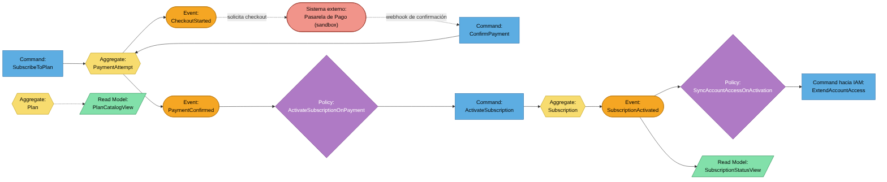</p>

*Nota.* Elaboración propia en Mermaid (2026).

*Descripción.* Diagrama de flujo de izquierda a derecha que ordena los commands, aggregates, eventos, políticas y read models del contexto Billing; las flechas punteadas indican interacciones con otros contextos o con sistemas externos.


El comando `SubscribeToPlan` (US40) crea un `PaymentAttempt` con una clave de idempotencia y solicita el checkout a la Pasarela de Pago, sistema externo que aparece con la solución, ya que el negocio actual no cobra suscripciones. Cuando la pasarela confirma el cobro, el comando `ConfirmPayment` marca el intento como pagado; la política `ActivateSubscriptionOnPayment` activa entonces la suscripción, y `SyncAccountAccessOnActivation` envía un Command hacia IAM para extender el acceso de la cuenta más allá del periodo de prueba. El acoplamiento entre ambos contextos es delgado: se comunican con eventos y commands, no con consultas directas a su modelo interno. `SubscriptionStatusView` alimenta la consulta del plan y del estado de la suscripción (US54) y `PlanCatalogView` los planes que se muestran al contratar.

**c. Production & Monitoring**

Gestiona los lotes de producción y el monitoreo de las variables del proceso. Responde a los Epics EP03 y EP04.

**Figura 67**

*Design-Level EventStorming del Bounded Context Production & Monitoring*

<p align="center">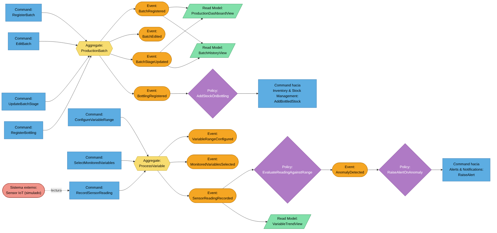</p>

*Nota.* Elaboración propia en Mermaid (2026).

*Descripción.* Diagrama de flujo de izquierda a derecha que ordena los commands, aggregates, eventos, políticas y read models del contexto Production & Monitoring; las flechas punteadas indican interacciones con otros contextos o con sistemas externos.


`RegisterBatch` (US06, US59) y `UpdateBatchStage` (US07, US60) mantienen el ciclo de vida del lote y alimentan `BatchHistoryView` (US08) y `ProductionDashboardView` (US04); `EditBatch` corrige los datos del lote (US42) y `RegisterBottling` (US43) dispara, mediante la política `AddStockOnBottling`, el Command `AddBottledStock` hacia Inventory & Stock Management. La política `EvaluateReadingAgainstRange` es el corazón del monitoreo: compara cada `SensorReadingRecorded` (US09, US28, US64) contra el rango definido con `ConfigureVariableRange` (US10) y, de estar fuera de rango, genera `AnomalyDetected` (US11), que a su vez dispara un Command hacia Alerts & Notifications. `SelectMonitoredVariables` define qué variables se vigilan en cada lote (US55) y `VariableTrendView` muestra su tendencia (US44, US61). El Sensor IoT se mantiene simulado dentro del alcance académico, tal como se identificó en el Big Picture EventStorming.

**d. Inventory & Stock Management**

Gestiona el catálogo de productos y el control de stock. Responde a los Epics EP05 y EP06.

**Figura 68**

*Design-Level EventStorming del Bounded Context Inventory & Stock Management*

<p align="center">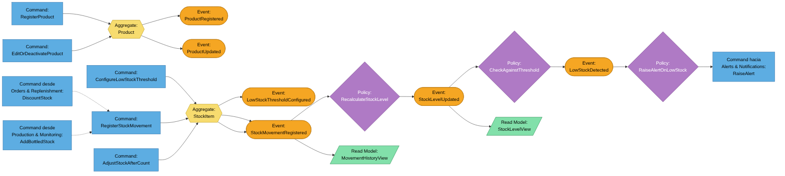</p>

*Nota.* Elaboración propia en Mermaid (2026).

*Descripción.* Diagrama de flujo de izquierda a derecha que ordena los commands, aggregates, eventos, políticas y read models del contexto Inventory & Stock Management; las flechas punteadas indican interacciones con otros contextos o con sistemas externos.


`RegisterStockMovement` puede originarse directamente en la interfaz del usuario (US13, US27) o ser disparado por Commands cruzados desde otros Bounded Contexts: `DiscountStock` (cuando Orders & Replenishment confirma un pedido, US18) y `AddBottledStock` (cuando Production & Monitoring registra un embotellado, US43). `AdjustStockAfterCount` corrige el saldo tras un conteo físico (US47). La política `CheckAgainstThreshold` compara el nuevo nivel contra el umbral configurado (US15) para decidir si dispara `LowStockDetected`, que se envía a Alerts & Notifications. `StockLevelView` responde a la consulta de stock disponible (US14) y `MovementHistoryView` al historial de movimientos de un producto (US46); la edición o desactivación de productos corresponde a US12 y US45.

**e. Orders & Replenishment**

Gestiona clientes, pedidos de venta y las listas de compra para la reposición. Responde al Epic EP07.

**Figura 69**

*Design-Level EventStorming del Bounded Context Orders & Replenishment*

<p align="center">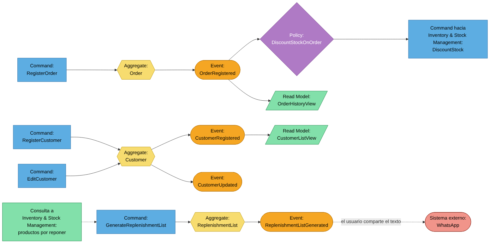</p>

*Nota.* Elaboración propia en Mermaid (2026).

*Descripción.* Diagrama de flujo de izquierda a derecha que ordena los commands, aggregates, eventos, políticas y read models del contexto Orders & Replenishment; las flechas punteadas indican interacciones con otros contextos o con sistemas externos.


`RegisterOrder` (US18, US63) dispara la política `DiscountStockOnOrder`, que emite un Command hacia Inventory & Stock Management para descontar el stock vendido, evitando que Orders & Replenishment conozca o manipule directamente el Aggregate `StockItem`: los Bounded Contexts se comunican por eventos y commands, no compartiendo agregados. `OrderHistoryView` responde a la consulta del historial de pedidos (US19) y `CustomerListView` a la gestión de clientes (US17, US49). `GenerateReplenishmentList` (US50) consulta los productos que están por agotarse y produce un texto listo para compartir; WhatsApp se mantiene como canal informal y externo de coordinación con el proveedor, tal como se identificó en el Big Picture EventStorming, y Destilatech no envía el mensaje por su cuenta.

**f. Alerts & Notifications**

Actúa como un Bounded Context transversal que centraliza las alertas generadas por Production & Monitoring e Inventory & Stock Management. Responde a los Epics EP04 y EP06.

**Figura 70**

*Design-Level EventStorming del Bounded Context Alerts & Notifications*

<p align="center">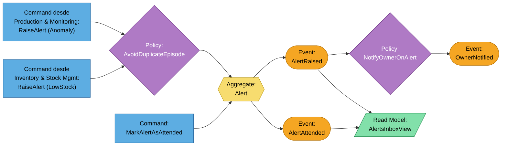</p>

*Nota.* Elaboración propia en Mermaid (2026).

*Descripción.* Diagrama de flujo de izquierda a derecha que ordena los commands, aggregates, eventos, políticas y read models del contexto Alerts & Notifications; las flechas punteadas indican interacciones con otros contextos o con sistemas externos.


Este Bounded Context no origina Commands desde el usuario salvo `MarkAlertAsAttended` (US16); su Aggregate `Alert` se crea a partir de los Commands cruzados que le envían Production & Monitoring e Inventory & Stock Management, manteniendo el desacoplamiento entre contextos. La política `AvoidDuplicateEpisode` impide abrir una segunda alerta mientras el mismo episodio sigue pendiente, y `NotifyOwnerOnAlert` informa al usuario dentro de la plataforma (US11). `AlertsInboxView` es la bandeja que se consulta y se filtra por tipo y estado (US16, US48, US62).

**g. Analytics & Estimations**

Calcula estimaciones de reposición e indicadores históricos a partir del historial de otros Bounded Contexts. Responde al Epic EP08 y al resumen del dashboard (EP02).

**Figura 71**

*Design-Level EventStorming del Bounded Context Analytics & Estimations*

<p align="center">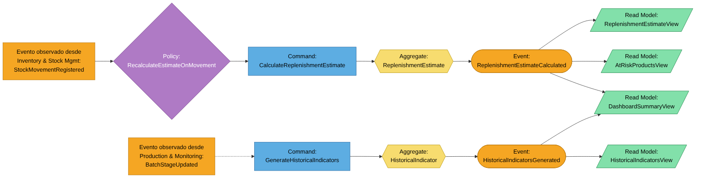</p>

*Nota.* Elaboración propia en Mermaid (2026).

*Descripción.* Diagrama de flujo de izquierda a derecha que ordena los commands, aggregates, eventos, políticas y read models del contexto Analytics & Estimations; las flechas punteadas indican interacciones con otros contextos o con sistemas externos.


Este contexto se suscribe al evento `StockMovementRegistered`, publicado por Inventory & Stock Management, para recalcular la estimación de reposición (US20, US29) sin acoplarse a su modelo interno; `AtRiskProductsView` muestra los productos con riesgo de agotamiento (US51). `GenerateHistoricalIndicators` se ejecuta de forma periódica o bajo demanda para alimentar los gráficos de evolución de inventario y producción (US21), consumiendo el historial de Production & Monitoring e Inventory & Stock Management. `DashboardSummaryView` combina ambos resultados para los dashboards de producción y comercial (US04, US05, US65).

**Resumen del Design-Level EventStorming**

| Bounded Context | Commands | Aggregates | Eventos de dominio | Consultas (*read models*) | Políticas |
| :---------- | :-------------------------- | :---------- | :------------------------------- | :-------------- | :--------------- |
| IAM | `RegisterAccount`, `Login`, `Logout`, `RequestPasswordRecovery`, `UpdateBusinessProfile`, `StartTrialPeriod` | `Account`, `TrialPeriod`, `PasswordRecoveryToken` | `AccountRegistered`, `UserAuthenticated`, `SessionClosed`, `PasswordRecoveryRequested`, `BusinessProfileUpdated`, `TrialPeriodStarted`, `TrialEndingSoonNotified` | `AccountStatusView` | `StartTrialOnRegistration`, `NotifyBeforeExpiration` |
| Billing | `SubscribeToPlan`, `ConfirmPayment`, `ActivateSubscription` | `PaymentAttempt`, `Subscription`, `Plan` | `CheckoutStarted`, `PaymentConfirmed`, `SubscriptionActivated` | `SubscriptionStatusView`, `PlanCatalogView` | `ActivateSubscriptionOnPayment`, `SyncAccountAccessOnActivation` |
| Production & Monitoring | `RegisterBatch`, `EditBatch`, `UpdateBatchStage`, `RegisterBottling`, `ConfigureVariableRange`, `SelectMonitoredVariables`, `RecordSensorReading` | `ProductionBatch`, `ProcessVariable` | `BatchRegistered`, `BatchEdited`, `BatchStageUpdated`, `BottlingRegistered`, `VariableRangeConfigured`, `MonitoredVariablesSelected`, `SensorReadingRecorded`, `AnomalyDetected` | `ProductionDashboardView`, `BatchHistoryView`, `VariableTrendView` | `AddStockOnBottling`, `EvaluateReadingAgainstRange`, `RaiseAlertOnAnomaly` |
| Inventory & Stock Management | `RegisterProduct`, `EditOrDeactivateProduct`, `ConfigureLowStockThreshold`, `RegisterStockMovement`, `AdjustStockAfterCount` | `Product`, `StockItem` | `ProductRegistered`, `ProductUpdated`, `LowStockThresholdConfigured`, `StockMovementRegistered`, `StockLevelUpdated`, `LowStockDetected` | `StockLevelView`, `MovementHistoryView` | `RecalculateStockLevel`, `CheckAgainstThreshold`, `RaiseAlertOnLowStock` |
| Orders & Replenishment | `RegisterCustomer`, `EditCustomer`, `RegisterOrder`, `GenerateReplenishmentList` | `Customer`, `Order`, `ReplenishmentList` | `CustomerRegistered`, `CustomerUpdated`, `OrderRegistered`, `ReplenishmentListGenerated` | `OrderHistoryView`, `CustomerListView` | `DiscountStockOnOrder` |
| Alerts & Notifications | `RaiseAlert`, `MarkAlertAsAttended` | `Alert` | `AlertRaised`, `OwnerNotified`, `AlertAttended` | `AlertsInboxView` | `AvoidDuplicateEpisode`, `NotifyOwnerOnAlert` |
| Analytics & Estimations | `CalculateReplenishmentEstimate`, `GenerateHistoricalIndicators` | `ReplenishmentEstimate`, `HistoricalIndicator` | `ReplenishmentEstimateCalculated`, `HistoricalIndicatorsGenerated` | `ReplenishmentEstimateView`, `AtRiskProductsView`, `HistoricalIndicatorsView`, `DashboardSummaryView` | `RecalculateEstimateOnMovement` |

**Tabla 7**

*Resumen de commands, aggregates, eventos, consultas y políticas por *bounded context*.*

Los commands que cruzan contextos (`ExtendAccountAccess`, `RaiseAlert`, `DiscountStock` y `AddBottledStock`) son los puntos de integración de la arquitectura; en el nivel de componentes (sección 4.6.4) aparecen como relaciones entre módulos de la API.

#### 4.6.2. Software Architecture Context Diagram

El diagrama de contexto presenta a Destilatech como un único recuadro al centro, rodeado por sus usuarios y por los sistemas externos con los que interactúa. Se elaboró con Structurizr y su código fuente (Structurizr DSL) se incluye al final de esta sección.

**Figura 72**

*Diagrama de contexto C4 de Destilatech*

<p align="center">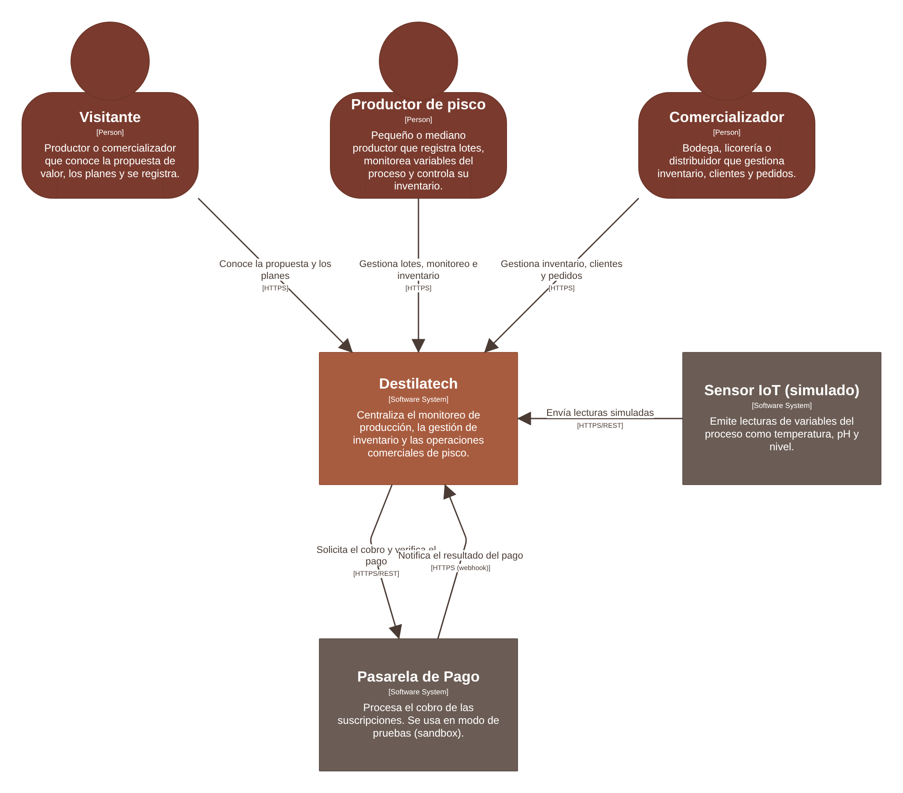</p>

*Nota.* Elaboración propia en Structurizr (2026).

*Descripción.* Destilatech aparece como un sistema central. Tres personas lo usan: el visitante, que conoce la propuesta y se registra; el productor de pisco, que gestiona lotes, monitoreo e inventario; y el comercializador, que gestiona inventario, clientes y pedidos. Dos sistemas externos se conectan con él: la pasarela de pago, a la que se solicitan cobros y de la que se recibe la notificación del resultado, y el sensor IoT simulado, que envía lecturas.


Los tres actores acceden a Destilatech como un único sistema, sin necesidad de conocer su composición interna ni la división en contextos. La pasarela de pago y el sensor IoT simulado son los dos sistemas externos con los que Destilatech se comunica; ambos aparecen con la solución y no existían en el negocio actual descrito en el Big Picture EventStorming. WhatsApp, el canal que hoy usan los entrevistados para coordinar pedidos, no se integra con Destilatech: el usuario comparte por su cuenta el texto de la lista de compra.

| Origen | Destino | Descripción de la relación | Protocolo |
| :---------- | :---------- | :---------------- | :---------- |
| Visitante | Destilatech | Conoce la propuesta de valor y los planes, y se registra. | HTTPS |
| Productor de pisco | Destilatech | Registra lotes, monitorea variables del proceso y controla su inventario. | HTTPS |
| Comercializador | Destilatech | Gestiona inventario, clientes y pedidos. | HTTPS |
| Destilatech | Pasarela de Pago | Solicita el cobro de la suscripción y verifica el pago. | HTTPS/REST |
| Pasarela de Pago | Destilatech | Notifica el resultado del pago. | HTTPS (webhook) |
| Sensor IoT (simulado) | Destilatech | Envía lecturas simuladas de las variables del proceso. | HTTPS/REST |

**Tabla 8**

*Relaciones del diagrama de contexto.*

**Código Structurizr DSL del espacio de trabajo (contexto, contenedores y componentes)**

```text
workspace "Destilatech" "Arquitectura de software de Destilatech, plataforma SaaS para el monitoreo de producción, el control de inventario y la gestión comercial de pisco." {

    !identifiers hierarchical

    model {

        # ---------------------------------------------------------------
        # Personas
        # ---------------------------------------------------------------
        visitor = person "Visitante" "Productor o comercializador que conoce la propuesta de valor, los planes y se registra."
        producer = person "Productor de pisco" "Pequeño o mediano productor que registra lotes, monitorea variables del proceso y controla su inventario."
        retailer = person "Comercializador" "Bodega, licorería o distribuidor que gestiona inventario, clientes y pedidos."

        # ---------------------------------------------------------------
        # Sistemas externos
        # ---------------------------------------------------------------
        paymentGateway = softwareSystem "Pasarela de Pago" "Procesa el cobro de las suscripciones. Se usa en modo de pruebas (sandbox)." "External"
        iotSensor = softwareSystem "Sensor IoT (simulado)" "Emite lecturas de variables del proceso como temperatura, pH y nivel." "External"

        # ---------------------------------------------------------------
        # Sistema de software
        # ---------------------------------------------------------------
        destilatech = softwareSystem "Destilatech" "Centraliza el monitoreo de producción, la gestión de inventario y las operaciones comerciales de pisco." {

            website = container "Website" "Sitio web estático con la propuesta de valor, los planes y el punto de entrada al registro." "HTML5, CSS3, JavaScript" "Website" {
                header = component "Header" "Logo, navegación entre secciones y selector de idioma." "HTML, CSS, JavaScript"
                description = component "Description" "Explica qué es Destilatech y su propuesta de valor." "HTML, CSS, JavaScript"
                goals = component "Goals" "Presenta los beneficios principales de la plataforma." "HTML, CSS, JavaScript"
                pricing = component "Pricing" "Muestra los planes de suscripción y la prueba gratuita de 14 días." "HTML, CSS, JavaScript"
                impact = component "Impact" "Muestra cifras del sector pisquero peruano." "HTML, CSS, JavaScript"
                features = component "Platform Features" "Describe las funcionalidades por segmento objetivo." "HTML, CSS, JavaScript"
                footer = component "Footer" "Contacto, enlaces, términos y condiciones y llamada a la acción de registro." "HTML, CSS, JavaScript"
            }

            webStatic = container "Web Application Static Content" "Sirve al navegador los archivos estáticos de la aplicación (HTML, CSS y paquetes de JavaScript) desde un servicio de hosting." "Hosting de contenido estático" "Static Content"

            spa = container "Single-Page Application" "Aplicación de una sola página que se ejecuta en el navegador del usuario; productores y comercializadores operan la plataforma desde ella." "Vue 3, PrimeVue, Pinia, Vue Router, JavaScript" "Web Browser" {
                sharedKernel = component "Shared Kernel" "Layout, cliente HTTP base, internacionalización (es/en), conmutador de usuario de demostración y componentes comunes." "Vue components, JavaScript"
                iamUi = component "IAM (planificado)" "Registro, inicio de sesión y recuperación de contraseña. No se aplica en el Sprint 2." "Vue components" "Planned"
                billingUi = component "Billing" "Plan, estado de la suscripción, periodo de prueba e historial de pagos." "Vue components, Pinia"
                productionUi = component "Production & Monitoring" "Lotes de producción, variables del proceso y lecturas simuladas." "Vue components, Pinia"
                inventoryUi = component "Inventory & Stock Management" "Productos, stock, movimientos y umbrales." "Vue components, Pinia"
                ordersUi = component "Orders & Replenishment" "Clientes, pedidos y lista de compra para reposición." "Vue components, Pinia"
                alertsUi = component "Alerts & Notifications" "Bandeja de alertas de anomalía y de stock bajo." "Vue components, Pinia"
                analyticsUi = component "Analytics & Estimations" "Dashboard, estimaciones de reposición e indicadores históricos." "Vue components, Pinia, Chart.js"
            }

            api = container "REST API" "Un único contenedor que expone los servicios de los siete bounded contexts como módulos: reglas de negocio, seguridad y acceso a datos. En el Sprint 2 se simula con una Fake API (json-server)." "ASP.NET Core, C#, Entity Framework Core" "API" {
                controllers = component "API Controllers" "Enruta, valida y autentica las peticiones HTTP y publica la documentación OpenAPI." "ASP.NET Core Controllers" "Controllers"
                iam = component "IAM" "Identidad de la cuenta, autenticación, recuperación de contraseña y periodo de prueba." "C# module"
                billing = component "Billing" "Planes, suscripciones e intentos de pago." "C# module"
                production = component "Production & Monitoring" "Lotes de producción, variables del proceso y lecturas." "C# module"
                inventory = component "Inventory & Stock Management" "Productos, stock, umbrales y movimientos." "C# module"
                orders = component "Orders & Replenishment" "Clientes, pedidos y listas de compra para reposición." "C# module"
                alerts = component "Alerts & Notifications" "Centraliza y gestiona las alertas." "C# module"
                analytics = component "Analytics & Estimations" "Estimaciones de reposición, indicadores históricos y resumen del dashboard." "C# module"
            }

            db = container "Database" "Persiste la información de cada bounded context en tablas con prefijo de módulo." "MySQL" "Database"
        }

        # ---------------------------------------------------------------
        # Relaciones entre personas, contenedores y sistemas externos
        # ---------------------------------------------------------------
        visitor -> destilatech.website "Conoce la propuesta y los planes" "HTTPS"
        destilatech.website -> destilatech.webStatic "Enlaza a la aplicación" "HTTPS"
        destilatech.webStatic -> destilatech.spa "Entrega la aplicación al navegador" "HTTPS"
        producer -> destilatech.spa "Gestiona lotes, monitoreo e inventario" "HTTPS"
        retailer -> destilatech.spa "Gestiona inventario, clientes y pedidos" "HTTPS"
        destilatech.spa -> destilatech.api "Consume los servicios" "JSON/HTTPS"
        destilatech.api -> destilatech.db "Lee y escribe" "SQL/TLS (EF Core)"
        destilatech.api -> paymentGateway "Solicita el cobro y verifica el pago" "HTTPS/REST"
        paymentGateway -> destilatech.api "Notifica el resultado del pago" "HTTPS (webhook)"
        iotSensor -> destilatech.api "Envía lecturas simuladas" "HTTPS/REST"

        # ---------------------------------------------------------------
        # Componentes del Website
        # ---------------------------------------------------------------
        visitor -> destilatech.website.header "Navega entre secciones" "HTTPS"
        destilatech.website.header -> destilatech.website.description "Enlaza"
        destilatech.website.header -> destilatech.website.goals "Enlaza"
        destilatech.website.header -> destilatech.website.pricing "Enlaza"
        destilatech.website.header -> destilatech.website.impact "Enlaza"
        destilatech.website.header -> destilatech.website.features "Enlaza"
        destilatech.website.header -> destilatech.website.footer "Enlaza"
        destilatech.website.pricing -> destilatech.webStatic "Enlaza a la aplicación con el plan preseleccionado" "HTTPS"
        destilatech.website.footer -> destilatech.webStatic "Enlaza al registro" "HTTPS"

        # ---------------------------------------------------------------
        # Componentes de la Single-Page Application (bounded contexts)
        # ---------------------------------------------------------------
        producer -> destilatech.spa.analyticsUi "Consulta su dashboard" "HTTPS"
        retailer -> destilatech.spa.analyticsUi "Consulta su dashboard" "HTTPS"
        destilatech.spa.sharedKernel -> destilatech.spa.alertsUi "Muestra las alertas pendientes"
        destilatech.spa.sharedKernel -> destilatech.spa.billingUi "Muestra el estado de la prueba gratuita"
        destilatech.spa.productionUi -> destilatech.spa.inventoryUi "Consulta productos al registrar el embotellado"
        destilatech.spa.productionUi -> destilatech.spa.alertsUi "Genera alertas de anomalía"
        destilatech.spa.inventoryUi -> destilatech.spa.alertsUi "Genera alertas de stock bajo"
        destilatech.spa.ordersUi -> destilatech.spa.inventoryUi "Consulta y descuenta stock"
        destilatech.spa.analyticsUi -> destilatech.spa.productionUi "Consulta lotes y lecturas"
        destilatech.spa.analyticsUi -> destilatech.spa.inventoryUi "Consulta stock y movimientos"
        destilatech.spa.analyticsUi -> destilatech.spa.ordersUi "Consulta pedidos"
        destilatech.spa.analyticsUi -> destilatech.spa.alertsUi "Consulta alertas"
        destilatech.spa.ordersUi -> destilatech.spa.analyticsUi "Consulta estimaciones de reposición"
        destilatech.spa.inventoryUi -> destilatech.spa.analyticsUi "Consulta la estimación de un producto"
        destilatech.spa.sharedKernel -> destilatech.api "Invoca los servicios de cada contexto" "JSON/HTTPS"

        # ---------------------------------------------------------------
        # Componentes de la REST API
        # ---------------------------------------------------------------
        destilatech.api.controllers -> destilatech.api.iam "Enruta"
        destilatech.api.controllers -> destilatech.api.billing "Enruta"
        destilatech.api.controllers -> destilatech.api.production "Enruta"
        destilatech.api.controllers -> destilatech.api.inventory "Enruta"
        destilatech.api.controllers -> destilatech.api.orders "Enruta"
        destilatech.api.controllers -> destilatech.api.alerts "Enruta"
        destilatech.api.controllers -> destilatech.api.analytics "Enruta"
        destilatech.api.billing -> destilatech.api.iam "SubscriptionActivated (extiende el acceso)" "Evento de dominio" "Domain"
        destilatech.api.production -> destilatech.api.alerts "AnomalyDetected" "Evento de dominio" "Domain"
        destilatech.api.inventory -> destilatech.api.alerts "LowStockDetected" "Evento de dominio" "Domain"
        destilatech.api.orders -> destilatech.api.inventory "OrderRegistered (descuenta stock)" "Evento de dominio" "Domain"
        destilatech.api.production -> destilatech.api.inventory "BottlingRegistered (agrega stock)" "Evento de dominio" "Domain"
        destilatech.api.analytics -> destilatech.api.inventory "Lee el historial de movimientos" "Interfaz de lectura" "Domain"
        destilatech.api.analytics -> destilatech.api.production "Lee el historial de lotes" "Interfaz de lectura" "Domain"
        destilatech.api.orders -> destilatech.api.inventory "Consulta productos por reponer" "Interfaz de lectura" "Domain"
        destilatech.api.iam -> destilatech.db "Lee y escribe" "SQL/TLS"
        destilatech.api.billing -> destilatech.db "Lee y escribe" "SQL/TLS"
        destilatech.api.production -> destilatech.db "Lee y escribe" "SQL/TLS"
        destilatech.api.inventory -> destilatech.db "Lee y escribe" "SQL/TLS"
        destilatech.api.orders -> destilatech.db "Lee y escribe" "SQL/TLS"
        destilatech.api.alerts -> destilatech.db "Lee y escribe" "SQL/TLS"
        destilatech.api.analytics -> destilatech.db "Lee y escribe" "SQL/TLS"
        destilatech.api.billing -> paymentGateway "Solicita el cobro y verifica el pago" "HTTPS/REST"
        paymentGateway -> destilatech.api.billing "Notifica el resultado del pago" "HTTPS (webhook)"
        iotSensor -> destilatech.api.production "Envía lecturas simuladas" "HTTPS/REST"
    }

    views {

        systemContext destilatech "C4-01-Contexto" "Diagrama de contexto de Destilatech" {
            include *
            autolayout tb 200 120
        }

        container destilatech "C4-02-Contenedores" "Diagrama de contenedores de Destilatech" {
            include *
            autolayout lr 200 150
        }

        component destilatech.website "C4-03-Componentes-Website" "Diagrama de componentes del Website" {
            include *
            autolayout tb 120 120
        }

        component destilatech.spa "C4-04-Componentes-SPA" "Diagrama de componentes de la Single-Page Application (bounded contexts)" {
            include *
            autolayout lr 150 200
        }

        component destilatech.api "C4-05-Componentes-API" "Módulos de la REST API: enrutamiento, eventos de dominio e interfaces de lectura" {
            include destilatech.api.controllers destilatech.api.iam destilatech.api.billing destilatech.api.production destilatech.api.inventory destilatech.api.orders destilatech.api.alerts destilatech.api.analytics
        }

        component destilatech.api "C4-06-Componentes-API-Datos" "Acceso a datos e integraciones externas de la REST API" {
            include destilatech.api.iam destilatech.api.billing destilatech.api.production destilatech.api.inventory destilatech.api.orders destilatech.api.alerts destilatech.api.analytics destilatech.db paymentGateway iotSensor
            exclude "relationship.tag==Domain"
        }

        branding {
            font "Arial"
        }

        styles {
            element "Person" {
                shape Person
                width 400
                height 400
                background #7a3b2e
                color #ffffff
            }
            element "Software System" {
                background #a85c3f
                color #ffffff
            }
            element "External" {
                background #6b5d55
                color #ffffff
            }
            element "Container" {
                background #d99b3f
                color #2c2320
            }
            element "Component" {
                background #f7efe4
                color #2c2320
                stroke #a85c3f
            }
            element "Web Browser" {
                shape WebBrowser
            }
            element "Website" {
                shape Folder
            }
            element "Static Content" {
                shape Folder
            }
            element "Planned" {
                background #ffffff
                stroke #a85c3f
                strokeWidth 3
                border dashed
            }
            element "Controllers" {
                width 3650
                height 200
            }
            element "Database" {
                shape Cylinder
            }
            relationship "Relationship" {
                thickness 3
                color #4a3b34
                dashed false
                fontSize 22
                width 300
            }
        }
    }
}
```

El código está en `assets/diagrams/structurizr/workspace.dsl` y el diseño de cada vista (posición de los elementos y trazo de las flechas) en `workspace.json`, de modo que al abrir la carpeta con Structurizr Lite se obtienen los mismos diagramas. Las seis vistas se exportaron como imagen a `assets/diagrams/structurizr/png/` (`C4-01-Contexto`, `C4-02-Contenedores`, `C4-03-Componentes-Website`, `C4-04-Componentes-SPA`, `C4-05-Componentes-API` y `C4-06-Componentes-API-Datos`).

#### 4.6.3. Software Architecture Container Diagrams

El diagrama de contenedores descompone a Destilatech en sus unidades desplegables o ejecutables por separado y muestra las principales decisiones de tecnología y la forma en que se comunican. Pertenece al mismo espacio de trabajo de Structurizr de la sección 4.6.2.

**Figura 73**

*Diagrama de contenedores C4 de Destilatech*

<p align="center">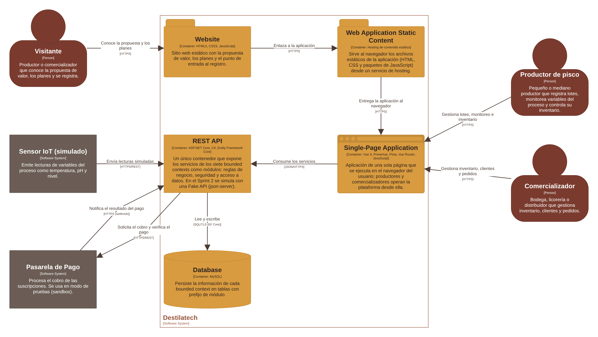</p>

*Nota.* Elaboración propia en Structurizr (2026).

*Descripción.* Dentro de Destilatech hay cinco contenedores. El Website (HTML5, CSS3 y JavaScript) es contenido estático que se sirve desde un hosting. La aplicación web, al ser una aplicación Vue de una sola página, se representa con dos contenedores: *Web Application Static Content*, el hosting que entrega al navegador los archivos estáticos, y *Single-Page Application*, el código Vue que se ejecuta en el navegador del usuario. La REST API (ASP.NET Core, C# y Entity Framework Core) es un único contenedor, aunque contiene los siete *bounded contexts* como módulos, y la base de datos MySQL persiste la información. El visitante usa el Website, que enlaza a la aplicación; el productor y el comercializador usan la SPA, que consume la REST API en JSON por HTTPS. La API lee y escribe en MySQL, se comunica con la pasarela de pago y recibe las lecturas del sensor IoT simulado.


| Contenedor | Tecnología | Responsabilidad |
| :---------- | :---------- | :-------------------------------- |
| Website | HTML5, CSS3, JavaScript | Contenido estático con la propuesta de valor, los planes y el punto de entrada al registro; no requiere autenticación. |
| Web Application Static Content | Hosting de contenido estático | Entrega al navegador los archivos estáticos (HTML, CSS y paquetes de JavaScript) de la aplicación. |
| Single-Page Application | Vue 3, PrimeVue, Pinia, Vue Router, JavaScript | Aplicación que se ejecuta en el navegador y en la que productores y comercializadores operan la plataforma. |
| REST API | ASP.NET Core, C#, Entity Framework Core | Un único contenedor con las reglas de negocio de los siete *bounded contexts*, la seguridad y el acceso a datos. En el Sprint 2 se simula con una Fake API (json-server). |
| Database | MySQL | Persistencia de cada *bounded context* en tablas con prefijo de módulo. |

**Tabla 9**

*Contenedores de Destilatech.*

La decisión tecnológica principal es separar el Website (contenido estático y sin autenticación) de la aplicación autenticada de una sola página, de modo que los llamados a la acción del Website lleven al usuario a la vista correspondiente de la aplicación y la experiencia sea consistente entre ambas, como exige el enunciado. Una aplicación de una sola página se compone de dos contenedores porque el hosting que entrega los archivos y el código que corre en el navegador son elementos de ejecución distintos. En cambio, la REST API es un solo contenedor: los *bounded contexts* son módulos de un mismo despliegue (monolito modular) y se distinguen en el diagrama de componentes de la API, no como contenedores separados. La API es el único contenedor que accede a la base de datos y a los dos sistemas externos.

| Origen | Destino | Descripción | Protocolo |
| :---------- | :---------- | :------------- | :---------- |
| Website | Web Application Static Content | Enlaza a la aplicación (registro, inicio de sesión y plan preseleccionado). | HTTPS |
| Web Application Static Content | Single-Page Application | Entrega la aplicación al navegador del usuario. | HTTPS |
| Single-Page Application | REST API | Consume los servicios de los siete contextos. | JSON/HTTPS |
| REST API | Database | Lee y escribe con Entity Framework Core. | SQL/TLS |
| REST API | Pasarela de Pago | Solicita el cobro y verifica el pago. | HTTPS/REST |
| Pasarela de Pago | REST API | Notifica el resultado del pago. | HTTPS (webhook) |
| Sensor IoT (simulado) | REST API | Envía lecturas simuladas. | HTTPS/REST |

**Tabla 10**

*Comunicación entre contenedores.*

#### 4.6.4. Software Architecture Components Diagrams

Se presentan los diagramas de componentes de los tres contenedores con lógica propia: el Website, la Single-Page Application y la REST API. En la SPA y en la API, el primer nivel de componentes corresponde a los *bounded contexts* y a sus relaciones; los elementos de cada contexto (formularios, listas, servicios, entidades) se detallan en el nivel de código: en los diagramas de clases de la sección 4.7 para la API y, para la SPA, en la estructura por capas de cada contexto del repositorio del frontend. El contenedor de base de datos se detalla en la sección 4.8 (Database Design).

**a. Componentes del Website**

**Figura 74**

*Diagrama de componentes C4 del Website*

<p align="center">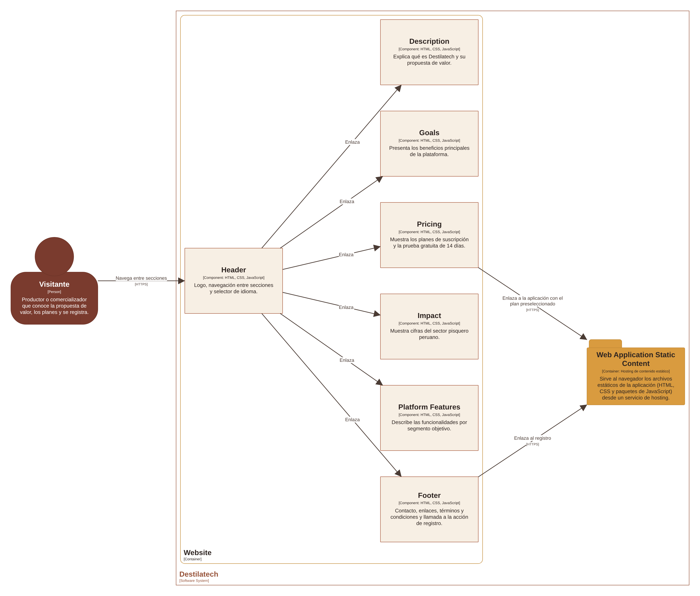</p>

*Nota.* Elaboración propia en Structurizr (2026).

*Descripción.* El Website se compone de siete secciones: Header, Description, Goals, Pricing, Impact, Platform Features y Footer. El visitante navega desde el Header hacia las demás secciones; Pricing y Footer enlazan a la aplicación (Web Application Static Content), el primero con el plan preseleccionado y el segundo al formulario de registro.


| Componente | Responsabilidad | Tecnología | Historia de usuario |
| :---------- | :----------------- | :---------- | :---------- |
| Header | Logo, navegación entre secciones y selector de idioma. | HTML, CSS, JavaScript | US30, US52 |
| Description | Explica qué es Destilatech y su propuesta de valor. | HTML, CSS, JavaScript | US31 |
| Goals | Presenta los beneficios principales. | HTML, CSS, JavaScript | US32 |
| Pricing | Muestra los planes y la prueba gratuita de 14 días, y redirige con el plan preseleccionado. | HTML, CSS, JavaScript | US33 |
| Impact | Muestra cifras del sector pisquero peruano. | HTML, CSS, JavaScript | US34 |
| Platform Features | Describe las funcionalidades por segmento objetivo. | HTML, CSS, JavaScript | US35 |
| Footer | Contacto, enlaces, términos y condiciones y llamada a la acción de registro. | HTML, CSS, JavaScript | US36, US53 |

**Tabla 11**

*Componentes del Website.*

**b. Componentes de la Single-Page Application**

El primer nivel de componentes de la SPA son los *bounded contexts* que implementa el frontend y un *Shared Kernel* con los elementos comunes. Cada contexto se organiza internamente en las capas de presentación, aplicación, dominio e infraestructura, que corresponden al nivel de código y se pueden verificar en las carpetas de cada contexto del repositorio del frontend.

**Figura 75**

*Diagrama de componentes C4 de la Single-Page Application*

<p align="center">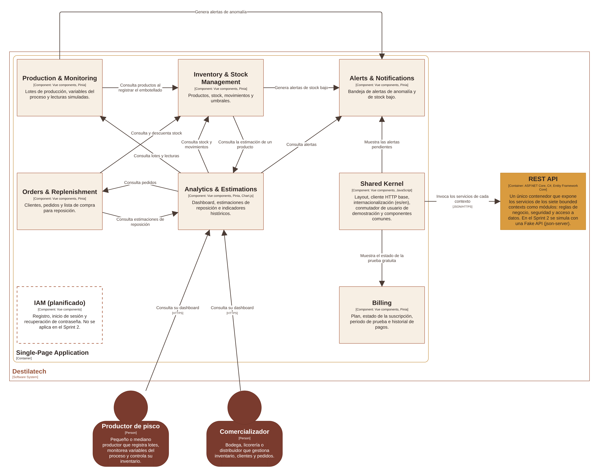</p>

*Nota.* Elaboración propia en Structurizr (2026).

*Descripción.* La SPA se compone de siete componentes que representan los *bounded contexts* (Billing, Production & Monitoring, Inventory & Stock Management, Orders & Replenishment, Alerts & Notifications, Analytics & Estimations e IAM, este último planificado y sin aplicarse en el Sprint 2) y del Shared Kernel. Las flechas muestran las relaciones reales entre contextos: Analytics & Estimations consulta a Production, Inventory, Orders y Alerts para construir el dashboard; Production y Inventory generan alertas; Orders consulta y descuenta stock en Inventory; y el Shared Kernel muestra las alertas pendientes y el estado de la prueba gratuita. Todos los contextos usan el Shared Kernel, que invoca la REST API por HTTPS.


| Componente | Responsabilidad | Tecnología | Relaciones con otros contextos |
| :---------- | :--------------------- | :---------- | :-------------------- |
| Shared Kernel | Layout, cliente HTTP base, internacionalización (es/en), conmutador de usuario de demostración y componentes comunes. | Vue components, JavaScript | Lo usan todos los contextos; muestra alertas (Alerts) y el estado de la prueba (Billing); invoca la REST API. |
| IAM (planificado) | Registro, inicio de sesión y recuperación de contraseña; no se aplica en el Sprint 2. | Vue components | Usa el Shared Kernel. |
| Billing | Plan, estado de la suscripción, periodo de prueba e historial de pagos. | Vue components, Pinia | Lo consulta el Shared Kernel. |
| Production & Monitoring | Lotes de producción, variables del proceso y lecturas simuladas. | Vue components, Pinia | Consulta productos en Inventory al registrar el embotellado; genera alertas en Alerts. |
| Inventory & Stock Management | Productos, stock, movimientos y umbrales. | Vue components, Pinia | Genera alertas de stock bajo en Alerts; consulta la estimación de un producto en Analytics. |
| Orders & Replenishment | Clientes, pedidos y lista de compra para reposición. | Vue components, Pinia | Consulta y descuenta stock en Inventory; consulta estimaciones en Analytics. |
| Alerts & Notifications | Bandeja de alertas de anomalía y de stock bajo. | Vue components, Pinia | Recibe las alertas de Production e Inventory. |
| Analytics & Estimations | Dashboard, estimaciones de reposición e indicadores históricos. | Vue components, Pinia, Chart.js | Consulta Production, Inventory, Orders y Alerts. |

**Tabla 12**

*Componentes de la Single-Page Application.*

**c. Componentes de la REST API**

La REST API es un único contenedor y cada uno de sus módulos corresponde exactamente a uno de los siete *bounded contexts* del Design-Level EventStorming (sección 4.6.1), lo que evidencia la trazabilidad entre el modelo de dominio y la arquitectura de software.

**Figura 76**

*Diagrama de componentes C4 de la REST API: módulos y comunicación entre contextos*

<p align="center">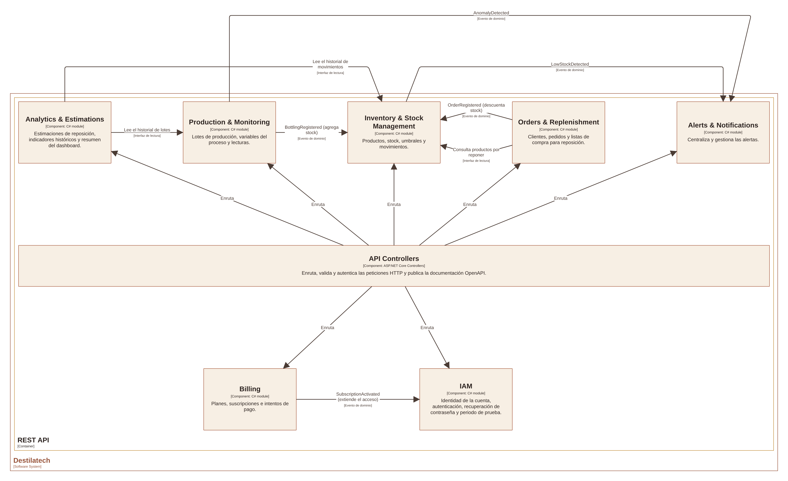</p>

*Nota.* Elaboración propia en Structurizr (2026).

*Descripción.* Los controladores reciben las peticiones de la Single-Page Application y las enrutan a los siete módulos: IAM, Billing, Production & Monitoring, Inventory & Stock Management, Orders & Replenishment, Alerts & Notifications y Analytics & Estimations. Entre módulos hay cinco eventos de dominio (SubscriptionActivated, AnomalyDetected, LowStockDetected, OrderRegistered y BottlingRegistered) y tres lecturas de historial. El acceso a la base de datos y a los sistemas externos se muestra en el diagrama siguiente.


**Figura 77**

*Diagrama de componentes C4 de la REST API: acceso a datos e integraciones externas*

<p align="center">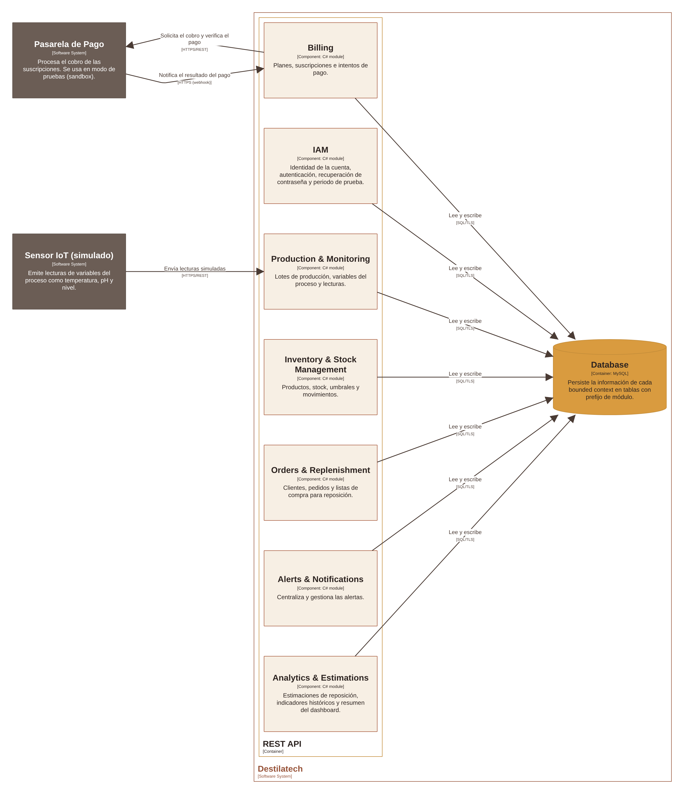</p>

*Nota.* Elaboración propia en Structurizr (2026).

*Descripción.* Los siete módulos leen y escriben en la base de datos MySQL a través de Entity Framework Core. Billing solicita el cobro a la pasarela de pago y recibe la notificación del resultado mediante un webhook, y Production recibe las lecturas del sensor IoT simulado. Esta vista omite las relaciones entre módulos, que se muestran en la figura anterior, para que ambos diagramas permanezcan legibles.

| Componente | Responsabilidad | Tecnología |
| :---------- | :------------------ | :---------- |
| API Controllers | Enruta, valida y autentica las peticiones HTTP y publica la documentación OpenAPI. | ASP.NET Core Controllers |
| IAM | Identidad de la cuenta, autenticación, recuperación de contraseña y periodo de prueba. | C# module |
| Billing | Planes, suscripciones e intentos de pago. | C# module |
| Production & Monitoring | Lotes de producción, variables del proceso y lecturas. | C# module |
| Inventory & Stock Management | Productos, stock, umbrales y movimientos. | C# module |
| Orders & Replenishment | Clientes, pedidos y listas de compra para reposición. | C# module |
| Alerts & Notifications | Centraliza y gestiona las alertas. | C# module |
| Analytics & Estimations | Estimaciones de reposición, indicadores históricos y resumen del dashboard. | C# module |

**Tabla 13**

*Componentes de la REST API.*

La comunicación entre módulos de distintos *bounded contexts* (por ejemplo, de Billing hacia IAM, de Production hacia Alerts o de Orders hacia Inventory) se realiza mediante la publicación de eventos de dominio y de commands, y no compartiendo directamente los modelos internos, como se definió en el Design-Level EventStorming. Los módulos de lectura de historial (`Analytics` hacia `Inventory` y `Production`) consumen interfaces de solo lectura y no modifican los datos de otros contextos.
