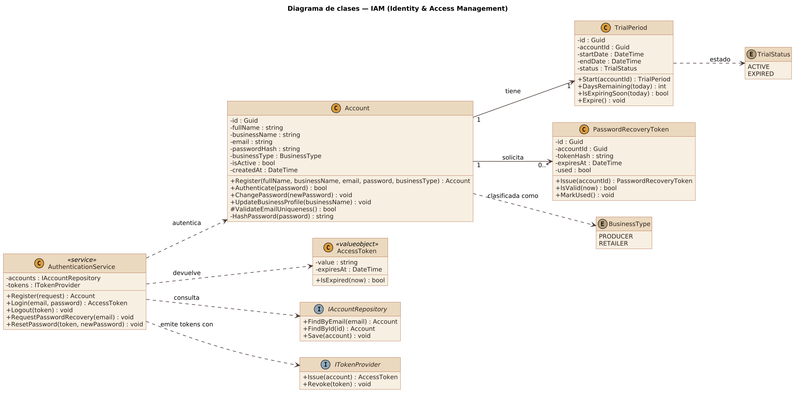
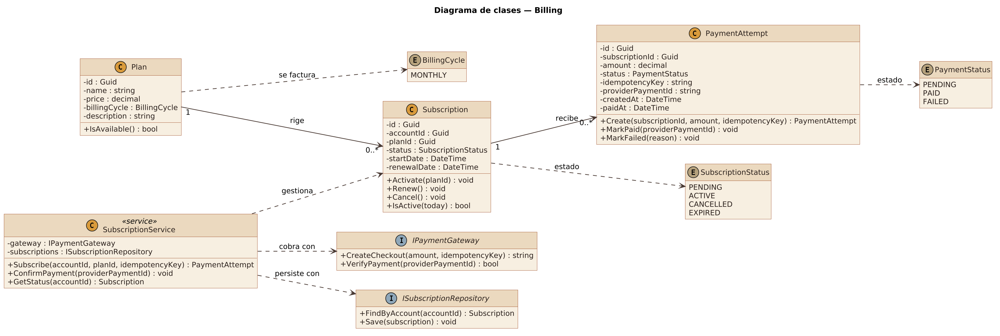
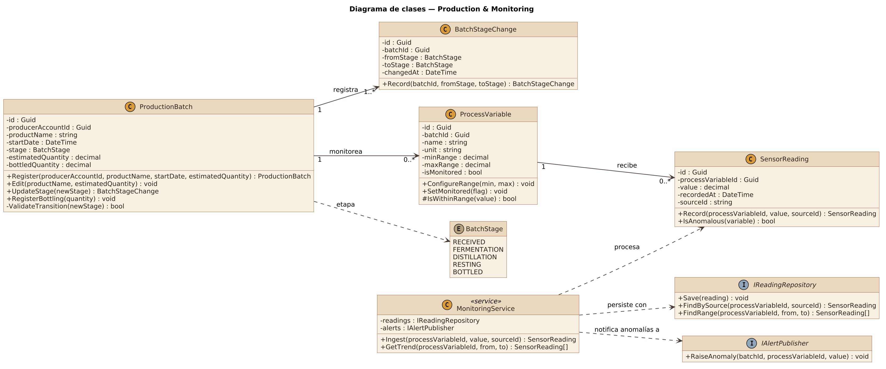
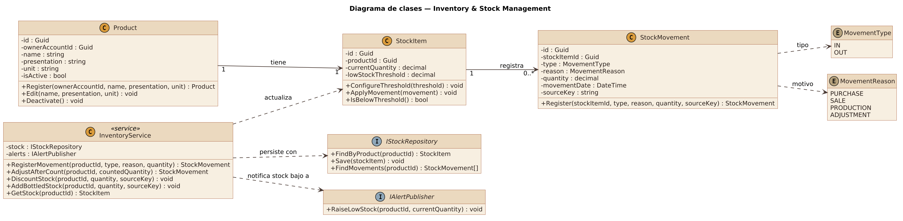
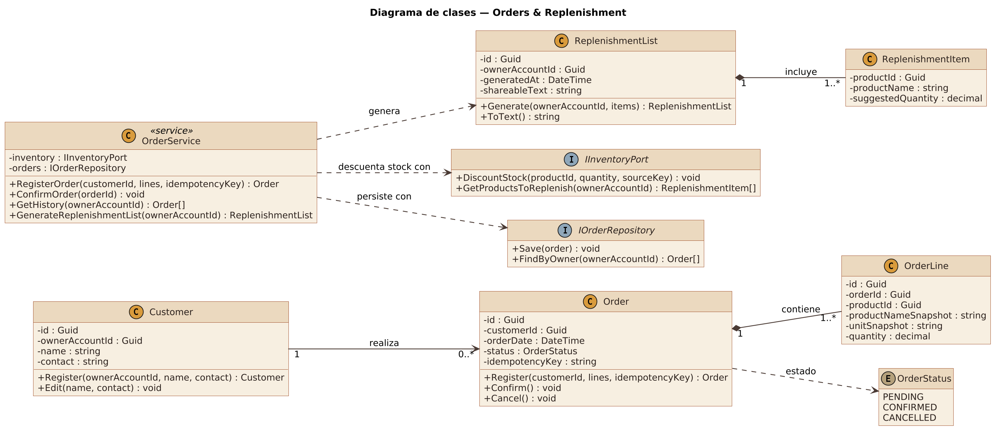
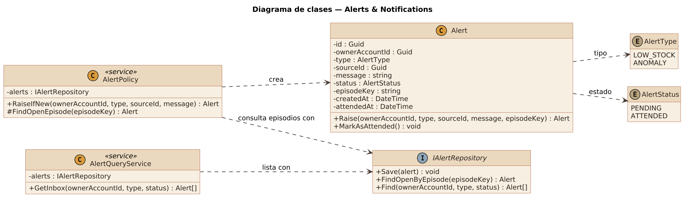
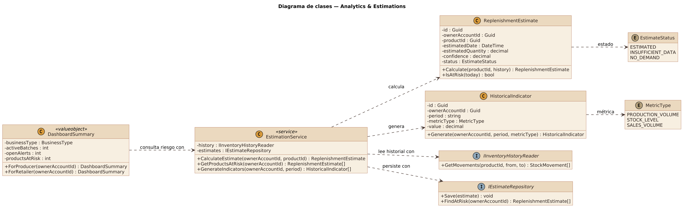

### 4.7. Software Object-Oriented Design

En esta sección el equipo detalla el diseño orientado a objetos de la REST API con un diagrama de clases UML por cada *bounded context*. El nivel de detalle incluye clases, interfaces y enumeraciones, sus atributos y métodos con el alcance de cada miembro (`+` público, `-` privado, `#` protegido), y las relaciones con su nombre, dirección y multiplicidad. Las clases de servicio (`<<service>>`) concentran la lógica de aplicación del contexto, y las interfaces (`<<interface>>`) son los contratos con la persistencia y con otros contextos. Los diagramas están escritos en PlantUML (`assets/diagrams/plantuml/`) y se incluyen en este documento como imágenes generadas a partir de ese código.

#### 4.7.1. Class Diagrams

**a. IAM (Identity & Access Management)**

**Figura 78**

*Diagrama de clases del Bounded Context IAM (Identity & Access Management)*

*Nota.* Elaboración propia en PlantUML (2026).

*Descripción.* El diagrama muestra las clases, interfaces y enumeraciones del contexto IAM (Identity & Access Management) (`Account`, `TrialPeriod`, `PasswordRecoveryToken`, `AccessToken`, `AuthenticationService`, `IAccountRepository`, `ITokenProvider`, `BusinessType`, `TrialStatus`) con sus atributos, métodos y alcance, y las relaciones entre ellas con su nombre y multiplicidad.

`Account` es la raíz del contexto: guarda el correo, el hash de la contraseña y el tipo de negocio (`BusinessType`), y nunca la contraseña en claro. Cada cuenta tiene un único `TrialPeriod`, que calcula los días restantes y si está por vencer, y puede solicitar varios `PasswordRecoveryToken`, de un solo uso y con vencimiento. `AuthenticationService` coordina el registro, el inicio y cierre de sesión y la recuperación de contraseña a través de las interfaces `IAccountRepository` e `ITokenProvider`, de modo que el dominio no depende de la base de datos ni del mecanismo de tokens.

**b. Billing**

**Figura 79**

*Diagrama de clases del Bounded Context Billing*

*Nota.* Elaboración propia en PlantUML (2026).

*Descripción.* El diagrama muestra las clases, interfaces y enumeraciones del contexto Billing (`Plan`, `Subscription`, `PaymentAttempt`, `SubscriptionService`, `IPaymentGateway`, `ISubscriptionRepository`, `BillingCycle`, `SubscriptionStatus`, `PaymentStatus`) con sus atributos, métodos y alcance, y las relaciones entre ellas con su nombre y multiplicidad.

`Plan` describe los planes de suscripción y rige cero o más `Subscription`; cada suscripción recibe cero o más `PaymentAttempt`. Un intento de pago solo pasa a pagado cuando la pasarela lo confirma (`MarkPaid`) y guarda una clave de idempotencia para que un reintento no genere dos cobros. `SubscriptionService` orquesta la contratación y la confirmación del pago mediante `IPaymentGateway`, que aísla al proveedor concreto, y `ISubscriptionRepository`. La referencia a la cuenta (`accountId`) es un identificador lógico hacia IAM.

**c. Production & Monitoring**

**Figura 80**

*Diagrama de clases del Bounded Context Production & Monitoring*

*Nota.* Elaboración propia en PlantUML (2026).

*Descripción.* El diagrama muestra las clases, interfaces y enumeraciones del contexto Production & Monitoring (`ProductionBatch`, `BatchStageChange`, `ProcessVariable`, `SensorReading`, `MonitoringService`, `IReadingRepository`, `IAlertPublisher`, `BatchStage`) con sus atributos, métodos y alcance, y las relaciones entre ellas con su nombre y multiplicidad.

`ProductionBatch` es el agregado raíz: valida las transiciones entre etapas (`BatchStage`) y cada cambio queda registrado como `BatchStageChange`, lo que da trazabilidad. Un lote monitorea cero o más `ProcessVariable`, cada una con su rango normal, y cada variable recibe cero o más `SensorReading`. `MonitoringService` ingiere las lecturas, evita duplicados con `sourceId` y, cuando una lectura sale del rango, notifica la anomalía mediante la interfaz `IAlertPublisher`, sin conocer el módulo de alertas.

**d. Inventory & Stock Management**

**Figura 81**

*Diagrama de clases del Bounded Context Inventory & Stock Management*

*Nota.* Elaboración propia en PlantUML (2026).

*Descripción.* El diagrama muestra las clases, interfaces y enumeraciones del contexto Inventory & Stock Management (`Product`, `StockItem`, `StockMovement`, `InventoryService`, `IStockRepository`, `IAlertPublisher`, `MovementType`, `MovementReason`) con sus atributos, métodos y alcance, y las relaciones entre ellas con su nombre y multiplicidad.

`Product` representa el catálogo y tiene un único `StockItem` con el saldo y el umbral de stock bajo. Cada cambio del saldo deja un `StockMovement` con tipo (`MovementType`), motivo (`MovementReason`) y una clave de origen (`sourceKey`) que evita registrar dos veces el mismo movimiento. `InventoryService` expone las operaciones que usan otros contextos, `DiscountStock` y `AddBottledStock`, y avisa del stock bajo mediante `IAlertPublisher`.

**e. Orders & Replenishment**

**Figura 82**

*Diagrama de clases del Bounded Context Orders & Replenishment*

*Nota.* Elaboración propia en PlantUML (2026).

*Descripción.* El diagrama muestra las clases, interfaces y enumeraciones del contexto Orders & Replenishment (`Customer`, `Order`, `OrderLine`, `ReplenishmentList`, `ReplenishmentItem`, `OrderService`, `IInventoryPort`, `IOrderRepository`, `OrderStatus`) con sus atributos, métodos y alcance, y las relaciones entre ellas con su nombre y multiplicidad.

`Customer` realiza cero o más `Order`, y cada `Order` contiene una o más `OrderLine`, que guardan una copia del nombre y la unidad del producto para que el historial no cambie si el producto se edita. `ReplenishmentList` agrupa los `ReplenishmentItem` sugeridos y produce un texto listo para compartir. `OrderService` registra y confirma pedidos con una clave de idempotencia y pide la salida de stock a Inventory mediante la interfaz `IInventoryPort`.

**f. Alerts & Notifications**

**Figura 83**

*Diagrama de clases del Bounded Context Alerts & Notifications*

*Nota.* Elaboración propia en PlantUML (2026).

*Descripción.* El diagrama muestra las clases, interfaces y enumeraciones del contexto Alerts & Notifications (`Alert`, `AlertPolicy`, `AlertQueryService`, `IAlertRepository`, `AlertType`, `AlertStatus`) con sus atributos, métodos y alcance, y las relaciones entre ellas con su nombre y multiplicidad.

`Alert` es el único agregado del contexto y se crea desde commands de otros contextos. `AlertPolicy` consulta si ya existe una alerta abierta para el mismo episodio (`episodeKey`) antes de crear otra, de modo que un mismo problema no genere avisos duplicados. `AlertQueryService` entrega la bandeja filtrada por tipo y estado, y `Alert.MarkAsAttended` registra cuándo se atendió.

**g. Analytics & Estimations**

**Figura 84**

*Diagrama de clases del Bounded Context Analytics & Estimations*

*Nota.* Elaboración propia en PlantUML (2026).

*Descripción.* El diagrama muestra las clases, interfaces y enumeraciones del contexto Analytics & Estimations (`ReplenishmentEstimate`, `HistoricalIndicator`, `DashboardSummary`, `EstimationService`, `IInventoryHistoryReader`, `IEstimateRepository`, `EstimateStatus`, `MetricType`) con sus atributos, métodos y alcance, y las relaciones entre ellas con su nombre y multiplicidad.

`ReplenishmentEstimate` calcula la fecha y la cantidad estimadas de reposición a partir del historial de movimientos, con un nivel de confianza y un estado (`EstimateStatus`) que distingue los casos de datos insuficientes y de producto sin demanda. `HistoricalIndicator` guarda los indicadores por periodo y `DashboardSummary` agrupa los valores de los dashboards según el tipo de negocio. `EstimationService` solo lee el historial mediante `IInventoryHistoryReader`; no modifica datos de otros contextos.
