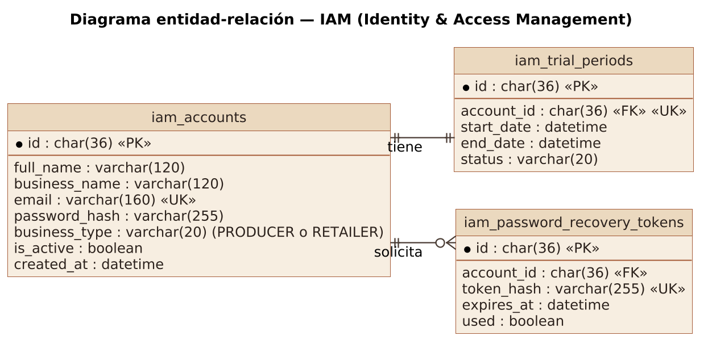
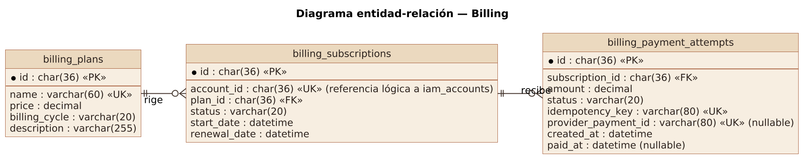
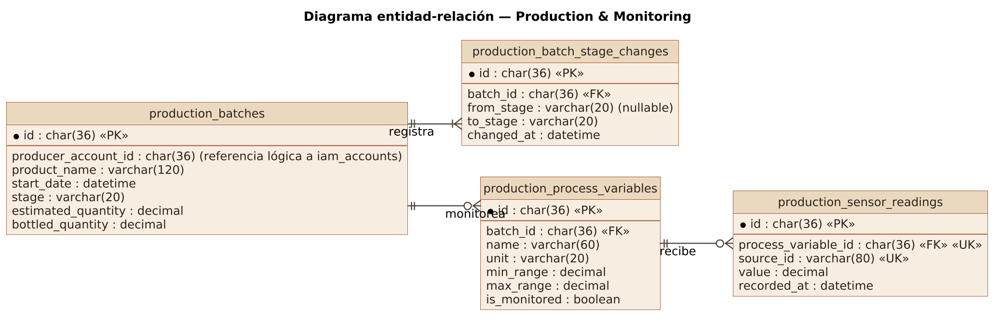
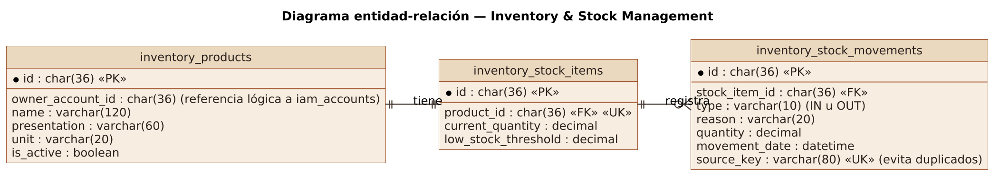
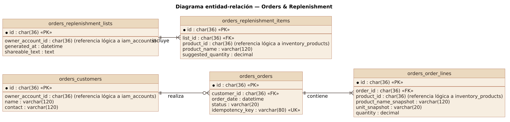
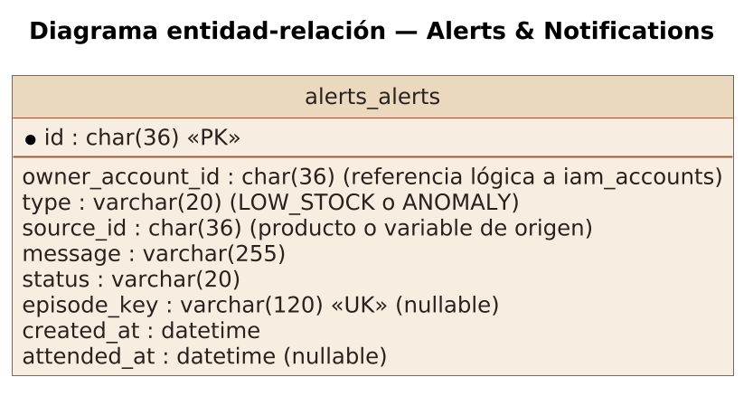
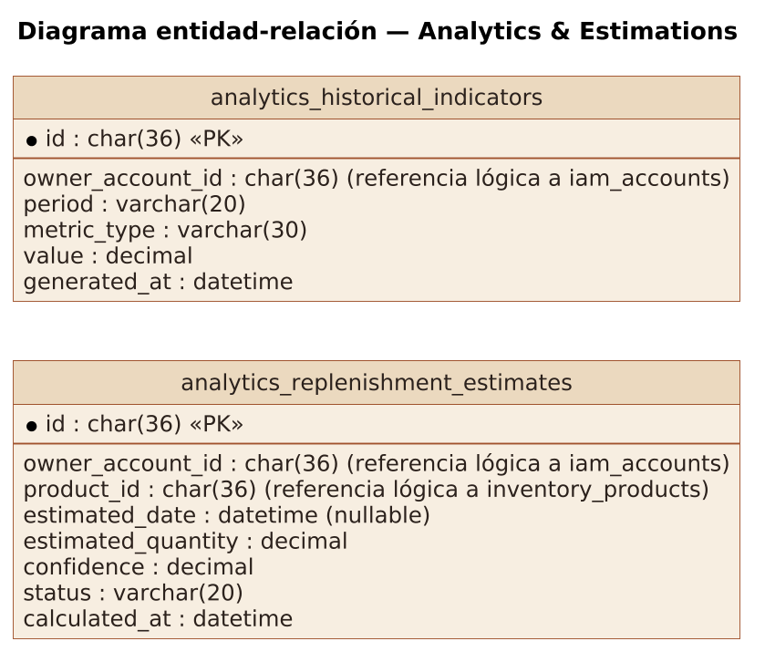

### 4.8. Database Design

La base de datos de Destilatech es relacional y se implementa en **MySQL**, con acceso desde la API mediante Entity Framework Core. Las convenciones de diseño son:

- Cada tabla lleva el prefijo de su módulo: `iam_`, `billing_`, `production_`, `inventory_`, `orders_`, `alerts_` y `analytics_`.
- Las claves primarias son identificadores únicos (UUID, `char(36)`) generados por la aplicación.
- Las notaciones `PK`, `FK` y `UK` indican clave primaria, clave foránea y restricción de unicidad.
- Las referencias entre contextos (por ejemplo, `account_id` en Billing) son identificadores lógicos y no llaves foráneas físicas, para preservar el desacoplamiento de los módulos.
- Los valores monetarios se almacenan como `decimal(10,2)`, las cantidades como `decimal(12,2)` y las fechas como `datetime`.
- Las columnas cuyo comentario dice *nullable* admiten valor nulo; las demás son obligatorias.

#### 4.8.1. Database Diagrams

Se presenta un diagrama entidad-relación por cada *bounded context*, derivado de los diagramas de clases de la sección 4.7.1. Los diagramas están escritos en PlantUML (`assets/diagrams/plantuml/`) y se incluyen en este documento como imágenes generadas a partir de ese código.

**a. IAM**

**Figura 85**

*Diagrama entidad-relación del Bounded Context IAM*

*Nota.* Elaboración propia en PlantUML (2026).

*Descripción.* El diagrama entidad-relación del contexto IAM contiene las tablas `iam_accounts`, `iam_trial_periods`, `iam_password_recovery_tokens`, con el tipo de cada columna, sus claves primarias (PK), foráneas (FK) y únicas (UK) y la cardinalidad de las relaciones.

Una cuenta (`iam_accounts`) tiene un único periodo de prueba (`iam_trial_periods`), garantizado por la restricción de unicidad de `account_id`, y cero o más tokens de recuperación de contraseña (`iam_password_recovery_tokens`). El correo es único y el token se guarda como hash, también único.

**b. Billing**

**Figura 86**

*Diagrama entidad-relación del Bounded Context Billing*

*Nota.* Elaboración propia en PlantUML (2026).

*Descripción.* El diagrama entidad-relación del contexto Billing contiene las tablas `billing_plans`, `billing_subscriptions`, `billing_payment_attempts`, con el tipo de cada columna, sus claves primarias (PK), foráneas (FK) y únicas (UK) y la cardinalidad de las relaciones.

Un plan (`billing_plans`) rige cero o más suscripciones (`billing_subscriptions`) y cada suscripción recibe cero o más intentos de pago (`billing_payment_attempts`). `account_id` es único en suscripciones, lo que asegura una sola suscripción por cuenta, y es una referencia lógica a IAM. `idempotency_key` y `provider_payment_id` son únicos, para no registrar dos veces un mismo cobro; `provider_payment_id` y `paid_at` admiten nulo mientras el pago no se confirma.

**c. Production & Monitoring**

**Figura 87**

*Diagrama entidad-relación del Bounded Context Production & Monitoring*

*Nota.* Elaboración propia en PlantUML (2026).

*Descripción.* El diagrama entidad-relación del contexto Production & Monitoring contiene las tablas `production_batches`, `production_batch_stage_changes`, `production_process_variables`, `production_sensor_readings`, con el tipo de cada columna, sus claves primarias (PK), foráneas (FK) y únicas (UK) y la cardinalidad de las relaciones.

Un lote (`production_batches`) tiene uno o más cambios de etapa (`production_batch_stage_changes`) y cero o más variables de proceso (`production_process_variables`); cada variable recibe cero o más lecturas (`production_sensor_readings`). `from_stage` admite nulo porque el primer registro del lote no tiene etapa previa, y la combinación de variable y `source_id` es única para evitar lecturas duplicadas.

**d. Inventory & Stock Management**

**Figura 88**

*Diagrama entidad-relación del Bounded Context Inventory & Stock Management*

*Nota.* Elaboración propia en PlantUML (2026).

*Descripción.* El diagrama entidad-relación del contexto Inventory & Stock Management contiene las tablas `inventory_products`, `inventory_stock_items`, `inventory_stock_movements`, con el tipo de cada columna, sus claves primarias (PK), foráneas (FK) y únicas (UK) y la cardinalidad de las relaciones.

Cada producto (`inventory_products`) tiene un único saldo (`inventory_stock_items`), garantizado por la unicidad de `product_id`, y cada saldo tiene cero o más movimientos (`inventory_stock_movements`). `source_key` es único, de modo que un mismo movimiento no se registra dos veces.

**e. Orders & Replenishment**

**Figura 89**

*Diagrama entidad-relación del Bounded Context Orders & Replenishment*

*Nota.* Elaboración propia en PlantUML (2026).

*Descripción.* El diagrama entidad-relación del contexto Orders & Replenishment contiene las tablas `orders_customers`, `orders_orders`, `orders_order_lines`, `orders_replenishment_lists`, `orders_replenishment_items`, con el tipo de cada columna, sus claves primarias (PK), foráneas (FK) y únicas (UK) y la cardinalidad de las relaciones.

Un cliente (`orders_customers`) realiza cero o más pedidos (`orders_orders`) y cada pedido contiene una o más líneas (`orders_order_lines`). `idempotency_key` es único para que un reintento no cree dos pedidos, y las líneas conservan el nombre y la unidad del producto al momento de la venta. Las listas de compra (`orders_replenishment_lists`) incluyen uno o más ítems (`orders_replenishment_items`).

**f. Alerts & Notifications**

**Figura 90**

*Diagrama entidad-relación del Bounded Context Alerts & Notifications*

*Nota.* Elaboración propia en PlantUML (2026).

*Descripción.* El diagrama entidad-relación del contexto Alerts & Notifications contiene una única tabla, `alerts_alerts`, con el tipo de cada columna, su clave primaria (PK) y su clave única (UK). No tiene relaciones con otras tablas del contexto: `owner_account_id` y `source_id` son referencias lógicas a otros contextos y no claves foráneas.

La tabla `alerts_alerts` guarda cada alerta con su tipo, el identificador del producto o de la variable de origen y su estado. `episode_key` es único cuando existe, lo que impide abrir dos alertas para el mismo episodio, y `attended_at` admite nulo mientras la alerta está pendiente.

**g. Analytics & Estimations**

**Figura 91**

*Diagrama entidad-relación del Bounded Context Analytics & Estimations*

*Nota.* Elaboración propia en PlantUML (2026).

*Descripción.* El diagrama entidad-relación del contexto Analytics & Estimations contiene las tablas `analytics_replenishment_estimates` y `analytics_historical_indicators`, con el tipo de cada columna y su clave primaria (PK). Las dos tablas no se relacionan entre sí: cada una guarda un resultado distinto que calcula `EstimationService` (las estimaciones por producto y los indicadores por periodo), y ambas apuntan a la cuenta y al producto mediante referencias lógicas, no claves foráneas.

`analytics_replenishment_estimates` guarda cada estimación con su fecha, cantidad, confianza y estado; `estimated_date` admite nulo cuando no hay datos suficientes o no hay demanda. `analytics_historical_indicators` guarda los indicadores por periodo y tipo de métrica. Ambas tablas referencian de forma lógica a la cuenta y al producto.
