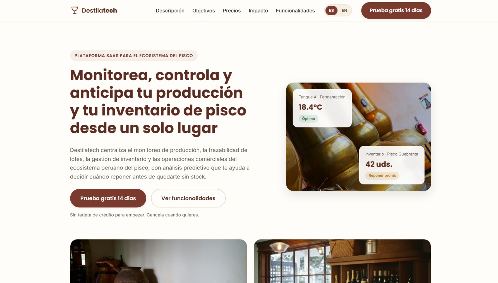
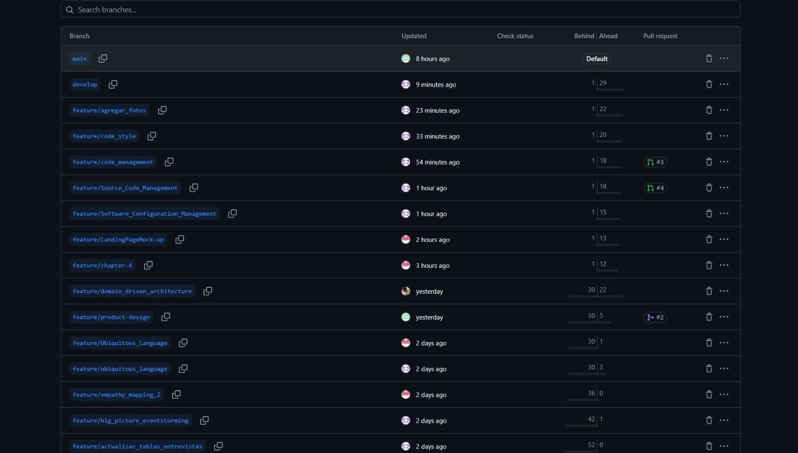
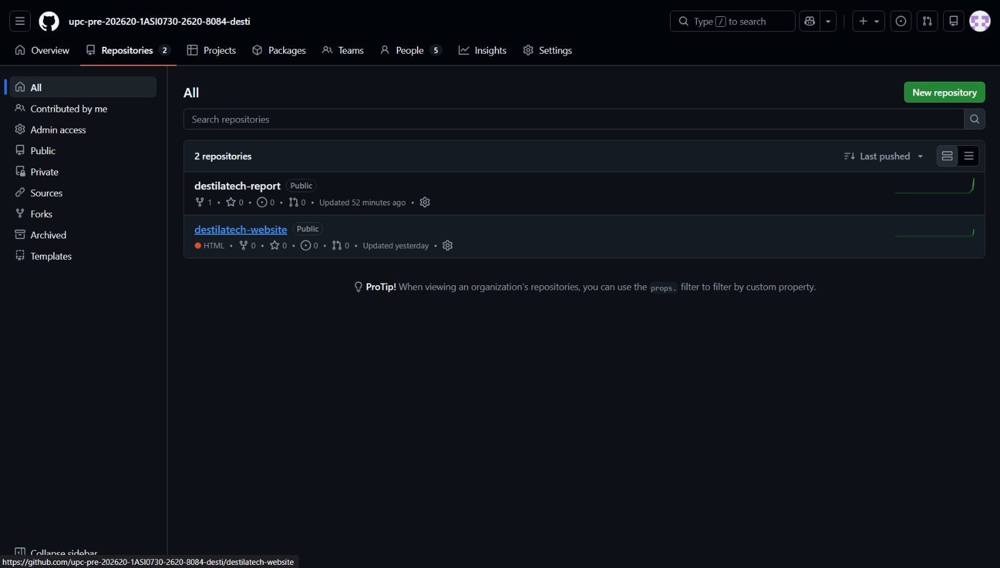
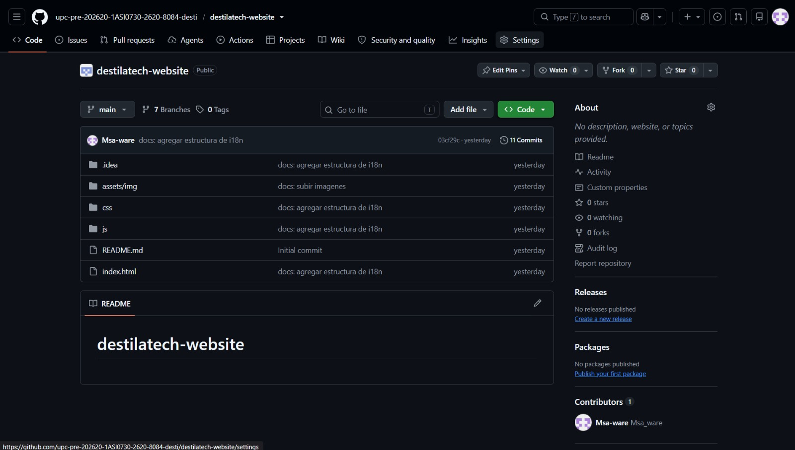
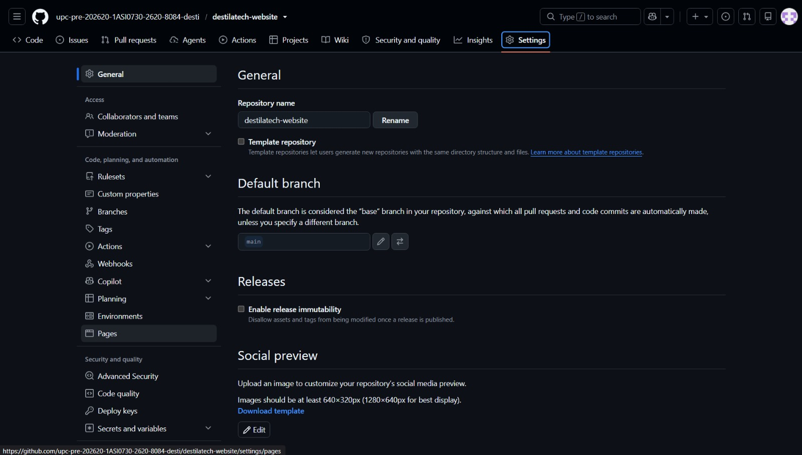
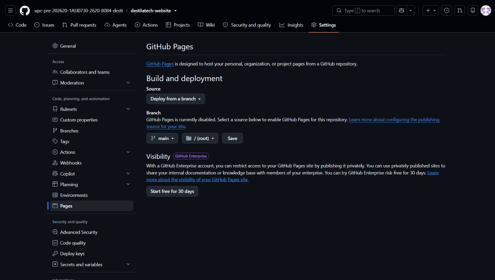
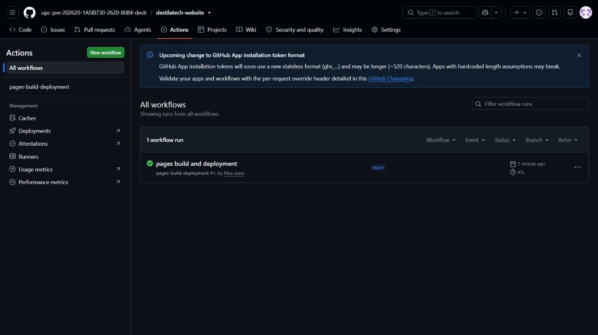

### 5.1. Software Configuration Management

En esta sección se detallan las decisiones tecnológicas, las herramientas de colaboración y las convenciones de código que sostienen la integridad y la mantenibilidad de Destilatech. Según Bourque y Fairley (2014) en el SWEBOK, la gestión de la configuración del software es necesaria para mantener la visibilidad y el control del producto durante todo su ciclo de vida.

#### 5.1.1. Software Development Environment Configuration


Para el desarrollo del ecosistema de Destilatech, el equipo integró las siguientes herramientas y plataformas, organizadas según su propósito en el ciclo de vida del software:

+ **Project Management**<br>La gestión de proyectos asegura que el desarrollo se entregue dentro de los plazos y presupuestos previstos. Según el Project Management Institute (2021), una gestión efectiva es fundamental para coordinar recursos, mitigar riesgos y alinear el trabajo colaborativo con los objetivos del negocio.<br><br>
  +	**Jira Software:** Herramienta de gestión de proyectos ágil (Atlassian, 2023) que permite planificar y gestionar el trabajo mediante tableros Scrum o Kanban, facilitando la colaboración transparente entre los equipos de desarrollo.<br>https://www.atlassian.com/software/jira<br><br>
  + **Trello:** Herramienta visual basada en tableros Kanban (Atlassian, 2024), utilizada para el tablero de cada Sprint y para organizar el trabajo diario del equipo.<br>https://trello.com/<br><br>

+ **Requirements Management**<br>Implica transformar las necesidades abstractas de los usuarios en requisitos de software medibles. La trazabilidad de estos requisitos garantiza que el producto final no diverja del valor de negocio esperado por los *stakeholders* (Bourque & Fairley, 2014).<br><br>
  + **Jira Software:** En su función de gestión de backlog, permite estructurar Historias de Usuario (*User Stories*) y Épicas, priorizando el trabajo orientado a aportar valor continuo en cada iteración.<br>https://www.atlassian.com/software/jira<br><br>

+ **Product UX/UI Design**<br>El diseño de experiencia (UX) e interfaz (UI) se apoya en el modelo de diseño centrado en el humano (Norman, 2013), buscando optimizar la forma en que los usuarios interactúan con el sistema en momentos de alta carga cognitiva.<br><br>
  + **Figma:** Herramienta colaborativa en la nube para la creación de interfaces y prototipos de alta fidelidad, vital para validar flujos antes del desarrollo de código.<br>https://www.figma.com/ <br><br>
  + **UXPressia:** Plataforma empleada para mapear el *Customer Journey* y construir *User Personas*, traduciendo la investigación cualitativa en artefactos visuales de diseño.<br>https://uxpressia.com/ <br><br>
  + **MIRO:** Tablero digital colaborativo utilizado para las sesiones de *Big Picture Event Storming* y *Domain-Driven Design*.<br>https://miro.com/ <br><br>
  + **Canva:** Herramienta de diseño gráfico en línea utilizada para la elaboración de la identidad visual de la marca y la estructuración de la presentación final del proyecto.<br>https://www.canva.com/<br><br>
  + **Structurizr:** Plataforma basada en el modelo C4 para visualizar los contenedores, componentes y contextos delimitados (*Bounded Contexts*) del sistema (Brown, 2018).<br>https://structurizr.com/ <br><br>
  + **Lucidchart:** Herramienta de diagramación empleada para los esquemas lógicos, flujos de base de datos y arquitectura preliminar.<br>https://www.lucidchart.com/<br><br>
  + **PlantUML:** Herramienta de código abierto que implementa *Diagrams as Code*, permitiendo que la arquitectura del sistema evolucione y se versione junto con el código fuente en GitHub.<br>https://plantuml.com/es/<br><br>
  + **Mermaid:** Biblioteca JavaScript utilizada para los diagramas del Capítulo IV (Event Storming de diseño, C4, clases y entidad-relación) mediante sintaxis textual versionable, soportada directamente por GitHub (Mermaid, 2023).<br>https://mermaid.js.org/<br><br>

+ **Software Development**<br>Etapa donde se materializa la arquitectura de software. Se seleccionaron lenguajes y marcos de trabajo (*frameworks*) de uso extendido en la industria para garantizar la mantenibilidad y la fiabilidad del sistema.<br><br>
  + **GitHub:** Plataforma base para el control de versiones distribuido mediante Git, permitiendo la integración y revisión de código asíncrona.<br>https://github.com/ <br><br>
  + **Visual Studio Code:** Editor de código fuente ligero y versátil (Microsoft, 2024a), utilizado por parte del equipo gracias a su amplio ecosistema de extensiones para múltiples lenguajes.<br>https://code.visualstudio.com/ <br><br>
  + **JetBrains Rider:** Entorno de Desarrollo Integrado (IDE) multiplataforma y de alto rendimiento (JetBrains, 2024a), utilizado como herramienta principal para el desarrollo de la lógica de negocio y la API en C# / .NET.<br>https://www.jetbrains.com/rider/<br><br>
  + **JetBrains WebStorm:** IDE especializado en el desarrollo web moderno (JetBrains, 2024b), empleado para la programación y depuración de todo el ecosistema frontend con Vue.js y JavaScript.<br>https://www.jetbrains.com/webstorm/<br><br>
  + **HTML & CSS:** Lenguajes estándar web utilizados para estructurar el contenido (HTML) y definir la apariencia y diseño visual (CSS) de la Landing Page y la Web App.<br>https://developer.mozilla.org/es/docs/Web/HTML<br><br>
  + **JavaScript:** Lenguaje del cliente web, utilizado en la landing page (JavaScript puro) y en la aplicación web (Vue.js).<br>https://developer.mozilla.org/es/docs/Web/JavaScript<br><br>
  + **Vue.js y PrimeVue:** Framework progresivo para construir la interfaz de la aplicación web y biblioteca de componentes visuales.<br>https://vuejs.org/ · https://primevue.org/<br><br>
  + **C# y ASP.NET Core:** Lenguaje y marco de trabajo del servicio REST (API), con Entity Framework Core para el acceso a datos.<br>https://learn.microsoft.com/es-es/aspnet/core/<br><br>
  + **MySQL:** Sistema de gestión de base de datos relacional que almacena los datos operativos.<br>https://www.mysql.com/<br><br>

+ **Software Testing**<br>La evaluación de la calidad del software garantiza que la solución cumpla los criterios de aceptación acordados.<br><br>
  + **Lenguaje Gherkin (Cucumber):** Lenguaje de dominio (DSL) implementado para el *Behavior-Driven Development* (BDD) (Smart, 2014). Permite traducir criterios de aceptación en pruebas legibles por negocio mediante sintaxis *Given-When-Then*.<br>https://cucumber.io/<br><br>

+ **Software Deployment**<br>Consiste en la automatización y alojamiento de los artefactos compilados para su consumo público.<br><br>
  + **Github Pages:** Servicio de *hosting* estático aprovechado para el despliegue automático de la *Landing Page* institucional.<br>https://pages.github.com/ <br><br>

+ **Software Documentation**<br>Mantenimiento de la información técnica esencial para reducir la curva de aprendizaje de nuevos desarrolladores e interesados en el proyecto.<br><br>
  + **Markdown:** Lenguaje de marcado ligero, pilar de la documentación técnica moderna en repositorios, facilitando legibilidad humana y renderización web.<br>https://www.markdownguide.org/getting-started/<br><br>
  + **Microsoft Office 365:** Suite colaborativa en la nube para la gestión del reporte académico final y documentación adjunta.<br>https://www.microsoft.com/microsoft-365<br><br>


#### 5.1.2. Source Code Management

El código se versiona con Git y se aloja en GitHub, dentro de la organización del curso. El equipo usa dos repositorios: uno para el informe (documentación) y otro para la landing page.

| Repositorio | Contenido | Enlace |
| :---------- | :------------ | :------------------------------------ |
| destilatech-report | Informe del trabajo final (README, imágenes y diagramas). | [https://github.com/upc-pre-202620-1ASI0730-2620-8084-desti/destilatech-report](https://github.com/upc-pre-202620-1ASI0730-2620-8084-desti/destilatech-report) |
| destilatech-website | Landing page (HTML, CSS y JavaScript). | [https://github.com/upc-pre-202620-1ASI0730-2620-8084-desti/destilatech-website](https://github.com/upc-pre-202620-1ASI0730-2620-8084-desti/destilatech-website) |

**Sitio publicado (landing page):** [https://upc-pre-202620-1asi0730-2620-8084-desti.github.io/destilatech-website/](https://upc-pre-202620-1asi0730-2620-8084-desti.github.io/destilatech-website/)

**Figura 92**

*Landing page publicada en GitHub Pages*

<p align="center"></p>

*Nota.* Captura propia del sitio publicado (2026).

*Descripción.* Captura de la sección inicial de la landing page de Destilatech: encabezado con logotipo, menú de secciones, selector de idioma ES / EN y botón «Prueba gratis 14 días»; título «Monitorea, controla y anticipa tu producción y tu inventario de pisco desde un solo lugar», dos botones de acción y, a la derecha, una fotografía de botellas con tarjetas de temperatura (18.4 °C, Óptimo) e inventario (42 uds., Reponer pronto).


**Flujo de trabajo: GitFlow**

El equipo aplica el flujo de trabajo GitFlow (Driessen, 2010). Cada rama tiene un propósito definido:

| Rama | Propósito | Se crea desde | Se integra en |
| :---------- | :-------------------- | :---------- | :---------- |
| `main` | Versión estable y publicada. Cada integración en `main` corresponde a una versión etiquetada. | — | — |
| `develop` | Rama de integración del trabajo del equipo. | `main` | `main` (mediante `release/*`) |
| `feature/<nombre>` | Una funcionalidad o sección del informe (por ejemplo, `feature/product-design`). | `develop` | `develop` (mediante Pull Request) |
| `release/<versión>` | Preparación de una versión: revisión final y corrección de detalles menores. | `develop` | `main` y `develop` |
| `hotfix/<descripción>` | Corrección urgente de un error detectado en `main`. | `main` | `main` y `develop` |

Los cambios llegan a `develop` y a `main` mediante Pull Requests revisadas por otro integrante del equipo.

**Conventional Commits**

Los mensajes de commit siguen la especificación Conventional Commits (s. f.), con el formato `<tipo>(<ámbito opcional>): <descripción>`, y un cuerpo opcional que explica el motivo del cambio. Los tipos que usa el equipo son:

| Tipo | Uso |
| :---------- | :---------- |
| `feat` | Nueva funcionalidad o sección. |
| `fix` | Corrección de un error. |
| `docs` | Cambios en documentación. |
| `style` | Cambios de formato o estilo que no alteran el comportamiento. |
| `refactor` | Reorganización del código sin cambiar su comportamiento. |
| `test` | Pruebas. |
| `chore` | Tareas de mantenimiento. |

**Semantic Versioning**

Las versiones del informe y del software siguen el versionado semántico (Preston-Werner, 2013), con el formato `MAJOR.MINOR.PATCH`: se incrementa `MAJOR` ante un cambio incompatible, `MINOR` al añadir funcionalidad compatible y `PATCH` al corregir errores. La versión del informe se registra en el *Registro de Versiones* al inicio de este documento.

**Figura 93**

*Ramas del repositorio del informe*

<p align="center"></p>

*Nota.* Captura de GitHub (2026).

*Descripción.* Listado de ramas del repositorio con las columnas de actualización, estado de las verificaciones, commits por detrás y por delante de la rama por defecto, y Pull Request asociada. Aparecen la rama por defecto `main`, la rama de integración `develop` y varias ramas `feature/*` con nombres descriptivos (por ejemplo `feature/product-design`, `feature/domain_driven_architecture` y `feature/chapter-4`). Algunas ramas muestran Pull Requests asociadas, numeradas #2, #3 y #4.


#### 5.1.3. Source Code Style Guide & Conventions

Esta sección define las reglas de codificación y nomenclatura definidas por el equipo de trabajo que serán aplicadas en Destilatech. De esta manera, el grupo asegura la conservación de la legibilidad, mantenibilidad y escalabilidad en las etapas de desarrollo de la solución.

El proyecto utilizará HTML, CSS, JavaScript, C# y Gherkin con el propósito de favorecer la implementación y validación de comportamiento. Para el código fuente, el idioma empleado será el inglés y se respetará el uso de estándares tecnológicos oficiales.

##### 5.1.3.1 Principios generales para todos los lenguajes

###### 5.1.3.1.1 Nomenclatura obligatoria en inglés

Todo el código (variables, clases, comentarios y, a partir del siguiente sprint, mensajes de commit) debe ser redactado en inglés.

Reglas transversales:

- Los nombres deben ser descriptivos y orientados al dominio.
- Las abreviaciones ambiguas (`tmp`, `obj`, `val`) están prohibidas a excepción de tratarse de contextos locales muy acotados.
- La semántica del nombre debe anticipar su responsabilidad y tipo de dato.
- Los nombres de una sola letra se reservan para iteradores de alcance corto (`i`, `j`) o coordenadas matemáticas (`x`, `y`, `z`).

###### 5.1.3.1.2 Formato base de código

- Los archivos serán guardados en UTF-8.
- Las líneas de código excesivamente largas serán evitadas, debido a que se prioriza la legibilidad.
- Los comentarios serán usados para la documentación técnica de las clases y métodos complejos.

###### 5.1.3.1.3 Convenciones de estilo por tecnología

Cada lenguaje conserva su convención estándar:

- HTML, CSS y JavaScript: guías de estilo de Google (s. f.-a, s. f.-b), documentación de MDN Web Docs (s. f.) y la guía de estilo oficial de Vue.js (Vue.js, 2024).
- C#: convenciones de código de Microsoft (2024b) y del ecosistema ASP.NET Core.
- Gherkin: referencia de Cucumber (s. f.), con enfoque de legibilidad y comportamiento orientado al negocio.

##### 5.1.3.2 Convenciones para HTML

Se adoptará HTML5 con el objetivo de buscar un enfoque semántico y accesible.

###### 5.1.3.2.1 Estructura y sintaxis

- Es necesario declarar `<!doctype html>` al inicio.
- Se requiere escribir etiquetas y atributos en minúsculas.
- Se necesita el uso de comillas dobles para valores de atributos.

###### 5.1.3.2.2 Semántica y accesibilidad

- Se requerirá del uso de elementos semánticos (`header`, `main`, `nav`, `section`, `article`, `footer`) en lugar de `div` sin propósito.
- Se prefiere evitar controladores *inline* (`onclick`, `onchange`), debido a que se busca que la lógica sea delegada a los eventos de Vue.js (`@click`, `@change`).
- Se exige la inclusión de texto alternativo significativo en imágenes.
- Se desea asociar etiquetas y controles de formulario (`label` + `for`).

Ejemplo recomendado:

```html
<!doctype html>
<html lang="en">
  <head>
    <meta charset="utf-8">
    <meta name="viewport" content="width=device-width, initial-scale=1">
    <title>Account Settings</title>
  </head>
  <body>
    <main>
      <h1>Account Settings</h1>
      
      <a href="/comments">All comments</a>
    </main>
  </body>
</html>
```

##### 5.1.3.3 Convenciones para CSS

Se adopta CSS con enfoque mantenible, predecible y escalable.

###### 5.1.3.3.1 Nomenclatura

- Se exige nomenclatura de clases en inglés y formato `kebab-case`.
- Se prioriza semántica de componente/rol (`checkout-form`, `product-card-title`).
- Se busca evitar nombres crípticos (`.rg`, `.x`, `.blueText`).

###### 5.1.3.3.2 Reglas de estilo

- Se requiere del uso de un espacio después de `:` en cada declaración.
- Se necesita finalizar cada declaración con `;`.
- Se sugiere usar las llaves de apertura en la misma línea del selector.
- Se recomienda evitar la sentencia `!important` salvo justificación técnica documentada.

Ejemplo recomendado:

```css
.checkout-form {
  padding: 0 1rem 1.5rem;
  border-top: 0;
}

.checkout-form__title {
  margin-bottom: 0.75rem;
  font: 600 1.25rem/1.4 "Poppins", sans-serif;
}
```

Complementación conveniente:

- Se recomienda el uso de unidades relativas (`rem`, `%`) con el propósito de mejorar la escalabilidad y accesibilidad.
- Se sugiere realizar la estandarización de la paleta de colores y espaciados mediante variables CSS (`:root { --color-primary: ... }`).

##### 5.1.3.4 Convenciones para JavaScript

Se adopta JavaScript moderno (ES2022 o superior) como lenguaje del cliente web, tanto en la landing page como en la aplicación Vue.js.

###### 5.1.3.4.1 Nomenclatura y estructura

- Se exige el uso de identificadores en inglés.
- Se sugiere la denominación de variables y funciones en `camelCase`.
- Se sugiere la denominación de clases y constructores en `PascalCase`.
- Se recomienda la denominación de constantes globales en `UPPER_SNAKE_CASE`.

###### 5.1.3.4.2 Reglas de codificación

- Preferir el uso de la igualdad estricta (`===`, `!==`).
- Dejar espacios alrededor de operadores y después de comas.
- Incorporar el uso del punto y coma al final de sentencias.
- Usar comillas simples por defecto; reservar *template literals* (``) para interpolación.
- Manejar errores de forma explícita (`try/catch` o propagación controlada).

###### 5.1.3.4.3 Reglas específicas para Vue.js

- Documentar con JSDoc los contratos de datos que intercambia la API cuando no sean evidentes.
- Mantener el uso de componentes con una sola responsabilidad.
- Nombrar archivos de Vue.js siguiendo la convención *Single File Component (SFC)* en `PascalCase` (`BatchDashboard.vue`, `MetricCard.vue`).
- Evitar lógica compleja en templates HTML; mover cálculos y transformaciones a propiedades computadas (`computed`) o al store global (`Pinia`).

Ejemplo recomendado:

```js
const MAX_RETRY_ATTEMPTS = 3;

function calculateSquare(value) {
  return value * value;
}

function getGreeting(hour) {
  if (hour < 20) {
    return 'Good day';
  }

  return 'Good evening';
}
```

##### 5.1.3.5 Convenciones para C# y .NET

Se adoptan las convenciones oficiales de Microsoft y buenas prácticas compatibles con ASP.NET Core.

###### 5.1.3.5.1 Nomenclatura

Todos los nombres serán escritos en el idioma inglés.

- Las clases, registros (*records*), métodos, propiedades y eventos serán denominados bajo `PascalCase`.
- Las variables locales y parámetros de métodos serán nombrados bajo `camelCase`.
- Los campos privados de una clase deben llevar el prefijo guion bajo (`_camelCase`) para distinguirlos rápidamente de las variables locales.
- En las interfaces, el prefijo `I` es **obligatorio** (`IOrderRepository`, `IPaymentService`).

###### 5.1.3.5.2 Formato y prácticas

- Se exige el uso de llaves `{}` en líneas separadas (convención Allman).
- Se exige que los métodos posean una responsabilidad única y clara.
- Las clases de servicio y repositorios requieren nombres orientados al modelo de dominio.
- Los métodos asíncronos obligatoriamente deben llevar el sufijo `Async` (Ej. `SaveDataAsync`).

Ejemplo recomendado:

```csharp
public class OrderService
{
    private readonly IOrderRepository _orderRepository;

    public OrderService(IOrderRepository orderRepository)
    {
        _orderRepository = orderRepository;
    }

    public async Task<Order?> FindByIdAsync(Guid orderId)
    {
        if (orderId == Guid.Empty)
        {
            return null;
        }

        return await _orderRepository.FindByIdAsync(orderId);
    }
}
```

##### 5.1.3.6 Convenciones para Gherkin

Gherkin se utiliza para especificaciones legibles por negocio y equipo técnico.

###### 5.1.3.6.1 Reglas de legibilidad

- Los escenarios presentan estructura clara, mediante la denominación `Given-When-Then`.
- La sentencia `And` se usa para continuidad lógica dentro del mismo bloque.
- Se exigen *steps* concretos, observables y sin ruido irrelevante.
- Cuando un *step* requiere una tabla de datos, debe finalizar con `:`.
- Se recomienda dejar líneas en blanco entre escenarios para facilitar su lectura.

Ejemplo recomendado:

```gherkin
Feature: Contact channels

  Scenario: Visitor sends a contact form request
    Given the visitor provides the following data:
      | field   | value               |
      | name    | Ana Torres          |
      | email   | ana@example.com     |
      | message | I need more details |
    When the visitor submits the form
    Then the system confirms the request was received
```

Estas referencias serán aplicadas de manera complementaria. Si existiera conflicto entre guías, se priorizará la convención oficial de Microsoft (.NET) o de Vue.js según el módulo implementado.

#### 5.1.4. Software Deployment Configuration

Esta sección describe cómo se publica la landing page. La landing page es un sitio estático (HTML, CSS y JavaScript), por lo que se despliega en **GitHub Pages**, un servicio de alojamiento gratuito integrado con el repositorio. La aplicación web se despliega en **Firebase Hosting**, con el Fake API en **Render**, como se describe en la sección 5.1.4.2; la API real se documentará cuando se implemente.

**URL de producción:** [https://upc-pre-202620-1asi0730-2620-8084-desti.github.io/destilatech-website/](https://upc-pre-202620-1asi0730-2620-8084-desti.github.io/destilatech-website/)

##### 5.1.4.1. Landing Page

Pasos realizados para publicar la landing page:

**Figura 94**

*Despliegue en GitHub Pages, paso 1. Ingresamos al repositorio de la landing page*

<p align="center"></p>

*Nota.* Captura de GitHub (2026).

*Descripción.* Página de la organización en GitHub con el listado «All» de repositorios. Se ven dos repositorios públicos: `destilatech-report` (actualizado hace 52 minutos) y `destilatech-website` (HTML, actualizado el día anterior), este último resaltado.


**Figura 95**

*Despliegue en GitHub Pages, paso 2. Abrimos el repositorio y su configuración*

<p align="center"></p>

*Nota.* Captura de GitHub (2026).

*Descripción.* Página principal del repositorio `destilatech-website`: rama `main`, 7 ramas, 11 commits y los archivos `.idea`, `assets/img`, `css`, `js`, `README.md` e `index.html`. En la barra superior se resalta la pestaña Settings.


**Figura 96**

*Despliegue en GitHub Pages, paso 3. Ingresamos a la sección Pages*

<p align="center"></p>

*Nota.* Captura de GitHub (2026).

*Descripción.* Página Settings > General del repositorio, con el nombre del repositorio, la rama por defecto `main` y la opción Pages resaltada en el menú lateral izquierdo.


**Figura 97**

*Despliegue en GitHub Pages, paso 4. Seleccionamos la rama de origen y guardamos*

<p align="center"></p>

*Nota.* Captura de GitHub (2026).

*Descripción.* Sección GitHub Pages en Build and deployment: la fuente es «Deploy from a branch», la rama seleccionada es `main` con la carpeta `/ (root)` y el botón Save. El texto indica que GitHub Pages aún está deshabilitado antes de guardar.


**Figura 98**

*Despliegue en GitHub Pages, paso 5. Verificamos el despliegue*

<p align="center"></p>

*Nota.* Captura de GitHub (2026).

*Descripción.* Pestaña Actions del repositorio con el flujo de trabajo `pages build and deployment` ejecutado correctamente sobre la rama `main` en 41 segundos.


GitHub Pages usa la rama `main` como origen de producción: cada integración en `main` vuelve a publicar el sitio mediante el flujo de trabajo automático `pages build and deployment`, que se ejecuta sin configuración adicional y tarda menos de un minuto.


##### 5.1.4.2. Web Application

La aplicación web es una SPA construida con Vue 3 y Vite, por lo que se compila a archivos estáticos que se pueden alojar en cualquier servicio de hosting estático. La configuración de compilación está en el repositorio [destilatech-webapp](https://github.com/upc-pre-202620-1ASI0730-2620-8084-desti/destilatech-webapp):

- **Compilación:** `npm run build` genera la carpeta `dist/` (`index.html` y `assets/`) usando las variables de `.env.production`.
- **API en producción:** mientras no exista el *backend*, `.env.production` apunta al Fake API (`json-server`) publicado en Render (`https://destilatech-api.onrender.com/api/v1`); en desarrollo, `.env.development` apunta al Fake API local (`http://localhost:3000/api/v1`).
- **Hosting:** la carpeta `dist/` se publica en Firebase Hosting (proyecto `destilatech-webapp`, plan Spark sin costo). `firebase.json` define `dist` como directorio público y reescribe todas las rutas a `/index.html`, necesario para que Vue Router (`createWebHistory`) resuelva las rutas de la SPA al recargar la página.
- **Enlace con la landing page:** la variable `VITE_LANDING_PAGE_URL` apunta a la landing page publicada y la landing page enlaza al registro de la aplicación (`/registro?plan=...`).
- **Estado:** la aplicación web está desplegada en [https://destilatech-webapp.web.app](https://destilatech-webapp.web.app). Los pasos, con sus capturas, están en la sección 5.2.2.7 (Figuras 155 a 162).
