#### 5.2.1. Sprint 1

##### 5.2.1.1. Sprint Planning 1

El Sprint 1 se dedicó a implementar y publicar la primera versión de la landing page, con el fin de presentar la propuesta de valor de Destilatech a productores y comercializadores. El desarrollo de la aplicación web y del backend se reservó para sprints posteriores.

**Tabla 14**

*Resumen de la reunión de Sprint Planning 1*

| Sprint # | Sprint 1 |
| :---------- | :------------------------------------- |
| **Antecedentes de la planificación** | Con la investigación de usuarios, la especificación de requisitos, la guía de estilo y los diseños de la landing page concluidos (capítulos I a IV del informe), el equipo decidió que el primer producto en construir sería la landing page, para validar la propuesta de valor y abrir un canal de contacto con los prospectos. |
| **Fecha** | 2026-09-15 |
| **Hora** | 11:00 AM |
| **Ubicación** | Reunión virtual (Discord) |
| **Preparada por** | Santiago Atanacio, Jairo Mathias |
| **Asistentes** | Fernandez Seer, Mario Alonso; Santiago Atanacio, Jairo Mathias; Almandroz Carbajal, Pierina Marysabel; Condor Sandoval, Jean Pierre; Domenack Angeles, Miguel |
| **Sprint -1 Review Summary** | No aplica: es el primer sprint. |
| **Sprint -1 Retrospective Summary** | No aplica: es el primer sprint. |
| **Sprint 1 Goal** | *Our focus is on* que los productores de pisco y los pequeños comercializadores puedan conocer qué es Destilatech, qué beneficios les ofrece, cuánto cuestan sus planes y cómo comenzar la prueba gratuita de 14 días, desde su teléfono o su computadora. *We believe it delivers* claridad sobre la propuesta de valor y confianza para evaluar la plataforma antes de registrarse, sin necesidad de contactar a un asesor. *This will be confirmed when* un visitante de cada segmento, desde su teléfono o su computadora, pueda explicar qué hace Destilatech, identificar el plan que le corresponde y llegar al registro de la prueba gratuita. |
| **Sprint 1 Velocity** | 72 horas de trabajo planificadas por el equipo. |
| **Sum of Story Points** | 18 Story Points (US30 a US37). |

##### 5.2.1.2. Aspect Leaders and Collaborators

En el Sprint 1 los aspectos son las secciones de la landing page (épica EP09) y su adaptabilidad móvil. El líder de cada aspecto es el responsable de las tareas correspondientes en la sección 5.2.1.3.

| Team Member (Last Name, First Name) | GitHub Username | Header (US30) | Description (US31) | Goals (US32) | Pricing (US33) | Impact (US34) | Platform Features (US35) | Footer (US36) | Responsive Design (US37) |
| :---------- | :---------- | :----------: | :----------: | :----------: | :----------: | :----------: | :----------: | :----------: | :----------: |
| Fernandez Seer, Mario Alonso | MrBaru | C | C | C | L | L | C | C | C |
| Santiago Atanacio, Jairo Mathias | Msa-ware | L | C | C | C | C | C | L | C |
| Almandroz Carbajal, Pierina Marysabel | pierinaaa29 | C | C | C | C | C | L | C | C |
| Condor Sandoval, Jean Pierre | jeanpcs | C | L | L | C | C | C | C | C |
| Domenack Angeles, Miguel | midoan0805 | C | C | C | C | C | C | C | L |

**Leyenda:** L = Líder (*Leader*); C = Colaborador (*Collaborator*). Cada aspecto tiene un solo líder, que coincide con el responsable de la tarea correspondiente en el Sprint Backlog.

##### 5.2.1.3. Sprint Backlog 1

El objetivo del Sprint 1 es que los visitantes de ambos segmentos entiendan la propuesta de valor de Destilatech y puedan iniciar su prueba gratuita; para lograrlo se publica la versión inicial de la landing page. Cada sección de la página se asignó a un integrante, de modo que todos participaran en la implementación.

**Tablero del equipo en Trello:** [https://trello.com/b/4HZaQ3o7/destilatech-app-web](https://trello.com/b/4HZaQ3o7/destilatech-app-web) (listas Product Backlog, To Do, In Process, To Review, DONE - SPRINT 1 y DONE - SPRINT 2)

**Figura 99**

*Tablero del Sprint 1 en Trello*

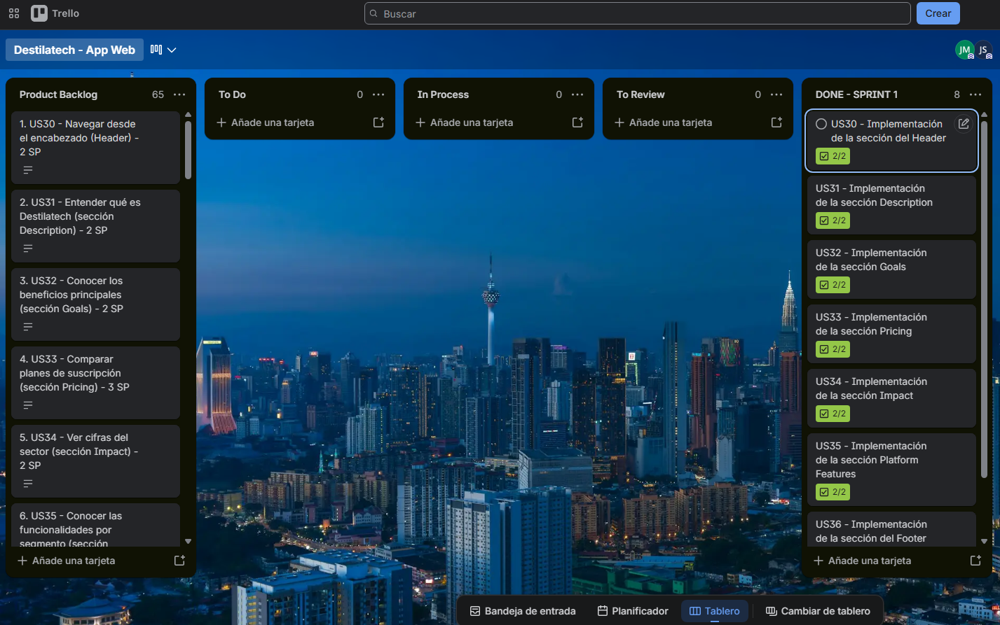

*Nota.* Captura propia de Trello (2026). Tablero disponible en [https://trello.com/b/4HZaQ3o7/destilatech-app-web](https://trello.com/b/4HZaQ3o7/destilatech-app-web).

*Descripción.* El tablero «Destilatech - App Web» organiza el trabajo en seis listas: Product Backlog (65 tarjetas); To Do, In Process y To Review (0 tarjetas cada una); DONE - SPRINT 1 (8 tarjetas) y DONE - SPRINT 2. La captura muestra el Product Backlog y la lista DONE - SPRINT 1, que concentra las tarjetas de las historias US30 a US37 (Header, Description, Goals, Pricing, Impact, Platform Features, Footer y Responsive Design; esta última queda oculta bajo el desplazamiento de la columna), cada una con su lista de verificación de tareas de ingeniería ya completada.

**Tabla 15**

*Sprint Backlog 1*

| User Story Id | User Story Title | Task Id | Task Title | Description | Estimation (Hours) | Assigned To | Status |
| :---------- | :----------------- | :---------- | :---------- | :------------------------------------------- | :----------: | :---------- | :----------: |
| **US30** | Navegar desde el encabezado (Header) | TK-01 | Header Markup, Styles & Branding | Estructura HTML y estilos CSS del Header con el logotipo, adaptados a pantallas de escritorio y móviles. Incluye la revisión del código y la verificación en navegador. | 4 | Santiago Atanacio, Jairo Mathias | Done |
| **US30** | Navegar desde el encabezado (Header) | TK-02 | Header Navigation & Anchor Links | Enlaces de navegación hacia las secciones de la página con desplazamiento suave y menú desplegable para móvil. Incluye la revisión del código y la verificación en navegador. | 4 | Santiago Atanacio, Jairo Mathias | Done |
| **US31** | Entender qué es Destilatech (sección Description) | TK-03 | Description Section Layout | Estructura HTML y estilos CSS de la sección Description, con las tarjetas de segmento. Incluye la revisión del código y la verificación en navegador. | 4 | Condor Sandoval, Jean Pierre | Done |
| **US31** | Entender qué es Destilatech (sección Description) | TK-04 | Description Content & Copy | Textos que explican qué es Destilatech para cada segmento, en inglés y en español. Incluye la revisión del código y la verificación en navegador. | 4 | Condor Sandoval, Jean Pierre | Done |
| **US32** | Conocer los beneficios principales (sección Goals) | TK-05 | Goals Section Layout | Estructura HTML y estilos CSS de la sección Goals con las tarjetas de beneficios. Incluye la revisión del código y la verificación en navegador. | 4 | Condor Sandoval, Jean Pierre | Done |
| **US32** | Conocer los beneficios principales (sección Goals) | TK-06 | Goals Content & Benefit Cards | Contenido de los beneficios principales de la plataforma, con sus iconos, en inglés y en español. Incluye la revisión del código y la verificación en navegador. | 4 | Condor Sandoval, Jean Pierre | Done |
| **US33** | Comparar planes de suscripción (sección Pricing) | TK-07 | Pricing Cards Layout | Tarjetas de los tres planes de suscripción, con precios y características, y sus estilos. Incluye la revisión del código y la verificación en navegador. | 6 | Fernandez Seer, Mario Alonso | Done |
| **US33** | Comparar planes de suscripción (sección Pricing) | TK-08 | Free Trial Highlight & CTA | Destacado de la prueba gratuita de 14 días y llamadas a la acción hacia la aplicación web. Incluye la revisión del código y la verificación en navegador. | 4 | Fernandez Seer, Mario Alonso | Done |
| **US34** | Ver cifras del sector (sección Impact) | TK-09 | Impact Section Layout | Estructura y estilos de la sección Impact con la imagen de fondo. Incluye la revisión del código y la verificación en navegador. | 4 | Fernandez Seer, Mario Alonso | Done |
| **US34** | Ver cifras del sector (sección Impact) | TK-10 | Impact Figures & Sources | Cifras del sector pisquero peruano y cita de la fuente (Ministerio de la Producción, 2025). Incluye la revisión del código y la verificación en navegador. | 4 | Fernandez Seer, Mario Alonso | Done |
| **US35** | Conocer las funcionalidades por segmento (sección Platform Features) | TK-11 | Platform Features Layout & Tabs | Estructura, estilos y pestañas accesibles (roles ARIA) de la sección Platform Features. Incluye la revisión del código y la verificación en navegador. | 6 | Almandroz Carbajal, Pierina Marysabel | Done |
| **US35** | Conocer las funcionalidades por segmento (sección Platform Features) | TK-12 | Features by Segment Content | Funcionalidades presentadas por segmento objetivo (productor y comercializador). Incluye la revisión del código y la verificación en navegador. | 4 | Almandroz Carbajal, Pierina Marysabel | Done |
| **US36** | Encontrar contacto y enlaces en el pie de página (Footer) | TK-13 | Footer Layout | Estructura y estilos de la sección Footer con la marca y las columnas de navegación. Incluye la revisión del código y la verificación en navegador. | 4 | Santiago Atanacio, Jairo Mathias | Done |
| **US36** | Encontrar contacto y enlaces en el pie de página (Footer) | TK-14 | Footer Links & Legal Pages | Enlaces del pie de página y páginas de términos y condiciones y de política de privacidad. Incluye la revisión del código y la verificación en navegador. | 4 | Santiago Atanacio, Jairo Mathias | Done |
| **US37** | Usar la landing page en cualquier dispositivo (adaptabilidad móvil) | TK-15 | Responsive Design Implementation | Implementación de la adaptabilidad móvil de todas las secciones con puntos de quiebre para teléfono, tableta y escritorio. Incluye la revisión del código y la verificación en navegador. | 8 | Domenack Angeles, Miguel | Done |
| **US37** | Usar la landing page en cualquier dispositivo (adaptabilidad móvil) | TK-16 | Mobile Mock-up of the Landing Page | Diseño del mock-up de la landing page para smartphone, como referencia visual de la adaptabilidad móvil. Incluye la revisión del diseño con el equipo. | 4 | Fernandez Seer, Mario Alonso | To Review |

**Horas por integrante.** El Sprint Backlog 1 suma 72 horas: Santiago Atanacio, Jairo Mathias, 16; Condor Sandoval, Jean Pierre, 16; Fernandez Seer, Mario Alonso, 22; Almandroz Carbajal, Pierina Marysabel, 10; Domenack Angeles, Miguel, 8.

**Observación.** Cada tarea es una tarea de ingeniería (*Engineering Task*) de 4 a 8 horas, y cada historia se descompone en al menos dos de ellas, que se registran como una checklist dentro de su tarjeta en Trello; las tareas de una misma historia las ejecuta el responsable del aspecto. La tarea TK-16 es de apoyo a la historia US37 y no modifica su responsable: el líder del aspecto Responsive Design sigue siendo Domenack Angeles, Miguel. Al cierre del Sprint 1 (Figura 99), todas las tarjetas del sprint están en la lista DONE - SPRINT 1.

##### 5.2.1.4. Development Evidence for Sprint Review

Durante el Sprint 1 se implementaron en el repositorio [destilatech-website](https://github.com/upc-pre-202620-1ASI0730-2620-8084-desti/destilatech-website) la estructura HTML, los estilos, la adaptabilidad móvil, el ícono del logotipo, las pestañas de funcionalidades por segmento y la estructura base de internacionalización (i18n). La tabla lista los commits en orden cronológico.

**Tabla 16**

*Commits del repositorio de la landing page*

| Repository | Branch | Commit Id | Commit Message | Commit Message Body | Committed on (Date) |
| :------------------- | :---------- | :---------- | :---------- | :---------- | :----------: |
| `upc-pre-202620-1ASI0730-2620-8084-desti/destilatech-website` | main | `6f9d1f4` | Initial commit | — | 2026-09-04 |
| `upc-pre-202620-1ASI0730-2620-8084-desti/destilatech-website` | main | `a524f80` | docs: subir imagenes a assets | — | 2026-09-05 |
| `upc-pre-202620-1ASI0730-2620-8084-desti/destilatech-website` | main | `a438143` | docs: eliminando | — | 2026-09-05 |
| `upc-pre-202620-1ASI0730-2620-8084-desti/destilatech-website` | main | `a1d574c` | docs: subir imagenes | — | 2026-09-06 |
| `upc-pre-202620-1ASI0730-2620-8084-desti/destilatech-website` | main | `9e034db` | docs: agregar parte del index, js | — | 2026-09-08 |
| `upc-pre-202620-1ASI0730-2620-8084-desti/destilatech-website` | main | `9ff557f` | docs: eliminando | — | 2026-09-08 |
| `upc-pre-202620-1ASI0730-2620-8084-desti/destilatech-website` | main | `5d16532` | docs: subiendo archuvi html, js y css | — | 2026-09-10 |
| `upc-pre-202620-1ASI0730-2620-8084-desti/destilatech-website` | main | `5be25df` | docs: agregar estrucutra de responsive design | — | 2026-09-12 |
| `upc-pre-202620-1ASI0730-2620-8084-desti/destilatech-website` | main | `f521716` | docs: agregar estructura de logo-icon | — | 2026-09-14 |
| `upc-pre-202620-1ASI0730-2620-8084-desti/destilatech-website` | main | `70141ff` | docs: agregar estructura de platform feature tabs | — | 2026-09-16 |
| `upc-pre-202620-1ASI0730-2620-8084-desti/destilatech-website` | main | `03cf29c` | docs: agregar estructura de i18n | — | 2026-09-18 |

**Observaciones sobre los commits.** Los mensajes de este sprint están redactados en español y usan el tipo `docs`, aunque la mayoría de los cambios corresponde a funcionalidad (`feat`) o estilos (`style`). Los mensajes se conservan tal como quedaron registrados en GitHub; a partir del siguiente sprint el equipo aplicará la convención de la sección 5.1.2 (tipo adecuado y descripción en inglés). La estructura base de i18n se inició en este sprint, pero la historia US52 (cambio de idioma) no forma parte del Sprint Backlog 1.

**Commits del repositorio del informe.** Durante el mismo periodo el equipo avanzó en el informe, que se registra en el repositorio [destilatech-report](https://github.com/upc-pre-202620-1ASI0730-2620-8084-desti/destilatech-report). El equipo trabajó con ramas `feature/*` integradas en `develop` mediante Pull Requests, como se describe en la sección 5.1.2. La tabla siguiente reúne los commits visibles en el historial de GitHub de cada rama; cuando un commit aparece en varias ramas por compartir historial, se registra una sola vez, en la primera rama donde se observó.

El historial de GitHub no muestra el cuerpo del mensaje de los commits, por lo que esa columna se indica con «—».

**Tabla 17**

*Commits del repositorio del informe*

| Repository | Branch | Commit Id | Commit Message | Commit Message Body | Committed on (Date) |
| :---------- | :---------- | :----------------------------------- | :--------------- | :---------- | :----------: |
| destilatech-report | `feature/agregar-entrevistas-o-fix/corregir-readme` | [`a56bac5`](https://github.com/upc-pre-202620-1ASI0730-2620-8084-desti/destilatech-report/commit/a56bac5) | docs: add segment 2 interviews and images to README | — | 2026-09-15 |
| destilatech-report | `feature/big_picture_eventstorming` | [`10ba45f`](https://github.com/upc-pre-202620-1ASI0730-2620-8084-desti/destilatech-report/commit/10ba45f) | Update README.md | — | 2026-09-15 |
| destilatech-report | `feature/big_picture_eventstorming` | [`1d8f888`](https://github.com/upc-pre-202620-1ASI0730-2620-8084-desti/destilatech-report/commit/1d8f888) | docs: agregar estructura de user stories y product backlog | — | 2026-09-15 |
| destilatech-report | `feature/big_picture_eventstorming` | [`341e6e6`](https://github.com/upc-pre-202620-1ASI0730-2620-8084-desti/destilatech-report/commit/341e6e6) | Adjust image size in README | — | 2026-09-15 |
| destilatech-report | `feature/big_picture_eventstorming` | [`6e28ebe`](https://github.com/upc-pre-202620-1ASI0730-2620-8084-desti/destilatech-report/commit/6e28ebe) | Merge branch 'feature/actualizar_tablas_entrevistas' into develop | — | 2026-09-15 |
| destilatech-report | `feature/big_picture_eventstorming` | [`962a753`](https://github.com/upc-pre-202620-1ASI0730-2620-8084-desti/destilatech-report/commit/962a753) | docs: actualizar estructura de registro de entrevistas | — | 2026-09-15 |
| destilatech-report | `feature/big_picture_eventstorming` | [`c489e2d`](https://github.com/upc-pre-202620-1ASI0730-2620-8084-desti/destilatech-report/commit/c489e2d) | Add files via upload | — | 2026-09-15 |
| destilatech-report | `feature/empathy_mapping_2` | [`046034e`](https://github.com/upc-pre-202620-1ASI0730-2620-8084-desti/destilatech-report/commit/046034e) | Merge branch 'develop' of https://github.com/upc-pre-202620-1ASI0730-2620-8084-desti/destilatech-report into develop | — | 2026-09-15 |
| destilatech-report | `feature/empathy_mapping_2` | [`46c1788`](https://github.com/upc-pre-202620-1ASI0730-2620-8084-desti/destilatech-report/commit/46c1788) | docs: actualizar capitulo 3 y product backlog | — | 2026-09-15 |
| destilatech-report | `feature/empathy_mapping_2` | [`47767a5`](https://github.com/upc-pre-202620-1ASI0730-2620-8084-desti/destilatech-report/commit/47767a5) | Merge branch 'feature/agregar-entrevistas-o-fix/corregir-readme' into develop | — | 2026-09-15 |
| destilatech-report | `feature/empathy_mapping_2` | [`4fa13c8`](https://github.com/upc-pre-202620-1ASI0730-2620-8084-desti/destilatech-report/commit/4fa13c8) | Merge branch 'develop' of https://github.com/upc-pre-202620-1ASI0730-2620-8084-desti/destilatech-report into develop | — | 2026-09-15 |
| destilatech-report | `feature/empathy_mapping_2` | [`772ef0f`](https://github.com/upc-pre-202620-1ASI0730-2620-8084-desti/destilatech-report/commit/772ef0f) | docs: update README sections and add user journey map image | — | 2026-09-15 |
| destilatech-report | `feature/empathy_mapping_2` | [`c491714`](https://github.com/upc-pre-202620-1ASI0730-2620-8084-desti/destilatech-report/commit/c491714) | Update README.md | — | 2026-09-15 |
| destilatech-report | `feature/empathy_mapping_2` | [`c64fdfd`](https://github.com/upc-pre-202620-1ASI0730-2620-8084-desti/destilatech-report/commit/c64fdfd) | feat: agregar imagen UXPressia y actualizar readme | — | 2026-09-15 |
| destilatech-report | `feature/empathy_mapping_2` | [`d1ca28f`](https://github.com/upc-pre-202620-1ASI0730-2620-8084-desti/destilatech-report/commit/d1ca28f) | docs: actualizar secciones del README | — | 2026-09-15 |
| destilatech-report | `feature/empathy_mapping_2` | [`ea01a93`](https://github.com/upc-pre-202620-1ASI0730-2620-8084-desti/destilatech-report/commit/ea01a93) | docs: actualizar secciones del README | — | 2026-09-15 |
| destilatech-report | `feature/entrevistas` | [`c7e1c2f`](https://github.com/upc-pre-202620-1ASI0730-2620-8084-desti/destilatech-report/commit/c7e1c2f) | docs: agregar estructura del competidores | — | 2026-09-15 |
| destilatech-report | `feature/entrevistas` | [`d89a80f`](https://github.com/upc-pre-202620-1ASI0730-2620-8084-desti/destilatech-report/commit/d89a80f) | docs: agregar estructura de entrevistas | — | 2026-09-15 |
| destilatech-report | `feature/segmentos_objetivo` | [`c5c6552`](https://github.com/upc-pre-202620-1ASI0730-2620-8084-desti/destilatech-report/commit/c5c6552) | docs: agregar estructura de segmentos objetivo | — | 2026-09-15 |
| destilatech-report | `feature/solution_profile` | [`dbcf1fa`](https://github.com/upc-pre-202620-1ASI0730-2620-8084-desti/destilatech-report/commit/dbcf1fa) | docs: agregar estructura del solution profile | — | 2026-09-15 |
| destilatech-report | `feature/startup_profile` | [`3700507`](https://github.com/upc-pre-202620-1ASI0730-2620-8084-desti/destilatech-report/commit/3700507) | chore: agregar recursos e imagenes desde main | — | 2026-09-15 |
| destilatech-report | `feature/startup_profile` | [`4ffa766`](https://github.com/upc-pre-202620-1ASI0730-2620-8084-desti/destilatech-report/commit/4ffa766) | Delete assets directory | — | 2026-09-15 |
| destilatech-report | `feature/startup_profile` | [`6c018b5`](https://github.com/upc-pre-202620-1ASI0730-2620-8084-desti/destilatech-report/commit/6c018b5) | docs: agregar estructura del indice | — | 2026-09-15 |
| destilatech-report | `feature/startup_profile` | [`84148af`](https://github.com/upc-pre-202620-1ASI0730-2620-8084-desti/destilatech-report/commit/84148af) | docs: agregar startup profile | — | 2026-09-15 |
| destilatech-report | `feature/startup_profile` | [`ab668c8`](https://github.com/upc-pre-202620-1ASI0730-2620-8084-desti/destilatech-report/commit/ab668c8) | Merge pull request #1 from upc-pre-202620-1ASI0730-2620-8084-desti/feature/indice | — | 2026-09-15 |
| destilatech-report | `feature/startup_profile` | [`b2f9ef9`](https://github.com/upc-pre-202620-1ASI0730-2620-8084-desti/destilatech-report/commit/b2f9ef9) | Create md-images-front-matter | — | 2026-09-15 |
| destilatech-report | `feature/startup_profile` | [`d542fa3`](https://github.com/upc-pre-202620-1ASI0730-2620-8084-desti/destilatech-report/commit/d542fa3) | chore: iniciar rama develop vacia | — | 2026-09-15 |
| destilatech-report | `feature/ubiquitous_language` | [`17886a4`](https://github.com/upc-pre-202620-1ASI0730-2620-8084-desti/destilatech-report/commit/17886a4) | docs: agregar big pivture eventstorming | — | 2026-09-15 |
| destilatech-report | `feature/ubiquitous_language` | [`35d68f8`](https://github.com/upc-pre-202620-1ASI0730-2620-8084-desti/destilatech-report/commit/35d68f8) | docs: redactar y colocar imagenes de los big picture event storming | — | 2026-09-15 |
| destilatech-report | `feature/ubiquitous_language` | [`5cb1d76`](https://github.com/upc-pre-202620-1ASI0730-2620-8084-desti/destilatech-report/commit/5cb1d76) | Add files via upload | — | 2026-09-15 |
| destilatech-report | `feature/ubiquitous_language` | [`62f8e46`](https://github.com/upc-pre-202620-1ASI0730-2620-8084-desti/destilatech-report/commit/62f8e46) | docs: descripcion de ubiquitous-language | — | 2026-09-15 |
| destilatech-report | `feature/ubiquitous_language` | [`948f7f9`](https://github.com/upc-pre-202620-1ASI0730-2620-8084-desti/destilatech-report/commit/948f7f9) | Adjust image sizes in README for Big Picture section | — | 2026-09-15 |
| destilatech-report | `feature/ubiquitous_language` | [`a3c85c2`](https://github.com/upc-pre-202620-1ASI0730-2620-8084-desti/destilatech-report/commit/a3c85c2) | Update README.md | — | 2026-09-15 |
| destilatech-report | `feature/ubiquitous_language` | [`a448ff6`](https://github.com/upc-pre-202620-1ASI0730-2620-8084-desti/destilatech-report/commit/a448ff6) | docs: agregar estrucutra de ubiquitous language | — | 2026-09-15 |
| destilatech-report | `feature/ubiquitous_language` | [`de7235f`](https://github.com/upc-pre-202620-1ASI0730-2620-8084-desti/destilatech-report/commit/de7235f) | Remove Big Picture Event Storming section from README | — | 2026-09-15 |
| destilatech-report | `feature/ubiquitous_language` | [`f2b389b`](https://github.com/upc-pre-202620-1ASI0730-2620-8084-desti/destilatech-report/commit/f2b389b) | docs: update README sections and add empathy mapping image | — | 2026-09-15 |
| destilatech-report | `feature/ubiquitous_language` | [`f3f59f3`](https://github.com/upc-pre-202620-1ASI0730-2620-8084-desti/destilatech-report/commit/f3f59f3) | Merge branch 'develop' of https://github.com/upc-pre-202620-1ASI0730-2620-8084-desti/destilatech-report into develop | — | 2026-09-15 |
| destilatech-report | `docs/chapter-4-webapp-ux-ui` | [`c63b578`](https://github.com/upc-pre-202620-1ASI0730-2620-8084-desti/destilatech-report/commit/c63b578) | add segment 1 producer interview | — | 2026-09-16 |
| destilatech-report | `feature/LandingPageMock-up` | [`6593ccb`](https://github.com/upc-pre-202620-1ASI0730-2620-8084-desti/destilatech-report/commit/6593ccb) | Add files via upload | — | 2026-09-16 |
| destilatech-report | `feature/domain_driven_architecture` | [`0be6549`](https://github.com/upc-pre-202620-1ASI0730-2620-8084-desti/destilatech-report/commit/0be6549) | docs: add Class Diagram for Analytics & Estimations | — | 2026-09-16 |
| destilatech-report | `feature/domain_driven_architecture` | [`228bfb1`](https://github.com/upc-pre-202620-1ASI0730-2620-8084-desti/destilatech-report/commit/228bfb1) | docs: add Event Storming diagram for Orders & Replenishment | — | 2026-09-16 |
| destilatech-report | `feature/domain_driven_architecture` | [`32ff465`](https://github.com/upc-pre-202620-1ASI0730-2620-8084-desti/destilatech-report/commit/32ff465) | docs: add Class Diagram for Production & Monitoring | — | 2026-09-16 |
| destilatech-report | `feature/domain_driven_architecture` | [`3ac965d`](https://github.com/upc-pre-202620-1ASI0730-2620-8084-desti/destilatech-report/commit/3ac965d) | docs: add Event Storming diagram for Analytics & Estimations | — | 2026-09-16 |
| destilatech-report | `feature/domain_driven_architecture` | [`423df99`](https://github.com/upc-pre-202620-1ASI0730-2620-8084-desti/destilatech-report/commit/423df99) | docs: add Class Diagram for Orders & Replenishment | — | 2026-09-16 |
| destilatech-report | `feature/domain_driven_architecture` | [`7d9371c`](https://github.com/upc-pre-202620-1ASI0730-2620-8084-desti/destilatech-report/commit/7d9371c) | docs: add Class Diagram for Identity/Access & Subscriptions | — | 2026-09-16 |
| destilatech-report | `feature/domain_driven_architecture` | [`98cd696`](https://github.com/upc-pre-202620-1ASI0730-2620-8084-desti/destilatech-report/commit/98cd696) | docs: add Software Object-Oriented Design intro | — | 2026-09-16 |
| destilatech-report | `feature/domain_driven_architecture` | [`aa69c20`](https://github.com/upc-pre-202620-1ASI0730-2620-8084-desti/destilatech-report/commit/aa69c20) | docs: add Class Diagram for Inventory & Stock Management | — | 2026-09-16 |
| destilatech-report | `feature/domain_driven_architecture` | [`e7108e2`](https://github.com/upc-pre-202620-1ASI0730-2620-8084-desti/destilatech-report/commit/e7108e2) | docs: add Class Diagram for Alerts & Notifications | — | 2026-09-16 |
| destilatech-report | `feature/domain_driven_architecture` | [`ff2cdde`](https://github.com/upc-pre-202620-1ASI0730-2620-8084-desti/destilatech-report/commit/ff2cdde) | docs: add Event Storming diagram for Alerts & Notifications | — | 2026-09-16 |
| destilatech-report | `feature/product-design` | [`69897f8`](https://github.com/upc-pre-202620-1ASI0730-2620-8084-desti/destilatech-report/commit/69897f8) | docs: add product design sections 4.6 to 4.8 | — | 2026-09-16 |
| destilatech-report | `feature/product-design` | [`ce5a4aa`](https://github.com/upc-pre-202620-1ASI0730-2620-8084-desti/destilatech-report/commit/ce5a4aa) | docs: add architecture diagrams | — | 2026-09-16 |
| destilatech-report | `docs/chapter-4-webapp-ux-ui` | [`04bdbc7`](https://github.com/upc-pre-202620-1ASI0730-2620-8084-desti/destilatech-report/commit/04bdbc7) | Update team member details in README.md | — | 2026-09-17 |
| destilatech-report | `feature/chapter-4` | [`2bd2abc`](https://github.com/upc-pre-202620-1ASI0730-2620-8084-desti/destilatech-report/commit/2bd2abc) | Merge branch 'develop' of https://github.com/upc-pre-202620-1ASI0730-2620-8084-desti/destilatech-report | — | 2026-09-17 |
| destilatech-report | `feature/chapter-4` | [`aa303d6`](https://github.com/upc-pre-202620-1ASI0730-2620-8084-desti/destilatech-report/commit/aa303d6) | Revise timing and summary details in README | — | 2026-09-17 |
| destilatech-report | `feature/chapter-4` | [`f22c0e4`](https://github.com/upc-pre-202620-1ASI0730-2620-8084-desti/destilatech-report/commit/f22c0e4) | Update video URL in README | — | 2026-09-17 |
| destilatech-report | `feature/code_management` | [`30f6db6`](https://github.com/upc-pre-202620-1ASI0730-2620-8084-desti/destilatech-report/commit/30f6db6) | docs: update user personas and task matrix in README | — | 2026-09-17 |
| destilatech-report | `feature/code_management` | [`3b78422`](https://github.com/upc-pre-202620-1ASI0730-2620-8084-desti/destilatech-report/commit/3b78422) | docs: update user personas and task matrix in README | — | 2026-09-17 |
| destilatech-report | `feature/code_style` | [`1c53631`](https://github.com/upc-pre-202620-1ASI0730-2620-8084-desti/destilatech-report/commit/1c53631) | docs: add LandingPageMock up content | — | 2026-09-17 |
| destilatech-report | `feature/code_style` | [`ac2a791`](https://github.com/upc-pre-202620-1ASI0730-2620-8084-desti/destilatech-report/commit/ac2a791) | docs: add chapter 4 content | — | 2026-09-17 |
| destilatech-report | `feature/code_style` | [`ba2f25b`](https://github.com/upc-pre-202620-1ASI0730-2620-8084-desti/destilatech-report/commit/ba2f25b) | Add files via upload | — | 2026-09-17 |
| destilatech-report | `feature/code_style` | [`c574b92`](https://github.com/upc-pre-202620-1ASI0730-2620-8084-desti/destilatech-report/commit/c574b92) | docs: add new asset image and update README section | — | 2026-09-17 |
| destilatech-report | `develop` | [`0fdf365`](https://github.com/upc-pre-202620-1ASI0730-2620-8084-desti/destilatech-report/commit/0fdf365) | fix: resolve merge conflicts in README | — | 2026-09-18 |
| destilatech-report | `develop` | [`1dae533`](https://github.com/upc-pre-202620-1ASI0730-2620-8084-desti/destilatech-report/commit/1dae533) | fix: sync develop with resolved main | — | 2026-09-18 |
| destilatech-report | `develop` | [`c2b87b0`](https://github.com/upc-pre-202620-1ASI0730-2620-8084-desti/destilatech-report/commit/c2b87b0) | Merge pull request #5 from upc-pre-202620-1ASI0730-2620-8084-desti/feature/student-profile | — | 2026-09-18 |
| destilatech-report | `docs/chapter-4-webapp-ux-ui` | [`7686841`](https://github.com/upc-pre-202620-1ASI0730-2620-8084-desti/destilatech-report/commit/7686841) | docs: add web application ux ui assets | — | 2026-09-18 |
| destilatech-report | `docs/chapter-4-webapp-ux-ui` | [`a58e500`](https://github.com/upc-pre-202620-1ASI0730-2620-8084-desti/destilatech-report/commit/a58e500) | docs: add web application ux ui documentation | — | 2026-09-18 |
| destilatech-report | `docs/chapter-4-webapp-ux-ui` | [`b3a11f7`](https://github.com/upc-pre-202620-1ASI0730-2620-8084-desti/destilatech-report/commit/b3a11f7) | docs: align web app ux ui section with chapter four | — | 2026-09-18 |
| destilatech-report | `docs/chapter-4-webapp-ux-ui` | [`c47bf41`](https://github.com/upc-pre-202620-1ASI0730-2620-8084-desti/destilatech-report/commit/c47bf41) | Update README.md | — | 2026-09-18 |
| destilatech-report | `feature/Source_Code_Management` | [`7b8847e`](https://github.com/upc-pre-202620-1ASI0730-2620-8084-desti/destilatech-report/commit/7b8847e) | docs: agregar estructura de Source_Code_Management | — | 2026-09-18 |
| destilatech-report | `feature/Student_Jean` | [`023c9ea`](https://github.com/upc-pre-202620-1ASI0730-2620-8084-desti/destilatech-report/commit/023c9ea) | Revise Sprint 1 details in README | — | 2026-09-18 |
| destilatech-report | `feature/Student_Jean` | [`3cf7060`](https://github.com/upc-pre-202620-1ASI0730-2620-8084-desti/destilatech-report/commit/3cf7060) | Add files via upload | — | 2026-09-18 |
| destilatech-report | `feature/Student_Jean` | [`494efc8`](https://github.com/upc-pre-202620-1ASI0730-2620-8084-desti/destilatech-report/commit/494efc8) | Update README.md | — | 2026-09-18 |
| destilatech-report | `feature/Student_Jean` | [`521c7c9`](https://github.com/upc-pre-202620-1ASI0730-2620-8084-desti/destilatech-report/commit/521c7c9) | Update README.md | — | 2026-09-18 |
| destilatech-report | `feature/Student_Jean` | [`61c83c2`](https://github.com/upc-pre-202620-1ASI0730-2620-8084-desti/destilatech-report/commit/61c83c2) | docs: add Student Jean content | — | 2026-09-18 |
| destilatech-report | `feature/Student_Jean` | [`63264b3`](https://github.com/upc-pre-202620-1ASI0730-2620-8084-desti/destilatech-report/commit/63264b3) | Add files via upload | — | 2026-09-18 |
| destilatech-report | `feature/Student_Jean` | [`9409eae`](https://github.com/upc-pre-202620-1ASI0730-2620-8084-desti/destilatech-report/commit/9409eae) | Update user stories and tasks in README | — | 2026-09-18 |
| destilatech-report | `feature/Student_Jean` | [`9aeb97c`](https://github.com/upc-pre-202620-1ASI0730-2620-8084-desti/destilatech-report/commit/9aeb97c) | Update README.md | — | 2026-09-18 |
| destilatech-report | `feature/Student_Jean` | [`bf9933f`](https://github.com/upc-pre-202620-1ASI0730-2620-8084-desti/destilatech-report/commit/bf9933f) | Add files via upload | — | 2026-09-18 |
| destilatech-report | `feature/Student_Jean` | [`c669a0e`](https://github.com/upc-pre-202620-1ASI0730-2620-8084-desti/destilatech-report/commit/c669a0e) | Update README.md | — | 2026-09-18 |
| destilatech-report | `feature/agregar_fotos` | [`45967d5`](https://github.com/upc-pre-202620-1ASI0730-2620-8084-desti/destilatech-report/commit/45967d5) | merge: integrar cambios en develop | — | 2026-09-18 |
| destilatech-report | `feature/agregar_fotos` | [`b47a668`](https://github.com/upc-pre-202620-1ASI0730-2620-8084-desti/destilatech-report/commit/b47a668) | docs: completar capitulo 5.1.4 | — | 2026-09-18 |
| destilatech-report | `feature/chapter-4` | [`583a8c9`](https://github.com/upc-pre-202620-1ASI0730-2620-8084-desti/destilatech-report/commit/583a8c9) | complete web application ux ui design | — | 2026-09-18 |
| destilatech-report | `feature/chapter-4` | [`e0cdc23`](https://github.com/upc-pre-202620-1ASI0730-2620-8084-desti/destilatech-report/commit/e0cdc23) | Add files via upload | — | 2026-09-18 |
| destilatech-report | `feature/code_style` | [`0f0a2d5`](https://github.com/upc-pre-202620-1ASI0730-2620-8084-desti/destilatech-report/commit/0f0a2d5) | merge: integrar feature/code_management en develop | — | 2026-09-18 |
| destilatech-report | `feature/code_style` | [`3d2f9d9`](https://github.com/upc-pre-202620-1ASI0730-2620-8084-desti/destilatech-report/commit/3d2f9d9) | docs: agregar estructura de Software_Configuration_Management | — | 2026-09-18 |
| destilatech-report | `feature/code_style` | [`48d5455`](https://github.com/upc-pre-202620-1ASI0730-2620-8084-desti/destilatech-report/commit/48d5455) | docs: agregar estructura de source code management | — | 2026-09-18 |
| destilatech-report | `feature/code_style` | [`524175e`](https://github.com/upc-pre-202620-1ASI0730-2620-8084-desti/destilatech-report/commit/524175e) | docs: agregando el code style | — | 2026-09-18 |
| destilatech-report | `feature/code_style` | [`6bf2772`](https://github.com/upc-pre-202620-1ASI0730-2620-8084-desti/destilatech-report/commit/6bf2772) | docs: agregar estructura de capitulo 5 | — | 2026-09-18 |
| destilatech-report | `feature/code_style` | [`e1e739a`](https://github.com/upc-pre-202620-1ASI0730-2620-8084-desti/destilatech-report/commit/e1e739a) | docs: realizando capitulo 5.1 | — | 2026-09-18 |
| destilatech-report | `feature/dda_diagrams` | [`076b85a`](https://github.com/upc-pre-202620-1ASI0730-2620-8084-desti/destilatech-report/commit/076b85a) | docs: add Database Diagram for Orders & Replenishment | — | 2026-09-18 |
| destilatech-report | `feature/dda_diagrams` | [`1cfd628`](https://github.com/upc-pre-202620-1ASI0730-2620-8084-desti/destilatech-report/commit/1cfd628) | docs: add Component Diagram for Web Application with Billing Module | — | 2026-09-18 |
| destilatech-report | `feature/dda_diagrams` | [`23a1199`](https://github.com/upc-pre-202620-1ASI0730-2620-8084-desti/destilatech-report/commit/23a1199) | docs: add Component Diagram for Landing Page | — | 2026-09-18 |
| destilatech-report | `feature/dda_diagrams` | [`31f458b`](https://github.com/upc-pre-202620-1ASI0730-2620-8084-desti/destilatech-report/commit/31f458b) | docs: add Component Diagram for RESTful API with IAM/Billing split | — | 2026-09-18 |
| destilatech-report | `feature/dda_diagrams` | [`35629ae`](https://github.com/upc-pre-202620-1ASI0730-2620-8084-desti/destilatech-report/commit/35629ae) | docs: add Database Diagram for Production & Monitoring | — | 2026-09-18 |
| destilatech-report | `feature/dda_diagrams` | [`35fad69`](https://github.com/upc-pre-202620-1ASI0730-2620-8084-desti/destilatech-report/commit/35fad69) | docs: add Database Diagram for Billing | — | 2026-09-18 |
| destilatech-report | `feature/dda_diagrams` | [`400ca59`](https://github.com/upc-pre-202620-1ASI0730-2620-8084-desti/destilatech-report/commit/400ca59) | docs: add Database Diagram for Alerts & Notifications | — | 2026-09-18 |
| destilatech-report | `feature/dda_diagrams` | [`8781f0c`](https://github.com/upc-pre-202620-1ASI0730-2620-8084-desti/destilatech-report/commit/8781f0c) | docs: add Database Diagram for Inventory & Stock Management | — | 2026-09-18 |
| destilatech-report | `feature/dda_diagrams` | [`8ef8afe`](https://github.com/upc-pre-202620-1ASI0730-2620-8084-desti/destilatech-report/commit/8ef8afe) | docs: add Database Diagram for IAM | — | 2026-09-18 |
| destilatech-report | `feature/dda_diagrams` | [`a5e2db2`](https://github.com/upc-pre-202620-1ASI0730-2620-8084-desti/destilatech-report/commit/a5e2db2) | docs: add Database Diagram for Analytics & Estimations | — | 2026-09-18 |
| destilatech-report | `feature/student-profile` | [`265d16a`](https://github.com/upc-pre-202620-1ASI0730-2620-8084-desti/destilatech-report/commit/265d16a) | Correccion de detalles y completado de puntos faltantes | — | 2026-09-18 |
| destilatech-report | `feature/student-profile` | [`3813d28`](https://github.com/upc-pre-202620-1ASI0730-2620-8084-desti/destilatech-report/commit/3813d28) | Foto Miguel para Perfiles de Integrantes | — | 2026-09-18 |
| destilatech-report | `feature/student-profile` | [`5aeb520`](https://github.com/upc-pre-202620-1ASI0730-2620-8084-desti/destilatech-report/commit/5aeb520) | docs: Fix and update team member descriptions in README.md | — | 2026-09-18 |
| destilatech-report | `feature/student-profile` | [`6a297bf`](https://github.com/upc-pre-202620-1ASI0730-2620-8084-desti/destilatech-report/commit/6a297bf) | Revise Web Applications UX/UI Design section in README | — | 2026-09-18 |
| destilatech-report | `feature/student-profile` | [`7853fd8`](https://github.com/upc-pre-202620-1ASI0730-2620-8084-desti/destilatech-report/commit/7853fd8) | Add images to team member profiles | — | 2026-09-18 |
| destilatech-report | `feature/student-profile` | [`add6811`](https://github.com/upc-pre-202620-1ASI0730-2620-8084-desti/destilatech-report/commit/add6811) | Merge branch 'develop' into feature/student-profile | — | 2026-09-18 |
| destilatech-report | `feature/student-profile` | [`bebfabb`](https://github.com/upc-pre-202620-1ASI0730-2620-8084-desti/destilatech-report/commit/bebfabb) | Registro de Versiones del Informe Actualizado | — | 2026-09-18 |
| destilatech-report | `feature/student-profile` | [`bf51a28`](https://github.com/upc-pre-202620-1ASI0730-2620-8084-desti/destilatech-report/commit/bf51a28) | update Mario Student Outcome contribution | — | 2026-09-18 |
| destilatech-report | `feature/student-profile` | [`ddd65b3`](https://github.com/upc-pre-202620-1ASI0730-2620-8084-desti/destilatech-report/commit/ddd65b3) | Merge pull request #6 from upc-pre-202620-1ASI0730-2620-8084-desti/feature/dda_diagrams | — | 2026-09-18 |
| destilatech-report | `feature/student-profile` | [`fbbbcb5`](https://github.com/upc-pre-202620-1ASI0730-2620-8084-desti/destilatech-report/commit/fbbbcb5) | Add files via upload | — | 2026-09-18 |
| destilatech-report | `main` | [`34d560a`](https://github.com/upc-pre-202620-1ASI0730-2620-8084-desti/destilatech-report/commit/34d560a) | fix: sync develop with main README | — | 2026-09-18 |
| destilatech-report | `develop` | [`455a7db`](https://github.com/upc-pre-202620-1ASI0730-2620-8084-desti/destilatech-report/commit/455a7db) | Fix table closing tag in README.md | — | 2026-09-30 |
| destilatech-report | `main` | [`4182625`](https://github.com/upc-pre-202620-1ASI0730-2620-8084-desti/destilatech-report/commit/4182625) | Merge pull request #7 from upc-pre-202620-1ASI0730-2620-8084-desti/develop | — | 2026-09-30 |
| destilatech-report | `main` | [`9eaaa9c`](https://github.com/upc-pre-202620-1ASI0730-2620-8084-desti/destilatech-report/commit/9eaaa9c) | docs: sync report content from develop to main | — | 2026-09-30 |

Las capturas siguientes muestran el historial de cada rama en GitHub, que respalda la tabla anterior.

**Figura 100**

*Historial de commits de la rama feature/ubiquitous_language*

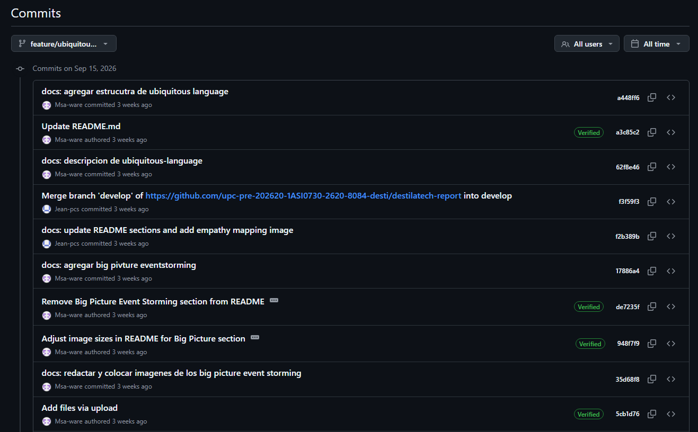

*Nota.* Captura de GitHub (2026).

*Descripción.* Página «Commits» del repositorio destilatech-report filtrada por la rama `feature/ubiquitous_language`, con el mensaje, el autor y el identificador de cada commit.

**Figura 101**

*Historial de commits de la rama feature/student-profile*

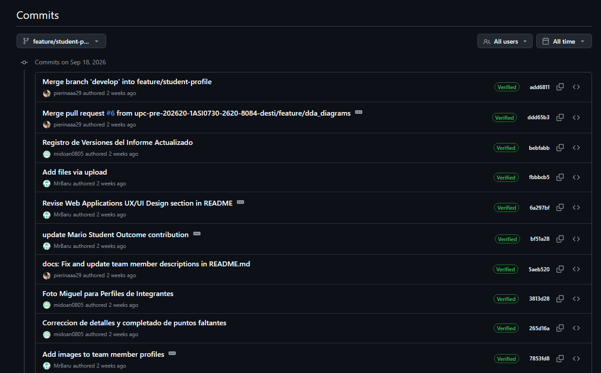

*Nota.* Captura de GitHub (2026).

*Descripción.* Página «Commits» del repositorio destilatech-report filtrada por la rama `feature/student-profile`, con el mensaje, el autor y el identificador de cada commit.

**Figura 102**

*Historial de commits de la rama feature/startup_profile*

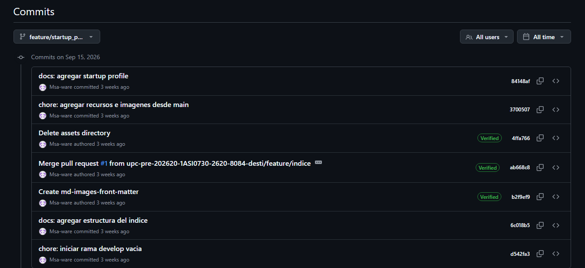

*Nota.* Captura de GitHub (2026).

*Descripción.* Página «Commits» del repositorio destilatech-report filtrada por la rama `feature/startup_profile`, con el mensaje, el autor y el identificador de cada commit.

**Figura 103**

*Historial de commits de la rama feature/solution_profile*

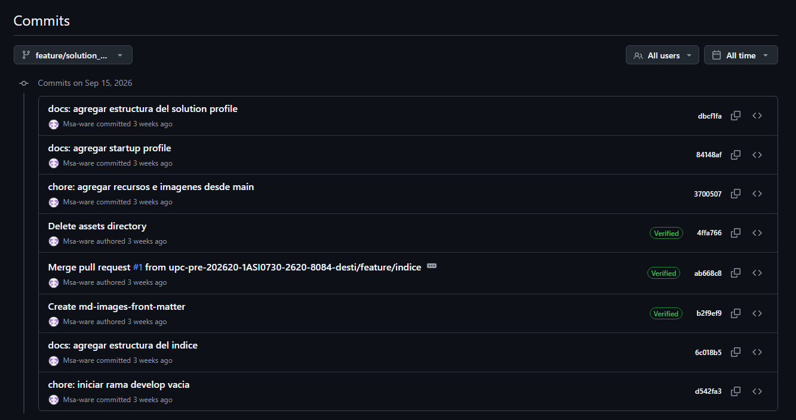

*Nota.* Captura de GitHub (2026).

*Descripción.* Página «Commits» del repositorio destilatech-report filtrada por la rama `feature/solution_profile`, con el mensaje, el autor y el identificador de cada commit.

**Figura 104**

*Historial de commits de la rama feature/segmentos_objetivo*

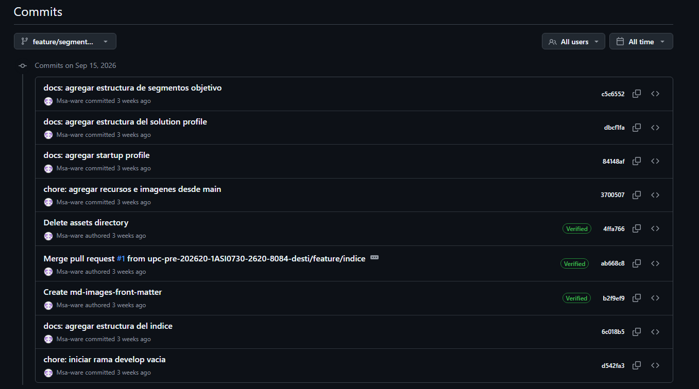

*Nota.* Captura de GitHub (2026).

*Descripción.* Página «Commits» del repositorio destilatech-report filtrada por la rama `feature/segmentos_objetivo`, con el mensaje, el autor y el identificador de cada commit.

**Figura 105**

*Historial de commits de la rama feature/product-design*

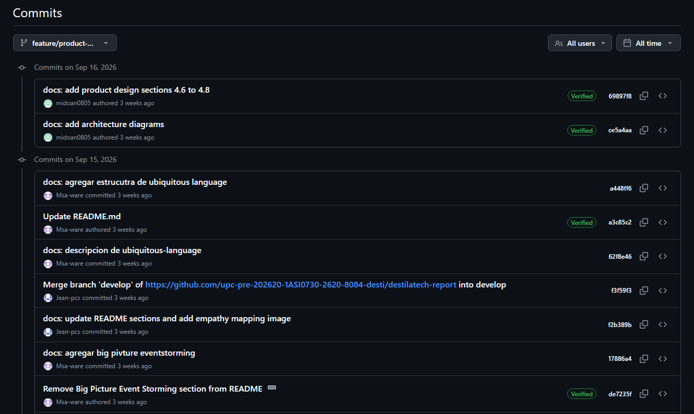

*Nota.* Captura de GitHub (2026).

*Descripción.* Página «Commits» del repositorio destilatech-report filtrada por la rama `feature/product-design`, con el mensaje, el autor y el identificador de cada commit.

**Figura 106**

*Historial de commits de la rama feature/entrevistas*

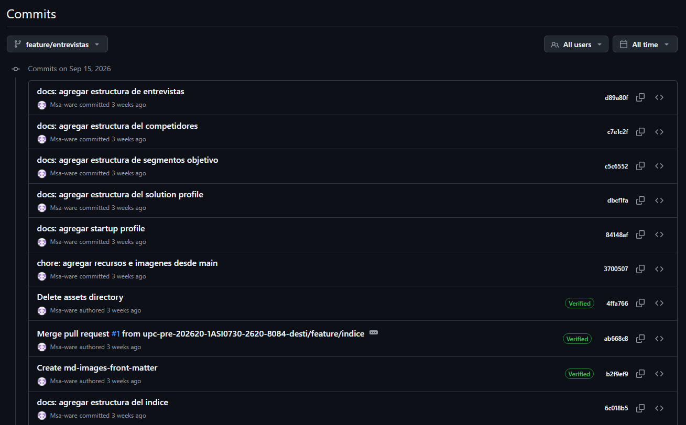

*Nota.* Captura de GitHub (2026).

*Descripción.* Página «Commits» del repositorio destilatech-report filtrada por la rama `feature/entrevistas`, con el mensaje, el autor y el identificador de cada commit.

**Figura 107**

*Historial de commits de la rama feature/empathy_mapping_2*

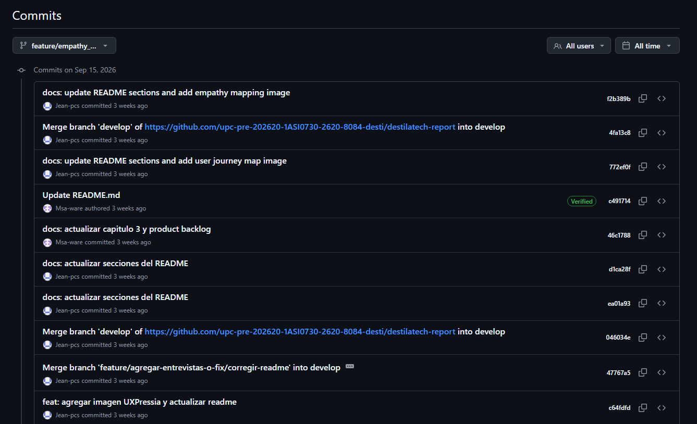

*Nota.* Captura de GitHub (2026).

*Descripción.* Página «Commits» del repositorio destilatech-report filtrada por la rama `feature/empathy_mapping_2`, con el mensaje, el autor y el identificador de cada commit.

**Figura 108**

*Historial de commits de la rama feature/domain_driven_architecture*

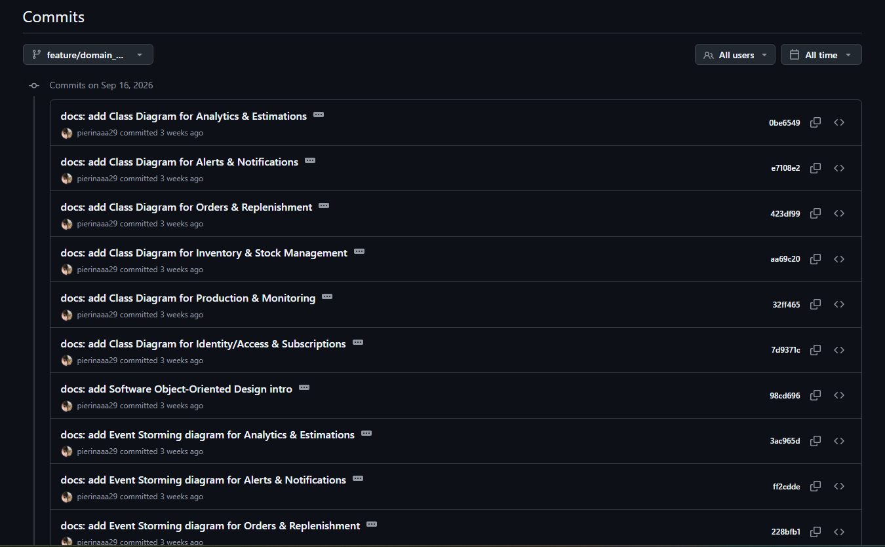

*Nota.* Captura de GitHub (2026).

*Descripción.* Página «Commits» del repositorio destilatech-report filtrada por la rama `feature/domain_driven_architecture`, con el mensaje, el autor y el identificador de cada commit.

**Figura 109**

*Historial de commits de la rama feature/dda_diagrams*

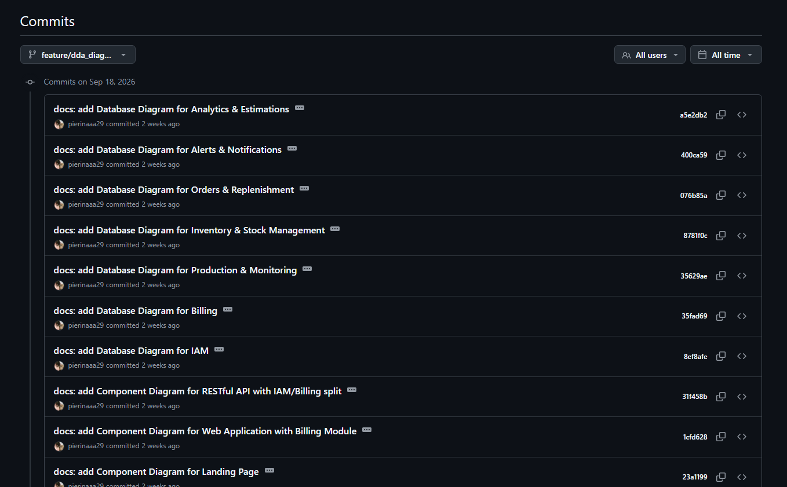

*Nota.* Captura de GitHub (2026).

*Descripción.* Página «Commits» del repositorio destilatech-report filtrada por la rama `feature/dda_diagrams`, con el mensaje, el autor y el identificador de cada commit.

**Figura 110**

*Historial de commits de la rama feature/competidores*

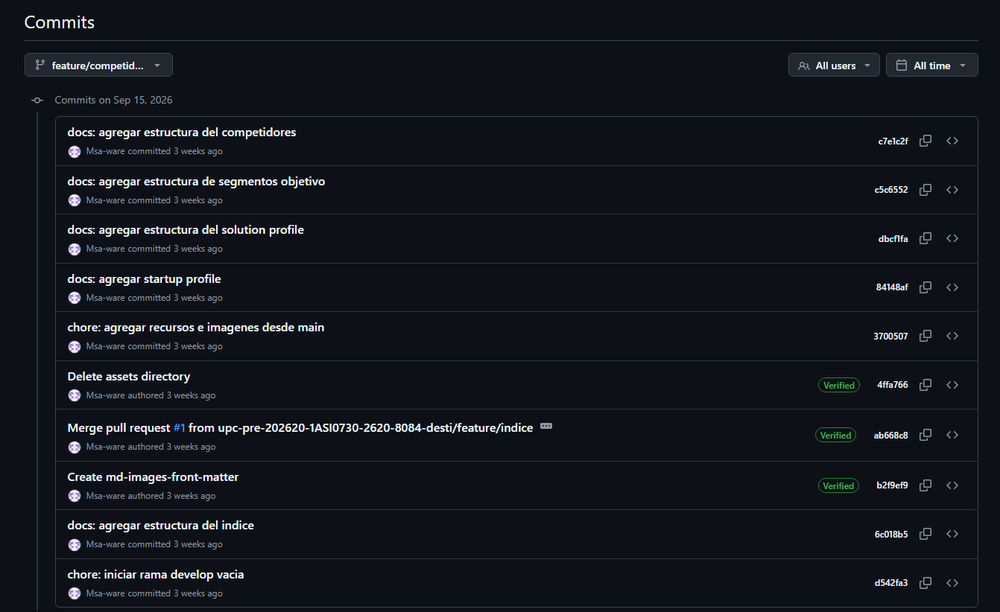

*Nota.* Captura de GitHub (2026).

*Descripción.* Página «Commits» del repositorio destilatech-report filtrada por la rama `feature/competidores`, con el mensaje, el autor y el identificador de cada commit.

**Figura 111**

*Historial de commits de la rama feature/code_style*

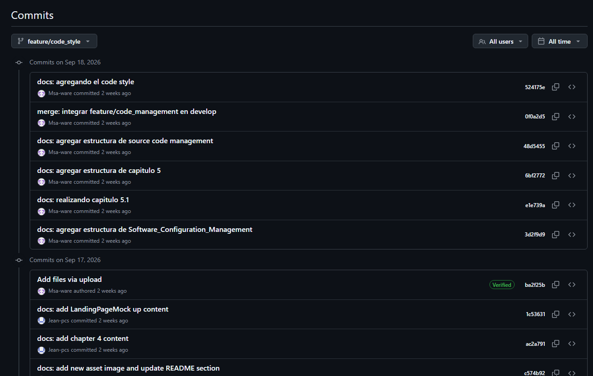

*Nota.* Captura de GitHub (2026).

*Descripción.* Página «Commits» del repositorio destilatech-report filtrada por la rama `feature/code_style`, con el mensaje, el autor y el identificador de cada commit.

**Figura 112**

*Historial de commits de la rama feature/code_management*

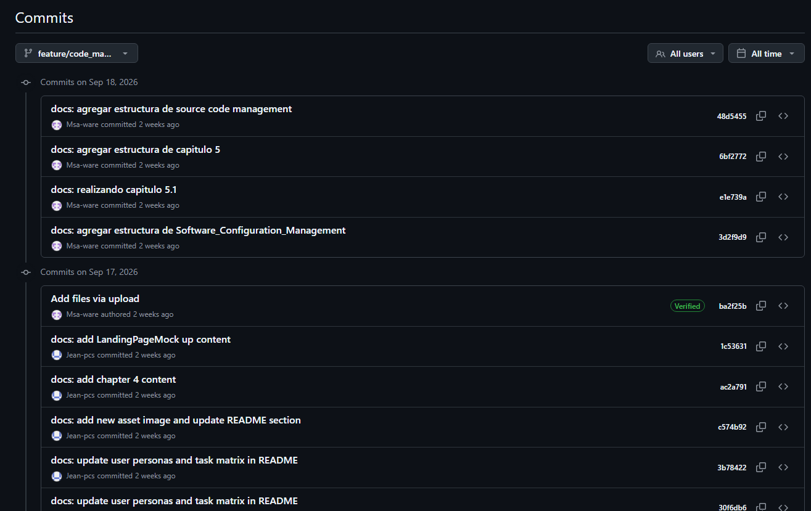

*Nota.* Captura de GitHub (2026).

*Descripción.* Página «Commits» del repositorio destilatech-report filtrada por la rama `feature/code_management`, con el mensaje, el autor y el identificador de cada commit.

**Figura 113**

*Historial de commits de la rama feature/chapter-4*

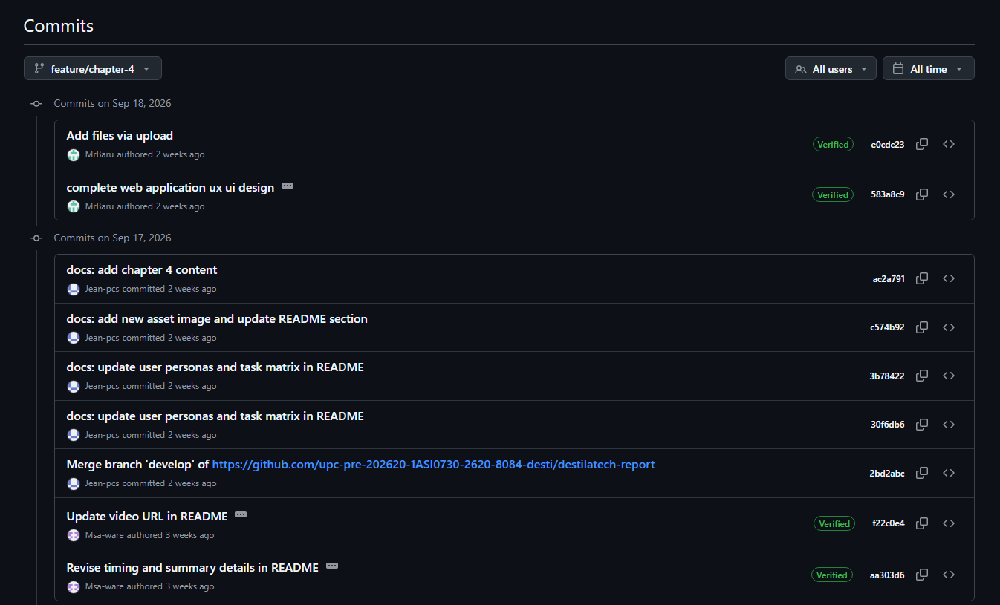

*Nota.* Captura de GitHub (2026).

*Descripción.* Página «Commits» del repositorio destilatech-report filtrada por la rama `feature/chapter-4`, con el mensaje, el autor y el identificador de cada commit.

**Figura 114**

*Historial de commits de la rama feature/big_picture_eventstorming*

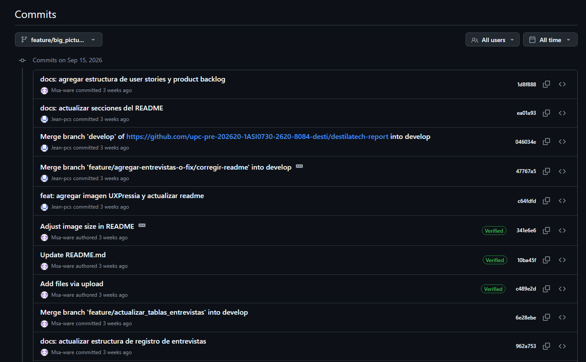

*Nota.* Captura de GitHub (2026).

*Descripción.* Página «Commits» del repositorio destilatech-report filtrada por la rama `feature/big_picture_eventstorming`, con el mensaje, el autor y el identificador de cada commit.

**Figura 115**

*Historial de commits de la rama feature/agregar-entrevistas-o-fix/corregir-readme*

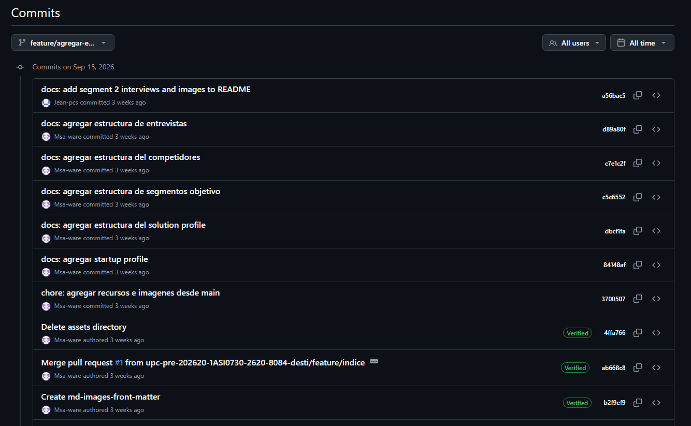

*Nota.* Captura de GitHub (2026).

*Descripción.* Página «Commits» del repositorio destilatech-report filtrada por la rama `feature/agregar-entrevistas-o-fix/corregir-readme`, con el mensaje, el autor y el identificador de cada commit.

**Figura 116**

*Historial de commits de la rama feature/agregar_fotos*

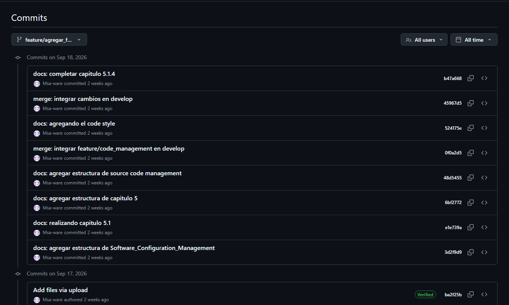

*Nota.* Captura de GitHub (2026).

*Descripción.* Página «Commits» del repositorio destilatech-report filtrada por la rama `feature/agregar_fotos`, con el mensaje, el autor y el identificador de cada commit.

**Figura 117**

*Historial de commits de la rama feature/actualizar_tablas_entrevistas*

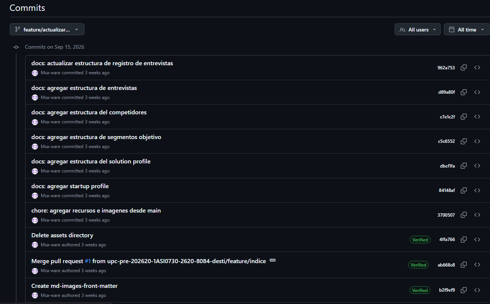

*Nota.* Captura de GitHub (2026).

*Descripción.* Página «Commits» del repositorio destilatech-report filtrada por la rama `feature/actualizar_tablas_entrevistas`, con el mensaje, el autor y el identificador de cada commit.

**Figura 118**

*Historial de commits de la rama feature/Student_Jean*

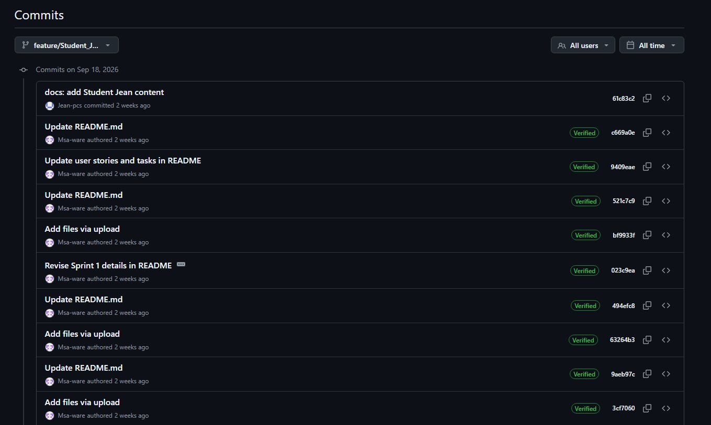

*Nota.* Captura de GitHub (2026).

*Descripción.* Página «Commits» del repositorio destilatech-report filtrada por la rama `feature/Student_Jean`, con el mensaje, el autor y el identificador de cada commit.

**Figura 119**

*Historial de commits de la rama feature/Source_Code_Management*

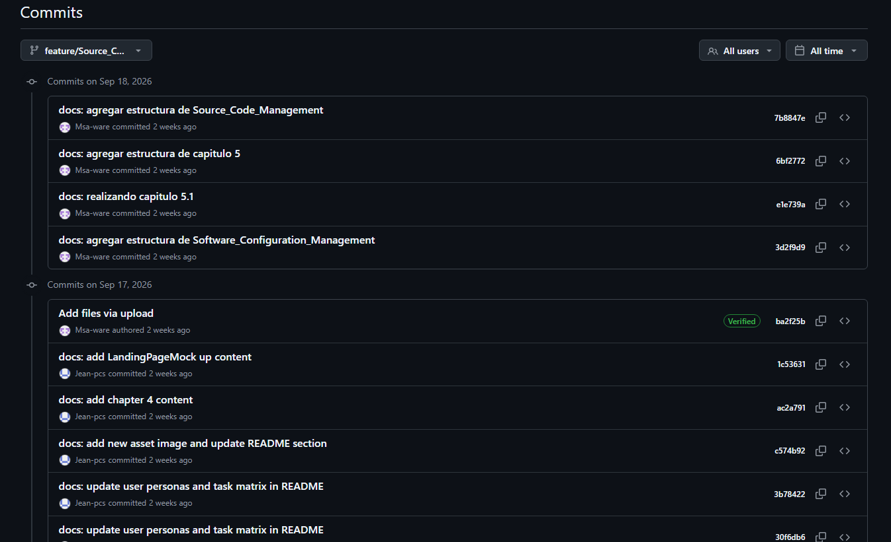

*Nota.* Captura de GitHub (2026).

*Descripción.* Página «Commits» del repositorio destilatech-report filtrada por la rama `feature/Source_Code_Management`, con el mensaje, el autor y el identificador de cada commit.

**Figura 120**

*Historial de commits de la rama feature/Software_Configuration_Management*

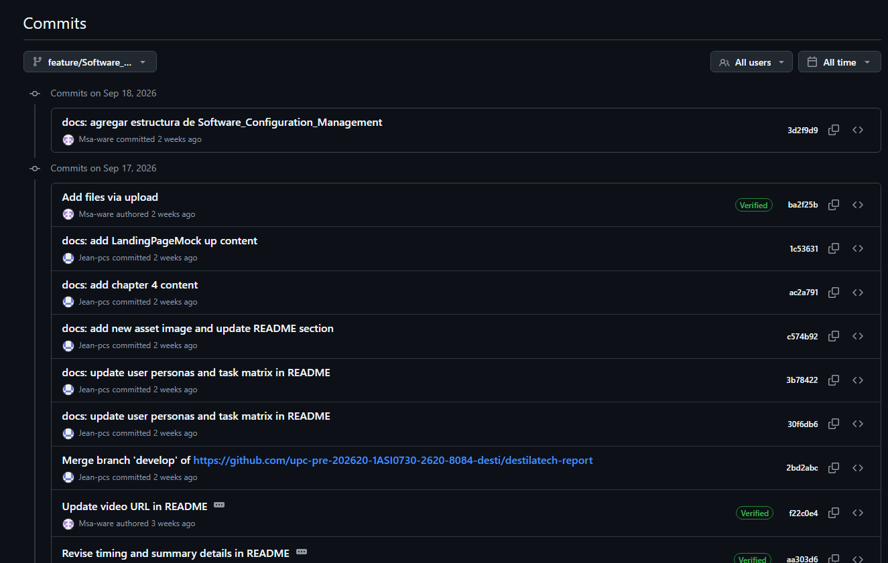

*Nota.* Captura de GitHub (2026).

*Descripción.* Página «Commits» del repositorio destilatech-report filtrada por la rama `feature/Software_Configuration_Management`, con el mensaje, el autor y el identificador de cada commit.

**Figura 121**

*Historial de commits de la rama feature/LandingPageMock-up*

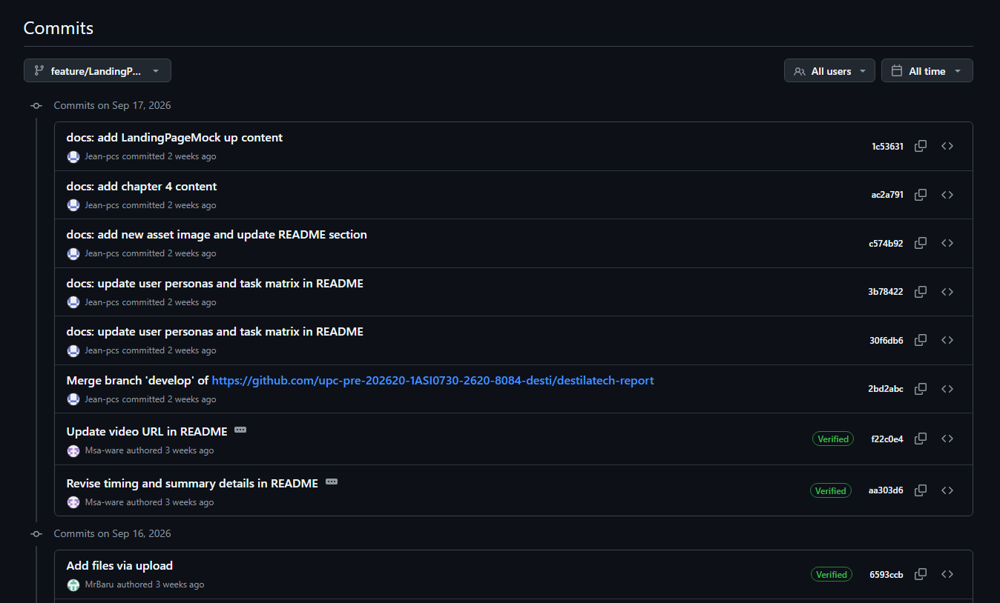

*Nota.* Captura de GitHub (2026).

*Descripción.* Página «Commits» del repositorio destilatech-report filtrada por la rama `feature/LandingPageMock-up`, con el mensaje, el autor y el identificador de cada commit.

**Figura 122**

*Historial de commits de la rama docs/chapter-4-webapp-ux-ui*

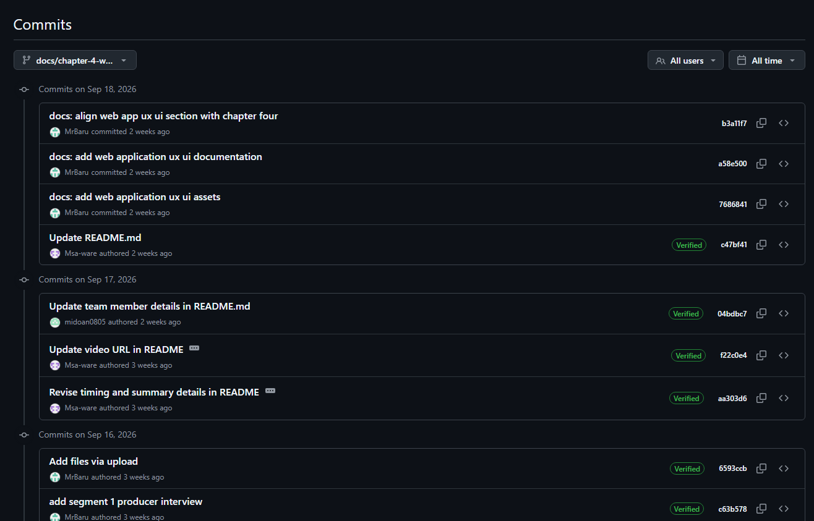

*Nota.* Captura de GitHub (2026).

*Descripción.* Página «Commits» del repositorio destilatech-report filtrada por la rama `docs/chapter-4-webapp-ux-ui`, con el mensaje, el autor y el identificador de cada commit.

**Figura 123**

*Historial de commits de la rama develop*

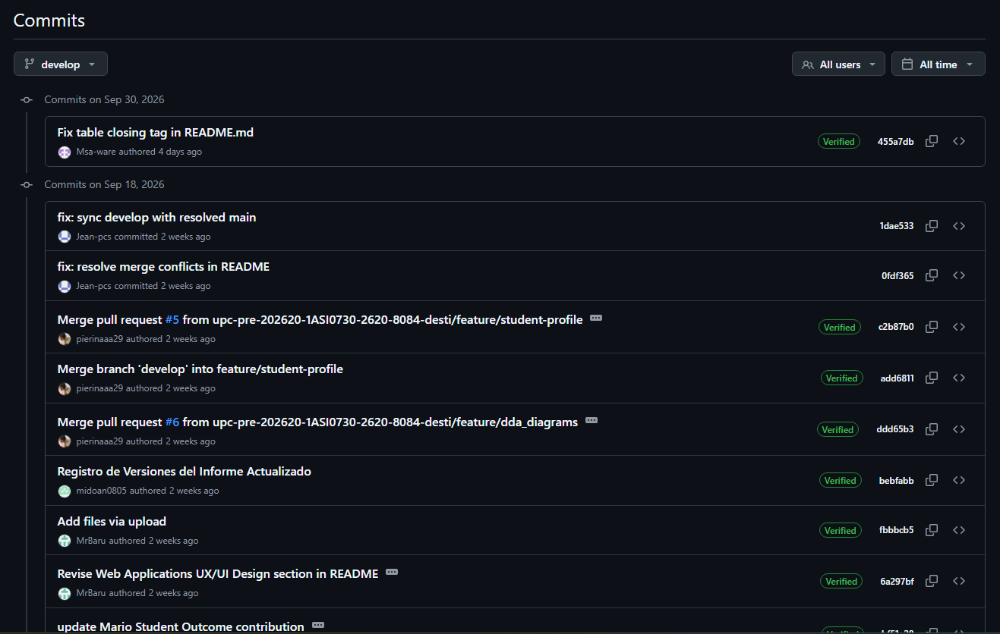

*Nota.* Captura de GitHub (2026).

*Descripción.* Página «Commits» del repositorio destilatech-report filtrada por la rama `develop`, con el mensaje, el autor y el identificador de cada commit.

**Figura 124**

*Historial de commits de la rama main*

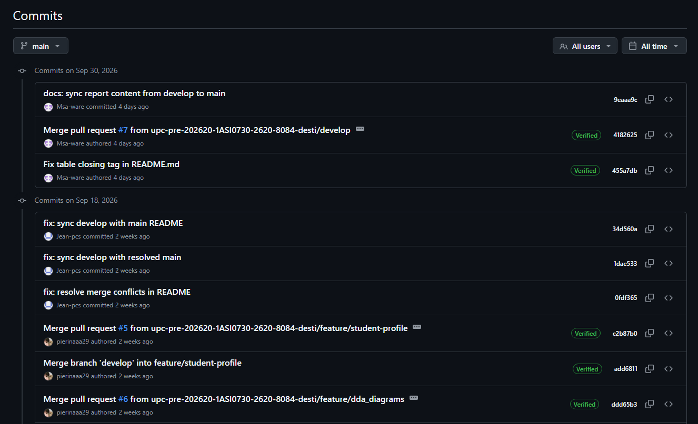

*Nota.* Captura de GitHub (2026).

*Descripción.* Página «Commits» del repositorio destilatech-report filtrada por la rama `main`, con el mensaje, el autor y el identificador de cada commit.

##### 5.2.1.5. Execution Evidence for Sprint Review

El logro del Sprint 1 es la primera versión de la landing page publicada, con las siete secciones previstas: Header, Description, Goals, Pricing, Impact, Platform Features y Footer, junto con el selector de idioma ES / EN y el botón de prueba gratuita de 14 días. Las capturas muestran las vistas principales en escritorio.

**Video de navegación.** El equipo grabó un video de navegación de la landing page publicada, que consolida el flujo principal del visitante: ingreso a la página y lectura de la sección principal, recorrido de las secciones desde el menú del encabezado (Descripción, Objetivos, Precios, Impacto y Funcionalidades), cambio de idioma ES / EN, revisión de las funcionalidades por segmento y acceso al botón «Prueba gratis 14 días», hasta llegar al pie de página con los datos de contacto. El video prioriza el flujo relacionado con el negocio central, que es la captación de prospectos para la prueba gratuita.

- **Enlace (Microsoft Stream, enlace privado):** [Ver video][video-sprint-1]

**Figura 125**

*Landing page: encabezado*

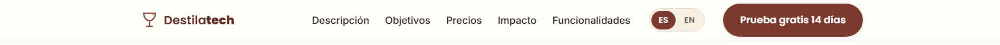

*Nota.* Captura propia del sitio publicado (2026).

*Descripción.* Encabezado de la landing page con el logotipo de Destilatech a la izquierda, el menú de secciones (Descripción, Objetivos, Precios, Impacto y Funcionalidades), el selector de idioma ES / EN con ES activo y el botón «Prueba gratis 14 días» a la derecha.

**Figura 126**

*Landing page: sección principal*

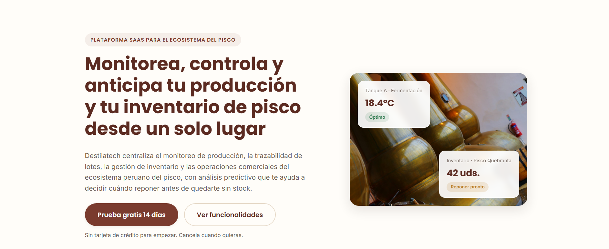

*Nota.* Captura propia del sitio publicado (2026).

*Descripción.* Sección principal con la etiqueta «Plataforma SaaS para el ecosistema del pisco», el título «Monitorea, controla y anticipa tu producción y tu inventario de pisco desde un solo lugar», un párrafo de descripción, los botones «Prueba gratis 14 días» y «Ver funcionalidades», y a la derecha una fotografía de alambiques con tarjetas de temperatura (18.4 °C, Óptimo) e inventario (42 uds., Reponer pronto).

**Figura 127**

*Landing page: pie de página*

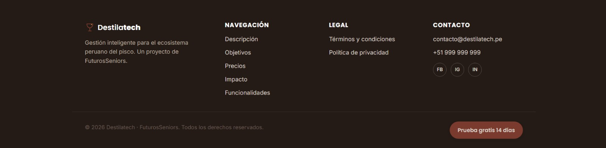

*Nota.* Captura propia del sitio publicado (2026).

*Descripción.* Pie de página en tono oscuro con la marca y el eslogan, y columnas de Navegación (Descripción, Objetivos, Precios, Impacto y Funcionalidades), Legal (Términos y condiciones y Política de privacidad) y Contacto (correo, teléfono y enlaces a redes sociales). En la parte inferior aparecen los derechos reservados y un botón de prueba gratuita.

##### 5.2.1.6. Services Documentation Evidence for Sprint Review

El Sprint 1 se centró en la landing page, por lo que no se implementaron servicios web ni se generó documentación OpenAPI. Los endpoints previstos están especificados como historias técnicas en el capítulo III (épica EP10).

##### 5.2.1.7. Software Deployment Evidence for Sprint Review

En el Sprint 1 se desplegó la landing page en GitHub Pages desde la rama `main` del repositorio `destilatech-website`, con los pasos documentados en la sección 5.1.4. El despliegue se ejecuta de forma automática con el flujo `pages build and deployment` en cada integración en `main`.

**Enlace de producción:** [https://upc-pre-202620-1asi0730-2620-8084-desti.github.io/destilatech-website/](https://upc-pre-202620-1asi0730-2620-8084-desti.github.io/destilatech-website/)

##### 5.2.1.8. Team Collaboration Insights during Sprint

El equipo repartió las secciones de la landing page según la sección 5.2.1.3 y coordinó el trabajo por Discord. Los 11 commits del repositorio de la landing page se registraron desde una única cuenta del equipo; por esta razón, los aportes individuales por integrante se muestran con el repositorio del informe (sección «Project Report Collaboration Insights» y sección 5.2.1.4), donde cada persona trabajó desde su propia cuenta y rama.

**Figura 128**

*Commits del repositorio de la landing page*

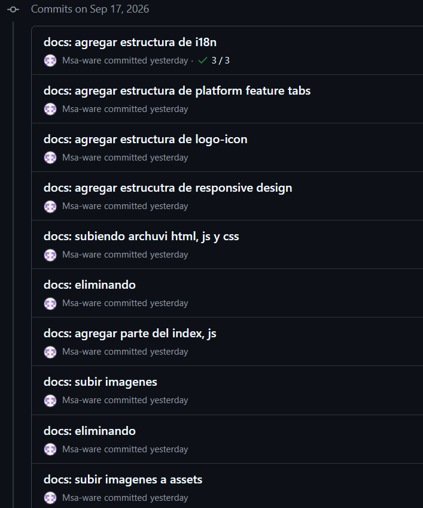

*Nota.* Captura de GitHub (2026).

*Descripción.* Historial de commits del repositorio de la landing page del 17 de septiembre de 2026 y días anteriores, con los mensajes «agregar estructura de i18n», «agregar estructura de platform feature tabs», «agregar estructura de logo-icon», «agregar estructura de responsive design», «subiendo archivo html, js y css», «agregar parte del index, js», «subir imagenes», «subir imagenes a assets» y «eliminando».

**Figura 129**

*Contributors Insights del repositorio del informe (Sprint 1)*

*Nota.* Captura de GitHub Insights (2026).

*Descripción.* Aportes de los cinco integrantes al repositorio del informe entre el 31 de agosto y el 28 de septiembre de 2026, con pico de actividad en torno al 14 de septiembre. Msa-ware registra 77 commits (4,736 líneas añadidas y 506 eliminadas), pierinaaa29 25 (398 y 40), Jean-pcs 18 (1,198 y 2,444), MrBaru 8 (557 y 11) y midoan0805 7 (3,204 y 63).

El repositorio de la landing page no se muestra en un gráfico de Contributors porque todos sus commits se registraron desde una única cuenta del equipo (ver arriba).
