#### 5.2.2. Sprint 2

##### 5.2.2.1. Sprint Planning 2

El Sprint 2 se dedicó a construir la primera versión de la aplicación web (*Web Application*) de Destilatech, con la landing page ya publicada en el Sprint 1. La aplicación implementa seis de los siete *bounded contexts* del diseño de software (capítulo IV): el contexto IAM (registro, inicio de sesión y perfil) queda para un sprint posterior porque el curso aún no aborda la autenticación. La aplicación consume un Fake API mientras se construye el *backend* en ASP.NET Core, que se reserva para el siguiente sprint. Al cierre del sprint la aplicación quedó desplegada en Firebase Hosting y el Fake API en Render (sección 5.2.2.7).
**Tabla 18**

*Resumen de la reunión de Sprint Planning 2*


| Sprint # | Sprint 2 |
| :---------- | :------------------------------------------- |
| **Antecedentes de la planificación** | Con la landing page publicada y el Product Backlog priorizado (sección 3.3), el equipo decidió construir la primera versión de la aplicación web con las historias de interfaz de seis *bounded contexts*. Los endpoints de la RESTful API (épica EP10) se dejaron para el sprint del *backend*. Antes de este sprint se retiró del equipo Domenack Angeles, Miguel; desde el Sprint 2 el equipo está conformado por cuatro integrantes. |
| **Fecha** | 2026-09-29 |
| **Hora** | 11:00 a.m. |
| **Ubicación** | Reunión virtual (WhatsApp, Discord y Google Meet) |
| **Preparada por** | Santiago Atanacio, Jairo Mathias |
| **Asistentes** | Fernandez Seer, Mario Alonso; Santiago Atanacio, Jairo Mathias; Almandroz Carbajal, Pierina Marysabel; Condor Sandoval, Jean Pierre |
| **Sprint 1 Review Summary** | La landing page se publicó en GitHub Pages con las siete secciones previstas (Header, Description, Goals, Pricing, Impact, Platform Features y Footer), el selector de idioma ES / EN y el botón de prueba gratuita de 14 días. Al cierre del tablero quedaba en To Review la tarjeta «Mock-up móvil de la landing page». |
| **Sprint 1 Retrospective Summary** | Funcionó el reparto de la landing page por secciones y la coordinación por Discord. A mejorar: los 11 commits de la landing se registraron desde una sola cuenta y con el tipo `docs`, lo que impidió medir aportes individuales. Para el Sprint 2 se trabaja con ramas `feature/*` por *bounded context*, cada integrante desde su propia cuenta y con mensajes en formato Conventional Commits. |
| **Sprint 2 Goal** | *Our focus is on* que el productor y el comercializador de pisco puedan controlar su operación desde una sola plataforma: el productor, registrar sus lotes y vigilar las condiciones del proceso con lecturas simuladas; el comercializador, controlar su stock, registrar clientes y pedidos, y saber cuándo reponer. *We believe it delivers* visibilidad del estado de su producción y de su inventario sin cuadernos ni hojas de cálculo, y un aviso oportuno antes de perder un lote o de quedarse sin producto. *This will be confirmed when* un productor de demostración pueda registrar un lote, ver sus lecturas y recibir una alerta cuando una variable salga de su rango, y un comercializador de demostración pueda registrar un pedido, ver el stock descontado y recibir la sugerencia de reposición de un producto con stock bajo. |
| **Sprint 2 Velocity** | 347 horas de trabajo planificadas por el equipo. |
| **Sum of Story Points** | 92 Story Points (29 historias de usuario). |


##### 5.2.2.2. Aspect Leaders and Collaborators

En el Sprint 2 los aspectos son los módulos de la aplicación, que coinciden con los *bounded contexts* del capítulo IV más el *Shared Kernel*, el Fake API y la internacionalización. El líder de cada aspecto es el responsable de las tareas correspondientes en la sección 5.2.2.3; el rol de colaborador se asignó a quien registra commits en la rama del aspecto (sección 5.2.2.4).

| Team Member (Last Name, First Name) | GitHub Username | Shared Kernel | Fake API & i18n | Billing | Production & Monitoring | Inventory & Stock | Orders & Replenishment | Alerts & Notifications | Analytics & Estimations |
| :----------- | :---------- | :----------: | :----------: | :----------: | :----------: | :----------: | :----------: | :----------: | :----------: |
| Fernandez Seer, Mario Alonso | MrBaru | - | - | - | L | - | - | - | - |
| Santiago Atanacio, Jairo Mathias | Msa-ware | L | L | - | - | - | L | - | - |
| Almandroz Carbajal, Pierina Marysabel | pierinaaa29 | - | - | - | - | L | - | L | L |
| Condor Sandoval, Jean Pierre | jeanpcs | C | C | L | - | - | C | - | - |

**Leyenda:** L = Líder (*Leader*); C = Colaborador (*Collaborator*); - = sin participación registrada en el aspecto. Las pruebas funcionales de cada módulo (TK-67 a TK-72) las hizo el integrante que lo desarrolló, por lo que no tienen una columna propia. Los dashboards (US04 y US05) pertenecen al contexto Analytics & Estimations.

##### 5.2.2.3. Sprint Backlog 2

El Sprint Backlog 2 contiene las historias de interfaz de seis *bounded contexts* que forman la primera versión de la aplicación web, divididas en tareas, más las tareas técnicas transversales (*Shared Kernel*, estructura de la aplicación, Fake API, internacionalización y selector de usuario) y las tareas de pruebas funcionales de la aplicación. Cada tarea es una tarea de ingeniería (*Engineering Task*) estimada en horas de planificación, con un mínimo de 4 y un máximo de 8 horas por tarea.

**Tablero del equipo en Trello:** [https://trello.com/b/4HZaQ3o7/destilatech-app-web](https://trello.com/b/4HZaQ3o7/destilatech-app-web) (listas Product Backlog, To Do, In Process, To Review, DONE - SPRINT 1 y DONE - SPRINT 2)

**Figura 130**

*Tablero del Sprint 2 en Trello*

<p align="center">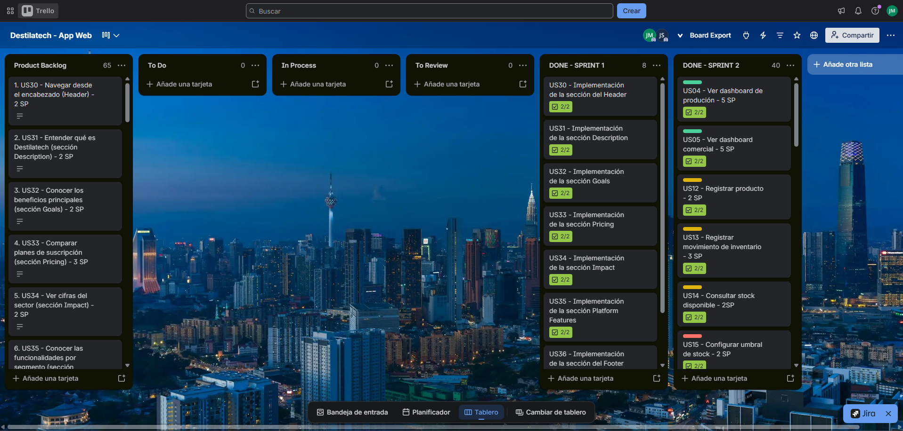</p>

*Nota.* Captura propia de Trello (2026). Tablero disponible en [https://trello.com/b/4HZaQ3o7/destilatech-app-web](https://trello.com/b/4HZaQ3o7/destilatech-app-web).

*Descripción.* La captura muestra las seis listas del tablero. La lista DONE - SPRINT 2 concentra las 40 tarjetas del sprint: 29 historias de usuario, cada una con su lista de verificación de tareas de ingeniería completada (la columna se desplaza para ver todas las tarjetas); 5 tarjetas de tareas técnicas transversales (Shared Kernel, Shared Layout & App Bootstrap, Fake API, Internationalization y User Switcher); y 6 tarjetas de pruebas funcionales.


**Tabla 19**

*Sprint Backlog 2*


| User Story Id | User Story Title | Task Id | Task Title | Description | Estimation (Hours) | Assigned To | Status |
| :---------- | :---------- | :---------- | :---------- | :------------------------------------------- | :----------: | :----------- | :----------: |
| **US04** | Ver dashboard de producción | TK-01 | Producer Dashboard View & KPI Indicators | Alcance: `dashboard.vue` y `producer-dashboard.vue` con la distribución de bloques; `kpi-card.vue` y cálculo de los indicadores en `analytics.store.js`. Incluye la revisión del código y la verificación funcional contra los criterios de aceptación. | 6 | Almandroz Carbajal, Pierina Marysabel | Done |
| **US04** | Ver dashboard de producción | TK-02 | Recent Activity Feed & Volume Chart | Alcance: `recent-activity.vue` y gráfico de volumen por lote. Incluye la revisión del código y la verificación funcional contra los criterios de aceptación. | 4 | Almandroz Carbajal, Pierina Marysabel | Done |
| **US05** | Ver dashboard comercial | TK-03 | Retailer Dashboard View & Indicators | Alcance: `retailer-dashboard.vue` con la distribución de bloques; Indicadores de ventas, pedidos abiertos, stock bajo y productos en `analytics.store.js`. Incluye la revisión del código y la verificación funcional contra los criterios de aceptación. | 6 | Almandroz Carbajal, Pierina Marysabel | Done |
| **US05** | Ver dashboard comercial | TK-04 | Recent Orders Table & Inventory Movement Chart | Alcance: Tabla de pedidos recientes y gráfico de movimiento de inventario. Incluye la revisión del código y la verificación funcional contra los criterios de aceptación. | 4 | Almandroz Carbajal, Pierina Marysabel | Done |
| **US12** | Registrar producto | TK-05 | Product Domain & Inventory API | Alcance: `product.entity.js`, `product.assembler.js` y registro de productos en `inventory-api.js`. Incluye la revisión del código y la verificación funcional contra los criterios de aceptación. | 4 | Almandroz Carbajal, Pierina Marysabel | Done |
| **US12** | Registrar producto | TK-06 | Product Form Dialog & Validation | Alcance: `product-form-dialog.vue` con validación de campos obligatorios. Incluye la revisión del código y la verificación funcional contra los criterios de aceptación. | 4 | Almandroz Carbajal, Pierina Marysabel | Done |
| **US13** | Registrar movimiento de inventario | TK-07 | Stock Movement Domain & Update Rules | Alcance: `stock-movement.entity.js`, `register-stock-movement.command.js` y `stock-movement.assembler.js`; Regla de salida mayor al stock y actualización en `inventory.store.js`. Incluye la revisión del código y la verificación funcional contra los criterios de aceptación. | 6 | Almandroz Carbajal, Pierina Marysabel | Done |
| **US13** | Registrar movimiento de inventario | TK-08 | Stock Movement Dialog | Alcance: `stock-movement-dialog.vue` para entradas y salidas. Incluye la revisión del código y la verificación funcional contra los criterios de aceptación. | 4 | Almandroz Carbajal, Pierina Marysabel | Done |
| **US14** | Consultar stock disponible | TK-09 | Inventory Overview View | Alcance: `inventory-overview.vue` con la lista y los indicadores de inventario. Incluye la revisión del código y la verificación funcional contra los criterios de aceptación. | 5 | Almandroz Carbajal, Pierina Marysabel | Done |
| **US14** | Consultar stock disponible | TK-10 | Stock Status Tag & Filters | Alcance: `stock-status-tag.vue` y filtros por estado óptimo, bajo y crítico. Incluye la revisión del código y la verificación funcional contra los criterios de aceptación. | 4 | Almandroz Carbajal, Pierina Marysabel | Done |
| **US15** | Configurar umbral de stock bajo | TK-11 | Threshold Dialog | Alcance: `threshold-dialog.vue` para configurar el umbral de stock bajo. Incluye la revisión del código y la verificación funcional contra los criterios de aceptación. | 4 | Almandroz Carbajal, Pierina Marysabel | Done |
| **US15** | Configurar umbral de stock bajo | TK-12 | Threshold Validation & Persistence | Alcance: Validación del umbral y actualización del `stock-item` en `inventory.store.js`. Incluye la revisión del código y la verificación funcional contra los criterios de aceptación. | 4 | Almandroz Carbajal, Pierina Marysabel | Done |
| **US16** | Visualizar y atender alertas | TK-13 | Alert Domain & API | Alcance: `alert.entity.js`, `raise-alert.command.js`, `alert.assembler.js` y `alerts-api.js`. Incluye la revisión del código y la verificación funcional contra los criterios de aceptación. | 5 | Almandroz Carbajal, Pierina Marysabel | Done |
| **US16** | Visualizar y atender alertas | TK-14 | Alerts Inbox View & Mark as Attended | Alcance: `alerts-inbox.vue` y `alert-item.vue`; Acción de marcar una alerta como atendida en `alerts.store.js`. Incluye la revisión del código y la verificación funcional contra los criterios de aceptación. | 6 | Almandroz Carbajal, Pierina Marysabel | Done |
| **US06** | Registrar lote de producción | TK-15 | Batch Domain & Registration Rules | Alcance: `production-batch.entity.js`, `register-batch.command.js` y `production-batch.assembler.js`. Incluye la revisión del código y la verificación funcional contra los criterios de aceptación. | 5 | Fernandez Seer, Mario Alonso | Done |
| **US06** | Registrar lote de producción | TK-16 | Batch Form Dialog & Management View | Alcance: `batch-form-dialog.vue` con validación; `batch-management.vue` con el listado de lotes. Incluye la revisión del código y la verificación funcional contra los criterios de aceptación. | 6 | Fernandez Seer, Mario Alonso | Done |
| **US07** | Actualizar estado de un lote | TK-17 | Batch Stage Model & Transitions | Alcance: `batch-stage.js` con las etapas y las transiciones permitidas. Incluye la revisión del código y la verificación funcional contra los criterios de aceptación. | 4 | Fernandez Seer, Mario Alonso | Done |
| **US07** | Actualizar estado de un lote | TK-18 | Advance Stage Dialog & Stage Tag | Alcance: `advance-stage-dialog.vue` y `batch-stage-tag.vue`. Incluye la revisión del código y la verificación funcional contra los criterios de aceptación. | 5 | Fernandez Seer, Mario Alonso | Done |
| **US08** | Consultar historial de un lote | TK-19 | Batch Detail View | Alcance: `batch-detail.vue` con el resumen del lote. Incluye la revisión del código y la verificación funcional contra los criterios de aceptación. | 4 | Fernandez Seer, Mario Alonso | Done |
| **US08** | Consultar historial de un lote | TK-20 | Stage Timeline & Traceability | Alcance: Línea de tiempo con la trazabilidad de las etapas del lote. Incluye la revisión del código y la verificación funcional contra los criterios de aceptación. | 5 | Fernandez Seer, Mario Alonso | Done |
| **US43** | Registrar el embotellado de un lote | TK-21 | Bottling Dialog | Alcance: Registro de la cantidad embotellada y del producto vinculado en `advance-stage-dialog.vue`. Incluye la revisión del código y la verificación funcional contra los criterios de aceptación. | 5 | Fernandez Seer, Mario Alonso | Done |
| **US43** | Registrar el embotellado de un lote | TK-22 | Add Stock on Bottling | Alcance: Suma de las botellas al stock del producto vinculado. Incluye la revisión del código y la verificación funcional contra los criterios de aceptación. | 4 | Fernandez Seer, Mario Alonso | Done |
| **US17** | Registrar cliente | TK-23 | Customer Domain & API | Alcance: `customer.entity.js`, `customer.assembler.js` y registro de clientes en `orders-api.js`. Incluye la revisión del código y la verificación funcional contra los criterios de aceptación. | 4 | Santiago Atanacio, Jairo Mathias | Done |
| **US17** | Registrar cliente | TK-24 | Customers View & Form | Alcance: `customers-list.vue` y `customer-form-dialog.vue`. Incluye la revisión del código y la verificación funcional contra los criterios de aceptación. | 5 | Santiago Atanacio, Jairo Mathias | Done |
| **US18** | Registrar pedido | TK-25 | Order Domain & Stock Discount | Alcance: `order.entity.js`, `order-line.js` y `order.assembler.js`; Descuento del stock de cada línea al registrar el pedido. Incluye la revisión del código y la verificación funcional contra los criterios de aceptación. | 6 | Santiago Atanacio, Jairo Mathias | Done |
| **US18** | Registrar pedido | TK-26 | Order Form Dialog with Product Lines | Alcance: `order-form-dialog.vue` con líneas de producto. Incluye la revisión del código y la verificación funcional contra los criterios de aceptación. | 6 | Santiago Atanacio, Jairo Mathias | Done |
| **US19** | Consultar historial de pedidos | TK-27 | Orders List View & Search | Alcance: `orders-list.vue` con la búsqueda por código o cliente. Incluye la revisión del código y la verificación funcional contra los criterios de aceptación. | 5 | Santiago Atanacio, Jairo Mathias | Done |
| **US19** | Consultar historial de pedidos | TK-28 | Order Status Actions | Alcance: `order-status-tag.vue` y cambio de estado del pedido. Incluye la revisión del código y la verificación funcional contra los criterios de aceptación. | 4 | Santiago Atanacio, Jairo Mathias | Done |
| **US09** | Visualizar variables de proceso | TK-29 | IoT Sensor Simulator | Alcance: `iot-sensor-simulator.js` con lecturas alrededor del centro del rango y probabilidad de anomalía. Incluye la revisión del código y la verificación funcional contra los criterios de aceptación. | 6 | Fernandez Seer, Mario Alonso | Done |
| **US09** | Visualizar variables de proceso | TK-30 | Sensor Reading Domain & Monitoring View | Alcance: `sensor-reading.entity.js`, `sensor-reading.assembler.js` y acceso en `production-api.js`; `monitoring-dashboard.vue` y `variable-card.vue`. Incluye la revisión del código y la verificación funcional contra los criterios de aceptación. | 8 | Fernandez Seer, Mario Alonso | Done |
| **US10** | Configurar rango normal de una variable | TK-31 | Variable Range Dialog | Alcance: `variable-range-dialog.vue` para configurar el mínimo y el máximo. Incluye la revisión del código y la verificación funcional contra los criterios de aceptación. | 5 | Fernandez Seer, Mario Alonso | Done |
| **US10** | Configurar rango normal de una variable | TK-32 | Range Validation Rules | Alcance: `process-variable.entity.js` con la validación del rango. Incluye la revisión del código y la verificación funcional contra los criterios de aceptación. | 4 | Fernandez Seer, Mario Alonso | Done |
| **US11** | Recibir notificación de condición anómala | TK-33 | Reading Evaluation Against Range | Alcance: Comparación de cada lectura contra el rango de la variable. Incluye la revisión del código y la verificación funcional contra los criterios de aceptación. | 5 | Fernandez Seer, Mario Alonso | Done |
| **US11** | Recibir notificación de condición anómala | TK-34 | Anomaly Alert Generation | Alcance: Generación de la alerta hacia el contexto Alerts & Notifications. Incluye la revisión del código y la verificación funcional contra los criterios de aceptación. | 4 | Fernandez Seer, Mario Alonso | Done |
| **US44** | Ver la tendencia de una variable | TK-35 | Readings Chart Component | Alcance: `readings-chart.vue` con Chart.js. Incluye la revisión del código y la verificación funcional contra los criterios de aceptación. | 6 | Fernandez Seer, Mario Alonso | Done |
| **US44** | Ver la tendencia de una variable | TK-36 | Range Lines on Chart | Alcance: Líneas del mínimo y el máximo configurados en el gráfico. Incluye la revisión del código y la verificación funcional contra los criterios de aceptación. | 4 | Fernandez Seer, Mario Alonso | Done |
| **US50** | Generar lista de compra para reposición | TK-37 | Replenishment Order Domain & API | Alcance: `replenishment-order.entity.js`, `replenishment-order.assembler.js` y acceso en `orders-api.js`. Incluye la revisión del código y la verificación funcional contra los criterios de aceptación. | 4 | Condor Sandoval, Jean Pierre | Done |
| **US50** | Generar lista de compra para reposición | TK-38 | Replenishment Orders View & Suggestions | Alcance: `replenishment-orders.vue` y `replenishment-form-dialog.vue` con las sugerencias de compra. Incluye la revisión del código y la verificación funcional contra los criterios de aceptación. | 6 | Condor Sandoval, Jean Pierre | Done |
| **US20** | Ver estimación de reposición | TK-39 | Replenishment Estimate Domain & Calculation | Alcance: `replenishment-estimate.entity.js` con fecha estimada, consumo promedio y cantidad sugerida; Cálculo con el consumo de los últimos 30 días en `analytics.store.js`. Incluye la revisión del código y la verificación funcional contra los criterios de aceptación. | 8 | Almandroz Carbajal, Pierina Marysabel | Done |
| **US20** | Ver estimación de reposición | TK-40 | Estimate Card in Product Detail | Alcance: `replenishment-estimate-card.vue` en la ficha del producto. Incluye la revisión del código y la verificación funcional contra los criterios de aceptación. | 4 | Almandroz Carbajal, Pierina Marysabel | Done |
| **US51** | Ver productos con riesgo de agotamiento | TK-41 | At-Risk Products Logic | Alcance: Selección de productos con riesgo de agotamiento en `analytics.store.js`. Incluye la revisión del código y la verificación funcional contra los criterios de aceptación. | 4 | Almandroz Carbajal, Pierina Marysabel | Done |
| **US51** | Ver productos con riesgo de agotamiento | TK-42 | Priority Replenishment List View | Alcance: `priority-replenishment.vue` con la lista ordenada por urgencia. Incluye la revisión del código y la verificación funcional contra los criterios de aceptación. | 5 | Almandroz Carbajal, Pierina Marysabel | Done |
| **US21** | Ver indicadores históricos | TK-43 | Historical Indicator Domain | Alcance: `historical-indicator.entity.js` y `analytics-record.assembler.js`. Incluye la revisión del código y la verificación funcional contra los criterios de aceptación. | 4 | Almandroz Carbajal, Pierina Marysabel | Done |
| **US21** | Ver indicadores históricos | TK-44 | Indicators View with Period Selector | Alcance: `historical-indicators.vue` con el selector de periodo. Incluye la revisión del código y la verificación funcional contra los criterios de aceptación. | 6 | Almandroz Carbajal, Pierina Marysabel | Done |
| **US21** | Ver indicadores históricos | TK-45 | Indicator Charts | Alcance: Gráficos de stock, entradas contra salidas y ventas con `trend-chart.vue`. Incluye la revisión del código y la verificación funcional contra los criterios de aceptación. | 6 | Almandroz Carbajal, Pierina Marysabel | Done |
| **US03** | Recibir aviso de fin de periodo de prueba | TK-46 | Trial Banner Component | Alcance: Componente `trial-banner.vue` con los días restantes de prueba y el acceso a los planes. Incluye la revisión del código y la verificación funcional contra los criterios de aceptación. | 4 | Condor Sandoval, Jean Pierre | Done |
| **US03** | Recibir aviso de fin de periodo de prueba | TK-47 | Trial Period Logic | Alcance: `trial-period.entity.js` y cálculo de los días restantes en `billing.store.js`. Incluye la revisión del código y la verificación funcional contra los criterios de aceptación. | 4 | Condor Sandoval, Jean Pierre | Done |
| **US54** | Consultar mi plan y estado de suscripción | TK-48 | Subscription Entity & API | Alcance: `subscription.entity.js`, `subscription.assembler.js` y consulta de la suscripción en `billing-api.js`. Incluye la revisión del código y la verificación funcional contra los criterios de aceptación. | 4 | Condor Sandoval, Jean Pierre | Done |
| **US54** | Consultar mi plan y estado de suscripción | TK-49 | Access Status Panel | Alcance: Tarjeta con el estado de acceso, el plan y la fecha de renovación en `subscription-plans.vue`. Incluye la revisión del código y la verificación funcional contra los criterios de aceptación. | 4 | Condor Sandoval, Jean Pierre | Done |
| **US40** | Contratar un plan de suscripción | TK-50 | Plan Catalog & Plan Cards | Alcance: `plan.entity.js`, `plan.assembler.js` y `plan-card.vue` con los tres planes. Incluye la revisión del código y la verificación funcional contra los criterios de aceptación. | 5 | Condor Sandoval, Jean Pierre | Done |
| **US40** | Contratar un plan de suscripción | TK-51 | Checkout Flow with Payment Gateway (Test Mode) | Alcance: Inicio del pago con la pasarela en modo de pruebas y orquestación en `billing.store.js`. Incluye la revisión del código y la verificación funcional contra los criterios de aceptación. | 8 | Condor Sandoval, Jean Pierre | Done |
| **US40** | Contratar un plan de suscripción | TK-52 | Checkout Result Views | Alcance: `checkout-success.vue` y `checkout-cancelled.vue` para el resultado del pago. Incluye la revisión del código y la verificación funcional contra los criterios de aceptación. | 4 | Condor Sandoval, Jean Pierre | Done |
| **US40** | Contratar un plan de suscripción | TK-53 | Payment History | Alcance: `payment.entity.js`, `payment.assembler.js` y `payment-history.vue`. Incluye la revisión del código y la verificación funcional contra los criterios de aceptación. | 5 | Condor Sandoval, Jean Pierre | Done |
| **US46** | Consultar el historial de movimientos de un producto | TK-54 | Product Detail View | Alcance: `product-detail.vue` con los datos del producto. Incluye la revisión del código y la verificación funcional contra los criterios de aceptación. | 4 | Almandroz Carbajal, Pierina Marysabel | Done |
| **US46** | Consultar el historial de movimientos de un producto | TK-55 | Movement History Table | Alcance: Tabla paginada con el historial de movimientos del producto. Incluye la revisión del código y la verificación funcional contra los criterios de aceptación. | 5 | Almandroz Carbajal, Pierina Marysabel | Done |
| **US47** | Ajustar el stock tras un conteo físico | TK-56 | Adjustment Movement Type | Alcance: Tipo de movimiento `ADJUSTMENT` en el modelo de dominio. Incluye la revisión del código y la verificación funcional contra los criterios de aceptación. | 4 | Almandroz Carbajal, Pierina Marysabel | Done |
| **US47** | Ajustar el stock tras un conteo físico | TK-57 | Adjustment Form | Alcance: Cantidad contada y motivo del ajuste en `stock-movement-dialog.vue`. Incluye la revisión del código y la verificación funcional contra los criterios de aceptación. | 5 | Almandroz Carbajal, Pierina Marysabel | Done |
| **US48** | Filtrar alertas por tipo y estado | TK-58 | Alert Type Filter | Alcance: Filtro de alertas por tipo (producción o inventario). Incluye la revisión del código y la verificación funcional contra los criterios de aceptación. | 4 | Almandroz Carbajal, Pierina Marysabel | Done |
| **US48** | Filtrar alertas por tipo y estado | TK-59 | Alert Status Filter | Alcance: Filtro de alertas por estado (pendientes, atendidas o todas). Incluye la revisión del código y la verificación funcional contra los criterios de aceptación. | 4 | Almandroz Carbajal, Pierina Marysabel | Done |
| **US49** | Editar los datos de un cliente | TK-60 | Customer Edit Mode | Alcance: Modo de edición en `customer-form-dialog.vue`. Incluye la revisión del código y la verificación funcional contra los criterios de aceptación. | 4 | Santiago Atanacio, Jairo Mathias | Done |
| **US49** | Editar los datos de un cliente | TK-61 | Update Customer Request | Alcance: Actualización del cliente en `orders-api.js` y `orders.store.js`. Incluye la revisión del código y la verificación funcional contra los criterios de aceptación. | 4 | Santiago Atanacio, Jairo Mathias | Done |
| — | Tarea técnica transversal | TK-62 | Shared Kernel | `BaseApi`, `BaseEndpoint`, `BaseAssembler`, `error.interceptor`, `Money` y `DateTime`. Incluye la revisión del código y la verificación funcional. | 6 | Santiago Atanacio, Jairo Mathias | Done |
| — | Tarea técnica transversal | TK-63 | Shared Layout & App Bootstrap | Layout, barra superior, navegación lateral, tarjeta KPI, estado vacío y página 404; `main.js`, `app.vue`, `router.js` y `pinia.js`. Incluye la revisión del código y la verificación funcional. | 6 | Santiago Atanacio, Jairo Mathias | Done |
| — | Tarea técnica transversal | TK-64 | Fake API | Fake API con json-server (`db.json`, `routes.json`, `start.sh`) y su publicación para producción. Incluye la revisión del código y la verificación funcional. | 5 | Santiago Atanacio, Jairo Mathias | Done |
| — | Tarea técnica transversal | TK-65 | Internationalization | Configuración de vue-i18n y catálogos `es.json` y `en.json`. Incluye la revisión del código y la verificación funcional. | 5 | Santiago Atanacio, Jairo Mathias | Done |
| — | Tarea técnica transversal | TK-66 | User Switcher | Selector Productor / Comercializador (`user-switcher`), tienda del usuario actual (`user.store`) y `users-api`; reemplaza al inicio de sesión mientras no exista IAM. Incluye la revisión del código y la verificación funcional. | 4 | Santiago Atanacio, Jairo Mathias | Done |
| — | Tarea técnica de pruebas | TK-67 | Functional Testing Billing & Users | Pruebas funcionales de planes, suscripción, pagos y cambio de perfil con el selector de usuario. Incluye el registro de los defectos encontrados y su reprueba. | 4 | Condor Sandoval, Jean Pierre | Done |
| — | Tarea técnica de pruebas | TK-68 | Functional Testing Production | Pruebas funcionales de lotes, etapas y monitoreo IoT simulado, incluida la detección de anomalías. Incluye el registro de los defectos encontrados y su reprueba. | 6 | Fernandez Seer, Mario Alonso | Done |
| — | Tarea técnica de pruebas | TK-69 | Functional Testing Inventory | Pruebas funcionales de productos, movimientos, umbrales y estimaciones de reposición. Incluye el registro de los defectos encontrados y su reprueba. | 4 | Almandroz Carbajal, Pierina Marysabel | Done |
| — | Tarea técnica de pruebas | TK-70 | Functional Testing Orders | Pruebas funcionales de clientes, pedidos y órdenes de reposición. Incluye el registro de los defectos encontrados y su reprueba. | 4 | Santiago Atanacio, Jairo Mathias | Done |
| — | Tarea técnica de pruebas | TK-71 | Functional Testing Alerts & Analytics | Pruebas funcionales de alertas, dashboards e indicadores históricos. Incluye el registro de los defectos encontrados y su reprueba. | 4 | Almandroz Carbajal, Pierina Marysabel | Done |
| — | Tarea técnica de pruebas | TK-72 | Language & Navigation Testing | Pruebas de cambio de idioma ES / EN, navegación entre vistas y rutas protegidas por perfil. Incluye el registro de los defectos encontrados y su reprueba. | 4 | Santiago Atanacio, Jairo Mathias | Done |


**Horas por integrante.** El Sprint Backlog suma 347 horas: Santiago Atanacio, Jairo Mathias, 72; Almandroz Carbajal, Pierina Marysabel, 137; Fernandez Seer, Mario Alonso, 86; y Condor Sandoval, Jean Pierre, 52. Cada historia de usuario se descompone en dos o más tareas de ingeniería de 4 a 8 horas, que se asignan al responsable del aspecto correspondiente. Las tareas de pruebas funcionales (TK-67 a TK-72) se asignaron a quien desarrolló cada módulo.

**Observación.** Las historias del contexto IAM (US01 registro, US02 inicio de sesión, US38 cierre de sesión, US39 recuperar contraseña y US41 perfil del negocio) no forman parte de este sprint porque el curso aún no aborda la autenticación; el equipo las había iniciado en la rama `feature/iam` y las retiró del alcance, por lo que vuelven al Product Backlog para un sprint posterior. Tampoco se incluyeron US42 (editar lote), US45 (editar o desactivar producto) y US55 (elegir las variables monitoreadas), que no se implementaron en la primera versión de la interfaz. Las historias técnicas de endpoints (EP10) se reservan para el sprint del *backend*.

##### 5.2.2.4. Development Evidence for Sprint Review


Durante el Sprint 2 se implementó en el repositorio [destilatech-webapp](https://github.com/upc-pre-202620-1ASI0730-2620-8084-desti/destilatech-webapp) la aplicación web con Vue 3 (Composition API) y Vite, PrimeVue para los componentes de interfaz, Pinia para el estado, Vue Router, vue-i18n y Chart.js para los gráficos. Cada *bounded context* se organiza en las capas `domain`, `infrastructure`, `application` y `presentation`, y el repositorio sigue el flujo de ramas `main`, `develop` y `feature/*` descrito en la sección 5.1.2. La tabla reúne los commits únicos visibles en las ramas del repositorio al 2026-10-05, en orden cronológico; cuando un commit aparece en varias ramas por compartir historial, se registra una sola vez, en la rama más antigua que lo contiene.

**Tabla 20**

*Commits del repositorio de la aplicación web*


| Repository | Branch | Commit Id | Commit Message | Commit Message Body | Committed on (Date) |
| :-------------------- | :---------- | :----------------------------------- | :----------- | :---------- | :----------: |
| `upc-pre-202620-1ASI0730-2620-8084-desti/destilatech-webapp` | `main` | [`805bd07`](https://github.com/upc-pre-202620-1ASI0730-2620-8084-desti/destilatech-webapp/commit/805bd07) | chore: initial project configuration | — | 2026-09-29 |
| `upc-pre-202620-1ASI0730-2620-8084-desti/destilatech-webapp` | `main` | [`07c3767`](https://github.com/upc-pre-202620-1ASI0730-2620-8084-desti/destilatech-webapp/commit/07c3767) | creacion de archivos .env.development y .env.production, a su vez actualizar los archivos package.json y package-lock.json | — | 2026-09-29 |
| `upc-pre-202620-1ASI0730-2620-8084-desti/destilatech-webapp` | `feature/shared` | [`0b07f65`](https://github.com/upc-pre-202620-1ASI0730-2620-8084-desti/destilatech-webapp/commit/0b07f65) | agregar favicon.svg y date-time.js | — | 2026-09-29 |
| `upc-pre-202620-1ASI0730-2620-8084-desti/destilatech-webapp` | `feature/shared` | [`2e1a111`](https://github.com/upc-pre-202620-1ASI0730-2620-8084-desti/destilatech-webapp/commit/2e1a111) | crear archivo money.js | — | 2026-09-29 |
| `upc-pre-202620-1ASI0730-2620-8084-desti/destilatech-webapp` | `feature/shared` | [`df099cf`](https://github.com/upc-pre-202620-1ASI0730-2620-8084-desti/destilatech-webapp/commit/df099cf) | feat: agregar base-api, primera parte | — | 2026-10-01 |
| `upc-pre-202620-1ASI0730-2620-8084-desti/destilatech-webapp` | `feature/shared` | [`415098a`](https://github.com/upc-pre-202620-1ASI0730-2620-8084-desti/destilatech-webapp/commit/415098a) | feat: complementando base-api | — | 2026-10-01 |
| `upc-pre-202620-1ASI0730-2620-8084-desti/destilatech-webapp` | `feature/shared` | [`c7b532a`](https://github.com/upc-pre-202620-1ASI0730-2620-8084-desti/destilatech-webapp/commit/c7b532a) | feat: complementando base-api | — | 2026-10-01 |
| `upc-pre-202620-1ASI0730-2620-8084-desti/destilatech-webapp` | `feature/shared` | [`a008e59`](https://github.com/upc-pre-202620-1ASI0730-2620-8084-desti/destilatech-webapp/commit/a008e59) | feat: constructor de  base-api | — | 2026-10-01 |
| `upc-pre-202620-1ASI0730-2620-8084-desti/destilatech-webapp` | `feature/shared` | [`31bde92`](https://github.com/upc-pre-202620-1ASI0730-2620-8084-desti/destilatech-webapp/commit/31bde92) | feat: completed  base-api | — | 2026-10-01 |
| `upc-pre-202620-1ASI0730-2620-8084-desti/destilatech-webapp` | `feature/shared` | [`3f6ee31`](https://github.com/upc-pre-202620-1ASI0730-2620-8084-desti/destilatech-webapp/commit/3f6ee31) | feat: base-assembler creado | — | 2026-10-01 |
| `upc-pre-202620-1ASI0730-2620-8084-desti/destilatech-webapp` | `feature/shared` | [`a37a34d`](https://github.com/upc-pre-202620-1ASI0730-2620-8084-desti/destilatech-webapp/commit/a37a34d) | feat: base-assembler implmentando | — | 2026-10-01 |
| `upc-pre-202620-1ASI0730-2620-8084-desti/destilatech-webapp` | `feature/shared` | [`d19d4be`](https://github.com/upc-pre-202620-1ASI0730-2620-8084-desti/destilatech-webapp/commit/d19d4be) | feat: base-assembler entities and responses | — | 2026-10-01 |
| `upc-pre-202620-1ASI0730-2620-8084-desti/destilatech-webapp` | `feature/shared` | [`76a22c8`](https://github.com/upc-pre-202620-1ASI0730-2620-8084-desti/destilatech-webapp/commit/76a22c8) | feat: base-assembler completo | — | 2026-10-01 |
| `upc-pre-202620-1ASI0730-2620-8084-desti/destilatech-webapp` | `feature/shared` | [`4998383`](https://github.com/upc-pre-202620-1ASI0730-2620-8084-desti/destilatech-webapp/commit/4998383) | feat: base-endpoint creado | — | 2026-10-01 |
| `upc-pre-202620-1ASI0730-2620-8084-desti/destilatech-webapp` | `feature/shared` | [`9664676`](https://github.com/upc-pre-202620-1ASI0730-2620-8084-desti/destilatech-webapp/commit/9664676) | feat: base-endpoint constructor creado | — | 2026-10-01 |
| `upc-pre-202620-1ASI0730-2620-8084-desti/destilatech-webapp` | `feature/shared` | [`a708216`](https://github.com/upc-pre-202620-1ASI0730-2620-8084-desti/destilatech-webapp/commit/a708216) | feat: base-endpoint completo | — | 2026-10-01 |
| `upc-pre-202620-1ASI0730-2620-8084-desti/destilatech-webapp` | `feature/shared` | [`27dbfb0`](https://github.com/upc-pre-202620-1ASI0730-2620-8084-desti/destilatech-webapp/commit/27dbfb0) | feat: error.interceptor.js creado | — | 2026-10-01 |
| `upc-pre-202620-1ASI0730-2620-8084-desti/destilatech-webapp` | `feature/shared` | [`6a4c005`](https://github.com/upc-pre-202620-1ASI0730-2620-8084-desti/destilatech-webapp/commit/6a4c005) | feat: error.interceptor.js response | — | 2026-10-01 |
| `upc-pre-202620-1ASI0730-2620-8084-desti/destilatech-webapp` | `feature/shared` | [`90a4cf0`](https://github.com/upc-pre-202620-1ASI0730-2620-8084-desti/destilatech-webapp/commit/90a4cf0) | feat: error.interceptor.js completo | — | 2026-10-01 |
| `upc-pre-202620-1ASI0730-2620-8084-desti/destilatech-webapp` | `feature/shared` | [`c68ab13`](https://github.com/upc-pre-202620-1ASI0730-2620-8084-desti/destilatech-webapp/commit/c68ab13) | feat: creacion del archivo i18n | — | 2026-10-03 |
| `upc-pre-202620-1ASI0730-2620-8084-desti/destilatech-webapp` | `feature/shared` | [`530a6f3`](https://github.com/upc-pre-202620-1ASI0730-2620-8084-desti/destilatech-webapp/commit/530a6f3) | feat: creacion del archivo empty-state.vue | — | 2026-10-05 |
| `upc-pre-202620-1ASI0730-2620-8084-desti/destilatech-webapp` | `feature/shared` | [`d0969a8`](https://github.com/upc-pre-202620-1ASI0730-2620-8084-desti/destilatech-webapp/commit/d0969a8) | feat: add script | — | 2026-10-05 |
| `upc-pre-202620-1ASI0730-2620-8084-desti/destilatech-webapp` | `feature/shared` | [`11c5363`](https://github.com/upc-pre-202620-1ASI0730-2620-8084-desti/destilatech-webapp/commit/11c5363) | feat: add template | — | 2026-10-05 |
| `upc-pre-202620-1ASI0730-2620-8084-desti/destilatech-webapp` | `feature/shared` | [`a4b9732`](https://github.com/upc-pre-202620-1ASI0730-2620-8084-desti/destilatech-webapp/commit/a4b9732) | feat: add style scoped | — | 2026-10-05 |
| `upc-pre-202620-1ASI0730-2620-8084-desti/destilatech-webapp` | `feature/shared` | [`1786048`](https://github.com/upc-pre-202620-1ASI0730-2620-8084-desti/destilatech-webapp/commit/1786048) | feat: add style.css | — | 2026-10-05 |
| `upc-pre-202620-1ASI0730-2620-8084-desti/destilatech-webapp` | `feature/shared` | [`e2a82bc`](https://github.com/upc-pre-202620-1ASI0730-2620-8084-desti/destilatech-webapp/commit/e2a82bc) | feat: create footer-content.vue | — | 2026-10-05 |
| `upc-pre-202620-1ASI0730-2620-8084-desti/destilatech-webapp` | `feature/shared` | [`a7b1cfc`](https://github.com/upc-pre-202620-1ASI0730-2620-8084-desti/destilatech-webapp/commit/a7b1cfc) | feat: create kpi-card.vue | — | 2026-10-05 |
| `upc-pre-202620-1ASI0730-2620-8084-desti/destilatech-webapp` | `feature/shared` | [`198cfad`](https://github.com/upc-pre-202620-1ASI0730-2620-8084-desti/destilatech-webapp/commit/198cfad) | feat: create language-swticher.vue | — | 2026-10-05 |
| `upc-pre-202620-1ASI0730-2620-8084-desti/destilatech-webapp` | `feature/shared` | [`8fd5eff`](https://github.com/upc-pre-202620-1ASI0730-2620-8084-desti/destilatech-webapp/commit/8fd5eff) | feat: create layout.vue | — | 2026-10-05 |
| `upc-pre-202620-1ASI0730-2620-8084-desti/destilatech-webapp` | `feature/shared` | [`fa28a6e`](https://github.com/upc-pre-202620-1ASI0730-2620-8084-desti/destilatech-webapp/commit/fa28a6e) | feat: create page-header.vue | — | 2026-10-05 |
| `upc-pre-202620-1ASI0730-2620-8084-desti/destilatech-webapp` | `feature/shared` | [`37ec566`](https://github.com/upc-pre-202620-1ASI0730-2620-8084-desti/destilatech-webapp/commit/37ec566) | feat: create side-navigation.vue | — | 2026-10-05 |
| `upc-pre-202620-1ASI0730-2620-8084-desti/destilatech-webapp` | `feature/shared` | [`72973db`](https://github.com/upc-pre-202620-1ASI0730-2620-8084-desti/destilatech-webapp/commit/72973db) | feat: create top-bar.vue | — | 2026-10-05 |
| `upc-pre-202620-1ASI0730-2620-8084-desti/destilatech-webapp` | `feature/shared` | [`2eab4bb`](https://github.com/upc-pre-202620-1ASI0730-2620-8084-desti/destilatech-webapp/commit/2eab4bb) | feat: create page-not-found.vue | — | 2026-10-05 |
| `upc-pre-202620-1ASI0730-2620-8084-desti/destilatech-webapp` | `feature/iam` | [`adaf9e4`](https://github.com/upc-pre-202620-1ASI0730-2620-8084-desti/destilatech-webapp/commit/adaf9e4) | feat: create pinia.js | — | 2026-10-05 |
| `upc-pre-202620-1ASI0730-2620-8084-desti/destilatech-webapp` | `feature/iam` | [`f31c569`](https://github.com/upc-pre-202620-1ASI0730-2620-8084-desti/destilatech-webapp/commit/f31c569) | feat: create router.js | — | 2026-10-05 |
| `upc-pre-202620-1ASI0730-2620-8084-desti/destilatech-webapp` | `feature/iam` | [`866498b`](https://github.com/upc-pre-202620-1ASI0730-2620-8084-desti/destilatech-webapp/commit/866498b) | feat: moved router.js | — | 2026-10-05 |
| `upc-pre-202620-1ASI0730-2620-8084-desti/destilatech-webapp` | `feature/iam` | [`f6cda49`](https://github.com/upc-pre-202620-1ASI0730-2620-8084-desti/destilatech-webapp/commit/f6cda49) | feat: create business-type.js | — | 2026-10-05 |
| `upc-pre-202620-1ASI0730-2620-8084-desti/destilatech-webapp` | `feature/iam` | [`f6e4a1e`](https://github.com/upc-pre-202620-1ASI0730-2620-8084-desti/destilatech-webapp/commit/f6e4a1e) | feat: create sing-in.command.js | — | 2026-10-05 |
| `upc-pre-202620-1ASI0730-2620-8084-desti/destilatech-webapp` | `feature/iam` | [`10fb915`](https://github.com/upc-pre-202620-1ASI0730-2620-8084-desti/destilatech-webapp/commit/10fb915) | feat: create sing-up.command.js | — | 2026-10-05 |
| `upc-pre-202620-1ASI0730-2620-8084-desti/destilatech-webapp` | `feature/iam` | [`1fd03c0`](https://github.com/upc-pre-202620-1ASI0730-2620-8084-desti/destilatech-webapp/commit/1fd03c0) | feat: create trial-period.entity.js | — | 2026-10-05 |
| `upc-pre-202620-1ASI0730-2620-8084-desti/destilatech-webapp` | `feature/iam` | [`59879b5`](https://github.com/upc-pre-202620-1ASI0730-2620-8084-desti/destilatech-webapp/commit/59879b5) | feat: create user.entity.js | — | 2026-10-05 |
| `upc-pre-202620-1ASI0730-2620-8084-desti/destilatech-webapp` | `feature/iam` | [`828e06b`](https://github.com/upc-pre-202620-1ASI0730-2620-8084-desti/destilatech-webapp/commit/828e06b) | feat: create sing-up.resource.js | — | 2026-10-05 |
| `upc-pre-202620-1ASI0730-2620-8084-desti/destilatech-webapp` | `feature/iam` | [`76e61ef`](https://github.com/upc-pre-202620-1ASI0730-2620-8084-desti/destilatech-webapp/commit/76e61ef) | feat: create sign-up.assembler.js | — | 2026-10-05 |
| `upc-pre-202620-1ASI0730-2620-8084-desti/destilatech-webapp` | `feature/iam` | [`fbe1ac9`](https://github.com/upc-pre-202620-1ASI0730-2620-8084-desti/destilatech-webapp/commit/fbe1ac9) | feat: create sign-in.resource.js | — | 2026-10-05 |
| `upc-pre-202620-1ASI0730-2620-8084-desti/destilatech-webapp` | `feature/iam` | [`dd51c30`](https://github.com/upc-pre-202620-1ASI0730-2620-8084-desti/destilatech-webapp/commit/dd51c30) | feat: create sign-in.assembler.js | — | 2026-10-05 |
| `upc-pre-202620-1ASI0730-2620-8084-desti/destilatech-webapp` | `feature/iam` | [`a67df4b`](https://github.com/upc-pre-202620-1ASI0730-2620-8084-desti/destilatech-webapp/commit/a67df4b) | feat: create user.assembler.js | — | 2026-10-05 |
| `upc-pre-202620-1ASI0730-2620-8084-desti/destilatech-webapp` | `feature/iam` | [`465fddb`](https://github.com/upc-pre-202620-1ASI0730-2620-8084-desti/destilatech-webapp/commit/465fddb) | feat: create iam-api.js | — | 2026-10-05 |
| `upc-pre-202620-1ASI0730-2620-8084-desti/destilatech-webapp` | `feature/iam` | [`a386aa7`](https://github.com/upc-pre-202620-1ASI0730-2620-8084-desti/destilatech-webapp/commit/a386aa7) | feat: create iam.interceptor.js | — | 2026-10-05 |
| `upc-pre-202620-1ASI0730-2620-8084-desti/destilatech-webapp` | `feature/iam` | [`63fc69a`](https://github.com/upc-pre-202620-1ASI0730-2620-8084-desti/destilatech-webapp/commit/63fc69a) | feat: create authentication.guard.js | — | 2026-10-05 |
| `upc-pre-202620-1ASI0730-2620-8084-desti/destilatech-webapp` | `feature/iam` | [`77da4aa`](https://github.com/upc-pre-202620-1ASI0730-2620-8084-desti/destilatech-webapp/commit/77da4aa) | feat: create authentication-panel.vue | — | 2026-10-05 |
| `upc-pre-202620-1ASI0730-2620-8084-desti/destilatech-webapp` | `feature/iam` | [`1d90d68`](https://github.com/upc-pre-202620-1ASI0730-2620-8084-desti/destilatech-webapp/commit/1d90d68) | feat: create user-menu.vue | — | 2026-10-05 |
| `upc-pre-202620-1ASI0730-2620-8084-desti/destilatech-webapp` | `feature/iam` | [`33b22e0`](https://github.com/upc-pre-202620-1ASI0730-2620-8084-desti/destilatech-webapp/commit/33b22e0) | feat: create account-profile.vue | — | 2026-10-05 |
| `upc-pre-202620-1ASI0730-2620-8084-desti/destilatech-webapp` | `feature/iam` | [`2db9b57`](https://github.com/upc-pre-202620-1ASI0730-2620-8084-desti/destilatech-webapp/commit/2db9b57) | feat: create sign-in.vue | — | 2026-10-05 |
| `upc-pre-202620-1ASI0730-2620-8084-desti/destilatech-webapp` | `feature/iam` | [`0333ec8`](https://github.com/upc-pre-202620-1ASI0730-2620-8084-desti/destilatech-webapp/commit/0333ec8) | feat: create sign-up.vue | — | 2026-10-05 |
| `upc-pre-202620-1ASI0730-2620-8084-desti/destilatech-webapp` | `feature/iam` | [`100b5fb`](https://github.com/upc-pre-202620-1ASI0730-2620-8084-desti/destilatech-webapp/commit/100b5fb) | feat: create iam-routes.js | — | 2026-10-05 |
| `upc-pre-202620-1ASI0730-2620-8084-desti/destilatech-webapp` | `feature/iam` | [`d604365`](https://github.com/upc-pre-202620-1ASI0730-2620-8084-desti/destilatech-webapp/commit/d604365) | feat: create iam-store.js | — | 2026-10-05 |
| `upc-pre-202620-1ASI0730-2620-8084-desti/destilatech-webapp` | `feature/billing` | [`8cbbb26`](https://github.com/upc-pre-202620-1ASI0730-2620-8084-desti/destilatech-webapp/commit/8cbbb26) | feat: create payment.entity.js | — | 2026-10-05 |
| `upc-pre-202620-1ASI0730-2620-8084-desti/destilatech-webapp` | `feature/billing` | [`043241a`](https://github.com/upc-pre-202620-1ASI0730-2620-8084-desti/destilatech-webapp/commit/043241a) | feat: create plan.entity.js | — | 2026-10-05 |
| `upc-pre-202620-1ASI0730-2620-8084-desti/destilatech-webapp` | `feature/billing` | [`b4e632f`](https://github.com/upc-pre-202620-1ASI0730-2620-8084-desti/destilatech-webapp/commit/b4e632f) | feat: create subscription.entity.js | — | 2026-10-05 |
| `upc-pre-202620-1ASI0730-2620-8084-desti/destilatech-webapp` | `feature/billing` | [`5287c70`](https://github.com/upc-pre-202620-1ASI0730-2620-8084-desti/destilatech-webapp/commit/5287c70) | feat: create billing-api.js | — | 2026-10-05 |
| `upc-pre-202620-1ASI0730-2620-8084-desti/destilatech-webapp` | `feature/billing` | [`94c63a9`](https://github.com/upc-pre-202620-1ASI0730-2620-8084-desti/destilatech-webapp/commit/94c63a9) | feat: create payment.assembler.js | — | 2026-10-05 |
| `upc-pre-202620-1ASI0730-2620-8084-desti/destilatech-webapp` | `feature/billing` | [`5e92a64`](https://github.com/upc-pre-202620-1ASI0730-2620-8084-desti/destilatech-webapp/commit/5e92a64) | feat: create plan.assembler.js | — | 2026-10-05 |
| `upc-pre-202620-1ASI0730-2620-8084-desti/destilatech-webapp` | `feature/billing` | [`e42e566`](https://github.com/upc-pre-202620-1ASI0730-2620-8084-desti/destilatech-webapp/commit/e42e566) | feat: create subscription.assembler.js | — | 2026-10-05 |
| `upc-pre-202620-1ASI0730-2620-8084-desti/destilatech-webapp` | `feature/billing` | [`87b0d7c`](https://github.com/upc-pre-202620-1ASI0730-2620-8084-desti/destilatech-webapp/commit/87b0d7c) | feat: create payment-history.vue | — | 2026-10-05 |
| `upc-pre-202620-1ASI0730-2620-8084-desti/destilatech-webapp` | `feature/billing` | [`5e40c03`](https://github.com/upc-pre-202620-1ASI0730-2620-8084-desti/destilatech-webapp/commit/5e40c03) | feat: create plan-card.vue | — | 2026-10-05 |
| `upc-pre-202620-1ASI0730-2620-8084-desti/destilatech-webapp` | `feature/billing` | [`7e97153`](https://github.com/upc-pre-202620-1ASI0730-2620-8084-desti/destilatech-webapp/commit/7e97153) | feat: create trial-banner.vue | — | 2026-10-05 |
| `upc-pre-202620-1ASI0730-2620-8084-desti/destilatech-webapp` | `feature/billing` | [`eee87ce`](https://github.com/upc-pre-202620-1ASI0730-2620-8084-desti/destilatech-webapp/commit/eee87ce) | feat: create checkout-cancelled.vue | — | 2026-10-05 |
| `upc-pre-202620-1ASI0730-2620-8084-desti/destilatech-webapp` | `feature/billing` | [`58665ec`](https://github.com/upc-pre-202620-1ASI0730-2620-8084-desti/destilatech-webapp/commit/58665ec) | feat: create checkout-success.vue | — | 2026-10-05 |
| `upc-pre-202620-1ASI0730-2620-8084-desti/destilatech-webapp` | `feature/billing` | [`daa9718`](https://github.com/upc-pre-202620-1ASI0730-2620-8084-desti/destilatech-webapp/commit/daa9718) | feat: create subscription-plans.vue | — | 2026-10-05 |
| `upc-pre-202620-1ASI0730-2620-8084-desti/destilatech-webapp` | `feature/billing` | [`0c30151`](https://github.com/upc-pre-202620-1ASI0730-2620-8084-desti/destilatech-webapp/commit/0c30151) | feat: create billing-routes.js | — | 2026-10-05 |
| `upc-pre-202620-1ASI0730-2620-8084-desti/destilatech-webapp` | `feature/billing` | [`58bd501`](https://github.com/upc-pre-202620-1ASI0730-2620-8084-desti/destilatech-webapp/commit/58bd501) | feat: create billing.store.js | — | 2026-10-05 |
| `upc-pre-202620-1ASI0730-2620-8084-desti/destilatech-webapp` | `feature/alerts-notifications` | [`3d238ae`](https://github.com/upc-pre-202620-1ASI0730-2620-8084-desti/destilatech-webapp/commit/3d238ae) | feat: create alert.entity.js | — | 2026-10-05 |
| `upc-pre-202620-1ASI0730-2620-8084-desti/destilatech-webapp` | `feature/fake-api` | [`74924af`](https://github.com/upc-pre-202620-1ASI0730-2620-8084-desti/destilatech-webapp/commit/74924af) | chore: create db.json | — | 2026-10-05 |
| `upc-pre-202620-1ASI0730-2620-8084-desti/destilatech-webapp` | `feature/fake-api` | [`9b15167`](https://github.com/upc-pre-202620-1ASI0730-2620-8084-desti/destilatech-webapp/commit/9b15167) | chore: create routes.json | — | 2026-10-05 |
| `upc-pre-202620-1ASI0730-2620-8084-desti/destilatech-webapp` | `feature/fake-api` | [`9ce28b7`](https://github.com/upc-pre-202620-1ASI0730-2620-8084-desti/destilatech-webapp/commit/9ce28b7) | chore: create start.sh | — | 2026-10-05 |
| `upc-pre-202620-1ASI0730-2620-8084-desti/destilatech-webapp` | `feature/fake-api` | [`54d2693`](https://github.com/upc-pre-202620-1ASI0730-2620-8084-desti/destilatech-webapp/commit/54d2693) | feat: add .env.development prime ui license | — | 2026-10-05 |
| `upc-pre-202620-1ASI0730-2620-8084-desti/destilatech-webapp` | `feature/fake-api` | [`c3d927d`](https://github.com/upc-pre-202620-1ASI0730-2620-8084-desti/destilatech-webapp/commit/c3d927d) | feat: add fake api with beeceptor | — | 2026-10-05 |
| `upc-pre-202620-1ASI0730-2620-8084-desti/destilatech-webapp` | `feature/alerts-notifications` | [`5415f70`](https://github.com/upc-pre-202620-1ASI0730-2620-8084-desti/destilatech-webapp/commit/5415f70) | feat: raise-alert.command.js | — | 2026-10-05 |
| `upc-pre-202620-1ASI0730-2620-8084-desti/destilatech-webapp` | `feature/alerts-notifications` | [`20c37ed`](https://github.com/upc-pre-202620-1ASI0730-2620-8084-desti/destilatech-webapp/commit/20c37ed) | feat: alert.assembler.js | — | 2026-10-05 |
| `upc-pre-202620-1ASI0730-2620-8084-desti/destilatech-webapp` | `feature/alerts-notifications` | [`f78e10f`](https://github.com/upc-pre-202620-1ASI0730-2620-8084-desti/destilatech-webapp/commit/f78e10f) | feat: alerts-api.js | — | 2026-10-05 |
| `upc-pre-202620-1ASI0730-2620-8084-desti/destilatech-webapp` | `feature/alerts-notifications` | [`91b8b81`](https://github.com/upc-pre-202620-1ASI0730-2620-8084-desti/destilatech-webapp/commit/91b8b81) | feat: create alert-item.vue | — | 2026-10-05 |
| `upc-pre-202620-1ASI0730-2620-8084-desti/destilatech-webapp` | `feature/alerts-notifications` | [`8a1c8a9`](https://github.com/upc-pre-202620-1ASI0730-2620-8084-desti/destilatech-webapp/commit/8a1c8a9) | feat: create alerts-inbox.vue | — | 2026-10-05 |
| `upc-pre-202620-1ASI0730-2620-8084-desti/destilatech-webapp` | `feature/alerts-notifications` | [`0b16bce`](https://github.com/upc-pre-202620-1ASI0730-2620-8084-desti/destilatech-webapp/commit/0b16bce) | feat: create alerts-notifications-routes.js | — | 2026-10-05 |
| `upc-pre-202620-1ASI0730-2620-8084-desti/destilatech-webapp` | `feature/alerts-notifications` | [`a624859`](https://github.com/upc-pre-202620-1ASI0730-2620-8084-desti/destilatech-webapp/commit/a624859) | feat: create alerts.store.js | — | 2026-10-05 |
| `upc-pre-202620-1ASI0730-2620-8084-desti/destilatech-webapp` | `develop` | [`9a37f58`](https://github.com/upc-pre-202620-1ASI0730-2620-8084-desti/destilatech-webapp/commit/9a37f58) | Merge branch 'feature/alerts-notifications' into develop | Please enter a commit message to explain why this merge is necessary, especially if it merges an updated upstream into a topic branch. | 2026-10-05 |
| `upc-pre-202620-1ASI0730-2620-8084-desti/destilatech-webapp` | `feature/analytics-estimations` | [`2bdd7b3`](https://github.com/upc-pre-202620-1ASI0730-2620-8084-desti/destilatech-webapp/commit/2bdd7b3) | feat: create historical-indicator.entity.js | — | 2026-10-05 |
| `upc-pre-202620-1ASI0730-2620-8084-desti/destilatech-webapp` | `feature/analytics-estimations` | [`6783fca`](https://github.com/upc-pre-202620-1ASI0730-2620-8084-desti/destilatech-webapp/commit/6783fca) | feat: create replenishment-estimate.entity.js | — | 2026-10-05 |
| `upc-pre-202620-1ASI0730-2620-8084-desti/destilatech-webapp` | `feature/analytics-estimations` | [`56acc84`](https://github.com/upc-pre-202620-1ASI0730-2620-8084-desti/destilatech-webapp/commit/56acc84) | feat: create analytics-api.js | — | 2026-10-05 |
| `upc-pre-202620-1ASI0730-2620-8084-desti/destilatech-webapp` | `feature/analytics-estimations` | [`229754b`](https://github.com/upc-pre-202620-1ASI0730-2620-8084-desti/destilatech-webapp/commit/229754b) | feat: create analytics-record.assembler.js | — | 2026-10-05 |
| `upc-pre-202620-1ASI0730-2620-8084-desti/destilatech-webapp` | `feature/analytics-estimations` | [`77ff8d2`](https://github.com/upc-pre-202620-1ASI0730-2620-8084-desti/destilatech-webapp/commit/77ff8d2) | feat: create priority-replenishment.vue | — | 2026-10-05 |
| `upc-pre-202620-1ASI0730-2620-8084-desti/destilatech-webapp` | `feature/analytics-estimations` | [`9e21609`](https://github.com/upc-pre-202620-1ASI0730-2620-8084-desti/destilatech-webapp/commit/9e21609) | feat: create producer-dashboard.vue | — | 2026-10-05 |
| `upc-pre-202620-1ASI0730-2620-8084-desti/destilatech-webapp` | `feature/analytics-estimations` | [`14e36a3`](https://github.com/upc-pre-202620-1ASI0730-2620-8084-desti/destilatech-webapp/commit/14e36a3) | feat: create recent-activity.vue | — | 2026-10-05 |
| `upc-pre-202620-1ASI0730-2620-8084-desti/destilatech-webapp` | `feature/analytics-estimations` | [`e7a748c`](https://github.com/upc-pre-202620-1ASI0730-2620-8084-desti/destilatech-webapp/commit/e7a748c) | feat: create replenishment-estimate-card.vue | — | 2026-10-05 |
| `upc-pre-202620-1ASI0730-2620-8084-desti/destilatech-webapp` | `feature/analytics-estimations` | [`bdc0c1e`](https://github.com/upc-pre-202620-1ASI0730-2620-8084-desti/destilatech-webapp/commit/bdc0c1e) | feat: create retailer-dashboard.vue | — | 2026-10-05 |
| `upc-pre-202620-1ASI0730-2620-8084-desti/destilatech-webapp` | `feature/analytics-estimations` | [`e66269d`](https://github.com/upc-pre-202620-1ASI0730-2620-8084-desti/destilatech-webapp/commit/e66269d) | feat: create trend-chart.vue | — | 2026-10-05 |
| `upc-pre-202620-1ASI0730-2620-8084-desti/destilatech-webapp` | `feature/analytics-estimations` | [`c7f06ba`](https://github.com/upc-pre-202620-1ASI0730-2620-8084-desti/destilatech-webapp/commit/c7f06ba) | feat: create dashboard.vue | — | 2026-10-05 |
| `upc-pre-202620-1ASI0730-2620-8084-desti/destilatech-webapp` | `feature/analytics-estimations` | [`6206bc8`](https://github.com/upc-pre-202620-1ASI0730-2620-8084-desti/destilatech-webapp/commit/6206bc8) | feat: create historical-indicators.vue | — | 2026-10-05 |
| `upc-pre-202620-1ASI0730-2620-8084-desti/destilatech-webapp` | `feature/analytics-estimations` | [`1554bb8`](https://github.com/upc-pre-202620-1ASI0730-2620-8084-desti/destilatech-webapp/commit/1554bb8) | feat: create analytics-estimations-routes.js | — | 2026-10-05 |
| `upc-pre-202620-1ASI0730-2620-8084-desti/destilatech-webapp` | `feature/analytics-estimations` | [`7450316`](https://github.com/upc-pre-202620-1ASI0730-2620-8084-desti/destilatech-webapp/commit/7450316) | feat: create period-label.js | — | 2026-10-05 |
| `upc-pre-202620-1ASI0730-2620-8084-desti/destilatech-webapp` | `feature/analytics-estimations` | [`c7eb23e`](https://github.com/upc-pre-202620-1ASI0730-2620-8084-desti/destilatech-webapp/commit/c7eb23e) | feat: create analytics.store.js | — | 2026-10-05 |
| `upc-pre-202620-1ASI0730-2620-8084-desti/destilatech-webapp` | `feature/inventory-stock` | [`94d87e9`](https://github.com/upc-pre-202620-1ASI0730-2620-8084-desti/destilatech-webapp/commit/94d87e9) | feat: create product.entity.js | — | 2026-10-05 |
| `upc-pre-202620-1ASI0730-2620-8084-desti/destilatech-webapp` | `feature/inventory-stock` | [`171c1a5`](https://github.com/upc-pre-202620-1ASI0730-2620-8084-desti/destilatech-webapp/commit/171c1a5) | feat: create register-stock-movement.command.js | — | 2026-10-05 |
| `upc-pre-202620-1ASI0730-2620-8084-desti/destilatech-webapp` | `feature/inventory-stock` | [`ef6417f`](https://github.com/upc-pre-202620-1ASI0730-2620-8084-desti/destilatech-webapp/commit/ef6417f) | feat: create stock-item.entity.js | — | 2026-10-05 |
| `upc-pre-202620-1ASI0730-2620-8084-desti/destilatech-webapp` | `feature/inventory-stock` | [`cb7e1c0`](https://github.com/upc-pre-202620-1ASI0730-2620-8084-desti/destilatech-webapp/commit/cb7e1c0) | feat: create stock-movement.entity.js | — | 2026-10-05 |
| `upc-pre-202620-1ASI0730-2620-8084-desti/destilatech-webapp` | `feature/inventory-stock` | [`318e288`](https://github.com/upc-pre-202620-1ASI0730-2620-8084-desti/destilatech-webapp/commit/318e288) | feat: create inventory-api.js | — | 2026-10-05 |
| `upc-pre-202620-1ASI0730-2620-8084-desti/destilatech-webapp` | `feature/inventory-stock` | [`73f974e`](https://github.com/upc-pre-202620-1ASI0730-2620-8084-desti/destilatech-webapp/commit/73f974e) | feat: create product.assembler.js | — | 2026-10-05 |
| `upc-pre-202620-1ASI0730-2620-8084-desti/destilatech-webapp` | `feature/inventory-stock` | [`3af79ca`](https://github.com/upc-pre-202620-1ASI0730-2620-8084-desti/destilatech-webapp/commit/3af79ca) | feat: create stock-item.assembler.js | — | 2026-10-05 |
| `upc-pre-202620-1ASI0730-2620-8084-desti/destilatech-webapp` | `feature/inventory-stock` | [`5df532e`](https://github.com/upc-pre-202620-1ASI0730-2620-8084-desti/destilatech-webapp/commit/5df532e) | feat: create stock-movement.assembler.js | — | 2026-10-05 |
| `upc-pre-202620-1ASI0730-2620-8084-desti/destilatech-webapp` | `feature/inventory-stock` | [`85793c2`](https://github.com/upc-pre-202620-1ASI0730-2620-8084-desti/destilatech-webapp/commit/85793c2) | feat: create product-form-dialog.vue | — | 2026-10-05 |
| `upc-pre-202620-1ASI0730-2620-8084-desti/destilatech-webapp` | `feature/inventory-stock` | [`bd1e38a`](https://github.com/upc-pre-202620-1ASI0730-2620-8084-desti/destilatech-webapp/commit/bd1e38a) | feat: create stock-movement-dialog.vue | — | 2026-10-05 |
| `upc-pre-202620-1ASI0730-2620-8084-desti/destilatech-webapp` | `feature/inventory-stock` | [`d16c046`](https://github.com/upc-pre-202620-1ASI0730-2620-8084-desti/destilatech-webapp/commit/d16c046) | feat: create stock-status-tag.vue | — | 2026-10-05 |
| `upc-pre-202620-1ASI0730-2620-8084-desti/destilatech-webapp` | `feature/inventory-stock` | [`a1d01ae`](https://github.com/upc-pre-202620-1ASI0730-2620-8084-desti/destilatech-webapp/commit/a1d01ae) | feat: create threshold-dialog.vue | — | 2026-10-05 |
| `upc-pre-202620-1ASI0730-2620-8084-desti/destilatech-webapp` | `feature/inventory-stock` | [`97fd3ea`](https://github.com/upc-pre-202620-1ASI0730-2620-8084-desti/destilatech-webapp/commit/97fd3ea) | feat: create inventory-overview.vue | — | 2026-10-05 |
| `upc-pre-202620-1ASI0730-2620-8084-desti/destilatech-webapp` | `feature/inventory-stock` | [`230adb6`](https://github.com/upc-pre-202620-1ASI0730-2620-8084-desti/destilatech-webapp/commit/230adb6) | feat: create product-detail.vue | — | 2026-10-05 |
| `upc-pre-202620-1ASI0730-2620-8084-desti/destilatech-webapp` | `feature/inventory-stock` | [`a8198c6`](https://github.com/upc-pre-202620-1ASI0730-2620-8084-desti/destilatech-webapp/commit/a8198c6) | feat: create inventory-stock-routes.js | — | 2026-10-05 |
| `upc-pre-202620-1ASI0730-2620-8084-desti/destilatech-webapp` | `feature/inventory-stock` | [`5b52ad7`](https://github.com/upc-pre-202620-1ASI0730-2620-8084-desti/destilatech-webapp/commit/5b52ad7) | feat: create inventory.store.js | — | 2026-10-05 |
| `upc-pre-202620-1ASI0730-2620-8084-desti/destilatech-webapp` | `feature/inventory-stock` | [`353f6c5`](https://github.com/upc-pre-202620-1ASI0730-2620-8084-desti/destilatech-webapp/commit/353f6c5) | feat: create inventory.store.js | — | 2026-10-05 |
| `upc-pre-202620-1ASI0730-2620-8084-desti/destilatech-webapp` | `feature/production-monitoring` | [`0cbffba`](https://github.com/upc-pre-202620-1ASI0730-2620-8084-desti/destilatech-webapp/commit/0cbffba) | feat: create batch-stage.js | — | 2026-10-05 |
| `upc-pre-202620-1ASI0730-2620-8084-desti/destilatech-webapp` | `feature/production-monitoring` | [`dbd37b4`](https://github.com/upc-pre-202620-1ASI0730-2620-8084-desti/destilatech-webapp/commit/dbd37b4) | feat: create process-variable.entity.js | — | 2026-10-05 |
| `upc-pre-202620-1ASI0730-2620-8084-desti/destilatech-webapp` | `feature/production-monitoring` | [`549e360`](https://github.com/upc-pre-202620-1ASI0730-2620-8084-desti/destilatech-webapp/commit/549e360) | feat: create process-variable.entity.js | — | 2026-10-05 |
| `upc-pre-202620-1ASI0730-2620-8084-desti/destilatech-webapp` | `feature/production-monitoring` | [`82515a5`](https://github.com/upc-pre-202620-1ASI0730-2620-8084-desti/destilatech-webapp/commit/82515a5) | feat: create production-batch.entity.js | — | 2026-10-05 |
| `upc-pre-202620-1ASI0730-2620-8084-desti/destilatech-webapp` | `feature/production-monitoring` | [`346cf8d`](https://github.com/upc-pre-202620-1ASI0730-2620-8084-desti/destilatech-webapp/commit/346cf8d) | feat: create production-batch.entity.js | — | 2026-10-05 |
| `upc-pre-202620-1ASI0730-2620-8084-desti/destilatech-webapp` | `feature/production-monitoring` | [`7a8c8ee`](https://github.com/upc-pre-202620-1ASI0730-2620-8084-desti/destilatech-webapp/commit/7a8c8ee) | feat: create register-batch.command.js | — | 2026-10-05 |
| `upc-pre-202620-1ASI0730-2620-8084-desti/destilatech-webapp` | `feature/production-monitoring` | [`72d65d7`](https://github.com/upc-pre-202620-1ASI0730-2620-8084-desti/destilatech-webapp/commit/72d65d7) | feat: create register-batch.command.js v2 | — | 2026-10-05 |
| `upc-pre-202620-1ASI0730-2620-8084-desti/destilatech-webapp` | `feature/production-monitoring` | [`cc5d678`](https://github.com/upc-pre-202620-1ASI0730-2620-8084-desti/destilatech-webapp/commit/cc5d678) | feat: create sensor-reading.entity.js | — | 2026-10-05 |
| `upc-pre-202620-1ASI0730-2620-8084-desti/destilatech-webapp` | `feature/production-monitoring` | [`e23fd89`](https://github.com/upc-pre-202620-1ASI0730-2620-8084-desti/destilatech-webapp/commit/e23fd89) | feat: create sensor-reading.entity.js v2 | — | 2026-10-05 |
| `upc-pre-202620-1ASI0730-2620-8084-desti/destilatech-webapp` | `feature/production-monitoring` | [`2cb62aa`](https://github.com/upc-pre-202620-1ASI0730-2620-8084-desti/destilatech-webapp/commit/2cb62aa) | feat: create iot-sensor-simulator.js | — | 2026-10-05 |
| `upc-pre-202620-1ASI0730-2620-8084-desti/destilatech-webapp` | `feature/production-monitoring` | [`37b3d85`](https://github.com/upc-pre-202620-1ASI0730-2620-8084-desti/destilatech-webapp/commit/37b3d85) | feat: create iot-sensor-simulator.js v2 | — | 2026-10-05 |
| `upc-pre-202620-1ASI0730-2620-8084-desti/destilatech-webapp` | `feature/production-monitoring` | [`ac90dc6`](https://github.com/upc-pre-202620-1ASI0730-2620-8084-desti/destilatech-webapp/commit/ac90dc6) | feat: create process-variable.assembler.js | — | 2026-10-05 |
| `upc-pre-202620-1ASI0730-2620-8084-desti/destilatech-webapp` | `feature/production-monitoring` | [`0b64704`](https://github.com/upc-pre-202620-1ASI0730-2620-8084-desti/destilatech-webapp/commit/0b64704) | feat: create production-api.js | — | 2026-10-05 |
| `upc-pre-202620-1ASI0730-2620-8084-desti/destilatech-webapp` | `feature/production-monitoring` | [`ed46cfc`](https://github.com/upc-pre-202620-1ASI0730-2620-8084-desti/destilatech-webapp/commit/ed46cfc) | feat: create production-batch.assembler.js | — | 2026-10-05 |
| `upc-pre-202620-1ASI0730-2620-8084-desti/destilatech-webapp` | `feature/production-monitoring` | [`0113135`](https://github.com/upc-pre-202620-1ASI0730-2620-8084-desti/destilatech-webapp/commit/0113135) | feat: create production-batch.assembler.js v2 | — | 2026-10-05 |
| `upc-pre-202620-1ASI0730-2620-8084-desti/destilatech-webapp` | `feature/production-monitoring` | [`e83714a`](https://github.com/upc-pre-202620-1ASI0730-2620-8084-desti/destilatech-webapp/commit/e83714a) | feat: create sensor-reading.assembler.js | — | 2026-10-05 |
| `upc-pre-202620-1ASI0730-2620-8084-desti/destilatech-webapp` | `feature/production-monitoring` | [`b63c427`](https://github.com/upc-pre-202620-1ASI0730-2620-8084-desti/destilatech-webapp/commit/b63c427) | feat: create sensor-reading.assembler.js v2 | — | 2026-10-05 |
| `upc-pre-202620-1ASI0730-2620-8084-desti/destilatech-webapp` | `feature/production-monitoring` | [`c2a9d38`](https://github.com/upc-pre-202620-1ASI0730-2620-8084-desti/destilatech-webapp/commit/c2a9d38) | feat: create advance-stage-dialog.vue | — | 2026-10-05 |
| `upc-pre-202620-1ASI0730-2620-8084-desti/destilatech-webapp` | `feature/production-monitoring` | [`cfe3ef0`](https://github.com/upc-pre-202620-1ASI0730-2620-8084-desti/destilatech-webapp/commit/cfe3ef0) | feat: create advance-stage-dialog.vue v2 | — | 2026-10-05 |
| `upc-pre-202620-1ASI0730-2620-8084-desti/destilatech-webapp` | `feature/production-monitoring` | [`bfa727b`](https://github.com/upc-pre-202620-1ASI0730-2620-8084-desti/destilatech-webapp/commit/bfa727b) | feat: create batch-form-dialog.vue | — | 2026-10-05 |
| `upc-pre-202620-1ASI0730-2620-8084-desti/destilatech-webapp` | `feature/production-monitoring` | [`9952e71`](https://github.com/upc-pre-202620-1ASI0730-2620-8084-desti/destilatech-webapp/commit/9952e71) | feat: create batch-form-dialog.vue v2 | — | 2026-10-05 |
| `upc-pre-202620-1ASI0730-2620-8084-desti/destilatech-webapp` | `feature/production-monitoring` | [`3e8b2f9`](https://github.com/upc-pre-202620-1ASI0730-2620-8084-desti/destilatech-webapp/commit/3e8b2f9) | feat: create batch-stage-tag.vue | — | 2026-10-05 |
| `upc-pre-202620-1ASI0730-2620-8084-desti/destilatech-webapp` | `feature/production-monitoring` | [`b910b90`](https://github.com/upc-pre-202620-1ASI0730-2620-8084-desti/destilatech-webapp/commit/b910b90) | feat: create readings-chart.vue | — | 2026-10-05 |
| `upc-pre-202620-1ASI0730-2620-8084-desti/destilatech-webapp` | `feature/production-monitoring` | [`3454c1e`](https://github.com/upc-pre-202620-1ASI0730-2620-8084-desti/destilatech-webapp/commit/3454c1e) | feat: create variable-card.vue | — | 2026-10-05 |
| `upc-pre-202620-1ASI0730-2620-8084-desti/destilatech-webapp` | `feature/production-monitoring` | [`34c94fc`](https://github.com/upc-pre-202620-1ASI0730-2620-8084-desti/destilatech-webapp/commit/34c94fc) | feat: create variable-range-dialog.vue | — | 2026-10-05 |
| `upc-pre-202620-1ASI0730-2620-8084-desti/destilatech-webapp` | `feature/production-monitoring` | [`766557b`](https://github.com/upc-pre-202620-1ASI0730-2620-8084-desti/destilatech-webapp/commit/766557b) | feat: create batch-detail.vue | — | 2026-10-05 |
| `upc-pre-202620-1ASI0730-2620-8084-desti/destilatech-webapp` | `feature/production-monitoring` | [`ac4ebf8`](https://github.com/upc-pre-202620-1ASI0730-2620-8084-desti/destilatech-webapp/commit/ac4ebf8) | feat: create batch-management.vue | — | 2026-10-05 |
| `upc-pre-202620-1ASI0730-2620-8084-desti/destilatech-webapp` | `feature/production-monitoring` | [`dc8f063`](https://github.com/upc-pre-202620-1ASI0730-2620-8084-desti/destilatech-webapp/commit/dc8f063) | feat: create monitoring-dashboard.vue | — | 2026-10-05 |
| `upc-pre-202620-1ASI0730-2620-8084-desti/destilatech-webapp` | `feature/production-monitoring` | [`7aa1456`](https://github.com/upc-pre-202620-1ASI0730-2620-8084-desti/destilatech-webapp/commit/7aa1456) | feat: create production-monitoring-routes.js | — | 2026-10-05 |
| `upc-pre-202620-1ASI0730-2620-8084-desti/destilatech-webapp` | `feature/production-monitoring` | [`c8be6ef`](https://github.com/upc-pre-202620-1ASI0730-2620-8084-desti/destilatech-webapp/commit/c8be6ef) | feat: create production.store.js | — | 2026-10-05 |
| `upc-pre-202620-1ASI0730-2620-8084-desti/destilatech-webapp` | `feature/orders-replenishment` | [`cbcb082`](https://github.com/upc-pre-202620-1ASI0730-2620-8084-desti/destilatech-webapp/commit/cbcb082) | feat: create customer.entity.js | — | 2026-10-05 |
| `upc-pre-202620-1ASI0730-2620-8084-desti/destilatech-webapp` | `feature/orders-replenishment` | [`62b1799`](https://github.com/upc-pre-202620-1ASI0730-2620-8084-desti/destilatech-webapp/commit/62b1799) | feat: create order.entity.js | — | 2026-10-05 |
| `upc-pre-202620-1ASI0730-2620-8084-desti/destilatech-webapp` | `feature/orders-replenishment` | [`8169f42`](https://github.com/upc-pre-202620-1ASI0730-2620-8084-desti/destilatech-webapp/commit/8169f42) | feat: create order-line.js | — | 2026-10-05 |
| `upc-pre-202620-1ASI0730-2620-8084-desti/destilatech-webapp` | `feature/orders-replenishment` | [`0002d54`](https://github.com/upc-pre-202620-1ASI0730-2620-8084-desti/destilatech-webapp/commit/0002d54) | feat: create replenishment-order.entity.js | — | 2026-10-05 |
| `upc-pre-202620-1ASI0730-2620-8084-desti/destilatech-webapp` | `feature/orders-replenishment` | [`9c8ecef`](https://github.com/upc-pre-202620-1ASI0730-2620-8084-desti/destilatech-webapp/commit/9c8ecef) | feat: create customer.assembler.js | — | 2026-10-05 |
| `upc-pre-202620-1ASI0730-2620-8084-desti/destilatech-webapp` | `feature/orders-replenishment` | [`8abf22c`](https://github.com/upc-pre-202620-1ASI0730-2620-8084-desti/destilatech-webapp/commit/8abf22c) | feat: create order.assembler.js | — | 2026-10-05 |
| `upc-pre-202620-1ASI0730-2620-8084-desti/destilatech-webapp` | `feature/orders-replenishment` | [`5515793`](https://github.com/upc-pre-202620-1ASI0730-2620-8084-desti/destilatech-webapp/commit/5515793) | feat: create order.assembler.js v2 | — | 2026-10-05 |
| `upc-pre-202620-1ASI0730-2620-8084-desti/destilatech-webapp` | `feature/orders-replenishment` | [`7aa831b`](https://github.com/upc-pre-202620-1ASI0730-2620-8084-desti/destilatech-webapp/commit/7aa831b) | feat: create orders-api.js | — | 2026-10-05 |
| `upc-pre-202620-1ASI0730-2620-8084-desti/destilatech-webapp` | `feature/orders-replenishment` | [`0e96a82`](https://github.com/upc-pre-202620-1ASI0730-2620-8084-desti/destilatech-webapp/commit/0e96a82) | feat: create orders-api.js v2 | — | 2026-10-05 |
| `upc-pre-202620-1ASI0730-2620-8084-desti/destilatech-webapp` | `feature/orders-replenishment` | [`6fc1638`](https://github.com/upc-pre-202620-1ASI0730-2620-8084-desti/destilatech-webapp/commit/6fc1638) | feat: create D:\Downloads\GC_gaaa\universidad\6to_ciclo\App_web\destilatech-webapp\src\orders-replenishment\infrastructure\replenishment-order.assembler.js | — | 2026-10-05 |
| `upc-pre-202620-1ASI0730-2620-8084-desti/destilatech-webapp` | `feature/orders-replenishment` | [`68148b9`](https://github.com/upc-pre-202620-1ASI0730-2620-8084-desti/destilatech-webapp/commit/68148b9) | feat: create replenishment-order.assembler.js | — | 2026-10-05 |
| `upc-pre-202620-1ASI0730-2620-8084-desti/destilatech-webapp` | `feature/orders-replenishment` | [`7406417`](https://github.com/upc-pre-202620-1ASI0730-2620-8084-desti/destilatech-webapp/commit/7406417) | feat: create customer-form-dialog.vue | — | 2026-10-05 |
| `upc-pre-202620-1ASI0730-2620-8084-desti/destilatech-webapp` | `feature/orders-replenishment` | [`47e6d4c`](https://github.com/upc-pre-202620-1ASI0730-2620-8084-desti/destilatech-webapp/commit/47e6d4c) | feat: create customer-form-dialog.vue v2 | — | 2026-10-05 |
| `upc-pre-202620-1ASI0730-2620-8084-desti/destilatech-webapp` | `feature/orders-replenishment` | [`e2f96e3`](https://github.com/upc-pre-202620-1ASI0730-2620-8084-desti/destilatech-webapp/commit/e2f96e3) | feat: create order-form-dialog.vue | — | 2026-10-05 |
| `upc-pre-202620-1ASI0730-2620-8084-desti/destilatech-webapp` | `feature/orders-replenishment` | [`31ec71c`](https://github.com/upc-pre-202620-1ASI0730-2620-8084-desti/destilatech-webapp/commit/31ec71c) | feat: create order-form-dialog.vue v2 | — | 2026-10-05 |
| `upc-pre-202620-1ASI0730-2620-8084-desti/destilatech-webapp` | `feature/orders-replenishment` | [`01a4ab4`](https://github.com/upc-pre-202620-1ASI0730-2620-8084-desti/destilatech-webapp/commit/01a4ab4) | feat: create order-status-tag.vue | — | 2026-10-05 |
| `upc-pre-202620-1ASI0730-2620-8084-desti/destilatech-webapp` | `feature/orders-replenishment` | [`a85963c`](https://github.com/upc-pre-202620-1ASI0730-2620-8084-desti/destilatech-webapp/commit/a85963c) | feat: create order-status-tag.vue v2 | — | 2026-10-05 |
| `upc-pre-202620-1ASI0730-2620-8084-desti/destilatech-webapp` | `feature/orders-replenishment` | [`7dedd42`](https://github.com/upc-pre-202620-1ASI0730-2620-8084-desti/destilatech-webapp/commit/7dedd42) | feat: create replenishment-form-dialog.vue | — | 2026-10-05 |
| `upc-pre-202620-1ASI0730-2620-8084-desti/destilatech-webapp` | `feature/orders-replenishment` | [`4b49da0`](https://github.com/upc-pre-202620-1ASI0730-2620-8084-desti/destilatech-webapp/commit/4b49da0) | feat: create customers-list.vue | — | 2026-10-05 |
| `upc-pre-202620-1ASI0730-2620-8084-desti/destilatech-webapp` | `feature/orders-replenishment` | [`381edfa`](https://github.com/upc-pre-202620-1ASI0730-2620-8084-desti/destilatech-webapp/commit/381edfa) | feat: create customers-list.vue v2 | — | 2026-10-05 |
| `upc-pre-202620-1ASI0730-2620-8084-desti/destilatech-webapp` | `feature/orders-replenishment` | [`7312132`](https://github.com/upc-pre-202620-1ASI0730-2620-8084-desti/destilatech-webapp/commit/7312132) | feat: create orders-list.vue v1 | — | 2026-10-05 |
| `upc-pre-202620-1ASI0730-2620-8084-desti/destilatech-webapp` | `feature/orders-replenishment` | [`e1a3784`](https://github.com/upc-pre-202620-1ASI0730-2620-8084-desti/destilatech-webapp/commit/e1a3784) | feat: create orders-list.vue v2 | — | 2026-10-05 |
| `upc-pre-202620-1ASI0730-2620-8084-desti/destilatech-webapp` | `feature/orders-replenishment` | [`0c10a1b`](https://github.com/upc-pre-202620-1ASI0730-2620-8084-desti/destilatech-webapp/commit/0c10a1b) | feat: create replenishment-orders.vue | — | 2026-10-05 |
| `upc-pre-202620-1ASI0730-2620-8084-desti/destilatech-webapp` | `feature/orders-replenishment` | [`bbf41f0`](https://github.com/upc-pre-202620-1ASI0730-2620-8084-desti/destilatech-webapp/commit/bbf41f0) | feat: create replenishment-orders.vue v2 | — | 2026-10-05 |
| `upc-pre-202620-1ASI0730-2620-8084-desti/destilatech-webapp` | `feature/orders-replenishment` | [`0b8eb5a`](https://github.com/upc-pre-202620-1ASI0730-2620-8084-desti/destilatech-webapp/commit/0b8eb5a) | feat: create orders-replenishment-routes.js | — | 2026-10-05 |
| `upc-pre-202620-1ASI0730-2620-8084-desti/destilatech-webapp` | `feature/orders-replenishment` | [`cae4256`](https://github.com/upc-pre-202620-1ASI0730-2620-8084-desti/destilatech-webapp/commit/cae4256) | feat: create orders-replenishment-routes.js v2 | — | 2026-10-05 |
| `upc-pre-202620-1ASI0730-2620-8084-desti/destilatech-webapp` | `feature/orders-replenishment` | [`e4bbca9`](https://github.com/upc-pre-202620-1ASI0730-2620-8084-desti/destilatech-webapp/commit/e4bbca9) | feat: create orders.store.js | — | 2026-10-05 |
| `upc-pre-202620-1ASI0730-2620-8084-desti/destilatech-webapp` | `feature/locales` | [`97b4c06`](https://github.com/upc-pre-202620-1ASI0730-2620-8084-desti/destilatech-webapp/commit/97b4c06) | feat: create locales/en.json | — | 2026-10-05 |
| `upc-pre-202620-1ASI0730-2620-8084-desti/destilatech-webapp` | `feature/locales` | [`45b57f0`](https://github.com/upc-pre-202620-1ASI0730-2620-8084-desti/destilatech-webapp/commit/45b57f0) | feat: create locales/es.json | — | 2026-10-05 |
| `upc-pre-202620-1ASI0730-2620-8084-desti/destilatech-webapp` | `develop` | [`e170b9e`](https://github.com/upc-pre-202620-1ASI0730-2620-8084-desti/destilatech-webapp/commit/e170b9e) | feat: add .gitattributes | — | 2026-10-05 |
| `upc-pre-202620-1ASI0730-2620-8084-desti/destilatech-webapp` | `develop` | [`803c20f`](https://github.com/upc-pre-202620-1ASI0730-2620-8084-desti/destilatech-webapp/commit/803c20f) | feat: add app.vue | — | 2026-10-05 |
| `upc-pre-202620-1ASI0730-2620-8084-desti/destilatech-webapp` | `develop` | [`9faebb5`](https://github.com/upc-pre-202620-1ASI0730-2620-8084-desti/destilatech-webapp/commit/9faebb5) | feat: add main.js | — | 2026-10-05 |
| `upc-pre-202620-1ASI0730-2620-8084-desti/destilatech-webapp` | `develop` | [`93034aa`](https://github.com/upc-pre-202620-1ASI0730-2620-8084-desti/destilatech-webapp/commit/93034aa) | feat: update i18n | — | 2026-10-05 |
| `upc-pre-202620-1ASI0730-2620-8084-desti/destilatech-webapp` | `develop` | [`71c9220`](https://github.com/upc-pre-202620-1ASI0730-2620-8084-desti/destilatech-webapp/commit/71c9220) | feat: corrigiendo error en package.json | — | 2026-10-05 |
| `upc-pre-202620-1ASI0730-2620-8084-desti/destilatech-webapp` | `develop` | [`03e7682`](https://github.com/upc-pre-202620-1ASI0730-2620-8084-desti/destilatech-webapp/commit/03e7682) | feat: update iam-api.js | — | 2026-10-05 |
| `upc-pre-202620-1ASI0730-2620-8084-desti/destilatech-webapp` | `develop` | [`5ac4414`](https://github.com/upc-pre-202620-1ASI0730-2620-8084-desti/destilatech-webapp/commit/5ac4414) | feat: update iam.store.js | — | 2026-10-05 |
| `upc-pre-202620-1ASI0730-2620-8084-desti/destilatech-webapp` | `develop` | [`7d6c63d`](https://github.com/upc-pre-202620-1ASI0730-2620-8084-desti/destilatech-webapp/commit/7d6c63d) | feat: update router.js | — | 2026-10-05 |
| `upc-pre-202620-1ASI0730-2620-8084-desti/destilatech-webapp` | `develop` | [`8cea8bc`](https://github.com/upc-pre-202620-1ASI0730-2620-8084-desti/destilatech-webapp/commit/8cea8bc) | feat: update README.md | — | 2026-10-05 |
| `upc-pre-202620-1ASI0730-2620-8084-desti/destilatech-webapp` | `main` | [`7e4ffe0`](https://github.com/upc-pre-202620-1ASI0730-2620-8084-desti/destilatech-webapp/commit/7e4ffe0) | feat: update correcciones | — | 2026-10-05 |
| `upc-pre-202620-1ASI0730-2620-8084-desti/destilatech-webapp` | `main` | [`2592d5b`](https://github.com/upc-pre-202620-1ASI0730-2620-8084-desti/destilatech-webapp/commit/2592d5b) | feat: update en.json | — | 2026-10-05 |


**Observaciones sobre los commits.** Del total de 187 commits, 183 usan los tipos `feat` o `chore` de Conventional Commits con descripción en inglés, lo que corrige la observación hecha en el Sprint 1. Las excepciones son los tres commits de configuración inicial del 29 de septiembre (variables de entorno, ícono y `money.js`) y el commit de integración de `feature/alerts-notifications` en `develop`. Los commits terminados en `v2` corresponden a una segunda versión del mismo archivo, subida de inmediato. Las ramas `feature/*` se crearon sobre un historial común, por lo que varios commits son visibles en más de una rama; cada uno se registra una sola vez en la tabla. Los commits de la rama `feature/iam` corresponden al contexto IAM, que el equipo implementó al inicio y retiró del alcance del sprint en el commit `7e4ffe0` («update correcciones»); se conservan porque forman parte del historial real del repositorio.

**Historial de commits por rama.** Las capturas siguientes muestran, para cada rama, los commits más recientes registrados en GitHub, y la última muestra las ramas del repositorio.

**Figura 131**

*Historial de commits de la rama feature/alerts-notifications*

<p align="center">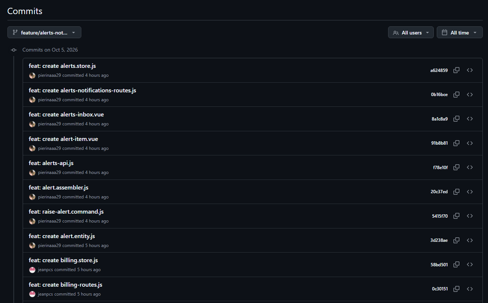</p>

*Nota.* Captura de GitHub (2026).

*Descripción.* Página «Commits» del repositorio destilatech-webapp filtrada por la rama `feature/alerts-notifications`. Commits de `pierinaaa29` con la entidad, el comando, el *assembler*, la API, los componentes y la bandeja de alertas, y la tienda `alerts.store.js`.


**Figura 132**

*Historial de commits de la rama feature/analytics-estimations*

<p align="center">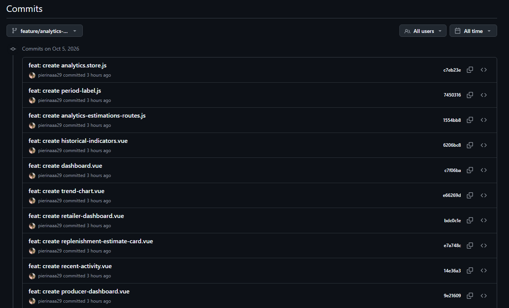</p>

*Nota.* Captura de GitHub (2026).

*Descripción.* Página «Commits» del repositorio destilatech-webapp filtrada por la rama `feature/analytics-estimations`. Commits de `pierinaaa29` con la tienda de analíticas, los dashboards del productor y del comercializador, el gráfico de tendencia, las tarjetas de estimación y los indicadores históricos.


**Figura 133**

*Historial de commits de la rama feature/billing*

<p align="center">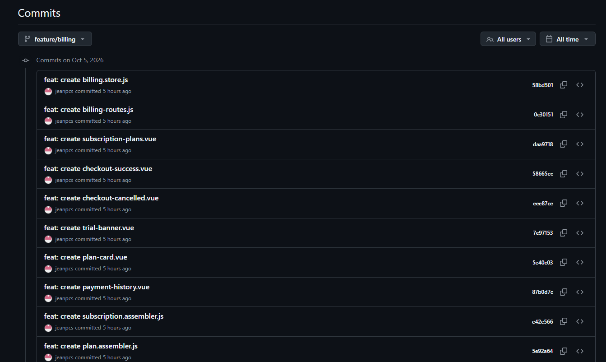</p>

*Nota.* Captura de GitHub (2026).

*Descripción.* Página «Commits» del repositorio destilatech-webapp filtrada por la rama `feature/billing`. Commits de `jeanpcs` con la tienda de facturación, las rutas, la vista de planes, las vistas de resultado del pago, el aviso de prueba, la tarjeta de plan, el historial de pagos y los *assemblers*.


**Figura 134**

*Historial de commits de la rama feature/fake-api*

<p align="center">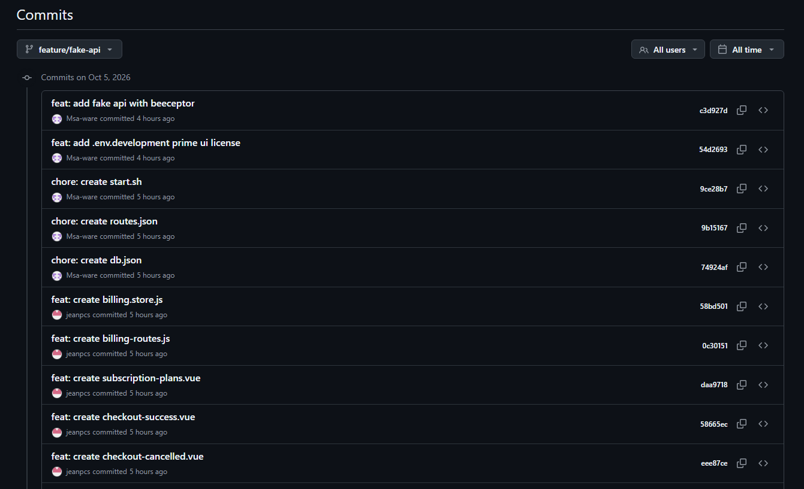</p>

*Nota.* Captura de GitHub (2026).

*Descripción.* Página «Commits» del repositorio destilatech-webapp filtrada por la rama `feature/fake-api`. Commits de `Msa-ware` con el Fake API con Beeceptor, la licencia de PrimeUI en el entorno de desarrollo, `start.sh`, `routes.json` y `db.json`.


**Figura 135**

*Historial de commits de la rama feature/iam*

<p align="center">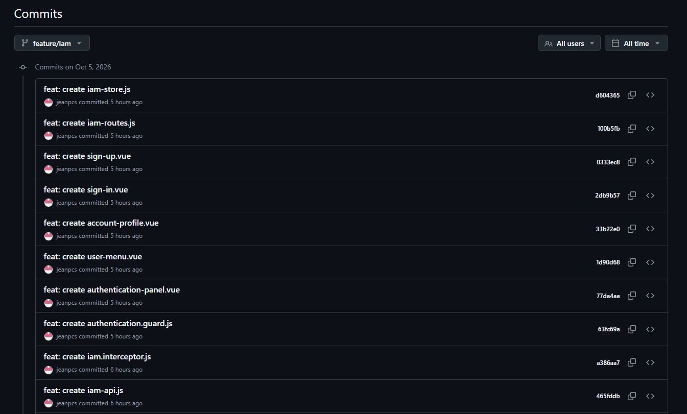</p>

*Nota.* Captura de GitHub (2026).

*Descripción.* Página «Commits» del repositorio destilatech-webapp filtrada por la rama `feature/iam`. Commits de `jeanpcs` con la tienda, las rutas, las vistas de registro e inicio de sesión, el perfil, el menú de usuario, el panel de autenticación, el guardián de rutas, el interceptor y la API de IAM.


**Figura 136**

*Historial de commits de la rama feature/inventory-stock*

<p align="center">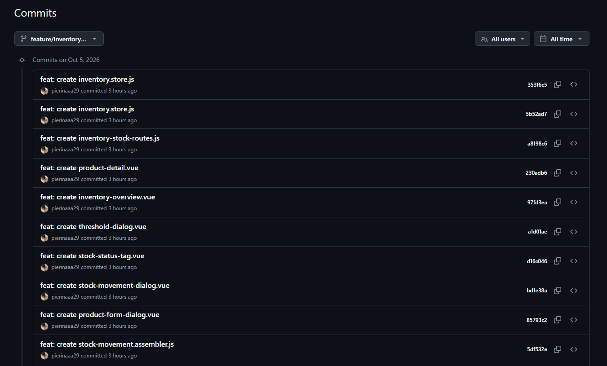</p>

*Nota.* Captura de GitHub (2026).

*Descripción.* Página «Commits» del repositorio destilatech-webapp filtrada por la rama `feature/inventory-stock`. Commits de `pierinaaa29` con la tienda de inventario, las rutas, la ficha del producto, la vista de inventario, los diálogos de umbral, movimiento y producto, y las etiquetas de estado de stock.


**Figura 137**

*Historial de commits de la rama feature/locales*

<p align="center">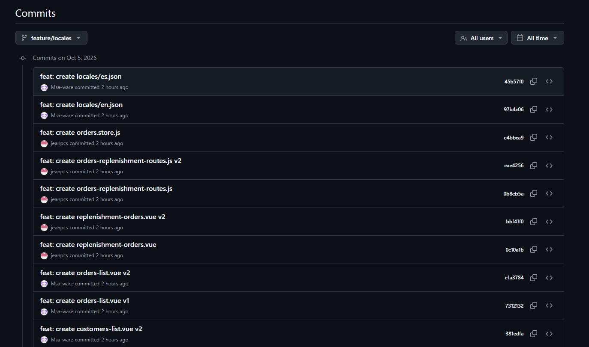</p>

*Nota.* Captura de GitHub (2026).

*Descripción.* Página «Commits» del repositorio destilatech-webapp filtrada por la rama `feature/locales`. Commits de `Msa-ware` con los catálogos `locales/es.json` y `locales/en.json`, seguidos de los commits de pedidos y reposición de la rama anterior.


**Figura 138**

*Historial de commits de la rama feature/orders-replenishment*

<p align="center">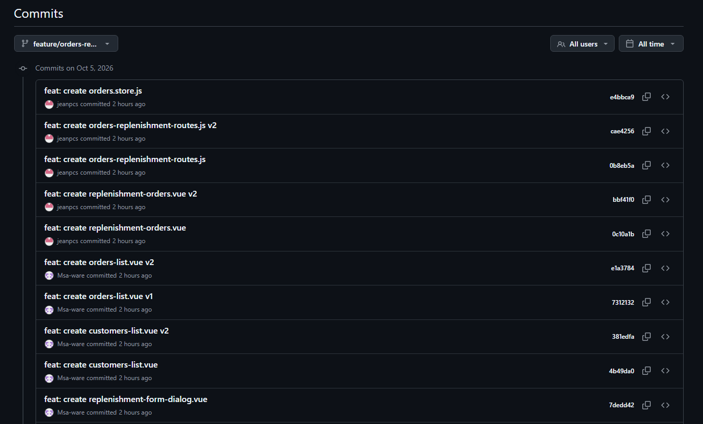</p>

*Nota.* Captura de GitHub (2026).

*Descripción.* Página «Commits» del repositorio destilatech-webapp filtrada por la rama `feature/orders-replenishment`. Commits de `jeanpcs` y `Msa-ware` con la tienda de pedidos, las rutas, las vistas de reposición, pedidos y clientes, y los diálogos de cliente, pedido y reposición.


**Figura 139**

*Historial de commits de la rama feature/production-monitoring*

<p align="center">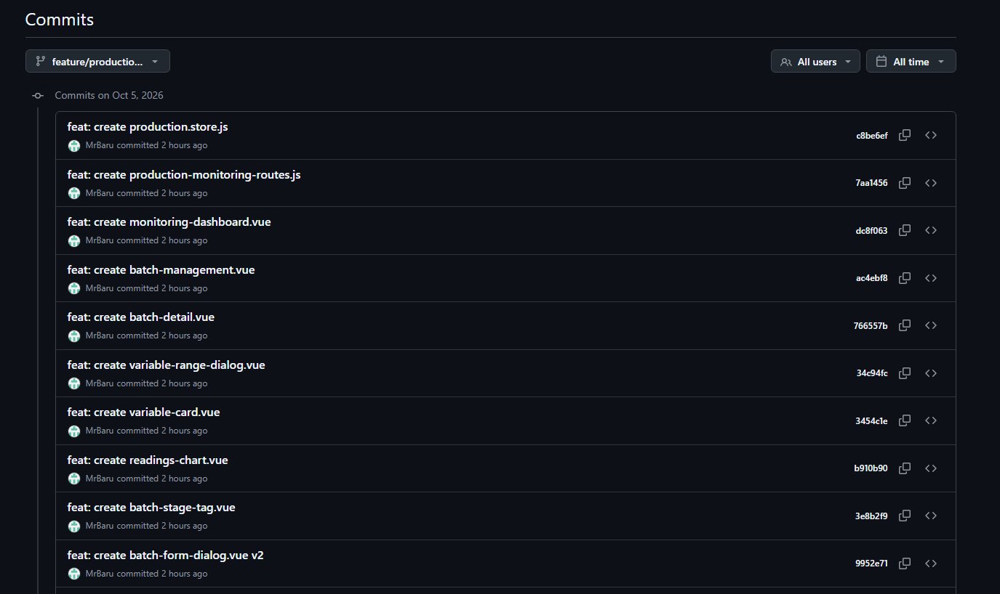</p>

*Nota.* Captura de GitHub (2026).

*Descripción.* Página «Commits» del repositorio destilatech-webapp filtrada por la rama `feature/production-monitoring`. Commits de `MrBaru` con la tienda de producción, las rutas, el dashboard de monitoreo, la gestión y el detalle de lotes, los diálogos de rango y de lote, las tarjetas de variable y el gráfico de lecturas.


**Figura 140**

*Historial de commits de la rama feature/shared*

<p align="center">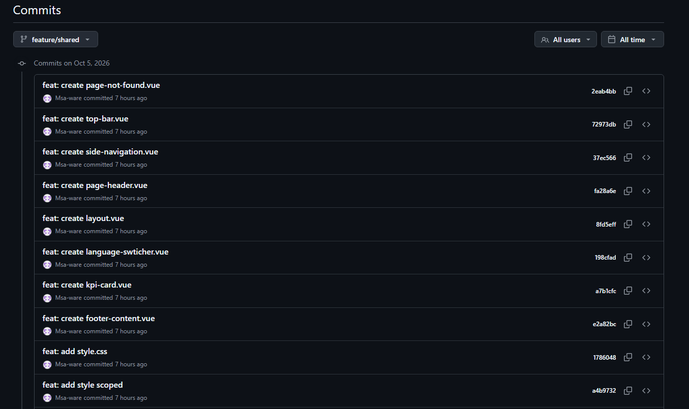</p>

*Nota.* Captura de GitHub (2026).

*Descripción.* Página «Commits» del repositorio destilatech-webapp filtrada por la rama `feature/shared`. Commits de `Msa-ware` con la página 404, la barra superior, la navegación lateral, el encabezado de página, el layout, el selector de idioma, la tarjeta KPI, el pie de página y los estilos.


**Figura 141**

*Historial de commits de la rama develop*

<p align="center">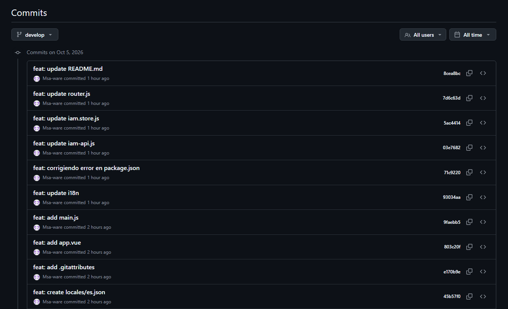</p>

*Nota.* Captura de GitHub (2026).

*Descripción.* Página «Commits» del repositorio destilatech-webapp filtrada por la rama `develop`. Commits de `Msa-ware` con la actualización del README, el enrutador, la tienda y la API de IAM, la corrección de `package.json`, la internacionalización, `main.js`, `app.vue` y `.gitattributes`.


**Figura 142**

*Ramas del repositorio de la aplicación web*

<p align="center">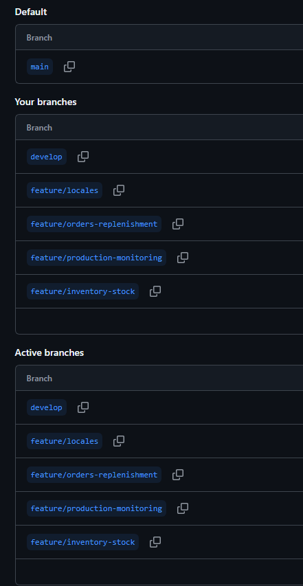</p>

*Nota.* Captura de GitHub (2026).

*Descripción.* Página «Branches» del repositorio destilatech-webapp con la rama predeterminada `main` y las ramas `develop`, `feature/locales`, `feature/orders-replenishment`, `feature/production-monitoring` y `feature/inventory-stock` entre las más activas.

##### 5.2.2.5. Execution Evidence for Sprint Review

El logro del Sprint 2 es la primera versión de la aplicación web, que está publicada en Firebase Hosting, consume el Fake API (`json-server`) publicado en Render (y también puede ejecutarse de forma local) y ofrece dos perfiles de demostración: productor (lotes, monitoreo IoT simulado, inventario y pedidos) y comercializador (inventario, pedidos y reposición). Como el contexto IAM no forma parte del sprint, no hay inicio de sesión: el perfil se cambia con los botones Productor / Comercializador de la barra superior y la aplicación recuerda el perfil elegido. Las pantallas siguientes, con la interfaz en inglés, recorren los flujos principales de cada perfil. La aplicación está disponible en español e inglés.

**Video de navegación:** [Ver video][video-sprint-2]

**Figura 143**

*Dashboard del productor*

<p align="center">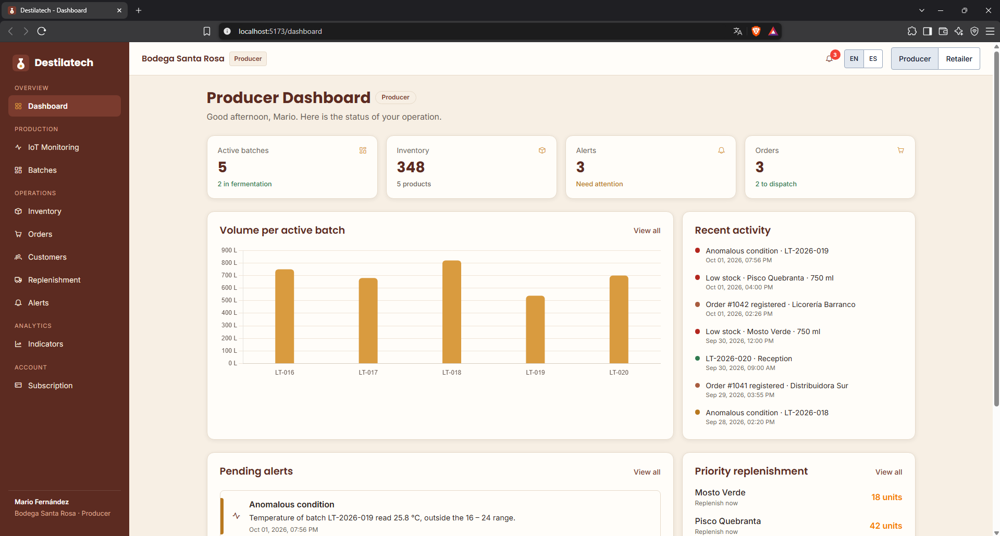</p>

*Nota.* Captura propia de la aplicación en ejecución con el Fake API (2026).

*Descripción.* Dashboard del productor (`/dashboard`, historia US04) con indicadores de lotes activos, inventario, alertas y pedidos, un gráfico del volumen por lote activo, la actividad reciente, las alertas pendientes y los productos de reposición prioritaria.


**Figura 144**

*Monitoreo IoT de la producción*

<p align="center">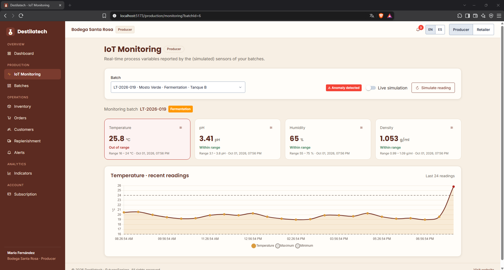</p>

*Nota.* Captura propia de la aplicación en ejecución con el Fake API (2026).

*Descripción.* Vista de monitoreo (`/production/monitoring`, historias US09 y US44) con la selección del lote, las variables de proceso (temperatura, pH, humedad y densidad) y el gráfico de lecturas recientes generadas por el simulador IoT; las lecturas fuera del rango normal se señalan como anomalías (US11).


**Figura 145**

*Gestión de lotes de producción*

<p align="center">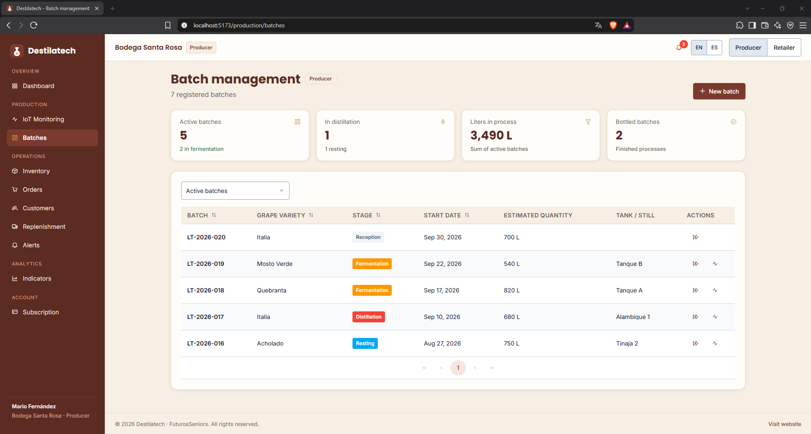</p>

*Nota.* Captura propia de la aplicación en ejecución con el Fake API (2026).

*Descripción.* Listado de lotes (`/production/batches`, historias US06 y US07) con la etapa de cada lote, el registro de un lote nuevo y el avance de etapa.


**Figura 146**

*Detalle y trazabilidad de un lote*

<p align="center">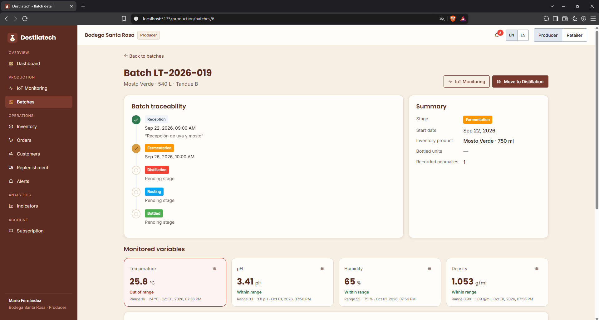</p>

*Nota.* Captura propia de la aplicación en ejecución con el Fake API (2026).

*Descripción.* Detalle de un lote (`/production/batches/:batchId`, historias US08 y US43) con su historial de etapas, sus variables y el registro del embotellado.


**Figura 147**

*Inventario*

<p align="center">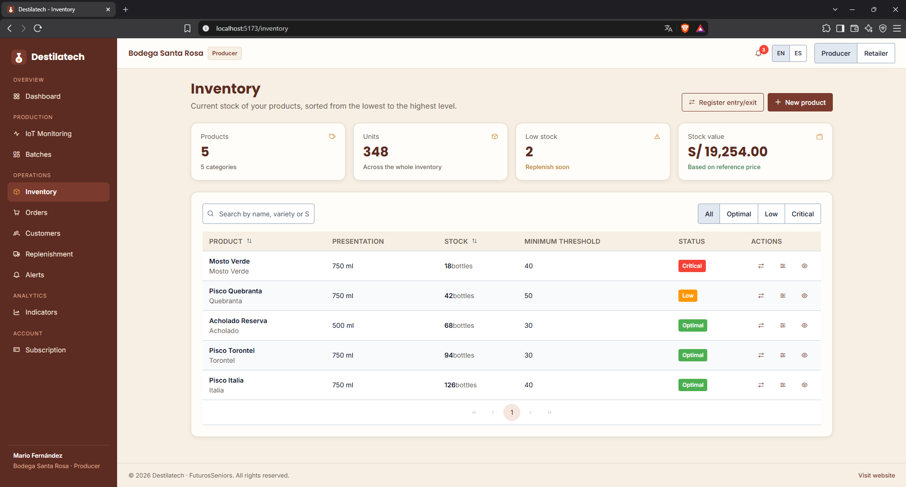</p>

*Nota.* Captura propia de la aplicación en ejecución con el Fake API (2026).

*Descripción.* Vista de inventario (`/inventory`, historias US12, US14 y US15) con las unidades y el valor del inventario, el stock por producto, su estado (óptimo, bajo o crítico) y el acceso a la configuración del umbral de stock bajo.


**Figura 148**

*Ficha de producto con estimación de reposición*

<p align="center">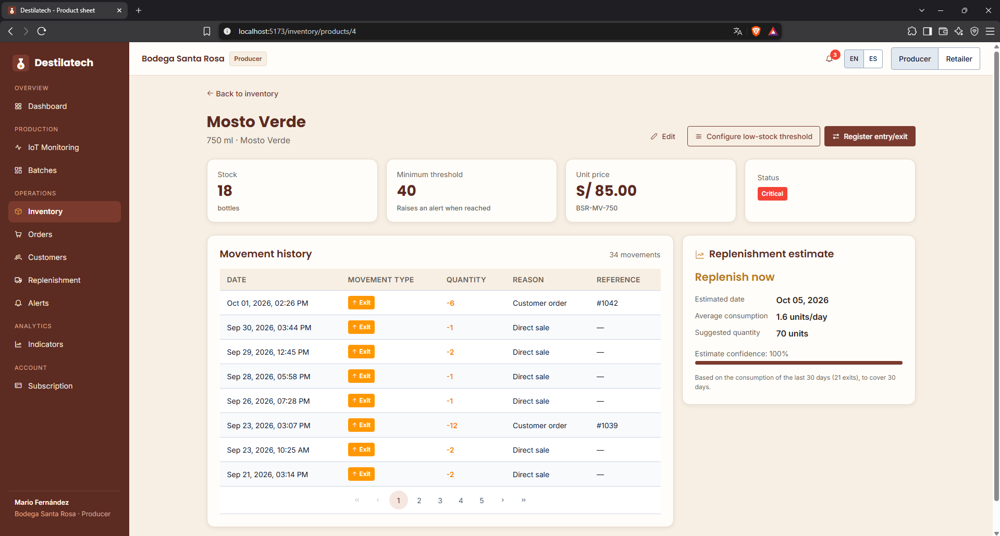</p>

*Nota.* Captura propia de la aplicación en ejecución con el Fake API (2026).

*Descripción.* Ficha del producto (`/inventory/products/:id`, historias US13, US20, US46 y US47) con el historial de movimientos, el registro de movimientos y ajustes, y la estimación de reposición.


**Figura 149**

*Pedidos y clientes*

<p align="center">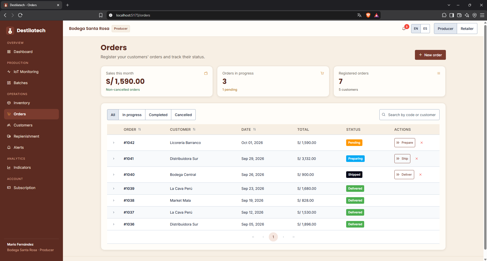</p>

*Nota.* Captura propia de la aplicación en ejecución con el Fake API (2026).

*Descripción.* Vista de pedidos (`/orders`, historias US18 y US19) y de clientes (`/orders/customers`, historias US17 y US49) con sus formularios y el estado de cada pedido.


**Figura 150**

*Reposición a proveedores*

<p align="center">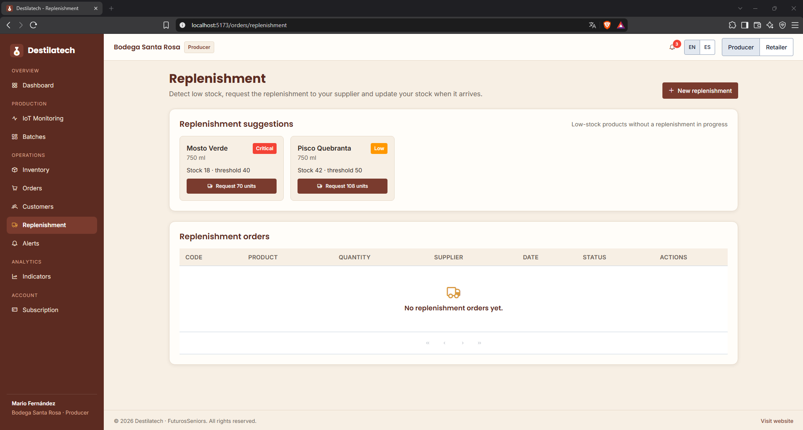</p>

*Nota.* Captura propia de la aplicación en ejecución con el Fake API (2026).

*Descripción.* Vista de reposición (`/orders/replenishment`, historia US50) con las sugerencias de compra y las órdenes de reposición a proveedores.


**Figura 151**

*Centro de alertas*

<p align="center">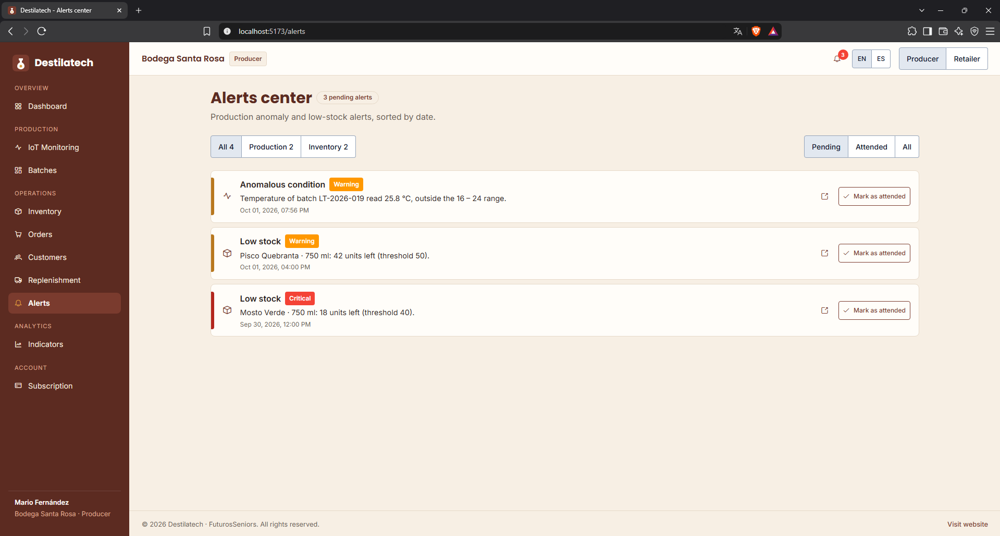</p>

*Nota.* Captura propia de la aplicación en ejecución con el Fake API (2026).

*Descripción.* Centro de alertas (`/alerts`, historias US16 y US48) con alertas por anomalía y por stock bajo, y filtros por tipo y estado.


**Figura 152**

*Planes y suscripción*

<p align="center">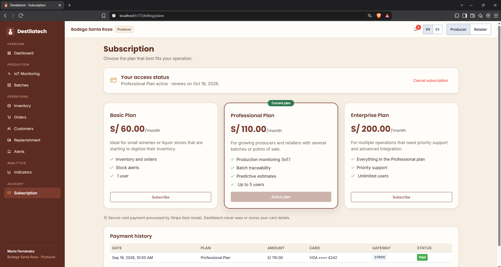</p>

*Nota.* Captura propia de la aplicación en ejecución con el Fake API (2026).

*Descripción.* Vista de planes (`/billing/plans`, historias US03, US40 y US54) con el estado de acceso, los planes Básico (S/ 60), Profesional (S/ 110) y Empresarial (S/ 200) por mes y el historial de pagos.


**Figura 153**

*Dashboard del comercializador*

<p align="center">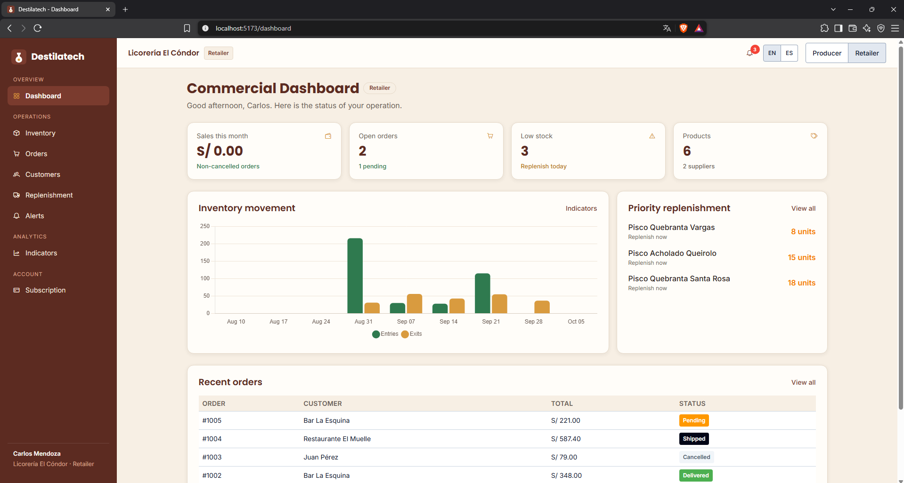</p>

*Nota.* Captura propia de la aplicación en ejecución con el Fake API (2026).

*Descripción.* Dashboard del comercializador (`/dashboard`, historia US05) con indicadores de ventas, pedidos abiertos, stock bajo y productos, el gráfico de movimiento de inventario, los productos de reposición prioritaria y los pedidos recientes.


**Figura 154**

*Indicadores históricos*

<p align="center">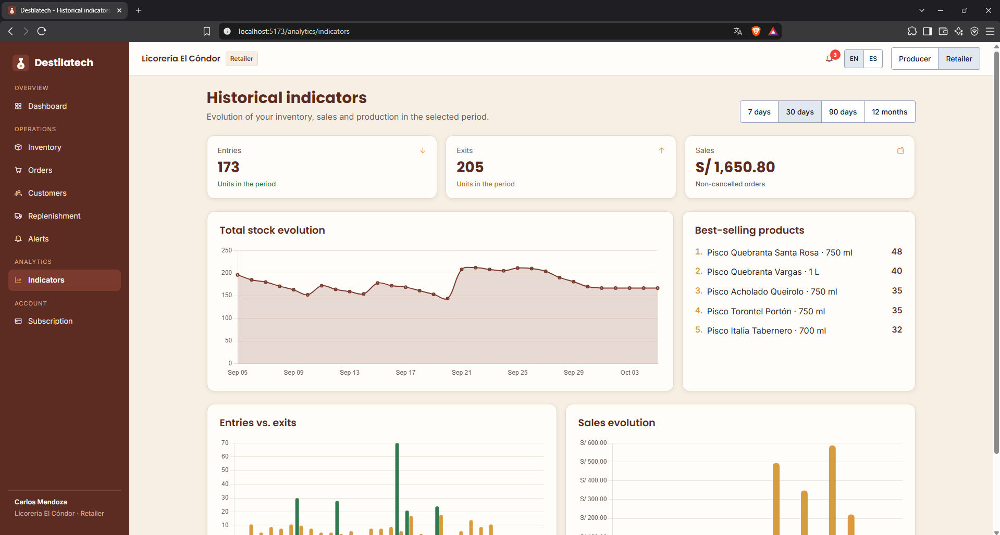</p>

*Nota.* Captura propia de la aplicación en ejecución con el Fake API (2026).

*Descripción.* Vista de indicadores históricos (`/analytics/indicators`, historia US21) con selector de periodo (7, 30, 90 días o 12 meses), indicadores de entradas, salidas y ventas, la evolución del stock, los productos más vendidos y gráficos de entradas contra salidas y de ventas.

##### 5.2.2.6. Services Documentation Evidence for Sprint Review

En el Sprint 2 no se implementaron servicios web propios: la aplicación consume un **Fake API** con `json-server`, que se ejecuta de forma local en desarrollo y se publica en Render como servicio web (`destilatech-api`) para la compilación de producción. En ambos casos los recursos se exponen con el prefijo `/api/v1`, que `routes.json` agrega a cada colección de `db.json`. La API real en ASP.NET Core y su documentación OpenAPI corresponden al sprint del *backend*; los endpoints previstos están especificados como historias técnicas en el capítulo III (épica EP10).

**URL base en desarrollo:** `http://localhost:3000/api/v1`. **URL base en producción:** `https://destilatech-api.onrender.com/api/v1` (por ejemplo, `https://destilatech-api.onrender.com/api/v1/plans`). El servicio de Render usa una instancia gratuita, que se suspende tras un periodo de inactividad y puede demorar la primera solicitud (Figura 161).

**Tabla 21**

*Recursos del Fake API utilizados por la aplicación web*


| Bounded Context | Recurso | Endpoint | Registros en `db.json` |
| :---------- | :---------- | :---------- | :----------: |
| Shared Kernel | Usuarios (perfil activo, sin autenticación) | `/users` | 2 |
| Billing | Planes | `/plans` | 3 |
| Billing | Suscripciones | `/subscriptions` | 1 |
| Billing | Pagos | `/payments` | 1 |
| Billing | Sesiones de pago | `/checkout-sessions` | — |
| Production & Monitoring | Lotes | `/batches` | 7 |
| Production & Monitoring | Variables de proceso | `/process-variables` | 28 |
| Production & Monitoring | Lecturas de sensores | `/sensor-readings` | 384 |
| Inventory & Stock Management | Productos | `/products` | 11 |
| Inventory & Stock Management | Existencias | `/stock-items` | 11 |
| Inventory & Stock Management | Movimientos de stock | `/stock-movements` | 325 |
| Orders & Replenishment | Clientes | `/customers` | 8 |
| Orders & Replenishment | Pedidos | `/orders` | 12 |
| Orders & Replenishment | Órdenes de reposición | `/replenishment-orders` | 2 |
| Alerts & Notifications | Alertas | `/alerts` | 7 |


Las lecturas de sensores se generan con el simulador `IotSensorSimulator`, que produce valores alrededor del centro del rango de cada variable con una probabilidad configurable de lectura anómala (15 % por defecto). Con esto se representa el comportamiento de los sensores sin dispositivos físicos, como establece el alcance académico del proyecto. Los recursos se acceden desde los adaptadores `*-api.js`, que extienden `BaseApi` y `BaseEndpoint` del *Shared Kernel*.

##### 5.2.2.7. Software Deployment Evidence for Sprint Review

La aplicación web se desplegó en **Firebase Hosting** y el Fake API en **Render**, ambos con planes gratuitos. La aplicación es una SPA de Vue 3 que `npm run build` compila a archivos estáticos en la carpeta `dist/`, por lo que Firebase Hosting la sirve por HTTPS sin necesidad de un servidor propio. Como el *backend* en ASP.NET Core aún no existe, el Fake API (`json-server`, con `db.json` y `routes.json`) se publica como servicio web en Render para que la aplicación desplegada pueda consultar datos. La sección 5.1.4.2 resume la configuración; esta sección documenta los pasos con sus evidencias.

**Enlaces de producción:**

- **Aplicación web (Firebase Hosting):** [https://destilatech-webapp.web.app](https://destilatech-webapp.web.app)
- **Fake API (Render):** [https://destilatech-api.onrender.com/api/v1](https://destilatech-api.onrender.com/api/v1)
- **Landing page (GitHub Pages):** [https://upc-pre-202620-1asi0730-2620-8084-desti.github.io/destilatech-website/](https://upc-pre-202620-1asi0730-2620-8084-desti.github.io/destilatech-website/)

**Despliegue de la aplicación web en Firebase Hosting**

**Paso 1. Creación del proyecto.** En la consola de Firebase se creó el proyecto `destilatech-webapp` con la cuenta del equipo, en el plan Spark (sin costo). No se registró ninguna aplicación (iOS, Android o web) porque Hosting no la requiere, y no se activó Firestore ni Functions.

**Figura 155**

*Proyecto destilatech-webapp en la consola de Firebase*

<p align="center">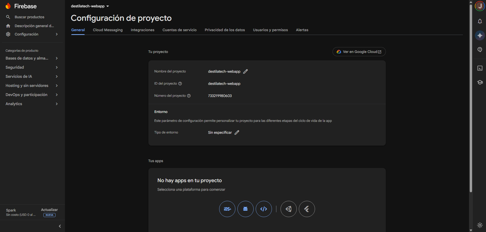</p>

*Nota.* Captura de la consola de Firebase (2026).

*Descripción.* Pantalla «Configuración de proyecto» de Firebase con el nombre y el ID del proyecto (`destilatech-webapp`), el número del proyecto y el plan Spark sin costo en la esquina inferior izquierda. La sección «Tus apps» indica que no hay aplicaciones registradas, ya que Hosting no las necesita.

**Paso 2. Inicialización de Hosting.** Desde la carpeta del proyecto se ejecutaron `firebase login` y `firebase init`. Se eligió la función Hosting, se usó el proyecto existente, se indicó `dist` como directorio público y se aceptó la configuración de aplicación de una sola página (reescribir todas las URL a `/index.html`). No se activaron las compilaciones automáticas con GitHub ni se sobrescribió `dist/index.html`. El asistente generó `firebase.json` y `.firebaserc`.

**Figura 156**

*Inicialización de Firebase Hosting con firebase init*

<p align="center">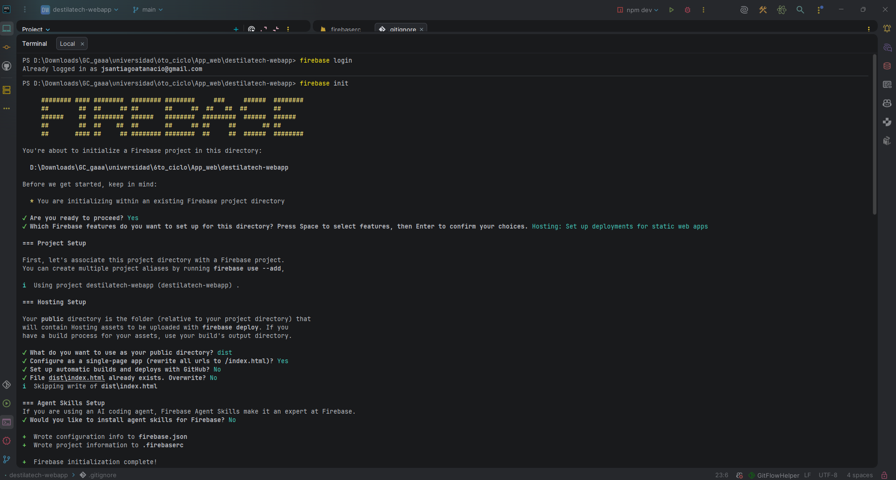</p>

*Nota.* Captura de la terminal del IDE (2026).

*Descripción.* Terminal con `firebase login` (sesión ya iniciada) y `firebase init`: funcionalidad Hosting seleccionada, proyecto `destilatech-webapp`, directorio público `dist`, aplicación de una sola página con reescritura a `/index.html`, GitHub automático en «No», y creación de `firebase.json` y `.firebaserc`.

El archivo `firebase.json` resultante es el siguiente:

```json
{
  "hosting": {
    "public": "dist",
    "ignore": ["firebase.json", "**/.*", "**/node_modules/**"],
    "rewrites": [{ "source": "**", "destination": "/index.html" }]
  }
}
```

**Paso 3. Publicación.** Con `dist/` generada por `npm run build`, la configuración se registró en el repositorio con el commit `chore(deploy): add Firebase Hosting configuration` en la rama `main` y se publicó con `npx firebase-tools deploy`. Firebase encontró 58 archivos en `dist`, los subió, finalizó la versión y completó el *release*.

**Figura 157**

*Commit de la configuración y despliegue con firebase deploy*

<p align="center">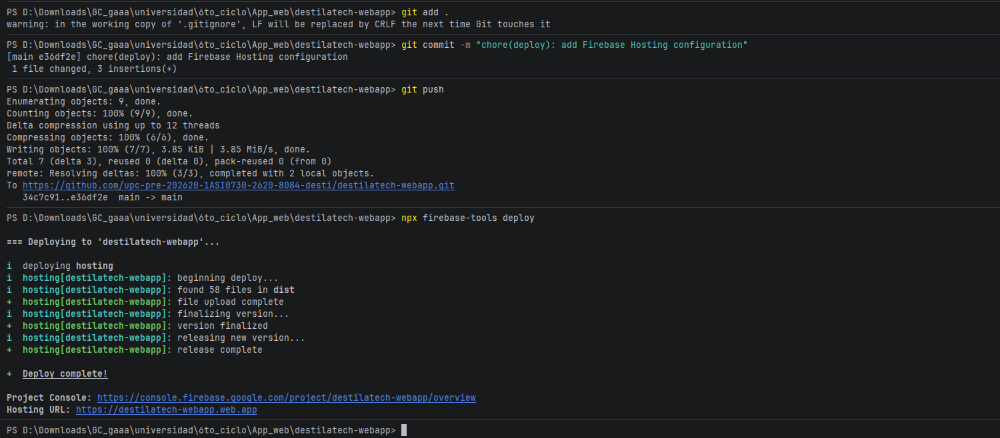</p>

*Nota.* Captura de la terminal del IDE (2026).

*Descripción.* Terminal con `git add`, `git commit` y `git push` de la configuración de Hosting hacia `main`, seguidos de `npx firebase-tools deploy`: 58 archivos en `dist`, subida completa, versión finalizada y *release* completo. La salida termina con la URL de la consola del proyecto y la Hosting URL `https://destilatech-webapp.web.app`.

**Paso 4. Verificación en la consola.** El panel de Hosting muestra la versión actual (`98f9a8`, publicada el 05/10/2026 a las 8:01 p. m.), una versión anterior (`13fbe4`, de las 7:57 p. m.) y los dominios asignados por Firebase: `destilatech-webapp.web.app` y `destilatech-webapp.firebaseapp.com`.

**Figura 158**

*Panel de Hosting en la consola de Firebase*

<p align="center">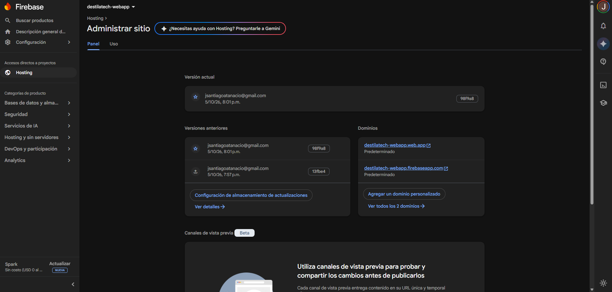</p>

*Nota.* Captura de la consola de Firebase (2026).

*Descripción.* Pantalla «Administrar sitio» de Hosting con la versión actual, el historial de versiones anteriores y los dos dominios predeterminados del proyecto.

**Despliegue del Fake API en Render**

**Paso 5. Creación del servicio web.** En Render se creó un *Web Service* con el nombre `destilatech-api`, conectado al repositorio `destilatech-webapp` de la organización del curso en GitHub, con entorno Node, la rama `develop`, la región Oregon y una instancia gratuita (0,1 CPU y 512 MB de RAM, USD 0 al mes).

**Figura 159**

*Configuración del servicio web destilatech-api en Render*

<p align="center">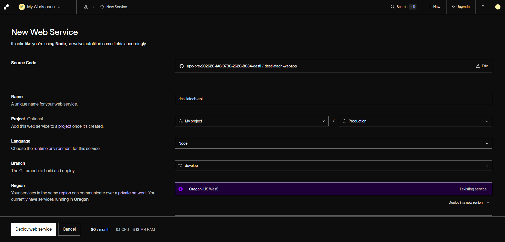</p>

*Nota.* Captura de Render (2026).

*Descripción.* Formulario «New Web Service» con el repositorio de origen, el nombre `destilatech-api`, el proyecto y el entorno de producción, el lenguaje Node, la rama `develop` y la región Oregon. El costo mostrado al pie es de USD 0 al mes.

**Paso 6. Verificación del servicio.** El proyecto de Render muestra el servicio `destilatech-api` con estado *Deployed*, entorno Node y región Oregon. El panel de despliegues registra el primer despliegue, del commit `chore(config): point production API to json-server hosted on Render`, con estado *Live* y una duración de 34,3 segundos.

**Figura 160**

*Servicio destilatech-api desplegado en Render*

<p align="center">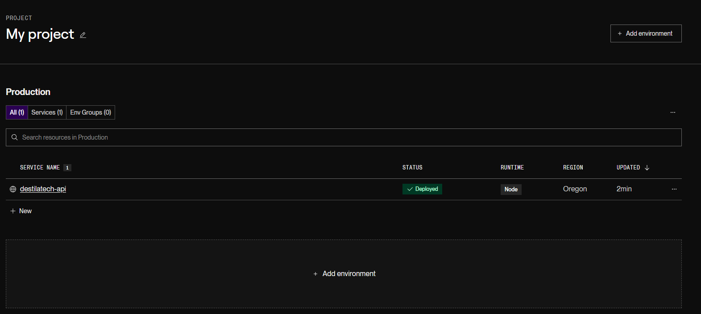</p>

*Nota.* Captura de Render (2026).

*Descripción.* Lista de recursos del entorno Production del proyecto «My project», con el servicio web `destilatech-api` en estado *Deployed*.

**Figura 161**

*Despliegue del Fake API en Render*

<p align="center">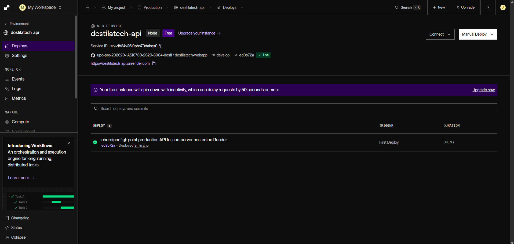</p>

*Nota.* Captura de Render (2026).

*Descripción.* Panel «Deploys» del servicio con su identificador, el repositorio y la rama `develop`, el commit `ed3b72a` con estado *Live* y la URL pública `https://destilatech-api.onrender.com`. El aviso morado indica que la instancia gratuita se suspende por inactividad y que las solicitudes pueden demorar 50 segundos o más.

**Paso 7. Conexión de la aplicación con el Fake API.** La variable `VITE_DESTILATECH_API_URL` de `.env.production` apunta a `https://destilatech-api.onrender.com/api/v1`, de modo que la compilación de producción consume el servicio publicado en Render.

**Resultado**

La aplicación está disponible en la URL pública de Firebase Hosting y carga sus datos desde el Fake API.

**Figura 162**

*Aplicación web desplegada en Firebase Hosting*

<p align="center">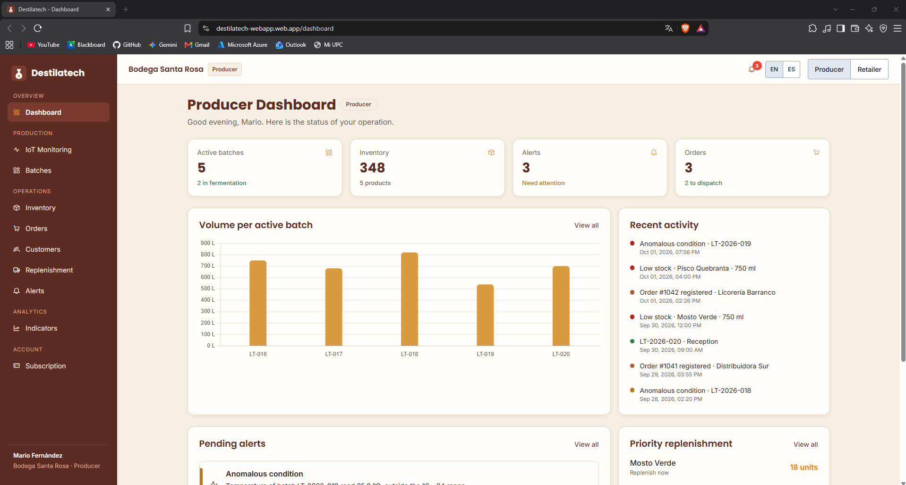</p>

*Nota.* Captura propia del navegador en `destilatech-webapp.web.app/dashboard` (2026).

*Descripción.* Dashboard del productor abierto desde la URL pública, con los indicadores de lotes, inventario, alertas y pedidos, el gráfico de volumen por lote activo, la actividad reciente y las alertas pendientes.

**Automatización y limitaciones**

- **Firebase Hosting:** la publicación se ejecuta de forma manual con `npx firebase-tools deploy`; no se configuró un flujo de GitHub Actions (la opción de compilaciones automáticas se dejó en «No»). Cada publicación crea una versión nueva en el panel de Hosting y conserva las anteriores.
- **Render:** el servicio queda enlazado a la rama `develop` del repositorio y sus despliegues se consultan en el panel «Deploys».
- **Landing page:** se publica de forma automática con el flujo `pages build and deployment` de GitHub Pages (sección 5.2.1.7).
- **Instancia gratuita de Render:** se suspende tras un periodo de inactividad, por lo que la primera consulta puede demorar. Además, los cambios que la aplicación escriba en `db.json` pueden perderse cuando el servicio se reinicie. Ambas limitaciones desaparecen cuando el Fake API se reemplace por la API en ASP.NET Core con su base de datos.

##### 5.2.2.8. Team Collaboration Insights during Sprint

El equipo repartió los módulos de la aplicación según la sección 5.2.2.3 y trabajó con una rama `feature/*` por *bounded context*. A diferencia del Sprint 1, cada integrante registró sus commits desde su propia cuenta, de modo que el repositorio permite medir los aportes individuales. La tabla resume los commits únicos de la sección 5.2.2.4 por integrante y por rama. Las pruebas funcionales se repartieron entre los cuatro integrantes (sección 5.2.2.3) y no dejan commits en el repositorio.

**Tabla 22**

*Commits del repositorio de la aplicación web por integrante*


| Team Member (Last Name, First Name) | GitHub Username | Ramas con commits | Commits |
| :---------- | :---------- | :------------------------ | :----------: |
| Fernandez Seer, Mario Alonso | MrBaru | `feature/production-monitoring` (30) | 30 |
| Santiago Atanacio, Jairo Mathias | Msa-ware | `main` (4), `feature/shared` (30), `feature/iam` (3), `feature/fake-api` (5), `feature/orders-replenishment` (22), `feature/locales` (2), `develop` (9) | 75 |
| Almandroz Carbajal, Pierina Marysabel | pierinaaa29 | `feature/alerts-notifications` (8), `feature/analytics-estimations` (15), `feature/inventory-stock` (17), `develop` (1) | 41 |
| Condor Sandoval, Jean Pierre | jeanpcs | `feature/shared` (1), `feature/iam` (20), `feature/billing` (15), `feature/orders-replenishment` (5) | 41 |
| **Total** | | | **187** |


**Aportes por integrante.** Los commits de la tabla se contaron a partir del historial de GitHub del repositorio. Los 20 commits de Condor Sandoval en `feature/iam` y los 3 de Santiago Atanacio corresponden al contexto IAM, retirado del alcance del sprint; los aportes vigentes de Condor Sandoval en la aplicación son el módulo Billing y su colaboración en el *Shared Kernel* y en pedidos.
