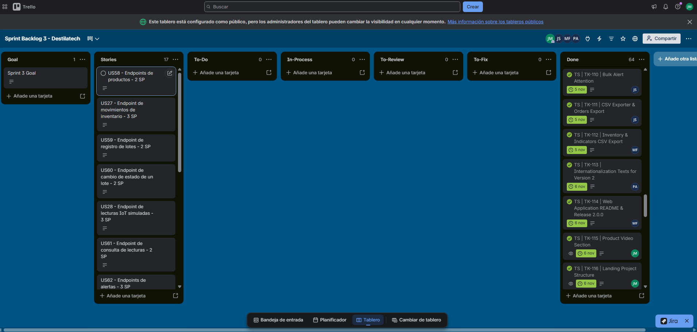

##### 5.2.3.3. Sprint Backlog 3

El Sprint Backlog 3 contiene las 13 historias técnicas de la épica EP10 que la API implementa en este sprint, divididas en dos o más tareas de ingeniería, y las tareas sin historia de usuario: soporte de los contextos, tareas transversales del *Shared Kernel* y de la configuración de la API, mejoras de la aplicación web (versiones 2.0.0 y 2.1.0) y mejoras de la landing page. Cada tarea es una tarea de ingeniería (*Engineering Task*) estimada en horas de planificación, con un mínimo de 4 y un máximo de 8 horas por tarea.

**Tablero del equipo en Trello:** [https://trello.com/b/11yAZnma/sprint-backlog-3-destilatech](https://trello.com/b/11yAZnma/sprint-backlog-3-destilatech) (listas Goal, Stories, To-Do, In-Process, To-Review, To-Fix y Done)

**Figura 169**

*Tablero del Sprint 3 en Trello*

*Nota.* Captura propia de Trello (2026). Tablero público disponible en [https://trello.com/b/11yAZnma/sprint-backlog-3-destilatech](https://trello.com/b/11yAZnma/sprint-backlog-3-destilatech).

*Descripción.* El tablero «Sprint Backlog 3 - Destilatech» tiene siete listas: Goal, con la meta del sprint; Stories, con 17 tarjetas (13 historias técnicas de la épica EP10 con su puntaje en Story Points y 4 tarjetas de tareas sin historia: soporte del contexto, tareas transversales, mejora de la Web Application y mejora de la Landing Page); To-Do, In-Process, To-Review y To-Fix, sin tarjetas; y Done, con las 64 tarjetas de tareas de ingeniería (TK-73 a TK-136) terminadas, cada una con su fecha de entrega y su responsable. La captura muestra el inicio de la lista Done; la columna se desplaza para ver las demás tarjetas.

**Tabla 24**

*Sprint Backlog 3*

| User Story Id | User Story Title | Task Id | Task Title | Description | Estimation (Hours) | Assigned To | Status |
| :---------- | :---------- | :---------- | :---------- | :------------------------------------------- | :----------: | :----------- | :----------: |
| **US58** | Endpoints de productos | TK-73 | Product & Stock Item Aggregates | Alcance: agregados `Product` y `StockItem`, entidad `StockMovement` y su mapeo en `InventoryModelBuilderExtensions` (EF Core). Incluye la revisión del código y la verificación funcional con la documentación de Scalar. | 6 | Fernandez Seer, Mario Alonso | Done |
| **US58** | Endpoints de productos | TK-74 | Products Endpoints | Alcance: `ProductsController` con `GET` y `POST /api/v1/products` y `PUT /api/v1/products/{id}`, con `ProductCommandService` y `InventoryQueryService`; el producto nuevo crea su `StockItem` con el umbral de stock bajo. Incluye la revisión del código y la verificación funcional con la documentación de Scalar. | 5 | Fernandez Seer, Mario Alonso | Done |
| **US27** | Endpoint de movimientos de inventario | TK-75 | Stock Movement Rules | Alcance: `StockItem.RegisterMovement` con entradas y salidas, rechazo de la salida mayor al stock y actualización de la existencia mediante `StockItemCommandService`, con errores de negocio basados en el modelo compartido y repositorios de Entity Framework Core. Incluye la revisión del código y la verificación funcional con la documentación de Scalar. | 6 | Fernandez Seer, Mario Alonso | Done |
| **US27** | Endpoint de movimientos de inventario | TK-76 | Stock Movements & Threshold Endpoints | Alcance: `StockMovementsController` (`GET` y `POST /api/v1/stock-movements`) y `StockItemsController` (`GET /api/v1/stock-items` y `PATCH /api/v1/stock-items/{id}`); la alerta de stock bajo se genera mediante `IAlertsContextFacade` y el contexto ofrece `IInventoryContextFacade` a los demás. Incluye la revisión del código y la verificación funcional con la documentación de Scalar. | 5 | Fernandez Seer, Mario Alonso | Done |
| **US59** | Endpoint de registro de lotes | TK-77 | Production Batch Aggregate & Migration | Alcance: agregado `ProductionBatch`, entidad `BatchStageChange`, mapeo en `ProductionModelBuilderExtensions` y migración `AddProductionMonitoring`. Incluye la revisión del código y la verificación funcional con la documentación de Scalar. | 6 | Fernandez Seer, Mario Alonso | Done |
| **US59** | Endpoint de registro de lotes | TK-78 | Batch Registration Endpoints | Alcance: `ProductionBatchesController` con `GET` y `POST /api/v1/batches` y `PUT /api/v1/batches/{id}`, con `ProductionBatchCommandService` y `ProductionQueryService`. Incluye la revisión del código y la verificación funcional con la documentación de Scalar. | 4 | Fernandez Seer, Mario Alonso | Done |
| **US60** | Endpoint de cambio de estado de un lote | TK-79 | Batch Stage Sequence Validation | Alcance: `ProductionBatch.Advance` valida la secuencia de etapas y registra el historial en `batch_stage_changes`; al embotellar, `ProductionBatchCommandService` incorpora las botellas al stock mediante `IInventoryContextFacade`. Incluye la revisión del código y la verificación funcional con la documentación de Scalar. | 6 | Fernandez Seer, Mario Alonso | Done |
| **US60** | Endpoint de cambio de estado de un lote | TK-80 | Batch Status Endpoint | Alcance: `PATCH /api/v1/batches/{id}/status` con la etapa, las notas y las botellas producidas. Incluye la revisión del código y la verificación funcional con la documentación de Scalar. | 4 | Fernandez Seer, Mario Alonso | Done |
| **US28** | Endpoint de lecturas IoT simuladas | TK-81 | Process Variable & Sensor Reading Aggregates | Alcance: agregados `ProcessVariable` y `SensorReading`; `ProcessVariablesController` con `GET` y `POST /api/v1/process-variables` y `PATCH /api/v1/process-variables/{id}` para el rango normal. Incluye la revisión del código y la verificación funcional con la documentación de Scalar. | 6 | Fernandez Seer, Mario Alonso | Done |
| **US28** | Endpoint de lecturas IoT simuladas | TK-82 | Reading Ingestion & Anomaly Evaluation | Alcance: `POST /api/v1/sensor-readings` y `POST /api/v1/batches/{id}/readings` (campo `source_id`); `ProcessMonitoringCommandService` evalúa la lectura contra el rango, evita duplicados con la clave de origen y genera la alerta de condición anómala mediante `IAlertsContextFacade`. Incluye la revisión del código y la verificación funcional con la documentación de Scalar. | 8 | Fernandez Seer, Mario Alonso | Done |
| **US61** | Endpoint de consulta de lecturas | TK-83 | Batch Readings Query | Alcance: `GET /api/v1/batches/{id}/readings` con los filtros `variable`, `from` y `to` y validación del rango de fechas. Incluye la revisión del código y la verificación funcional con la documentación de Scalar. | 4 | Fernandez Seer, Mario Alonso | Done |
| **US61** | Endpoint de consulta de lecturas | TK-84 | Sensor Readings List Endpoint | Alcance: `SensorReadingsController` con `GET /api/v1/sensor-readings` y el parámetro `_limit` para las lecturas recientes de la cuenta. Incluye la revisión del código y la verificación funcional con la documentación de Scalar. | 4 | Fernandez Seer, Mario Alonso | Done |
| **US62** | Endpoints de alertas | TK-85 | Alert Aggregate & Persistence | Alcance: agregado `Alert`, comandos, consultas, repositorio y migración de la tabla `alerts`. Incluye la revisión del código y la verificación funcional con la documentación de Scalar. | 8 | Santiago Atanacio, Jairo Mathias | Done |
| **US62** | Endpoints de alertas | TK-86 | Alerts REST Controller | Alcance: `AlertsController` con `POST`, `GET` (filtros `type` y `status`), `GET /{id}` y `PATCH /{id}/attended`, con respuestas `ProblemDetails` localizadas. Incluye la revisión del código y la verificación funcional con la documentación de Scalar. | 6 | Santiago Atanacio, Jairo Mathias | Done |
| **US62** | Endpoints de alertas | TK-87 | Alerts Context Facade & Event Handler | Alcance: `IAlertsContextFacade` (ACL) y `AlertRaisedEventHandler` para que los demás contextos generen alertas. Incluye la revisión del código y la verificación funcional con la documentación de Scalar. | 5 | Santiago Atanacio, Jairo Mathias | Done |
| **US63** | Endpoint de pedidos | TK-88 | Order Aggregate & Persistence | Alcance: agregados `Order`, `OrderLine` y `Customer`, repositorios y migración del contexto Orders & Replenishment. Incluye la revisión del código y la verificación funcional con la documentación de Scalar. | 8 | Almandroz Carbajal, Pierina Marysabel | Done |
| **US63** | Endpoint de pedidos | TK-89 | Orders Endpoints with Stock Discount | Alcance: `GET` y `POST /api/v1/orders`, `GET /{id}` y `PATCH /{id}`; `OrderCommandService` descuenta el stock mediante `IInventoryPort` y rechaza el pedido con `InsufficientStock`. Incluye la revisión del código y la verificación funcional con la documentación de Scalar. | 6 | Almandroz Carbajal, Pierina Marysabel | Done |
| **US29** | Endpoint de estimaciones de reposición | TK-90 | Replenishment Estimate Calculation | Alcance: `ReplenishmentEstimateCommandService`, agregados `ReplenishmentEstimate` y `ReplenishmentEstimateAudit` y migración del contexto Analytics & Estimations. Incluye la revisión del código y la verificación funcional con la documentación de Scalar. | 8 | Almandroz Carbajal, Pierina Marysabel | Done |
| **US29** | Endpoint de estimaciones de reposición | TK-91 | Replenishment Estimate Endpoints | Alcance: `GET /api/v1/replenishment-estimates`, `POST /api/v1/replenishment-estimates/recalculations` y `GET /api/v1/products/{productId}/replenishment-estimate`. Incluye la revisión del código y la verificación funcional con la documentación de Scalar. | 5 | Almandroz Carbajal, Pierina Marysabel | Done |
| **US56** | Endpoint de registro de cuenta | TK-92 | IAM User Aggregate & Persistence | Alcance: agregado `User`, periodo de prueba (`TrialPeriod`), repositorio y migración del contexto IAM. Incluye la revisión del código y la verificación funcional con la documentación de Scalar. | 6 | Condor Sandoval, Jean Pierre | Done |
| **US56** | Endpoint de registro de cuenta | TK-93 | Users Endpoints | Alcance: `POST /api/v1/users` con respuesta `409` para el correo repetido, `GET /api/v1/users` y `GET /api/v1/users/{id}`. Incluye la revisión del código y la verificación funcional con la documentación de Scalar. | 4 | Condor Sandoval, Jean Pierre | Done |
| **US57** | Endpoints de suscripción | TK-94 | Plans, Subscriptions & Payments Aggregates | Alcance: agregados `Plan`, `Subscription` y `Payment`, datos iniciales de los planes y migración del contexto Billing. Incluye la revisión del código y la verificación funcional con la documentación de Scalar. | 8 | Condor Sandoval, Jean Pierre | Done |
| **US57** | Endpoints de suscripción | TK-95 | Billing Query & Status Endpoints | Alcance: `GET /api/v1/plans`, `GET /api/v1/subscriptions`, `PATCH /api/v1/subscriptions/{id}` y `GET /api/v1/payments`. Incluye la revisión del código y la verificación funcional con la documentación de Scalar. | 6 | Condor Sandoval, Jean Pierre | Done |
| **US57** | Endpoints de suscripción | TK-96 | Checkout Sessions with Stripe Gateway | Alcance: `StripePaymentGatewayService`, `POST /api/v1/checkout-sessions` y `POST /api/v1/checkout-sessions/{sessionId}/confirmation` en modo de prueba. Incluye la revisión del código y la verificación funcional con la documentación de Scalar. | 8 | Condor Sandoval, Jean Pierre | Done |
| — | Sin historia (soporte del contexto) | TK-97 | Customers & Replenishment Orders Endpoints | Alcance: `CustomersController` (`GET`, `GET /{id}`, `POST`, `PUT`) y `ReplenishmentOrdersController` (`GET`, `GET /{id}`, `POST`, `PATCH`). Incluye la revisión del código y la verificación funcional con la documentación de Scalar. | 6 | Almandroz Carbajal, Pierina Marysabel | Done |
| — | Sin historia (soporte del contexto) | TK-98 | Historical Indicators Endpoints | Alcance: `GET /api/v1/historical-indicators` y `GET /api/v1/historical-indicators/top-consumed-products`. Incluye la revisión del código y la verificación funcional con la documentación de Scalar. | 5 | Almandroz Carbajal, Pierina Marysabel | Done |
| — | Sin historia (tarea transversal) | TK-99 | Project Configuration & Packages | Alcance: proyecto ASP.NET Core, paquetes de OpenAPI, Entity Framework Core, MySQL y Humanizer, y eliminación del código de plantilla. Incluye la revisión del código y la verificación funcional con la documentación de Scalar. | 4 | Santiago Atanacio, Jairo Mathias | Done |
| — | Sin historia (tarea transversal) | TK-100 | Shared Kernel Persistence | Alcance: `AppDbContext`, repositorio base genérico, unidad de trabajo y convención `snake_case` para los objetos de la base de datos. Incluye la revisión del código y la verificación funcional con la documentación de Scalar. | 8 | Santiago Atanacio, Jairo Mathias | Done |
| — | Sin historia (tarea transversal) | TK-101 | Naming Conventions & Result Model | Alcance: `KebabCaseRouteNamingConvention` para las rutas y el registro `Result` para los resultados de aplicación de cada contexto. Incluye la revisión del código y la verificación funcional con la documentación de Scalar. | 5 | Santiago Atanacio, Jairo Mathias | Done |
| — | Sin historia (tarea transversal) | TK-102 | API Configuration, Localization & OpenAPI | Alcance: archivos de recursos `SharedResource.*.resx` (es, en), manejo centralizado de excepciones, OpenAPI con Scalar, cadenas de conexión por entorno y migraciones al iniciar. Incluye la revisión del código y la verificación funcional con la documentación de Scalar. | 8 | Santiago Atanacio, Jairo Mathias | Done |
| — | Sin historia (tarea transversal) | TK-103 | Domain Events & Command Pipeline | Alcance: `Cortex.Mediator` con los comportamientos de registro, excepciones y transacción, interceptor de eventos de dominio y *global exception handler* con `ProblemDetails` localizado. Incluye la revisión del código y la verificación funcional con la documentación de Scalar. | 8 | Santiago Atanacio, Jairo Mathias | Done |
| — | Sin historia (tarea transversal) | TK-104 | Result Model Refactor in Alerts | Alcance: rama `refactor/alerts-notifications-result`; el servicio de comandos, la fachada, los ensambladores y el controlador de Alerts usan el modelo `Result` compartido. Incluye la revisión del código y la verificación funcional con la documentación de Scalar. | 6 | Santiago Atanacio, Jairo Mathias | Done |
| — | Sin historia (tarea transversal) | TK-105 | Result Model Refactor in Orders & Analytics | Alcance: los servicios de comandos y consultas y los controladores de Orders & Replenishment y Analytics & Estimations devuelven el modelo `Result` y eligen el estado HTTP según el tipo de error. Incluye la revisión del código y la verificación funcional con la documentación de Scalar. | 6 | Almandroz Carbajal, Pierina Marysabel | Done |
| — | Sin historia (tarea transversal) | TK-106 | Result Model Refactor in IAM & Billing | Alcance: los servicios de comandos, la pasarela de pago y los controladores de IAM y Billing devuelven el modelo `Result`; regeneración de la migración sobre `develop`. Incluye la revisión del código y la verificación funcional con la documentación de Scalar. | 6 | Condor Sandoval, Jean Pierre | Done |
| — | Sin historia (tarea transversal) | TK-107 | Docker, CORS & Platform README | Alcance: `Dockerfile`, `docker-compose.yml` (MySQL y API), `global.json` con el SDK de .NET 10, política CORS `AllowAllPolicy` y `README.md` del repositorio. Incluye la revisión del código y la verificación funcional con la documentación de Scalar. | 6 | Santiago Atanacio, Jairo Mathias | Done |
| — | Sin historia (mejora de la Web Application) | TK-108 | Simulated Card Payment | Alcance: formulario de pago con validación de tarjeta (Luhn), vencimiento y CVC; el pago y la suscripción se registran sin cobro real. La versión 2.1.0 lo reemplazó por Stripe Checkout a través de la API. Incluye la revisión del código y la verificación funcional con la documentación de Scalar. | 6 | Santiago Atanacio, Jairo Mathias | Done |
| — | Sin historia (mejora de la Web Application) | TK-109 | Stripe Checkout Removal in Web Application | Alcance: eliminación de las vistas de éxito y cancelación de Stripe y de los *endpoints* `checkout-sessions` de los archivos de entorno. La versión 2.1.0 restableció el flujo con la API. Incluye la revisión del código y la verificación funcional con la documentación de Scalar. | 4 | Almandroz Carbajal, Pierina Marysabel | Done |
| — | Sin historia (mejora de la Web Application) | TK-110 | Bulk Alert Attention | Alcance: acción «Marcar todas como atendidas» en la bandeja de alertas y su operación en `alerts.store.js`. Incluye la revisión del código y la verificación funcional con la documentación de Scalar. | 4 | Condor Sandoval, Jean Pierre | Done |
| — | Sin historia (mejora de la Web Application) | TK-111 | CSV Exporter & Orders Export | Alcance: exportador genérico de datos de tabla a CSV y exportación de pedidos y de clientes. Incluye la revisión del código y la verificación funcional con la documentación de Scalar. | 5 | Condor Sandoval, Jean Pierre | Done |
| — | Sin historia (mejora de la Web Application) | TK-112 | Inventory & Indicators CSV Export | Alcance: exportación a CSV del inventario y de los indicadores históricos. Incluye la revisión del código y la verificación funcional con la documentación de Scalar. | 5 | Fernandez Seer, Mario Alonso | Done |
| — | Sin historia (mejora de la Web Application) | TK-113 | Internationalization Texts for Version 2 | Alcance: textos en inglés y español del pago simulado, la atención masiva de alertas y la exportación a CSV. Incluye la revisión del código y la verificación funcional con la documentación de Scalar. | 4 | Almandroz Carbajal, Pierina Marysabel | Done |
| — | Sin historia (mejora de la Web Application) | TK-114 | Web Application README & Release 2.0.0 | Alcance: documentación de pagos simulados, despliegue, exportación y versiones; script `fake-api` y versión 2.0.0. Incluye la revisión del código y la verificación funcional con la documentación de Scalar. | 4 | Fernandez Seer, Mario Alonso | Done |
| — | Sin historia (mejora de la Landing Page) | TK-115 | Product Video Section | Alcance: sección «About the product», incorporación de los videos desde `data-video-id` y estilos y textos ES / EN. Incluye la revisión del código y la verificación funcional con la documentación de Scalar. | 6 | Santiago Atanacio, Jairo Mathias | Done |
| — | Sin historia (mejora de la Landing Page) | TK-116 | Landing Project Structure | Alcance: carpeta `public/assets`, imágenes con nombres en inglés, hojas de estilo y guiones movidos a `public/assets`. Incluye la revisión del código y la verificación funcional con la documentación de Scalar. | 5 | Santiago Atanacio, Jairo Mathias | Done |
| — | Sin historia (mejora de la Landing Page) | TK-117 | Shared Header & Footer Partials | Alcance: *partials* de encabezado y de pie de página y cargador `main.js` que reemplaza a `script.js`. Incluye la revisión del código y la verificación funcional con la documentación de Scalar. | 5 | Almandroz Carbajal, Pierina Marysabel | Done |
| — | Sin historia (mejora de la Landing Page) | TK-118 | Home & Legal Pages Refactor | Alcance: página principal y páginas legales trasladadas a `public` con los *partials* y los diccionarios de traducción. Incluye la revisión del código y la verificación funcional con la documentación de Scalar. | 5 | Condor Sandoval, Jean Pierre | Done |
| — | Sin historia (mejora de la Landing Page) | TK-119 | GitHub Pages Workflow & README | Alcance: flujo de GitHub Actions que publica la carpeta `public` y documentación de la estructura y del despliegue. Incluye la revisión del código y la verificación funcional con la documentación de Scalar. | 5 | Fernandez Seer, Mario Alonso | Done |
| **US64** | Servicio simulador de lecturas IoT | TK-120 | IoT Sensor Simulator Service | Alcance: `IotSensorSimulator` (`BackgroundService`) que en cada intervalo consulta los lotes en etapa monitoreada y envía una lectura sintética por cada variable con sensor a `POST /api/v1/batches/{id}/readings` (`source_id` y `source_key`), con probabilidad configurable de valores fuera de rango y reintentos con la misma clave de origen. Incluye la revisión del código y la verificación funcional con la documentación de Scalar. | 8 | Fernandez Seer, Mario Alonso | Done |
| **US64** | Servicio simulador de lecturas IoT | TK-121 | Simulator Settings & Registration | Alcance: `IotSensorSimulatorOptions` (sección `IotSensorSimulator`: `Enabled`, `ApiBaseUrl`, `UserId`, `BatchId`, `VariableType`, `IntervalSeconds`, `AnomalyProbability`, `MaxRetries` y `Seed`), registro como servicio hospedado en `Program.cs`, desactivado por defecto, y valores de desarrollo. Incluye la revisión del código y la verificación funcional con la documentación de Scalar. | 4 | Fernandez Seer, Mario Alonso | Done |
| **US65** | Endpoint de resumen del dashboard | TK-122 | Dashboard Summary Query & Value Objects | Alcance: `GetDashboardSummaryQuery`, objetos de valor `DashboardSummary`, `DashboardBatch`, `DashboardStockLevel` y `DashboardOrder` y error de usuario no encontrado en Analytics & Estimations. Incluye la revisión del código y la verificación funcional con la documentación de Scalar. | 5 | Almandroz Carbajal, Pierina Marysabel | Done |
| **US65** | Endpoint de resumen del dashboard | TK-123 | Dashboard Sources Port & Query Service | Alcance: `IDashboardSourcesReadPort` y `ExternalDashboardSourcesService`, que leen de los demás contextos mediante sus fachadas, y `DashboardQueryService`, que arma el resumen según el tipo de negocio (productor o comercializador). Incluye la revisión del código y la verificación funcional con la documentación de Scalar. | 8 | Almandroz Carbajal, Pierina Marysabel | Done |
| **US65** | Endpoint de resumen del dashboard | TK-124 | Dashboard Summary Endpoint | Alcance: `GET /api/v1/dashboard/summary` en `DashboardController`, con `DashboardSummaryResource` y su ensamblador, y respuestas `200`, `400` y `404`. Incluye la revisión del código y la verificación funcional con la documentación de Scalar. | 5 | Almandroz Carbajal, Pierina Marysabel | Done |
| **US65** | Endpoint de resumen del dashboard | TK-125 | Recent Orders in Orders Context Facade | Alcance: `GetRecentOrdersAsync` en `IOrdersContextFacade` y su implementación para el resumen del comercializador. Incluye la revisión del código y la verificación funcional con la documentación de Scalar. | 4 | Almandroz Carbajal, Pierina Marysabel | Done |
| **US65** | Endpoint de resumen del dashboard | TK-126 | Production & Inventory Context Facades | Alcance: `IProductionContextFacade` (lotes activos e iniciados) y consulta del resumen de existencias de productos activos en `IInventoryContextFacade`. Incluye la revisión del código y la verificación funcional con la documentación de Scalar. | 6 | Fernandez Seer, Mario Alonso | Done |
| **US65** | Endpoint de resumen del dashboard | TK-127 | Business Type in IAM Context Facade | Alcance: `FetchBusinessTypeAsync` en `IIamContextFacade` para que el resumen distinga al productor del comercializador. Incluye la revisión del código y la verificación funcional con la documentación de Scalar. | 4 | Condor Sandoval, Jean Pierre | Done |
| **US65** | Endpoint de resumen del dashboard | TK-128 | Pending Alerts Count & Dashboard Registration | Alcance: conteo de alertas pendientes en `IAlertsContextFacade` y registro de las fachadas y de los servicios del resumen en `Program.cs`. Incluye la revisión del código y la verificación funcional con la documentación de Scalar. | 4 | Santiago Atanacio, Jairo Mathias | Done |
| — | Sin historia (mejora de la Web Application) | TK-129 | HTTP Client & Current User Adjustments | Alcance: `BaseApi` envía los parámetros de consulta en cada petición, el interceptor de errores lee los `ProblemDetails` de la API y el usuario actual se recarga desde la plataforma después de un pago. Incluye la revisión del código y la verificación funcional con la documentación de Scalar. | 5 | Santiago Atanacio, Jairo Mathias | Done |
| — | Sin historia (mejora de la Web Application) | TK-130 | Inventory Integration with the Platform | Alcance: los adaptadores de productos, existencias y movimientos usan los endpoints de la API; el stock y la alerta de stock bajo los resuelve la plataforma. Incluye la revisión del código y la verificación funcional con la documentación de Scalar. | 6 | Almandroz Carbajal, Pierina Marysabel | Done |
| — | Sin historia (mejora de la Web Application) | TK-131 | Orders Integration with the Platform | Alcance: los adaptadores de clientes, pedidos y órdenes de reposición usan los endpoints de la API; el descuento y la devolución del stock los resuelve la plataforma. Incluye la revisión del código y la verificación funcional con la documentación de Scalar. | 6 | Almandroz Carbajal, Pierina Marysabel | Done |
| — | Sin historia (mejora de la Web Application) | TK-132 | Production Integration with the Platform | Alcance: los adaptadores de lotes, variables de proceso y lecturas usan los endpoints de la API; el avance de etapa y el registro de lecturas los valida la plataforma. Incluye la revisión del código y la verificación funcional con la documentación de Scalar. | 8 | Fernandez Seer, Mario Alonso | Done |
| — | Sin historia (mejora de la Web Application) | TK-133 | Alerts Integration with the Platform | Alcance: las alertas se leen por cuenta, se marcan como atendidas en la plataforma y se describen a partir de su producto o variable de proceso. Incluye la revisión del código y la verificación funcional con la documentación de Scalar. | 6 | Condor Sandoval, Jean Pierre | Done |
| — | Sin historia (mejora de la Web Application) | TK-134 | Stripe Checkout through the Platform | Alcance: la suscripción se paga con Stripe Checkout en modo de prueba mediante `POST /api/v1/checkout-sessions`, con las vistas de pago confirmado y de pago cancelado. Incluye la revisión del código y la verificación funcional con la documentación de Scalar. | 8 | Condor Sandoval, Jean Pierre | Done |
| — | Sin historia (mejora de la Web Application) | TK-135 | Platform API Configuration & Seed Script | Alcance: archivos de entorno con la URL de la API local y de la API desplegada en Render, y script `seed-api` que carga los datos de demostración mediante los endpoints de la plataforma. Incluye la revisión del código y la verificación funcional con la documentación de Scalar. | 5 | Fernandez Seer, Mario Alonso | Done |
| — | Sin historia (mejora de la Web Application) | TK-136 | Web Application README & Release 2.1.0 | Alcance: documentación de la API, de Stripe Checkout y de los datos de demostración, y versión 2.1.0. Incluye la revisión del código y la verificación funcional con la documentación de Scalar. | 4 | Santiago Atanacio, Jairo Mathias | Done |

**Horas por integrante.** El Sprint Backlog suma 364 horas: Fernandez Seer, Mario Alonso, 109; Santiago Atanacio, Jairo Mathias, 94; Almandroz Carbajal, Pierina Marysabel, 91; Condor Sandoval, Jean Pierre, 70. Cada historia técnica se descompone en dos o más tareas de ingeniería de 4 a 8 horas que se asignan al responsable del *bounded context* correspondiente.

**Observación.** La historia US26 (endpoint de autenticación, 3 SP) no forma parte de este sprint: la API todavía no autentica solicitudes y los endpoints reciben la cuenta mediante el parámetro `userId` o `accountId`. La historia vuelve al Product Backlog. La API todavía no cuenta con un proyecto de pruebas automatizadas; las verificaciones del sprint se hicieron desde Scalar.
