##### 5.2.3.4. Development Evidence for Sprint Review

Durante el Sprint 3 se implementó en el repositorio [destilatech-platform](https://github.com/upc-pre-202620-1ASI0730-2620-8084-desti/destilatech-platform) la RESTful API de Destilatech con .NET 10 y ASP.NET Core, Entity Framework Core con MySQL, Cortex.Mediator para los eventos de dominio y el *pipeline* de comandos, Humanizer para las convenciones de nombres y OpenAPI con Scalar para la documentación. Cada *bounded context* se organiza en las capas `Domain`, `Application`, `Infrastructure` e `Interfaces`, y el *Shared Kernel* ofrece el repositorio base, la unidad de trabajo, el modelo `Result`, los errores localizados y el manejo centralizado de excepciones. Los commits siguen Conventional Commits en inglés (424 de 424) y cada *bounded context* se desarrolló en una rama `feature/*` que se integró a `develop` mediante *merge* o *Pull Request*. Entre 2026-10-27 y 2026-11-11 el repositorio registró 424 commits sin contar los de integración. En la aplicación web se publicaron la versión 2.0.0 (exportación a CSV, atención masiva de alertas y pago simulado) y la versión 2.1.0, que la conecta con la API y paga la suscripción con Stripe Checkout (43 commits en `feature/av2-improvements`, `release/v2.0.0`, `feature/platform-integration` y `release/v2.1.0`) y en la landing page se incorporó la sección del video del producto y una nueva estructura de carpetas (20 commits).

**Repositorio de la API:** [destilatech-platform](https://github.com/upc-pre-202620-1ASI0730-2620-8084-desti/destilatech-platform)

**Tabla 25**

*Commits del repositorio de la API (destilatech-platform)*

| Repository | Branch | Commit Id | Commit Message | Commit Message Body | Committed on (Date) |
| :-------------------- | :---------- | :----------------------------------- | :----------- | :---------- | :----------: |
| `upc-pre-202620-1ASI0730-2620-8084-desti/destilatech-platform` | `feature/project-configuration` | [`5bfe756`](https://github.com/upc-pre-202620-1ASI0730-2620-8084-desti/destilatech-platform/commit/5bfe756) | chore: initial commit | — | 2026-10-27 |
| `upc-pre-202620-1ASI0730-2620-8084-desti/destilatech-platform` | `feature/project-configuration` | [`ab4c0d1`](https://github.com/upc-pre-202620-1ASI0730-2620-8084-desti/destilatech-platform/commit/ab4c0d1) | chore: remove WeatherForecastController and WeatherForecast.cs files | — | 2026-10-27 |
| `upc-pre-202620-1ASI0730-2620-8084-desti/destilatech-platform` | `feature/project-configuration` | [`6c1377c`](https://github.com/upc-pre-202620-1ASI0730-2620-8084-desti/destilatech-platform/commit/6c1377c) | build: add version and lang version, update project properties, add missing packages | — | 2026-10-27 |
| `upc-pre-202620-1ASI0730-2620-8084-desti/destilatech-platform` | `feature/project-configuration` | [`b69f99d`](https://github.com/upc-pre-202620-1ASI0730-2620-8084-desti/destilatech-platform/commit/b69f99d) | chore: remove WeatherForecast.cs file | — | 2026-10-27 |
| `upc-pre-202620-1ASI0730-2620-8084-desti/destilatech-platform` | `feature/project-configuration` | [`13fc175`](https://github.com/upc-pre-202620-1ASI0730-2620-8084-desti/destilatech-platform/commit/13fc175) | build: add OpenAPI, Entity Framework Core, MySQL and Humanizer packages | — | 2026-10-27 |
| `upc-pre-202620-1ASI0730-2620-8084-desti/destilatech-platform` | `feature/shared` | [`48c9fa2`](https://github.com/upc-pre-202620-1ASI0730-2620-8084-desti/destilatech-platform/commit/48c9fa2) | feat(audit): add AuditableEntityInterceptor for Audit Trails | — | 2026-10-27 |
| `upc-pre-202620-1ASI0730-2620-8084-desti/destilatech-platform` | `feature/shared` | [`c8ada3c`](https://github.com/upc-pre-202620-1ASI0730-2620-8084-desti/destilatech-platform/commit/c8ada3c) | feat(audit): add IAuditableEntity interface for audit trail timestamps | — | 2026-10-27 |
| `upc-pre-202620-1ASI0730-2620-8084-desti/destilatech-platform` | `feature/shared` | [`c409f6a`](https://github.com/upc-pre-202620-1ASI0730-2620-8084-desti/destilatech-platform/commit/c409f6a) | feat(audit): add AuditableEntityInterceptor to set audit timestamps on save | — | 2026-10-27 |
| `upc-pre-202620-1ASI0730-2620-8084-desti/destilatech-platform` | `feature/shared` | [`49c4f98`](https://github.com/upc-pre-202620-1ASI0730-2620-8084-desti/destilatech-platform/commit/49c4f98) | feat(persistence): add AppDbContext with auditable entity interceptor | — | 2026-10-27 |
| `upc-pre-202620-1ASI0730-2620-8084-desti/destilatech-platform` | `feature/shared` | [`343324c`](https://github.com/upc-pre-202620-1ASI0730-2620-8084-desti/destilatech-platform/commit/343324c) | feat(persistence): add generic base repository contract | — | 2026-10-27 |
| `upc-pre-202620-1ASI0730-2620-8084-desti/destilatech-platform` | `feature/shared` | [`74de69f`](https://github.com/upc-pre-202620-1ASI0730-2620-8084-desti/destilatech-platform/commit/74de69f) | feat(persistence): add unit of work contract | — | 2026-10-27 |
| `upc-pre-202620-1ASI0730-2620-8084-desti/destilatech-platform` | `feature/shared` | [`8219c81`](https://github.com/upc-pre-202620-1ASI0730-2620-8084-desti/destilatech-platform/commit/8219c81) | feat(persistence): implement generic base repository with Entity Framework Core | — | 2026-10-27 |
| `upc-pre-202620-1ASI0730-2620-8084-desti/destilatech-platform` | `feature/shared` | [`f9a9a88`](https://github.com/upc-pre-202620-1ASI0730-2620-8084-desti/destilatech-platform/commit/f9a9a88) | feat(persistence): implement unit of work with Entity Framework Core | — | 2026-10-27 |
| `upc-pre-202620-1ASI0730-2620-8084-desti/destilatech-platform` | `feature/shared` | [`9c3d08c`](https://github.com/upc-pre-202620-1ASI0730-2620-8084-desti/destilatech-platform/commit/9c3d08c) | feat(config): add MySQL database connection string | — | 2026-10-27 |
| `upc-pre-202620-1ASI0730-2620-8084-desti/destilatech-platform` | `feature/shared` | [`1460b7d`](https://github.com/upc-pre-202620-1ASI0730-2620-8084-desti/destilatech-platform/commit/1460b7d) | feat(persistence): configure database context and unit of work dependency injection | — | 2026-10-27 |
| `upc-pre-202620-1ASI0730-2620-8084-desti/destilatech-platform` | `feature/shared` | [`270410b`](https://github.com/upc-pre-202620-1ASI0730-2620-8084-desti/destilatech-platform/commit/270410b) | feat(conventions): add snake case and plural string extensions | — | 2026-10-27 |
| `upc-pre-202620-1ASI0730-2620-8084-desti/destilatech-platform` | `feature/shared` | [`08ba2dc`](https://github.com/upc-pre-202620-1ASI0730-2620-8084-desti/destilatech-platform/commit/08ba2dc) | feat(conventions): add snake case naming convention for database objects | — | 2026-10-27 |
| `upc-pre-202620-1ASI0730-2620-8084-desti/destilatech-platform` | `feature/shared` | [`311bff9`](https://github.com/upc-pre-202620-1ASI0730-2620-8084-desti/destilatech-platform/commit/311bff9) | feat(conventions): apply snake case naming convention in AppDbContext | — | 2026-10-27 |
| `upc-pre-202620-1ASI0730-2620-8084-desti/destilatech-platform` | `feature/shared` | [`3cbe420`](https://github.com/upc-pre-202620-1ASI0730-2620-8084-desti/destilatech-platform/commit/3cbe420) | feat(result): add Result record with success and failure types, to be used for application results in the bounded contexts | — | 2026-10-27 |
| `upc-pre-202620-1ASI0730-2620-8084-desti/destilatech-platform` | `feature/shared` | [`25645af`](https://github.com/upc-pre-202620-1ASI0730-2620-8084-desti/destilatech-platform/commit/25645af) | feat(conventions): add kebab case string extension for routes | — | 2026-10-27 |
| `upc-pre-202620-1ASI0730-2620-8084-desti/destilatech-platform` | `feature/shared` | [`da46f1b`](https://github.com/upc-pre-202620-1ASI0730-2620-8084-desti/destilatech-platform/commit/da46f1b) | feat(conventions): add KebabCaseRouteNamingConvention for controller routes | — | 2026-10-27 |
| `upc-pre-202620-1ASI0730-2620-8084-desti/destilatech-platform` | `feature/shared` | [`d46d93f`](https://github.com/upc-pre-202620-1ASI0730-2620-8084-desti/destilatech-platform/commit/d46d93f) | feat(conventions): register kebab case route naming convention and lowercase URLs | — | 2026-10-27 |
| `upc-pre-202620-1ASI0730-2620-8084-desti/destilatech-platform` | `feature/api-configuration` | [`6ddb014`](https://github.com/upc-pre-202620-1ASI0730-2620-8084-desti/destilatech-platform/commit/6ddb014) | build(dependencies): update package versions for OpenAPI, Entity Framework Core, and MySQL provider | — | 2026-10-29 |
| `upc-pre-202620-1ASI0730-2620-8084-desti/destilatech-platform` | `feature/api-configuration` | [`311b5e2`](https://github.com/upc-pre-202620-1ASI0730-2620-8084-desti/destilatech-platform/commit/311b5e2) | feat(localization): add shared resource class for localized response messages | — | 2026-10-29 |
| `upc-pre-202620-1ASI0730-2620-8084-desti/destilatech-platform` | `feature/api-configuration` | [`a7323ed`](https://github.com/upc-pre-202620-1ASI0730-2620-8084-desti/destilatech-platform/commit/a7323ed) | feat(localization): add default shared resource file | — | 2026-10-29 |
| `upc-pre-202620-1ASI0730-2620-8084-desti/destilatech-platform` | `feature/api-configuration` | [`318b43f`](https://github.com/upc-pre-202620-1ASI0730-2620-8084-desti/destilatech-platform/commit/318b43f) | feat(localization): add English shared resource file | — | 2026-10-29 |
| `upc-pre-202620-1ASI0730-2620-8084-desti/destilatech-platform` | `feature/api-configuration` | [`14366e2`](https://github.com/upc-pre-202620-1ASI0730-2620-8084-desti/destilatech-platform/commit/14366e2) | feat(localization): add US English shared resource file | — | 2026-10-29 |
| `upc-pre-202620-1ASI0730-2620-8084-desti/destilatech-platform` | `feature/api-configuration` | [`2d99243`](https://github.com/upc-pre-202620-1ASI0730-2620-8084-desti/destilatech-platform/commit/2d99243) | feat(localization): add Spanish shared resource file | — | 2026-10-29 |
| `upc-pre-202620-1ASI0730-2620-8084-desti/destilatech-platform` | `feature/api-configuration` | [`44d1c88`](https://github.com/upc-pre-202620-1ASI0730-2620-8084-desti/destilatech-platform/commit/44d1c88) | feat(localization): add Peruvian Spanish shared resource file | — | 2026-10-29 |
| `upc-pre-202620-1ASI0730-2620-8084-desti/destilatech-platform` | `feature/api-configuration` | [`4d253ce`](https://github.com/upc-pre-202620-1ASI0730-2620-8084-desti/destilatech-platform/commit/4d253ce) | feat(configuration): add connection string for development environment | — | 2026-10-29 |
| `upc-pre-202620-1ASI0730-2620-8084-desti/destilatech-platform` | `feature/api-configuration` | [`a1099cf`](https://github.com/upc-pre-202620-1ASI0730-2620-8084-desti/destilatech-platform/commit/a1099cf) | feat(configuration): add connection string for production environment | — | 2026-10-29 |
| `upc-pre-202620-1ASI0730-2620-8084-desti/destilatech-platform` | `feature/api-configuration` | [`9538486`](https://github.com/upc-pre-202620-1ASI0730-2620-8084-desti/destilatech-platform/commit/9538486) | feat(launch-settings): enable browser launch and set Scalar as default launch URL | — | 2026-10-29 |
| `upc-pre-202620-1ASI0730-2620-8084-desti/destilatech-platform` | `feature/api-configuration` | [`ffb948a`](https://github.com/upc-pre-202620-1ASI0730-2620-8084-desti/destilatech-platform/commit/ffb948a) | feat(configuration): configure localization, centralized exception handling, OpenAPI with Scalar and migrations on startup | — | 2026-10-29 |
| `upc-pre-202620-1ASI0730-2620-8084-desti/destilatech-platform` | `feature/api-configuration` | [`863a908`](https://github.com/upc-pre-202620-1ASI0730-2620-8084-desti/destilatech-platform/commit/863a908) | feat(configuration): configure localization, centralized exception handling, OpenAPI with Scalar and migrations on startup v2 | — | 2026-10-29 |
| `upc-pre-202620-1ASI0730-2620-8084-desti/destilatech-platform` | `feature/shared-domain-events` | [`f0c0d56`](https://github.com/upc-pre-202620-1ASI0730-2620-8084-desti/destilatech-platform/commit/f0c0d56) | build(dependencies): add Cortex.Mediator package for domain events and command pipeline | — | 2026-11-05 |
| `upc-pre-202620-1ASI0730-2620-8084-desti/destilatech-platform` | `feature/shared-domain-events` | [`734286b`](https://github.com/upc-pre-202620-1ASI0730-2620-8084-desti/destilatech-platform/commit/734286b) | feat(shared): add domain event marker interface | — | 2026-11-05 |
| `upc-pre-202620-1ASI0730-2620-8084-desti/destilatech-platform` | `feature/shared-domain-events` | [`c7287e9`](https://github.com/upc-pre-202620-1ASI0730-2620-8084-desti/destilatech-platform/commit/c7287e9) | feat(shared): add aggregate root contract with domain events | — | 2026-11-05 |
| `upc-pre-202620-1ASI0730-2620-8084-desti/destilatech-platform` | `feature/shared-domain-events` | [`fed7f56`](https://github.com/upc-pre-202620-1ASI0730-2620-8084-desti/destilatech-platform/commit/fed7f56) | feat(shared): add aggregate root base class that collects domain events | — | 2026-11-05 |
| `upc-pre-202620-1ASI0730-2620-8084-desti/destilatech-platform` | `feature/shared-domain-events` | [`dc631fd`](https://github.com/upc-pre-202620-1ASI0730-2620-8084-desti/destilatech-platform/commit/dc631fd) | feat(shared): add typed domain error model | — | 2026-11-05 |
| `upc-pre-202620-1ASI0730-2620-8084-desti/destilatech-platform` | `feature/shared-domain-events` | [`1e92eee`](https://github.com/upc-pre-202620-1ASI0730-2620-8084-desti/destilatech-platform/commit/1e92eee) | feat(shared): add strongly typed entity id contract | — | 2026-11-05 |
| `upc-pre-202620-1ASI0730-2620-8084-desti/destilatech-platform` | `feature/shared-domain-events` | [`953322d`](https://github.com/upc-pre-202620-1ASI0730-2620-8084-desti/destilatech-platform/commit/953322d) | refactor(shared): move auditable entity contract to entities namespace | — | 2026-11-05 |
| `upc-pre-202620-1ASI0730-2620-8084-desti/destilatech-platform` | `feature/shared-domain-events` | [`1497bde`](https://github.com/upc-pre-202620-1ASI0730-2620-8084-desti/destilatech-platform/commit/1497bde) | feat(shared): add result model with typed domain errors | — | 2026-11-05 |
| `upc-pre-202620-1ASI0730-2620-8084-desti/destilatech-platform` | `feature/shared-domain-events` | [`3f596b0`](https://github.com/upc-pre-202620-1ASI0730-2620-8084-desti/destilatech-platform/commit/3f596b0) | feat(shared): add domain event handler contract | — | 2026-11-05 |
| `upc-pre-202620-1ASI0730-2620-8084-desti/destilatech-platform` | `feature/shared-domain-events` | [`e1584d7`](https://github.com/upc-pre-202620-1ASI0730-2620-8084-desti/destilatech-platform/commit/e1584d7) | feat(shared): support strongly typed ids and no-tracking queries in base repository | — | 2026-11-05 |
| `upc-pre-202620-1ASI0730-2620-8084-desti/destilatech-platform` | `feature/shared-domain-events` | [`345d922`](https://github.com/upc-pre-202620-1ASI0730-2620-8084-desti/destilatech-platform/commit/345d922) | feat(shared): add no-tracking query methods to base repository contract | — | 2026-11-05 |
| `upc-pre-202620-1ASI0730-2620-8084-desti/destilatech-platform` | `feature/shared-domain-events` | [`7644556`](https://github.com/upc-pre-202620-1ASI0730-2620-8084-desti/destilatech-platform/commit/7644556) | feat(shared): add value converter for strongly typed ids | — | 2026-11-05 |
| `upc-pre-202620-1ASI0730-2620-8084-desti/destilatech-platform` | `feature/shared-domain-events` | [`66fae81`](https://github.com/upc-pre-202620-1ASI0730-2620-8084-desti/destilatech-platform/commit/66fae81) | feat(shared): add interceptor that dispatches domain events on save changes | — | 2026-11-05 |
| `upc-pre-202620-1ASI0730-2620-8084-desti/destilatech-platform` | `feature/shared-domain-events` | [`15f3aec`](https://github.com/upc-pre-202620-1ASI0730-2620-8084-desti/destilatech-platform/commit/15f3aec) | feat(mediator): add logging command pipeline behavior | — | 2026-11-05 |
| `upc-pre-202620-1ASI0730-2620-8084-desti/destilatech-platform` | `feature/shared-domain-events` | [`2a42cc0`](https://github.com/upc-pre-202620-1ASI0730-2620-8084-desti/destilatech-platform/commit/2a42cc0) | feat(mediator): add exception handling command pipeline behavior | — | 2026-11-05 |
| `upc-pre-202620-1ASI0730-2620-8084-desti/destilatech-platform` | `feature/shared-domain-events` | [`96d79b0`](https://github.com/upc-pre-202620-1ASI0730-2620-8084-desti/destilatech-platform/commit/96d79b0) | feat(mediator): add transaction command pipeline behavior | — | 2026-11-05 |
| `upc-pre-202620-1ASI0730-2620-8084-desti/destilatech-platform` | `feature/shared-domain-events` | [`b33d080`](https://github.com/upc-pre-202620-1ASI0730-2620-8084-desti/destilatech-platform/commit/b33d080) | feat(shared): add global exception handler with localized problem details | — | 2026-11-05 |
| `upc-pre-202620-1ASI0730-2620-8084-desti/destilatech-platform` | `feature/shared-domain-events` | [`8b2bdcf`](https://github.com/upc-pre-202620-1ASI0730-2620-8084-desti/destilatech-platform/commit/8b2bdcf) | feat(shared): add localized problem details factory for failed results | — | 2026-11-05 |
| `upc-pre-202620-1ASI0730-2620-8084-desti/destilatech-platform` | `feature/shared-domain-events` | [`dcc82f2`](https://github.com/upc-pre-202620-1ASI0730-2620-8084-desti/destilatech-platform/commit/dcc82f2) | feat(localization): add error titles to default resource file | — | 2026-11-05 |
| `upc-pre-202620-1ASI0730-2620-8084-desti/destilatech-platform` | `feature/shared-domain-events` | [`39ef1ae`](https://github.com/upc-pre-202620-1ASI0730-2620-8084-desti/destilatech-platform/commit/39ef1ae) | feat(localization): add error titles to English resource file | — | 2026-11-05 |
| `upc-pre-202620-1ASI0730-2620-8084-desti/destilatech-platform` | `feature/shared-domain-events` | [`13dc8a1`](https://github.com/upc-pre-202620-1ASI0730-2620-8084-desti/destilatech-platform/commit/13dc8a1) | feat(localization): add error titles to US English resource file | — | 2026-11-05 |
| `upc-pre-202620-1ASI0730-2620-8084-desti/destilatech-platform` | `feature/shared-domain-events` | [`5ca8e2b`](https://github.com/upc-pre-202620-1ASI0730-2620-8084-desti/destilatech-platform/commit/5ca8e2b) | feat(localization): add error titles to Spanish resource file | — | 2026-11-05 |
| `upc-pre-202620-1ASI0730-2620-8084-desti/destilatech-platform` | `feature/shared-domain-events` | [`e7e9e71`](https://github.com/upc-pre-202620-1ASI0730-2620-8084-desti/destilatech-platform/commit/e7e9e71) | feat(localization): add error titles to Peruvian Spanish resource file | — | 2026-11-05 |
| `upc-pre-202620-1ASI0730-2620-8084-desti/destilatech-platform` | `feature/shared-domain-events` | [`57dfb1b`](https://github.com/upc-pre-202620-1ASI0730-2620-8084-desti/destilatech-platform/commit/57dfb1b) | feat(configuration): register mediator, domain events interceptor, command behaviors and global exception handler | — | 2026-11-05 |
| `upc-pre-202620-1ASI0730-2620-8084-desti/destilatech-platform` | `feature/alerts-notifications` | [`d9d4e5b`](https://github.com/upc-pre-202620-1ASI0730-2620-8084-desti/destilatech-platform/commit/d9d4e5b) | feat(alerts): add AccountId value object | — | 2026-10-29 |
| `upc-pre-202620-1ASI0730-2620-8084-desti/destilatech-platform` | `feature/alerts-notifications` | [`05318d1`](https://github.com/upc-pre-202620-1ASI0730-2620-8084-desti/destilatech-platform/commit/05318d1) | feat(alerts): add SourceId value object | — | 2026-10-29 |
| `upc-pre-202620-1ASI0730-2620-8084-desti/destilatech-platform` | `feature/alerts-notifications` | [`120246f`](https://github.com/upc-pre-202620-1ASI0730-2620-8084-desti/destilatech-platform/commit/120246f) | feat(alerts): add AlertMessage value object | — | 2026-10-29 |
| `upc-pre-202620-1ASI0730-2620-8084-desti/destilatech-platform` | `feature/alerts-notifications` | [`39b7e06`](https://github.com/upc-pre-202620-1ASI0730-2620-8084-desti/destilatech-platform/commit/39b7e06) | feat(alerts): add AlertType enumeration | — | 2026-11-01 |
| `upc-pre-202620-1ASI0730-2620-8084-desti/destilatech-platform` | `feature/alerts-notifications` | [`9e1230b`](https://github.com/upc-pre-202620-1ASI0730-2620-8084-desti/destilatech-platform/commit/9e1230b) | feat(alerts): add AlertStatus enumeration | — | 2026-11-02 |
| `upc-pre-202620-1ASI0730-2620-8084-desti/destilatech-platform` | `feature/alerts-notifications` | [`41408f5`](https://github.com/upc-pre-202620-1ASI0730-2620-8084-desti/destilatech-platform/commit/41408f5) | feat(alerts): add AlertSeverity enumeration | — | 2026-11-02 |
| `upc-pre-202620-1ASI0730-2620-8084-desti/destilatech-platform` | `feature/alerts-notifications` | [`ca1c7a3`](https://github.com/upc-pre-202620-1ASI0730-2620-8084-desti/destilatech-platform/commit/ca1c7a3) | feat(alerts): add RaiseAlert command | — | 2026-11-02 |
| `upc-pre-202620-1ASI0730-2620-8084-desti/destilatech-platform` | `feature/alerts-notifications` | [`01b00a7`](https://github.com/upc-pre-202620-1ASI0730-2620-8084-desti/destilatech-platform/commit/01b00a7) | feat(alerts): add MarkAlertAsAttended command | — | 2026-11-02 |
| `upc-pre-202620-1ASI0730-2620-8084-desti/destilatech-platform` | `feature/alerts-notifications` | [`f78726c`](https://github.com/upc-pre-202620-1ASI0730-2620-8084-desti/destilatech-platform/commit/f78726c) | feat(alerts): add Alert aggregate with episode key to avoid duplicate pending alerts | — | 2026-11-02 |
| `upc-pre-202620-1ASI0730-2620-8084-desti/destilatech-platform` | `feature/alerts-notifications` | [`235e69c`](https://github.com/upc-pre-202620-1ASI0730-2620-8084-desti/destilatech-platform/commit/235e69c) | feat(alerts): add audit trail to Alert aggregate | — | 2026-11-02 |
| `upc-pre-202620-1ASI0730-2620-8084-desti/destilatech-platform` | `feature/alerts-notifications` | [`8f90304`](https://github.com/upc-pre-202620-1ASI0730-2620-8084-desti/destilatech-platform/commit/8f90304) | feat(alerts): add get alert by id query | — | 2026-11-02 |
| `upc-pre-202620-1ASI0730-2620-8084-desti/destilatech-platform` | `feature/alerts-notifications` | [`06a4dd8`](https://github.com/upc-pre-202620-1ASI0730-2620-8084-desti/destilatech-platform/commit/06a4dd8) | feat(alerts): add get all alerts by account id query | — | 2026-11-02 |
| `upc-pre-202620-1ASI0730-2620-8084-desti/destilatech-platform` | `feature/alerts-notifications` | [`62aff95`](https://github.com/upc-pre-202620-1ASI0730-2620-8084-desti/destilatech-platform/commit/62aff95) | feat(alerts): add Alert repository contract | — | 2026-11-02 |
| `upc-pre-202620-1ASI0730-2620-8084-desti/destilatech-platform` | `feature/alerts-notifications` | [`88a4706`](https://github.com/upc-pre-202620-1ASI0730-2620-8084-desti/destilatech-platform/commit/88a4706) | feat(alerts): implement Alert repository | — | 2026-11-03 |
| `upc-pre-202620-1ASI0730-2620-8084-desti/destilatech-platform` | `feature/alerts-notifications` | [`488a2ea`](https://github.com/upc-pre-202620-1ASI0730-2620-8084-desti/destilatech-platform/commit/488a2ea) | feat(alerts): add Object-Relational Mapping rules for Alert aggregate | — | 2026-11-03 |
| `upc-pre-202620-1ASI0730-2620-8084-desti/destilatech-platform` | `feature/alerts-notifications` | [`491a1f0`](https://github.com/upc-pre-202620-1ASI0730-2620-8084-desti/destilatech-platform/commit/491a1f0) | feat(alerts): apply Alerts & Notifications mapping in AppDbContext | — | 2026-11-03 |
| `upc-pre-202620-1ASI0730-2620-8084-desti/destilatech-platform` | `feature/alerts-notifications` | [`c03d9a1`](https://github.com/upc-pre-202620-1ASI0730-2620-8084-desti/destilatech-platform/commit/c03d9a1) | feat(alerts): add Raise Alert error identifiers | — | 2026-11-03 |
| `upc-pre-202620-1ASI0730-2620-8084-desti/destilatech-platform` | `feature/alerts-notifications` | [`2be5fa6`](https://github.com/upc-pre-202620-1ASI0730-2620-8084-desti/destilatech-platform/commit/2be5fa6) | feat(alerts): add Mark Alert As Attended error identifiers | — | 2026-11-03 |
| `upc-pre-202620-1ASI0730-2620-8084-desti/destilatech-platform` | `feature/alerts-notifications` | [`44306cf`](https://github.com/upc-pre-202620-1ASI0730-2620-8084-desti/destilatech-platform/commit/44306cf) | feat(alerts): add Alert command service contract | — | 2026-11-03 |
| `upc-pre-202620-1ASI0730-2620-8084-desti/destilatech-platform` | `feature/alerts-notifications` | [`150c9ca`](https://github.com/upc-pre-202620-1ASI0730-2620-8084-desti/destilatech-platform/commit/150c9ca) | feat(alerts): add Alert query service contract | — | 2026-11-03 |
| `upc-pre-202620-1ASI0730-2620-8084-desti/destilatech-platform` | `feature/alerts-notifications` | [`a7b4a0c`](https://github.com/upc-pre-202620-1ASI0730-2620-8084-desti/destilatech-platform/commit/a7b4a0c) | feat(alerts): add Alert command service implementation | — | 2026-11-03 |
| `upc-pre-202620-1ASI0730-2620-8084-desti/destilatech-platform` | `feature/alerts-notifications` | [`a78f10a`](https://github.com/upc-pre-202620-1ASI0730-2620-8084-desti/destilatech-platform/commit/a78f10a) | feat(alerts): add Alert query service implementation | — | 2026-11-03 |
| `upc-pre-202620-1ASI0730-2620-8084-desti/destilatech-platform` | `feature/alerts-notifications` | [`656502b`](https://github.com/upc-pre-202620-1ASI0730-2620-8084-desti/destilatech-platform/commit/656502b) | feat(alerts): add Alerts context facade contract for other bounded contexts | — | 2026-11-04 |
| `upc-pre-202620-1ASI0730-2620-8084-desti/destilatech-platform` | `feature/alerts-notifications` | [`23ab82d`](https://github.com/upc-pre-202620-1ASI0730-2620-8084-desti/destilatech-platform/commit/23ab82d) | feat(alerts): implement Alerts context facade | — | 2026-11-04 |
| `upc-pre-202620-1ASI0730-2620-8084-desti/destilatech-platform` | `feature/alerts-notifications` | [`c80311a`](https://github.com/upc-pre-202620-1ASI0730-2620-8084-desti/destilatech-platform/commit/c80311a) | feat(alerts): add Raise Alert inbound resource | — | 2026-11-04 |
| `upc-pre-202620-1ASI0730-2620-8084-desti/destilatech-platform` | `feature/alerts-notifications` | [`5f8bfd2`](https://github.com/upc-pre-202620-1ASI0730-2620-8084-desti/destilatech-platform/commit/5f8bfd2) | feat(alerts): add Alert outbound resource | — | 2026-11-04 |
| `upc-pre-202620-1ASI0730-2620-8084-desti/destilatech-platform` | `feature/alerts-notifications` | [`cdf37f2`](https://github.com/upc-pre-202620-1ASI0730-2620-8084-desti/destilatech-platform/commit/cdf37f2) | feat(alerts): add assembler for alert enumeration API values | — | 2026-11-04 |
| `upc-pre-202620-1ASI0730-2620-8084-desti/destilatech-platform` | `feature/alerts-notifications` | [`a6083c9`](https://github.com/upc-pre-202620-1ASI0730-2620-8084-desti/destilatech-platform/commit/a6083c9) | feat(alerts): add Raise Alert command from resource assembler | — | 2026-11-04 |
| `upc-pre-202620-1ASI0730-2620-8084-desti/destilatech-platform` | `feature/alerts-notifications` | [`353bd9f`](https://github.com/upc-pre-202620-1ASI0730-2620-8084-desti/destilatech-platform/commit/353bd9f) | feat(alerts): add Alert resource from entity assembler | — | 2026-11-05 |
| `upc-pre-202620-1ASI0730-2620-8084-desti/destilatech-platform` | `feature/alerts-notifications` | [`7d70229`](https://github.com/upc-pre-202620-1ASI0730-2620-8084-desti/destilatech-platform/commit/7d70229) | feat(alerts): implement Alerts context facade v2 | — | 2026-11-05 |
| `upc-pre-202620-1ASI0730-2620-8084-desti/destilatech-platform` | `feature/alerts-notifications` | [`358118f`](https://github.com/upc-pre-202620-1ASI0730-2620-8084-desti/destilatech-platform/commit/358118f) | feat(alerts): add Alert resource from entity assembler v2 | — | 2026-11-05 |
| `upc-pre-202620-1ASI0730-2620-8084-desti/destilatech-platform` | `feature/alerts-notifications` | [`be2335f`](https://github.com/upc-pre-202620-1ASI0730-2620-8084-desti/destilatech-platform/commit/be2335f) | feat(alerts): add assembler for HTTP action result from raise alert operation | — | 2026-11-05 |
| `upc-pre-202620-1ASI0730-2620-8084-desti/destilatech-platform` | `feature/alerts-notifications` | [`1a3c7dd`](https://github.com/upc-pre-202620-1ASI0730-2620-8084-desti/destilatech-platform/commit/1a3c7dd) | feat(alerts): add assembler for HTTP action result from mark alert as attended operation | — | 2026-11-05 |
| `upc-pre-202620-1ASI0730-2620-8084-desti/destilatech-platform` | `feature/alerts-notifications` | [`767bc6f`](https://github.com/upc-pre-202620-1ASI0730-2620-8084-desti/destilatech-platform/commit/767bc6f) | feat(localization): add alerts messages to default resource file | — | 2026-11-05 |
| `upc-pre-202620-1ASI0730-2620-8084-desti/destilatech-platform` | `feature/alerts-notifications` | [`9cb2cd1`](https://github.com/upc-pre-202620-1ASI0730-2620-8084-desti/destilatech-platform/commit/9cb2cd1) | feat(localization): add alerts messages to English resource file | — | 2026-11-05 |
| `upc-pre-202620-1ASI0730-2620-8084-desti/destilatech-platform` | `feature/alerts-notifications` | [`b900eff`](https://github.com/upc-pre-202620-1ASI0730-2620-8084-desti/destilatech-platform/commit/b900eff) | feat(localization): add alerts messages to US English resource file | — | 2026-11-05 |
| `upc-pre-202620-1ASI0730-2620-8084-desti/destilatech-platform` | `feature/alerts-notifications` | [`46d8a05`](https://github.com/upc-pre-202620-1ASI0730-2620-8084-desti/destilatech-platform/commit/46d8a05) | feat(localization): add alerts messages to Spanish resource file | — | 2026-11-05 |
| `upc-pre-202620-1ASI0730-2620-8084-desti/destilatech-platform` | `feature/alerts-notifications` | [`fc8d253`](https://github.com/upc-pre-202620-1ASI0730-2620-8084-desti/destilatech-platform/commit/fc8d253) | feat(localization): add alerts messages to Peruvian Spanish resource file | — | 2026-11-05 |
| `upc-pre-202620-1ASI0730-2620-8084-desti/destilatech-platform` | `feature/alerts-notifications` | [`71a702c`](https://github.com/upc-pre-202620-1ASI0730-2620-8084-desti/destilatech-platform/commit/71a702c) | feat(localized-openapi): add assembler for localized OpenAPI metadata for Alerts REST endpoints | — | 2026-11-05 |
| `upc-pre-202620-1ASI0730-2620-8084-desti/destilatech-platform` | `feature/alerts-notifications` | [`e008aaa`](https://github.com/upc-pre-202620-1ASI0730-2620-8084-desti/destilatech-platform/commit/e008aaa) | feat(alerts): implement AlertsController for the alerts inbox | — | 2026-11-05 |
| `upc-pre-202620-1ASI0730-2620-8084-desti/destilatech-platform` | `feature/alerts-notifications` | [`a8690b1`](https://github.com/upc-pre-202620-1ASI0730-2620-8084-desti/destilatech-platform/commit/a8690b1) | feat(alerts): register Alerts & Notifications dependency injection and OpenAPI transformers | — | 2026-11-05 |
| `upc-pre-202620-1ASI0730-2620-8084-desti/destilatech-platform` | `feature/alerts-notifications` | [`58d7fea`](https://github.com/upc-pre-202620-1ASI0730-2620-8084-desti/destilatech-platform/commit/58d7fea) | feat(migrations): add migration for alerts table | — | 2026-11-05 |
| `upc-pre-202620-1ASI0730-2620-8084-desti/destilatech-platform` | `feature/iam` | [`87b4e47`](https://github.com/upc-pre-202620-1ASI0730-2620-8084-desti/destilatech-platform/commit/87b4e47) | feat(iam): add IAM bounded context | — | 2026-11-05 |
| `upc-pre-202620-1ASI0730-2620-8084-desti/destilatech-platform` | `refactor/alerts-notifications-result` | [`a7378dc`](https://github.com/upc-pre-202620-1ASI0730-2620-8084-desti/destilatech-platform/commit/a7378dc) | feat(alerts): add strongly typed AlertId | — | 2026-11-06 |
| `upc-pre-202620-1ASI0730-2620-8084-desti/destilatech-platform` | `refactor/alerts-notifications-result` | [`0fb8e9c`](https://github.com/upc-pre-202620-1ASI0730-2620-8084-desti/destilatech-platform/commit/0fb8e9c) | refactor(alerts): implement entity id contract in AccountId | — | 2026-11-06 |
| `upc-pre-202620-1ASI0730-2620-8084-desti/destilatech-platform` | `refactor/alerts-notifications-result` | [`09de399`](https://github.com/upc-pre-202620-1ASI0730-2620-8084-desti/destilatech-platform/commit/09de399) | refactor(alerts): implement entity id contract in SourceId | — | 2026-11-06 |
| `upc-pre-202620-1ASI0730-2620-8084-desti/destilatech-platform` | `refactor/alerts-notifications-result` | [`6b2146f`](https://github.com/upc-pre-202620-1ASI0730-2620-8084-desti/destilatech-platform/commit/6b2146f) | feat(alerts): add alert raised domain event | — | 2026-11-06 |
| `upc-pre-202620-1ASI0730-2620-8084-desti/destilatech-platform` | `refactor/alerts-notifications-result` | [`4dea591`](https://github.com/upc-pre-202620-1ASI0730-2620-8084-desti/destilatech-platform/commit/4dea591) | feat(alerts): add alert attended domain event | — | 2026-11-06 |
| `upc-pre-202620-1ASI0730-2620-8084-desti/destilatech-platform` | `refactor/alerts-notifications-result` | [`e3c061a`](https://github.com/upc-pre-202620-1ASI0730-2620-8084-desti/destilatech-platform/commit/e3c061a) | feat(alerts): add Alerts & Notifications error identifiers | — | 2026-11-06 |
| `upc-pre-202620-1ASI0730-2620-8084-desti/destilatech-platform` | `refactor/alerts-notifications-result` | [`5308229`](https://github.com/upc-pre-202620-1ASI0730-2620-8084-desti/destilatech-platform/commit/5308229) | feat(alerts): add Alerts & Notifications domain errors | — | 2026-11-06 |
| `upc-pre-202620-1ASI0730-2620-8084-desti/destilatech-platform` | `refactor/alerts-notifications-result` | [`9f7d182`](https://github.com/upc-pre-202620-1ASI0730-2620-8084-desti/destilatech-platform/commit/9f7d182) | refactor(alerts): make Alert an aggregate root with typed id and domain events | — | 2026-11-07 |
| `upc-pre-202620-1ASI0730-2620-8084-desti/destilatech-platform` | `refactor/alerts-notifications-result` | [`0cbfc83`](https://github.com/upc-pre-202620-1ASI0730-2620-8084-desti/destilatech-platform/commit/0cbfc83) | refactor(alerts): map AlertId with strongly typed id converter | — | 2026-11-07 |
| `upc-pre-202620-1ASI0730-2620-8084-desti/destilatech-platform` | `refactor/alerts-notifications-result` | [`0492604`](https://github.com/upc-pre-202620-1ASI0730-2620-8084-desti/destilatech-platform/commit/0492604) | refactor(alerts): return result model from Alert command service contract | — | 2026-11-07 |
| `upc-pre-202620-1ASI0730-2620-8084-desti/destilatech-platform` | `refactor/alerts-notifications-result` | [`b3baab8`](https://github.com/upc-pre-202620-1ASI0730-2620-8084-desti/destilatech-platform/commit/b3baab8) | refactor(alerts): return typed domain errors from Alert command service | — | 2026-11-07 |
| `upc-pre-202620-1ASI0730-2620-8084-desti/destilatech-platform` | `refactor/alerts-notifications-result` | [`ac9fbd9`](https://github.com/upc-pre-202620-1ASI0730-2620-8084-desti/destilatech-platform/commit/ac9fbd9) | refactor(alerts): adapt Alerts context facade to result model | — | 2026-11-07 |
| `upc-pre-202620-1ASI0730-2620-8084-desti/destilatech-platform` | `refactor/alerts-notifications-result` | [`4787b44`](https://github.com/upc-pre-202620-1ASI0730-2620-8084-desti/destilatech-platform/commit/4787b44) | feat(alerts): add alert raised event handler | — | 2026-11-07 |
| `upc-pre-202620-1ASI0730-2620-8084-desti/destilatech-platform` | `refactor/alerts-notifications-result` | [`b96f2f4`](https://github.com/upc-pre-202620-1ASI0730-2620-8084-desti/destilatech-platform/commit/b96f2f4) | refactor(alerts): read typed alert id in resource assembler | — | 2026-11-07 |
| `upc-pre-202620-1ASI0730-2620-8084-desti/destilatech-platform` | `refactor/alerts-notifications-result` | [`7c398d8`](https://github.com/upc-pre-202620-1ASI0730-2620-8084-desti/destilatech-platform/commit/7c398d8) | feat(alerts): add action result assembler with localized problem details | — | 2026-11-08 |
| `upc-pre-202620-1ASI0730-2620-8084-desti/destilatech-platform` | `refactor/alerts-notifications-result` | [`244fb7f`](https://github.com/upc-pre-202620-1ASI0730-2620-8084-desti/destilatech-platform/commit/244fb7f) | refactor(alerts): use problem details factory in AlertsController | — | 2026-11-08 |
| `upc-pre-202620-1ASI0730-2620-8084-desti/destilatech-platform` | `refactor/alerts-notifications-result` | [`1b5ae2c`](https://github.com/upc-pre-202620-1ASI0730-2620-8084-desti/destilatech-platform/commit/1b5ae2c) | refactor(alerts): remove action result assemblers replaced by AlertsActionResultAssembler | — | 2026-11-08 |
| `upc-pre-202620-1ASI0730-2620-8084-desti/destilatech-platform` | `refactor/alerts-notifications-result` | [`6b814f7`](https://github.com/upc-pre-202620-1ASI0730-2620-8084-desti/destilatech-platform/commit/6b814f7) | refactor(alerts): remove error enums replaced by AlertsError | — | 2026-11-08 |
| `upc-pre-202620-1ASI0730-2620-8084-desti/destilatech-platform` | `refactor/alerts-notifications-result` | [`dcbf9fe`](https://github.com/upc-pre-202620-1ASI0730-2620-8084-desti/destilatech-platform/commit/dcbf9fe) | refactor(shared): remove previous result pattern replaced by result model | — | 2026-11-08 |
| `upc-pre-202620-1ASI0730-2620-8084-desti/destilatech-platform` | `feature/inventory-stock` | [`3cc31d5`](https://github.com/upc-pre-202620-1ASI0730-2620-8084-desti/destilatech-platform/commit/3cc31d5) | feat(configuration): edit code | — | 2026-11-05 |
| `upc-pre-202620-1ASI0730-2620-8084-desti/destilatech-platform` | `feature/inventory-stock` | [`da5ff54`](https://github.com/upc-pre-202620-1ASI0730-2620-8084-desti/destilatech-platform/commit/da5ff54) | feat(inventory): add product aggregate | — | 2026-11-07 |
| `upc-pre-202620-1ASI0730-2620-8084-desti/destilatech-platform` | `feature/inventory-stock` | [`e23c72a`](https://github.com/upc-pre-202620-1ASI0730-2620-8084-desti/destilatech-platform/commit/e23c72a) | feat(inventory): add stock movement entity | — | 2026-11-07 |
| `upc-pre-202620-1ASI0730-2620-8084-desti/destilatech-platform` | `feature/inventory-stock` | [`0e9605f`](https://github.com/upc-pre-202620-1ASI0730-2620-8084-desti/destilatech-platform/commit/0e9605f) | feat(inventory): add stock rules and threshold | — | 2026-11-07 |
| `upc-pre-202620-1ASI0730-2620-8084-desti/destilatech-platform` | `feature/inventory-stock` | [`c62e6cb`](https://github.com/upc-pre-202620-1ASI0730-2620-8084-desti/destilatech-platform/commit/c62e6cb) | feat(inventory): map inventory entities in EF Core | — | 2026-11-07 |
| `upc-pre-202620-1ASI0730-2620-8084-desti/destilatech-platform` | `feature/inventory-stock` | [`9d4bf13`](https://github.com/upc-pre-202620-1ASI0730-2620-8084-desti/destilatech-platform/commit/9d4bf13) | feat(inventory): implement inventory operations | — | 2026-11-07 |
| `upc-pre-202620-1ASI0730-2620-8084-desti/destilatech-platform` | `feature/inventory-stock` | [`4191e45`](https://github.com/upc-pre-202620-1ASI0730-2620-8084-desti/destilatech-platform/commit/4191e45) | feat(inventory): expose inventory API endpoints | — | 2026-11-07 |
| `upc-pre-202620-1ASI0730-2620-8084-desti/destilatech-platform` | `feature/inventory-stock` | [`bcaa708`](https://github.com/upc-pre-202620-1ASI0730-2620-8084-desti/destilatech-platform/commit/bcaa708) | feat(inventory): register inventory mappings in shared context | — | 2026-11-07 |
| `upc-pre-202620-1ASI0730-2620-8084-desti/destilatech-platform` | `feature/inventory-stock` | [`d797834`](https://github.com/upc-pre-202620-1ASI0730-2620-8084-desti/destilatech-platform/commit/d797834) | feat(inventory): register inventory application service | — | 2026-11-07 |
| `upc-pre-202620-1ASI0730-2620-8084-desti/destilatech-platform` | `feature/inventory-stock` | [`8bccf7f`](https://github.com/upc-pre-202620-1ASI0730-2620-8084-desti/destilatech-platform/commit/8bccf7f) | feat(inventory): add inventory database migration | — | 2026-11-07 |
| `upc-pre-202620-1ASI0730-2620-8084-desti/destilatech-platform` | `feature/inventory-stock` | [`ea04dfa`](https://github.com/upc-pre-202620-1ASI0730-2620-8084-desti/destilatech-platform/commit/ea04dfa) | chore(inventory): add generated migration metadata | — | 2026-11-07 |
| `upc-pre-202620-1ASI0730-2620-8084-desti/destilatech-platform` | `feature/inventory-stock` | [`5d00226`](https://github.com/upc-pre-202620-1ASI0730-2620-8084-desti/destilatech-platform/commit/5d00226) | chore(inventory): update shared EF model snapshot | — | 2026-11-07 |
| `upc-pre-202620-1ASI0730-2620-8084-desti/destilatech-platform` | `feature/production-monitoring` | [`60242f1`](https://github.com/upc-pre-202620-1ASI0730-2620-8084-desti/destilatech-platform/commit/60242f1) | feat(production): add batch stage history entry | — | 2026-11-07 |
| `upc-pre-202620-1ASI0730-2620-8084-desti/destilatech-platform` | `feature/production-monitoring` | [`2ac05ff`](https://github.com/upc-pre-202620-1ASI0730-2620-8084-desti/destilatech-platform/commit/2ac05ff) | feat(production): add production batch and stage rules | — | 2026-11-07 |
| `upc-pre-202620-1ASI0730-2620-8084-desti/destilatech-platform` | `feature/production-monitoring` | [`5384c7d`](https://github.com/upc-pre-202620-1ASI0730-2620-8084-desti/destilatech-platform/commit/5384c7d) | feat(production): add configurable process variable | — | 2026-11-07 |
| `upc-pre-202620-1ASI0730-2620-8084-desti/destilatech-platform` | `feature/production-monitoring` | [`ea0196b`](https://github.com/upc-pre-202620-1ASI0730-2620-8084-desti/destilatech-platform/commit/ea0196b) | feat(production): add sensor reading and range evaluation | — | 2026-11-07 |
| `upc-pre-202620-1ASI0730-2620-8084-desti/destilatech-platform` | `feature/production-monitoring` | [`84dacb4`](https://github.com/upc-pre-202620-1ASI0730-2620-8084-desti/destilatech-platform/commit/84dacb4) | feat(production): map production entities in EF Core | — | 2026-11-07 |
| `upc-pre-202620-1ASI0730-2620-8084-desti/destilatech-platform` | `feature/production-monitoring` | [`5de2e1c`](https://github.com/upc-pre-202620-1ASI0730-2620-8084-desti/destilatech-platform/commit/5de2e1c) | feat(production): implement batch and monitoring operations | — | 2026-11-07 |
| `upc-pre-202620-1ASI0730-2620-8084-desti/destilatech-platform` | `feature/production-monitoring` | [`683db49`](https://github.com/upc-pre-202620-1ASI0730-2620-8084-desti/destilatech-platform/commit/683db49) | feat(production): expose batch and monitoring endpoints | — | 2026-11-07 |
| `upc-pre-202620-1ASI0730-2620-8084-desti/destilatech-platform` | `feature/production-monitoring` | [`a40b974`](https://github.com/upc-pre-202620-1ASI0730-2620-8084-desti/destilatech-platform/commit/a40b974) | feat(production): register production mappings in shared context | — | 2026-11-07 |
| `upc-pre-202620-1ASI0730-2620-8084-desti/destilatech-platform` | `feature/production-monitoring` | [`f799377`](https://github.com/upc-pre-202620-1ASI0730-2620-8084-desti/destilatech-platform/commit/f799377) | feat(production): register production application service | — | 2026-11-07 |
| `upc-pre-202620-1ASI0730-2620-8084-desti/destilatech-platform` | `feature/production-monitoring` | [`01735fb`](https://github.com/upc-pre-202620-1ASI0730-2620-8084-desti/destilatech-platform/commit/01735fb) | feat(production): add production database migration | — | 2026-11-07 |
| `upc-pre-202620-1ASI0730-2620-8084-desti/destilatech-platform` | `feature/production-monitoring` | [`1507831`](https://github.com/upc-pre-202620-1ASI0730-2620-8084-desti/destilatech-platform/commit/1507831) | chore(production): add generated migration metadata | — | 2026-11-07 |
| `upc-pre-202620-1ASI0730-2620-8084-desti/destilatech-platform` | `feature/production-monitoring` | [`f7e14c2`](https://github.com/upc-pre-202620-1ASI0730-2620-8084-desti/destilatech-platform/commit/f7e14c2) | chore(production): update shared EF model snapshot | — | 2026-11-07 |
| `upc-pre-202620-1ASI0730-2620-8084-desti/destilatech-platform` | `feature/production-monitoring` | [`0f4917b`](https://github.com/upc-pre-202620-1ASI0730-2620-8084-desti/destilatech-platform/commit/0f4917b) | fix(inventory): resolve the account from the userId query instead of a missing demo setting | — | 2026-11-10 |
| `upc-pre-202620-1ASI0730-2620-8084-desti/destilatech-platform` | `feature/production-monitoring` | [`62cbf3f`](https://github.com/upc-pre-202620-1ASI0730-2620-8084-desti/destilatech-platform/commit/62cbf3f) | fix(production): resolve the account from the userId query instead of a missing demo setting | — | 2026-11-10 |
| `upc-pre-202620-1ASI0730-2620-8084-desti/destilatech-platform` | `feature/orders-replenishment` | [`3731b28`](https://github.com/upc-pre-202620-1ASI0730-2620-8084-desti/destilatech-platform/commit/3731b28) | feat(orders-replenishment): add customer type value object | — | 2026-11-04 |
| `upc-pre-202620-1ASI0730-2620-8084-desti/destilatech-platform` | `feature/orders-replenishment` | [`f37f862`](https://github.com/upc-pre-202620-1ASI0730-2620-8084-desti/destilatech-platform/commit/f37f862) | feat(orders-replenishment): add order status value object | — | 2026-11-04 |
| `upc-pre-202620-1ASI0730-2620-8084-desti/destilatech-platform` | `feature/orders-replenishment` | [`67a9dbd`](https://github.com/upc-pre-202620-1ASI0730-2620-8084-desti/destilatech-platform/commit/67a9dbd) | feat(orders-replenishment): add replenishment status value object | — | 2026-11-04 |
| `upc-pre-202620-1ASI0730-2620-8084-desti/destilatech-platform` | `feature/orders-replenishment` | [`cc7bd9e`](https://github.com/upc-pre-202620-1ASI0730-2620-8084-desti/destilatech-platform/commit/cc7bd9e) | feat(orders-replenishment): add bounded context errors aligned with web app error keys | — | 2026-11-04 |
| `upc-pre-202620-1ASI0730-2620-8084-desti/destilatech-platform` | `feature/orders-replenishment` | [`a20da2b`](https://github.com/upc-pre-202620-1ASI0730-2620-8084-desti/destilatech-platform/commit/a20da2b) | feat(orders-replenishment): add domain exception for business rule violations | — | 2026-11-04 |
| `upc-pre-202620-1ASI0730-2620-8084-desti/destilatech-platform` | `feature/orders-replenishment` | [`19b542c`](https://github.com/upc-pre-202620-1ASI0730-2620-8084-desti/destilatech-platform/commit/19b542c) | feat(orders-replenishment): add register customer command | — | 2026-11-04 |
| `upc-pre-202620-1ASI0730-2620-8084-desti/destilatech-platform` | `feature/orders-replenishment` | [`df9e9d9`](https://github.com/upc-pre-202620-1ASI0730-2620-8084-desti/destilatech-platform/commit/df9e9d9) | feat(orders-replenishment): add update customer command | — | 2026-11-04 |
| `upc-pre-202620-1ASI0730-2620-8084-desti/destilatech-platform` | `feature/orders-replenishment` | [`41138ca`](https://github.com/upc-pre-202620-1ASI0730-2620-8084-desti/destilatech-platform/commit/41138ca) | feat(orders-replenishment): add order line data for order commands | — | 2026-11-04 |
| `upc-pre-202620-1ASI0730-2620-8084-desti/destilatech-platform` | `feature/orders-replenishment` | [`c034048`](https://github.com/upc-pre-202620-1ASI0730-2620-8084-desti/destilatech-platform/commit/c034048) | feat(orders-replenishment): add register order command | — | 2026-11-04 |
| `upc-pre-202620-1ASI0730-2620-8084-desti/destilatech-platform` | `feature/orders-replenishment` | [`8026fd1`](https://github.com/upc-pre-202620-1ASI0730-2620-8084-desti/destilatech-platform/commit/8026fd1) | feat(orders-replenishment): add advance order status command | — | 2026-11-04 |
| `upc-pre-202620-1ASI0730-2620-8084-desti/destilatech-platform` | `feature/orders-replenishment` | [`ef0c6d6`](https://github.com/upc-pre-202620-1ASI0730-2620-8084-desti/destilatech-platform/commit/ef0c6d6) | feat(orders-replenishment): add cancel order command | — | 2026-11-04 |
| `upc-pre-202620-1ASI0730-2620-8084-desti/destilatech-platform` | `feature/orders-replenishment` | [`69e9c3f`](https://github.com/upc-pre-202620-1ASI0730-2620-8084-desti/destilatech-platform/commit/69e9c3f) | feat(orders-replenishment): add request replenishment order command | — | 2026-11-04 |
| `upc-pre-202620-1ASI0730-2620-8084-desti/destilatech-platform` | `feature/orders-replenishment` | [`03de809`](https://github.com/upc-pre-202620-1ASI0730-2620-8084-desti/destilatech-platform/commit/03de809) | feat(orders-replenishment): add receive replenishment order command | — | 2026-11-04 |
| `upc-pre-202620-1ASI0730-2620-8084-desti/destilatech-platform` | `feature/orders-replenishment` | [`25e98b3`](https://github.com/upc-pre-202620-1ASI0730-2620-8084-desti/destilatech-platform/commit/25e98b3) | feat(orders-replenishment): add cancel replenishment order command | — | 2026-11-04 |
| `upc-pre-202620-1ASI0730-2620-8084-desti/destilatech-platform` | `feature/orders-replenishment` | [`f37e53d`](https://github.com/upc-pre-202620-1ASI0730-2620-8084-desti/destilatech-platform/commit/f37e53d) | feat(orders-replenishment): add get all customers by user id query | — | 2026-11-04 |
| `upc-pre-202620-1ASI0730-2620-8084-desti/destilatech-platform` | `feature/orders-replenishment` | [`f15076e`](https://github.com/upc-pre-202620-1ASI0730-2620-8084-desti/destilatech-platform/commit/f15076e) | feat(orders-replenishment): add get customer by id query | — | 2026-11-04 |
| `upc-pre-202620-1ASI0730-2620-8084-desti/destilatech-platform` | `feature/orders-replenishment` | [`10f2d9c`](https://github.com/upc-pre-202620-1ASI0730-2620-8084-desti/destilatech-platform/commit/10f2d9c) | feat(orders-replenishment): add get all orders by user id query | — | 2026-11-04 |
| `upc-pre-202620-1ASI0730-2620-8084-desti/destilatech-platform` | `feature/orders-replenishment` | [`4ff7a1d`](https://github.com/upc-pre-202620-1ASI0730-2620-8084-desti/destilatech-platform/commit/4ff7a1d) | feat(orders-replenishment): add get order by id query | — | 2026-11-04 |
| `upc-pre-202620-1ASI0730-2620-8084-desti/destilatech-platform` | `feature/orders-replenishment` | [`3a25402`](https://github.com/upc-pre-202620-1ASI0730-2620-8084-desti/destilatech-platform/commit/3a25402) | feat(orders-replenishment): add get orders by customer id query | — | 2026-11-04 |
| `upc-pre-202620-1ASI0730-2620-8084-desti/destilatech-platform` | `feature/orders-replenishment` | [`8ba487f`](https://github.com/upc-pre-202620-1ASI0730-2620-8084-desti/destilatech-platform/commit/8ba487f) | feat(orders-replenishment): add get all replenishment orders by user id query | — | 2026-11-04 |
| `upc-pre-202620-1ASI0730-2620-8084-desti/destilatech-platform` | `feature/orders-replenishment` | [`514edff`](https://github.com/upc-pre-202620-1ASI0730-2620-8084-desti/destilatech-platform/commit/514edff) | feat(orders-replenishment): add get replenishment order by id query | — | 2026-11-04 |
| `upc-pre-202620-1ASI0730-2620-8084-desti/destilatech-platform` | `feature/orders-replenishment` | [`9d3e9b4`](https://github.com/upc-pre-202620-1ASI0730-2620-8084-desti/destilatech-platform/commit/9d3e9b4) | feat(orders-replenishment): add order line entity with product name and price snapshot | — | 2026-11-04 |
| `upc-pre-202620-1ASI0730-2620-8084-desti/destilatech-platform` | `feature/orders-replenishment` | [`83620fd`](https://github.com/upc-pre-202620-1ASI0730-2620-8084-desti/destilatech-platform/commit/83620fd) | feat(orders-replenishment): add customer aggregate with contact validation | — | 2026-11-04 |
| `upc-pre-202620-1ASI0730-2620-8084-desti/destilatech-platform` | `feature/orders-replenishment` | [`4ee6227`](https://github.com/upc-pre-202620-1ASI0730-2620-8084-desti/destilatech-platform/commit/4ee6227) | feat(orders-replenishment): add order aggregate with status flow and code generation | — | 2026-11-04 |
| `upc-pre-202620-1ASI0730-2620-8084-desti/destilatech-platform` | `feature/orders-replenishment` | [`391fab6`](https://github.com/upc-pre-202620-1ASI0730-2620-8084-desti/destilatech-platform/commit/391fab6) | feat(orders-replenishment): add replenishment order aggregate | — | 2026-11-04 |
| `upc-pre-202620-1ASI0730-2620-8084-desti/destilatech-platform` | `feature/orders-replenishment` | [`36158f7`](https://github.com/upc-pre-202620-1ASI0730-2620-8084-desti/destilatech-platform/commit/36158f7) | feat(orders-replenishment): add customer repository contract | — | 2026-11-04 |
| `upc-pre-202620-1ASI0730-2620-8084-desti/destilatech-platform` | `feature/orders-replenishment` | [`71e164b`](https://github.com/upc-pre-202620-1ASI0730-2620-8084-desti/destilatech-platform/commit/71e164b) | feat(orders-replenishment): add order repository contract | — | 2026-11-04 |
| `upc-pre-202620-1ASI0730-2620-8084-desti/destilatech-platform` | `feature/orders-replenishment` | [`c6e9425`](https://github.com/upc-pre-202620-1ASI0730-2620-8084-desti/destilatech-platform/commit/c6e9425) | feat(orders-replenishment): add replenishment order repository contract | — | 2026-11-04 |
| `upc-pre-202620-1ASI0730-2620-8084-desti/destilatech-platform` | `feature/orders-replenishment` | [`05bd333`](https://github.com/upc-pre-202620-1ASI0730-2620-8084-desti/destilatech-platform/commit/05bd333) | feat(orders-replenishment): add customer command service contract | — | 2026-11-04 |
| `upc-pre-202620-1ASI0730-2620-8084-desti/destilatech-platform` | `feature/orders-replenishment` | [`99ea836`](https://github.com/upc-pre-202620-1ASI0730-2620-8084-desti/destilatech-platform/commit/99ea836) | feat(orders-replenishment): add customer query service contract | — | 2026-11-04 |
| `upc-pre-202620-1ASI0730-2620-8084-desti/destilatech-platform` | `feature/orders-replenishment` | [`f840375`](https://github.com/upc-pre-202620-1ASI0730-2620-8084-desti/destilatech-platform/commit/f840375) | feat(orders-replenishment): add order command service contract | — | 2026-11-04 |
| `upc-pre-202620-1ASI0730-2620-8084-desti/destilatech-platform` | `feature/orders-replenishment` | [`3017342`](https://github.com/upc-pre-202620-1ASI0730-2620-8084-desti/destilatech-platform/commit/3017342) | feat(orders-replenishment): add order query service contract | — | 2026-11-04 |
| `upc-pre-202620-1ASI0730-2620-8084-desti/destilatech-platform` | `feature/orders-replenishment` | [`b60365d`](https://github.com/upc-pre-202620-1ASI0730-2620-8084-desti/destilatech-platform/commit/b60365d) | feat(orders-replenishment): add replenishment order command service contract | — | 2026-11-04 |
| `upc-pre-202620-1ASI0730-2620-8084-desti/destilatech-platform` | `feature/orders-replenishment` | [`5972894`](https://github.com/upc-pre-202620-1ASI0730-2620-8084-desti/destilatech-platform/commit/5972894) | feat(orders-replenishment): add replenishment order query service contract | — | 2026-11-04 |
| `upc-pre-202620-1ASI0730-2620-8084-desti/destilatech-platform` | `feature/orders-replenishment` | [`0f24f97`](https://github.com/upc-pre-202620-1ASI0730-2620-8084-desti/destilatech-platform/commit/0f24f97) | feat(orders-replenishment): add inventory product data for the inventory port | — | 2026-11-04 |
| `upc-pre-202620-1ASI0730-2620-8084-desti/destilatech-platform` | `feature/orders-replenishment` | [`21b8deb`](https://github.com/upc-pre-202620-1ASI0730-2620-8084-desti/destilatech-platform/commit/21b8deb) | feat(orders-replenishment): add stock entry reason for the inventory port | — | 2026-11-04 |
| `upc-pre-202620-1ASI0730-2620-8084-desti/destilatech-platform` | `feature/orders-replenishment` | [`d549640`](https://github.com/upc-pre-202620-1ASI0730-2620-8084-desti/destilatech-platform/commit/d549640) | feat(orders-replenishment): add inventory outbound port for products and stock movements | — | 2026-11-04 |
| `upc-pre-202620-1ASI0730-2620-8084-desti/destilatech-platform` | `feature/orders-replenishment` | [`753a228`](https://github.com/upc-pre-202620-1ASI0730-2620-8084-desti/destilatech-platform/commit/753a228) | feat(orders-replenishment): implement customer command service | — | 2026-11-04 |
| `upc-pre-202620-1ASI0730-2620-8084-desti/destilatech-platform` | `feature/orders-replenishment` | [`7986572`](https://github.com/upc-pre-202620-1ASI0730-2620-8084-desti/destilatech-platform/commit/7986572) | feat(orders-replenishment): implement customer query service | — | 2026-11-04 |
| `upc-pre-202620-1ASI0730-2620-8084-desti/destilatech-platform` | `feature/orders-replenishment` | [`46ac872`](https://github.com/upc-pre-202620-1ASI0730-2620-8084-desti/destilatech-platform/commit/46ac872) | feat(orders-replenishment): implement order command service with stock discount and return | — | 2026-11-04 |
| `upc-pre-202620-1ASI0730-2620-8084-desti/destilatech-platform` | `feature/orders-replenishment` | [`299f64a`](https://github.com/upc-pre-202620-1ASI0730-2620-8084-desti/destilatech-platform/commit/299f64a) | feat(orders-replenishment): implement order query service | — | 2026-11-04 |
| `upc-pre-202620-1ASI0730-2620-8084-desti/destilatech-platform` | `feature/orders-replenishment` | [`73769da`](https://github.com/upc-pre-202620-1ASI0730-2620-8084-desti/destilatech-platform/commit/73769da) | feat(orders-replenishment): implement replenishment order command service with stock entry on receipt | — | 2026-11-04 |
| `upc-pre-202620-1ASI0730-2620-8084-desti/destilatech-platform` | `feature/orders-replenishment` | [`2a89d69`](https://github.com/upc-pre-202620-1ASI0730-2620-8084-desti/destilatech-platform/commit/2a89d69) | feat(orders-replenishment): implement replenishment order query service | — | 2026-11-04 |
| `upc-pre-202620-1ASI0730-2620-8084-desti/destilatech-platform` | `feature/orders-replenishment` | [`02fa700`](https://github.com/upc-pre-202620-1ASI0730-2620-8084-desti/destilatech-platform/commit/02fa700) | refactor(orders-replenishment): move customer audit timestamps to a partial class | — | 2026-11-07 |
| `upc-pre-202620-1ASI0730-2620-8084-desti/destilatech-platform` | `feature/orders-replenishment` | [`5ed6c03`](https://github.com/upc-pre-202620-1ASI0730-2620-8084-desti/destilatech-platform/commit/5ed6c03) | refactor(orders-replenishment): move order audit timestamps to a partial class | — | 2026-11-07 |
| `upc-pre-202620-1ASI0730-2620-8084-desti/destilatech-platform` | `feature/orders-replenishment` | [`d9a7014`](https://github.com/upc-pre-202620-1ASI0730-2620-8084-desti/destilatech-platform/commit/d9a7014) | refactor(orders-replenishment): move replenishment order audit timestamps to a partial class | — | 2026-11-07 |
| `upc-pre-202620-1ASI0730-2620-8084-desti/destilatech-platform` | `feature/orders-replenishment` | [`98e1aeb`](https://github.com/upc-pre-202620-1ASI0730-2620-8084-desti/destilatech-platform/commit/98e1aeb) | refactor(orders-replenishment): let ef core set the order line id | — | 2026-11-07 |
| `upc-pre-202620-1ASI0730-2620-8084-desti/destilatech-platform` | `feature/orders-replenishment` | [`ac52f0a`](https://github.com/upc-pre-202620-1ASI0730-2620-8084-desti/destilatech-platform/commit/ac52f0a) | refactor(orders-replenishment): move service contracts to the application layer | — | 2026-11-07 |
| `upc-pre-202620-1ASI0730-2620-8084-desti/destilatech-platform` | `feature/orders-replenishment` | [`d91e226`](https://github.com/upc-pre-202620-1ASI0730-2620-8084-desti/destilatech-platform/commit/d91e226) | refactor(orders-replenishment): rename service handlers to Handle like the other contexts | — | 2026-11-07 |
| `upc-pre-202620-1ASI0730-2620-8084-desti/destilatech-platform` | `feature/orders-replenishment` | [`bb40b31`](https://github.com/upc-pre-202620-1ASI0730-2620-8084-desti/destilatech-platform/commit/bb40b31) | feat(orders-replenishment): add invalid status transition error | — | 2026-11-07 |
| `upc-pre-202620-1ASI0730-2620-8084-desti/destilatech-platform` | `feature/orders-replenishment` | [`04a90d5`](https://github.com/upc-pre-202620-1ASI0730-2620-8084-desti/destilatech-platform/commit/04a90d5) | refactor(orders-replenishment): use decimal stock quantities like inventory | — | 2026-11-07 |
| `upc-pre-202620-1ASI0730-2620-8084-desti/destilatech-platform` | `feature/orders-replenishment` | [`bd00af4`](https://github.com/upc-pre-202620-1ASI0730-2620-8084-desti/destilatech-platform/commit/bd00af4) | feat(orders-replenishment): add ef core configuration for customers and orders | — | 2026-11-07 |
| `upc-pre-202620-1ASI0730-2620-8084-desti/destilatech-platform` | `feature/orders-replenishment` | [`49340b6`](https://github.com/upc-pre-202620-1ASI0730-2620-8084-desti/destilatech-platform/commit/49340b6) | feat(orders-replenishment): add customer repository | — | 2026-11-07 |
| `upc-pre-202620-1ASI0730-2620-8084-desti/destilatech-platform` | `feature/orders-replenishment` | [`ff1afe8`](https://github.com/upc-pre-202620-1ASI0730-2620-8084-desti/destilatech-platform/commit/ff1afe8) | feat(orders-replenishment): add order repository | — | 2026-11-07 |
| `upc-pre-202620-1ASI0730-2620-8084-desti/destilatech-platform` | `feature/orders-replenishment` | [`0e489c1`](https://github.com/upc-pre-202620-1ASI0730-2620-8084-desti/destilatech-platform/commit/0e489c1) | feat(orders-replenishment): add replenishment order repository | — | 2026-11-07 |
| `upc-pre-202620-1ASI0730-2620-8084-desti/destilatech-platform` | `feature/orders-replenishment` | [`e1795bb`](https://github.com/upc-pre-202620-1ASI0730-2620-8084-desti/destilatech-platform/commit/e1795bb) | feat(orders-replenishment): connect stock movements with the inventory context | — | 2026-11-07 |
| `upc-pre-202620-1ASI0730-2620-8084-desti/destilatech-platform` | `feature/orders-replenishment` | [`1f587e2`](https://github.com/upc-pre-202620-1ASI0730-2620-8084-desti/destilatech-platform/commit/1f587e2) | feat(orders-replenishment): add orders context facade for other contexts | — | 2026-11-07 |
| `upc-pre-202620-1ASI0730-2620-8084-desti/destilatech-platform` | `feature/orders-replenishment` | [`f9d470f`](https://github.com/upc-pre-202620-1ASI0730-2620-8084-desti/destilatech-platform/commit/f9d470f) | feat(orders-replenishment): add value and error assemblers for the rest api | — | 2026-11-07 |
| `upc-pre-202620-1ASI0730-2620-8084-desti/destilatech-platform` | `feature/orders-replenishment` | [`c1d48e5`](https://github.com/upc-pre-202620-1ASI0730-2620-8084-desti/destilatech-platform/commit/c1d48e5) | feat(orders-replenishment): add customer resources | — | 2026-11-07 |
| `upc-pre-202620-1ASI0730-2620-8084-desti/destilatech-platform` | `feature/orders-replenishment` | [`9f36127`](https://github.com/upc-pre-202620-1ASI0730-2620-8084-desti/destilatech-platform/commit/9f36127) | feat(orders-replenishment): add customer assemblers | — | 2026-11-07 |
| `upc-pre-202620-1ASI0730-2620-8084-desti/destilatech-platform` | `feature/orders-replenishment` | [`56bd9b7`](https://github.com/upc-pre-202620-1ASI0730-2620-8084-desti/destilatech-platform/commit/56bd9b7) | feat(orders-replenishment): add customers controller | — | 2026-11-07 |
| `upc-pre-202620-1ASI0730-2620-8084-desti/destilatech-platform` | `feature/orders-replenishment` | [`c15990d`](https://github.com/upc-pre-202620-1ASI0730-2620-8084-desti/destilatech-platform/commit/c15990d) | feat(orders-replenishment): add order resources | — | 2026-11-07 |
| `upc-pre-202620-1ASI0730-2620-8084-desti/destilatech-platform` | `feature/orders-replenishment` | [`8cbab27`](https://github.com/upc-pre-202620-1ASI0730-2620-8084-desti/destilatech-platform/commit/8cbab27) | feat(orders-replenishment): add order assemblers | — | 2026-11-07 |
| `upc-pre-202620-1ASI0730-2620-8084-desti/destilatech-platform` | `feature/orders-replenishment` | [`9218344`](https://github.com/upc-pre-202620-1ASI0730-2620-8084-desti/destilatech-platform/commit/9218344) | feat(orders-replenishment): add orders controller | — | 2026-11-07 |
| `upc-pre-202620-1ASI0730-2620-8084-desti/destilatech-platform` | `feature/orders-replenishment` | [`fb82800`](https://github.com/upc-pre-202620-1ASI0730-2620-8084-desti/destilatech-platform/commit/fb82800) | feat(orders-replenishment): add replenishment order resources | — | 2026-11-07 |
| `upc-pre-202620-1ASI0730-2620-8084-desti/destilatech-platform` | `feature/orders-replenishment` | [`e3cb589`](https://github.com/upc-pre-202620-1ASI0730-2620-8084-desti/destilatech-platform/commit/e3cb589) | feat(orders-replenishment): add replenishment order assemblers | — | 2026-11-07 |
| `upc-pre-202620-1ASI0730-2620-8084-desti/destilatech-platform` | `feature/orders-replenishment` | [`15a6875`](https://github.com/upc-pre-202620-1ASI0730-2620-8084-desti/destilatech-platform/commit/15a6875) | feat(orders-replenishment): add replenishment orders controller | — | 2026-11-07 |
| `upc-pre-202620-1ASI0730-2620-8084-desti/destilatech-platform` | `feature/orders-replenishment` | [`899ce5b`](https://github.com/upc-pre-202620-1ASI0730-2620-8084-desti/destilatech-platform/commit/899ce5b) | feat(orders-replenishment): apply orders configuration in the app db context | — | 2026-11-07 |
| `upc-pre-202620-1ASI0730-2620-8084-desti/destilatech-platform` | `feature/orders-replenishment` | [`42037c8`](https://github.com/upc-pre-202620-1ASI0730-2620-8084-desti/destilatech-platform/commit/42037c8) | feat(orders-replenishment): register orders and replenishment services | — | 2026-11-07 |
| `upc-pre-202620-1ASI0730-2620-8084-desti/destilatech-platform` | `feature/orders-replenishment` | [`84bb63f`](https://github.com/upc-pre-202620-1ASI0730-2620-8084-desti/destilatech-platform/commit/84bb63f) | feat(orders-replenishment): add migration for customers and orders tables | — | 2026-11-07 |
| `upc-pre-202620-1ASI0730-2620-8084-desti/destilatech-platform` | `feature/orders-replenishment` | [`f908e7f`](https://github.com/upc-pre-202620-1ASI0730-2620-8084-desti/destilatech-platform/commit/f908e7f) | fix(orders-replenishment): keep newest first when two orders share the same date | — | 2026-11-07 |
| `upc-pre-202620-1ASI0730-2620-8084-desti/destilatech-platform` | `feature/orders-replenishment` | [`8cd7250`](https://github.com/upc-pre-202620-1ASI0730-2620-8084-desti/destilatech-platform/commit/8cd7250) | refactor(orders-replenishment): extend the shared error model in business errors | — | 2026-11-10 |
| `upc-pre-202620-1ASI0730-2620-8084-desti/destilatech-platform` | `feature/orders-replenishment` | [`46de81f`](https://github.com/upc-pre-202620-1ASI0730-2620-8084-desti/destilatech-platform/commit/46de81f) | refactor(orders-replenishment): return the shared result model from the customer command service | — | 2026-11-10 |
| `upc-pre-202620-1ASI0730-2620-8084-desti/destilatech-platform` | `feature/orders-replenishment` | [`6629335`](https://github.com/upc-pre-202620-1ASI0730-2620-8084-desti/destilatech-platform/commit/6629335) | refactor(orders-replenishment): return the shared result model from the order command service | — | 2026-11-10 |
| `upc-pre-202620-1ASI0730-2620-8084-desti/destilatech-platform` | `feature/orders-replenishment` | [`d305e28`](https://github.com/upc-pre-202620-1ASI0730-2620-8084-desti/destilatech-platform/commit/d305e28) | refactor(orders-replenishment): return the shared result model from the replenishment order command service | — | 2026-11-10 |
| `upc-pre-202620-1ASI0730-2620-8084-desti/destilatech-platform` | `feature/orders-replenishment` | [`72849b4`](https://github.com/upc-pre-202620-1ASI0730-2620-8084-desti/destilatech-platform/commit/72849b4) | refactor(orders-replenishment): choose the http status from the shared error type | — | 2026-11-10 |
| `upc-pre-202620-1ASI0730-2620-8084-desti/destilatech-platform` | `feature/orders-replenishment` | [`d8e2edd`](https://github.com/upc-pre-202620-1ASI0730-2620-8084-desti/destilatech-platform/commit/d8e2edd) | refactor(orders-replenishment): match the shared result model in the rest controllers | — | 2026-11-10 |
| `upc-pre-202620-1ASI0730-2620-8084-desti/destilatech-platform` | `feature/orders-replenishment` | [`fa98d4d`](https://github.com/upc-pre-202620-1ASI0730-2620-8084-desti/destilatech-platform/commit/fa98d4d) | chore(orders-replenishment): regenerate the orders migration on top of develop | — | 2026-11-10 |
| `upc-pre-202620-1ASI0730-2620-8084-desti/destilatech-platform` | `feature/analytics-estimations` | [`400443d`](https://github.com/upc-pre-202620-1ASI0730-2620-8084-desti/destilatech-platform/commit/400443d) | feat(analytics-estimations): add metric type value object for historical indicators | — | 2026-11-04 |
| `upc-pre-202620-1ASI0730-2620-8084-desti/destilatech-platform` | `feature/analytics-estimations` | [`2e13e82`](https://github.com/upc-pre-202620-1ASI0730-2620-8084-desti/destilatech-platform/commit/2e13e82) | feat(analytics-estimations): add granularity value object for indicator periods | — | 2026-11-04 |
| `upc-pre-202620-1ASI0730-2620-8084-desti/destilatech-platform` | `feature/analytics-estimations` | [`079f570`](https://github.com/upc-pre-202620-1ASI0730-2620-8084-desti/destilatech-platform/commit/079f570) | feat(analytics-estimations): add movement direction value object | — | 2026-11-04 |
| `upc-pre-202620-1ASI0730-2620-8084-desti/destilatech-platform` | `feature/analytics-estimations` | [`4c36e0b`](https://github.com/upc-pre-202620-1ASI0730-2620-8084-desti/destilatech-platform/commit/4c36e0b) | feat(analytics-estimations): add stock movement record read from inventory | — | 2026-11-04 |
| `upc-pre-202620-1ASI0730-2620-8084-desti/destilatech-platform` | `feature/analytics-estimations` | [`8dbc935`](https://github.com/upc-pre-202620-1ASI0730-2620-8084-desti/destilatech-platform/commit/8dbc935) | feat(analytics-estimations): add stock level value object | — | 2026-11-04 |
| `upc-pre-202620-1ASI0730-2620-8084-desti/destilatech-platform` | `feature/analytics-estimations` | [`6ede0e9`](https://github.com/upc-pre-202620-1ASI0730-2620-8084-desti/destilatech-platform/commit/6ede0e9) | feat(analytics-estimations): add sale record read from orders | — | 2026-11-04 |
| `upc-pre-202620-1ASI0730-2620-8084-desti/destilatech-platform` | `feature/analytics-estimations` | [`85645dd`](https://github.com/upc-pre-202620-1ASI0730-2620-8084-desti/destilatech-platform/commit/85645dd) | feat(analytics-estimations): add production record read from production batches | — | 2026-11-04 |
| `upc-pre-202620-1ASI0730-2620-8084-desti/destilatech-platform` | `feature/analytics-estimations` | [`0a1612a`](https://github.com/upc-pre-202620-1ASI0730-2620-8084-desti/destilatech-platform/commit/0a1612a) | feat(analytics-estimations): add historical indicator value object | — | 2026-11-04 |
| `upc-pre-202620-1ASI0730-2620-8084-desti/destilatech-platform` | `feature/analytics-estimations` | [`0670337`](https://github.com/upc-pre-202620-1ASI0730-2620-8084-desti/destilatech-platform/commit/0670337) | feat(analytics-estimations): add historical indicators series result | — | 2026-11-04 |
| `upc-pre-202620-1ASI0730-2620-8084-desti/destilatech-platform` | `feature/analytics-estimations` | [`ff9ad20`](https://github.com/upc-pre-202620-1ASI0730-2620-8084-desti/destilatech-platform/commit/ff9ad20) | feat(analytics-estimations): add product consumption value object for top consumed ranking | — | 2026-11-04 |
| `upc-pre-202620-1ASI0730-2620-8084-desti/destilatech-platform` | `feature/analytics-estimations` | [`a903f8f`](https://github.com/upc-pre-202620-1ASI0730-2620-8084-desti/destilatech-platform/commit/a903f8f) | feat(analytics-estimations): add bounded context errors | — | 2026-11-04 |
| `upc-pre-202620-1ASI0730-2620-8084-desti/destilatech-platform` | `feature/analytics-estimations` | [`b1253ad`](https://github.com/upc-pre-202620-1ASI0730-2620-8084-desti/destilatech-platform/commit/b1253ad) | feat(analytics-estimations): add domain exception for invalid analytics input | — | 2026-11-04 |
| `upc-pre-202620-1ASI0730-2620-8084-desti/destilatech-platform` | `feature/analytics-estimations` | [`a333ce0`](https://github.com/upc-pre-202620-1ASI0730-2620-8084-desti/destilatech-platform/commit/a333ce0) | feat(analytics-estimations): add calculate replenishment estimate command | — | 2026-11-04 |
| `upc-pre-202620-1ASI0730-2620-8084-desti/destilatech-platform` | `feature/analytics-estimations` | [`6280d53`](https://github.com/upc-pre-202620-1ASI0730-2620-8084-desti/destilatech-platform/commit/6280d53) | feat(analytics-estimations): add recalculate replenishment estimates command | — | 2026-11-04 |
| `upc-pre-202620-1ASI0730-2620-8084-desti/destilatech-platform` | `feature/analytics-estimations` | [`b8302b8`](https://github.com/upc-pre-202620-1ASI0730-2620-8084-desti/destilatech-platform/commit/b8302b8) | feat(analytics-estimations): add get latest replenishment estimate by product id query | — | 2026-11-04 |
| `upc-pre-202620-1ASI0730-2620-8084-desti/destilatech-platform` | `feature/analytics-estimations` | [`99bbafe`](https://github.com/upc-pre-202620-1ASI0730-2620-8084-desti/destilatech-platform/commit/99bbafe) | feat(analytics-estimations): add get latest replenishment estimates by user id query | — | 2026-11-04 |
| `upc-pre-202620-1ASI0730-2620-8084-desti/destilatech-platform` | `feature/analytics-estimations` | [`0723fc4`](https://github.com/upc-pre-202620-1ASI0730-2620-8084-desti/destilatech-platform/commit/0723fc4) | feat(analytics-estimations): add get urgent replenishment estimates query | — | 2026-11-04 |
| `upc-pre-202620-1ASI0730-2620-8084-desti/destilatech-platform` | `feature/analytics-estimations` | [`90a93e9`](https://github.com/upc-pre-202620-1ASI0730-2620-8084-desti/destilatech-platform/commit/90a93e9) | feat(analytics-estimations): add get historical indicators query | — | 2026-11-04 |
| `upc-pre-202620-1ASI0730-2620-8084-desti/destilatech-platform` | `feature/analytics-estimations` | [`5c29278`](https://github.com/upc-pre-202620-1ASI0730-2620-8084-desti/destilatech-platform/commit/5c29278) | feat(analytics-estimations): add get top consumed products query | — | 2026-11-04 |
| `upc-pre-202620-1ASI0730-2620-8084-desti/destilatech-platform` | `feature/analytics-estimations` | [`d77920c`](https://github.com/upc-pre-202620-1ASI0730-2620-8084-desti/destilatech-platform/commit/d77920c) | feat(analytics-estimations): add replenishment estimate aggregate aligned with web app calculation | — | 2026-11-04 |
| `upc-pre-202620-1ASI0730-2620-8084-desti/destilatech-platform` | `feature/analytics-estimations` | [`96d3c63`](https://github.com/upc-pre-202620-1ASI0730-2620-8084-desti/destilatech-platform/commit/96d3c63) | feat(analytics-estimations): add historical indicator calculator domain service | — | 2026-11-04 |
| `upc-pre-202620-1ASI0730-2620-8084-desti/destilatech-platform` | `feature/analytics-estimations` | [`41caf5f`](https://github.com/upc-pre-202620-1ASI0730-2620-8084-desti/destilatech-platform/commit/41caf5f) | feat(analytics-estimations): add replenishment estimate repository contract | — | 2026-11-04 |
| `upc-pre-202620-1ASI0730-2620-8084-desti/destilatech-platform` | `feature/analytics-estimations` | [`d20b7ea`](https://github.com/upc-pre-202620-1ASI0730-2620-8084-desti/destilatech-platform/commit/d20b7ea) | feat(analytics-estimations): add replenishment estimate command service contract | — | 2026-11-04 |
| `upc-pre-202620-1ASI0730-2620-8084-desti/destilatech-platform` | `feature/analytics-estimations` | [`50f5f54`](https://github.com/upc-pre-202620-1ASI0730-2620-8084-desti/destilatech-platform/commit/50f5f54) | feat(analytics-estimations): add replenishment estimate query service contract | — | 2026-11-04 |
| `upc-pre-202620-1ASI0730-2620-8084-desti/destilatech-platform` | `feature/analytics-estimations` | [`33a3a21`](https://github.com/upc-pre-202620-1ASI0730-2620-8084-desti/destilatech-platform/commit/33a3a21) | feat(analytics-estimations): add historical indicator query service contract | — | 2026-11-04 |
| `upc-pre-202620-1ASI0730-2620-8084-desti/destilatech-platform` | `feature/analytics-estimations` | [`d906812`](https://github.com/upc-pre-202620-1ASI0730-2620-8084-desti/destilatech-platform/commit/d906812) | feat(analytics-estimations): add inventory history read port | — | 2026-11-04 |
| `upc-pre-202620-1ASI0730-2620-8084-desti/destilatech-platform` | `feature/analytics-estimations` | [`9651515`](https://github.com/upc-pre-202620-1ASI0730-2620-8084-desti/destilatech-platform/commit/9651515) | feat(analytics-estimations): add sales history read port | — | 2026-11-04 |
| `upc-pre-202620-1ASI0730-2620-8084-desti/destilatech-platform` | `feature/analytics-estimations` | [`5171dcd`](https://github.com/upc-pre-202620-1ASI0730-2620-8084-desti/destilatech-platform/commit/5171dcd) | feat(analytics-estimations): add production history read port | — | 2026-11-04 |
| `upc-pre-202620-1ASI0730-2620-8084-desti/destilatech-platform` | `feature/analytics-estimations` | [`28560e8`](https://github.com/upc-pre-202620-1ASI0730-2620-8084-desti/destilatech-platform/commit/28560e8) | feat(analytics-estimations): implement replenishment estimate command service | — | 2026-11-04 |
| `upc-pre-202620-1ASI0730-2620-8084-desti/destilatech-platform` | `feature/analytics-estimations` | [`753cf04`](https://github.com/upc-pre-202620-1ASI0730-2620-8084-desti/destilatech-platform/commit/753cf04) | feat(analytics-estimations): implement replenishment estimate query service | — | 2026-11-04 |
| `upc-pre-202620-1ASI0730-2620-8084-desti/destilatech-platform` | `feature/analytics-estimations` | [`c626d3c`](https://github.com/upc-pre-202620-1ASI0730-2620-8084-desti/destilatech-platform/commit/c626d3c) | feat(analytics-estimations): implement historical indicator query service | — | 2026-11-04 |
| `upc-pre-202620-1ASI0730-2620-8084-desti/destilatech-platform` | `feature/analytics-estimations` | [`30b1f52`](https://github.com/upc-pre-202620-1ASI0730-2620-8084-desti/destilatech-platform/commit/30b1f52) | refactor(analytics-estimations): move estimate audit timestamps to a partial class | — | 2026-11-07 |
| `upc-pre-202620-1ASI0730-2620-8084-desti/destilatech-platform` | `feature/analytics-estimations` | [`e4494d8`](https://github.com/upc-pre-202620-1ASI0730-2620-8084-desti/destilatech-platform/commit/e4494d8) | refactor(analytics-estimations): use decimal stock quantities like inventory | — | 2026-11-07 |
| `upc-pre-202620-1ASI0730-2620-8084-desti/destilatech-platform` | `feature/analytics-estimations` | [`c7ea0b0`](https://github.com/upc-pre-202620-1ASI0730-2620-8084-desti/destilatech-platform/commit/c7ea0b0) | refactor(analytics-estimations): move service contracts to the application layer | — | 2026-11-07 |
| `upc-pre-202620-1ASI0730-2620-8084-desti/destilatech-platform` | `feature/analytics-estimations` | [`9968bdf`](https://github.com/upc-pre-202620-1ASI0730-2620-8084-desti/destilatech-platform/commit/9968bdf) | refactor(analytics-estimations): rename service handlers to Handle like the other contexts | — | 2026-11-07 |
| `upc-pre-202620-1ASI0730-2620-8084-desti/destilatech-platform` | `feature/analytics-estimations` | [`7d1b6ac`](https://github.com/upc-pre-202620-1ASI0730-2620-8084-desti/destilatech-platform/commit/7d1b6ac) | feat(analytics-estimations): add ef core configuration for replenishment estimates | — | 2026-11-07 |
| `upc-pre-202620-1ASI0730-2620-8084-desti/destilatech-platform` | `feature/analytics-estimations` | [`48b7ec2`](https://github.com/upc-pre-202620-1ASI0730-2620-8084-desti/destilatech-platform/commit/48b7ec2) | feat(analytics-estimations): add replenishment estimate repository | — | 2026-11-07 |
| `upc-pre-202620-1ASI0730-2620-8084-desti/destilatech-platform` | `feature/analytics-estimations` | [`30c1b1f`](https://github.com/upc-pre-202620-1ASI0730-2620-8084-desti/destilatech-platform/commit/30c1b1f) | feat(analytics-estimations): read stock history from the inventory context | — | 2026-11-07 |
| `upc-pre-202620-1ASI0730-2620-8084-desti/destilatech-platform` | `feature/analytics-estimations` | [`765751f`](https://github.com/upc-pre-202620-1ASI0730-2620-8084-desti/destilatech-platform/commit/765751f) | feat(analytics-estimations): read sales history from the orders context | — | 2026-11-07 |
| `upc-pre-202620-1ASI0730-2620-8084-desti/destilatech-platform` | `feature/analytics-estimations` | [`19abf22`](https://github.com/upc-pre-202620-1ASI0730-2620-8084-desti/destilatech-platform/commit/19abf22) | feat(analytics-estimations): add empty production history until production exists | — | 2026-11-07 |
| `upc-pre-202620-1ASI0730-2620-8084-desti/destilatech-platform` | `feature/analytics-estimations` | [`cb3a53a`](https://github.com/upc-pre-202620-1ASI0730-2620-8084-desti/destilatech-platform/commit/cb3a53a) | feat(analytics-estimations): add value and error assemblers for the rest api | — | 2026-11-07 |
| `upc-pre-202620-1ASI0730-2620-8084-desti/destilatech-platform` | `feature/analytics-estimations` | [`5ee0219`](https://github.com/upc-pre-202620-1ASI0730-2620-8084-desti/destilatech-platform/commit/5ee0219) | feat(analytics-estimations): add replenishment estimate resource | — | 2026-11-07 |
| `upc-pre-202620-1ASI0730-2620-8084-desti/destilatech-platform` | `feature/analytics-estimations` | [`d1836ad`](https://github.com/upc-pre-202620-1ASI0730-2620-8084-desti/destilatech-platform/commit/d1836ad) | feat(analytics-estimations): add product replenishment estimate endpoint | — | 2026-11-07 |
| `upc-pre-202620-1ASI0730-2620-8084-desti/destilatech-platform` | `feature/analytics-estimations` | [`d5edeee`](https://github.com/upc-pre-202620-1ASI0730-2620-8084-desti/destilatech-platform/commit/d5edeee) | feat(analytics-estimations): add replenishment estimates controller | — | 2026-11-07 |
| `upc-pre-202620-1ASI0730-2620-8084-desti/destilatech-platform` | `feature/analytics-estimations` | [`509eafb`](https://github.com/upc-pre-202620-1ASI0730-2620-8084-desti/destilatech-platform/commit/509eafb) | feat(analytics-estimations): add historical indicator resources | — | 2026-11-07 |
| `upc-pre-202620-1ASI0730-2620-8084-desti/destilatech-platform` | `feature/analytics-estimations` | [`e1c9f35`](https://github.com/upc-pre-202620-1ASI0730-2620-8084-desti/destilatech-platform/commit/e1c9f35) | feat(analytics-estimations): add product consumption resource | — | 2026-11-07 |
| `upc-pre-202620-1ASI0730-2620-8084-desti/destilatech-platform` | `feature/analytics-estimations` | [`0d4ef5d`](https://github.com/upc-pre-202620-1ASI0730-2620-8084-desti/destilatech-platform/commit/0d4ef5d) | feat(analytics-estimations): add historical indicators controller | — | 2026-11-07 |
| `upc-pre-202620-1ASI0730-2620-8084-desti/destilatech-platform` | `feature/analytics-estimations` | [`221f99f`](https://github.com/upc-pre-202620-1ASI0730-2620-8084-desti/destilatech-platform/commit/221f99f) | feat(analytics-estimations): apply analytics configuration in the app db context | — | 2026-11-07 |
| `upc-pre-202620-1ASI0730-2620-8084-desti/destilatech-platform` | `feature/analytics-estimations` | [`81a62b8`](https://github.com/upc-pre-202620-1ASI0730-2620-8084-desti/destilatech-platform/commit/81a62b8) | feat(analytics-estimations): register analytics and estimations services | — | 2026-11-07 |
| `upc-pre-202620-1ASI0730-2620-8084-desti/destilatech-platform` | `feature/analytics-estimations` | [`b135206`](https://github.com/upc-pre-202620-1ASI0730-2620-8084-desti/destilatech-platform/commit/b135206) | feat(analytics-estimations): add migration for replenishment estimates table | — | 2026-11-07 |
| `upc-pre-202620-1ASI0730-2620-8084-desti/destilatech-platform` | `feature/analytics-estimations` | [`a731ca8`](https://github.com/upc-pre-202620-1ASI0730-2620-8084-desti/destilatech-platform/commit/a731ca8) | refactor(analytics-estimations): extend the shared error model in business errors | — | 2026-11-10 |
| `upc-pre-202620-1ASI0730-2620-8084-desti/destilatech-platform` | `feature/analytics-estimations` | [`6743662`](https://github.com/upc-pre-202620-1ASI0730-2620-8084-desti/destilatech-platform/commit/6743662) | refactor(analytics-estimations): return the shared result model from the replenishment estimate command service | — | 2026-11-10 |
| `upc-pre-202620-1ASI0730-2620-8084-desti/destilatech-platform` | `feature/analytics-estimations` | [`e99d72e`](https://github.com/upc-pre-202620-1ASI0730-2620-8084-desti/destilatech-platform/commit/e99d72e) | refactor(analytics-estimations): return the shared result model from the historical indicator query service | — | 2026-11-10 |
| `upc-pre-202620-1ASI0730-2620-8084-desti/destilatech-platform` | `feature/analytics-estimations` | [`d86aab7`](https://github.com/upc-pre-202620-1ASI0730-2620-8084-desti/destilatech-platform/commit/d86aab7) | refactor(analytics-estimations): choose the http status from the shared error type | — | 2026-11-10 |
| `upc-pre-202620-1ASI0730-2620-8084-desti/destilatech-platform` | `feature/analytics-estimations` | [`155a7e3`](https://github.com/upc-pre-202620-1ASI0730-2620-8084-desti/destilatech-platform/commit/155a7e3) | refactor(analytics-estimations): match the shared result model in the rest controllers | — | 2026-11-10 |
| `upc-pre-202620-1ASI0730-2620-8084-desti/destilatech-platform` | `feature/analytics-estimations` | [`e397d4d`](https://github.com/upc-pre-202620-1ASI0730-2620-8084-desti/destilatech-platform/commit/e397d4d) | chore(analytics-estimations): regenerate the analytics migration on top of develop | — | 2026-11-10 |
| `upc-pre-202620-1ASI0730-2620-8084-desti/destilatech-platform` | `feature/billing-work` | [`72c0f6b`](https://github.com/upc-pre-202620-1ASI0730-2620-8084-desti/destilatech-platform/commit/72c0f6b) | feat(iam): add IAM context facade for Billing | — | 2026-11-08 |
| `upc-pre-202620-1ASI0730-2620-8084-desti/destilatech-platform` | `feature/billing-work` | [`44c67bc`](https://github.com/upc-pre-202620-1ASI0730-2620-8084-desti/destilatech-platform/commit/44c67bc) | feat(billing): add EPlanCode enum | — | 2026-11-08 |
| `upc-pre-202620-1ASI0730-2620-8084-desti/destilatech-platform` | `feature/billing-work` | [`09717ff`](https://github.com/upc-pre-202620-1ASI0730-2620-8084-desti/destilatech-platform/commit/09717ff) | feat(billing): add EBillingCycle enum | — | 2026-11-08 |
| `upc-pre-202620-1ASI0730-2620-8084-desti/destilatech-platform` | `feature/billing-work` | [`02357e8`](https://github.com/upc-pre-202620-1ASI0730-2620-8084-desti/destilatech-platform/commit/02357e8) | feat(billing): add ESubscriptionStatus enum | — | 2026-11-08 |
| `upc-pre-202620-1ASI0730-2620-8084-desti/destilatech-platform` | `feature/billing-work` | [`0bc5405`](https://github.com/upc-pre-202620-1ASI0730-2620-8084-desti/destilatech-platform/commit/0bc5405) | feat(billing): add EPaymentStatus enum | — | 2026-11-08 |
| `upc-pre-202620-1ASI0730-2620-8084-desti/destilatech-platform` | `feature/billing-work` | [`52a988c`](https://github.com/upc-pre-202620-1ASI0730-2620-8084-desti/destilatech-platform/commit/52a988c) | feat(billing): add EPaymentProvider enum | — | 2026-11-08 |
| `upc-pre-202620-1ASI0730-2620-8084-desti/destilatech-platform` | `feature/billing-work` | [`2c05e9d`](https://github.com/upc-pre-202620-1ASI0730-2620-8084-desti/destilatech-platform/commit/2c05e9d) | feat(billing): add Plan aggregate | — | 2026-11-08 |
| `upc-pre-202620-1ASI0730-2620-8084-desti/destilatech-platform` | `feature/billing-work` | [`0bae3e9`](https://github.com/upc-pre-202620-1ASI0730-2620-8084-desti/destilatech-platform/commit/0bae3e9) | feat(billing): add Subscription aggregate | — | 2026-11-08 |
| `upc-pre-202620-1ASI0730-2620-8084-desti/destilatech-platform` | `feature/billing-work` | [`526503a`](https://github.com/upc-pre-202620-1ASI0730-2620-8084-desti/destilatech-platform/commit/526503a) | feat(billing): add Payment aggregate | — | 2026-11-08 |
| `upc-pre-202620-1ASI0730-2620-8084-desti/destilatech-platform` | `feature/billing-work` | [`38de3fe`](https://github.com/upc-pre-202620-1ASI0730-2620-8084-desti/destilatech-platform/commit/38de3fe) | feat(billing): add BillingError enum | — | 2026-11-08 |
| `upc-pre-202620-1ASI0730-2620-8084-desti/destilatech-platform` | `feature/billing-work` | [`a5bb7a9`](https://github.com/upc-pre-202620-1ASI0730-2620-8084-desti/destilatech-platform/commit/a5bb7a9) | feat(billing): add CreateCheckoutSessionCommand | — | 2026-11-08 |
| `upc-pre-202620-1ASI0730-2620-8084-desti/destilatech-platform` | `feature/billing-work` | [`ca60802`](https://github.com/upc-pre-202620-1ASI0730-2620-8084-desti/destilatech-platform/commit/ca60802) | feat(billing): add ConfirmCheckoutSessionCommand | — | 2026-11-08 |
| `upc-pre-202620-1ASI0730-2620-8084-desti/destilatech-platform` | `feature/billing-work` | [`805cc72`](https://github.com/upc-pre-202620-1ASI0730-2620-8084-desti/destilatech-platform/commit/805cc72) | feat(billing): add CancelSubscriptionCommand | — | 2026-11-08 |
| `upc-pre-202620-1ASI0730-2620-8084-desti/destilatech-platform` | `feature/billing-work` | [`392e055`](https://github.com/upc-pre-202620-1ASI0730-2620-8084-desti/destilatech-platform/commit/392e055) | feat(billing): add GetAllPlansQuery | — | 2026-11-08 |
| `upc-pre-202620-1ASI0730-2620-8084-desti/destilatech-platform` | `feature/billing-work` | [`4b712ad`](https://github.com/upc-pre-202620-1ASI0730-2620-8084-desti/destilatech-platform/commit/4b712ad) | feat(billing): add GetSubscriptionsByUserIdQuery | — | 2026-11-08 |
| `upc-pre-202620-1ASI0730-2620-8084-desti/destilatech-platform` | `feature/billing-work` | [`e123eda`](https://github.com/upc-pre-202620-1ASI0730-2620-8084-desti/destilatech-platform/commit/e123eda) | feat(billing): add GetPaymentsByUserIdQuery | — | 2026-11-08 |
| `upc-pre-202620-1ASI0730-2620-8084-desti/destilatech-platform` | `feature/billing-work` | [`b3c97b9`](https://github.com/upc-pre-202620-1ASI0730-2620-8084-desti/destilatech-platform/commit/b3c97b9) | feat(billing): add GetPaymentByReferenceQuery | — | 2026-11-08 |
| `upc-pre-202620-1ASI0730-2620-8084-desti/destilatech-platform` | `feature/billing-work` | [`82c3913`](https://github.com/upc-pre-202620-1ASI0730-2620-8084-desti/destilatech-platform/commit/82c3913) | feat(billing): add IPlanRepository | — | 2026-11-08 |
| `upc-pre-202620-1ASI0730-2620-8084-desti/destilatech-platform` | `feature/billing-work` | [`0378f96`](https://github.com/upc-pre-202620-1ASI0730-2620-8084-desti/destilatech-platform/commit/0378f96) | feat(billing): add ISubscriptionRepository | — | 2026-11-08 |
| `upc-pre-202620-1ASI0730-2620-8084-desti/destilatech-platform` | `feature/billing-work` | [`889307b`](https://github.com/upc-pre-202620-1ASI0730-2620-8084-desti/destilatech-platform/commit/889307b) | feat(billing): add IPaymentRepository | — | 2026-11-08 |
| `upc-pre-202620-1ASI0730-2620-8084-desti/destilatech-platform` | `feature/billing-work` | [`354a57a`](https://github.com/upc-pre-202620-1ASI0730-2620-8084-desti/destilatech-platform/commit/354a57a) | feat(billing): add IPaymentGatewayService port | — | 2026-11-08 |
| `upc-pre-202620-1ASI0730-2620-8084-desti/destilatech-platform` | `feature/billing-work` | [`01b2724`](https://github.com/upc-pre-202620-1ASI0730-2620-8084-desti/destilatech-platform/commit/01b2724) | feat(billing): add ICheckoutCommandService | — | 2026-11-08 |
| `upc-pre-202620-1ASI0730-2620-8084-desti/destilatech-platform` | `feature/billing-work` | [`3fc7e85`](https://github.com/upc-pre-202620-1ASI0730-2620-8084-desti/destilatech-platform/commit/3fc7e85) | feat(billing): add ISubscriptionCommandService | — | 2026-11-08 |
| `upc-pre-202620-1ASI0730-2620-8084-desti/destilatech-platform` | `feature/billing-work` | [`42fe62e`](https://github.com/upc-pre-202620-1ASI0730-2620-8084-desti/destilatech-platform/commit/42fe62e) | feat(billing): add IPlanQueryService | — | 2026-11-08 |
| `upc-pre-202620-1ASI0730-2620-8084-desti/destilatech-platform` | `feature/billing-work` | [`13d507b`](https://github.com/upc-pre-202620-1ASI0730-2620-8084-desti/destilatech-platform/commit/13d507b) | feat(billing): add ISubscriptionQueryService | — | 2026-11-08 |
| `upc-pre-202620-1ASI0730-2620-8084-desti/destilatech-platform` | `feature/billing-work` | [`74e2a00`](https://github.com/upc-pre-202620-1ASI0730-2620-8084-desti/destilatech-platform/commit/74e2a00) | feat(billing): add IPaymentQueryService | — | 2026-11-08 |
| `upc-pre-202620-1ASI0730-2620-8084-desti/destilatech-platform` | `feature/billing-work` | [`fb2c002`](https://github.com/upc-pre-202620-1ASI0730-2620-8084-desti/destilatech-platform/commit/fb2c002) | feat(billing): add CheckoutCommandService | — | 2026-11-08 |
| `upc-pre-202620-1ASI0730-2620-8084-desti/destilatech-platform` | `feature/billing-work` | [`5a053da`](https://github.com/upc-pre-202620-1ASI0730-2620-8084-desti/destilatech-platform/commit/5a053da) | feat(billing): add SubscriptionCommandService | — | 2026-11-08 |
| `upc-pre-202620-1ASI0730-2620-8084-desti/destilatech-platform` | `feature/billing-work` | [`cf66685`](https://github.com/upc-pre-202620-1ASI0730-2620-8084-desti/destilatech-platform/commit/cf66685) | feat(billing): add PlanQueryService | — | 2026-11-08 |
| `upc-pre-202620-1ASI0730-2620-8084-desti/destilatech-platform` | `feature/billing-work` | [`03742a1`](https://github.com/upc-pre-202620-1ASI0730-2620-8084-desti/destilatech-platform/commit/03742a1) | feat(billing): add SubscriptionQueryService | — | 2026-11-08 |
| `upc-pre-202620-1ASI0730-2620-8084-desti/destilatech-platform` | `feature/billing-work` | [`25134e1`](https://github.com/upc-pre-202620-1ASI0730-2620-8084-desti/destilatech-platform/commit/25134e1) | feat(billing): add PaymentQueryService | — | 2026-11-08 |
| `upc-pre-202620-1ASI0730-2620-8084-desti/destilatech-platform` | `feature/billing-work` | [`84f7480`](https://github.com/upc-pre-202620-1ASI0730-2620-8084-desti/destilatech-platform/commit/84f7480) | chore(billing): add Stripe.net package | — | 2026-11-09 |
| `upc-pre-202620-1ASI0730-2620-8084-desti/destilatech-platform` | `feature/billing-work` | [`95bc733`](https://github.com/upc-pre-202620-1ASI0730-2620-8084-desti/destilatech-platform/commit/95bc733) | feat(billing): add StripeOptions | — | 2026-11-09 |
| `upc-pre-202620-1ASI0730-2620-8084-desti/destilatech-platform` | `feature/billing-work` | [`9de5104`](https://github.com/upc-pre-202620-1ASI0730-2620-8084-desti/destilatech-platform/commit/9de5104) | feat(billing): add Stripe payment gateway adapter | — | 2026-11-09 |
| `upc-pre-202620-1ASI0730-2620-8084-desti/destilatech-platform` | `feature/billing-work` | [`7590794`](https://github.com/upc-pre-202620-1ASI0730-2620-8084-desti/destilatech-platform/commit/7590794) | chore(billing): add Stripe redirect URLs | — | 2026-11-09 |
| `upc-pre-202620-1ASI0730-2620-8084-desti/destilatech-platform` | `feature/billing-work` | [`814dfd4`](https://github.com/upc-pre-202620-1ASI0730-2620-8084-desti/destilatech-platform/commit/814dfd4) | feat(billing): add PlanRepository | — | 2026-11-09 |
| `upc-pre-202620-1ASI0730-2620-8084-desti/destilatech-platform` | `feature/billing-work` | [`6617801`](https://github.com/upc-pre-202620-1ASI0730-2620-8084-desti/destilatech-platform/commit/6617801) | feat(billing): add SubscriptionRepository | — | 2026-11-09 |
| `upc-pre-202620-1ASI0730-2620-8084-desti/destilatech-platform` | `feature/billing-work` | [`6ae28f6`](https://github.com/upc-pre-202620-1ASI0730-2620-8084-desti/destilatech-platform/commit/6ae28f6) | feat(billing): add PaymentRepository | — | 2026-11-09 |
| `upc-pre-202620-1ASI0730-2620-8084-desti/destilatech-platform` | `feature/billing-work` | [`2c7b2ec`](https://github.com/upc-pre-202620-1ASI0730-2620-8084-desti/destilatech-platform/commit/2c7b2ec) | feat(billing): add Billing EF Core configuration | — | 2026-11-09 |
| `upc-pre-202620-1ASI0730-2620-8084-desti/destilatech-platform` | `feature/billing-work` | [`4f241f0`](https://github.com/upc-pre-202620-1ASI0730-2620-8084-desti/destilatech-platform/commit/4f241f0) | feat(billing): apply Billing configuration in AppDbContext | — | 2026-11-09 |
| `upc-pre-202620-1ASI0730-2620-8084-desti/destilatech-platform` | `feature/billing-work` | [`73e5be6`](https://github.com/upc-pre-202620-1ASI0730-2620-8084-desti/destilatech-platform/commit/73e5be6) | feat(billing): register Billing services | — | 2026-11-09 |
| `upc-pre-202620-1ASI0730-2620-8084-desti/destilatech-platform` | `feature/billing-work` | [`022cc5e`](https://github.com/upc-pre-202620-1ASI0730-2620-8084-desti/destilatech-platform/commit/022cc5e) | feat(billing): add PlanResource | — | 2026-11-09 |
| `upc-pre-202620-1ASI0730-2620-8084-desti/destilatech-platform` | `feature/billing-work` | [`e4dc43f`](https://github.com/upc-pre-202620-1ASI0730-2620-8084-desti/destilatech-platform/commit/e4dc43f) | feat(billing): add SubscriptionResource | — | 2026-11-09 |
| `upc-pre-202620-1ASI0730-2620-8084-desti/destilatech-platform` | `feature/billing-work` | [`64bb2cc`](https://github.com/upc-pre-202620-1ASI0730-2620-8084-desti/destilatech-platform/commit/64bb2cc) | feat(billing): add PaymentResource | — | 2026-11-09 |
| `upc-pre-202620-1ASI0730-2620-8084-desti/destilatech-platform` | `feature/billing-work` | [`a81e605`](https://github.com/upc-pre-202620-1ASI0730-2620-8084-desti/destilatech-platform/commit/a81e605) | feat(billing): add CreateCheckoutSessionResource | — | 2026-11-09 |
| `upc-pre-202620-1ASI0730-2620-8084-desti/destilatech-platform` | `feature/billing-work` | [`8ac55f3`](https://github.com/upc-pre-202620-1ASI0730-2620-8084-desti/destilatech-platform/commit/8ac55f3) | feat(billing): add CheckoutSessionResource | — | 2026-11-09 |
| `upc-pre-202620-1ASI0730-2620-8084-desti/destilatech-platform` | `feature/billing-work` | [`a970468`](https://github.com/upc-pre-202620-1ASI0730-2620-8084-desti/destilatech-platform/commit/a970468) | feat(billing): add UpdateSubscriptionStatusResource | — | 2026-11-09 |
| `upc-pre-202620-1ASI0730-2620-8084-desti/destilatech-platform` | `feature/billing-work` | [`fde9557`](https://github.com/upc-pre-202620-1ASI0730-2620-8084-desti/destilatech-platform/commit/fde9557) | feat(billing): add CheckoutConfirmationResource | — | 2026-11-09 |
| `upc-pre-202620-1ASI0730-2620-8084-desti/destilatech-platform` | `feature/billing-work` | [`cb9db85`](https://github.com/upc-pre-202620-1ASI0730-2620-8084-desti/destilatech-platform/commit/cb9db85) | feat(billing): add PlanResourceFromEntityAssembler | — | 2026-11-09 |
| `upc-pre-202620-1ASI0730-2620-8084-desti/destilatech-platform` | `feature/billing-work` | [`55496e1`](https://github.com/upc-pre-202620-1ASI0730-2620-8084-desti/destilatech-platform/commit/55496e1) | feat(billing): add SubscriptionResourceFromEntityAssembler | — | 2026-11-09 |
| `upc-pre-202620-1ASI0730-2620-8084-desti/destilatech-platform` | `feature/billing-work` | [`008ae70`](https://github.com/upc-pre-202620-1ASI0730-2620-8084-desti/destilatech-platform/commit/008ae70) | feat(billing): add PaymentResourceFromEntityAssembler | — | 2026-11-09 |
| `upc-pre-202620-1ASI0730-2620-8084-desti/destilatech-platform` | `feature/billing-work` | [`c8608f9`](https://github.com/upc-pre-202620-1ASI0730-2620-8084-desti/destilatech-platform/commit/c8608f9) | feat(billing): add BillingError problem mapping | — | 2026-11-09 |
| `upc-pre-202620-1ASI0730-2620-8084-desti/destilatech-platform` | `feature/billing-work` | [`e508523`](https://github.com/upc-pre-202620-1ASI0730-2620-8084-desti/destilatech-platform/commit/e508523) | feat(billing): add PlansController | — | 2026-11-09 |
| `upc-pre-202620-1ASI0730-2620-8084-desti/destilatech-platform` | `feature/billing-work` | [`c1c2398`](https://github.com/upc-pre-202620-1ASI0730-2620-8084-desti/destilatech-platform/commit/c1c2398) | feat(billing): add SubscriptionsController | — | 2026-11-09 |
| `upc-pre-202620-1ASI0730-2620-8084-desti/destilatech-platform` | `feature/billing-work` | [`796e251`](https://github.com/upc-pre-202620-1ASI0730-2620-8084-desti/destilatech-platform/commit/796e251) | feat(billing): add PaymentsController | — | 2026-11-09 |
| `upc-pre-202620-1ASI0730-2620-8084-desti/destilatech-platform` | `feature/billing-work` | [`ccda4b7`](https://github.com/upc-pre-202620-1ASI0730-2620-8084-desti/destilatech-platform/commit/ccda4b7) | feat(billing): add CheckoutSessionsController | — | 2026-11-09 |
| `upc-pre-202620-1ASI0730-2620-8084-desti/destilatech-platform` | `feature/billing-work` | [`2cfbffe`](https://github.com/upc-pre-202620-1ASI0730-2620-8084-desti/destilatech-platform/commit/2cfbffe) | fix(billing): use front checkout redirect URLs | — | 2026-11-09 |
| `upc-pre-202620-1ASI0730-2620-8084-desti/destilatech-platform` | `feature/billing-work` | [`fbe7afd`](https://github.com/upc-pre-202620-1ASI0730-2620-8084-desti/destilatech-platform/commit/fbe7afd) | fix(billing): restrict plan deletion to keep payment history | — | 2026-11-09 |
| `upc-pre-202620-1ASI0730-2620-8084-desti/destilatech-platform` | `feature/billing-work` | [`993c57b`](https://github.com/upc-pre-202620-1ASI0730-2620-8084-desti/destilatech-platform/commit/993c57b) | feat(billing): add Billing migration | — | 2026-11-09 |
| `upc-pre-202620-1ASI0730-2620-8084-desti/destilatech-platform` | `feature/billing-work` | [`01ede0f`](https://github.com/upc-pre-202620-1ASI0730-2620-8084-desti/destilatech-platform/commit/01ede0f) | fix(billing): set Stripe redirect URLs | — | 2026-11-09 |
| `upc-pre-202620-1ASI0730-2620-8084-desti/destilatech-platform` | `feature/billing-work` | [`4e75177`](https://github.com/upc-pre-202620-1ASI0730-2620-8084-desti/destilatech-platform/commit/4e75177) | feat(billing): log Stripe gateway errors | — | 2026-11-09 |
| `upc-pre-202620-1ASI0730-2620-8084-desti/destilatech-platform` | `feature/billing-work` | [`ed4428c`](https://github.com/upc-pre-202620-1ASI0730-2620-8084-desti/destilatech-platform/commit/ed4428c) | feat(billing): run plan seeder on startup | — | 2026-11-09 |
| `upc-pre-202620-1ASI0730-2620-8084-desti/destilatech-platform` | `feature/billing-work` | [`b1893cb`](https://github.com/upc-pre-202620-1ASI0730-2620-8084-desti/destilatech-platform/commit/b1893cb) | refactor(iam): rename user command and resources to match webapp | — | 2026-11-09 |
| `upc-pre-202620-1ASI0730-2620-8084-desti/destilatech-platform` | `feature/billing-work` | [`41a4ef9`](https://github.com/upc-pre-202620-1ASI0730-2620-8084-desti/destilatech-platform/commit/41a4ef9) | feat(iam): add TrialPeriodResource | — | 2026-11-09 |
| `upc-pre-202620-1ASI0730-2620-8084-desti/destilatech-platform` | `feature/billing-work` | [`5a8ff1c`](https://github.com/upc-pre-202620-1ASI0730-2620-8084-desti/destilatech-platform/commit/5a8ff1c) | refactor(iam): nest trialPeriod in UserResource | — | 2026-11-09 |
| `upc-pre-202620-1ASI0730-2620-8084-desti/destilatech-platform` | `feature/billing-work` | [`02f7798`](https://github.com/upc-pre-202620-1ASI0730-2620-8084-desti/destilatech-platform/commit/02f7798) | refactor(iam): return uppercase businessType and nested trialPeriod | — | 2026-11-09 |
| `upc-pre-202620-1ASI0730-2620-8084-desti/destilatech-platform` | `feature/billing-work` | [`bb21f7d`](https://github.com/upc-pre-202620-1ASI0730-2620-8084-desti/destilatech-platform/commit/bb21f7d) | refactor(iam): normalize preferredPlanCode to uppercase | — | 2026-11-09 |
| `upc-pre-202620-1ASI0730-2620-8084-desti/destilatech-platform` | `feature/billing-work` | [`74b949f`](https://github.com/upc-pre-202620-1ASI0730-2620-8084-desti/destilatech-platform/commit/74b949f) | feat(iam): add migration aligning users table with webapp | — | 2026-11-09 |
| `upc-pre-202620-1ASI0730-2620-8084-desti/destilatech-platform` | `feature/billing-work` | [`d782f4f`](https://github.com/upc-pre-202620-1ASI0730-2620-8084-desti/destilatech-platform/commit/d782f4f) | fix(iam): rename Trader to Retailer in EBusinessType | — | 2026-11-09 |
| `upc-pre-202620-1ASI0730-2620-8084-desti/destilatech-platform` | `feature/billing-work` | [`34fe825`](https://github.com/upc-pre-202620-1ASI0730-2620-8084-desti/destilatech-platform/commit/34fe825) | feat(iam): add User.CreateSeed for initial data | — | 2026-11-09 |
| `upc-pre-202620-1ASI0730-2620-8084-desti/destilatech-platform` | `feature/billing-work` | [`bfe7dca`](https://github.com/upc-pre-202620-1ASI0730-2620-8084-desti/destilatech-platform/commit/bfe7dca) | feat(iam): add demo user seeder | — | 2026-11-09 |
| `upc-pre-202620-1ASI0730-2620-8084-desti/destilatech-platform` | `feature/billing-work` | [`4e16b68`](https://github.com/upc-pre-202620-1ASI0730-2620-8084-desti/destilatech-platform/commit/4e16b68) | feat(iam): run user seeder on startup | — | 2026-11-09 |
| `upc-pre-202620-1ASI0730-2620-8084-desti/destilatech-platform` | `feature/billing-work` | [`bc2423f`](https://github.com/upc-pre-202620-1ASI0730-2620-8084-desti/destilatech-platform/commit/bc2423f) | refactor(iam): use the shared auditable entity namespace in the user aggregate | — | 2026-11-10 |
| `upc-pre-202620-1ASI0730-2620-8084-desti/destilatech-platform` | `feature/billing-work` | [`7d5064d`](https://github.com/upc-pre-202620-1ASI0730-2620-8084-desti/destilatech-platform/commit/7d5064d) | refactor(iam): return the shared result model from the user command service | — | 2026-11-10 |
| `upc-pre-202620-1ASI0730-2620-8084-desti/destilatech-platform` | `feature/billing-work` | [`2237824`](https://github.com/upc-pre-202620-1ASI0730-2620-8084-desti/destilatech-platform/commit/2237824) | refactor(iam): match the shared result model in the users controller | — | 2026-11-10 |
| `upc-pre-202620-1ASI0730-2620-8084-desti/destilatech-platform` | `feature/billing-work` | [`570e318`](https://github.com/upc-pre-202620-1ASI0730-2620-8084-desti/destilatech-platform/commit/570e318) | refactor(billing): use the shared auditable entity namespace in billing aggregates | — | 2026-11-10 |
| `upc-pre-202620-1ASI0730-2620-8084-desti/destilatech-platform` | `feature/billing-work` | [`6be9352`](https://github.com/upc-pre-202620-1ASI0730-2620-8084-desti/destilatech-platform/commit/6be9352) | refactor(billing): return the shared result model from the payment gateway | — | 2026-11-10 |
| `upc-pre-202620-1ASI0730-2620-8084-desti/destilatech-platform` | `feature/billing-work` | [`1b1fe13`](https://github.com/upc-pre-202620-1ASI0730-2620-8084-desti/destilatech-platform/commit/1b1fe13) | refactor(billing): return the shared result model from the checkout command service | — | 2026-11-10 |
| `upc-pre-202620-1ASI0730-2620-8084-desti/destilatech-platform` | `feature/billing-work` | [`ddb2ebb`](https://github.com/upc-pre-202620-1ASI0730-2620-8084-desti/destilatech-platform/commit/ddb2ebb) | refactor(billing): return the shared result model from the subscription command service | — | 2026-11-10 |
| `upc-pre-202620-1ASI0730-2620-8084-desti/destilatech-platform` | `feature/billing-work` | [`2c291c8`](https://github.com/upc-pre-202620-1ASI0730-2620-8084-desti/destilatech-platform/commit/2c291c8) | refactor(billing): match the shared result model in the rest controllers | — | 2026-11-10 |
| `upc-pre-202620-1ASI0730-2620-8084-desti/destilatech-platform` | `feature/billing-work` | [`50ac272`](https://github.com/upc-pre-202620-1ASI0730-2620-8084-desti/destilatech-platform/commit/50ac272) | fix(config): replace the local mysql password with a placeholder | — | 2026-11-10 |
| `upc-pre-202620-1ASI0730-2620-8084-desti/destilatech-platform` | `feature/billing-work` | [`1a9c8b9`](https://github.com/upc-pre-202620-1ASI0730-2620-8084-desti/destilatech-platform/commit/1a9c8b9) | chore(migrations): regenerate iam and billing migration on top of develop | — | 2026-11-10 |
| `upc-pre-202620-1ASI0730-2620-8084-desti/destilatech-platform` | `feature/cors-and-project-files` | [`46f7d2c`](https://github.com/upc-pre-202620-1ASI0730-2620-8084-desti/destilatech-platform/commit/46f7d2c) | feat(configuration): allow the web application to call the api with a cors policy | — | 2026-11-10 |
| `upc-pre-202620-1ASI0730-2620-8084-desti/destilatech-platform` | `feature/cors-and-project-files` | [`1dacc96`](https://github.com/upc-pre-202620-1ASI0730-2620-8084-desti/destilatech-platform/commit/1dacc96) | refactor(persistence): apply each bounded context configuration once in the app db context | — | 2026-11-10 |
| `upc-pre-202620-1ASI0730-2620-8084-desti/destilatech-platform` | `feature/cors-and-project-files` | [`b0ccffb`](https://github.com/upc-pre-202620-1ASI0730-2620-8084-desti/destilatech-platform/commit/b0ccffb) | build: pin the .NET 10 SDK with global.json | — | 2026-11-10 |
| `upc-pre-202620-1ASI0730-2620-8084-desti/destilatech-platform` | `feature/cors-and-project-files` | [`9643d7a`](https://github.com/upc-pre-202620-1ASI0730-2620-8084-desti/destilatech-platform/commit/9643d7a) | chore: stop tracking rider settings | — | 2026-11-10 |
| `upc-pre-202620-1ASI0730-2620-8084-desti/destilatech-platform` | `feature/cors-and-project-files` | [`fb58f25`](https://github.com/upc-pre-202620-1ASI0730-2620-8084-desti/destilatech-platform/commit/fb58f25) | build: add Dockerfile to publish the api as a container | — | 2026-11-10 |
| `upc-pre-202620-1ASI0730-2620-8084-desti/destilatech-platform` | `feature/cors-and-project-files` | [`e88148f`](https://github.com/upc-pre-202620-1ASI0730-2620-8084-desti/destilatech-platform/commit/e88148f) | docs(readme): describe bounded contexts, setup, migrations, deployment and web app connection | — | 2026-11-10 |
| `upc-pre-202620-1ASI0730-2620-8084-desti/destilatech-platform` | `feature/cors-and-project-files` | [`656fae0`](https://github.com/upc-pre-202620-1ASI0730-2620-8084-desti/destilatech-platform/commit/656fae0) | build: add docker compose to run mysql and the api with one command | — | 2026-11-10 |
| `upc-pre-202620-1ASI0730-2620-8084-desti/destilatech-platform` | `refactor/inventory-stock` | [`1bbef6a`](https://github.com/upc-pre-202620-1ASI0730-2620-8084-desti/destilatech-platform/commit/1bbef6a) | feat(inventory): add product and stock commands | — | 2026-11-11 |
| `upc-pre-202620-1ASI0730-2620-8084-desti/destilatech-platform` | `refactor/inventory-stock` | [`07435be`](https://github.com/upc-pre-202620-1ASI0730-2620-8084-desti/destilatech-platform/commit/07435be) | feat(inventory): add inventory queries | — | 2026-11-11 |
| `upc-pre-202620-1ASI0730-2620-8084-desti/destilatech-platform` | `refactor/inventory-stock` | [`c85d107`](https://github.com/upc-pre-202620-1ASI0730-2620-8084-desti/destilatech-platform/commit/c85d107) | feat(inventory): add inventory business errors based on the shared error model | — | 2026-11-11 |
| `upc-pre-202620-1ASI0730-2620-8084-desti/destilatech-platform` | `refactor/inventory-stock` | [`ec138ae`](https://github.com/upc-pre-202620-1ASI0730-2620-8084-desti/destilatech-platform/commit/ec138ae) | feat(inventory): add product, stock item and stock movement repository contracts | — | 2026-11-11 |
| `upc-pre-202620-1ASI0730-2620-8084-desti/destilatech-platform` | `refactor/inventory-stock` | [`f0cf5e2`](https://github.com/upc-pre-202620-1ASI0730-2620-8084-desti/destilatech-platform/commit/f0cf5e2) | feat(inventory): implement inventory repositories with entity framework core | — | 2026-11-11 |
| `upc-pre-202620-1ASI0730-2620-8084-desti/destilatech-platform` | `refactor/inventory-stock` | [`71a0daf`](https://github.com/upc-pre-202620-1ASI0730-2620-8084-desti/destilatech-platform/commit/71a0daf) | feat(inventory): add inventory command and query service contracts | — | 2026-11-11 |
| `upc-pre-202620-1ASI0730-2620-8084-desti/destilatech-platform` | `refactor/inventory-stock` | [`b833b83`](https://github.com/upc-pre-202620-1ASI0730-2620-8084-desti/destilatech-platform/commit/b833b83) | feat(inventory): implement product command service | — | 2026-11-11 |
| `upc-pre-202620-1ASI0730-2620-8084-desti/destilatech-platform` | `refactor/inventory-stock` | [`3cf1f96`](https://github.com/upc-pre-202620-1ASI0730-2620-8084-desti/destilatech-platform/commit/3cf1f96) | feat(inventory): implement stock item command service with low stock alerts | — | 2026-11-11 |
| `upc-pre-202620-1ASI0730-2620-8084-desti/destilatech-platform` | `refactor/inventory-stock` | [`bffd440`](https://github.com/upc-pre-202620-1ASI0730-2620-8084-desti/destilatech-platform/commit/bffd440) | feat(inventory): implement inventory query service | — | 2026-11-11 |
| `upc-pre-202620-1ASI0730-2620-8084-desti/destilatech-platform` | `refactor/inventory-stock` | [`17c22db`](https://github.com/upc-pre-202620-1ASI0730-2620-8084-desti/destilatech-platform/commit/17c22db) | feat(inventory): add inventory context facade contract for other bounded contexts | — | 2026-11-11 |
| `upc-pre-202620-1ASI0730-2620-8084-desti/destilatech-platform` | `refactor/inventory-stock` | [`78a13d9`](https://github.com/upc-pre-202620-1ASI0730-2620-8084-desti/destilatech-platform/commit/78a13d9) | feat(inventory): implement inventory context facade | — | 2026-11-11 |
| `upc-pre-202620-1ASI0730-2620-8084-desti/destilatech-platform` | `refactor/inventory-stock` | [`e753c1c`](https://github.com/upc-pre-202620-1ASI0730-2620-8084-desti/destilatech-platform/commit/e753c1c) | feat(inventory): add inventory rest resources | — | 2026-11-11 |
| `upc-pre-202620-1ASI0730-2620-8084-desti/destilatech-platform` | `refactor/inventory-stock` | [`721e0a2`](https://github.com/upc-pre-202620-1ASI0730-2620-8084-desti/destilatech-platform/commit/721e0a2) | feat(inventory): add inventory rest assemblers | — | 2026-11-11 |
| `upc-pre-202620-1ASI0730-2620-8084-desti/destilatech-platform` | `refactor/inventory-stock` | [`c070c8a`](https://github.com/upc-pre-202620-1ASI0730-2620-8084-desti/destilatech-platform/commit/c070c8a) | feat(inventory): add products controller | — | 2026-11-11 |
| `upc-pre-202620-1ASI0730-2620-8084-desti/destilatech-platform` | `refactor/inventory-stock` | [`8dc049d`](https://github.com/upc-pre-202620-1ASI0730-2620-8084-desti/destilatech-platform/commit/8dc049d) | feat(inventory): add stock items controller | — | 2026-11-11 |
| `upc-pre-202620-1ASI0730-2620-8084-desti/destilatech-platform` | `refactor/inventory-stock` | [`56f2bdf`](https://github.com/upc-pre-202620-1ASI0730-2620-8084-desti/destilatech-platform/commit/56f2bdf) | feat(inventory): add stock movements controller | — | 2026-11-11 |
| `upc-pre-202620-1ASI0730-2620-8084-desti/destilatech-platform` | `refactor/inventory-stock` | [`4f5c92b`](https://github.com/upc-pre-202620-1ASI0730-2620-8084-desti/destilatech-platform/commit/4f5c92b) | refactor(orders-replenishment): use the inventory context facade for products and stock movements | — | 2026-11-11 |
| `upc-pre-202620-1ASI0730-2620-8084-desti/destilatech-platform` | `refactor/inventory-stock` | [`a4c8030`](https://github.com/upc-pre-202620-1ASI0730-2620-8084-desti/destilatech-platform/commit/a4c8030) | refactor(analytics-estimations): read stock levels and movements through the inventory context facade | — | 2026-11-11 |
| `upc-pre-202620-1ASI0730-2620-8084-desti/destilatech-platform` | `refactor/inventory-stock` | [`9978a37`](https://github.com/upc-pre-202620-1ASI0730-2620-8084-desti/destilatech-platform/commit/9978a37) | refactor(production): stage bottled stock through the inventory context facade | — | 2026-11-11 |
| `upc-pre-202620-1ASI0730-2620-8084-desti/destilatech-platform` | `refactor/inventory-stock` | [`bcd8677`](https://github.com/upc-pre-202620-1ASI0730-2620-8084-desti/destilatech-platform/commit/bcd8677) | refactor(inventory): register inventory services and remove the previous service and controller | — | 2026-11-11 |
| `upc-pre-202620-1ASI0730-2620-8084-desti/destilatech-platform` | `refactor/production-monitoring` | [`1c09bc8`](https://github.com/upc-pre-202620-1ASI0730-2620-8084-desti/destilatech-platform/commit/1c09bc8) | feat(production): add batch, process variable and sensor reading commands | — | 2026-11-11 |
| `upc-pre-202620-1ASI0730-2620-8084-desti/destilatech-platform` | `refactor/production-monitoring` | [`603f18a`](https://github.com/upc-pre-202620-1ASI0730-2620-8084-desti/destilatech-platform/commit/603f18a) | feat(production): add production queries | — | 2026-11-11 |
| `upc-pre-202620-1ASI0730-2620-8084-desti/destilatech-platform` | `refactor/production-monitoring` | [`7657bb1`](https://github.com/upc-pre-202620-1ASI0730-2620-8084-desti/destilatech-platform/commit/7657bb1) | feat(production): add production business errors and recorded reading value object | — | 2026-11-11 |
| `upc-pre-202620-1ASI0730-2620-8084-desti/destilatech-platform` | `refactor/production-monitoring` | [`6e6f4d7`](https://github.com/upc-pre-202620-1ASI0730-2620-8084-desti/destilatech-platform/commit/6e6f4d7) | feat(production): add batch, process variable and sensor reading repository contracts | — | 2026-11-11 |
| `upc-pre-202620-1ASI0730-2620-8084-desti/destilatech-platform` | `refactor/production-monitoring` | [`e79c5cb`](https://github.com/upc-pre-202620-1ASI0730-2620-8084-desti/destilatech-platform/commit/e79c5cb) | feat(production): implement production repositories with entity framework core | — | 2026-11-11 |
| `upc-pre-202620-1ASI0730-2620-8084-desti/destilatech-platform` | `refactor/production-monitoring` | [`6ef8720`](https://github.com/upc-pre-202620-1ASI0730-2620-8084-desti/destilatech-platform/commit/6ef8720) | feat(production): add production command and query service contracts | — | 2026-11-11 |
| `upc-pre-202620-1ASI0730-2620-8084-desti/destilatech-platform` | `refactor/production-monitoring` | [`b9ffe27`](https://github.com/upc-pre-202620-1ASI0730-2620-8084-desti/destilatech-platform/commit/b9ffe27) | feat(production): implement batch command service with bottling through the inventory facade | — | 2026-11-11 |
| `upc-pre-202620-1ASI0730-2620-8084-desti/destilatech-platform` | `refactor/production-monitoring` | [`d51ca0a`](https://github.com/upc-pre-202620-1ASI0730-2620-8084-desti/destilatech-platform/commit/d51ca0a) | feat(production): implement process monitoring command service with anomaly alerts | — | 2026-11-11 |
| `upc-pre-202620-1ASI0730-2620-8084-desti/destilatech-platform` | `refactor/production-monitoring` | [`b5e49a1`](https://github.com/upc-pre-202620-1ASI0730-2620-8084-desti/destilatech-platform/commit/b5e49a1) | feat(production): implement production query service | — | 2026-11-11 |
| `upc-pre-202620-1ASI0730-2620-8084-desti/destilatech-platform` | `refactor/production-monitoring` | [`7db2262`](https://github.com/upc-pre-202620-1ASI0730-2620-8084-desti/destilatech-platform/commit/7db2262) | feat(production): add production rest resources | — | 2026-11-11 |
| `upc-pre-202620-1ASI0730-2620-8084-desti/destilatech-platform` | `refactor/production-monitoring` | [`1a04348`](https://github.com/upc-pre-202620-1ASI0730-2620-8084-desti/destilatech-platform/commit/1a04348) | feat(production): add production rest assemblers | — | 2026-11-11 |
| `upc-pre-202620-1ASI0730-2620-8084-desti/destilatech-platform` | `refactor/production-monitoring` | [`c066732`](https://github.com/upc-pre-202620-1ASI0730-2620-8084-desti/destilatech-platform/commit/c066732) | feat(production): add batches controller | — | 2026-11-11 |
| `upc-pre-202620-1ASI0730-2620-8084-desti/destilatech-platform` | `refactor/production-monitoring` | [`884b3c4`](https://github.com/upc-pre-202620-1ASI0730-2620-8084-desti/destilatech-platform/commit/884b3c4) | feat(production): add process variables controller | — | 2026-11-11 |
| `upc-pre-202620-1ASI0730-2620-8084-desti/destilatech-platform` | `refactor/production-monitoring` | [`2d3151c`](https://github.com/upc-pre-202620-1ASI0730-2620-8084-desti/destilatech-platform/commit/2d3151c) | feat(production): add sensor readings controller | — | 2026-11-11 |
| `upc-pre-202620-1ASI0730-2620-8084-desti/destilatech-platform` | `refactor/production-monitoring` | [`3bce179`](https://github.com/upc-pre-202620-1ASI0730-2620-8084-desti/destilatech-platform/commit/3bce179) | refactor(production): register production services and remove the previous service and controller | — | 2026-11-11 |
| `upc-pre-202620-1ASI0730-2620-8084-desti/destilatech-platform` | `feature/dashboard-summary` | [`0ceb76f`](https://github.com/upc-pre-202620-1ASI0730-2620-8084-desti/destilatech-platform/commit/0ceb76f) | feat(iam): expose the business type of a user through the iam context facade | — | 2026-11-11 |
| `upc-pre-202620-1ASI0730-2620-8084-desti/destilatech-platform` | `feature/dashboard-summary` | [`b29f6e5`](https://github.com/upc-pre-202620-1ASI0730-2620-8084-desti/destilatech-platform/commit/b29f6e5) | feat(alerts): count pending alerts through the alerts context facade | — | 2026-11-11 |
| `upc-pre-202620-1ASI0730-2620-8084-desti/destilatech-platform` | `feature/dashboard-summary` | [`648cc5c`](https://github.com/upc-pre-202620-1ASI0730-2620-8084-desti/destilatech-platform/commit/648cc5c) | feat(production): add production context facade contract for other bounded contexts | — | 2026-11-11 |
| `upc-pre-202620-1ASI0730-2620-8084-desti/destilatech-platform` | `feature/dashboard-summary` | [`c44a70c`](https://github.com/upc-pre-202620-1ASI0730-2620-8084-desti/destilatech-platform/commit/c44a70c) | feat(production): implement production context facade with active and started batches | — | 2026-11-11 |
| `upc-pre-202620-1ASI0730-2620-8084-desti/destilatech-platform` | `feature/dashboard-summary` | [`6a51e8a`](https://github.com/upc-pre-202620-1ASI0730-2620-8084-desti/destilatech-platform/commit/6a51e8a) | feat(inventory): expose the stock overview of active products through the inventory facade | — | 2026-11-11 |
| `upc-pre-202620-1ASI0730-2620-8084-desti/destilatech-platform` | `feature/dashboard-summary` | [`fed872d`](https://github.com/upc-pre-202620-1ASI0730-2620-8084-desti/destilatech-platform/commit/fed872d) | feat(orders-replenishment): add recent orders to the orders context facade contract | — | 2026-11-11 |
| `upc-pre-202620-1ASI0730-2620-8084-desti/destilatech-platform` | `feature/dashboard-summary` | [`9794ddb`](https://github.com/upc-pre-202620-1ASI0730-2620-8084-desti/destilatech-platform/commit/9794ddb) | feat(orders-replenishment): implement recent orders in the orders context facade | — | 2026-11-11 |
| `upc-pre-202620-1ASI0730-2620-8084-desti/destilatech-platform` | `feature/dashboard-summary` | [`fa91209`](https://github.com/upc-pre-202620-1ASI0730-2620-8084-desti/destilatech-platform/commit/fa91209) | feat(analytics-estimations): add dashboard summary query and user not found error | — | 2026-11-11 |
| `upc-pre-202620-1ASI0730-2620-8084-desti/destilatech-platform` | `feature/dashboard-summary` | [`70a038d`](https://github.com/upc-pre-202620-1ASI0730-2620-8084-desti/destilatech-platform/commit/70a038d) | feat(analytics-estimations): add dashboard summary value objects | — | 2026-11-11 |
| `upc-pre-202620-1ASI0730-2620-8084-desti/destilatech-platform` | `feature/dashboard-summary` | [`bdb24a7`](https://github.com/upc-pre-202620-1ASI0730-2620-8084-desti/destilatech-platform/commit/bdb24a7) | feat(analytics-estimations): read dashboard data from the other contexts through their facades | — | 2026-11-11 |
| `upc-pre-202620-1ASI0730-2620-8084-desti/destilatech-platform` | `feature/dashboard-summary` | [`f8c3c92`](https://github.com/upc-pre-202620-1ASI0730-2620-8084-desti/destilatech-platform/commit/f8c3c92) | feat(analytics-estimations): read production history from the production context facade | — | 2026-11-11 |
| `upc-pre-202620-1ASI0730-2620-8084-desti/destilatech-platform` | `feature/dashboard-summary` | [`be3b6bc`](https://github.com/upc-pre-202620-1ASI0730-2620-8084-desti/destilatech-platform/commit/be3b6bc) | feat(analytics-estimations): implement dashboard summary query service by business type | — | 2026-11-11 |
| `upc-pre-202620-1ASI0730-2620-8084-desti/destilatech-platform` | `feature/dashboard-summary` | [`b14718d`](https://github.com/upc-pre-202620-1ASI0730-2620-8084-desti/destilatech-platform/commit/b14718d) | feat(analytics-estimations): add dashboard summary rest resources | — | 2026-11-11 |
| `upc-pre-202620-1ASI0730-2620-8084-desti/destilatech-platform` | `feature/dashboard-summary` | [`fd859d6`](https://github.com/upc-pre-202620-1ASI0730-2620-8084-desti/destilatech-platform/commit/fd859d6) | feat(analytics-estimations): add dashboard summary resource assembler | — | 2026-11-11 |
| `upc-pre-202620-1ASI0730-2620-8084-desti/destilatech-platform` | `feature/dashboard-summary` | [`b26095e`](https://github.com/upc-pre-202620-1ASI0730-2620-8084-desti/destilatech-platform/commit/b26095e) | feat(analytics-estimations): add dashboard summary endpoint | — | 2026-11-11 |
| `upc-pre-202620-1ASI0730-2620-8084-desti/destilatech-platform` | `feature/dashboard-summary` | [`39bdc41`](https://github.com/upc-pre-202620-1ASI0730-2620-8084-desti/destilatech-platform/commit/39bdc41) | feat(configuration): register production facade and dashboard summary services | — | 2026-11-11 |
| `upc-pre-202620-1ASI0730-2620-8084-desti/destilatech-platform` | `feature/iot-sensor-simulator` | [`08c898a`](https://github.com/upc-pre-202620-1ASI0730-2620-8084-desti/destilatech-platform/commit/08c898a) | feat(production): add iot sensor simulator settings | — | 2026-11-11 |
| `upc-pre-202620-1ASI0730-2620-8084-desti/destilatech-platform` | `feature/iot-sensor-simulator` | [`c92f5b4`](https://github.com/upc-pre-202620-1ASI0730-2620-8084-desti/destilatech-platform/commit/c92f5b4) | feat(production): add iot sensor simulator that sends readings with retries | — | 2026-11-11 |
| `upc-pre-202620-1ASI0730-2620-8084-desti/destilatech-platform` | `feature/iot-sensor-simulator` | [`b0cec18`](https://github.com/upc-pre-202620-1ASI0730-2620-8084-desti/destilatech-platform/commit/b0cec18) | chore(config): add disabled iot sensor simulator settings for development | — | 2026-11-11 |
| `upc-pre-202620-1ASI0730-2620-8084-desti/destilatech-platform` | `feature/iot-sensor-simulator` | [`a234e86`](https://github.com/upc-pre-202620-1ASI0730-2620-8084-desti/destilatech-platform/commit/a234e86) | feat(configuration): register the iot sensor simulator as a hosted service | — | 2026-11-11 |

El *merge* de las ramas a `develop` se registró con commits de integración y con los *Pull Request* #1 a #8 (`feature/inventory-stock`, `feature/analytics-estimations`, `feature/billing-work`, `feature/cors-and-project-files`, `refactor/inventory-stock`, `refactor/production-monitoring`, `feature/dashboard-summary` y `feature/iot-sensor-simulator`); los commits de integración no se listan en la tabla. La rama `feature/billing` conserva un commit con la estructura inicial de IAM y Billing (`8947f72`) que no se integró a `develop`; el trabajo de esos contextos continuó en `feature/billing-work`.

**Figura 170**

*Ramas del repositorio de la API*

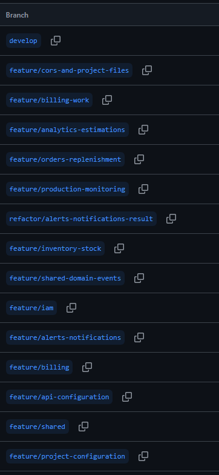

*Nota.* Captura de GitHub (2026).

*Descripción.* Página «Branches» del repositorio destilatech-platform con la rama `develop` y las ramas `feature/project-configuration`, `feature/shared`, `feature/api-configuration`, `feature/shared-domain-events`, `feature/iam`, `feature/alerts-notifications`, `refactor/alerts-notifications-result`, `feature/inventory-stock`, `feature/production-monitoring`, `feature/orders-replenishment`, `feature/analytics-estimations`, `feature/billing`, `feature/billing-work` y `feature/cors-and-project-files`.

**Figura 171**

*Commits de la rama feature/project-configuration*

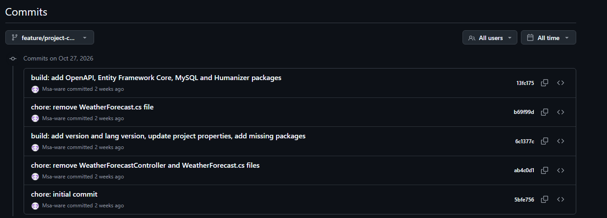

*Nota.* Captura de GitHub (2026).

*Descripción.* Historial de la rama `feature/project-configuration` del repositorio destilatech-platform. Configuración inicial del proyecto ASP.NET Core con los paquetes de OpenAPI, Entity Framework Core, MySQL y Humanizer (27 de octubre de 2026).

**Figura 172**

*Commits de la rama feature/shared*

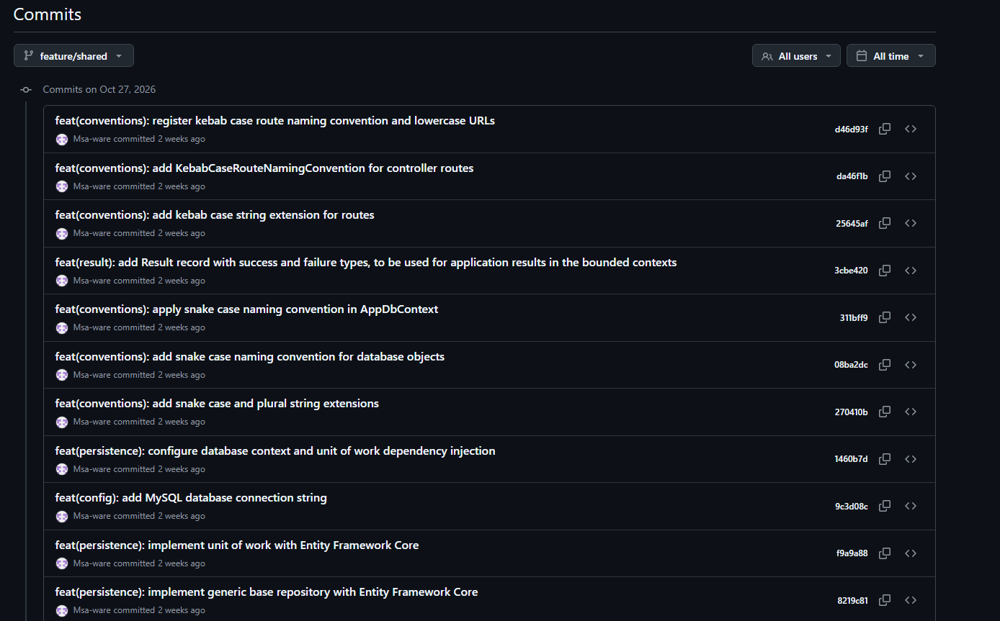

*Nota.* Captura de GitHub (2026).

*Descripción.* Historial de la rama `feature/shared` del repositorio destilatech-platform. Repositorio base, unidad de trabajo, contexto de base de datos, convenciones `snake_case` y `kebab-case` y registro `Result` del *Shared Kernel* (27 de octubre de 2026).

**Figura 173**

*Commits de la rama feature/api-configuration*

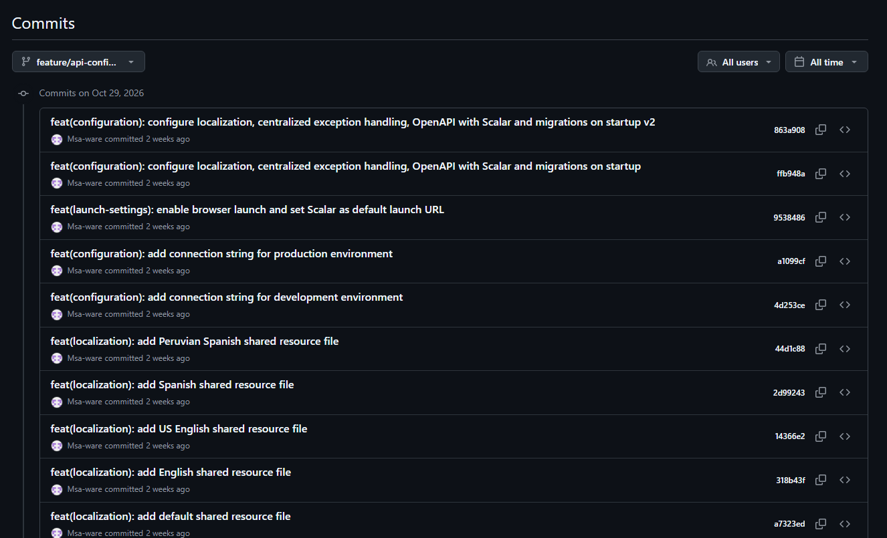

*Nota.* Captura de GitHub (2026).

*Descripción.* Historial de la rama `feature/api-configuration` del repositorio destilatech-platform. Archivos de recursos de localización, cadenas de conexión por entorno y configuración de OpenAPI con Scalar y de las migraciones al iniciar (29 de octubre de 2026).

**Figura 174**

*Commits de la rama feature/shared-domain-events*

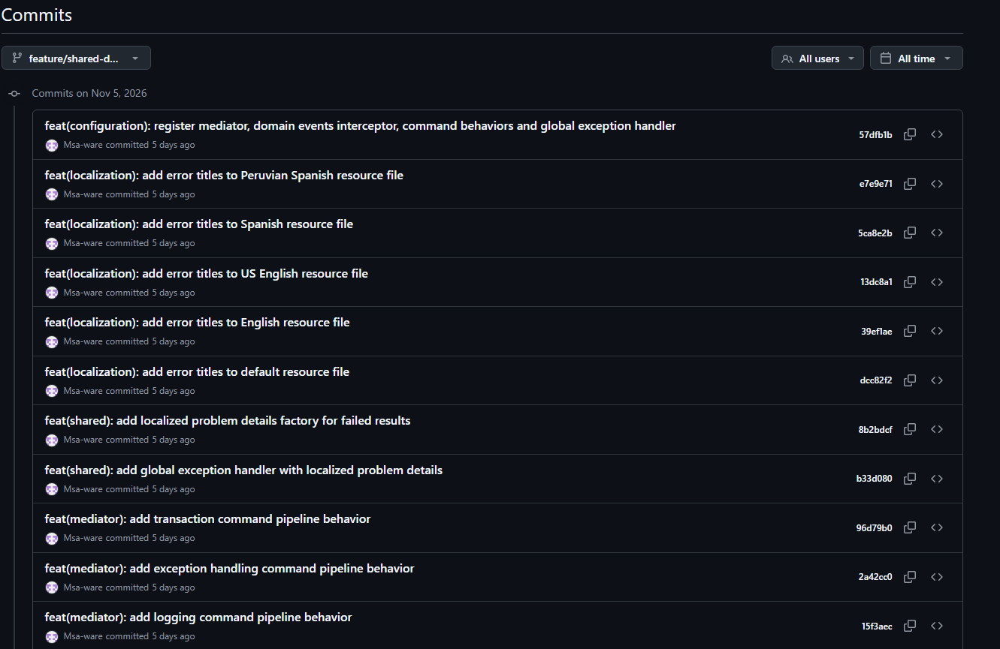

*Nota.* Captura de GitHub (2026).

*Descripción.* Historial de la rama `feature/shared-domain-events` del repositorio destilatech-platform. Mediador, comportamientos del *pipeline* de comandos (registro, excepciones y transacción), manejo global de excepciones y títulos de error localizados (5 de noviembre de 2026).

**Figura 175**

*Commits de la rama feature/iam*

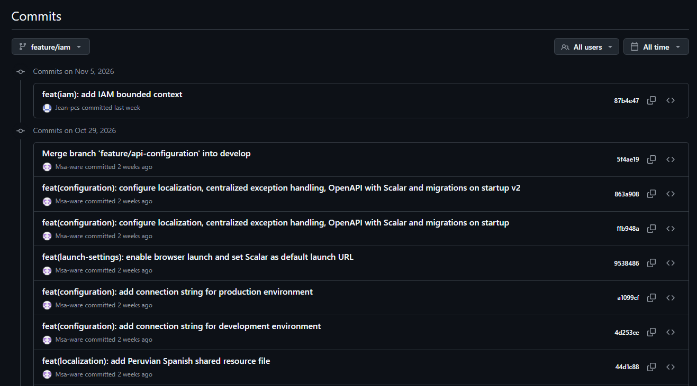

*Nota.* Captura de GitHub (2026).

*Descripción.* Historial de la rama `feature/iam` del repositorio destilatech-platform. Contexto IAM (5 de noviembre de 2026) y configuración heredada de `feature/api-configuration`.

**Figura 176**

*Commits de la rama feature/alerts-notifications*

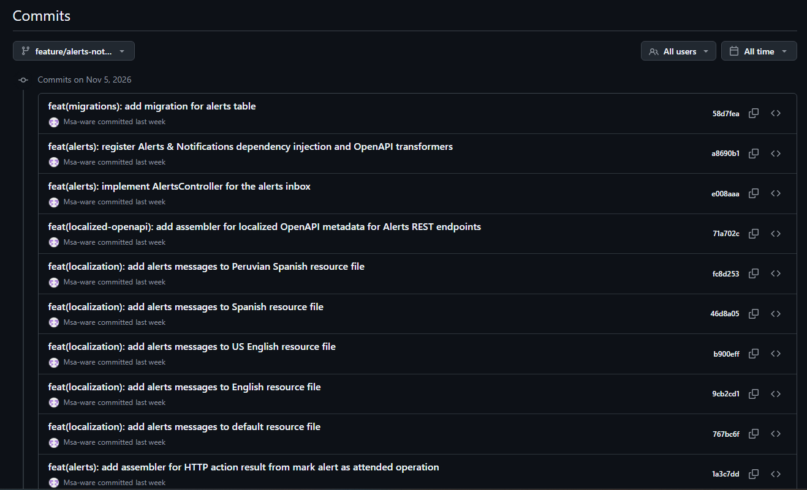

*Nota.* Captura de GitHub (2026).

*Descripción.* Historial de la rama `feature/alerts-notifications` del repositorio destilatech-platform. Contexto Alerts & Notifications: controlador, mensajes localizados, metadatos OpenAPI localizados y migración de la tabla de alertas (5 de noviembre de 2026).

**Figura 177**

*Commits de la rama refactor/alerts-notifications-result*

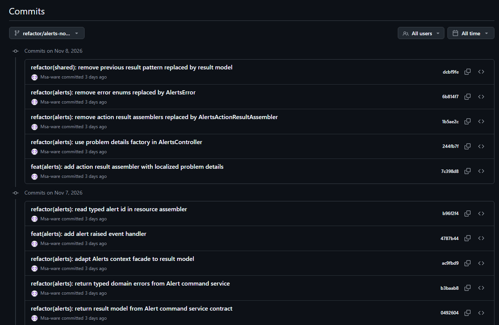

*Nota.* Captura de GitHub (2026).

*Descripción.* Historial de la rama `refactor/alerts-notifications-result` del repositorio destilatech-platform. Migración de Alerts al modelo `Result` compartido, errores tipados y fábrica de `ProblemDetails` (7 y 8 de noviembre de 2026).

**Figura 178**

*Commits de la rama feature/inventory-stock*

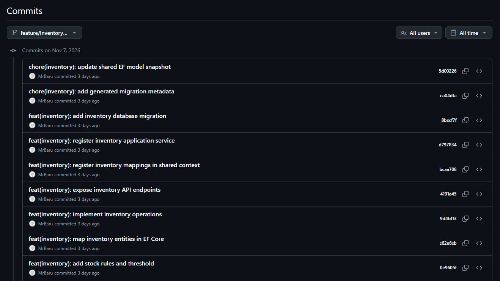

*Nota.* Captura de GitHub (2026).

*Descripción.* Historial de la rama `feature/inventory-stock` del repositorio destilatech-platform. Entidades, reglas de stock y umbral, operaciones, endpoints y migración del contexto Inventory & Stock (7 de noviembre de 2026).

**Figura 179**

*Commits de la rama feature/production-monitoring*

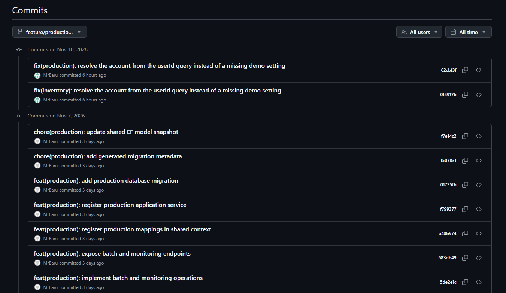

*Nota.* Captura de GitHub (2026).

*Descripción.* Historial de la rama `feature/production-monitoring` del repositorio destilatech-platform. Operaciones de lotes y monitoreo, endpoints, migración y corrección de la resolución de la cuenta (7 y 10 de noviembre de 2026).

**Figura 180**

*Commits de la rama feature/orders-replenishment*

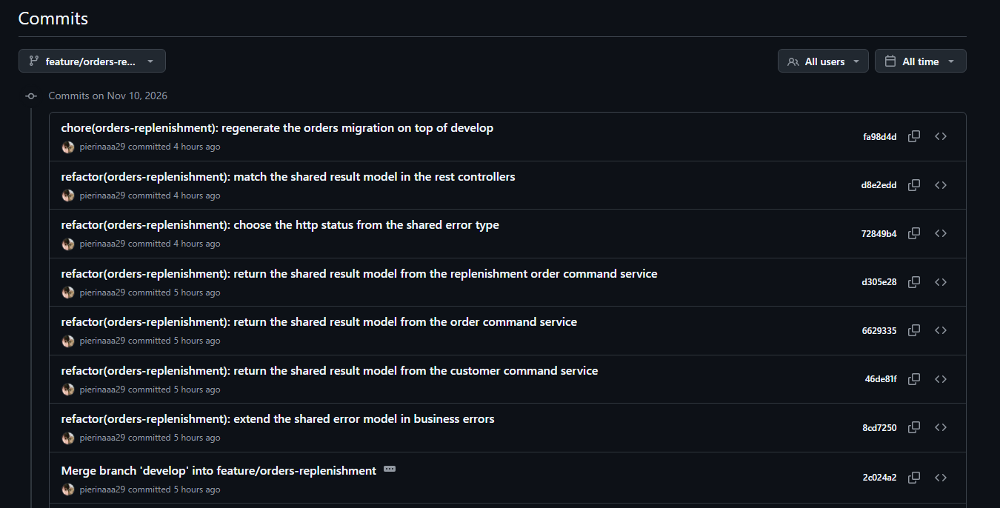

*Nota.* Captura de GitHub (2026).

*Descripción.* Historial de la rama `feature/orders-replenishment` del repositorio destilatech-platform. Servicios de comandos de clientes, pedidos y órdenes de reposición con el modelo `Result` compartido y regeneración de la migración (10 de noviembre de 2026).

**Figura 181**

*Commits de la rama feature/analytics-estimations*

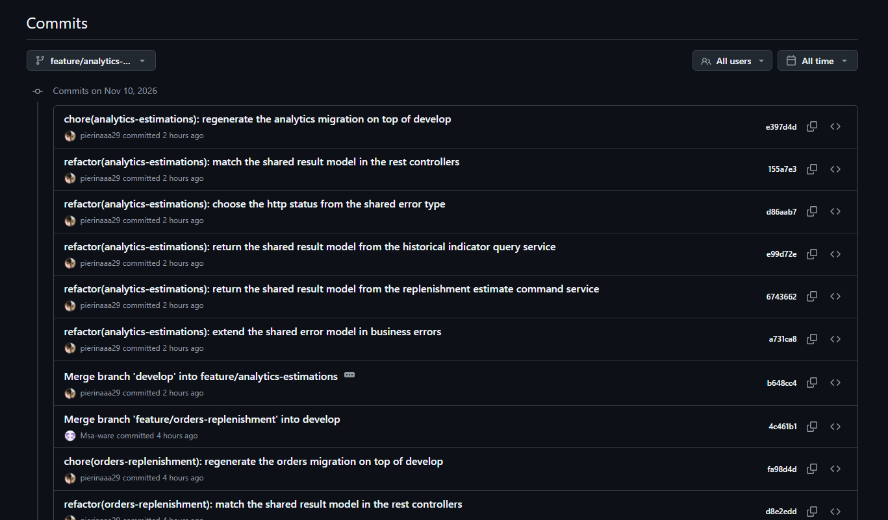

*Nota.* Captura de GitHub (2026).

*Descripción.* Historial de la rama `feature/analytics-estimations` del repositorio destilatech-platform. Servicios de consulta de indicadores históricos y de estimación de reposición con el modelo `Result` compartido y regeneración de la migración (10 de noviembre de 2026).

**Figura 182**

*Commits de la rama feature/billing-work*

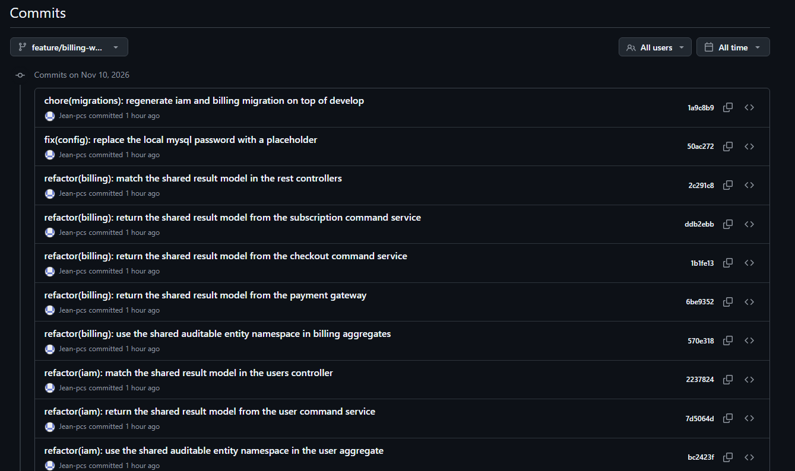

*Nota.* Captura de GitHub (2026).

*Descripción.* Historial de la rama `feature/billing-work` del repositorio destilatech-platform. Contextos IAM y Billing: agregados, servicios de comandos, pasarela de pago y controladores con el modelo `Result` compartido (10 de noviembre de 2026).

**Figura 183**

*Commits de la rama feature/cors-and-project-files*

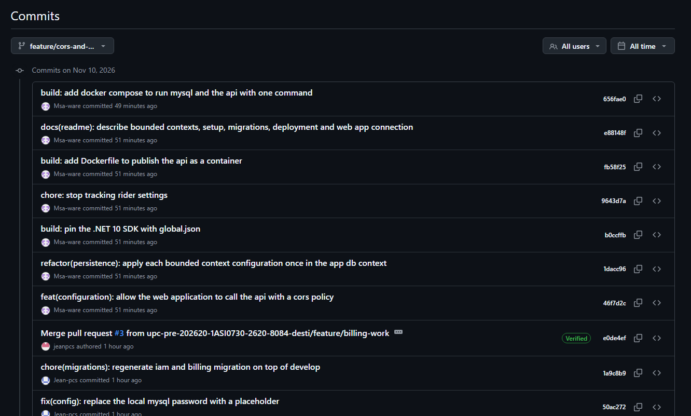

*Nota.* Captura de GitHub (2026).

*Descripción.* Historial de la rama `feature/cors-and-project-files` del repositorio destilatech-platform. Política CORS, `Dockerfile`, `docker-compose.yml`, `global.json` y `README.md` del repositorio (10 de noviembre de 2026).

**Tabla 26**

*Commits del repositorio de la aplicación web (versiones 2.0.0 y 2.1.0)*

| Repository | Branch | Commit Id | Commit Message | Commit Message Body | Committed on (Date) |
| :-------------------- | :---------- | :----------------------------------- | :----------- | :---------- | :----------: |
| `upc-pre-202620-1ASI0730-2620-8084-desti/destilatech-webapp` | `feature/av2-improvements` | [`ed3b72a`](https://github.com/upc-pre-202620-1ASI0730-2620-8084-desti/destilatech-webapp/commit/ed3b72a) | chore(config): point production API to json-server hosted on Render | — | 2026-10-05 |
| `upc-pre-202620-1ASI0730-2620-8084-desti/destilatech-webapp` | `feature/av2-improvements` | [`000428e`](https://github.com/upc-pre-202620-1ASI0730-2620-8084-desti/destilatech-webapp/commit/000428e) | chore(deploy): add Firebase Hosting configuration | — | 2026-10-05 |
| `upc-pre-202620-1ASI0730-2620-8084-desti/destilatech-webapp` | `feature/av2-improvements` | [`30db445`](https://github.com/upc-pre-202620-1ASI0730-2620-8084-desti/destilatech-webapp/commit/30db445) | chore: stop tracking Firebase cache | — | 2026-10-05 |
| `upc-pre-202620-1ASI0730-2620-8084-desti/destilatech-webapp` | `feature/av2-improvements` | [`43cae9d`](https://github.com/upc-pre-202620-1ASI0730-2620-8084-desti/destilatech-webapp/commit/43cae9d) | chore(fake-api): translate tank names to english and use simulated payment in seed data | — | 2026-11-08 |
| `upc-pre-202620-1ASI0730-2620-8084-desti/destilatech-webapp` | `feature/av2-improvements` | [`2184569`](https://github.com/upc-pre-202620-1ASI0730-2620-8084-desti/destilatech-webapp/commit/2184569) | feat(billing): replace stripe checkout with simulated card payment in payment entity | — | 2026-11-08 |
| `upc-pre-202620-1ASI0730-2620-8084-desti/destilatech-webapp` | `feature/av2-improvements` | [`f3e3504`](https://github.com/upc-pre-202620-1ASI0730-2620-8084-desti/destilatech-webapp/commit/f3e3504) | refactor(billing): remove checkout session endpoints from billing api | — | 2026-11-08 |
| `upc-pre-202620-1ASI0730-2620-8084-desti/destilatech-webapp` | `feature/av2-improvements` | [`c72eeb6`](https://github.com/upc-pre-202620-1ASI0730-2620-8084-desti/destilatech-webapp/commit/c72eeb6) | feat(billing): subscribe to a plan with a simulated card payment | — | 2026-11-08 |
| `upc-pre-202620-1ASI0730-2620-8084-desti/destilatech-webapp` | `feature/av2-improvements` | [`7c73bda`](https://github.com/upc-pre-202620-1ASI0730-2620-8084-desti/destilatech-webapp/commit/7c73bda) | feat(billing): add payment form dialog with card validation | — | 2026-11-08 |
| `upc-pre-202620-1ASI0730-2620-8084-desti/destilatech-webapp` | `feature/av2-improvements` | [`fe74798`](https://github.com/upc-pre-202620-1ASI0730-2620-8084-desti/destilatech-webapp/commit/fe74798) | feat(billing): open payment form dialog when choosing a plan | — | 2026-11-08 |
| `upc-pre-202620-1ASI0730-2620-8084-desti/destilatech-webapp` | `feature/av2-improvements` | [`a02702c`](https://github.com/upc-pre-202620-1ASI0730-2620-8084-desti/destilatech-webapp/commit/a02702c) | refactor(billing): remove stripe checkout routes | — | 2026-11-08 |
| `upc-pre-202620-1ASI0730-2620-8084-desti/destilatech-webapp` | `feature/av2-improvements` | [`36fba09`](https://github.com/upc-pre-202620-1ASI0730-2620-8084-desti/destilatech-webapp/commit/36fba09) | feat(billing): show translated payment provider in payment history | — | 2026-11-08 |
| `upc-pre-202620-1ASI0730-2620-8084-desti/destilatech-webapp` | `feature/av2-improvements` | [`a55554d`](https://github.com/upc-pre-202620-1ASI0730-2620-8084-desti/destilatech-webapp/commit/a55554d) | refactor(billing): delete stripe checkout success view | — | 2026-11-09 |
| `upc-pre-202620-1ASI0730-2620-8084-desti/destilatech-webapp` | `feature/av2-improvements` | [`f5c18e6`](https://github.com/upc-pre-202620-1ASI0730-2620-8084-desti/destilatech-webapp/commit/f5c18e6) | refactor(billing): delete stripe checkout cancelled view | — | 2026-11-09 |
| `upc-pre-202620-1ASI0730-2620-8084-desti/destilatech-webapp` | `feature/av2-improvements` | [`20664a3`](https://github.com/upc-pre-202620-1ASI0730-2620-8084-desti/destilatech-webapp/commit/20664a3) | chore(env): remove checkout sessions endpoint from development environment | — | 2026-11-09 |
| `upc-pre-202620-1ASI0730-2620-8084-desti/destilatech-webapp` | `feature/av2-improvements` | [`1de01cd`](https://github.com/upc-pre-202620-1ASI0730-2620-8084-desti/destilatech-webapp/commit/1de01cd) | chore(env): remove checkout sessions endpoint from production environment | — | 2026-11-09 |
| `upc-pre-202620-1ASI0730-2620-8084-desti/destilatech-webapp` | `feature/av2-improvements` | [`eabc5f4`](https://github.com/upc-pre-202620-1ASI0730-2620-8084-desti/destilatech-webapp/commit/eabc5f4) | feat(i18n): add english texts for simulated payment, bulk alert attention and csv export | — | 2026-11-09 |
| `upc-pre-202620-1ASI0730-2620-8084-desti/destilatech-webapp` | `feature/av2-improvements` | [`57747e4`](https://github.com/upc-pre-202620-1ASI0730-2620-8084-desti/destilatech-webapp/commit/57747e4) | feat(i18n): add spanish texts for simulated payment, bulk alert attention and csv export | — | 2026-11-09 |
| `upc-pre-202620-1ASI0730-2620-8084-desti/destilatech-webapp` | `feature/av2-improvements` | [`3394936`](https://github.com/upc-pre-202620-1ASI0730-2620-8084-desti/destilatech-webapp/commit/3394936) | feat(alerts): mark several alerts as attended in alerts store | — | 2026-11-09 |
| `upc-pre-202620-1ASI0730-2620-8084-desti/destilatech-webapp` | `feature/av2-improvements` | [`726a445`](https://github.com/upc-pre-202620-1ASI0730-2620-8084-desti/destilatech-webapp/commit/726a445) | feat(alerts): add mark all as attended action to alerts inbox | — | 2026-11-09 |
| `upc-pre-202620-1ASI0730-2620-8084-desti/destilatech-webapp` | `feature/av2-improvements` | [`262d962`](https://github.com/upc-pre-202620-1ASI0730-2620-8084-desti/destilatech-webapp/commit/262d962) | feat(shared): add csv exporter for table data | — | 2026-11-09 |
| `upc-pre-202620-1ASI0730-2620-8084-desti/destilatech-webapp` | `feature/av2-improvements` | [`ce983c7`](https://github.com/upc-pre-202620-1ASI0730-2620-8084-desti/destilatech-webapp/commit/ce983c7) | feat(orders): export orders to csv | — | 2026-11-09 |
| `upc-pre-202620-1ASI0730-2620-8084-desti/destilatech-webapp` | `feature/av2-improvements` | [`6cd2819`](https://github.com/upc-pre-202620-1ASI0730-2620-8084-desti/destilatech-webapp/commit/6cd2819) | feat(orders): export customers to csv | — | 2026-11-09 |
| `upc-pre-202620-1ASI0730-2620-8084-desti/destilatech-webapp` | `feature/av2-improvements` | [`22792b7`](https://github.com/upc-pre-202620-1ASI0730-2620-8084-desti/destilatech-webapp/commit/22792b7) | feat(inventory): export inventory to csv | — | 2026-11-10 |
| `upc-pre-202620-1ASI0730-2620-8084-desti/destilatech-webapp` | `feature/av2-improvements` | [`c7fd0a8`](https://github.com/upc-pre-202620-1ASI0730-2620-8084-desti/destilatech-webapp/commit/c7fd0a8) | feat(analytics): export historical indicators to csv | — | 2026-11-10 |
| `upc-pre-202620-1ASI0730-2620-8084-desti/destilatech-webapp` | `feature/av2-improvements` | [`65e2a45`](https://github.com/upc-pre-202620-1ASI0730-2620-8084-desti/destilatech-webapp/commit/65e2a45) | chore(scripts): add fake-api npm script | — | 2026-11-10 |
| `upc-pre-202620-1ASI0730-2620-8084-desti/destilatech-webapp` | `feature/av2-improvements` | [`b8be0b5`](https://github.com/upc-pre-202620-1ASI0730-2620-8084-desti/destilatech-webapp/commit/b8be0b5) | docs(readme): document simulated payments, deployment, csv export and versions | — | 2026-11-10 |
| `upc-pre-202620-1ASI0730-2620-8084-desti/destilatech-webapp` | `release/v2.0.0` | [`72c8864`](https://github.com/upc-pre-202620-1ASI0730-2620-8084-desti/destilatech-webapp/commit/72c8864) | chore(release): bump version to 2.0.0 | — | 2026-11-10 |
| `upc-pre-202620-1ASI0730-2620-8084-desti/destilatech-webapp` | `feature/platform-integration` | [`2adeada`](https://github.com/upc-pre-202620-1ASI0730-2620-8084-desti/destilatech-webapp/commit/2adeada) | feat(shared): send query parameters on every request and read problem details errors | — | 2026-11-12 |
| `upc-pre-202620-1ASI0730-2620-8084-desti/destilatech-webapp` | `feature/platform-integration` | [`e178cbc`](https://github.com/upc-pre-202620-1ASI0730-2620-8084-desti/destilatech-webapp/commit/e178cbc) | feat(shared): reload the current user from the platform after a payment | — | 2026-11-12 |
| `upc-pre-202620-1ASI0730-2620-8084-desti/destilatech-webapp` | `feature/platform-integration` | [`edfc8ea`](https://github.com/upc-pre-202620-1ASI0730-2620-8084-desti/destilatech-webapp/commit/edfc8ea) | feat(inventory): use the platform endpoints for products, stock items and movements | — | 2026-11-12 |
| `upc-pre-202620-1ASI0730-2620-8084-desti/destilatech-webapp` | `feature/platform-integration` | [`ae1a992`](https://github.com/upc-pre-202620-1ASI0730-2620-8084-desti/destilatech-webapp/commit/ae1a992) | refactor(inventory): let the platform update the stock and raise low stock alerts | — | 2026-11-12 |
| `upc-pre-202620-1ASI0730-2620-8084-desti/destilatech-webapp` | `feature/platform-integration` | [`7f6ce90`](https://github.com/upc-pre-202620-1ASI0730-2620-8084-desti/destilatech-webapp/commit/7f6ce90) | feat(production): use the platform endpoints for batches, process variables and readings | — | 2026-11-12 |
| `upc-pre-202620-1ASI0730-2620-8084-desti/destilatech-webapp` | `feature/platform-integration` | [`6833bdf`](https://github.com/upc-pre-202620-1ASI0730-2620-8084-desti/destilatech-webapp/commit/6833bdf) | refactor(production): advance batches and record readings through the platform | — | 2026-11-12 |
| `upc-pre-202620-1ASI0730-2620-8084-desti/destilatech-webapp` | `feature/platform-integration` | [`502f917`](https://github.com/upc-pre-202620-1ASI0730-2620-8084-desti/destilatech-webapp/commit/502f917) | feat(alerts): read alerts by account and mark them as attended in the platform | — | 2026-11-12 |
| `upc-pre-202620-1ASI0730-2620-8084-desti/destilatech-webapp` | `feature/platform-integration` | [`3a73b40`](https://github.com/upc-pre-202620-1ASI0730-2620-8084-desti/destilatech-webapp/commit/3a73b40) | feat(alerts): describe each alert from its product or process variable | — | 2026-11-12 |
| `upc-pre-202620-1ASI0730-2620-8084-desti/destilatech-webapp` | `feature/platform-integration` | [`654bdc6`](https://github.com/upc-pre-202620-1ASI0730-2620-8084-desti/destilatech-webapp/commit/654bdc6) | feat(orders): use the platform endpoints for customers, orders and replenishment orders | — | 2026-11-12 |
| `upc-pre-202620-1ASI0730-2620-8084-desti/destilatech-webapp` | `feature/platform-integration` | [`5806c89`](https://github.com/upc-pre-202620-1ASI0730-2620-8084-desti/destilatech-webapp/commit/5806c89) | refactor(orders): let the platform discount and return the stock of orders | — | 2026-11-12 |
| `upc-pre-202620-1ASI0730-2620-8084-desti/destilatech-webapp` | `feature/platform-integration` | [`8139b71`](https://github.com/upc-pre-202620-1ASI0730-2620-8084-desti/destilatech-webapp/commit/8139b71) | feat(billing): pay subscriptions with Stripe Checkout through the platform | — | 2026-11-12 |
| `upc-pre-202620-1ASI0730-2620-8084-desti/destilatech-webapp` | `feature/platform-integration` | [`a1480db`](https://github.com/upc-pre-202620-1ASI0730-2620-8084-desti/destilatech-webapp/commit/a1480db) | feat(billing): add checkout success and cancelled pages | — | 2026-11-12 |
| `upc-pre-202620-1ASI0730-2620-8084-desti/destilatech-webapp` | `feature/platform-integration` | [`5f9078c`](https://github.com/upc-pre-202620-1ASI0730-2620-8084-desti/destilatech-webapp/commit/5f9078c) | chore(config): point the web app to the platform API | — | 2026-11-12 |
| `upc-pre-202620-1ASI0730-2620-8084-desti/destilatech-webapp` | `feature/platform-integration` | [`d6c645c`](https://github.com/upc-pre-202620-1ASI0730-2620-8084-desti/destilatech-webapp/commit/d6c645c) | chore(scripts): add seed-api script to load the demo data into the platform | — | 2026-11-12 |
| `upc-pre-202620-1ASI0730-2620-8084-desti/destilatech-webapp` | `feature/platform-integration` | [`48ed877`](https://github.com/upc-pre-202620-1ASI0730-2620-8084-desti/destilatech-webapp/commit/48ed877) | docs(readme): document the platform API, Stripe Checkout and demo data | — | 2026-11-12 |
| `upc-pre-202620-1ASI0730-2620-8084-desti/destilatech-webapp` | `release/v2.1.0` | [`3675349`](https://github.com/upc-pre-202620-1ASI0730-2620-8084-desti/destilatech-webapp/commit/3675349) | chore(release): bump version to 2.1.0 | — | 2026-11-12 |

**Figura 184**

*Commits de la aplicación web (10 de noviembre)*

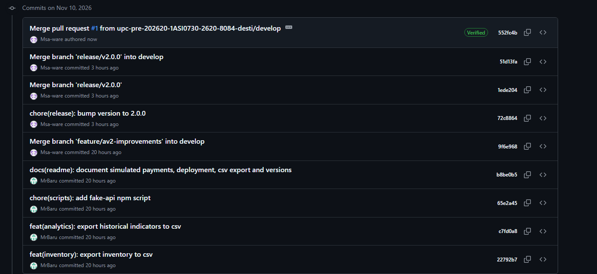

*Nota.* Captura de GitHub (2026).

*Descripción.* Historial de `develop` del repositorio destilatech-webapp con la integración de la versión 2.0.0, la documentación del README y la exportación a CSV del inventario y de los indicadores históricos.

**Figura 185**

*Commits de la aplicación web (9 de noviembre)*

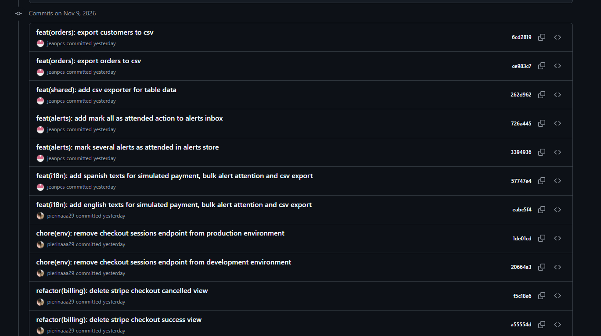

*Nota.* Captura de GitHub (2026).

*Descripción.* Historial de `develop` con la exportación a CSV de pedidos y clientes, la atención masiva de alertas, los textos ES / EN y el retiro de las vistas y los *endpoints* de Stripe Checkout de la aplicación web.

**Tabla 27**

*Commits del repositorio de la landing page*

| Repository | Branch | Commit Id | Commit Message | Commit Message Body | Committed on (Date) |
| :-------------------- | :---------- | :----------------------------------- | :----------- | :---------- | :----------: |
| `upc-pre-202620-1ASI0730-2620-8084-desti/destilatech-website` | `feature/product-video` | [`b49f807`](https://github.com/upc-pre-202620-1ASI0730-2620-8084-desti/destilatech-website/commit/b49f807) | feat(i18n): add product video section texts in English and Spanish | — | 2026-10-27 |
| `upc-pre-202620-1ASI0730-2620-8084-desti/destilatech-website` | `feature/product-video` | [`2fd7a1b`](https://github.com/upc-pre-202620-1ASI0730-2620-8084-desti/destilatech-website/commit/2fd7a1b) | feat(styles): add product video section styles | — | 2026-10-27 |
| `upc-pre-202620-1ASI0730-2620-8084-desti/destilatech-website` | `feature/product-video` | [`cf961ba`](https://github.com/upc-pre-202620-1ASI0730-2620-8084-desti/destilatech-website/commit/cf961ba) | feat(video): embed product and team YouTube videos from data-video-id | — | 2026-10-27 |
| `upc-pre-202620-1ASI0730-2620-8084-desti/destilatech-website` | `feature/product-video` | [`b6130c9`](https://github.com/upc-pre-202620-1ASI0730-2620-8084-desti/destilatech-website/commit/b6130c9) | feat(landing): add product video section and footer link | — | 2026-10-27 |
| `upc-pre-202620-1ASI0730-2620-8084-desti/destilatech-website` | `feature/product-video` | [`b9a21af`](https://github.com/upc-pre-202620-1ASI0730-2620-8084-desti/destilatech-website/commit/b9a21af) | docs: add README with sections, structure and deployment | — | 2026-10-27 |
| `upc-pre-202620-1ASI0730-2620-8084-desti/destilatech-website` | `feature/about-the-product` | [`d2ad10f`](https://github.com/upc-pre-202620-1ASI0730-2620-8084-desti/destilatech-website/commit/d2ad10f) | feat(i18n): rename product video texts to About the product | — | 2026-10-27 |
| `upc-pre-202620-1ASI0730-2620-8084-desti/destilatech-website` | `feature/about-the-product` | [`787d119`](https://github.com/upc-pre-202620-1ASI0730-2620-8084-desti/destilatech-website/commit/787d119) | fix(header): add spacing between logo and navigation and adjust menu breakpoint | — | 2026-10-27 |
| `upc-pre-202620-1ASI0730-2620-8084-desti/destilatech-website` | `feature/about-the-product` | [`f3e773d`](https://github.com/upc-pre-202620-1ASI0730-2620-8084-desti/destilatech-website/commit/f3e773d) | feat(header): add About the product link to navigation | — | 2026-10-27 |
| `upc-pre-202620-1ASI0730-2620-8084-desti/destilatech-website` | `feature/project-structure` | [`9287863`](https://github.com/upc-pre-202620-1ASI0730-2620-8084-desti/destilatech-website/commit/9287863) | chore(assets): move landing images to public/assets/images with english names | — | 2026-10-30 |
| `upc-pre-202620-1ASI0730-2620-8084-desti/destilatech-website` | `feature/project-structure` | [`0b37acc`](https://github.com/upc-pre-202620-1ASI0730-2620-8084-desti/destilatech-website/commit/0b37acc) | chore(assets): move team photos to public/assets/images/team | — | 2026-10-30 |
| `upc-pre-202620-1ASI0730-2620-8084-desti/destilatech-website` | `feature/project-structure` | [`bf83fa8`](https://github.com/upc-pre-202620-1ASI0730-2620-8084-desti/destilatech-website/commit/bf83fa8) | refactor(styles): move stylesheet to public/assets/styles | — | 2026-10-30 |
| `upc-pre-202620-1ASI0730-2620-8084-desti/destilatech-website` | `feature/project-structure` | [`fae2508`](https://github.com/upc-pre-202620-1ASI0730-2620-8084-desti/destilatech-website/commit/fae2508) | refactor(scripts): move i18n dictionary to public/assets/scripts | — | 2026-10-30 |
| `upc-pre-202620-1ASI0730-2620-8084-desti/destilatech-website` | `feature/project-structure` | [`e2f61dc`](https://github.com/upc-pre-202620-1ASI0730-2620-8084-desti/destilatech-website/commit/e2f61dc) | refactor(scripts): move legal pages translations to public/assets/scripts | — | 2026-10-30 |
| `upc-pre-202620-1ASI0730-2620-8084-desti/destilatech-website` | `feature/project-structure` | [`59bae9b`](https://github.com/upc-pre-202620-1ASI0730-2620-8084-desti/destilatech-website/commit/59bae9b) | feat(layout): add shared header partial | — | 2026-10-30 |
| `upc-pre-202620-1ASI0730-2620-8084-desti/destilatech-website` | `feature/project-structure` | [`9d11cb4`](https://github.com/upc-pre-202620-1ASI0730-2620-8084-desti/destilatech-website/commit/9d11cb4) | feat(layout): add shared footer partial | — | 2026-10-30 |
| `upc-pre-202620-1ASI0730-2620-8084-desti/destilatech-website` | `feature/project-structure` | [`ab171e8`](https://github.com/upc-pre-202620-1ASI0730-2620-8084-desti/destilatech-website/commit/ab171e8) | refactor(scripts): replace script.js with main.js partial loader | — | 2026-10-30 |
| `upc-pre-202620-1ASI0730-2620-8084-desti/destilatech-website` | `feature/project-structure` | [`4869739`](https://github.com/upc-pre-202620-1ASI0730-2620-8084-desti/destilatech-website/commit/4869739) | refactor(pages): move home page to public and load header and footer partials | — | 2026-10-30 |
| `upc-pre-202620-1ASI0730-2620-8084-desti/destilatech-website` | `feature/project-structure` | [`d4a8b97`](https://github.com/upc-pre-202620-1ASI0730-2620-8084-desti/destilatech-website/commit/d4a8b97) | refactor(pages): move legal pages to public and load header and footer partials | — | 2026-10-30 |
| `upc-pre-202620-1ASI0730-2620-8084-desti/destilatech-website` | `feature/project-structure` | [`30bfcb8`](https://github.com/upc-pre-202620-1ASI0730-2620-8084-desti/destilatech-website/commit/30bfcb8) | ci(pages): add GitHub Actions workflow to deploy the public folder | — | 2026-10-30 |
| `upc-pre-202620-1ASI0730-2620-8084-desti/destilatech-website` | `feature/project-structure` | [`03047bd`](https://github.com/upc-pre-202620-1ASI0730-2620-8084-desti/destilatech-website/commit/03047bd) | docs(readme): document public/assets project structure and deployment | — | 2026-10-30 |

**Figura 186**

*Commits de la landing page*

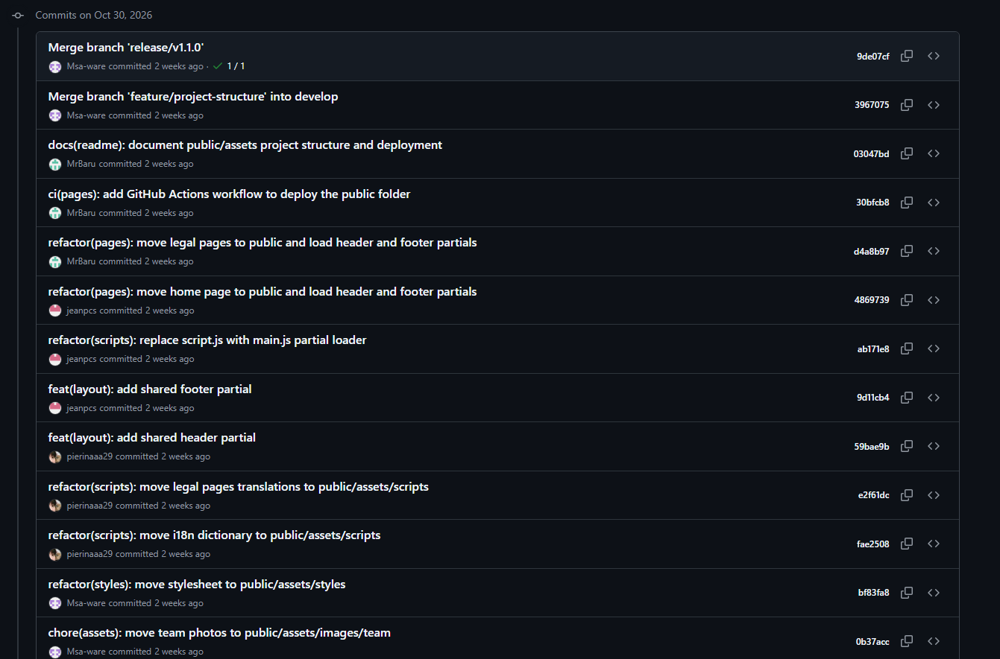

*Nota.* Captura de GitHub (2026).

*Descripción.* Historial de la landing page con el *partial* de encabezado y pie de página, el cargador `main.js`, el traslado de la página principal y de las páginas legales a `public`, el flujo de GitHub Actions que publica la carpeta `public` y la documentación de la estructura y del despliegue.

**Figura 187**

*Commits del repositorio del informe*

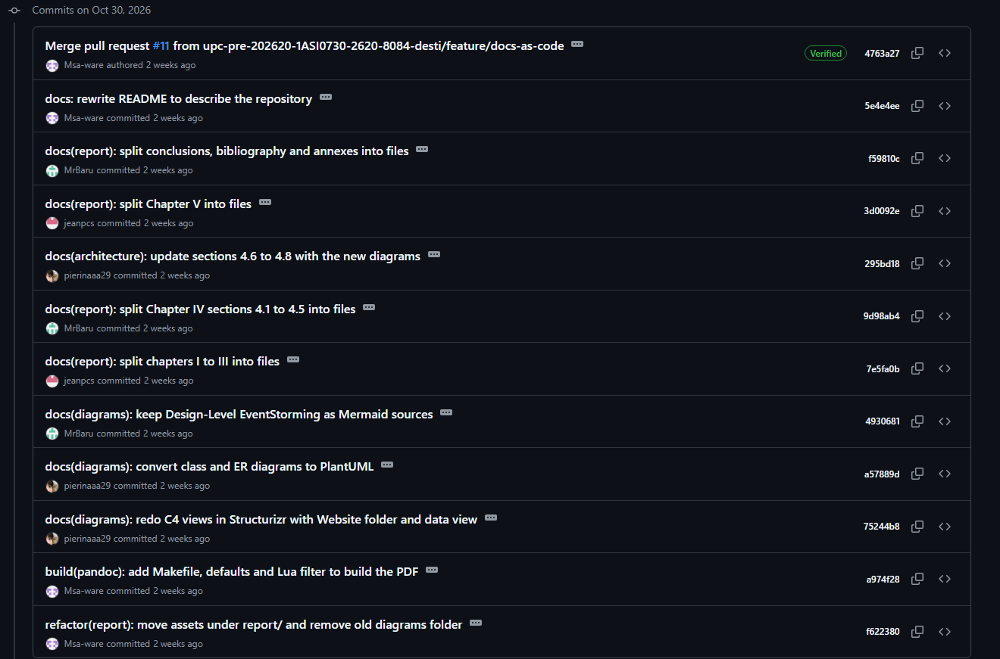

*Nota.* Captura de GitHub (2026).

*Descripción.* Historial de `develop` del repositorio destilatech-report con la conversión del informe a documentación como código (división de los capítulos en archivos, diagramas en Structurizr, PlantUML y Mermaid, compilación con Pandoc) y la reescritura del `README.md` para describir el repositorio.
