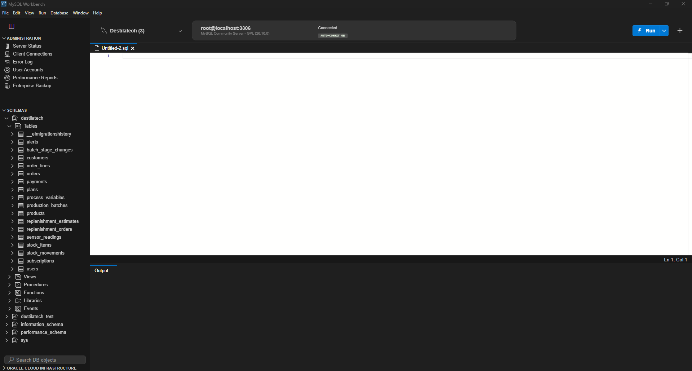
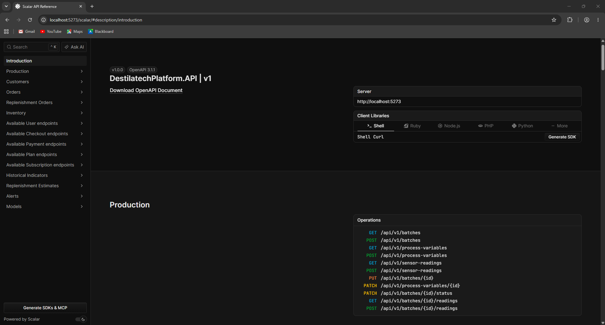
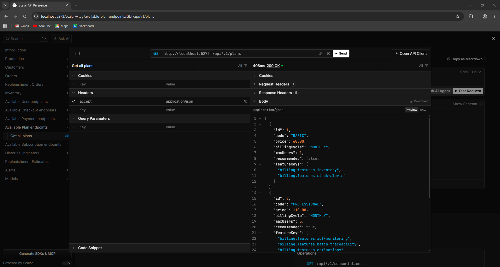
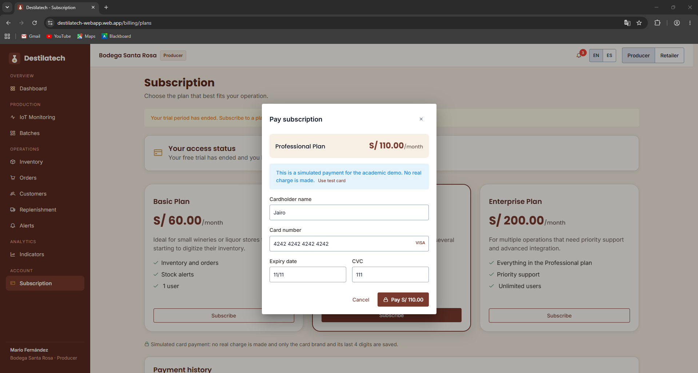
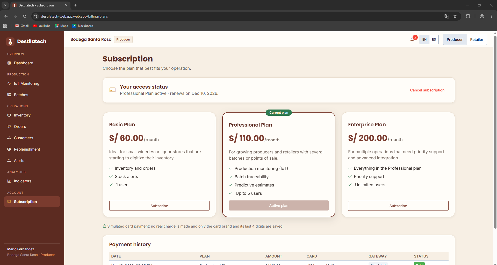
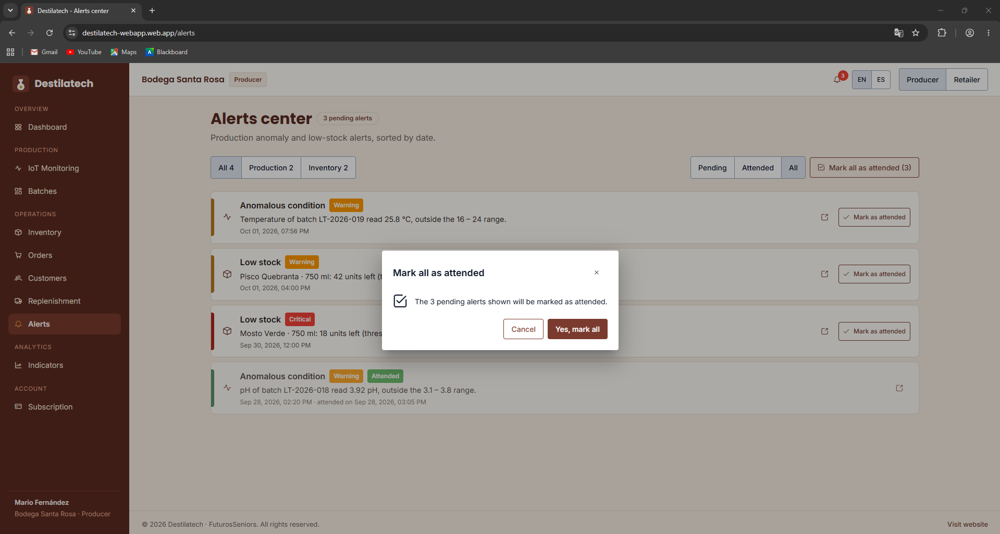
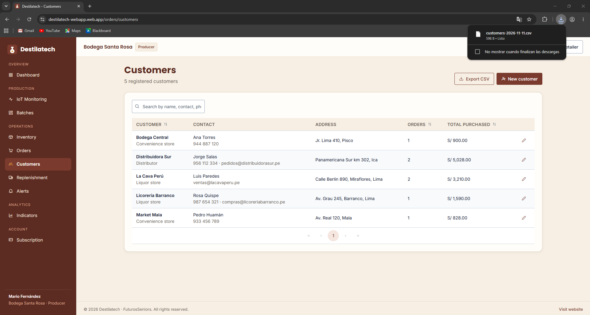

##### 5.2.3.5. Execution Evidence for Sprint Review

El logro del Sprint 3 es la primera versión de la RESTful API, que se ejecuta de forma local con MySQL (con `docker compose up -d --build` o con `dotnet run`), aplica las migraciones al iniciar y publica su documentación interactiva en Scalar. La versión 2.0.0 de la aplicación web incorporó el pago simulado, la atención masiva de alertas y la exportación a CSV, y la versión 2.1.0 la conectó con la API desplegada en Render: los productos, lotes, pedidos, alertas y suscripciones se guardan en la base de datos MySQL y la suscripción se paga con Stripe Checkout en modo de prueba (sección 5.2.3.7).

**Video de navegación:** [COMPLETAR: enlace al video de navegación del Sprint 3 en Microsoft Stream]

**Figura 182**

*Base de datos de la API en MySQL Workbench*

*Nota.* Captura propia de MySQL Workbench (2026).

*Descripción.* Conexión `root@localhost:3306` con el esquema `destilatech` creado por las migraciones de la API. Contiene la tabla de historial de migraciones (`__efmigrationshistory`) y las 17 tablas de los *bounded contexts*: `alerts`, `batch_stage_changes`, `customers`, `order_lines`, `orders`, `payments`, `plans`, `process_variables`, `production_batches`, `products`, `replenishment_estimates`, `replenishment_orders`, `sensor_readings`, `stock_items`, `stock_movements`, `subscriptions` y `users`.

**Figura 183**

*Documentación interactiva de la API en Scalar*

*Nota.* Captura propia de la API en ejecución (2026).

*Descripción.* Página de inicio de Scalar (`/scalar`) de `DestilatechPlatform.API` v1 (OpenAPI 3.1.1) con los grupos de endpoints (Production, Customers, Orders, Replenishment Orders, Inventory, User, Checkout, Payment, Plan y Subscription, Historical Indicators, Replenishment Estimates y Alerts) y las once operaciones del grupo Production.

**Figura 184**

*Prueba del endpoint GET /api/v1/plans en Scalar*

*Nota.* Captura propia de la API en ejecución con datos de prueba (2026).

*Descripción.* Solicitud `GET /api/v1/plans` enviada desde el cliente de Scalar, con respuesta `200 OK` en 408 ms y la lista de planes (`BASIC` a S/ 60.00 por mes para un usuario y `PROFESSIONAL` a S/ 110.00 por mes para cinco usuarios, recomendado), con las claves de las funcionalidades de cada plan.

**Aplicación web 2.0.0.** La versión 2.0.0 de la aplicación web está publicada en Firebase Hosting (`https://destilatech-webapp.web.app`); las siguientes capturas muestran las vistas nuevas del Sprint 3 sobre esa URL, con el perfil de demostración *Bodega Santa Rosa* (productor). Esa versión todavía consumía el Fake API y el pago simulado; la versión 2.1.0 los reemplazó por la API real y por Stripe Checkout (sección 5.2.3.7), y conserva las demás vistas.

**Figura 185**

*Contratación de un plan con pago simulado*

*Nota.* Captura propia de la aplicación web desplegada (2026).

*Descripción.* Vista *Subscription* con el diálogo «Pay subscription» para el plan Professional (S/ 110.00 al mes). El aviso indica que es un pago simulado para la demostración académica y que no se realiza ningún cargo real; el formulario pide titular, número de tarjeta (con la marca detectada), vencimiento y CVC.

**Figura 186**

*Suscripción activa e historial de pagos*

*Nota.* Captura propia de la aplicación web desplegada (2026).

*Descripción.* Después del pago, la vista *Subscription* muestra «Professional Plan active · renews on Dec 10, 2026», el plan actual marcado en la tarjeta correspondiente y el texto «Simulated card payment: no real charge is made and only the card brand and its last 4 digits are saved». Debajo aparece el historial de pagos (*Payment history*) con la pasarela *Simulated*.

**Figura 187**

*Atención masiva de alertas*

*Nota.* Captura propia de la aplicación web desplegada (2026).

*Descripción.* El *Alerts center* muestra tres alertas pendientes y el botón «Mark all as attended (3)». El diálogo de confirmación indica que las tres alertas pendientes visibles se marcarán como atendidas; la lista incluye alertas de condición anómala y de stock bajo.

**Figura 188**

*Exportación de clientes a CSV*

*Nota.* Captura propia de la aplicación web desplegada (2026).

*Descripción.* La vista *Customers* lista cinco clientes registrados y ofrece el botón «Export CSV»; el navegador muestra la descarga del archivo `customers-2026-11-11.csv` (598 B).
