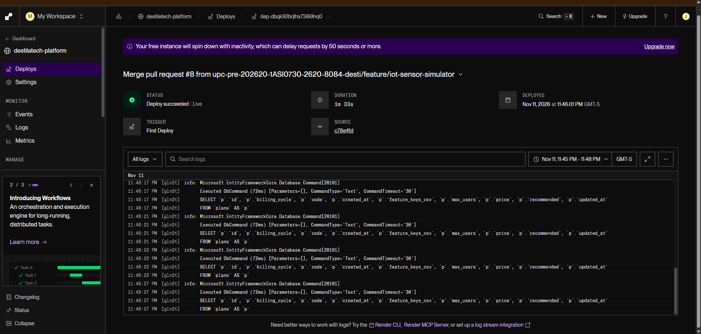
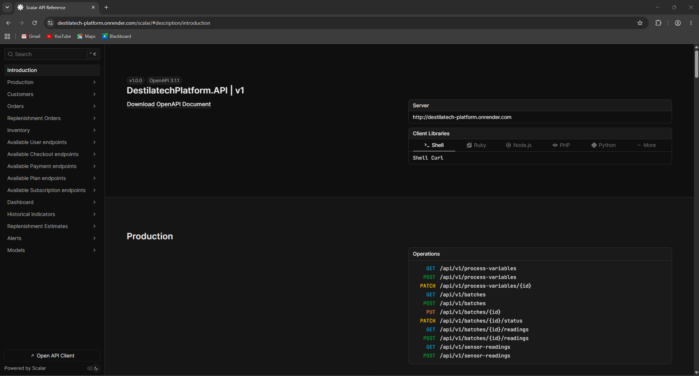
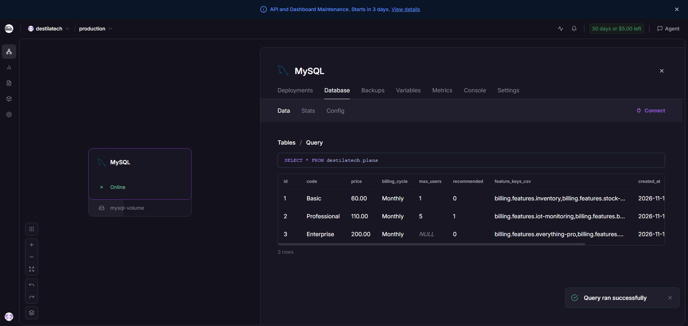
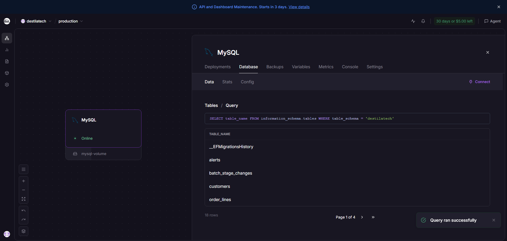
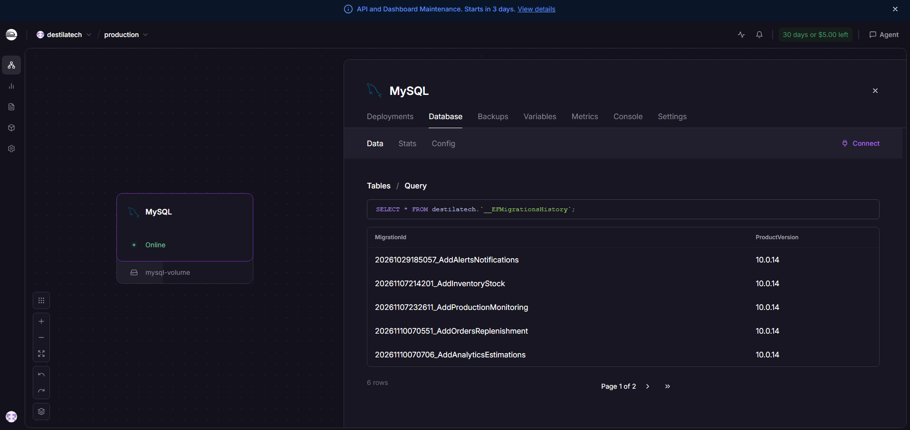
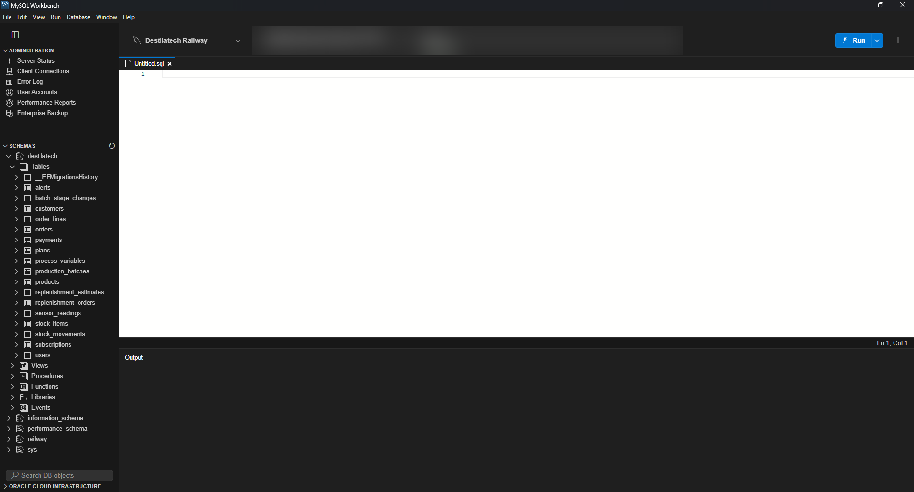
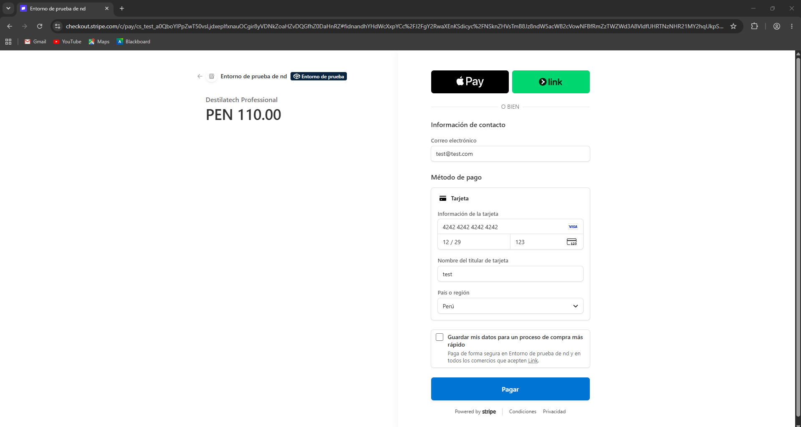
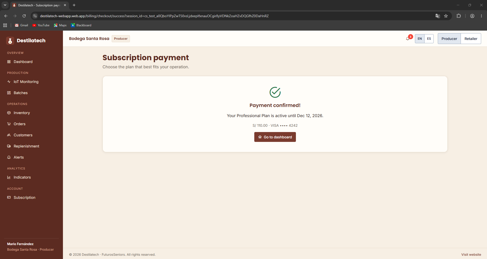
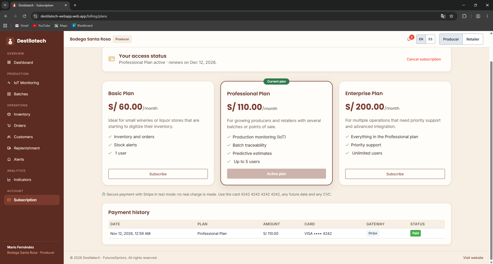

##### 5.2.3.7. Software Deployment Evidence for Sprint Review

En el Sprint 3 la RESTful API se desplegó como contenedor en Render, con su base de datos MySQL en Railway, y la versión 2.1.0 de la aplicación web, publicada en Firebase Hosting, la consume; también se publicó la nueva versión de la landing page. La tabla resume los servicios usados.

**Tabla 29**

*Servicios de despliegue del Sprint 3*

| Parte | Servicio | URL |
| :---------- | :---------- | :---------- |
| RESTful API (`destilatech-platform`) | Render (contenedor Docker, plan gratuito) | `https://destilatech-platform.onrender.com/scalar` |
| Base de datos | Railway (MySQL 8.4) | Esquema `destilatech`, sin URL pública de consulta |
| Aplicación web (`destilatech-webapp`) | Firebase Hosting | `https://destilatech-webapp.web.app` |
| Landing page (`destilatech-website`) | GitHub Pages | `https://upc-pre-202620-1asi0730-2620-8084-desti.github.io/destilatech-website/` |

*Nota.* Elaboración propia a partir de los README de los repositorios y de las capturas de los servicios (2026). La API se publicó a partir del commit `c78e41d` de `main` (Pull Request #8) y, por el plan gratuito, se apaga cuando no recibe solicitudes: la primera petición puede tardar cerca de un minuto.

**Contenedor de la API.** El `Dockerfile` ([`fb58f25`](https://github.com/upc-pre-202620-1ASI0730-2620-8084-desti/destilatech-platform/commit/fb58f25)) publica la API como imagen de contenedor, el archivo `global.json` ([`b0ccffb`](https://github.com/upc-pre-202620-1ASI0730-2620-8084-desti/destilatech-platform/commit/b0ccffb)) fija el SDK de .NET 10 y el `docker-compose.yml` ([`656fae0`](https://github.com/upc-pre-202620-1ASI0730-2620-8084-desti/destilatech-platform/commit/656fae0)) inicia MySQL y la API con un solo comando. La política CORS `AllowAllPolicy` ([`46f7d2c`](https://github.com/upc-pre-202620-1ASI0730-2620-8084-desti/destilatech-platform/commit/46f7d2c)) permite que la aplicación web llame a la API. El `README.md` ([`e88148f`](https://github.com/upc-pre-202620-1ASI0730-2620-8084-desti/destilatech-platform/commit/e88148f)) documenta los *bounded contexts*, la puesta en marcha, las migraciones, el despliegue y la conexión con la aplicación web.

**Ejecución con Docker.** Requisito: Docker Desktop abierto.

```bash
docker compose up -d --build
```

La API y su documentación quedan en `http://localhost:8080/scalar` y MySQL en `localhost:3307` (usuario `root`, base de datos `destilatech`); se usa el puerto 3307 para no chocar con una instalación local de MySQL. Para detener los servicios se usa `docker compose down` (los datos se conservan) o `docker compose down -v` (borra la base de datos).

**Variables de entorno en producción.** La cadena de conexión se arma con las variables `DATABASE_URL`, `DATABASE_USER`, `DATABASE_PASSWORD` y `DATABASE_SCHEMA` (`appsettings.Production.json`), de modo que no se guardan credenciales en el repositorio; la clave de Stripe en modo de prueba se guarda con *user secrets*.

**Landing page.** El flujo de GitHub Actions `ci(pages)` ([`30bfcb8`](https://github.com/upc-pre-202620-1ASI0730-2620-8084-desti/destilatech-website/commit/30bfcb8)) publica la carpeta `public` en GitHub Pages y reemplaza al flujo `pages build and deployment` del Sprint 1.

**Aplicación web.** Las versiones 2.0.0 y 2.1.0 se publican en Firebase Hosting (`https://destilatech-webapp.web.app`) con `npm run build` y `firebase deploy`. En producción el archivo `.env.production` apunta a `https://destilatech-platform.onrender.com/api/v1`, y el script `npm run seed-api` carga los datos de demostración mediante los endpoints de la API desplegada.

**Despliegue de la API en Render.** La API se despliega con el `Dockerfile` del repositorio. La Figura 189 muestra el despliegue del Pull Request #8 (commit `c78e41d`), que terminó con el estado *Deploy succeeded* en 1 minuto 33 segundos; los registros muestran a Entity Framework Core consultando la tabla `plans`, es decir, la API ya atiende solicitudes con la base de datos.

**Figura 189**

*Despliegue de la API en Render*

<p align="center"></p>

*Nota.* Captura propia del panel de Render (2026).

*Descripción.* Despliegue `dep-dbqk92brjlhs738i9hq0` del servicio `destilatech-platform` con estado *Deploy succeeded* y *Live*, duración de 1 m 33 s, origen `c78e41d` y registros de las consultas de Entity Framework Core a la tabla `plans`. Render avisa que la instancia gratuita se apaga por inactividad y puede demorar 50 segundos o más en responder.

**Figura 190**

*Documentación de la API desplegada en Scalar*

<p align="center"></p>

*Nota.* Captura propia de la API desplegada (2026).

*Descripción.* Página `https://destilatech-platform.onrender.com/scalar` con `DestilatechPlatform.API` v1 (OpenAPI 3.1.1), los grupos de endpoints (incluido Dashboard) y las operaciones del grupo Production.

**Base de datos en Railway.** La base de datos es un servicio MySQL de Railway, en línea, con un volumen. La API aplica las migraciones al iniciar: el esquema `destilatech` contiene la tabla `__EFMigrationsHistory` y las 17 tablas de los *bounded contexts*, y los planes se cargan como datos iniciales.

**Figura 191**

*Planes cargados en la base de datos de Railway*

<p align="center"></p>

*Nota.* Captura propia del panel de Railway (2026).

*Descripción.* Consulta `SELECT * FROM destilatech.plans` que devuelve los tres planes: Basic (S/ 60.00 al mes, 1 usuario), Professional (S/ 110.00, 5 usuarios, recomendado) y Enterprise (S/ 200.00, sin límite de usuarios).

**Figura 192**

*Tablas del esquema destilatech en Railway*

<p align="center"></p>

*Nota.* Captura propia del panel de Railway (2026).

*Descripción.* Consulta a `information_schema.tables` con 18 filas (la tabla de historial de migraciones y las 17 tablas de los *bounded contexts*).

**Figura 193**

*Historial de migraciones en Railway*

<p align="center"></p>

*Nota.* Captura propia del panel de Railway (2026).

*Descripción.* La tabla `__EFMigrationsHistory` registra las seis migraciones aplicadas por la API al iniciar (`AddAlertsNotifications`, `AddInventoryStock`, `AddProductionMonitoring`, `AddOrdersReplenishment`, `AddAnalyticsEstimations` y `AddIamAndBilling`) con la versión 10.0.14 de Entity Framework Core.

**Figura 194**

*Base de datos de Railway en MySQL Workbench*

<p align="center"></p>

*Nota.* Captura propia de MySQL Workbench (2026). Se ocultó el servidor y el puerto de la conexión.

*Descripción.* MySQL Workbench conectado a la instancia de Railway (MySQL Community Server 8.4.13) con el esquema `destilatech` y sus 18 tablas.

**Pago con Stripe Checkout en la aplicación web desplegada.** La versión 2.1.0 paga la suscripción con Stripe Checkout en modo de prueba a través de la API desplegada: la aplicación pide la sesión de pago a `POST /api/v1/checkout-sessions`, redirige a Stripe y, al volver, confirma el pago en `POST /api/v1/checkout-sessions/{sessionId}/confirmation`. No se realiza ningún cargo real y se usa la tarjeta de prueba de Stripe.

**Figura 195**

*Página de pago de Stripe Checkout en modo de prueba*

<p align="center"></p>

*Nota.* Captura propia de Stripe Checkout (2026).

*Descripción.* Página de pago de Stripe (entorno de prueba) para «Destilatech Professional» por PEN 110.00, abierta desde la vista Subscription de la aplicación desplegada, con la tarjeta de prueba `4242 4242 4242 4242`.

**Figura 196**

*Pago confirmado en la aplicación web*

<p align="center"></p>

*Nota.* Captura propia de la aplicación web desplegada (2026).

*Descripción.* Al volver de Stripe (`/billing/checkout/success`), la aplicación confirma el pago con la API y muestra «Payment confirmed! Your Professional Plan is active until Dec 12, 2026» para la cuenta de *Bodega Santa Rosa*.

**Figura 197**

*Suscripción activa y pago registrado en la aplicación web*

<p align="center"></p>

*Nota.* Captura propia de la aplicación web desplegada (2026).

*Descripción.* La vista *Subscription* marca el plan Professional como activo con renovación el 12 de diciembre de 2026 y el historial de pagos muestra el cobro de S/ 110.00 con la pasarela Stripe y el estado *Paid*, datos que la API guardó en las tablas `payments` y `subscriptions`.
