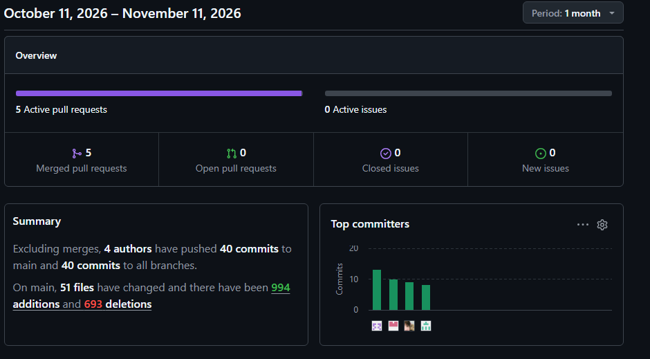
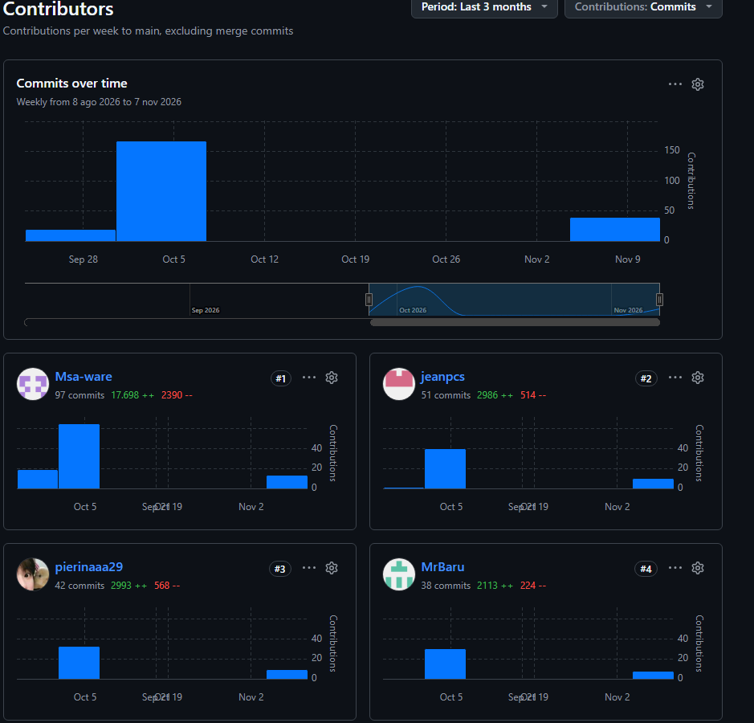
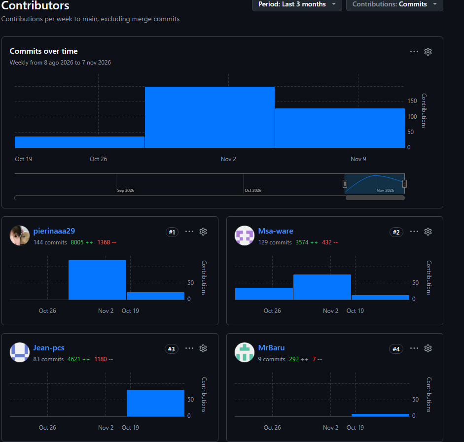
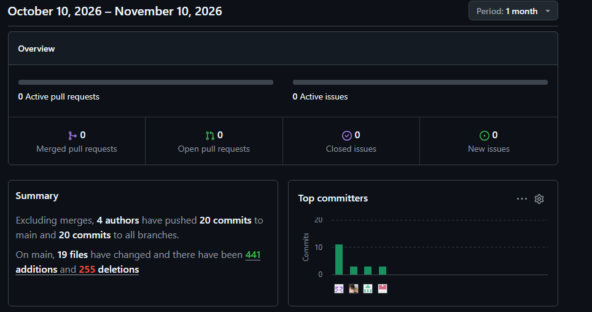
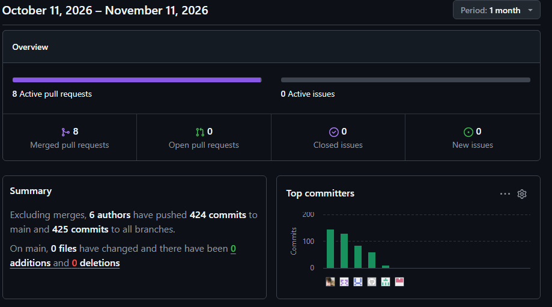

##### 5.2.3.8. Team Collaboration Insights during Sprint

El equipo repartió los *bounded contexts* de la API según la sección 5.2.3.3: cada integrante registró sus commits desde su propia cuenta, con Conventional Commits, y trabajó en una rama `feature/*` por contexto. La tabla resume los commits únicos de la sección 5.2.3.4 por integrante y por repositorio; los commits de integración (*merge*) no se cuentan.

**Tabla 30**

*Commits del Sprint 3 por integrante y por repositorio*

| Team Member (Last Name, First Name) | GitHub Username | destilatech-platform | destilatech-webapp | destilatech-website | Total |
| :---------- | :---------- | :----------: | :----------: | :----------: | :----------: |
| Fernandez Seer, Mario Alonso | MrBaru | 67 | 8 | 3 | 78 |
| Santiago Atanacio, Jairo Mathias | Msa-ware | 129 | 16 | 11 | 156 |
| Almandroz Carbajal, Pierina Marysabel | pierinaaa29 | 144 | 9 | 3 | 156 |
| Condor Sandoval, Jean Pierre | jeanpcs | 84 | 10 | 3 | 97 |
| **Total** | | **424** | **43** | **20** | **487** |

**Aportes por integrante.** En la API, Almandroz Carbajal, Pierina Marysabel, desarrolló Orders & Replenishment (80 commits) y Analytics & Estimations (64); Condor Sandoval, Jean Pierre, desarrolló Billing (66) e IAM (16); Fernandez Seer, Mario Alonso, desarrolló Production & Monitoring (33) e Inventory & Stock (30); y Santiago Atanacio, Jairo Mathias, desarrolló el *Shared Kernel* y la configuración de la API y Alerts & Notifications (54). En la última semana del sprint, Fernandez Seer, Mario Alonso, reorganizó Inventory & Stock y Production & Monitoring con servicios de comandos y de consultas (ramas `refactor/inventory-stock` y `refactor/production-monitoring`) y desarrolló el servicio simulador de lecturas IoT (`feature/iot-sensor-simulator`); el endpoint de resumen del dashboard (`feature/dashboard-summary`) se desarrolló entre Almandroz Carbajal, Pierina Marysabel, quien registró 10 de los 16 commits de la rama, junto con los demás integrantes. En la versión 2.1.0 de la aplicación web cada integrante conectó contextos con la API: Fernandez Seer, Mario Alonso, Production & Monitoring y el script de datos de demostración; Almandroz Carbajal, Pierina Marysabel, Inventory y Orders; Condor Sandoval, Jean Pierre, Alerts y el pago con Stripe Checkout; y Santiago Atanacio, Jairo Mathias, el cliente HTTP, la recarga del usuario después del pago y la publicación de la versión. Los cuatro integrantes también registraron commits en la versión 2.0.0 de la aplicación web y en la nueva estructura de la landing page.

**Figura 198**

*Analíticos de GitHub de la aplicación web (11 de octubre al 11 de noviembre de 2026)*

*Nota.* Captura de GitHub Insights (2026).

*Descripción.* Periodo de un mes: 5 *pull requests* integrados, 4 autores y 40 commits sin contar los *merges* en `main`, con 994 adiciones y 693 eliminaciones en 51 archivos. El gráfico *Top committers* muestra la participación de los cuatro integrantes. La tabla de la sección 5.2.3.4 cuenta 43 commits porque incluye tres commits del 5 de octubre.

**Figura 199**

*Contribuidores de la aplicación web*

*Nota.* Captura de GitHub Insights (2026).

*Descripción.* Commits semanales en `main` sin contar los *merges*, en los últimos tres meses: Msa-ware (97 commits), jeanpcs (51), pierinaaa29 (42) y MrBaru (38), con actividad en las semanas del 5 de octubre y del 9 de noviembre. Los totales abarcan el historial del repositorio desde el Sprint 1 y son mayores que los del sprint.

**Figura 200**

*Contribuidores de la API*

*Nota.* Captura de GitHub Insights (2026).

*Descripción.* Commits semanales en `main` sin contar los *merges*: pierinaaa29 (144 commits), Msa-ware (129), Jean-pcs (83) y MrBaru (9). GitHub atribuye a MrBaru solo 9 commits porque los otros 58 de Fernandez Seer, Mario Alonso, se registraron con un correo que no está asociado a su cuenta; la tabla de esta sección los atribuye por el nombre del autor del commit y suma 67.

**Figura 201**

*Analíticos de GitHub de la landing page (10 de octubre al 10 de noviembre de 2026)*

*Nota.* Captura de GitHub Insights (2026).

*Descripción.* Periodo de un mes: 4 autores y 20 commits sin contar los *merges*, con 441 adiciones y 255 eliminaciones en 19 archivos, lo que coincide con los 20 commits de la sección 5.2.3.4.

**Figura 202**

*Analíticos de GitHub de la API (11 de octubre al 11 de noviembre de 2026)*

*Nota.* Captura de GitHub Insights (2026).

*Descripción.* Periodo de un mes: 8 *pull requests* integrados y ninguno abierto, y 424 commits sin contar los *merges* en `main` (425 en todas las ramas; el commit adicional es el de la rama `feature/billing` que no se integró). El gráfico *Top committers* muestra la participación de los cuatro integrantes; GitHub cuenta 6 autores porque agrupa por identidad de commit y algunos integrantes registraron commits con más de un correo. La cifra coincide con los 424 commits de la sección 5.2.3.4.
