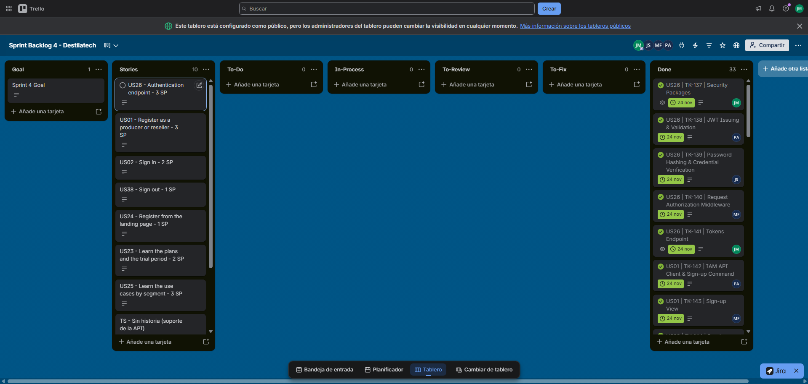

##### 5.2.4.3. Sprint Backlog 4

El Sprint Backlog 4 contiene siete historias: las historias técnicas US26 (endpoint de autenticación, que el Sprint 3 había devuelto al Product Backlog) y las historias de usuario US01 (registro), US02 (inicio de sesión), US38 (cierre de sesión), US23, US24 y US25 (planes, registro y segmentos de la landing page), divididas en dos o más tareas de ingeniería, y las tareas sin historia de usuario: la protección de los endpoints de cada contexto y la configuración de los secretos de la API, la prueba gratuita visible en la aplicación web (aviso de días restantes y vista de planes al terminar la prueba) y las publicaciones de las versiones. Cada tarea es una tarea de ingeniería (*Engineering Task*) estimada en horas de planificación, con un mínimo de 4 y un máximo de 8 horas por tarea.

**Tablero del equipo en Trello:** <https://trello.com/b/76wisHfR/sprint-backlog-4-destilatech> (listas Goal, Stories, To-Do, In-Process, To-Review, To-Fix y Done)

**Figura 208**

*Tablero del Sprint 4 en Trello*

*Nota.* Captura propia de Trello (2026). Tablero público disponible en <https://trello.com/b/76wisHfR/sprint-backlog-4-destilatech>.

*Descripción.* El tablero «Sprint Backlog 4 - Destilatech» tiene siete listas: Goal, con la meta del sprint; Stories, con las tarjetas de las 7 historias con su puntaje en Story Points y las de las tareas sin historia; To-Do, In-Process, To-Review y To-Fix, sin tarjetas; y Done, con las 33 tarjetas de tareas de ingeniería (TK-137 a TK-169) terminadas, cada una con su fecha de entrega y su responsable.

**Tabla 32**

*Sprint Backlog 4*

| User Story Id | User Story Title | Task Id | Task Title | Description | Estimation (Hours) | Assigned To | Status |
| :---------- | :---------- | :---------- | :---------- | :------------------------------------------- | :----------: | :----------- | :----------: |
| **US26** | Authentication endpoint | TK-137 | Security Packages | Alcance: paquetes de cifrado de contraseñas con BCrypt y de emisión de tokens JWT en el proyecto de la API. Incluye la revisión del código y la verificación funcional con la documentación de Scalar y con la aplicación en ejecución. | 4 | Santiago Atanacio, Jairo Mathias | Done |
| **US26** | Authentication endpoint | TK-138 | JWT Issuing & Validation | Alcance: servicio que emite tokens de acceso JWT firmados con HS256 y los valida con emisor, audiencia y tiempo de expiración configurables (`TokenSettings`). Incluye la revisión del código y la verificación funcional con la documentación de Scalar y con la aplicación en ejecución. | 6 | Almandroz Carbajal, Pierina Marysabel | Done |
| **US26** | Authentication endpoint | TK-139 | Password Hashing & Credential Verification | Alcance: el registro de cuentas guarda la contraseña cifrada con BCrypt y el inicio de sesión verifica las credenciales contra el hash guardado. Incluye la revisión del código y la verificación funcional con la documentación de Scalar y con la aplicación en ejecución. | 6 | Condor Sandoval, Jean Pierre | Done |
| **US26** | Authentication endpoint | TK-140 | Request Authorization Middleware | Alcance: `RequestAuthorizationMiddleware` y los atributos `[Authorize]` y `[AllowAnonymous]`, que rechazan con `401` las solicitudes sin token válido. Incluye la revisión del código y la verificación funcional con la documentación de Scalar y con la aplicación en ejecución. | 6 | Fernandez Seer, Mario Alonso | Done |
| **US26** | Authentication endpoint | TK-141 | Tokens Endpoint | Alcance: `POST /api/v1/tokens`, que recibe el correo y la contraseña y responde con el usuario, el token y su fecha de expiración (`200`), o `401` si las credenciales no son válidas; los endpoints de usuarios quedan protegidos. Incluye la revisión del código y la verificación funcional con la documentación de Scalar y con la aplicación en ejecución. | 6 | Santiago Atanacio, Jairo Mathias | Done |
| **US01** | Register as a producer or reseller | TK-142 | IAM API Client & Sign-up Command | Alcance: cliente de la API de IAM y comando de registro de la aplicación web, que envía nombre, correo, contraseña, negocio, tipo de negocio y plan preferido a `POST /api/v1/users`. Incluye la revisión del código y la verificación funcional con la documentación de Scalar y con la aplicación en ejecución. | 5 | Almandroz Carbajal, Pierina Marysabel | Done |
| **US01** | Register as a producer or reseller | TK-143 | Sign-up View | Alcance: vista `/register` con el formulario de registro, el tipo de negocio (productor o comercializador) y el plan preferido tomados de los enlaces de la landing page, textos en español e inglés y atributos ARIA. Incluye la revisión del código y la verificación funcional con la documentación de Scalar y con la aplicación en ejecución. | 6 | Fernandez Seer, Mario Alonso | Done |
| **US02** | Sign in | TK-144 | Session Storage & Access Token Interceptor | Alcance: la sesión se guarda en el navegador y el interceptor `iam.interceptor` envía el encabezado `Authorization: Bearer` en cada solicitud; una respuesta `401` devuelve al usuario a `/login`. Incluye la revisión del código y la verificación funcional con la documentación de Scalar y con la aplicación en ejecución. | 6 | Santiago Atanacio, Jairo Mathias | Done |
| **US02** | Sign in | TK-145 | IAM Store & Signed-in Account | Alcance: *store* de IAM (Pinia) con las acciones de inicio de sesión y registro y la carga de la cuenta autenticada. Incluye la revisión del código y la verificación funcional con la documentación de Scalar y con la aplicación en ejecución. | 5 | Condor Sandoval, Jean Pierre | Done |
| **US02** | Sign in | TK-146 | Sign-in View | Alcance: vista `/login` con correo y contraseña, mensajes de error, textos en español e inglés y atributos ARIA. Incluye la revisión del código y la verificación funcional con la documentación de Scalar y con la aplicación en ejecución. | 5 | Fernandez Seer, Mario Alonso | Done |
| **US02** | Sign in | TK-147 | Authentication Guard | Alcance: `authentication.guard` que protege todas las rutas excepto `/login` y `/register` y redirige al panel del tipo de usuario después de iniciar sesión. Incluye la revisión del código y la verificación funcional con la documentación de Scalar y con la aplicación en ejecución. | 6 | Santiago Atanacio, Jairo Mathias | Done |
| **US38** | Sign out | TK-148 | Account Menu with Sign-out | Alcance: menú de cuenta con la opción de cerrar sesión, que reemplaza al selector de usuarios de demostración. Incluye la revisión del código y la verificación funcional con la documentación de Scalar y con la aplicación en ejecución. | 5 | Almandroz Carbajal, Pierina Marysabel | Done |
| **US38** | Sign out | TK-149 | Session Removal & Redirect | Alcance: al cerrar sesión el *store* elimina la sesión y el token guardados y la aplicación muestra la vista de inicio de sesión. Incluye la revisión del código y la verificación funcional con la documentación de Scalar y con la aplicación en ejecución. | 4 | Condor Sandoval, Jean Pierre | Done |
| **US24** | Register from the landing page | TK-150 | Free Trial Texts | Alcance: textos en español e inglés de los botones «Start 14-day free trial» y «Subscribe» del diccionario de traducciones de la landing page. Incluye la revisión del código y la verificación funcional con la documentación de Scalar y con la aplicación en ejecución. | 4 | Santiago Atanacio, Jairo Mathias | Done |
| **US24** | Register from the landing page | TK-151 | Header & Footer Free Trial Buttons | Alcance: botón «Free trial» en el encabezado y en el pie de página, además del botón principal «Start your 14-day free trial», que abren el registro de la aplicación web (`/register`). Incluye la revisión del código y la verificación funcional con la documentación de Scalar y con la aplicación en ejecución. | 5 | Almandroz Carbajal, Pierina Marysabel | Done |
| **US23** | Learn the plans and the trial period | TK-152 | Plan Cards Trial Notice & Buttons | Alcance: cada plan indica «Includes a 14-day free trial» y muestra los botones «Start free trial» y «Subscribe» donde «Start free trial» abre el registro (`/register?plan=`) y «Subscribe» abre la vista de planes (`/billing/plans?plan=`) con el plan elegido. Incluye la revisión del código y la verificación funcional con la documentación de Scalar y con la aplicación en ejecución. | 6 | Condor Sandoval, Jean Pierre | Done |
| **US23** | Learn the plans and the trial period | TK-153 | Plan Buttons Styles | Alcance: estilos de los botones de los planes y del aviso del período de prueba. Incluye la revisión del código y la verificación funcional con la documentación de Scalar y con la aplicación en ejecución. | 4 | Fernandez Seer, Mario Alonso | Done |
| **US25** | Learn the use cases by segment | TK-154 | Segment Free Trial Buttons | Alcance: botones «Free trial for your winery» y «Free trial for your store» en la sección de productores y en la de comercializadores, que abren el registro con el tipo de negocio correspondiente (`/register?type=producer` y `/register?type=retailer`). Incluye la revisión del código y la verificación funcional con la documentación de Scalar y con la aplicación en ejecución. | 5 | Condor Sandoval, Jean Pierre | Done |
| **US25** | Learn the use cases by segment | TK-155 | Segment Buttons Styles | Alcance: estilos de los botones de cada segmento y de los botones de prueba gratuita. Incluye la revisión del código y la verificación funcional con la documentación de Scalar y con la aplicación en ejecución. | 4 | Fernandez Seer, Mario Alonso | Done |
| — | Sin historia (soporte de la API) | TK-156 | IAM Pipeline, Token Settings & Bearer Security in OpenAPI | Alcance: registro del *pipeline* de IAM en `Program.cs`, sección `TokenSettings` y esquema de seguridad Bearer (JWT) en OpenAPI, con el botón Authorize de Scalar. Incluye la revisión del código y la verificación funcional con la documentación de Scalar y con la aplicación en ejecución. | 6 | Almandroz Carbajal, Pierina Marysabel | Done |
| — | Sin historia (soporte de la API) | TK-157 | Billing Endpoints Protection | Alcance: los endpoints de Billing exigen token, salvo `GET /api/v1/plans`, que queda público. Incluye la revisión del código y la verificación funcional con la documentación de Scalar y con la aplicación en ejecución. | 5 | Condor Sandoval, Jean Pierre | Done |
| — | Sin historia (soporte de la API) | TK-158 | Production Endpoints Protection & IoT Simulator Signing | Alcance: los endpoints de Production & Monitoring exigen token y el simulador de lecturas IoT firma sus propias solicitudes. Incluye la revisión del código y la verificación funcional con la documentación de Scalar y con la aplicación en ejecución. | 6 | Fernandez Seer, Mario Alonso | Done |
| — | Sin historia (soporte de la API) | TK-159 | Alerts Endpoints Protection | Alcance: los endpoints de Alerts & Notifications exigen token. Incluye la revisión del código y la verificación funcional con la documentación de Scalar y con la aplicación en ejecución. | 4 | Santiago Atanacio, Jairo Mathias | Done |
| — | Sin historia (soporte de la API) | TK-160 | Orders & Replenishment Endpoints Protection | Alcance: los endpoints de Orders & Replenishment exigen token. Incluye la revisión del código y la verificación funcional con la documentación de Scalar y con la aplicación en ejecución. | 5 | Almandroz Carbajal, Pierina Marysabel | Done |
| — | Sin historia (soporte de la API) | TK-161 | Inventory Endpoints Protection | Alcance: los endpoints de Inventory & Stock exigen token. Incluye la revisión del código y la verificación funcional con la documentación de Scalar y con la aplicación en ejecución. | 4 | Condor Sandoval, Jean Pierre | Done |
| — | Sin historia (soporte de la API) | TK-162 | Analytics Endpoints Protection | Alcance: los endpoints de Analytics & Estimations y del resumen del dashboard exigen token. Incluye la revisión del código y la verificación funcional con la documentación de Scalar y con la aplicación en ejecución. | 4 | Santiago Atanacio, Jairo Mathias | Done |
| — | Sin historia (soporte de la API) | TK-163 | Secrets from Environment Variables in Docker | Alcance: el secreto del token y la contraseña de las cuentas de demostración se leen de variables de entorno (`TokenSettings__Secret`, `DemoAccounts__Password`) en `docker-compose`. Incluye la revisión del código y la verificación funcional con la documentación de Scalar y con la aplicación en ejecución. | 4 | Fernandez Seer, Mario Alonso | Done |
| — | Sin historia (soporte de la API) | TK-164 | Platform README & Release 2.0.0 | Alcance: documentación de la autenticación y de los secretos en el `README.md` y publicación de la versión 2.0.0 de la API. Incluye la revisión del código y la verificación funcional con la documentación de Scalar y con la aplicación en ejecución. | 4 | Almandroz Carbajal, Pierina Marysabel | Done |
| — | Sin historia (mejora de la Web Application) | TK-165 | Trial Banner & Plans after the Trial | Alcance: aviso con los días restantes de la prueba (advertencia en los últimos 3 días) y, al terminar la prueba, acceso solo a la vista de planes y a las páginas de retorno de Stripe. Incluye la revisión del código y la verificación funcional con la documentación de Scalar y con la aplicación en ejecución. | 6 | Condor Sandoval, Jean Pierre | Done |
| — | Sin historia (mejora de la Web Application) | TK-166 | Terms and Conditions Link in the Footer | Alcance: enlace a los términos y condiciones en el pie de página de la aplicación web. Incluye la revisión del código y la verificación funcional con la documentación de Scalar y con la aplicación en ejecución. | 4 | Fernandez Seer, Mario Alonso | Done |
| — | Sin historia (mejora de la Web Application) | TK-167 | Demo Data Script with Sign-in | Alcance: el script `seed-api` inicia sesión con las cuentas de demostración antes de cargar los datos. Incluye la revisión del código y la verificación funcional con la documentación de Scalar y con la aplicación en ejecución. | 4 | Santiago Atanacio, Jairo Mathias | Done |
| — | Sin historia (mejora de la Web Application) | TK-168 | Web Application README & Release 3.0.0 | Alcance: documentación del registro, del inicio de sesión y de la prueba gratuita y versión 3.0.0. Incluye la revisión del código y la verificación funcional con la documentación de Scalar y con la aplicación en ejecución. | 4 | Almandroz Carbajal, Pierina Marysabel | Done |
| — | Sin historia (mejora de la Landing Page) | TK-169 | Landing Page README & Release 4.0.0 | Alcance: documentación de los botones de prueba gratuita y de suscripción y versión 4.0.0. Incluye la revisión del código y la verificación funcional con la documentación de Scalar y con la aplicación en ejecución. | 4 | Santiago Atanacio, Jairo Mathias | Done |

**Horas por integrante.** El Sprint Backlog suma 162 horas: Fernandez Seer, Mario Alonso, 39; Santiago Atanacio, Jairo Mathias, 42; Almandroz Carbajal, Pierina Marysabel, 40; Condor Sandoval, Jean Pierre, 41. Cada historia se descompone en dos o más tareas de ingeniería de 4 a 8 horas, repartidas entre los cuatro integrantes porque la protección de los endpoints y los botones de la landing page se dividieron en partes de tamaño parecido.

**Observación.** Las historias US39 (recuperar contraseña) y US41 (actualizar los datos del negocio) no forman parte de este sprint: no se implementaron y vuelven al Product Backlog. La historia US56 (registro de cuentas en la API) se completó en este sprint con el cifrado de la contraseña y su puntaje se contó en el Sprint 3. La historia US03 (aviso del fin de la prueba) del Sprint 2 se refinó con el aviso de los días restantes y la vista de planes al terminar la prueba. La API todavía no cuenta con un proyecto de pruebas automatizadas; las verificaciones del sprint se hicieron desde Scalar y desde la aplicación web.
