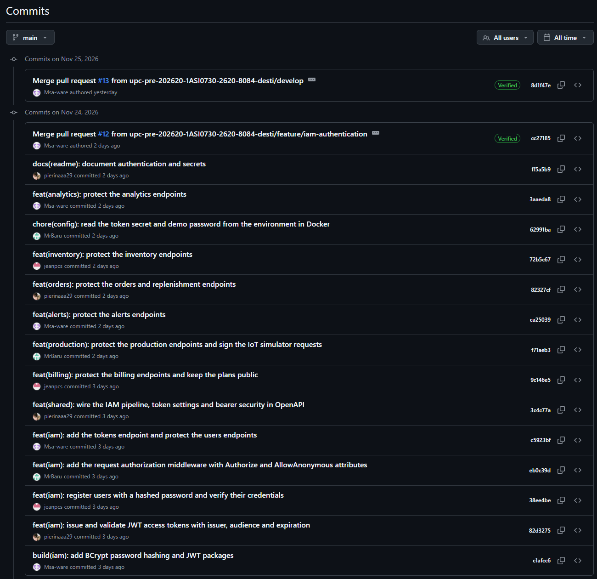
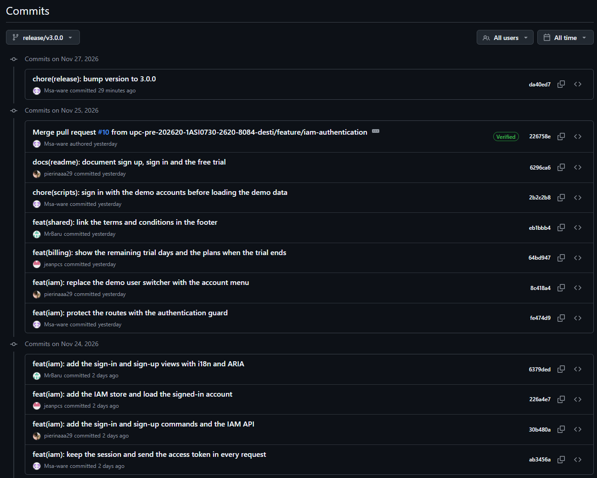
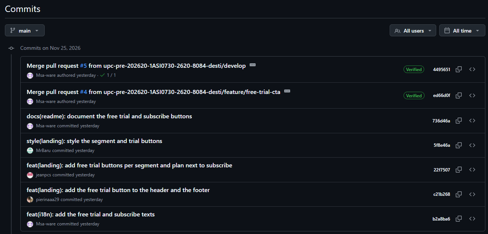

##### 5.2.4.4. Development Evidence for Sprint Review

Durante el Sprint 4 se implementó la autenticación en los tres repositorios del producto. En `destilatech-platform` (<https://github.com/upc-pre-202620-1ASI0730-2620-8084-desti/destilatech-platform>), la rama `feature/iam-authentication` incorporó el cifrado de contraseñas con BCrypt, la emisión y la validación de tokens JWT, el *middleware* de autorización de solicitudes con los atributos `[Authorize]` y `[AllowAnonymous]`, el endpoint `POST /api/v1/tokens` y la protección de los endpoints de cada *bounded context*; se integró a `develop` mediante el Pull Request #12 y se publicó como la versión 2.0.0 mediante el Pull Request #13. En `destilatech-webapp` (<https://github.com/upc-pre-202620-1ASI0730-2620-8084-desti/destilatech-webapp>), la misma rama incorporó el contexto IAM de Vue 3 con PrimeVue y Pinia (vistas de registro e inicio de sesión, *store*, interceptor del token, guardia de rutas, menú de cuenta y aviso de la prueba gratuita); se integró con el Pull Request #10 y se publicó como la versión 3.0.0. En `destilatech-website` (<https://github.com/upc-pre-202620-1ASI0730-2620-8084-desti/destilatech-website>), la rama `feature/free-trial-cta` incorporó los botones de prueba gratuita y de suscripción; se integró con el Pull Request #4 y se publicó como la versión 4.0.0. Los commits siguen Conventional Commits y cada integrante los registró desde su propia cuenta. Las tablas no incluyen los commits de integración (*merge*) de los Pull Requests.

**Repositorio de la API:** destilatech-platform (<https://github.com/upc-pre-202620-1ASI0730-2620-8084-desti/destilatech-platform>)

**Tabla 33**

*Commits del repositorio de la API (destilatech-platform) en el Sprint 4*

| Repository | Branch | Commit Id | Commit Message | Commit Message Body | Committed on (Date) |
| :-------------------- | :---------- | :----------------------------------- | :----------- | :---------- | :----------: |
| `upc-pre-202620-1ASI0730-2620-8084-desti/destilatech-platform` | `feature/iam-authentication` | [`c1afcc6`](https://github.com/upc-pre-202620-1ASI0730-2620-8084-desti/destilatech-platform/commit/c1afcc6) | build(iam): add BCrypt password hashing and JWT packages | — | 2026-11-24 |
| `upc-pre-202620-1ASI0730-2620-8084-desti/destilatech-platform` | `feature/iam-authentication` | [`82d3275`](https://github.com/upc-pre-202620-1ASI0730-2620-8084-desti/destilatech-platform/commit/82d3275) | feat(iam): issue and validate JWT access tokens with issuer, audience and expiration | — | 2026-11-24 |
| `upc-pre-202620-1ASI0730-2620-8084-desti/destilatech-platform` | `feature/iam-authentication` | [`38ee4be`](https://github.com/upc-pre-202620-1ASI0730-2620-8084-desti/destilatech-platform/commit/38ee4be) | feat(iam): register users with a hashed password and verify their credentials | — | 2026-11-24 |
| `upc-pre-202620-1ASI0730-2620-8084-desti/destilatech-platform` | `feature/iam-authentication` | [`eb0c39d`](https://github.com/upc-pre-202620-1ASI0730-2620-8084-desti/destilatech-platform/commit/eb0c39d) | feat(iam): add the request authorization middleware with Authorize and AllowAnonymous attributes | — | 2026-11-24 |
| `upc-pre-202620-1ASI0730-2620-8084-desti/destilatech-platform` | `feature/iam-authentication` | [`c5923bf`](https://github.com/upc-pre-202620-1ASI0730-2620-8084-desti/destilatech-platform/commit/c5923bf) | feat(iam): add the tokens endpoint and protect the users endpoints | — | 2026-11-24 |
| `upc-pre-202620-1ASI0730-2620-8084-desti/destilatech-platform` | `feature/iam-authentication` | [`3c4c77a`](https://github.com/upc-pre-202620-1ASI0730-2620-8084-desti/destilatech-platform/commit/3c4c77a) | feat(shared): wire the IAM pipeline, token settings and bearer security in OpenAPI | — | 2026-11-24 |
| `upc-pre-202620-1ASI0730-2620-8084-desti/destilatech-platform` | `feature/iam-authentication` | [`9c146e5`](https://github.com/upc-pre-202620-1ASI0730-2620-8084-desti/destilatech-platform/commit/9c146e5) | feat(billing): protect the billing endpoints and keep the plans public | — | 2026-11-24 |
| `upc-pre-202620-1ASI0730-2620-8084-desti/destilatech-platform` | `feature/iam-authentication` | [`f71aeb3`](https://github.com/upc-pre-202620-1ASI0730-2620-8084-desti/destilatech-platform/commit/f71aeb3) | feat(production): protect the production endpoints and sign the IoT simulator requests | — | 2026-11-24 |
| `upc-pre-202620-1ASI0730-2620-8084-desti/destilatech-platform` | `feature/iam-authentication` | [`ca25039`](https://github.com/upc-pre-202620-1ASI0730-2620-8084-desti/destilatech-platform/commit/ca25039) | feat(alerts): protect the alerts endpoints | — | 2026-11-24 |
| `upc-pre-202620-1ASI0730-2620-8084-desti/destilatech-platform` | `feature/iam-authentication` | [`82327cf`](https://github.com/upc-pre-202620-1ASI0730-2620-8084-desti/destilatech-platform/commit/82327cf) | feat(orders): protect the orders and replenishment endpoints | — | 2026-11-24 |
| `upc-pre-202620-1ASI0730-2620-8084-desti/destilatech-platform` | `feature/iam-authentication` | [`72b5c67`](https://github.com/upc-pre-202620-1ASI0730-2620-8084-desti/destilatech-platform/commit/72b5c67) | feat(inventory): protect the inventory endpoints | — | 2026-11-24 |
| `upc-pre-202620-1ASI0730-2620-8084-desti/destilatech-platform` | `feature/iam-authentication` | [`62991ba`](https://github.com/upc-pre-202620-1ASI0730-2620-8084-desti/destilatech-platform/commit/62991ba) | chore(config): read the token secret and demo password from the environment in Docker | — | 2026-11-24 |
| `upc-pre-202620-1ASI0730-2620-8084-desti/destilatech-platform` | `feature/iam-authentication` | [`3aaeda8`](https://github.com/upc-pre-202620-1ASI0730-2620-8084-desti/destilatech-platform/commit/3aaeda8) | feat(analytics): protect the analytics endpoints | — | 2026-11-24 |
| `upc-pre-202620-1ASI0730-2620-8084-desti/destilatech-platform` | `feature/iam-authentication` | [`ff5a5b9`](https://github.com/upc-pre-202620-1ASI0730-2620-8084-desti/destilatech-platform/commit/ff5a5b9) | docs(readme): document authentication and secrets | — | 2026-11-24 |

**Figura 209**

*Commits de la API en el Sprint 4*

*Nota.* Captura propia (2026).

*Descripción.* Historial de `destilatech-platform` con los 14 commits del Sprint 4, del cifrado de contraseñas y la emisión de tokens a la protección de los endpoints de Billing, Production, Alerts, Orders, Inventory y Analytics, la lectura de los secretos desde el entorno y la documentación de la autenticación.

**Repositorio de la aplicación web:** destilatech-webapp (<https://github.com/upc-pre-202620-1ASI0730-2620-8084-desti/destilatech-webapp>)

**Tabla 34**

*Commits del repositorio de la aplicación web (destilatech-webapp) en el Sprint 4*

| Repository | Branch | Commit Id | Commit Message | Commit Message Body | Committed on (Date) |
| :-------------------- | :---------- | :----------------------------------- | :----------- | :---------- | :----------: |
| `upc-pre-202620-1ASI0730-2620-8084-desti/destilatech-webapp` | `feature/iam-authentication` | [`ab3456a`](https://github.com/upc-pre-202620-1ASI0730-2620-8084-desti/destilatech-webapp/commit/ab3456a) | feat(iam): keep the session and send the access token in every request | — | 2026-11-24 |
| `upc-pre-202620-1ASI0730-2620-8084-desti/destilatech-webapp` | `feature/iam-authentication` | [`30b480a`](https://github.com/upc-pre-202620-1ASI0730-2620-8084-desti/destilatech-webapp/commit/30b480a) | feat(iam): add the sign-in and sign-up commands and the IAM API | — | 2026-11-24 |
| `upc-pre-202620-1ASI0730-2620-8084-desti/destilatech-webapp` | `feature/iam-authentication` | [`226a4e7`](https://github.com/upc-pre-202620-1ASI0730-2620-8084-desti/destilatech-webapp/commit/226a4e7) | feat(iam): add the IAM store and load the signed-in account | — | 2026-11-24 |
| `upc-pre-202620-1ASI0730-2620-8084-desti/destilatech-webapp` | `feature/iam-authentication` | [`6379ded`](https://github.com/upc-pre-202620-1ASI0730-2620-8084-desti/destilatech-webapp/commit/6379ded) | feat(iam): add the sign-in and sign-up views with i18n and ARIA | — | 2026-11-24 |
| `upc-pre-202620-1ASI0730-2620-8084-desti/destilatech-webapp` | `feature/iam-authentication` | [`fe474d9`](https://github.com/upc-pre-202620-1ASI0730-2620-8084-desti/destilatech-webapp/commit/fe474d9) | feat(iam): protect the routes with the authentication guard | — | 2026-11-25 |
| `upc-pre-202620-1ASI0730-2620-8084-desti/destilatech-webapp` | `feature/iam-authentication` | [`8c418a4`](https://github.com/upc-pre-202620-1ASI0730-2620-8084-desti/destilatech-webapp/commit/8c418a4) | feat(iam): replace the demo user switcher with the account menu | — | 2026-11-25 |
| `upc-pre-202620-1ASI0730-2620-8084-desti/destilatech-webapp` | `feature/iam-authentication` | [`64bd947`](https://github.com/upc-pre-202620-1ASI0730-2620-8084-desti/destilatech-webapp/commit/64bd947) | feat(billing): show the remaining trial days and the plans when the trial ends | — | 2026-11-25 |
| `upc-pre-202620-1ASI0730-2620-8084-desti/destilatech-webapp` | `feature/iam-authentication` | [`eb1bbb4`](https://github.com/upc-pre-202620-1ASI0730-2620-8084-desti/destilatech-webapp/commit/eb1bbb4) | feat(shared): link the terms and conditions in the footer | — | 2026-11-25 |
| `upc-pre-202620-1ASI0730-2620-8084-desti/destilatech-webapp` | `feature/iam-authentication` | [`2b2c2b8`](https://github.com/upc-pre-202620-1ASI0730-2620-8084-desti/destilatech-webapp/commit/2b2c2b8) | chore(scripts): sign in with the demo accounts before loading the demo data | — | 2026-11-25 |
| `upc-pre-202620-1ASI0730-2620-8084-desti/destilatech-webapp` | `feature/iam-authentication` | [`6296ca6`](https://github.com/upc-pre-202620-1ASI0730-2620-8084-desti/destilatech-webapp/commit/6296ca6) | docs(readme): document sign up, sign in and the free trial | — | 2026-11-25 |
| `upc-pre-202620-1ASI0730-2620-8084-desti/destilatech-webapp` | `develop` | [`da40ed7`](https://github.com/upc-pre-202620-1ASI0730-2620-8084-desti/destilatech-webapp/commit/da40ed7) | chore(release): bump version to 3.0.0 | — | 2026-11-27 |

**Figura 210**

*Commits de la aplicación web en el Sprint 4*

*Nota.* Captura propia (2026).

*Descripción.* Historial de `destilatech-webapp` con los 11 commits del Sprint 4: la sesión y el token en cada solicitud, los comandos y el *store* de IAM, las vistas de registro e inicio de sesión, la guardia de rutas, el menú de cuenta, el aviso de la prueba gratuita, el enlace de los términos y la versión 3.0.0.

**Repositorio de la landing page:** destilatech-website (<https://github.com/upc-pre-202620-1ASI0730-2620-8084-desti/destilatech-website>)

**Tabla 35**

*Commits del repositorio de la landing page (destilatech-website) en el Sprint 4*

| Repository | Branch | Commit Id | Commit Message | Commit Message Body | Committed on (Date) |
| :-------------------- | :---------- | :----------------------------------- | :----------- | :---------- | :----------: |
| `upc-pre-202620-1ASI0730-2620-8084-desti/destilatech-website` | `feature/free-trial-cta` | [`b2a8ba6`](https://github.com/upc-pre-202620-1ASI0730-2620-8084-desti/destilatech-website/commit/b2a8ba6) | feat(i18n): add the free trial and subscribe texts | — | 2026-11-25 |
| `upc-pre-202620-1ASI0730-2620-8084-desti/destilatech-website` | `feature/free-trial-cta` | [`c21b268`](https://github.com/upc-pre-202620-1ASI0730-2620-8084-desti/destilatech-website/commit/c21b268) | feat(landing): add the free trial button to the header and the footer | — | 2026-11-25 |
| `upc-pre-202620-1ASI0730-2620-8084-desti/destilatech-website` | `feature/free-trial-cta` | [`22f7507`](https://github.com/upc-pre-202620-1ASI0730-2620-8084-desti/destilatech-website/commit/22f7507) | feat(landing): add free trial buttons per segment and plan next to subscribe | — | 2026-11-25 |
| `upc-pre-202620-1ASI0730-2620-8084-desti/destilatech-website` | `feature/free-trial-cta` | [`5f8e46a`](https://github.com/upc-pre-202620-1ASI0730-2620-8084-desti/destilatech-website/commit/5f8e46a) | style(landing): style the segment and trial buttons | — | 2026-11-25 |
| `upc-pre-202620-1ASI0730-2620-8084-desti/destilatech-website` | `feature/free-trial-cta` | [`736d46a`](https://github.com/upc-pre-202620-1ASI0730-2620-8084-desti/destilatech-website/commit/736d46a) | docs(readme): document the free trial and subscribe buttons | — | 2026-11-25 |

**Figura 211**

*Commits de la landing page en el Sprint 4*

*Nota.* Captura propia (2026).

*Descripción.* Historial de `destilatech-website` con los 5 commits del Sprint 4: los textos de la prueba gratuita y de la suscripción, los botones del encabezado, del pie de página, de cada segmento y de cada plan, sus estilos y la documentación.

**Figura 212**

*Commits del repositorio del informe en el Sprint 4*

<strong>[CAPTURA 5: guardar como assets/sprint4/commits-report-sprint4.png y reemplazar este marcador por la imagen. Historial de commits del repositorio destilatech-report en GitHub con la documentación del Sprint 4 (rama develop).]</strong>

*Nota.* Captura de GitHub (2026).

*Descripción.* Historial de `develop` del repositorio destilatech-report con la documentación del Sprint 4 (sección 5.2.4) y la actualización del informe.
