##### 5.2.4.5. Execution Evidence for Sprint Review

El logro del Sprint 4 es el ciclo completo de acceso al producto: un visitante abre la landing page, pulsa un botón de prueba gratuita, crea su cuenta en la aplicación web, inicia sesión, usa la aplicación con los datos de su cuenta, ve los días que le quedan de prueba y cierra sesión. La API se ejecuta de forma local con MySQL (con `docker compose up -d --build` o con `dotnet run`) y necesita las variables `TokenSettings__Secret` y `DemoAccounts__Password`; la aplicación web exige iniciar sesión en todas sus rutas salvo `/login` y `/register`, y envía el token en cada solicitud.

**Video de navegación:** [COMPLETAR: URL del video de navegación del Sprint 4 (landing page, registro, inicio de sesión, aviso de la prueba, cierre de sesión y acceso protegido)]

**Landing page 4.0.0.** Las siguientes capturas muestran los botones nuevos sobre la landing page publicada en GitHub Pages (<https://upc-pre-202620-1asi0730-2620-8084-desti.github.io/destilatech-website/>), cuyos botones abren el registro de la aplicación web (<https://destilatech-webapp.web.app/register>).

**Figura 213**

*Botón principal de prueba gratuita de la landing page*

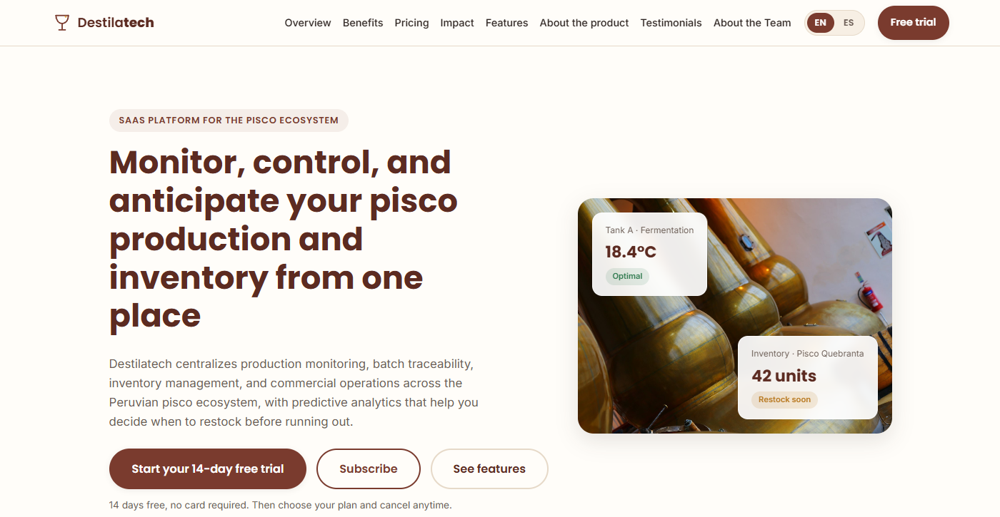

*Nota.* Captura propia (2026).

*Descripción.* La sección principal ofrece el botón «Start your 14-day free trial», que abre `/register` de la aplicación web, y el encabezado incluye el botón «Free trial»; ambos aparecen también en español.

**Figura 214**

*Botones de prueba gratuita por segmento*

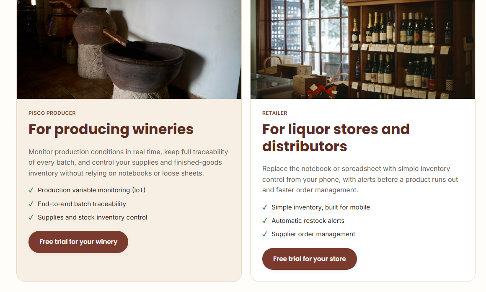

*Nota.* Captura propia (2026).

*Descripción.* Cada segmento tiene su botón de prueba gratuita, que abre el registro con el tipo de negocio ya elegido (`/register?type=producer` y `/register?type=retailer`).

**Figura 215**

*Planes con prueba gratuita y suscripción*

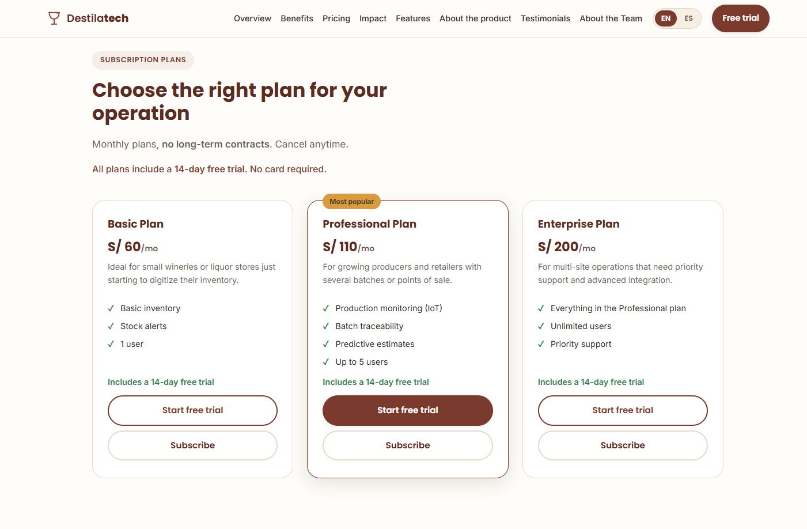

*Nota.* Captura propia (2026).

*Descripción.* Los planes Basic, Professional y Enterprise indican que incluyen la prueba de 14 días; «Start free trial» abre el registro con el plan elegido (`/register?plan=`) y «Subscribe» abre la vista de planes de la aplicación web (`/billing/plans?plan=`).

**Aplicación web 3.0.0.** Las siguientes capturas se tomaron sobre la aplicación web publicada en Firebase Hosting (<https://destilatech-webapp.web.app>), que consume la API 2.0.0 desplegada en Render.

**Figura 216**

*Vista de registro de cuenta*

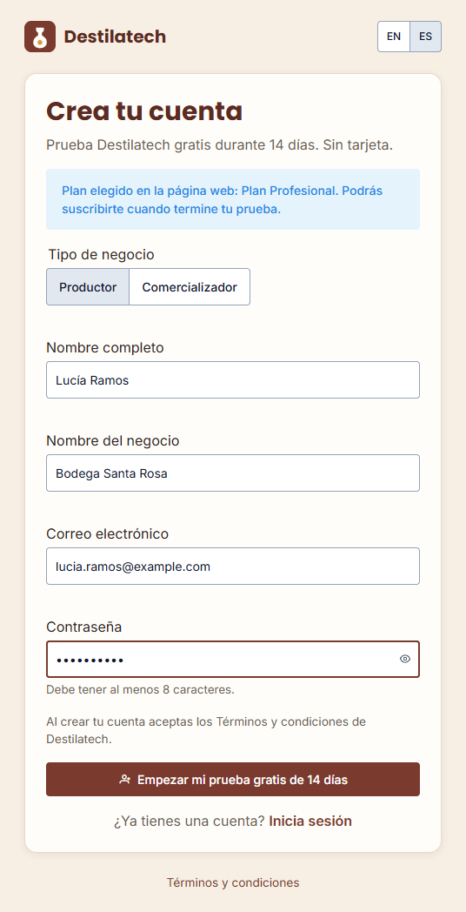

*Nota.* Captura propia de la aplicación web en ejecución local (2026).

*Descripción.* Formulario de registro con el nombre completo, el correo, la contraseña, el nombre del negocio, el tipo de negocio (productor o comercializador) y el plan preferido tomados del enlace de la landing page.

**Figura 217**

*Aviso de los días de prueba restantes*

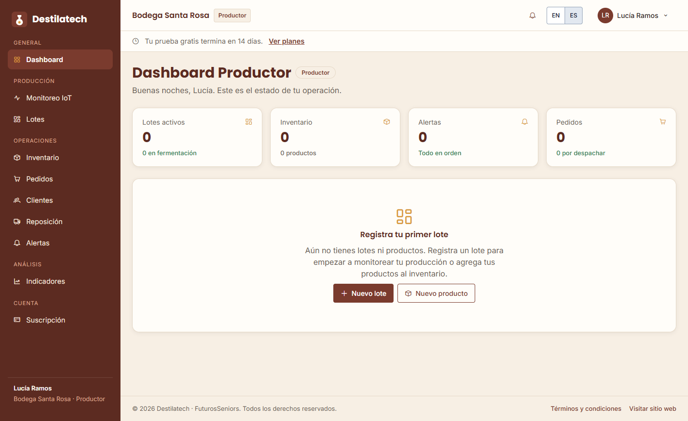

*Nota.* Captura propia de la aplicación web en ejecución local (2026).

*Descripción.* Después del registro la aplicación abre el dashboard del tipo de negocio y muestra el aviso con los días restantes de la prueba de 14 días; en los últimos 3 días el aviso cambia a advertencia.

**Figura 218**

*Vista de inicio de sesión*

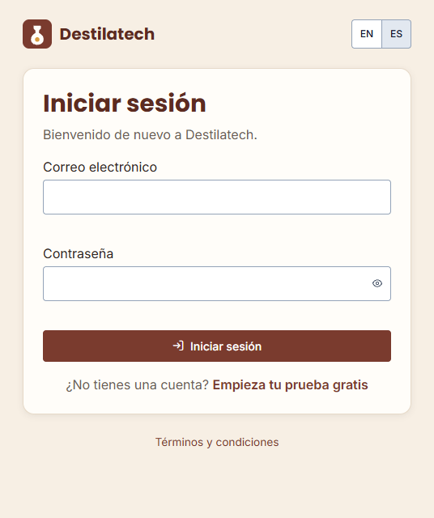

*Nota.* Captura propia de la aplicación web en ejecución local (2026).

*Descripción.* Formulario de inicio de sesión con el correo y la contraseña, el enlace al registro y el enlace a los términos y condiciones en el pie de página.

**Figura 219**

*Inicio de sesión con credenciales no válidas*

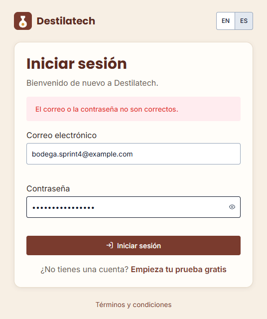

*Nota.* Captura propia de la aplicación web en ejecución local (2026).

*Descripción.* Cuando las credenciales no son válidas, la API responde `401` y la vista muestra el mensaje de error sin iniciar la sesión.

**Figura 220**

*Menú de cuenta con cierre de sesión*

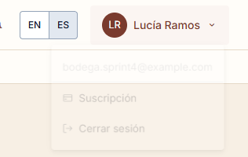

*Nota.* Captura propia de la aplicación web en ejecución local (2026).

*Descripción.* El menú de cuenta reemplaza al selector de usuarios de demostración del Sprint 2 y ofrece la opción de cerrar sesión (historia US38).

**Figura 221**

*Ruta protegida sin sesión*

*Nota.* Captura propia de la aplicación web en ejecución local (2026).

*Descripción.* Sin sesión, la guardia de autenticación redirige cualquier ruta protegida a `/login`: al abrir `/inventory` sin haber iniciado sesión, la aplicación muestra la vista de inicio de sesión en `/login?redirect=/inventory` y, después de iniciar sesión, vuelve a la ruta solicitada.

**Figura 222**

*Cuenta con la prueba terminada*

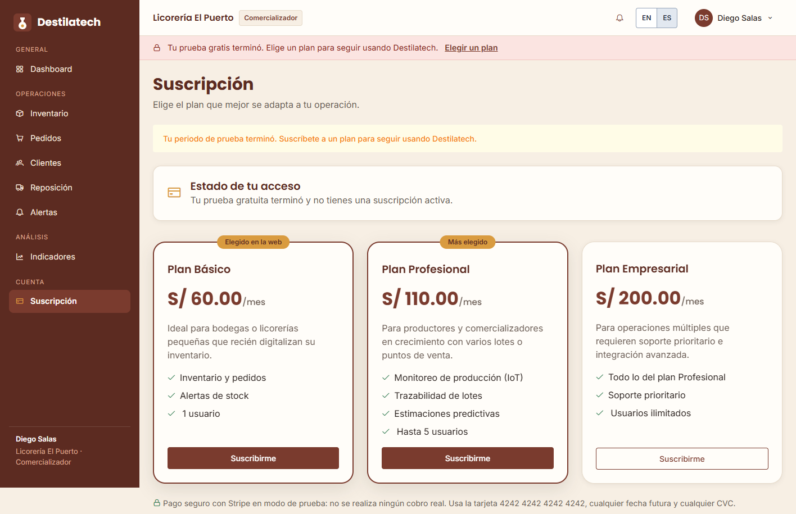

*Nota.* Captura propia de la aplicación web en ejecución local (2026).

*Descripción.* Al terminar la prueba solo se puede entrar a la vista de planes y a las páginas de retorno de Stripe; el resto de rutas redirige a los planes hasta que la cuenta contrate una suscripción.

**Figura 223**

*Términos y condiciones desde el pie de página*

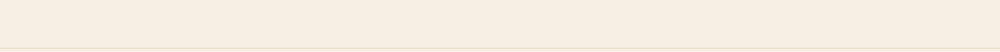

*Nota.* Captura propia de la aplicación web en ejecución local (2026).

*Descripción.* El pie de página enlaza los términos y condiciones de la landing page.

**RESTful API 2.0.0.** Las siguientes capturas muestran la API en ejecución local con Docker y su base de datos MySQL.

**Figura 224**

*API 2.0.0 en ejecución local con Docker*

<strong>[CAPTURA 17: guardar como assets/sprint4/api-docker-run.png y reemplazar este marcador por la imagen. Terminal con docker compose up -d --build y el registro de la API iniciada (sin mostrar el valor del secreto del token).]</strong>

*Nota.* Captura propia (2026).

*Descripción.* La API inicia con MySQL, aplica las migraciones y publica la documentación en Scalar; el secreto del token y la contraseña de las cuentas de demostración se leen de variables de entorno.

**Figura 225**

*Cuentas guardadas con la contraseña cifrada*

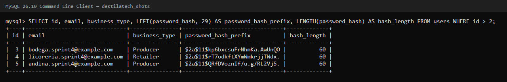

*Nota.* Salida del cliente de línea de comandos de MySQL sobre la base de datos local de pruebas (2026).

*Descripción.* La tabla `users` guarda la contraseña como un hash de BCrypt y nunca como texto plano; las cuentas de demostración y las registradas desde la aplicación coexisten en la misma tabla.
