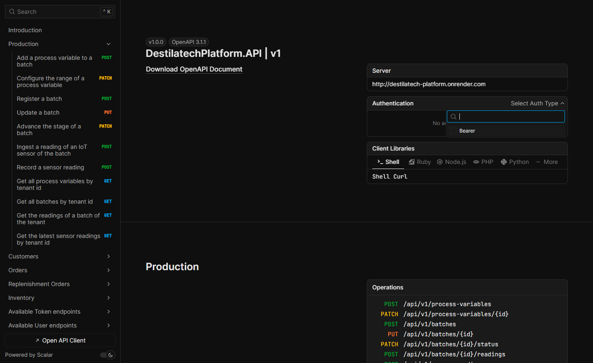
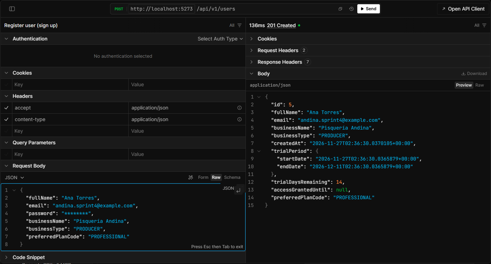
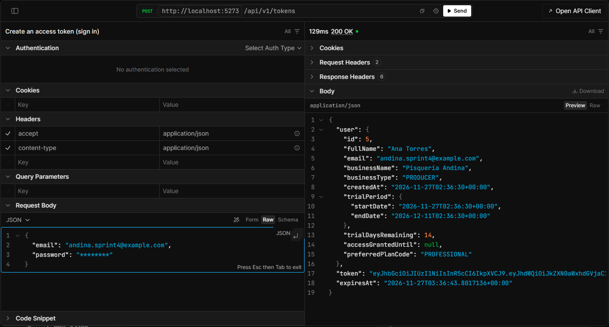
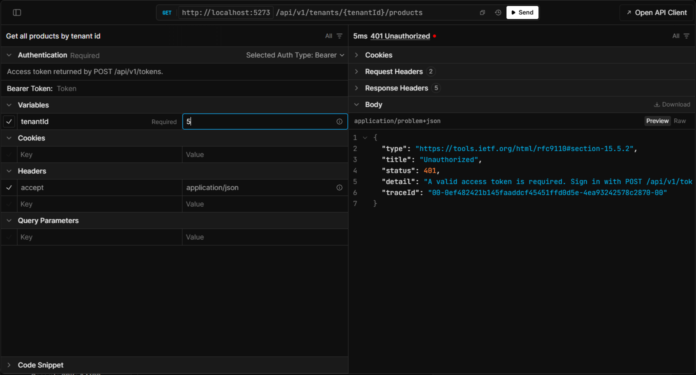
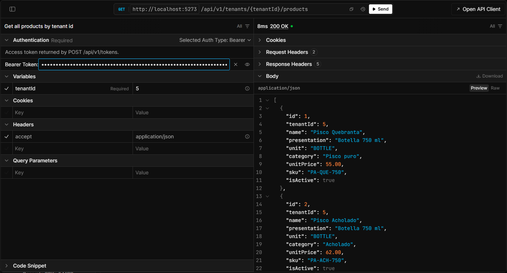
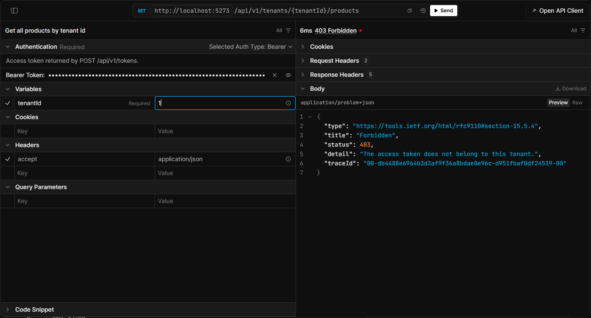
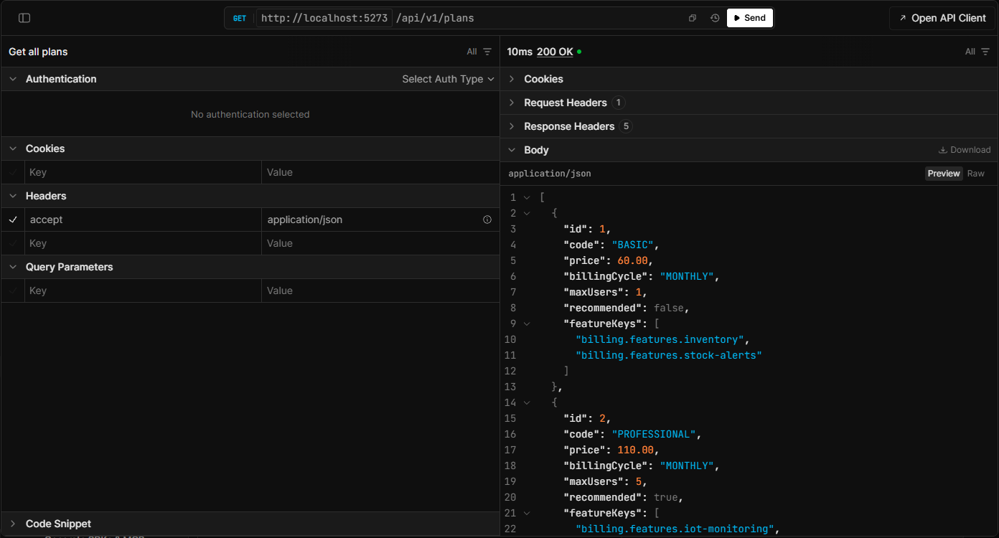

##### 5.2.4.6. Services Documentation Evidence for Sprint Review

En el Sprint 4 la API incorpora la autenticación con tokens JWT y documenta el esquema de seguridad Bearer en OpenAPI: la documentación de Scalar tiene un botón *Authorize* para pegar el token y probar los endpoints protegidos. La versión 2.0.0 documenta 52 operaciones, de las cuales 49 requieren el encabezado `Authorization: Bearer <token>`; solo `POST /api/v1/users` (registro), `POST /api/v1/tokens` (inicio de sesión) y `GET /api/v1/plans` (planes) son públicos. Una solicitud sin token o con un token vencido recibe `401`, y la que pide los datos de otra cuenta (otro `tenantId` en la ruta o en el cuerpo) recibe `403`. Los errores se siguen devolviendo como `ProblemDetails`. Las rutas de consulta usan el prefijo `/api/v1/tenants/{tenantId}/…` y el cuerpo de las operaciones de escritura incluye el `tenantId`. El inicio de sesión es un cambio incompatible con la versión anterior: los clientes de la API deben enviar el token en cada solicitud.

**URL de la documentación en ejecución local:** <http://localhost:5273/scalar> (con Docker: <http://localhost:8080/scalar>). **URL de la documentación desplegada:** <https://destilatech-platform.onrender.com/scalar> (sección 5.2.4.7). **Especificación OpenAPI desplegada:** <https://destilatech-platform.onrender.com/openapi/v1.json>.

**Tabla 36**

*Endpoints documentados de la API que incorpora o cambia el Sprint 4 (OpenAPI)*

| Bounded Context | Action (HTTP) | Endpoint (call syntax) | Parameters | Response | Historia |
| :---------- | :----------: | :---------- | :---------- | :---------- | :----------: |
| IAM | `POST` | `/api/v1/users` | Público. Cuerpo `RegisterUserResource` (`fullName`, `email`, `password`, `businessName`, `businessType` y `preferredPlanCode` opcional). | `201` con `UserResource` (incluye el período de prueba de 14 días); `400`, `409` con `ProblemDetails`. | US01, US56 |
| IAM | `POST` | `/api/v1/tokens` | Público. Cuerpo `SignInResource` (`email` y `password`). | `200` con `AuthenticatedUserResource` (`user`, `token` y `expiresAt`); `401` con `ProblemDetails`. | US26, US02 |
| IAM | `GET` | `/api/v1/users` | Encabezado `Authorization: Bearer <token>`. | `200` con la lista de `UserResource`, que contiene solo la cuenta autenticada; `401`. | US02 |
| IAM | `GET` | `/api/v1/users/{id}` | Ruta: `id`; encabezado `Authorization`. | `200` con `UserResource`; `401`; `404`. | US02 |
| Billing | `GET` | `/api/v1/plans` | Público, sin parámetros. | `200` con la lista de `PlanResource`. | US57 |
| Todos los contextos | `GET`, `POST`, `PUT`, `PATCH` | 47 operaciones de Billing, Production, Inventory, Orders, Alerts y Analytics, por ejemplo `GET /api/v1/tenants/{tenantId}/products` | Encabezado `Authorization: Bearer <token>`; ruta: `tenantId` en las consultas y en el cuerpo de las escrituras. | Las respuestas de cada endpoint no cambian (sección 5.2.3.6); sin token o con token vencido responden `401` y con el `tenantId` de otra cuenta responden `403`. | US26 |

*Nota.* Elaboración propia a partir de la especificación OpenAPI de la API desplegada (2026). El detalle de cada esquema está en Scalar.

**Tabla 37**

*Esquemas de IAM de la API (OpenAPI)*

| Esquema | Campos | Uso |
| :---------- | :---------- | :---------- |
| `RegisterUserResource` | `fullName`, `email`, `password`, `businessName`, `businessType` (`PRODUCER` o `RETAILER`), `preferredPlanCode` (opcional) | Cuerpo de `POST /api/v1/users`. |
| `SignInResource` | `email`, `password` | Cuerpo de `POST /api/v1/tokens`. |
| `UserResource` | `id`, `fullName`, `email`, `businessName`, `businessType`, `createdAt`, `trialPeriod` (`startDate`, `endDate`), `trialDaysRemaining`, `accessGrantedUntil`, `preferredPlanCode` | Respuesta de los endpoints de usuarios. La contraseña nunca se devuelve. |
| `AuthenticatedUserResource` | `user` (`UserResource`), `token`, `expiresAt` | Respuesta de `POST /api/v1/tokens`. El token es un JWT firmado con HS256 con emisor, audiencia y 60 minutos de vigencia (`TokenSettings:ExpirationMinutes`). |

**Ejemplo de request (`POST /api/v1/users`).** Los datos son de ejemplo:

```json
{
  "fullName": "Rosa Quispe",
  "email": "rosa.quispe@example.com",
  "password": "<contraseña>",
  "businessName": "Bodega Santa Rosa",
  "businessType": "PRODUCER",
  "preferredPlanCode": "PROFESSIONAL"
}
```

**Ejemplo de response (`POST /api/v1/tokens`).** La respuesta devuelve la cuenta, el token y su fecha de expiración; el token se abrevia:

```json
{
  "user": {
    "id": 3,
    "fullName": "Rosa Quispe",
    "email": "rosa.quispe@example.com",
    "businessName": "Bodega Santa Rosa",
    "businessType": "PRODUCER",
    "trialDaysRemaining": 14,
    "preferredPlanCode": "PROFESSIONAL"
  },
  "token": "eyJhbGciOiJIUzI1NiIs…",
  "expiresAt": "2026-11-25T16:30:00Z"
}
```

**Figura 226**

*Documentación de la API con el esquema de seguridad Bearer*

<p align="center"></p>

*Nota.* Captura propia de Scalar en https://destilatech-platform.onrender.com/scalar (2026).

*Descripción.* Documentación de la API 2.0.0 en Scalar con el esquema de seguridad Bearer (JWT) y los grupos de endpoints protegidos.

**Figura 227**

*Prueba de POST /api/v1/users en Scalar*

<p align="center"></p>

*Nota.* Captura propia de Scalar con la API ejecutada en local (2026).

*Descripción.* Registro de una cuenta con respuesta `201`: la cuenta incluye el período de prueba de 14 días y no devuelve la contraseña.

**Figura 228**

*Prueba de POST /api/v1/tokens en Scalar*

<p align="center"></p>

*Nota.* Captura propia de Scalar con la API ejecutada en local (2026).

*Descripción.* Inicio de sesión con respuesta `200`: la API devuelve la cuenta, el token JWT y la fecha de expiración (60 minutos).

**Figura 229**

*Solicitud protegida sin token*

<p align="center"></p>

*Nota.* Captura propia de Scalar con la API ejecutada en local (2026).

*Descripción.* Un endpoint protegido sin el encabezado `Authorization` responde `401`.

**Figura 230**

*Solicitud protegida con token*

<p align="center"></p>

*Nota.* Captura propia de Scalar con la API ejecutada en local (2026).

*Descripción.* Con el token de la cuenta, la consulta responde `200` con los datos de esa cuenta.

**Figura 231**

*Solicitud con el tenantId de otra cuenta*

<p align="center"></p>

*Nota.* Captura propia de Scalar con la API ejecutada en local (2026).

*Descripción.* Una cuenta que consulta los datos de otra recibe `403`, aunque su token sea válido.

**Figura 232**

*GET /api/v1/plans sin token*

<p align="center"></p>

*Nota.* Captura propia (2026).

*Descripción.* El endpoint de planes es público para que la landing page y la vista de registro los muestren sin sesión.
