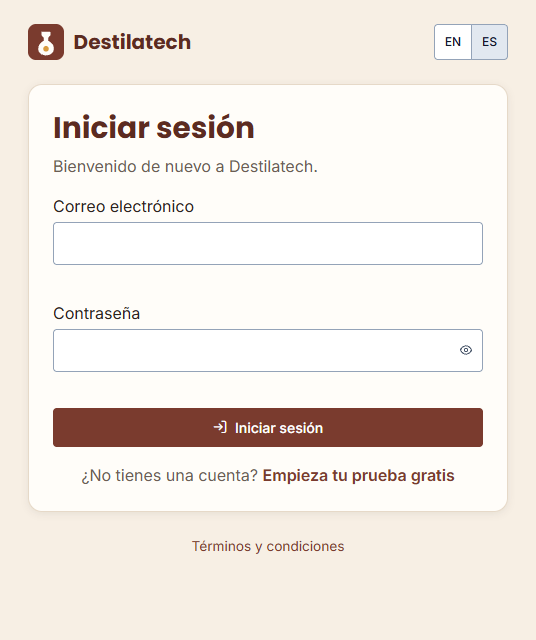
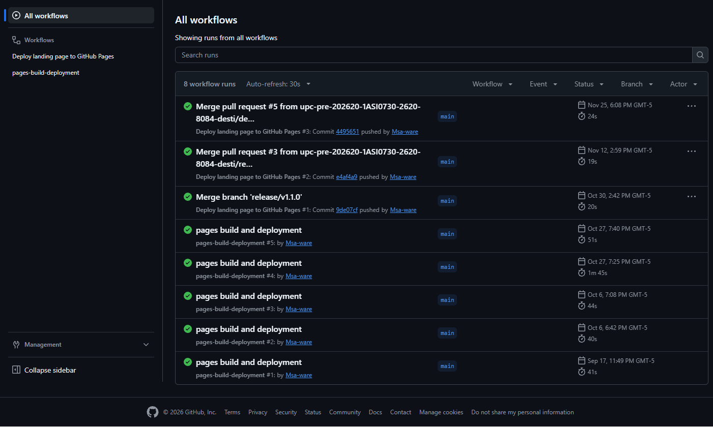
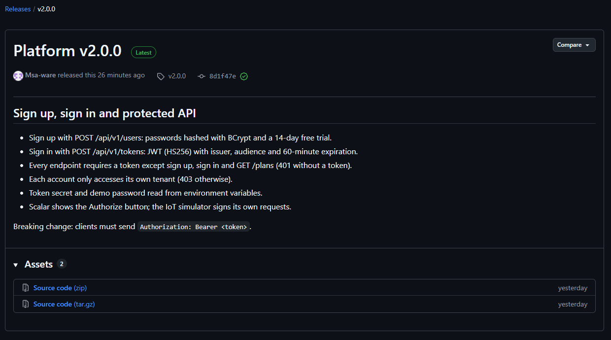
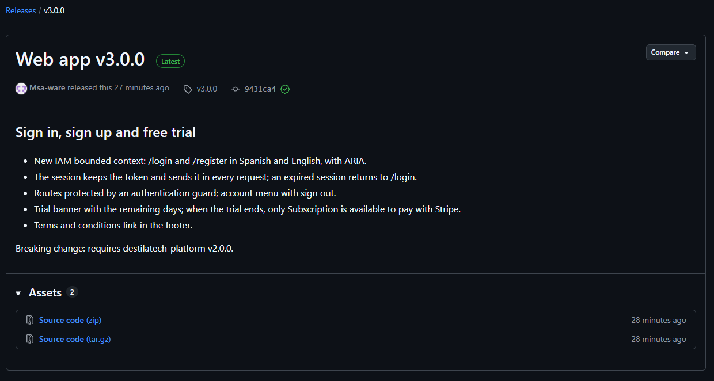
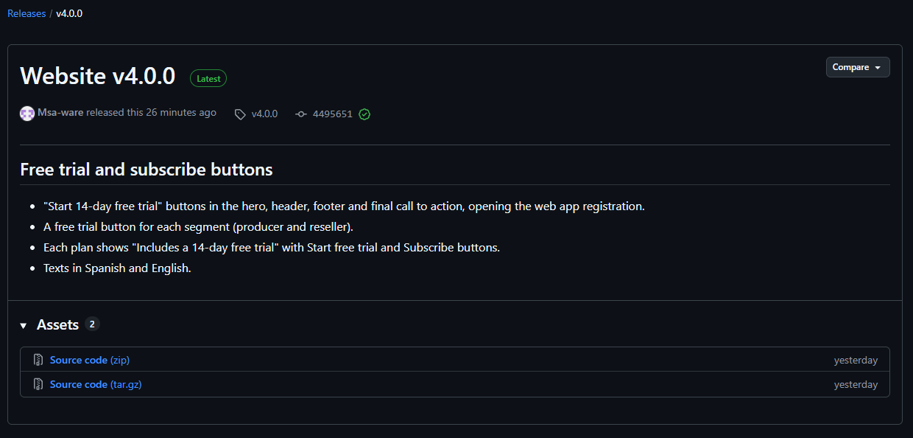

##### 5.2.4.7. Software Deployment Evidence for Sprint Review

En el Sprint 4 las tres partes del producto se publicaron con versiones nuevas: la RESTful API 2.0.0 en Render, la aplicación web 3.0.0 en Firebase Hosting y la landing page 4.0.0 en GitHub Pages. La aplicación web 3.0.0 requiere la API 2.0.0, por lo que la API se despliega primero; la landing page enlaza al registro de la aplicación web. La API necesita dos variables de entorno nuevas en Render, `TokenSettings__Secret` (clave con la que se firman los tokens) y `DemoAccounts__Password` (contraseña de las cuentas de demostración), cuyos valores no se guardan en el repositorio ni se muestran en este informe. La base de datos MySQL de Railway se mantiene.

**Tabla 38**

*Servicios de despliegue del Sprint 4*

| Parte | Versión | Servicio | URL |
| :---------- | :----------: | :---------- | :---------- |
| RESTful API (`destilatech-platform`) | 2.0.0 | Render (contenedor Docker, plan gratuito) | <https://destilatech-platform.onrender.com/scalar> |
| Base de datos | — | Railway (MySQL 8.4) | Esquema `destilatech`, sin URL pública de consulta |
| Aplicación web (`destilatech-webapp`) | 3.0.0 | Firebase Hosting | <https://destilatech-webapp.web.app> |
| Landing page (`destilatech-website`) | 4.0.0 | GitHub Pages | <https://upc-pre-202620-1asi0730-2620-8084-desti.github.io/destilatech-website/> |

**Tabla 39**

*Versiones publicadas en el Sprint 4*

| Repositorio | Versión | Fecha | Pull Request | Commit de la versión | Cambios principales |
| :---------- | :----------: | :----------: | :----------: | :----------: | :---------- |
| `destilatech-platform` | 2.0.0 | 2026-11-25 | #13 (`develop` a `main`) | [`8d1f47e`](https://github.com/upc-pre-202620-1ASI0730-2620-8084-desti/destilatech-platform/commit/8d1f47e) | Registro con contraseña cifrada, tokens JWT y API protegida con `401` y `403`. |
| `destilatech-webapp` | 3.0.0 | 2026-11-27 | #12 (`develop` a `main`) | [`9431ca4`](https://github.com/upc-pre-202620-1ASI0730-2620-8084-desti/destilatech-webapp/commit/9431ca4) | Contexto IAM: registro, inicio y cierre de sesión, rutas protegidas y aviso de la prueba gratuita. |
| `destilatech-website` | 4.0.0 | 2026-11-25 | #5 (`develop` a `main`) | [`4495651`](https://github.com/upc-pre-202620-1ASI0730-2620-8084-desti/destilatech-website/commit/4495651) | Botones «Start 14-day free trial» y «Subscribe» en el encabezado, el pie de página, los segmentos y los planes. |

Las notas de cada versión están en las secciones *Releases* de los repositorios: <https://github.com/upc-pre-202620-1ASI0730-2620-8084-desti/destilatech-platform/releases>, <https://github.com/upc-pre-202620-1ASI0730-2620-8084-desti/destilatech-webapp/releases> y <https://github.com/upc-pre-202620-1ASI0730-2620-8084-desti/destilatech-website/releases>.

**Figura 233**

*Variables de entorno de la API en Render*

<strong>[CAPTURA 26: guardar como assets/sprint4/deploy-render-env.png y reemplazar este marcador por la imagen. Panel Environment del servicio destilatech-platform en Render con los nombres TokenSettings__Secret y DemoAccounts__Password (valores ocultos).]</strong>

*Nota.* Captura propia (2026).

*Descripción.* Variables de entorno de la API desplegada: los valores de los secretos permanecen ocultos.

**Figura 234**

*Despliegue de la API 2.0.0 en Render*

<strong>[CAPTURA 27: guardar como assets/sprint4/deploy-render-live.png y reemplazar este marcador por la imagen. Panel Events o Deploys del servicio en Render con el despliegue en estado Live del commit 8d1f47e.]</strong>

*Nota.* Captura propia (2026).

*Descripción.* Despliegue de la versión 2.0.0 de la API en estado *Live* en Render, con el commit de la versión.

**Figura 235**

*Aplicación web 3.0.0 en Firebase Hosting*

*Nota.* Captura propia de https://destilatech-webapp.web.app/login (2026).

*Descripción.* La aplicación web 3.0.0 publicada en Firebase Hosting abre en la vista de inicio de sesión.

**Figura 236**

*Landing page 4.0.0 en GitHub Pages*

*Nota.* Captura propia (2026).

*Descripción.* Flujo de GitHub Actions que publicó la landing page 4.0.0 en GitHub Pages.

**Figura 237**

*Release 2.0.0 de la API*

*Nota.* Captura propia (2026).

*Descripción.* Release v2.0.0 de la API con sus notas: registro con contraseña cifrada, inicio de sesión con token JWT y API protegida.

**Figura 238**

*Release 3.0.0 de la aplicación web*

*Nota.* Captura propia (2026).

*Descripción.* Release v3.0.0 de la aplicación web con sus notas: inicio de sesión, registro y prueba gratuita.

**Figura 239**

*Release 4.0.0 de la landing page*

*Nota.* Captura propia (2026).

*Descripción.* Release v4.0.0 de la landing page con sus notas: botones de prueba gratuita y de suscripción.
