### 5.3. Validation Interviews

Las entrevistas de validación evalúan con usuarios de los dos segmentos objetivo la landing page y la aplicación web de Destilatech. Cada sesión se registra en video, se resume por escrito y se evalúa con el formato de heurísticas del curso (usabilidad, arquitectura de información y diseño inclusivo).

#### 5.3.1. Diseño de Entrevistas

**Segmentos y participantes.** Se realizan de 3 a 5 entrevistas por segmento: productores de pisco y comercializadores (licorerías, bodegas y pequeños distribuidores). Cada participante interactúa con la landing page y con la aplicación web en el perfil que corresponde a su segmento.

**Elementos de la sesión.** La sesión dura alrededor de 30 minutos: presentación del participante, exploración libre de la landing page, ejecución de las tareas de la Tabla 31 con la aplicación web y preguntas finales sobre claridad, utilidad y confianza.

**Tabla 31**

*Tareas de las sesiones de validación por segmento*

| Segmento | Tarea | User flow evaluado | Historia relacionada |
| :---------- | :---------- | :---------- | :----------: |
| Ambos | Entender qué ofrece Destilatech y qué plan le conviene | Landing page: Header, Description, Pricing y selector de idioma | US22, US23, US52 |
| Ambos | Contratar un plan con el pago simulado | Planes de suscripción, formulario de pago e historial de pagos | US40 |
| Productor | Registrar un lote y avanzar su etapa | Gestión de lotes y detalle del lote | US06, US07 |
| Productor | Revisar las lecturas simuladas y entender una alerta por condición anómala | Monitoreo IoT y centro de alertas | US09, US11, US16 |
| Comercializador | Registrar un producto y un movimiento de entrada o salida | Inventario y movimientos de stock | US12, US13 |
| Comercializador | Registrar un pedido y revisar la sugerencia de reposición | Pedidos, reposición e indicadores | US18, US20 |
| Ambos | Exportar un listado a CSV | Inventario o pedidos | — |

**Preguntas finales.** ¿Pudo completar cada tarea sin ayuda? ¿Qué le resultó confuso o lento? ¿Qué información esperaba encontrar y no encontró? ¿Pagaría por esta herramienta y cuánto? ¿Qué cambiaría primero?

#### 5.3.2. Registro de Entrevistas

Para cada entrevista se registra: nombres y apellidos, edad, distrito, captura de un cuadro del video, enlace al video en Microsoft Stream con el tiempo de inicio y la duración, y un resumen de las apreciaciones del participante sobre las tareas asignadas. Las entrevistas de los dos segmentos (de 3 a 5 por segmento) se consolidan en un único video, con un título que indica el entrevistado, el segmento y la fecha de cada sesión.

**Video de las entrevistas de validación:** [Ver video en Microsoft Stream](https://upcedupe-my.sharepoint.com/:v:/g/personal/u202418755_upc_edu_pe/IQCaCL2ACxsDSbr-WKq53s3kARrmlS8JWk_jU4IbjG0eRKU?nav=eyJyZWZlcnJhbEluZm8iOnsicmVmZXJyYWxBcHAiOiJPbmVEcml2ZUZvckJ1c2luZXNzIiwicmVmZXJyYWxBcHBQbGF0Zm9ybSI6IldlYiIsInJlZmVycmFsTW9kZSI6InZpZXciLCJyZWZlcnJhbFZpZXciOiJNeUZpbGVzTGlua0NvcHkifX0&e=N0aKrd) (duración total: 59:51)

**Figura 209**

*Cuadro representativo del video de las entrevistas de validación*

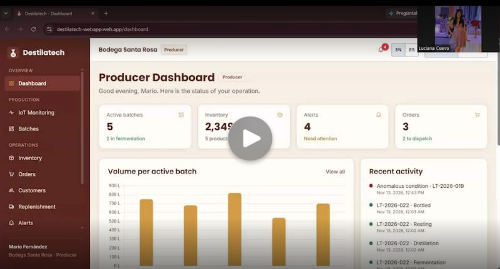

*Nota.* Captura del video de las entrevistas de validación en Microsoft Stream (2026).

*Descripción.* Cuadro de la entrevista #2: Luciana Cueva comparte su pantalla con el Dashboard Productor de la aplicación web publicada (perfil Productor, Bodega Santa Rosa, en inglés), con los indicadores de lotes activos, inventario, alertas y pedidos, el gráfico de volumen por lote activo y la actividad reciente. El video consolidado dura 59:51 y reúne las cuatro sesiones, cuyo inicio se indica en la Tabla 32.

**Tabla 32**

*Registro de las entrevistas de validación*

| # | Segmento | Nombres y apellidos | Edad | Distrito | Inicio y duración en el video |
| :----------: | :---------- | :---------- | :----------: | :---------- | :----------: |
| 1 | Comercializador | Marcos Esteban Vargas Paredes | 22 | San Miguel | 00:00:00 / 16:00 (aprox.) |
| 2 | Productor | Luciana Daniela Cueva Valdés | 20 | Lima | 00:16:59 / 16:17 |
| 3 | Comercializador | Rubens Bendezú | 24 | Comas | 00:33:17 / 11:41 |
| 4 | Comercializador | Andrea Mendoza | 41 | Surquillo | 00:44:59 / 14:52 |

**Entrevista #1.** Marcos Esteban Vargas Paredes, 22 años, San Miguel, segmento Comercializador (familiar con una pequeña licorería). Fecha de la sesión: 13 de noviembre de 2026. Enlace al video con el tiempo de inicio: [Ver video](https://upcedupe-my.sharepoint.com/:v:/g/personal/u202418755_upc_edu_pe/IQCaCL2ACxsDSbr-WKq53s3kARrmlS8JWk_jU4IbjG0eRKU?nav=eyJyZWZlcnJhbEluZm8iOnsicmVmZXJyYWxBcHAiOiJPbmVEcml2ZUZvckJ1c2luZXNzIiwicmVmZXJyYWxBcHBQbGF0Zm9ybSI6IldlYiIsInJlZmVycmFsTW9kZSI6InZpZXciLCJyZWZlcnJhbFZpZXciOiJNeUZpbGVzTGlua0NvcHkifX0&e=N0aKrd), desde el minuto 00:00:00.

**Figura 210**

*Cuadro del video de la entrevista #1*

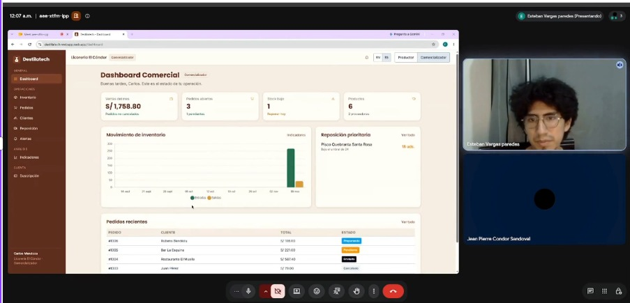

*Nota.* Captura de la grabación de la entrevista (2026).

*Descripción.* El entrevistado comparte su pantalla con el Dashboard Comercial de la aplicación web (perfil Comercializador, Licorería El Cóndor) durante la sesión de validación.

*Resumen.* Marcos Vargas navegó la landing page sin ayuda: cambió el idioma entre español e inglés, vio la versión móvil y conoció al equipo. En la aplicación registró un cliente nuevo y simuló un pedido y una reposición con ayuda de la interfaz. Le confundió que la landing page sea de una sola página, en lugar de abrir páginas distintas al usar los enlaces de la barra de navegación, y que al registrar un pedido con el stock agotado no se enlazara de forma más automática con las sugerencias de reposición o con un chat con el proveedor. Esperaba una comunicación más directa, como un chatbot que enviara los pedidos o las reposiciones al WhatsApp del proveedor. Sí pagaría por la plataforma, porque considera que los precios (entre S/ 60 y S/ 200 mensuales) se acomodan a su bolsillo, e incluso se suscribiría al plan Empresarial. Lo primero que cambiaría es la estructura de navegación de la landing page, para que abra páginas independientes, y el flujo de inventario cuando los pedidos se cruzan con el stock bajo.

**Entrevista #2.** Luciana Daniela Cueva Valdés, 20 años, Lima, segmento Productor. Fecha de la sesión: 13 de noviembre de 2026. Enlace al video con el tiempo de inicio: [Ver video](https://upcedupe-my.sharepoint.com/:v:/g/personal/u202418755_upc_edu_pe/IQCaCL2ACxsDSbr-WKq53s3kARrmlS8JWk_jU4IbjG0eRKU?nav=eyJyZWZlcnJhbEluZm8iOnsicmVmZXJyYWxBcHAiOiJPbmVEcml2ZUZvckJ1c2luZXNzIiwicmVmZXJyYWxBcHBQbGF0Zm9ybSI6IldlYiIsInJlZmVycmFsTW9kZSI6InZpZXciLCJyZWZlcnJhbFZpZXciOiJNeUZpbGVzTGlua0NvcHkifX0&e=N0aKrd), desde el minuto 00:16:59.

**Figura 211**

*Cuadro del video de la entrevista #2*

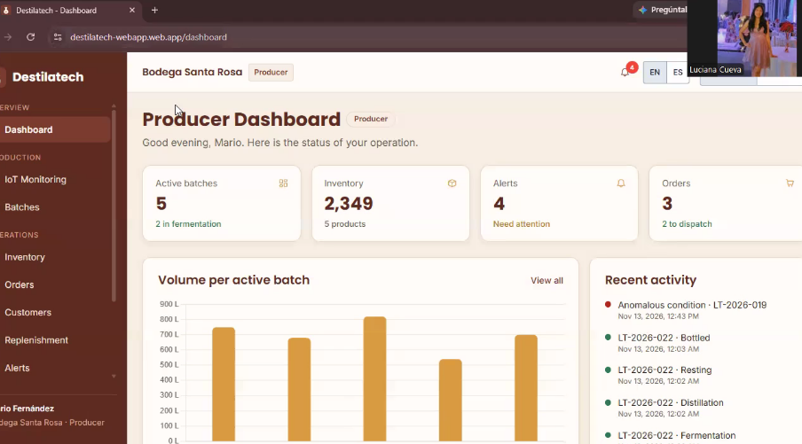

*Nota.* Captura de la grabación de la entrevista (2026).

*Descripción.* La entrevistada recorre el Dashboard del Productor de la aplicación web (Bodega Santa Rosa) durante la sesión de validación.

*Resumen.* Sin ayuda, Luciana Cueva entendió que la página sirve para administrar la producción de pisco. Encontró los planes y le parecieron muy accesibles, identificó el monitoreo y las alertas como lo que más le serviría, interpretó bien el dashboard (lotes activos, inventario, alertas, pedidos y actividad reciente) y encontró la temperatura y su rango de 16 a 24 °C. Le confundió que todo estuviera en inglés y le costó ubicar dónde registrar lotes, actualizar la etapa de un lote y ver las alertas. No esperaba que el monitoreo se actualizara solo con la simulación en vivo, y le gustó porque así puede vigilar la temperatura. Dijo que la plataforma se ve fácil de usar y que sí la usaría en su negocio; no indicó un monto, pero los precios le parecieron accesibles. Lo primero que cambiaría es tenerla en español y que las alertas sean más fáciles de encontrar. Se calificó con 3 sobre 5 en comodidad con aplicaciones web y busca algo simple y rápido.

**Entrevista #3.** Rubens Bendezú, 24 años, Comas, segmento Comercializador. Fecha de la sesión: 12 de noviembre de 2026. Enlace al video con el tiempo de inicio: [Ver video](https://upcedupe-my.sharepoint.com/:v:/g/personal/u202418755_upc_edu_pe/IQCaCL2ACxsDSbr-WKq53s3kARrmlS8JWk_jU4IbjG0eRKU?nav=eyJyZWZlcnJhbEluZm8iOnsicmVmZXJyYWxBcHAiOiJPbmVEcml2ZUZvckJ1c2luZXNzIiwicmVmZXJyYWxBcHBQbGF0Zm9ybSI6IldlYiIsInJlZmVycmFsTW9kZSI6InZpZXciLCJyZWZlcnJhbFZpZXciOiJNeUZpbGVzTGlua0NvcHkifX0&e=N0aKrd), desde el minuto 00:33:17.

**Figura 212**

*Cuadro del video de la entrevista #3*

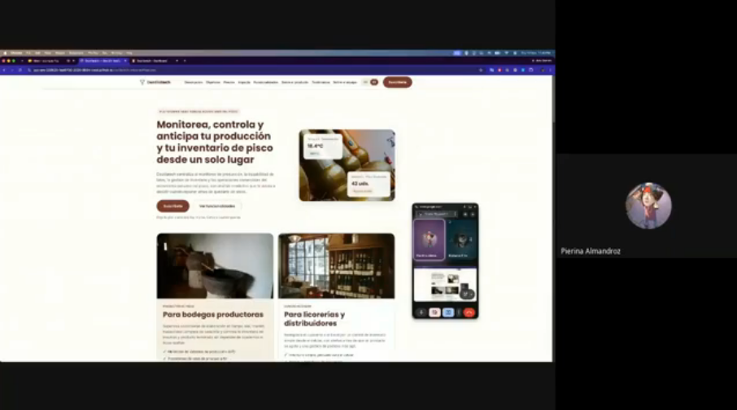

*Nota.* Captura de la grabación de la entrevista (2026).

*Descripción.* El entrevistado recorre la landing page de Destilatech en español durante la sesión de validación.

*Resumen.* Sin ayuda, Rubens Bendezú entendió que la plataforma es para licorerías, distribuidores y productores, y encontró las funciones para el comercializador («justo lo que necesito»). Cambió el idioma, entendió el dashboard (ventas, pedidos abiertos, stock bajo y reposición), encontró los productos con poco stock, registró el cliente y el pedido, cambió el estado del pedido y generó la reposición, que fue lo más fácil para él («cosa de 2 clics»). Le confundieron la configuración del umbral de stock y no ver la cantidad al armar el pedido, y no notó la prueba gratuita. Esperaba una función de proyección de ventas: si la semana pasada vendió cierta cantidad, cuánto se proyecta para esta. Elegiría el plan Básico porque administra la licorería solo, y recomendaría la plataforma con un 8 o 9 sobre 10. Lo primero que cambiaría es que los botones se noten más y agregar la proyección de ventas. Su comodidad con aplicaciones web es de 4 sobre 5; usa celular o laptop con Chrome, y hoy lleva el stock en Excel y en un cuaderno. Testimonio: «Me parece un sistema súper fácil de usar… es bastante rápido».

**Entrevista #4.** Andrea Mendoza, 41 años, Surquillo, segmento Comercializador. Fecha de la sesión: 13 de noviembre de 2026. Enlace al video con el tiempo de inicio: [Ver video](https://upcedupe-my.sharepoint.com/:v:/g/personal/u202418755_upc_edu_pe/IQCaCL2ACxsDSbr-WKq53s3kARrmlS8JWk_jU4IbjG0eRKU?nav=eyJyZWZlcnJhbEluZm8iOnsicmVmZXJyYWxBcHAiOiJPbmVEcml2ZUZvckJ1c2luZXNzIiwicmVmZXJyYWxBcHBQbGF0Zm9ybSI6IldlYiIsInJlZmVycmFsTW9kZSI6InZpZXciLCJyZWZlcnJhbFZpZXciOiJNeUZpbGVzTGlua0NvcHkifX0&e=N0aKrd), desde el minuto 00:44:59.

**Figura 213**

*Cuadro del video de la entrevista #4*

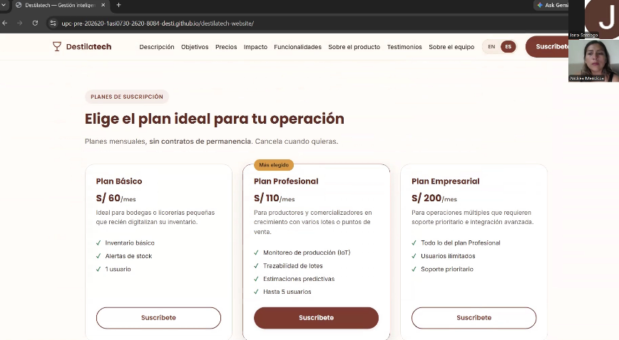

*Nota.* Captura de la grabación de la entrevista (2026).

*Descripción.* La entrevistada recorre la sección de planes de suscripción de la landing page de Destilatech, en español, durante la sesión de validación.

*Resumen.* Andrea Mendoza resolvió las tareas con facilidad y le resultaron sencillas. Solo se demoró al registrar un cliente (minuto 8:09), porque la barra de Zoom, al compartir la pantalla, le cubría esa parte de la interfaz. Sí pagaría por la herramienta: eligió el plan Empresarial, de S/ 200 al mes.

#### 5.3.3. Evaluaciones según heurísticas

Las sesiones se evalúan con el formato del Anexo D del enunciado (*UX Heuristics & Principles Evaluation: Usability – Inclusive Design – Information Architecture*). En cada sesión, un integrante del equipo observa, registra el resultado, el tiempo y los problemas de cada tarea, y al terminar clasifica cada problema con la heurística o el principio que viola y con la escala de severidad. La evaluación heurística preliminar del producto, realizada antes de las sesiones y revisada por el grupo Developers, se presenta en el Anexo D.

| Dato | Valor |
| :---------- | :---------- |
| Carrera | Ingeniería de Software |
| Curso | Aplicaciones Web (1ASI0730) |
| Sección | NRC 8084 |
| Profesores | Todos |
| Auditor | FuturosSeniors, grupo que ejecuta las sesiones de evaluación |
| Cliente(s) | Marcos Esteban Vargas Paredes; Luciana Daniela Cueva Valdés; Rubens Bendezú; Andrea Mendoza |

**Sitio o aplicación a evaluar.** La landing page de Destilatech (https://upc-pre-202620-1asi0730-2620-8084-desti.github.io/destilatech-website/) y la aplicación web (https://destilatech-webapp.web.app), con los perfiles de demostración de productor y de comercializador.

**Tareas a evaluar.** El alcance de esta evaluación incluye la revisión de la usabilidad de las siguientes tareas, que corresponden a la Tabla 31:

1. Entender qué ofrece Destilatech y qué plan le conviene en la landing page.
2. Contratar un plan de suscripción con el pago simulado.
3. Registrar un lote de producción y avanzar su etapa (productor).
4. Revisar las lecturas simuladas del monitoreo IoT y entender una alerta por condición anómala (productor).
5. Registrar un producto y un movimiento de entrada o salida de inventario (comercializador).
6. Registrar un pedido y revisar la sugerencia de reposición (comercializador).
7. Exportar un listado a CSV desde el inventario o los pedidos.

**Tareas no incluidas.** No están incluidas en esta versión de la evaluación:

1. Inicio de sesión y recuperación de contraseña: la API aún no autentica solicitudes (US26) y el perfil se elige con el selector de usuario de demostración.
2. Conexión con sensores IoT físicos: las lecturas de la aplicación son simuladas.
3. Configuración del umbral de stock bajo y de los rangos normales de las variables del proceso.
4. Registro y edición de clientes.

**Escala de severidad.** Los problemas se puntúan con la siguiente escala:

- **Nivel 1, problema superficial:** el usuario lo supera fácilmente u ocurre con muy poca frecuencia; no necesita corregirse salvo que haya tiempo disponible.
- **Nivel 2, problema menor:** ocurre un poco más seguido o es algo más difícil de superar; se le asigna prioridad baja para el siguiente *release*.
- **Nivel 3, problema mayor:** ocurre con frecuencia o los usuarios no logran resolverlo; es importante corregirlo y se le asigna prioridad alta.
- **Nivel 4, problema muy grave:** error de gran impacto que impide al usuario continuar con la herramienta; es imperativo corregirlo antes del lanzamiento.

**Heurísticas y principios de referencia.** Cada problema se clasifica en una de las tres familias del formato:

- **Usabilidad (heurísticas de Nielsen):** visibilidad del estado del sistema; coincidencia entre el sistema y el mundo real; control y libertad del usuario; consistencia y estándares; prevención de errores; reconocer en lugar de recordar; flexibilidad y eficiencia de uso; diseño estético y minimalista; ayuda para reconocer, diagnosticar y recuperarse de errores; ayuda y documentación.
- **Arquitectura de información:** ¿es encontrable (*findable*)?, ¿es usable (*usable*)?, ¿es útil (*useful*)?, ¿es creíble (*credible*)?, ¿es deseable (*desirable*)?, ¿es accesible (*accessible*)?, ¿aporta valor (*valuable*)?
- **Diseño inclusivo:** proporciona experiencias comparables; considera la situación del usuario; es consistente; da control al usuario; ofrece opciones; prioriza el contenido; añade valor.

**Tabla 33**

*Resumen de problemas encontrados en las sesiones de validación*

| # | Problema | Escala de severidad | Heurística / principio violado(a) |
| :----------: | :---------- | :----------: | :---------- |
| 1 | En el formulario «Registrar pedido» no se aprecia la cantidad de cada producto | 3 | Usabilidad: visibilidad del estado del sistema y prevención de errores; Arquitectura de información: ¿es útil (*useful*)? |
| 2 | No se encuentra el selector de idioma y la página se muestra en inglés | 3 | Arquitectura de información: ¿es encontrable (*findable*)? |
| 3 | No se encuentra dónde registrar un lote nuevo | 4 | Arquitectura de información: ¿es encontrable (*findable*)? |
| 4 | No se encuentra dónde actualizar la etapa de un lote | 3 | Arquitectura de información: ¿es encontrable (*findable*)? |
| 5 | No se encuentra la sección de alertas | 3 | Arquitectura de información: ¿es encontrable (*findable*)? |
| 6 | No se nota que existe la prueba gratuita de 14 días | 3 | Arquitectura de información: ¿es encontrable (*findable*)? |
| 7 | Cuesta encontrar el control del umbral de stock bajo en el inventario | 2 | Arquitectura de información: ¿es encontrable (*findable*)? |
| 8 | Demora al encontrar cómo registrar un cliente | 2 | Arquitectura de información: ¿es encontrable (*findable*)? |

Los minutos de cada problema se cuentan desde el inicio de la entrevista correspondiente. Las capturas de los problemas se toman de los cuadros del video de las entrevistas de validación.

**Problema #1:** Cantidad no visible al armar un pedido. **Sesión(es) en que se observó:** 1 y 3. **Severidad:** 3 (3 en la sesión 1 y 2 en la sesión 3). **Heurística violada:** Usabilidad, visibilidad del estado del sistema y prevención de errores; Arquitectura de información, ¿es útil (*useful*)?. **Problema:** En la sesión 1 (minutos 6:15 a 6:45), al agregar los productos de un pedido, el entrevistado no vio de forma clara cuántas botellas había elegido y, al superar el stock disponible de 18 unidades, se encontró con limitaciones y notificaciones de cantidad no confirmada. En la sesión 3 (minuto 6:16), el entrevistado dijo «me parece que hay un pequeño error porque no veo la cantidad» y siguió con el pedido. En una revisión posterior del formulario, la cantidad es un control numérico estrecho sin etiqueta visible; solo el nombre accesible la identifica. Ver la Figura 214. **Recomendación:** Mostrar la cantidad y el subtotal de cada producto en la línea del pedido, con una etiqueta visible «Cantidad», y advertir con un mensaje claro cuando la cantidad supera el stock disponible.

**Figura 214**

*Formulario «Registrar pedido» en la entrevista #3*

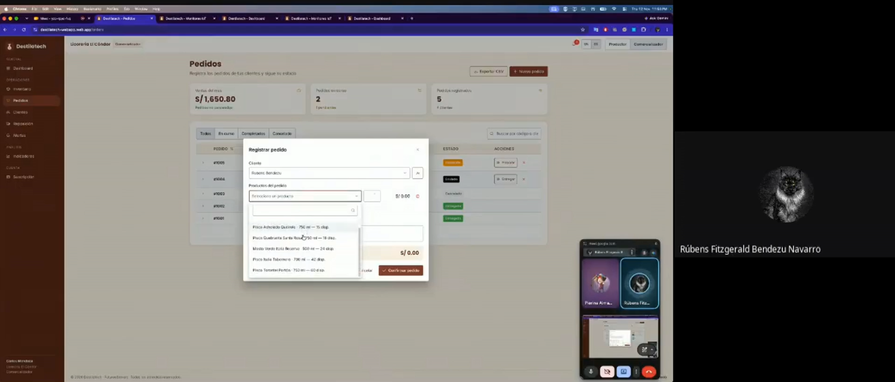

*Nota.* Captura del video de las entrevistas de validación (2026).

*Descripción.* Minuto 6:16 de la entrevista #3: Rubens Bendezú abre el formulario «Registrar pedido» del perfil Comercializador y elige un producto de la lista; la línea del pedido no muestra con claridad la cantidad elegida.

**Problema #2:** Selector de idioma no encontrado. **Sesión(es) en que se observó:** 2. **Severidad:** 3, porque no lo encontró sin ayuda. **Heurística violada:** Arquitectura de información: ¿es encontrable (*findable*)?. **Problema:** Al recorrer la página, la entrevistada dijo que todo estaba en inglés y que no sabía si había una función para traducirla (minuto 4:38). En la tarea de cambiar el idioma preguntó «¿Cómo podría hacerlo?» y el entrevistador le indicó dónde estaba el selector (minuto 6:35). Ver la Figura 215. **Recomendación:** Hacer más visible el selector de idioma, con el texto «ES | EN» junto al menú principal, o detectar el idioma del navegador.

**Figura 215**

*Landing page en inglés durante la entrevista #2*

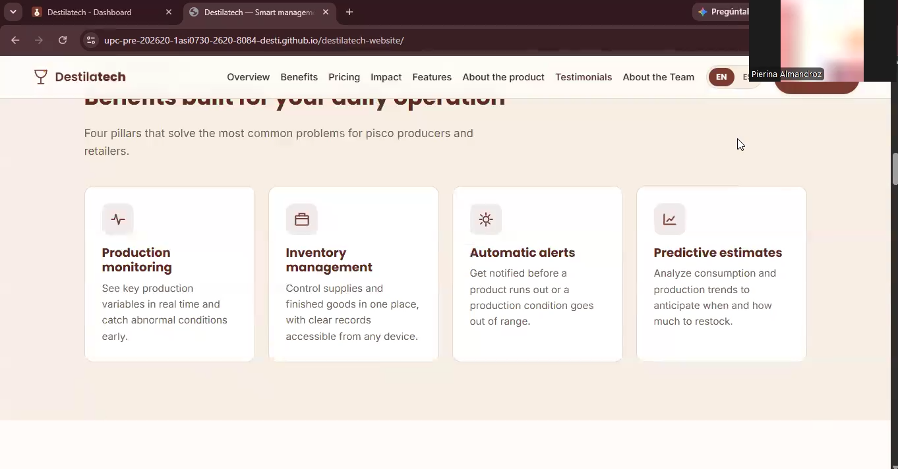

*Nota.* Captura del video de las entrevistas de validación (2026).

*Descripción.* Minuto 6:35 de la entrevista #2: la landing page se muestra en inglés (sección de beneficios) mientras la entrevistada pregunta cómo cambiar el idioma.

**Problema #3:** Registro de un lote nuevo no encontrado. **Sesión(es) en que se observó:** 2. **Severidad:** 4, porque no pudo continuar con la tarea. **Heurística violada:** Arquitectura de información: ¿es encontrable (*findable*)?. **Problema:** Entre los minutos 9:19 y 9:50, la entrevistada preguntó «¿Dónde lo coloco?». Le pidieron que lo intentara y respondió «No, no puedo». Se pasó a la siguiente tarea sin registrar el lote. Ver la Figura 216. **Recomendación:** Poner un botón visible «Registrar lote» en el dashboard y encima de la lista de lotes.

**Figura 216**

*Dashboard del productor al buscar dónde registrar un lote*

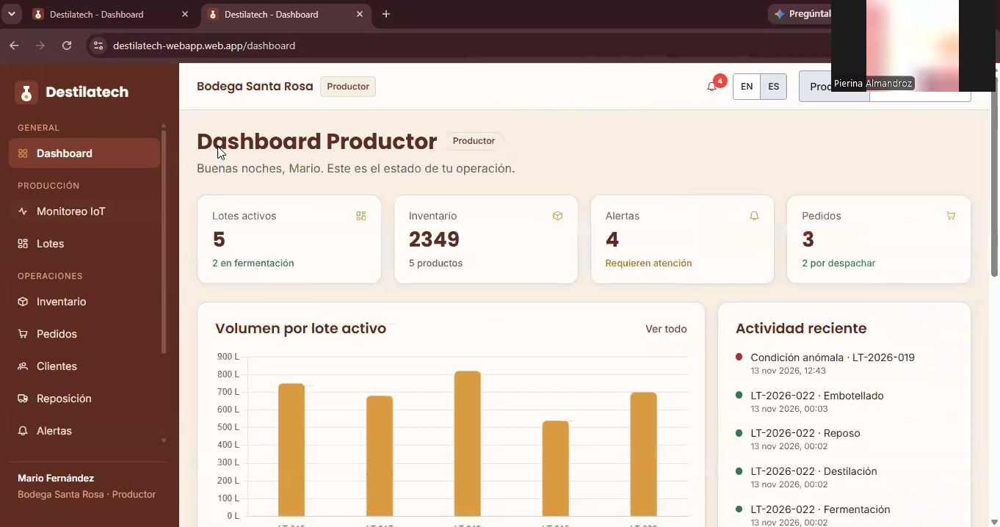

*Nota.* Captura del video de las entrevistas de validación (2026).

*Descripción.* Minuto 9:19 de la entrevista #2: el Dashboard Productor (Bodega Santa Rosa) en español, sin un acceso directo para registrar un lote nuevo.

**Problema #4:** Actualización de la etapa de un lote no encontrada. **Sesión(es) en que se observó:** 2. **Severidad:** 3, porque necesitó una indicación del entrevistador. **Heurística violada:** Arquitectura de información: ¿es encontrable (*findable*)?. **Problema:** Entre los minutos 9:50 y 11:14, la entrevistada no encontró dónde actualizar el lote. El entrevistador le indicó que entrara a la sección «Lotes» y pasó cerca de un minuto (de 10:20 a 11:14) antes de continuar. Ver la Figura 217. **Recomendación:** Que los lotes del dashboard se puedan abrir con un clic y lleven a su detalle, con el botón para avanzar de etapa a la vista.

**Figura 217**

*Gestión de lotes al buscar cómo avanzar la etapa*

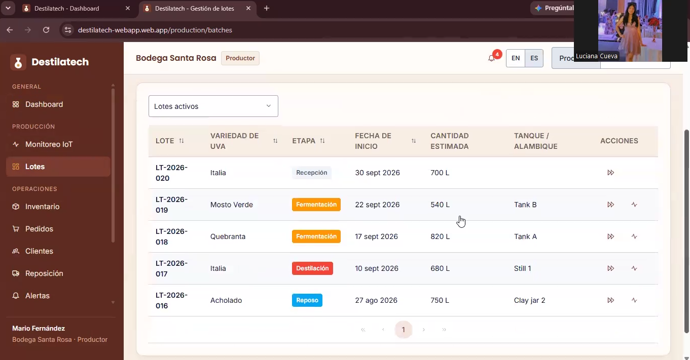

*Nota.* Captura del video de las entrevistas de validación (2026).

*Descripción.* Minuto 10:20 de la entrevista #2: la tabla de lotes activos, donde la acción para avanzar la etapa es solo un ícono en la columna Acciones.

**Problema #5:** Sección de alertas no encontrada. **Sesión(es) en que se observó:** 2. **Severidad:** 3, porque no lo logró sin ayuda. **Heurística violada:** Arquitectura de información: ¿es encontrable (*findable*)?. **Problema:** Entre los minutos 12:24 y 14:46, la entrevistada no encontró la sección de alertas. El entrevistador le indicó varias veces dónde estaba y cómo marcar una alerta como atendida y usar los filtros; le tomó unos dos minutos y medio. Al final ella misma dijo que tuvo problemas para encontrar el botón de alertas. Ver la Figura 218. **Recomendación:** Que la campana con el contador y la tarjeta «Alertas» del dashboard lleven directo a la bandeja de alertas.

**Figura 218**

*Monitoreo IoT al buscar la sección de alertas*

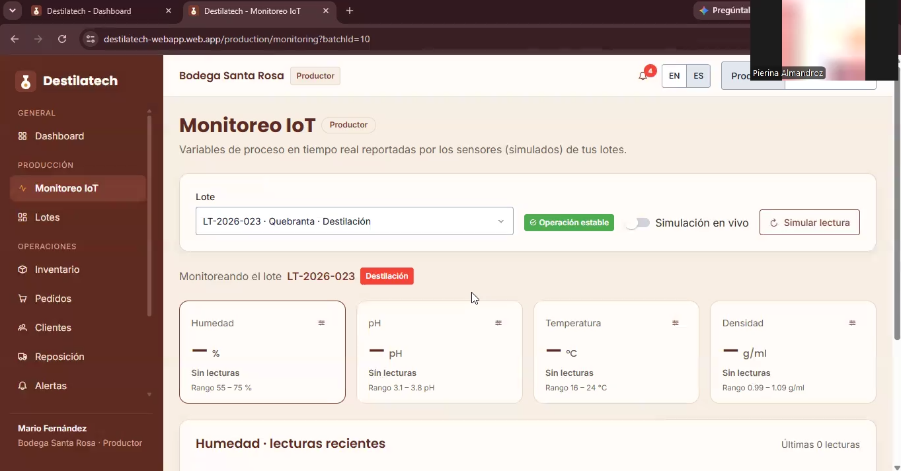

*Nota.* Captura del video de las entrevistas de validación (2026).

*Descripción.* Minuto 13:05 de la entrevista #2: la entrevistada está en Monitoreo IoT (lote LT-2026-023) mientras busca la bandeja de alertas.

**Problema #6:** Prueba gratuita no notada. **Sesión(es) en que se observó:** 3. **Severidad:** 3, porque no se dio cuenta solo de que había prueba gratuita. **Heurística violada:** Arquitectura de información: ¿es encontrable (*findable*)?. **Problema:** En el minuto 2:49, el entrevistado encontró los planes pero dijo «veo que no hay un plan gratuito» y que los planes empiezan en 60 soles; no vio la prueba gratuita. Ver la Figura 219. **Recomendación:** Poner «Prueba gratis de 14 días» dentro de cada tarjeta de plan y en el botón principal de la sección de precios.

**Figura 219**

*Planes de suscripción en la landing page durante la entrevista #3*

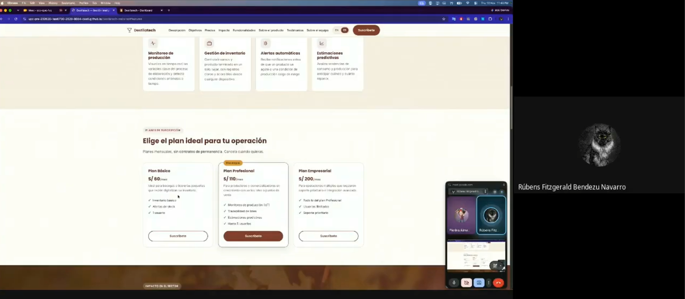

*Nota.* Captura del video de las entrevistas de validación (2026).

*Descripción.* Minuto 2:49 de la entrevista #3: la sección «Elige el plan ideal para tu operación» muestra los planes de S/ 60, S/ 110 y S/ 200, sin un aviso visible de la prueba gratuita en las tarjetas.

**Problema #7:** Control del umbral de stock bajo difícil de encontrar. **Sesión(es) en que se observó:** 3. **Severidad:** 2, porque le costó pero lo resolvió solo. **Heurística violada:** Arquitectura de información: ¿es encontrable (*findable*)?. **Problema:** Entre los minutos 4:11 y 5:19, el entrevistado dudó si el aviso era «una alerta o no», lo buscó primero en notificaciones, pidió que le repitieran la consigna y después lo encontró en inventario; le tomó cerca de un minuto. Al final dijo que lo más difícil fue entender el control del umbral en inventarios y que había «botoncitos» que recién notaba y que deberían notarse más. Ver la Figura 220. **Recomendación:** Un botón visible con texto, por ejemplo «Avisarme cuando baje de…», en cada producto del inventario y en la lista de stock bajo.

**Figura 220**

*Reposición del comercializador al buscar el umbral de stock bajo*

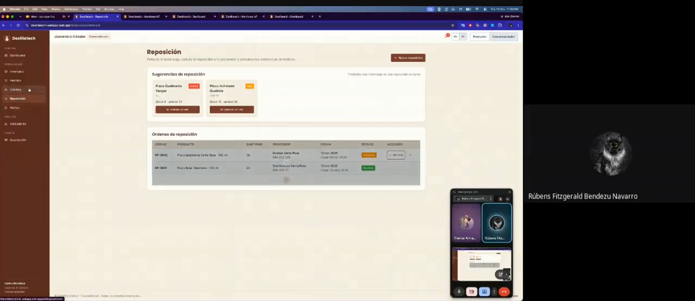

*Nota.* Captura del video de las entrevistas de validación (2026).

*Descripción.* Minuto 4:40 de la entrevista #3: la pantalla de Reposición muestra las sugerencias con el stock y el umbral de cada producto mientras el entrevistado busca dónde se configura ese umbral.

**Problema #8:** Demora al registrar un cliente. **Sesión(es) en que se observó:** 4. **Severidad:** 2, porque le costó un poco más pero pudo continuar y completar el registro. **Heurística violada:** Arquitectura de información: ¿es encontrable (*findable*)? (la demora se atribuye en parte a que la barra de Zoom cubría esa zona de la pantalla al compartirla). **Problema:** En el minuto 8:09, la entrevistada se demoró en registrar un cliente. Según el entrevistador, la barra de Zoom, al compartir la pantalla, le tapaba esa parte de la interfaz; aun así logró registrar el cliente. **Recomendación:** Mantener el botón «Nuevo cliente» visible y con texto en la parte superior de la lista de clientes y probarlo con el uso compartido de pantalla de videollamadas.
