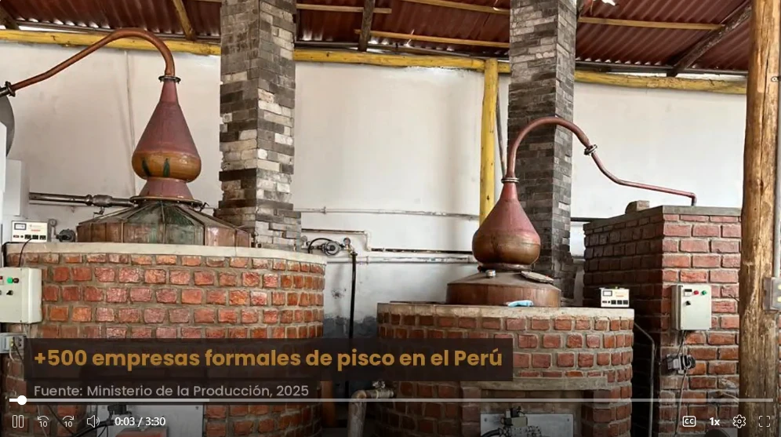

### 5.4. Video About-the-Product

El video About-the-Product presenta el modelo de negocio, las características y los beneficios de Destilatech a los visitantes de la landing page y a los usuarios de la aplicación web. Dura de 1 a 3 minutos, incluye escenas de interacción con el producto y al menos una opinión por cada segmento objetivo, y usa el mismo tono de comunicación del producto. La landing page lo incorpora en la sección «About the product» a partir de su identificador de YouTube.

| Dato | Valor |
| :---------- | :---------- |
| Nombre del archivo | upc-pre-202620-1asi0730-8084-futurosseniors-about-the-product-sprint-3.mp4 |
| Duración | 03:30 |
| Enlace en Microsoft Stream | [Ver video](https://upcedupe-my.sharepoint.com/:v:/g/personal/u202418755_upc_edu_pe/IQCFhi4_Hi0TTqML9k6Pzdo0AcH_rJm_2Y7to8P2PCnmnwE?e=ENdebx) |
| Enlace en YouTube (no listado, el que se incrusta en la landing page) | [https://youtu.be/5oqDkvLjRj4](https://youtu.be/5oqDkvLjRj4) |

**Figura 221**

*Cuadro representativo del video About-the-Product*

*Nota.* Captura del video About-the-Product del equipo (2026).

*Descripción.* Cuadro inicial del video (0:03 de 3:30): alambiques de cobre de una bodega pisquera con el dato «+500 empresas formales de pisco en el Perú» (Ministerio de la Producción, 2025), que introduce el problema que resuelve Destilatech. El video está publicado en YouTube y se incorpora en la sección «About the product» de la landing page.
