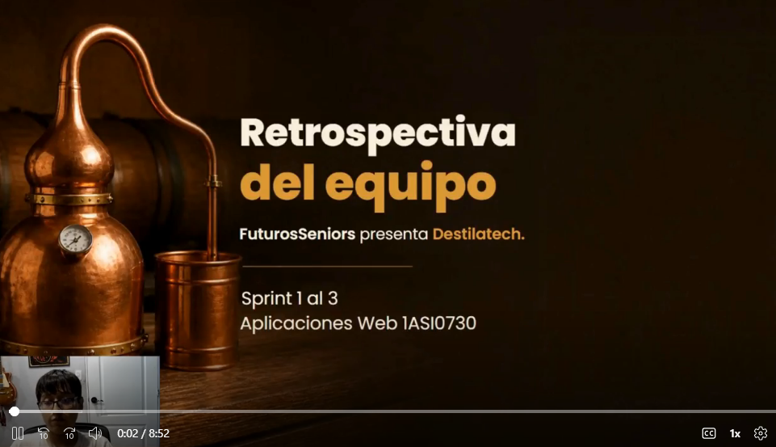

## Conclusiones

**Conclusiones**

1. Las entrevistas a siete personas de los dos segmentos (tres productores y cuatro comercializadores) mostraron que el problema principal de los productores es la dificultad para monitorear las variables del proceso y llevar registros sin errores, y el de los comercializadores, quedarse sin stock con clientes esperando. Estas necesidades justifican las tres capacidades de Destilatech: monitoreo, gestión de inventario y estimaciones de reposición.
2. El análisis estadístico de las entrevistas indica coincidencias entre los segmentos (todos usan teléfono inteligente y Excel o cuaderno, y todos los que respondieron estarían dispuestos a pagar una suscripción mensual), con un rango medio de pago cercano a S/ 66. Por la muestra pequeña (n = 7), estos resultados son indicativos y deben validarse con más usuarios.
3. El Big Picture EventStorming, modelado como el negocio actual, permitió identificar cuatro áreas candidatas y el Design-Level EventStorming, al incorporar la solución, llegó a siete *bounded contexts* (con IAM y Billing como contextos nuevos de la plataforma), implementados como módulos de la API. Esto mantiene la coherencia entre el análisis del negocio, las historias de usuario (65 historias, 10 épicas) y el diseño de software.
4. La arquitectura elegida —un monolito modular en ASP.NET Core con base de datos MySQL, una aplicación web en Vue.js y un simulador de lecturas IoT— es proporcionada al tamaño del equipo y permite incorporar sensores reales en el futuro sin cambiar la API.
5. La landing page se publicó en GitHub Pages con sus siete secciones, lo que cumple el objetivo del Sprint 1 y deja un canal de presentación del producto a los prospectos. En el Sprint 2 la aplicación web se desplegó en Firebase Hosting y consume un Fake API publicado en Render, de modo que la primera versión puede revisarse desde una URL pública.
6. En el Sprint 3 se construyó la primera versión de la RESTful API en ASP.NET Core con MySQL: siete *bounded contexts*, 49 endpoints documentados en Scalar, un servicio simulador de lecturas IoT y 13 de las 14 historias técnicas de la épica EP10. Cada contexto tuvo un líder y los 424 commits de la API siguen Conventional Commits, lo que cumple la recomendación del Sprint 2 y permite medir los aportes individuales.
7. La API se desplegó en Render con su base de datos MySQL en Railway y la aplicación web 2.1.0, publicada en Firebase Hosting, la consume y paga la suscripción con Stripe Checkout en modo de prueba, además de la atención masiva de alertas y la exportación a CSV. La API aún no autentica solicitudes (US26 queda en el Product Backlog) y carece de pruebas automatizadas.

**Recomendaciones**

1. Validar los resultados de las entrevistas con una muestra mayor de productores y comercializadores, y realizar las entrevistas de validación de la landing page y de la aplicación con usuarios reales.
2. Aplicar desde el siguiente sprint la convención de Conventional Commits, con el tipo correcto y mensajes en inglés, y hacer que cada integrante registre sus commits desde su propia cuenta en todos los repositorios.
3. Confirmar con los usuarios los precios de los planes Básico, Profesional y Empresarial, y pasar el pago de la suscripción de Stripe, hoy en modo de prueba, a un entorno de producción.
4. Reemplazar el simulador de lecturas por sensores IoT reales, manteniendo la API actual, e implementar las historias del Product Backlog que aún no se desarrollaron, documentando cada sprint con sus evidencias.
5. Implementar la autenticación (US26), agregar pruebas unitarias y de integración al repositorio de los Web Services y pasar la API y su base de datos a un plan que no se apague por inactividad.
6. Realizar las entrevistas de validación con 3 a 5 usuarios por segmento y corregir los problemas de mayor severidad antes de la entrega final.

### Video About-the-Team

El video About-the-Team resume el proceso de trabajo del equipo FuturosSeniors durante los tres Sprints: la retrospectiva del grupo, narrada sobre escenas de las reuniones reales del equipo, y el testimonio ante cámara de cada integrante sobre las actividades realizadas, el logro de los outcomes y las competencias desarrolladas. [COMPLETAR: resumen de los aspectos más relevantes del video, en dos o tres oraciones]

**Tabla 34**

*Pauta de secuencias del video About-the-Team*

| Sección | Inicio (hh:mm:ss) |
| :---------- | :----------: |
| Presentación del equipo | [COMPLETAR] |
| Retrospectiva: Sprint 1 | [COMPLETAR] |
| Retrospectiva: Sprint 2 | [COMPLETAR] |
| Retrospectiva: Sprint 3 | [COMPLETAR] |
| Retrospectiva: qué salió bien, qué salió mal y qué haríamos distinto | [COMPLETAR] |
| Testimonio de Fernandez Seer, Mario Alonso | [COMPLETAR] |
| Testimonio de Santiago Atanacio, Jairo Mathias | [COMPLETAR] |
| Testimonio de Almandroz Carbajal, Pierina Marysabel | [COMPLETAR] |
| Testimonio de Condor Sandoval, Jean Pierre | [COMPLETAR] |

| Dato | Valor |
| :---------- | :---------- |
| Nombre del archivo | upc-pre-202620-1asi0730-8084-futurosseniors-about-the-team-sprint-3.mp4 |
| Duración | 08:52 |
| Enlace en Microsoft Stream | [Ver video](https://upcedupe-my.sharepoint.com/:v:/g/personal/u202418755_upc_edu_pe/IQCtZKxZW1N-R5tM5o5bXInSAcEr14D9nnV8576NdhseK2A?e=IZzn6x) |
| Enlace en YouTube (no listado, el que se incrusta en la landing page) | [https://youtu.be/unnZ-w0I7SU](https://youtu.be/unnZ-w0I7SU) |

**Figura 210**

*Cuadro representativo del video About-the-Team*

*Nota.* Captura del video About-the-Team del equipo (2026).

*Descripción.* Portada del video (0:02 de 8:52) con el título «Retrospectiva del equipo»: FuturosSeniors presenta Destilatech, Sprint 1 al 3, curso Aplicaciones Web 1ASI0730, con la cámara del integrante que narra. El video está publicado en YouTube y se incorpora en la sección «About the Team» de la landing page.

