## Project Report Collaboration Insights

A continuación, se detallan los repositorios utilizados a lo largo del proyecto.

#### Link del repositorio del Reporte

- [destilatech-report](https://github.com/upc-pre-202620-1ASI0730-2620-8084-desti/destilatech-report)

#### Link del repositorio del Website

- [destilatech-website](https://github.com/upc-pre-202620-1ASI0730-2620-8084-desti/destilatech-website)

#### Link del Website

- [destilatech-website](https://upc-pre-202620-1asi0730-2620-8084-desti.github.io/destilatech-website/)

#### Link del repositorio de la Web Application

- [destilatech-webapp](https://github.com/upc-pre-202620-1ASI0730-2620-8084-desti/destilatech-webapp)

#### Link de la Web Application

- [destilatech-webapp](https://destilatech-webapp.web.app)

#### Link del repositorio de los Web Services

- [destilatech-platform](https://github.com/upc-pre-202620-1ASI0730-2620-8084-desti/destilatech-platform)

#### Link de la documentación de los Web Services

- [destilatech-platform](https://destilatech-platform.onrender.com/scalar)

### Desarrollo de Actividades

A lo largo del ciclo de vida del proyecto, el equipo mantuvo una comunicación constante mediante canales de voz en Discord para las reuniones virtuales y las coordinaciones generales, y mediante WhatsApp para los avisos cotidianos. La carga de trabajo del informe y del desarrollo del software se distribuyó de forma equitativa, con plazos adecuados para cada iteración (AV1, TB1 y AV2). Las sesiones presenciales fueron clave para recibir la retroalimentación del docente, resolver impedimentos técnicos y optimizar el avance frente a los horarios limitados del grupo. Un integrante, Domenack Angeles, Miguel, se retiró del equipo después del Sprint 1; desde el Sprint 2 el equipo está conformado por cuatro integrantes y las tareas se redistribuyeron entre ellos.

El trabajo siguió el flujo GitFlow descrito en la sección 5.1.2: una rama `feature/*` por actividad, integración a `develop` mediante Pull Request y mensajes de commit con el formato Conventional Commits desde el Sprint 2. Desde el AV2, por indicación del docente, toda rama se integra a `develop` mediante Pull Request revisada por otro integrante. La Tabla 1 resume, por actividad del ciclo de vida (documentación, desarrollo, ejecución, pruebas y despliegue), dónde se registró la evidencia y quiénes la produjeron.

**Tabla 1**

*Evidencia de las actividades del ciclo de vida por repositorio*

| Actividad | Qué se hizo | Repositorio y ramas | Commits de referencia | Responsables | Sección del informe |
| :---------- | :------------------------------------------- | :---------------------------------- | :------------------------------------------- | :--------------------- | :---------- |
| Documentación | Redacción del informe: capítulos I a V, Sprint Planning, Sprint Backlogs, evidencias y anexos. En el AV2 el informe se reorganizó como documentación como código (un archivo Markdown por sección, compilado con Pandoc) y el Sprint 3 se documentó con un archivo por sección. Cada capítulo se trabajó en una rama `feature/*` y se integró a `develop` mediante Pull Request. | `destilatech-report`: `feature/product-design`, `feature/sprint2`, `feature/docs-as-code`, `feature/sprint-3`, `develop`, `main` | [`62f8e46`](https://github.com/upc-pre-202620-1ASI0730-2620-8084-desti/destilatech-report/commit/62f8e46) (lenguaje ubicuo), [`69897f8`](https://github.com/upc-pre-202620-1ASI0730-2620-8084-desti/destilatech-report/commit/69897f8) (secciones 4.6 a 4.8), [`b3c44df`](https://github.com/upc-pre-202620-1ASI0730-2620-8084-desti/destilatech-report/commit/b3c44df) (Sprint Backlog 2), [`0094f16`](https://github.com/upc-pre-202620-1ASI0730-2620-8084-desti/destilatech-report/commit/0094f16) (evidencia de desarrollo), [`b811839`](https://github.com/upc-pre-202620-1ASI0730-2620-8084-desti/destilatech-report/commit/b811839) (evidencia de ejecución), [`8c09a2e`](https://github.com/upc-pre-202620-1ASI0730-2620-8084-desti/destilatech-report/commit/8c09a2e) (analíticos del Sprint 2) | Los cuatro integrantes del equipo; en el AV1 también Domenack Angeles, Miguel (revisión de calidad y perfiles, `bebfabb`, `265d16a`) | Capítulos I a V y Anexos |
| Desarrollo de la Landing Page | Implementación de las secciones de la landing page (estructura, estilos, internacionalización, pestañas de funcionalidades, adaptabilidad móvil, testimonios y pie de página). | `destilatech-website`: `feature/landing-structure`, `feature/i18n`, `feature/responsive-design`, `feature/platform-features-tabs`, `develop`, `main` | [`5d16532`](https://github.com/upc-pre-202620-1ASI0730-2620-8084-desti/destilatech-website/commit/5d16532) (estructura), [`5be25df`](https://github.com/upc-pre-202620-1ASI0730-2620-8084-desti/destilatech-website/commit/5be25df) (adaptabilidad móvil), [`798b3b1`](https://github.com/upc-pre-202620-1ASI0730-2620-8084-desti/destilatech-website/commit/798b3b1) (i18n), [`ca54689`](https://github.com/upc-pre-202620-1ASI0730-2620-8084-desti/destilatech-website/commit/ca54689) (inglés como idioma por defecto), [`17fd993`](https://github.com/upc-pre-202620-1ASI0730-2620-8084-desti/destilatech-website/commit/17fd993) (testimonios), [`c636199`](https://github.com/upc-pre-202620-1ASI0730-2620-8084-desti/destilatech-website/commit/c636199) (pie de página) | Santiago Atanacio (Jairo), Fernandez Seer (Mario), Almandroz Carbajal (Pierina), Condor Sandoval (Jean Pierre) | 5.2.1.3 y 5.2.1.4 |
| Desarrollo de la Web Application | Implementación de la aplicación web por *bounded context*: Shared Kernel, Fake API, internacionalización, Billing, Production & Monitoring, Inventory & Stock, Orders & Replenishment, Alerts & Notifications y Analytics & Estimations. En el AV2 se publicaron la versión 2.0.0 (atención masiva de alertas y exportación a CSV) y la 2.1.0, que reemplaza el Fake API por la RESTful API y paga la suscripción con Stripe Checkout. | `destilatech-webapp`: `feature/shared`, `feature/fake-api`, `feature/locales`, `feature/billing`, `feature/production-monitoring`, `feature/inventory-stock`, `feature/orders-replenishment`, `feature/alerts-notifications`, `feature/analytics-estimations`, `feature/av2-improvements`, `feature/platform-integration`, `release/v2.1.0`, `develop`, `main` | [`2eab4bb`](https://github.com/upc-pre-202620-1ASI0730-2620-8084-desti/destilatech-webapp/commit/2eab4bb) (Shared Kernel), [`c3d927d`](https://github.com/upc-pre-202620-1ASI0730-2620-8084-desti/destilatech-webapp/commit/c3d927d) (Fake API), [`58bd501`](https://github.com/upc-pre-202620-1ASI0730-2620-8084-desti/destilatech-webapp/commit/58bd501) (Billing), [`c8be6ef`](https://github.com/upc-pre-202620-1ASI0730-2620-8084-desti/destilatech-webapp/commit/c8be6ef) (producción), [`353f6c5`](https://github.com/upc-pre-202620-1ASI0730-2620-8084-desti/destilatech-webapp/commit/353f6c5) (inventario), [`7312132`](https://github.com/upc-pre-202620-1ASI0730-2620-8084-desti/destilatech-webapp/commit/7312132) (pedidos), [`a624859`](https://github.com/upc-pre-202620-1ASI0730-2620-8084-desti/destilatech-webapp/commit/a624859) (alertas), [`c7eb23e`](https://github.com/upc-pre-202620-1ASI0730-2620-8084-desti/destilatech-webapp/commit/c7eb23e) (analíticos), [`5268904`](https://github.com/upc-pre-202620-1ASI0730-2620-8084-desti/destilatech-webapp/commit/5268904) (PR #2: conexión con la API), [`9a5ca93`](https://github.com/upc-pre-202620-1ASI0730-2620-8084-desti/destilatech-webapp/commit/9a5ca93) (PR #3: versión 2.1.0) | Santiago Atanacio (Jairo), Fernandez Seer (Mario), Almandroz Carbajal (Pierina), Condor Sandoval (Jean Pierre) | 5.2.2.3, 5.2.2.4 y 5.2.3.4 |
| Desarrollo de los Web Services | RESTful API en ASP.NET Core con siete *bounded contexts* (IAM, Billing, Production & Monitoring, Inventory & Stock, Orders & Replenishment, Alerts & Notifications y Analytics & Estimations), el *Shared Kernel*, 49 endpoints documentados en Scalar, pagos con Stripe en modo de prueba y el servicio simulador de lecturas IoT. Cada contexto tuvo un líder y se integró a `develop` mediante Pull Request. | `destilatech-platform`: `feature/project-configuration`, `feature/shared`, `feature/iam`, `feature/billing-work`, `feature/production-monitoring`, `feature/inventory-stock`, `feature/orders-replenishment`, `feature/alerts-notifications`, `feature/analytics-estimations`, `refactor/*`, `feature/dashboard-summary`, `feature/iot-sensor-simulator`, `develop`, `main` | [`3cbe420`](https://github.com/upc-pre-202620-1ASI0730-2620-8084-desti/destilatech-platform/commit/3cbe420) (patrón `Result`), [`e05a149`](https://github.com/upc-pre-202620-1ASI0730-2620-8084-desti/destilatech-platform/commit/e05a149) (PR #2: Analytics), [`e0de4ef`](https://github.com/upc-pre-202620-1ASI0730-2620-8084-desti/destilatech-platform/commit/e0de4ef) (PR #3: Billing e IAM), [`4407f53`](https://github.com/upc-pre-202620-1ASI0730-2620-8084-desti/destilatech-platform/commit/4407f53) (PR #5: Inventory), [`9be6192`](https://github.com/upc-pre-202620-1ASI0730-2620-8084-desti/destilatech-platform/commit/9be6192) (PR #6: Production), [`b9f64ed`](https://github.com/upc-pre-202620-1ASI0730-2620-8084-desti/destilatech-platform/commit/b9f64ed) (PR #7: resumen del dashboard), [`c78e41d`](https://github.com/upc-pre-202620-1ASI0730-2620-8084-desti/destilatech-platform/commit/c78e41d) (PR #8: simulador IoT) | Santiago Atanacio (Jairo): Shared Kernel y Alerts; Fernandez Seer (Mario): Production e Inventory; Almandroz Carbajal (Pierina): Orders y Analytics; Condor Sandoval (Jean Pierre): IAM y Billing | 5.2.3.4 y 5.2.3.6 |
| Ejecución | Ejecución local de la aplicación con el Fake API (`json-server`) y registro de capturas y videos de navegación de la landing page y de la aplicación web, con los dos perfiles de demostración. En el Sprint 3, ejecución local de la API con MySQL (`docker compose` o `dotnet run`), con migraciones al iniciar y su documentación en Scalar. | `destilatech-report`: `assets/webapp/`, enlaces de video del Anexo B | [`3bc139f`](https://github.com/upc-pre-202620-1ASI0730-2620-8084-desti/destilatech-report/commit/3bc139f) (evidencia de ejecución del Sprint 2), [`6028978`](https://github.com/upc-pre-202620-1ASI0730-2620-8084-desti/destilatech-report/commit/6028978) (enlaces de los videos) | Fernandez Seer (Mario), Santiago Atanacio (Jairo) | 5.2.1.5, 5.2.2.5 y 5.2.3.5 |
| Pruebas funcionales | Pruebas manuales de los módulos de la aplicación web según los criterios de aceptación y, en el Sprint 3, de los endpoints de la API desde Scalar y de los datos en MySQL Workbench; los defectos se comunicaron al equipo por Discord antes de la revisión del sprint. | Sin commits: el resultado se refleja en las tareas de pruebas de los Sprint Backlog 2 y 3 | No aplica (las pruebas manuales no generan commits; las pruebas automatizadas de la API quedan para la siguiente versión) | Cada integrante, sobre los módulos y contextos que desarrolló | 5.2.2.3 y 5.2.3.3 |
| Despliegue | Publicación de la landing page en GitHub Pages, de la aplicación web en Firebase Hosting y del Fake API en Render. En el AV2: base de datos MySQL en Railway, RESTful API en Render con Docker (variables de conexión y de Stripe), conexión de la aplicación web 2.1.0 con la API y con Stripe Checkout, carga de los datos de demostración y publicación de la versión 2.1.0 en Firebase Hosting. | `destilatech-website` (`main`), `destilatech-webapp` (`develop`, `main`), `destilatech-platform` (`main`) | [`34c7c91`](https://github.com/upc-pre-202620-1ASI0730-2620-8084-desti/destilatech-webapp/commit/34c7c91) (configuración de Firebase), [`ed3b72a`](https://github.com/upc-pre-202620-1ASI0730-2620-8084-desti/destilatech-webapp/commit/ed3b72a) (API de producción en Render), [`000428e`](https://github.com/upc-pre-202620-1ASI0730-2620-8084-desti/destilatech-webapp/commit/000428e) (`firebase.json`), [`3863ecc`](https://github.com/upc-pre-202620-1ASI0730-2620-8084-desti/destilatech-report/commit/3863ecc) (documentación del despliegue), [`a1099cf`](https://github.com/upc-pre-202620-1ASI0730-2620-8084-desti/destilatech-platform/commit/a1099cf) (conexión de producción), [`fb58f25`](https://github.com/upc-pre-202620-1ASI0730-2620-8084-desti/destilatech-platform/commit/fb58f25) (`Dockerfile`), [`5f9078c`](https://github.com/upc-pre-202620-1ASI0730-2620-8084-desti/destilatech-webapp/commit/5f9078c) (URL de la API en producción), [`9a5ca93`](https://github.com/upc-pre-202620-1ASI0730-2620-8084-desti/destilatech-webapp/commit/9a5ca93) (versión 2.1.0) | Santiago Atanacio (Jairo) | 5.1.4, 5.2.1.7, 5.2.2.7 y 5.2.3.7 |

*Nota.* Elaboración propia a partir del historial de commits de los cuatro repositorios de la organización (2026). Los identificadores enlazan al commit en GitHub.

---

### Evidencias de Colaboración (GitHub Insights)

Las capturas se presentan por entrega: las del AV1 corresponden al avance del Sprint 1, las del TB1 al avance hasta el Sprint 2 y las del AV2 al avance hasta el Sprint 3.

#### 1. Analíticas Globales del Equipo

**A. Pulse Insights (actividad general del repositorio del informe)**

**Figura 1**

*Pulse Insights del repositorio del informe (AV1)*

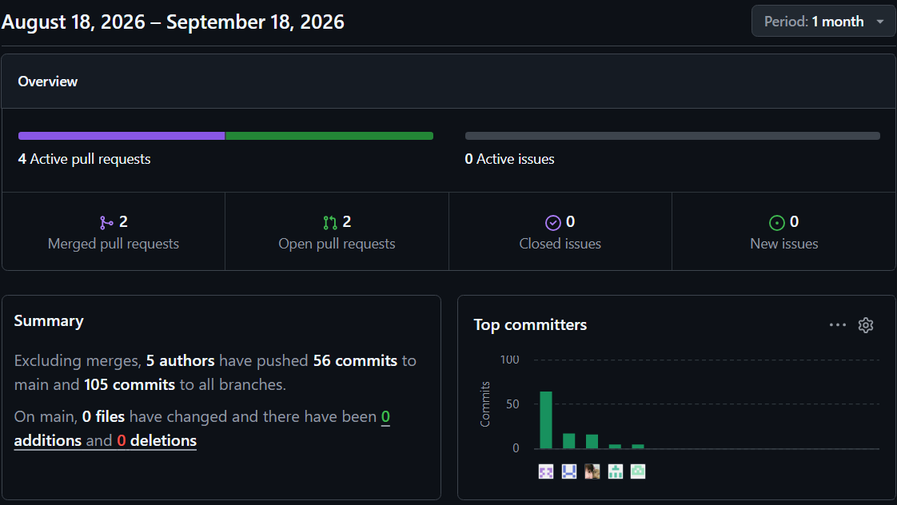

*Nota.* Captura de GitHub Insights (2026).

*Descripción.* Resumen de actividad entre el 18 de agosto y el 18 de septiembre de 2026: 4 Pull Requests activas (2 integradas y 2 abiertas) y ninguna incidencia. Cinco autores enviaron 56 commits a `main` y 105 commits a todas las ramas.

**Figura 2**

*Pulse Insights del repositorio del informe (TB1)*

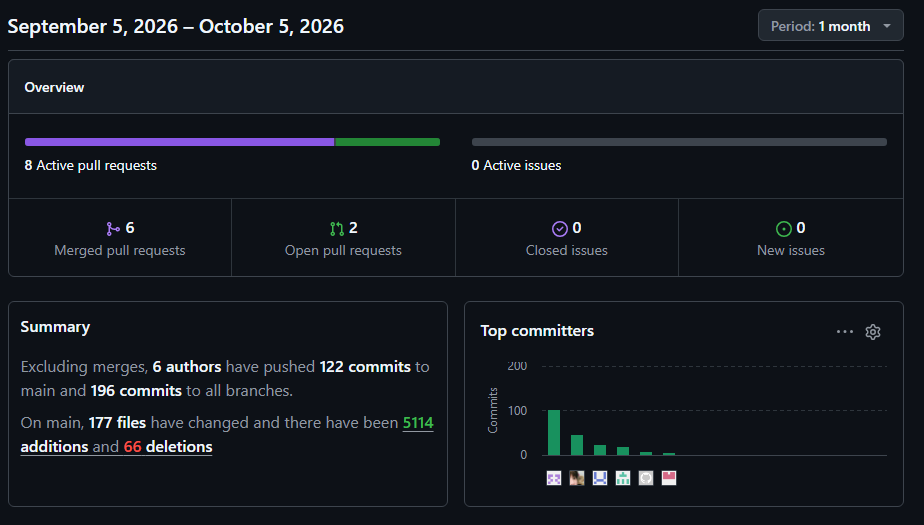

*Nota.* Captura de GitHub (2026).

*Descripción.* Resumen de actividad entre el 5 de septiembre y el 5 de octubre de 2026: 8 Pull Requests activas (6 integradas y 2 abiertas) y ninguna incidencia. Seis autores enviaron 122 commits a `main` y 196 commits a todas las ramas; en `main` cambiaron 177 archivos, con 5114 adiciones y 66 eliminaciones.

**Figura 3**

*Pulse Insights del repositorio del informe (AV2)*

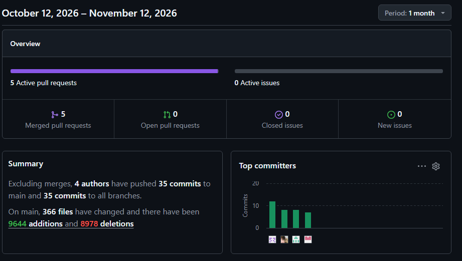

*Nota.* Captura de GitHub (2026).

*Descripción.* Resumen de actividad del repositorio del informe en el mes previo al AV2, hasta el 12 de noviembre de 2026: periodo en que el informe se reorganizó como documentación como código (`feature/docs-as-code`) y se documentó el Sprint 3 (`feature/sprint-3`). Muestra las Pull Requests integradas y abiertas y los commits enviados a `main` y a todas las ramas por los cuatro integrantes.

**B. Contributors Insights (evolución de aportes)**

**Figura 4**

*Contributors Insights del repositorio del informe (AV1)*

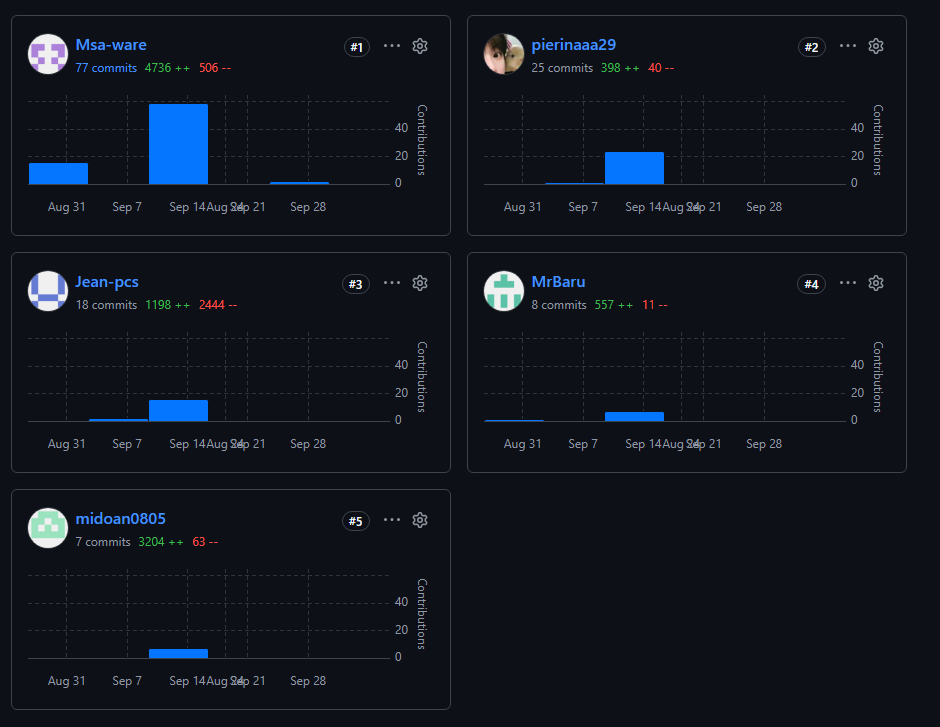

*Nota.* Captura de GitHub Insights (2026).

*Descripción.* Aportes de los cinco integrantes al repositorio del informe entre el 31 de agosto y el 28 de septiembre de 2026, con pico de actividad en torno al 14 de septiembre. Msa-ware registra 77 commits (4,736 líneas añadidas y 506 eliminadas), pierinaaa29 25 (398 y 40), Jean-pcs 18 (1,198 y 2,444), MrBaru 8 (557 y 11) y midoan0805 7 (3,204 y 63).

**Figura 5**

*Contributors Insights del repositorio del informe (TB1)*

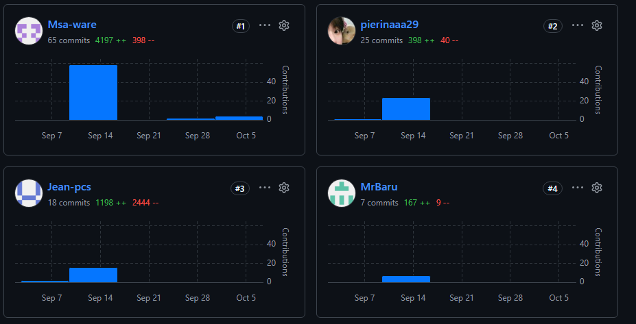

*Nota.* Captura de GitHub (2026).

*Descripción.* Aportes al repositorio del informe en el último mes, hasta el 5 de octubre de 2026, con la mayor parte de la actividad en la semana del 14 de septiembre. La captura muestra a los cuatro primeros aportantes por número de commits: Msa-ware con 65 commits (4,197 líneas añadidas y 398 eliminadas), pierinaaa29 con 25 (398 y 40), Jean-pcs con 18 (1,198 y 2,444) y MrBaru con 7 (167 y 9).

**Figura 6**

*Contributors Insights del repositorio del informe (AV2)*

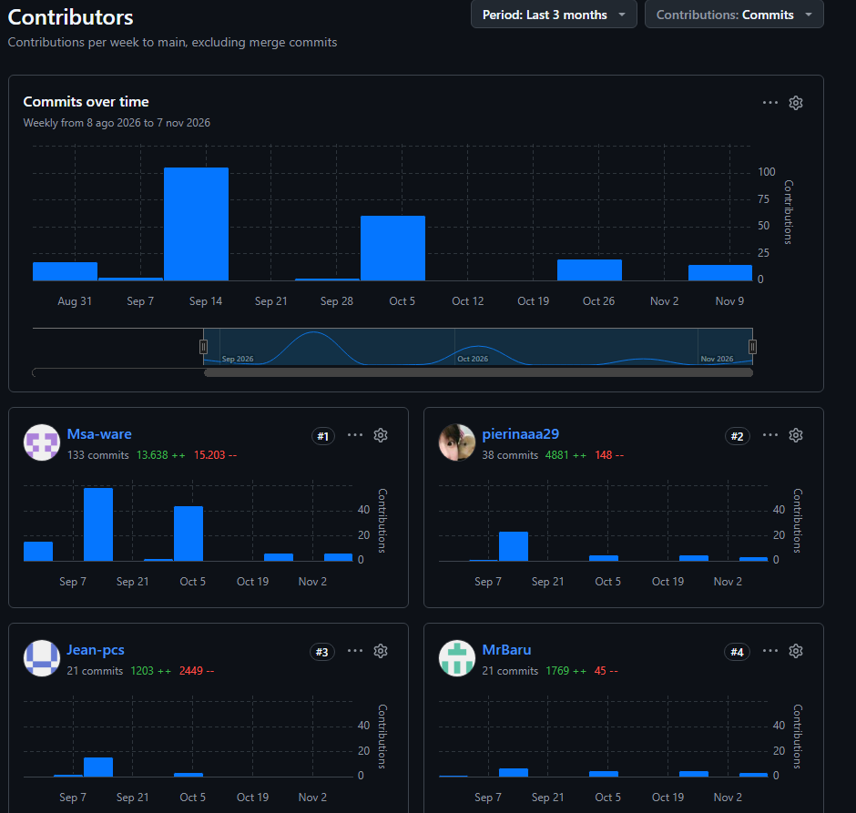

*Nota.* Captura de GitHub (2026).

*Descripción.* Aportes de los cuatro integrantes al repositorio del informe hasta el 12 de noviembre de 2026, con la actividad concentrada en la reorganización del informe a fines de octubre y en la documentación del Sprint 3 en noviembre, donde cada integrante registró los commits de las secciones a su cargo.

---

#### 2. Evidencias Individuales (Commits por Integrante)

A continuación, se detalla el progreso y la constancia de los *commits* realizados por cada miembro a lo largo del ciclo.

**Fernandez Seer, Mario Alonso**

**Figura 7**

*Commits de Fernandez Seer, Mario Alonso (AV1)*

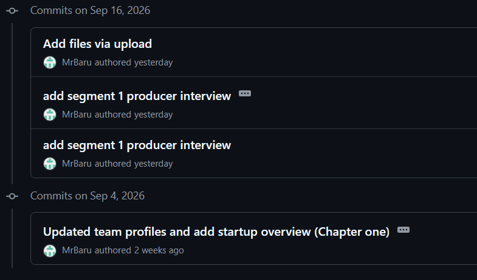

*Nota.* Captura de GitHub (2026).

*Descripción.* Historial de commits del 4 y el 16 de septiembre de 2026, con los mensajes «Updated team profiles and add startup overview (Chapter one)», «add segment 1 producer interview» (dos veces) y «Add files via upload».

**Figura 8**

*Commits de Fernandez Seer, Mario Alonso (TB1)*

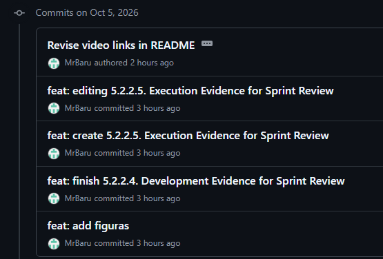

*Nota.* Captura de GitHub (2026).

*Descripción.* Historial de commits del 5 de octubre de 2026, con la creación y edición de la sección 5.2.2.5 (Execution Evidence), el cierre de la sección 5.2.2.4 (Development Evidence), la adición de figuras y la revisión de los enlaces de los videos en el README.

**Figura 9**

*Commits de Fernandez Seer, Mario Alonso (AV2)*

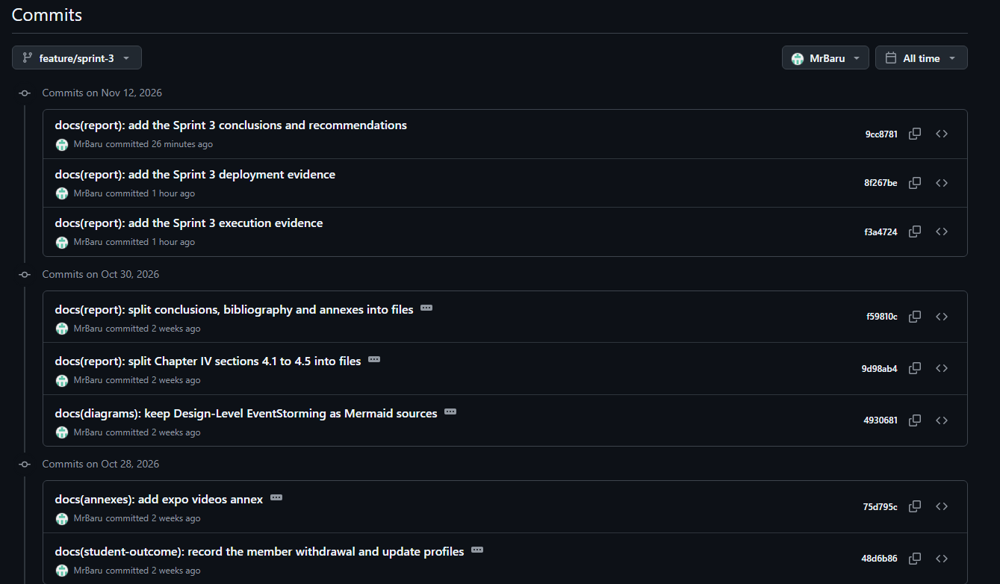

*Nota.* Captura de GitHub (2026).

*Descripción.* Historial de commits de la rama `feature/sprint-3`, con la evidencia de ejecución (5.2.3.5) y la evidencia de despliegue (5.2.3.7) del Sprint 3, cada una con sus capturas, y las conclusiones y recomendaciones del AV2.

**Santiago Atanacio, Jairo Mathias**

**Figura 10**

*Commits de Santiago Atanacio, Jairo Mathias (AV1)*

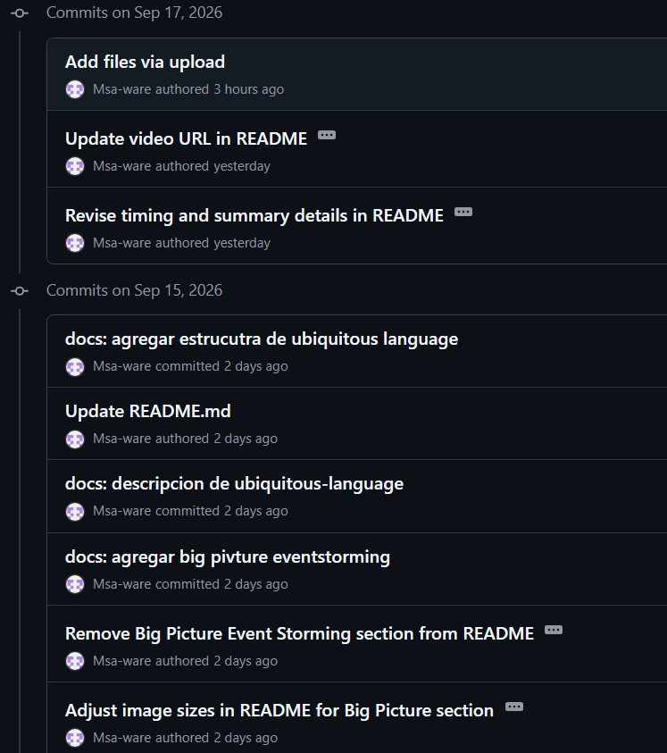

*Nota.* Captura de GitHub (2026).

*Descripción.* Historial de commits del 15 y el 17 de septiembre de 2026, con mensajes sobre el Big Picture EventStorming, la descripción del Ubiquitous Language, actualizaciones del README y de la URL del video.

**Figura 11**

*Commits de Santiago Atanacio, Jairo Mathias (TB1)*

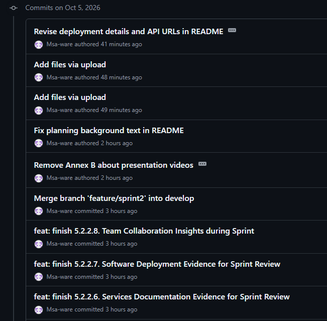

*Nota.* Captura de GitHub (2026).

*Descripción.* Historial de commits del 5 de octubre de 2026, con el cierre de las secciones 5.2.2.6, 5.2.2.7 y 5.2.2.8, la integración de la rama `feature/sprint2` en `develop`, el retiro del Anexo B, la corrección del texto de planificación, la carga de archivos y la revisión de los detalles de despliegue y de las URL de la API en el README.

**Figura 12**

*Commits de Santiago Atanacio, Jairo Mathias (AV2)*

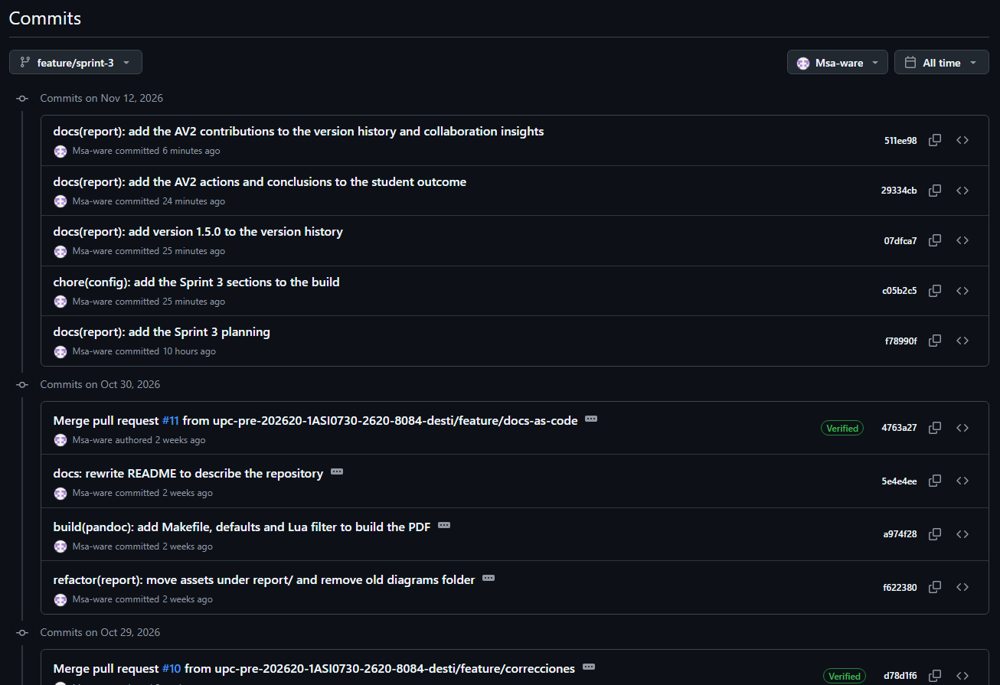

*Nota.* Captura de GitHub (2026).

*Descripción.* Historial de commits de las ramas `feature/docs-as-code` y `feature/sprint-3`, con la división del informe en archivos por capítulo, el Sprint Planning 3 (5.2.3.1), la configuración de compilación con las secciones del Sprint 3, el registro de versiones, las analíticas de colaboración y el Student Outcome del AV2.

**Almandroz Carbajal, Pierina Marysabel**

**Figura 13**

*Commits de Almandroz Carbajal, Pierina Marysabel (AV1)*

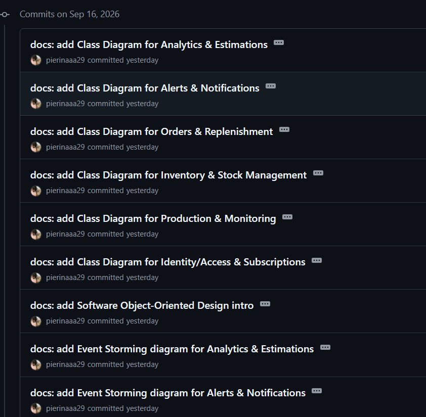

*Nota.* Captura de GitHub (2026).

*Descripción.* Historial de commits del 16 de septiembre de 2026, con los diagramas de clases de seis contextos del dominio, la introducción al diseño orientado a objetos y diagramas de Event Storming.

**Figura 14**

*Commits de Almandroz Carbajal, Pierina Marysabel (TB1)*

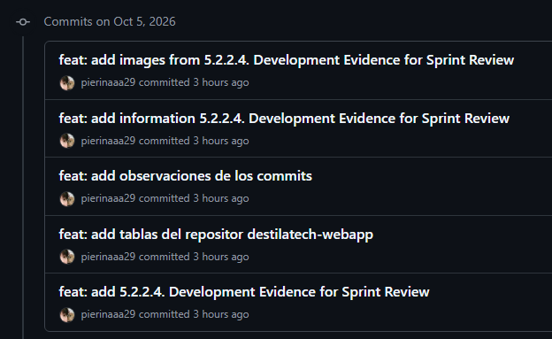

*Nota.* Captura de GitHub (2026).

*Descripción.* Historial de commits del 5 de octubre de 2026, con la creación de la sección 5.2.2.4 (Development Evidence), las tablas del repositorio destilatech-webapp, las observaciones de los commits y la información e imágenes de la sección.

**Figura 15**

*Commits de Almandroz Carbajal, Pierina Marysabel (AV2)*

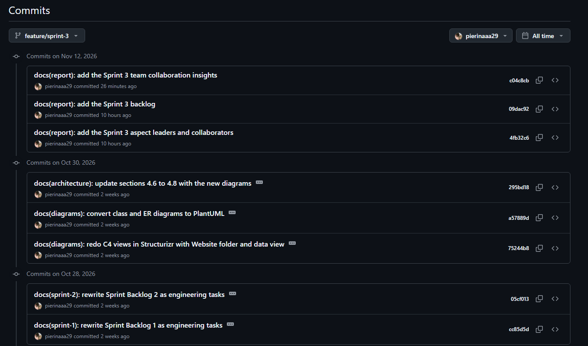

*Nota.* Captura de GitHub (2026).

*Descripción.* Historial de commits de la rama `feature/sprint-3`, con la matriz de líderes y colaboradores (5.2.3.2), el Sprint Backlog 3 con la captura del tablero (5.2.3.3) y las analíticas de colaboración del Sprint 3 con sus capturas de GitHub Insights (5.2.3.8).

**Condor Sandoval, Jean Pierre**

**Figura 16**

*Commits de Condor Sandoval, Jean Pierre (AV1)*

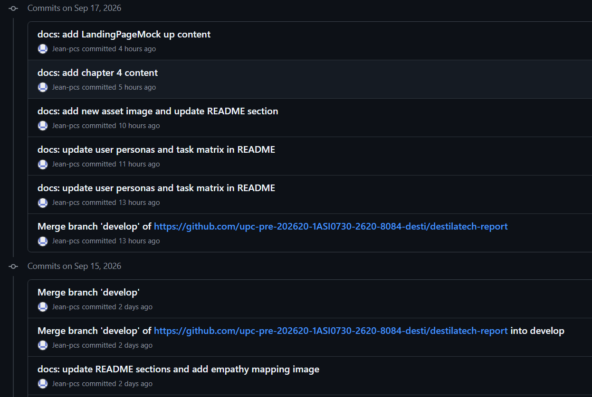

*Nota.* Captura de GitHub (2026).

*Descripción.* Historial de commits del 15 y el 17 de septiembre de 2026, con mensajes sobre el contenido del capítulo 4, el mock-up de la landing page, las User Personas, la User Task Matrix y el mapa de empatía, además de integraciones de la rama `develop`.

**Figura 17**

*Commits de Condor Sandoval, Jean Pierre (TB1)*

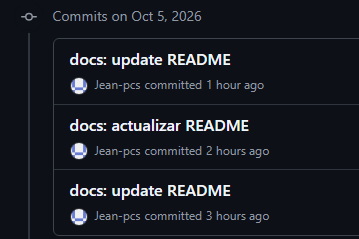

*Nota.* Captura de GitHub (2026).

*Descripción.* Historial de tres commits del 5 de octubre de 2026 con actualizaciones del README del informe.

**Figura 18**

*Commits de Condor Sandoval, Jean Pierre (AV2)*

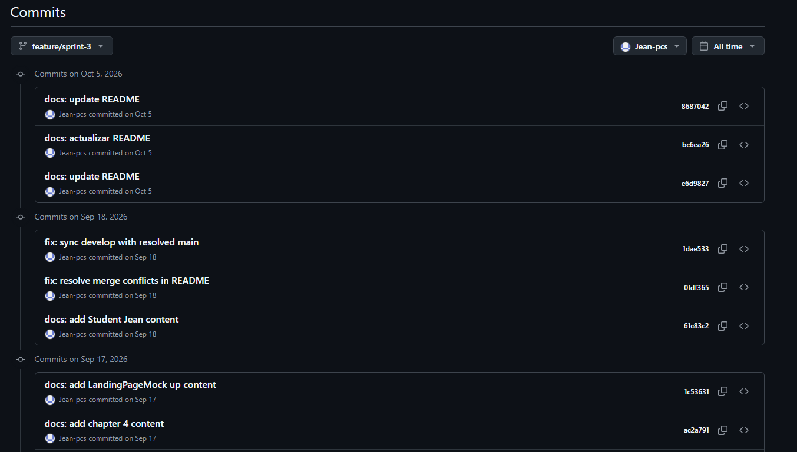

*Nota.* Captura de GitHub (2026).

*Descripción.* Historial de commits de la rama `feature/sprint-3`, con la visión general de la implementación (5.1), la evidencia de desarrollo del Sprint 3 con las tablas de commits y sus 18 capturas (5.2.3.4) y la documentación de los servicios (5.2.3.6).

**Domenack Angeles, Miguel**

**Figura 19**

*Commits de Domenack Angeles, Miguel (AV1)*

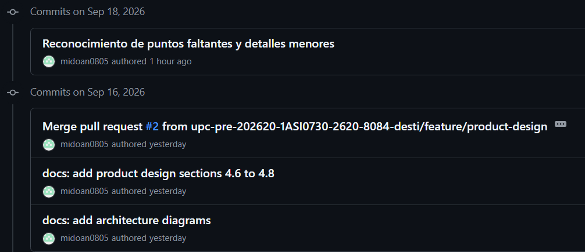

*Nota.* Captura de GitHub (2026).

*Descripción.* Historial de commits del 16 y el 18 de septiembre de 2026, con la integración de la Pull Request #2 de la rama `feature/product-design`, las secciones de diseño de producto, los diagramas de arquitectura y la revisión de detalles menores.

Para el TB1 y el AV2 no se incluyen capturas de commits de Domenack Angeles, Miguel, porque se retiró del equipo después del Sprint 1.

# Contenido
